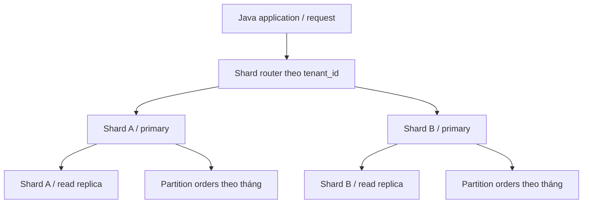
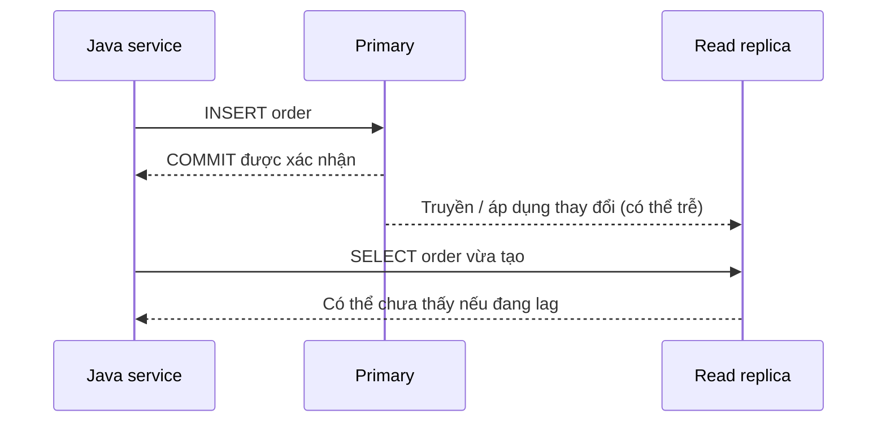
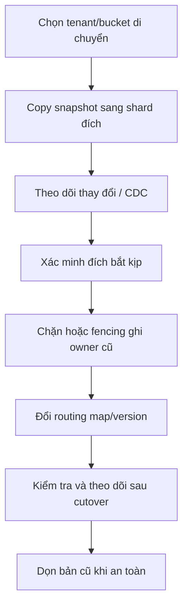

# Phân biệt replication, partitioning và sharding

Khi ứng dụng lưu trữ ngày càng nhiều dữ liệu và có nhiều request đồng thời, ba thuật ngữ **replication** (sao chép), **partitioning** (phân vùng) và **sharding** (phân mảnh dữ liệu trên nhiều đơn vị lưu trữ độc lập) thường xuất hiện cùng nhau. Chúng đều thay đổi cách bố trí dữ liệu, nhưng **giải quyết những câu hỏi khác nhau**:

- **Replication:** Một tập dữ liệu cần có **bao nhiêu bản sao**, nằm ở đâu, cập nhật và đồng bộ như thế nào?
- **Partitioning:** Một tập dữ liệu được **chia thành những phần nào** để lưu trữ, truy vấn và quản trị hiệu quả?
- **Sharding:** Dữ liệu được **phân phối đến những node/database độc lập nào**, và ứng dụng biết cách tìm đúng nơi chứa dữ liệu ra sao?

Bài thuộc chương **Nền tảng phân tán** của mô-đun **DATA_PERSISTENCE_FUNDAMENTALS**. Mô-đun cung cấp kiến thức về lưu trữ bền vững, mô hình dữ liệu, schema, truy vấn, chỉ mục, giao dịch, cô lập và kiểm soát đồng thời; đồng thời giúp người học thiết kế ranh giới persistence cho Java, xử lý lỗi kết nối, tiến hóa schema, bảo mật, sao lưu và hiệu năng. Ở đây, mục tiêu là **phân biệt cơ chế, nhận diện đánh đổi và chọn đúng kiến trúc**, thay vì xem mọi vấn đề tải lớn đều phải giải quyết bằng sharding.

Các ví dụ SQL chủ yếu dùng PostgreSQL. Những khái niệm về leader/replica, phân vùng và shard áp dụng rộng rãi, nhưng **cú pháp, ranh giới transaction, consistency và failover phụ thuộc DBMS, sản phẩm và cấu hình thực tế**.

## 1. Bảng so sánh nhanh: sao chép hay chia dữ liệu?

| Khía cạnh | Replication | Partitioning | Sharding |
|---|---|---|---|
| Câu hỏi chính | Có thêm bản sao để phục vụ sẵn sàng/đọc? | Chia tập dữ liệu thành các phần như thế nào? | Phần dữ liệu nào thuộc node/database nào? |
| Hành động cơ bản | **Sao chép** dữ liệu hoặc thay đổi dữ liệu | **Phân chia** hàng/cột/tập dữ liệu | **Phân phối** các phần sang đơn vị lưu trữ độc lập |
| Cùng một bản ghi xuất hiện ở đâu? | Có thể nằm ở **nhiều replica** | Theo thiết kế, hàng thường thuộc một partition logic | Theo shard key, hàng thường có một shard chủ sở hữu; shard đó có thể được replicate |
| Mục đích thường gặp | Khả dụng, khôi phục, phân tải đọc, phân bố địa lý | Quản lý dữ liệu lớn, pruning, retention, bảo trì và đôi khi song song hóa | Mở rộng dung lượng/ghi theo nhiều node, phân tán tải và giới hạn phạm vi sự cố |
| Điều **không** tự giải quyết | Tăng năng lực ghi của một leader; bảo đảm đọc mới nhất trên replica bất đồng bộ | Tự thêm node hay tổng năng lực phần cứng; mọi truy vấn đều nhanh hơn | Nhất quán nhiều shard; phân tán đều nếu shard key kém; failover tự động |
| Độ phức tạp đặc thù | Replication lag, promotion/failover, consistency, split brain | Chọn partition key, pruning, index/constraint, vòng đời partition | Routing, rebalance, hotspot, cross-shard join/transaction, global uniqueness |

**Sharding thường là một dạng horizontal partitioning phân tán**, nhưng không phải mọi partition đều là shard. Một bảng PostgreSQL chia thành 12 partition tháng trên **cùng một server** vẫn chỉ nằm trong một ranh giới hạ tầng. Ngược lại, một cụm có bốn database độc lập chứa các tập khách hàng khác nhau là sharding dù mỗi database không dùng tính năng `PARTITION BY`.

**Ba kỹ thuật có thể đồng thời tồn tại:** một hệ thống được shard theo tenant; mỗi shard có primary và một hoặc nhiều read replicas; trong từng shard, bảng lịch sử còn được partition theo tháng.

## 2. Trực giác bằng một ví dụ 100 triệu đơn hàng

Giả sử hệ thống có **100 triệu đơn hàng**. Các con số sau chỉ minh họa cách tổ chức, không phải cam kết khả năng xử lý hay cấu hình được khuyến nghị.

```text
Replication (3 bản sao cùng một dữ liệu logic):
  Primary:   100 triệu đơn ──> Replica A: 100 triệu đơn
                           `-> Replica B: 100 triệu đơn

Partitioning (12 tập theo tháng trên một database):
  orders_2026_01 | orders_2026_02 | ... | orders_2026_12
       mỗi hàng thuộc partition phù hợp với khóa ngày

Sharding (4 database/shard theo tenant_id):
  Shard 0: tập tenant A       Shard 1: tập tenant B
  Shard 2: tập tenant C       Shard 3: tập tenant D
       tổng các tập tạo thành dữ liệu logic của hệ thống
```

Trong replication, một bản sao được cập nhật từ bản khác theo cơ chế nhân bản; số bản sao tăng **không có nghĩa dữ liệu logic được chia nhỏ hơn**. Trong partitioning, toàn bộ hàng vẫn thuộc một bảng logic dù nằm ở nhiều partition vật lý. Trong sharding, các phần dữ liệu được quản lý bởi **nhiều đơn vị lưu trữ độc lập**, nên việc truy vấn toàn bộ dữ liệu thường phải đi qua nhiều shard hoặc một tầng điều phối.

Sơ đồ kết hợp một cách tổ chức có thể gặp:



Mũi tên ở sơ đồ thể hiện mối liên hệ kiến trúc: replica nhận dữ liệu qua cơ chế replication; partition là cấu trúc lưu trữ **bên trong từng shard**, không phải một server mới được tạo ra chỉ vì có thêm partition.

## 3. Replication: nhiều bản sao, không phải chia nhỏ dữ liệu logic

**Replication** duy trì một hoặc nhiều bản sao của dữ liệu hay những thay đổi dữ liệu ở nơi khác. Bản sao có thể dùng để phục vụ truy vấn đọc, hỗ trợ chuyển vai trò khi sự cố, giảm khoảng cách địa lý hoặc phục vụ một workload phụ trợ. Phạm vi nhân bản có thể là toàn bộ instance/database, bảng hoặc tập thay đổi được cấu hình, tùy sản phẩm và loại replication.

### 3.1. Leader–follower (primary–replica)

Mô hình quen thuộc có **một primary nhận ghi** và các replica áp dụng thay đổi từ primary:



Nếu replication **bất đồng bộ (asynchronous)**, primary có thể trả kết quả commit trước khi replica áp dụng thay đổi. Điều này tạo **replication lag**: một câu đọc trên replica có thể trả về trạng thái cũ dù thao tác ghi vào primary đã hoàn tất.

Nếu replication **đồng bộ (synchronous)**, xác nhận commit có thể chờ một hoặc nhiều mức ACK từ replica tùy chính sách, nhưng **không đồng nghĩa mọi replica đều đã phát dữ liệu mới cho mọi lượt đọc**, cũng không tự bảo đảm không bao giờ mất dữ liệu trong mọi dạng sự cố. Cần phân biệt ACK nhận log, flush log, apply log và quy tắc failover thực tế.

### 3.2. Replication vật lý và logic trong PostgreSQL

| Cơ chế | Ý tưởng | Điểm cần nhớ |
|---|---|---|
| **Physical/WAL streaming replication** | Replica áp dụng luồng thay đổi WAL để duy trì một bản sao của cụm PostgreSQL phù hợp | Phục vụ standby và failover; không phải tùy chọn tự do đặt các hàng của một bảng lên node khác nhau |
| **Logical replication** | Sao chép thay đổi logic của những bảng/tập publication được cấu hình | Hữu ích cho chọn lọc dữ liệu, tích hợp hoặc nâng cấp; yêu cầu chú ý schema, quyền, loại thao tác và xung đột |

Trong PostgreSQL, một **physical standby** thường phục vụ truy vấn đọc khi `hot_standby` được bật, còn ghi nghiệp vụ diễn ra ở primary. Với logical replication, subscriber không nên được hiểu là một read replica tương đương hoàn toàn với physical standby: có thể có phạm vi bảng khác nhau, độ trễ khác nhau và cách quản lý schema riêng. Quyền ghi trên subscriber và xử lý xung đột cũng cần thiết kế rõ.

### 3.3. Read-after-write và replica lag

Giả sử API `POST /orders` ghi đơn `id=500` vào primary và trả `201 Created`. Ngay sau đó, client gọi `GET /orders/500`, nhưng bộ cân bằng tải chuyển GET sang replica đang chậm 200 ms. Client nhận `404` dù đơn đã tồn tại trên primary.

Đây là vấn đề **tính nhất quán khi đọc**, không chứng minh rằng thao tác ghi thất bại. Những phương án thường dùng:

1. Đọc lại từ **primary** cho các yêu cầu vừa ghi cần *read-your-writes*.
2. Giữ các đọc liên quan đến một phiên trên primary trong một khoảng/thời điểm có kiểm soát; đánh đổi là tăng tải primary.
3. Chỉ chuyển đọc sang replica khi cơ chế đồng bộ theo **log position/LSN hoặc version** (nếu hệ hỗ trợ và được triển khai đúng) xác nhận nó đã bắt kịp mốc cần thiết.
4. Chấp nhận dữ liệu có độ trễ trong hợp đồng API cho các màn hình tổng hợp, báo cáo không đòi hỏi trạng thái ngay lập tức.

Đọc replica bất đồng bộ **không phải nơi có thẩm quyền để kết luận yêu cầu ghi không tồn tại** khi cần đối soát kết quả commit không rõ. Một kết quả rỗng có thể đơn giản vì replica chưa bắt kịp.

### 3.4. Failover không tự động đồng nghĩa không mất dữ liệu

Khi primary lỗi, hệ thống có thể **promote** một replica thành primary mới. Nếu replica đó chưa nhận hoặc chưa flush/apply toàn bộ dữ liệu được primary cũ xác nhận, có nguy cơ mất những ghi gần nhất, tùy cấu hình durability và replication. Với môi trường bất đồng bộ, phải đặt mục tiêu **RPO** (mức mất dữ liệu tối đa chấp nhận) và **RTO** (thời gian phục hồi) rõ ràng.

Ngoài ra cần cơ chế quyết định **node nào được quyền nhận ghi** và cách cô lập primary cũ khi mạng bị chia cắt. Nếu hai node cùng nhận ghi mà không có giao thức xử lý, có thể phát sinh *split brain*. Một cụm có nhiều replica nhưng không có fencing/routing/failover policy đáng tin cậy vẫn có thể ghi sai hoặc ghi vào node cũ sau chuyển vai trò.

### 3.5. Replication không phải backup

Nếu ứng dụng vô tình chạy `DELETE FROM orders`, câu xóa hợp lệ có thể được replicate sang các bản sao. Tương tự, dữ liệu bị sửa nhầm hoặc lỗ hổng bảo mật có thể được lan truyền. **Backup có lịch giữ bản, kiểm tra phục hồi, point-in-time recovery (PITR) và phạm vi bảo vệ riêng**; replication chủ yếu duy trì bản sao đang hoạt động, không thay thế chiến lược lưu trữ lịch sử phục hồi.

## 4. Partitioning: chia dữ liệu trong một cấu trúc logic

**Partitioning** chia một tập dữ liệu theo quy tắc để dễ lưu trữ, truy vấn hoặc quản trị. Với relational database, khái niệm phổ biến là **horizontal partitioning**: các partition có lược đồ tương tự và mỗi partition chứa một phần **hàng**. Một số bối cảnh cũng gọi việc tách theo nhóm **cột** là vertical partitioning, nhưng đó là bài toán tổ chức dữ liệu khác với việc chia hàng theo khóa.

Ví dụ bảng sự kiện lớn chia theo tháng giúp dễ loại bỏ dữ liệu cũ, giới hạn truy vấn theo thời gian và quản lý index riêng cho từng phần. Việc tạo partition **không tự sinh thêm database server**: nhiều DBMS hỗ trợ tất cả partition trên một instance hoặc trên cùng một hạ tầng lưu trữ.

### 4.1. Các cách phân vùng hàng thường gặp

| Phương pháp | Quy tắc chia | Phù hợp | Rủi ro |
|---|---|---|---|
| **Range** | `created_at` thuộc các khoảng ngày/tháng, `id` thuộc các khoảng số | Dữ liệu thời gian, retention, truy vấn có điều kiện khoảng | Partition mới phải được tạo đúng lúc; dữ liệu gần đây dồn vào partition nóng |
| **List** | `region IN ('VN','TH')`, loại dữ liệu, mã đơn vị | Tập giá trị rời rạc có ý nghĩa nghiệp vụ | Một giá trị phổ biến có thể chiếm quá nhiều dữ liệu; cần xử lý giá trị mới |
| **Hash** | Hàm băm của khóa ánh xạ tới partition | Phân bố tương đối đều với key đa dạng | Ít thuận tiện cho pruning theo khoảng hoặc loại bỏ dữ liệu cũ theo thời gian |
| **Composite/subpartition** | Kết hợp nhiều quy tắc, ví dụ range theo tháng rồi hash theo tenant | Khối lượng lớn với truy vấn đa dạng | Tăng số partition và chi phí quản trị |

**Partition key** là cột hoặc biểu thức dùng quyết định hàng thuộc partition nào. Nó ảnh hưởng trực tiếp đến **partition pruning**: khi truy vấn có điều kiện phù hợp, DB có thể bỏ qua những partition chắc chắn không chứa kết quả. Nếu truy vấn không lọc theo partition key hoặc dùng biểu thức cản trở pruning, DB có thể vẫn phải quét nhiều partition.

### 4.2. PostgreSQL: partition theo thời gian

Ví dụ dùng cú pháp declarative partitioning với khóa `occurred_at`. Trong PostgreSQL, một primary key/unique constraint khai báo trên partitioned parent phải đáp ứng yêu cầu bao gồm tất cả cột partition key theo quy tắc hệ thống; ví dụ này dùng khóa ghép `(event_id, occurred_at)`:

```sql
CREATE TABLE audit_events (
    event_id     BIGINT NOT NULL,
    tenant_id    BIGINT NOT NULL,
    occurred_at  TIMESTAMPTZ NOT NULL,
    event_type   TEXT NOT NULL,
    payload      JSONB NOT NULL,
    PRIMARY KEY (event_id, occurred_at)
) PARTITION BY RANGE (occurred_at);

CREATE TABLE audit_events_2026_11
    PARTITION OF audit_events
    FOR VALUES FROM ('2026-11-01 00:00:00+00')
             TO ('2026-12-01 00:00:00+00');

CREATE TABLE audit_events_2026_12
    PARTITION OF audit_events
    FOR VALUES FROM ('2026-12-01 00:00:00+00')
             TO ('2027-01-01 00:00:00+00');

CREATE INDEX idx_audit_events_tenant_time
    ON audit_events (tenant_id, occurred_at);
```

Truy vấn chọn một khoảng thời gian:

```sql
EXPLAIN
SELECT event_id, event_type
FROM audit_events
WHERE tenant_id = 42
  AND occurred_at >= TIMESTAMPTZ '2026-11-05 00:00:00+00'
  AND occurred_at <  TIMESTAMPTZ '2026-11-06 00:00:00+00';
```

Với partition bound trên, bộ tối ưu có cơ hội chỉ truy cập `audit_events_2026_11` vì partition tháng 12 không thể chứa hàng phù hợp. Cần **xem `EXPLAIN` trên dữ liệu và phiên bản thực tế**, không kết luận pruning chắc chắn chỉ từ sự hiện diện của `PARTITION BY`. Truy vấn không có điều kiện thời gian hoặc quét toàn lịch sử vẫn có thể cần nhiều partition.

**Lưu ý vận hành:** dữ liệu nằm ngoài các khoảng tháng hiện có sẽ không có partition đích và `INSERT` thất bại, trừ khi có partition khác hoặc default partition phù hợp. Production cần tự động tạo partition tương lai, xử lý late-arriving records, retention và kiểm tra schema/index của các partition.

### 4.3. Partition không làm mọi truy vấn nhanh hơn

- **Pruning chỉ hữu ích khi điều kiện lọc phù hợp:** partition theo `occurred_at` không tự tối ưu `WHERE email = ?` nếu không có chỉ mục/phương án tìm phù hợp.
- **Nhiều partition tạo overhead:** metadata, planner, index, DDL, thống kê và bảo trì có chi phí. Chia thành hàng chục nghìn partition nhỏ có thể kém hiệu quả hơn một số partition vừa phải.
- **Unique constraint và khóa ngoại có giới hạn:** đối với partitioned table, ràng buộc unique trên parent phụ thuộc partition key; không mặc định unique trên một cột bất kỳ được bảo đảm toàn cục nếu thiếu partition key.
- **Đổi partition key có thể chuyển hàng:** một `UPDATE` sửa giá trị khóa phân vùng có thể khiến hàng chuyển sang partition khác; cần kiểm tra khóa, trigger và chi phí liên quan.
- **Retention không phải chỉ `DELETE`:** drop/detach partition cũ có thể hiệu quả hơn xóa hàng loạt, nhưng vẫn cần cân nhắc khóa DDL, dữ liệu phụ thuộc và chính sách backup.

Partitioning là công cụ **tổ chức dữ liệu trong một database logic**. Nếu bottleneck nằm ở tổng năng lực ghi của một node, việc chia nhiều partition trên chính node đó không tự làm tài nguyên CPU, RAM hay I/O của node tăng lên.

## 5. Sharding: phân phối tập dữ liệu sang nhiều database độc lập

**Sharding** chia một tập dữ liệu logic thành nhiều tập con (shard) được phục vụ bởi các **đơn vị lưu trữ độc lập**. Trong kiểu phổ biến nhất, mỗi hàng được định tuyến tới một shard dựa trên **shard key**, chẳng hạn `tenant_id`, `customer_id` hoặc `account_id`. Các shard có thể chạy trên nhiều server/node, có vòng đời mở rộng, bảo trì và sự cố riêng.

Ví dụ với hệ thống SaaS có 100.000 tenant:

```text
Request: tenant_id = 42
             |
             v
      [Shard router]
        |   |   |   |
        v   v   v   v
      DB0 DB1 DB2 DB3

   Mỗi tenant có shard chủ sở hữu được xác định.
   Dữ liệu của tenant 42 thường nằm cùng một shard.
```

Một bảng logic `orders` vẫn có thể tồn tại với schema tương tự trên các shard, nhưng **không có một transaction SQL thông thường bao trùm tất cả shard** nếu mỗi shard là một database độc lập. Ứng dụng hoặc tầng database phân tán phải đảm nhiệm routing, query decomposition và giao thức phối hợp khi cần.

### 5.1. Sharding làm tăng loại năng lực nào?

Khi mỗi shard có tài nguyên xử lý/đĩa riêng và tải được phân bố hợp lý, sharding có thể:

- Phân chia tổng dung lượng dữ liệu và index qua nhiều node.
- Chia lưu lượng đọc **và ghi** theo shard key, tránh mọi ghi dồn vào một primary duy nhất.
- Giới hạn nhiều tác vụ bảo trì hoặc sự cố trong một nhóm dữ liệu, nếu failover và phụ thuộc chung đã được thiết kế phù hợp.
- Cho phép mở rộng từng nhóm dữ liệu khác nhau khi nhu cầu thay đổi.

Nhưng sharding **không đảm bảo** thông lượng tăng tuyến tính theo số node. Một tenant lớn có thể chiếm phần lớn I/O của một shard; mọi query cross-shard, điều phối global transaction hoặc service metadata trung tâm cũng có thể trở thành nút thắt. Hạ tầng chung như mạng, proxy, message broker và cache vẫn có thể là *single point of failure* nếu không được thiết kế riêng.

### 5.2. Chọn shard key: quyết định kiến trúc khó đổi

Một shard key tốt thường đạt nhiều mục tiêu đồng thời:

1. **Phù hợp với truy cập chủ đạo:** nhiều truy vấn có sẵn khóa định tuyến, ví dụ `tenant_id` xuất hiện trong hầu hết thao tác nghiệp vụ.
2. **Phân bố tải tương đối đều:** không có một vài giá trị cực nóng gây nghẽn một node; phải xét cả **số byte, QPS và số ghi**, không chỉ đếm hàng.
3. **Ổn định:** giá trị khóa không thường xuyên bị đổi; di chuyển hàng giữa shard làm transaction và routing phức tạp.
4. **Giữ tính cục bộ nghiệp vụ:** các hàng cần join, khóa hoặc commit cùng nhau nên nằm trên một shard khi khả thi.
5. **Có phương án mở rộng:** không gắn cứng toàn bộ routing vào số physical node hiện tại nếu dự kiến tăng node.

| Shard key | Điểm mạnh | Rủi ro cần đánh giá |
|---|---|---|
| `tenant_id` | Giữ dữ liệu mỗi tenant gần nhau; phần lớn nghiệp vụ nội bộ một tenant nằm trong một shard | Một tenant lớn (*whale tenant*) có thể gây hotspot; không phù hợp với mọi truy vấn xuyên tenant |
| `customer_id` | Thường phù hợp dữ liệu của từng khách | Các nghiệp vụ giữa khách hoặc phân tích toàn hệ cần phối hợp nhiều shard |
| `order_id` | Dễ tìm từng đơn khi order ID có thể route được | Khó gom tất cả đơn cùng tenant hoặc khách hàng vào một transaction/shard |
| Dãy thời gian hoặc `created_at` | Thuận quản lý dữ liệu theo khoảng | Tải ghi mới thường đổ vào shard hiện tại; tương tự hotspot thời gian |
| Hash của khóa ổn định | Phân tán tốt khi dữ liệu và lưu lượng key đa dạng | Query theo khoảng/nhóm mất tính cục bộ; không chữa được một khóa đơn lẻ cực nóng |

Đừng chọn shard key chỉ dựa vào phân phối hiện tại. Hãy mô phỏng khi **tenant phát triển không đều, workload thay đổi, cần chuyển vùng dữ liệu hoặc phải đáp ứng ràng buộc lưu trữ theo khu vực pháp lý**. Chọn khóa không thể thay đổi dễ dàng hơn việc bổ sung một index.

## 6. Các chiến lược ánh xạ khóa đến shard

### 6.1. Range-based sharding

Ví dụ `customer_id` từ `1–999999` thuộc shard A, `1000000–1999999` thuộc shard B. Ưu điểm là tìm theo khoảng dễ hơn và dữ liệu có quan hệ thứ tự được giữ gần nhau. Nhược điểm là các khoảng có thể tăng trưởng hoặc nhận tải không đều, và việc phân tách/di chuyển khoảng có thể khó.

### 6.2. Hash-based sharding

Một hàm băm ổn định biến khóa thành số, rồi ánh xạ sang shard/bucket. Cách này thường giảm thiên lệch khi nhiều khóa độc lập có tần suất tương tự. Tuy nhiên, **băm không chia được một khóa nóng đơn lẻ**: toàn bộ ghi của tenant quá lớn vẫn tới cùng điểm sở hữu nếu không tách riêng tenant đó.

**Ví dụ tối giản nhưng nguy hiểm khi mở rộng:**

```text
shard = hash(tenant_id) % number_of_physical_shards
```

Nếu `number_of_physical_shards` đổi từ 4 lên 5, **nhiều khóa đổi shard dù bản thân dữ liệu chưa được chuyển**. Một ứng dụng triển khai công thức mới trước khi di chuyển dữ liệu có thể đọc nhầm shard, trả kết quả rỗng hoặc ghi sai nơi.

### 6.3. Virtual buckets và bảng ánh xạ

Một mô hình linh hoạt hơn tách **khóa → bucket logic** khỏi **bucket → physical shard**:

```text
tenant_id
   |
   v
hash(tenant_id) -> bucket 0..15  [ổn định]
                      |
                      v
             bucket ownership map
               0..3   -> DB-A
               4..7   -> DB-B
               8..11  -> DB-C
               12..15 -> DB-D
```

Khi thêm shard E, hệ thống có thể di chuyển **một số bucket** sang E và cập nhật bảng sở hữu bucket **sau quy trình chuyển dữ liệu**. Trong thực tế nên có nhiều virtual buckets hơn ví dụ 16 để tăng độ linh hoạt, nhưng số bucket cũng tạo chi phí metadata và vận hành. Các cách khác gồm consistent hashing hoặc một directory ánh xạ `tenant_id` tới shard được quản lý trực tiếp.

**Bucket map là dữ liệu điều khiển quan trọng.** Ứng dụng phải biết phiên bản map, quản lý cache và cập nhật có kiểm soát; nếu hai instance đang dùng hai phiên bản và cùng ghi, có thể xảy ra split-brain theo routing. Di chuyển bucket phải phối hợp với chặn/đóng băng ghi hoặc cơ chế CDC/dual-write an toàn có fencing, không chỉ sửa một dòng cấu hình.

## 7. Ranh giới persistence trong Java: định tuyến đúng shard

Một abstraction đơn giản là `ShardRouter`: từ tenant ID, tìm bucket rồi tìm `DataSource` quản lý bucket đó. Repository sử dụng **đúng datasource cho toàn bộ transaction của tenant**. Không để domain service phải tự đoán shard bằng tên server hoặc sao chép công thức routing ở nhiều nơi.

Ở mỗi shard, ta có thể tạo **cùng schema** nhưng mỗi database chỉ chứa những tenant do shard đó sở hữu:

```sql
CREATE TABLE orders (
    tenant_id BIGINT NOT NULL,
    order_id BIGINT NOT NULL,
    status TEXT NOT NULL,
    PRIMARY KEY (tenant_id, order_id)
);
```

Ví dụ Java minh họa logic phân phối (không phải framework sharding hoàn chỉnh):

```java
import java.sql.Connection;
import java.sql.PreparedStatement;
import java.sql.ResultSet;
import java.sql.SQLException;
import java.util.Map;
import javax.sql.DataSource;

public final class ShardRouter {
    private static final int VIRTUAL_BUCKETS = 16; // Chỉ để minh họa.
    private final Map<Integer, DataSource> bucketOwners;

    public ShardRouter(Map<Integer, DataSource> bucketOwners) {
        // Production: validate đủ bucket 0..15, immutable map và version.
        this.bucketOwners = Map.copyOf(bucketOwners);
    }

    public DataSource forTenant(long tenantId) {
        // Một hàm ổn định chỉ dùng để minh họa bucket routing.
        int hash = Long.hashCode(tenantId);
        int bucket = Math.floorMod(hash, VIRTUAL_BUCKETS);
        DataSource owner = bucketOwners.get(bucket);
        if (owner == null) {
            throw new IllegalStateException("Unassigned shard bucket: " + bucket);
        }
        return owner;
    }
}

final class ShardedOrderReader {
    private final ShardRouter router;

    public ShardedOrderReader(ShardRouter router) {
        this.router = router;
    }

    public String findStatus(long tenantId, long orderId) throws SQLException {
        String sql = """
                SELECT status
                FROM orders
                WHERE tenant_id = ? AND order_id = ?
                """;

        try (Connection connection = router.forTenant(tenantId).getConnection();
             PreparedStatement query = connection.prepareStatement(sql)) {
            query.setLong(1, tenantId);
            query.setLong(2, orderId);
            try (ResultSet result = query.executeQuery()) {
                return result.next() ? result.getString("status") : null;
            }
        }
    }
}
```

Mã trên minh họa **khóa định tuyến** và vòng đời connection. `Map<Integer, DataSource>` phải được dựng từ cấu hình sở hữu bucket được quản lý chung; ở môi trường thật cần kiểm tra version của routing map, timeout, failover và thời điểm đổi owner. `ShardedOrderReader` là lớp phụ trong cùng đoạn mã minh họa; trong dự án thật có thể đặt nó trong file riêng. Hàm `Long.hashCode` đủ để mô tả nguyên lý nhưng **không được xem là hàm phân phối cân bằng hoàn hảo** cho mọi kiểu tenant ID/workload; chọn và kiểm chứng hàm băm phù hợp trước production.

`tenantId` trong request còn là **ranh giới bảo mật**: phải được xác minh từ identity/authorization của caller, không chấp nhận một ID tùy ý rồi đọc dữ liệu tenant khác. Truy vấn vẫn đặt `WHERE tenant_id = ?` dù đã route đúng shard để tránh nhầm dữ liệu và hỗ trợ chính sách phân tách tenant. Nếu tenant được di chuyển, một lần đọc từ map cũ có thể trỏ sang nơi không còn có quyền sở hữu; cần cơ chế từ chối/redirect và retry theo routing version đáng tin cậy.

### 7.1. Gắn transaction với shard nào?

Trong Spring JDBC hoặc JPA, transaction manager thường quản lý **một datasource hoặc resource context cụ thể**. Một use-case chỉ tác động tenant 42 có thể được bảo vệ bởi local transaction của shard chứa tenant 42. Nhưng hai lời gọi repository tự chọn **hai shard khác nhau** trong cùng method `@Transactional` không tự trở thành một atomic transaction xuyên hai DB.

Nếu dùng `AbstractRoutingDataSource`, hãy xác định routing key **trước khi connection đầu tiên được lấy** và giữ nhất quán trong toàn transaction. Đổi routing context giữa transaction không có nghĩa Spring sẽ tự chuyển connection đang gắn với transaction sang shard khác. ThreadLocal routing context cũng không tự truyền sang `@Async`, executor hoặc reactive pipeline; cần làm rõ ngữ nghĩa ngữ cảnh và dọn nó sau mỗi request.

**Không giả định** annotation `@Transactional` là cơ chế phân tán giao dịch. Nếu nghiệp vụ thật sự cần update nhiều shard cùng thành công hoặc cùng thất bại, phải đánh giá giao thức transaction phân tán được các resource hỗ trợ, hoặc thiết kế saga/eventual consistency/compensation với idempotency và đối soát.

## 8. Truy vấn và constraint khi dữ liệu nằm ở nhiều shard

Trong một database duy nhất, một câu `JOIN` hoặc `UNIQUE` có thể được DB thực thi theo phạm vi bảng. Sau sharding, phạm vi đó thay đổi:

| Nhu cầu | Với dữ liệu trên một shard | Với dữ liệu trên nhiều shard |
|---|---|---|
| Tìm một đơn theo `tenant_id, order_id` | Truy vấn trực tiếp vào shard đã biết | Router phải xác định đúng shard, thường không cần quét toàn cụm |
| Thống kê mọi tenant | Aggregation local | Scatter–gather hoặc hệ phân tích riêng, chịu chi phí mạng và sự không đồng bộ |
| Join dữ liệu khách/đơn | Join local nếu cùng shard | Join phân tán, denormalization, lookup service hoặc pipeline ETL |
| `UNIQUE (email)` toàn hệ | Constraint trên một DB | Unique local **không ngăn** email trùng trên hai shard; cần registry/authority toàn cục hoặc đổi yêu cầu |
| Foreign key | Có thể kiểm tra trong cùng database | FK cross-shard thường không tự được local DB bảo đảm |
| Transaction nhiều bảng | Một local transaction | Nếu hai bảng nằm ở hai shard, cần phối hợp hoặc đổi cách bố trí dữ liệu |
| `ORDER BY ... LIMIT` toàn hệ | Một query planner | Cần lấy dữ liệu từ nhiều shard, merge/sort và giải quyết snapshot khác thời điểm |

Một UUID hay ID phân tán có thể làm xác suất đụng ID rất nhỏ, nhưng **không tự tạo unique constraint toàn hệ giữa các shard**. Nếu business yêu cầu tính duy nhất tuyệt đối của email, mã vé hoặc tài khoản, phải có một **nguồn cấp phát/kiểm tra có thẩm quyền** và xử lý race condition, hoặc thiết kế shard key sao cho các giá trị cần unique nằm cùng phạm vi local constraint.

### 8.1. Co-locate dữ liệu để giữ transaction local

Nếu `orders`, `order_items` và `payments` thường được cập nhật cùng nhau, có thể đặt chúng trên **cùng shard theo `tenant_id`**. Khi đó transaction của một đơn hàng có thể dùng FK/constraint và commit local, miễn mọi bảng liên quan thực sự cùng database và không phát sinh thao tác ngoài phạm vi đó. Ngược lại, nếu `customers` được shard theo `customer_id` nhưng `orders` theo `order_id` không mang theo owner, một use-case tạo đơn có thể phải gọi nhiều shard cho mỗi transaction.

Thiết kế sharding nên bắt đầu từ **đường đi của các use-case**, không chỉ từ kích thước bảng. Chi phí di chuyển dữ liệu có thể cao, nhưng chi phí transaction hoặc join xuyên shard liên tục có thể còn lớn hơn.

### 8.2. Query toàn cụm và phân tích dữ liệu

Các dashboard thống kê tổng doanh thu của mọi tenant có thể dùng truy vấn fan-out tới nhiều shard, sau đó tổng hợp. Tuy nhiên, từng shard có thể trả dữ liệu ở thời điểm khác nhau, một shard có thể timeout, và top-N toàn cụm đòi hỏi chiến lược merge có thứ tự.

Nếu nhu cầu analytics toàn hệ lớn, thường hợp lý hơn khi **đẩy dữ liệu qua CDC/event hoặc batch ETL** tới một hệ thống phân tích chuyên dụng, với hợp đồng về độ trễ và khả năng tái dựng. Không biến từng request giao diện thành hàng chục truy vấn cross-shard không giới hạn.

## 9. Transaction và nhất quán: khác biệt lớn nhất sau sharding

Giả sử chuyển 500.000 đồng từ tài khoản A trên shard 1 sang B trên shard 2. Mỗi shard có một transaction riêng:

```text
Shard 1: trừ A 500.000 -> COMMIT thành công
             |
             | Mất kết nối / shard 2 không khả dụng
             v
Shard 2: cộng B 500.000 -> chưa commit
```

Hai local transactions không tự hình thành một transaction ACID toàn cụm. Nếu chỉ catch exception và gọi `ROLLBACK` trên shard 1 **sau khi nó đã commit**, thao tác đó không thể hoàn tác khoản trừ. Đây là bài toán nhất quán phân tán, không được giải quyết bằng việc tăng isolation trên một shard.

Các hướng tiếp cận cần cân nhắc theo nghiệp vụ:

| Giải pháp | Khi phù hợp | Giới hạn cần hiểu |
|---|---|---|
| **Giữ dữ liệu cùng shard** | Các bước phải atomic và thường cùng `tenant_id`/aggregate | Không giải quyết nghiệp vụ thật sự xuyên shard |
| **Local transaction + outbox/event** | Chấp nhận bước tiếp theo xử lý bất đồng bộ | Delivery có thể lặp; consumer cần idempotency và trạng thái trung gian |
| **Saga / compensation** | Quy trình gồm nhiều bước có thể bù trừ hợp lệ | Bù trừ không phải rollback nguyên tử; cần xử lý lỗi bù trừ |
| **Distributed transaction / 2PC** | Các resource manager thực sự hỗ trợ và chi phí chấp nhận được | Phức tạp, có trạng thái in-doubt, yêu cầu coordinator và recovery |
| **Ledger và trạng thái chuyển tiền theo giao thức riêng** | Nghiệp vụ tài chính cần audit/đối soát | Cần thiết kế bất biến liên shard, không thể chỉ cập nhật hai số dư tùy ý |

Ví dụ mô hình saga có thể ghi `TransferRequested` và một bút toán giữ tiền ở shard nguồn, phát thông điệp có operation ID ổn định, rồi ghi nhận phía đích. Nếu phía đích thất bại, hệ thống giữ trạng thái `PENDING` để retry hoặc xử lý bù trừ theo chính sách. **Đừng tự xem hoàn tiền/chuyển tiền ngược là thao tác dễ dàng và luôn thành công**: với tài chính, nghiệp vụ cần giao thức sổ cái, idempotency, đối soát và xác minh đủ bằng chứng.

Ngay cả với một shard, nếu thao tác phải gửi sự kiện sang broker thì **dual write** vẫn tồn tại. Sharding chỉ làm số ranh giới độc lập có thể tăng thêm. Một outbox đặt cùng local transaction với business data trên **mỗi shard** và dispatcher tương ứng có thể là nền tảng; consumer cần xử lý message lặp, sai thứ tự hoặc đến muộn.

### 9.1. Isolation của mỗi shard không phải isolation toàn cụm

Một transaction ở mức `SERIALIZABLE` trên shard A và transaction ở mức `SERIALIZABLE` trên shard B **không tự bảo đảm** kết quả nghiệp vụ liên shard có thể tuần tự hóa toàn cục. Mức cô lập do mỗi DB cung cấp chỉ áp dụng cho các resource mà nó quản lý. Hệ phân tán chuyên dụng có thể hỗ trợ giao thức global transaction, nhưng phải kiểm tra chính xác hợp đồng của sản phẩm.

Tương tự, việc đọc hai shard tại hai thời điểm khác nhau có thể tạo bản báo cáo không tương ứng với **một snapshot toàn cụm**. Nếu cần số liệu đối soát chính xác, phải xác định snapshot/version/LSN hoặc cơ chế chốt dữ liệu theo sản phẩm và ứng dụng; không dùng tổng của hai snapshot ngẫu nhiên rồi mặc định nhất quán.

## 10. Rebalancing và resharding: di chuyển dữ liệu mà vẫn phục vụ request

Khi thêm node hoặc tenant phát triển quá lớn, một số bucket/tenant có thể cần được **chuyển từ shard cũ sang shard mới**. Đây không chỉ là thao tác `COPY` dữ liệu: trong lúc copy, request vẫn có thể tiếp tục cập nhật và xóa hàng. Nếu đổi router trước khi dữ liệu mới bắt kịp, người dùng có thể thấy dữ liệu thiếu; nếu hai nơi cùng nhận ghi, có thể xuất hiện hai phiên bản khác nhau.

Một quy trình có kiểm soát thường bao gồm:

1. **Lập kế hoạch:** xác định bucket/tenant cần di chuyển, lượng dữ liệu, lưu lượng và những quan hệ phụ thuộc; ước tính thời gian, dung lượng và ảnh hưởng đến pool.
2. **Tạo shard đích và schema:** áp dụng migration/constraint/index tương thích, cấu hình backup/monitoring và xác minh quyền truy cập. Không copy dữ liệu nhạy cảm sang vùng không được phép.
3. **Sao chép snapshot ban đầu:** copy dữ liệu thuộc phạm vi cần chuyển và kiểm tra số lượng, checksum/đối soát các tập con có ý nghĩa.
4. **Bắt kịp các thay đổi:** dùng CDC, log hoặc cơ chế sao chép có thứ tự để áp dụng các ghi phát sinh từ thời điểm snapshot; không coi một lần copy là đủ trong khi writer vẫn hoạt động.
5. **Cutover có fencing:** xác định thời điểm node cũ ngừng chấp nhận ghi hoặc đảm bảo một owner duy nhất; đợi đích bắt kịp, cập nhật routing map theo version và bảo đảm các instance không tiếp tục dùng map cũ để ghi sai.
6. **Theo dõi sau chuyển:** so sánh dữ liệu và kết quả truy vấn, kiểm tra độ trễ, lỗi định tuyến, duplicate/unique conflicts, rồi mới quyết định dọn bản dữ liệu cũ theo retention và rollback policy.



**Fencing** quan trọng vì một request cũ có thể đã tra bảng routing trước cutover nhưng chỉ bắt đầu ghi sau khi quyền sở hữu chuyển. Một hệ thống chỉ phát cấu hình mới rồi hy vọng mọi tiến trình nhận ngay là chưa đủ cho yêu cầu ghi chính xác. Có thể dùng generation/epoch trong các thao tác ghi, khóa quyền sở hữu hoặc dịch vụ điều phối phù hợp với kiến trúc. Các hệ sharding được quản lý có thể cung cấp sẵn phần này; ứng dụng phải hiểu hợp đồng và giới hạn của chúng.

### 10.1. Vì sao hash trực tiếp theo số node gây khó khi mở rộng?

Với công thức `hash(key) % N`, thay `N=4` thành `N=5` khiến nhiều khóa ánh xạ sang node khác. Khi dùng **virtual buckets** có số lượng logic ổn định, có thể chuyển từng bucket và chỉ thay `bucket_owner[b]`, giảm mức phân bố lại ngoài ý muốn. Nhưng **data migration vẫn bắt buộc**: một routing map mới không làm hàng dữ liệu tự di chuyển sang server mới.

### 10.2. Hot shard khác với thiếu dung lượng toàn hệ

Một cụm bốn shard có thể còn nhiều CPU tổng nhưng shard của tenant lớn đã quá tải. Chỉ thêm một shard rỗng và chia những tenant nhỏ khác đi **không giảm** tải của tenant lớn nếu toàn bộ hoạt động của tenant đó vẫn ở một shard. Các lựa chọn gồm chuyển tenant lớn sang node riêng mạnh hơn, tách dữ liệu/tác vụ theo một khóa mới nếu nghiệp vụ cho phép, cache/điều chỉnh truy vấn hoặc dùng queue giới hạn ghi. Việc tách một tenant qua nhiều shard lại làm tăng chi phí transaction và join nội bộ tenant.

## 11. Kết hợp cả ba kỹ thuật trong một hệ thống

Một kiến trúc SaaS quy mô lớn có thể dùng cả ba tầng:

```text
Java service
   |
   v
Shard routing theo tenant_id
   |
   +-- Shard A (PostgreSQL primary) ----replicate----> Replica A1
   |      +-- orders_2026_11 (partition)
   |      +-- orders_2026_12 (partition)
   |
   +-- Shard B (PostgreSQL primary) ----replicate----> Replica B1
          +-- orders_2026_11 (partition)
          +-- orders_2026_12 (partition)
```

Vai trò từng tầng:

- **Sharding theo tenant:** xác định shard owner cho thao tác đọc/ghi, phân phối tổng dữ liệu và tải qua các primary độc lập.
- **Partitioning theo thời gian bên trong mỗi shard:** giúp truy vấn theo tháng pruning và thực thi retention/maintenance theo nhóm dữ liệu.
- **Replication của từng shard:** tạo thêm bản sao, hỗ trợ read scaling và quy trình failover riêng cho shard đó.

Lúc này một request tạo order cho tenant 42 cần **route tới shard có quyền ghi**, chọn đúng bảng logic `orders` và để DB tự xác định partition theo `created_at`; nó không cần biết tên partition cụ thể nếu schema và quyền truy cập được thiết kế đúng. Sau commit, nếu một request cần read-your-writes, hãy xét lag của **replica thuộc chính shard đó**, không dùng read replica bất kỳ trên toàn cụm.

Lưu ý khả năng **chịu lỗi không đơn giản cộng dồn**: nếu router/metadata service hỏng, nhiều shard khỏe vẫn có thể không nhận request; nếu failover của một shard thực hiện sai, nó có thể ảnh hưởng dữ liệu của tenant thuộc shard đó. Cần bảo vệ control plane và kiểm chứng recovery cho từng tầng.

## 12. Chọn cơ chế theo triệu chứng, không theo trào lưu

| Triệu chứng thực tế | Bước đầu nên xem xét | Vì sao chưa cần vội sharding |
|---|---|---|
| Báo cáo theo tháng chậm trên bảng lịch sử rất lớn | Index, execution plan, **range partitioning** và pruning | Có thể bottleneck do scan/retention trên một bảng, chưa phải tổng năng lực ghi |
| Nhiều truy vấn đọc làm primary CPU cao, ghi còn nhẹ | Cache, tuning truy vấn, **read replica** khi chấp nhận lag | Replication có thể chia tải đọc mà không phân phối schema sang nhiều DB |
| Cần phục hồi khi server primary hỏng | Replication + failover/fencing + backup/PITR | Sharding tự nó không tạo standby hoặc backup |
| Ghi của nhiều tenant độc lập vượt năng lực một primary | Tối ưu DB/SQL trước; sau đó xem xét **sharding theo tenant** | Cần số liệu bottleneck và phương án routing/cross-shard transaction |
| Một tenant chiếm hầu hết write QPS | Tenant-dedicated node, tối ưu truy cập, xử lý hotspot | Hash sharding theo tenant vẫn đặt tenant đó vào một shard |
| Cần unique email toàn hệ và transaction liên khách | Central registry/authority hoặc xem lại ranh giới dữ liệu | Sharding có thể làm ràng buộc toàn cục khó hơn |
| Cần đọc ngay dữ liệu vừa ghi nhưng replica hay trả cũ | Đọc primary/read-your-writes, version/LSN coordination | Thêm replica có thể tăng khả năng đọc cũ nếu routing không phù hợp |
| Lưu dữ liệu đủ năm và xóa theo từng tháng | Partition và retention policy | Sharding không thay thế quy trình tạo/detach/drop partition |

Một lộ trình thực tế thường là **đo tải → tối ưu schema/index/SQL/transaction → quản lý retention/partition → thêm replication cho read/availability khi phù hợp → chỉ shard khi bottleneck và mô hình truy cập thực sự đòi hỏi**. Đây không phải thứ tự bắt buộc cho mọi hệ thống, nhưng giúp tránh đưa độ phức tạp phân tán vào một vấn đề có thể giải quyết ở mức truy vấn hoặc vận hành.

## 13. Các tình huống lỗi thường bị hiểu nhầm

| Hiện tượng | Nguyên nhân có thể | Hành động đúng |
|---|---|---|
| `INSERT` vào bảng partitioned bị lỗi "no partition" | Chưa tạo partition bao phủ giá trị khóa | Tạo partition đúng bound/chính sách dữ liệu; không đổ lỗi cho replication |
| `POST` thành công nhưng đọc từ replica chưa thấy | Replication lag | Đọc primary khi cần read-your-writes, hoặc đợi replica bắt kịp mốc ghi |
| Shard mới thêm nhưng query trả rỗng | Đổi routing trước khi copy/catchup dữ liệu hoặc cache map cũ | Kiểm tra owner/version, đối soát và cơ chế chuyển shard; không tự tạo bản ghi bù từ kết quả rỗng |
| Việc tạo tài khoản trùng mã trên hai shard đều thành công | Unique constraint chỉ local | Thiết kế registry toàn cục hoặc thay đổi phạm vi unique |
| Báo cáo tổng toàn cụm sai lệch | Snapshot mỗi shard ở thời điểm khác nhau hoặc shard timeout | Xác định hợp đồng nhất quán và xử lý partial result, không âm thầm coi dữ liệu thiếu là 0 |
| Failover làm mất một số commit gần nhất | Replica chưa có các thay đổi được xác nhận, chính sách ACK/failover không đủ | Đánh giá RPO, chính sách synchronous ACK, fencing và recovery |
| Xóa nhầm dữ liệu lan sang replica | Replication sao chép cả thay đổi sai | Dùng backup/PITR đã kiểm chứng, không xem replica là bản backup bất biến |
| Shard nóng dù số hàng các shard tương đương | Lưu lượng/CPU/lock tập trung ở một key, không phải lệch số hàng | Đo QPS, p95/p99, lock wait theo shard/key; giảm hotspot hoặc thiết kế lại ownership |

**Không trộn các loại lỗi:** lỗi kết nối lúc `COMMIT` có thể tạo kết quả chưa xác định ngay cả trên một shard khỏe; replication lag chỉ làm việc quan sát kết quả khó hơn. Với nghiệp vụ không được lặp, dùng operation ID và đối soát ở **nguồn dữ liệu ghi có thẩm quyền** trước khi quyết định retry.

## 14. Quan sát và kiểm chứng trong vận hành

Chọn metric theo cơ chế thay vì chỉ theo tổng latency:

| Tầng | Metric/tín hiệu cần theo dõi | Ý nghĩa |
|---|---|---|
| Replication | WAL/log apply lag, replica replay position, replica delay, failover count | Biết bản sao bắt kịp đến đâu, có rủi ro đọc cũ hay chuyển vai trò |
| Replication / HA | Timeline/primary ownership, fencing status, RPO/RTO diễn tập | Ngăn hai primary cùng ghi và đánh giá khôi phục thực tế |
| Partitioning | Số partition, dung lượng/index mỗi phần, plan/pruning, failed insert, thời gian maintenance | Phát hiện phần nóng, partition thiếu, planner overhead và retention lỗi |
| Sharding | Dung lượng, write/read QPS, CPU/I/O, p95/p99, lock wait **theo shard** | Phát hiện skew/hot shard dù tổng cụm trông còn rảnh |
| Shard routing | Routing map version, owner mismatch, route miss, chuyển bucket, lỗi tenant authorization | Phát hiện đọc/ghi nhầm nơi hoặc cutover chưa hoàn thành |
| Cross-shard workflow | Saga backlog, outbox lag, retry, duplicate/dedup, reconciliation pending | Xác định giao dịch nghiệp vụ có đang mắc kẹt giữa các node không |
| Tổng thể | Pool usage theo datasource, timeout, connection churn, backup restore tests | Phát hiện chi phí vận hành khi số shard và replica tăng |

Trong PostgreSQL, việc theo dõi replication thường liên quan đến các view/công cụ như `pg_stat_replication` ở primary và các chỉ số replay/receiver ở standby, tùy quyền và loại replication. Độ trễ theo **thời gian từ commit gần nhất** không phải lúc nào cũng là lag hiện tại: khi hệ không có ghi mới, phép đo có thể gây hiểu nhầm. Ưu tiên so sánh **vị trí log cần thiết với vị trí đã nhận/áp dụng** theo khả năng hệ thống, đồng thời đo thời gian đọc stale từ góc nhìn ứng dụng nếu có yêu cầu consistency.

Với partitioning, sử dụng `EXPLAIN`/`EXPLAIN ANALYZE` để biết planner loại partition nào và chi phí quét/aggregate ra sao; `EXPLAIN ANALYZE` **thực thi câu lệnh**, nên phải cẩn trọng với truy vấn ghi hoặc tác vụ tốn kém trong production.

### 14.1. Kiểm thử kiến trúc bằng các lịch thực thi có chủ đích

1. **Replication lag:** ghi một bản ghi vào primary rồi đọc ngay trên replica đang được làm trễ trong môi trường test; xác minh API nào được phép trả dữ liệu cũ và API nào buộc đọc primary.
2. **Primary failover:** cô lập primary trong môi trường diễn tập, bảo đảm chỉ một node có quyền ghi, routing mới hoạt động và dữ liệu phù hợp RPO/RTO.
3. **Partition pruning:** query một tháng với và không có điều kiện thời gian, xem execution plan và so sánh lượng dữ liệu phải đọc.
4. **Partition rollover:** thử insert vào tháng mới trước/sau khi tạo partition, kiểm tra timezone và late-arriving records.
5. **Shard routing:** cho cùng `tenant_id` qua nhiều request/service instance, xác minh mọi request tới cùng owner hợp lệ; thử map cũ và map mới lúc cutover.
6. **Cross-shard transaction:** gây lỗi giữa hai local commit, xác minh saga/outbox/đối soát không để nghiệp vụ bị coi là hoàn tất sai.
7. **Rebalance:** sao chép một bucket trong lúc có ghi, chuyển quyền owner có fencing, kiểm tra không mất hoặc nhân đôi thay đổi nghiệp vụ.
8. **Global uniqueness:** hai request cùng cố tạo một mã được yêu cầu unique toàn hệ nhưng route sang hai shard khác nhau; kiểm tra cơ chế authority ngăn trùng.

Test đồng thời nên dùng barrier/latch và sự kiện xác nhận để điều khiển thứ tự hành động; không trông chờ `Thread.sleep` tạo race condition đúng thời điểm. Không tiến hành kiểm thử phá hủy mạng/dữ liệu trên production. Kiểm tra thêm phân quyền: người dùng tenant A không được sửa/đọc tenant B dù biết chính xác shard và ID của B.

## 15. Những nhầm lẫn thường gặp

- **"Replication là chia dữ liệu cho nhiều node."** Không chính xác. Trong mô hình phổ biến, replica duy trì bản sao của cùng dữ liệu logic; sharding mới chia tập chủ sở hữu dữ liệu thành nhiều phần.
- **"Tạo partition là đã mở rộng ngang qua nhiều máy."** Không đúng với partitioning local. Cần biết vị trí lưu trữ thực của partition và ranh giới tài nguyên được chia.
- **"Sharding là replication ở cấp bảng."** Không đúng: một shard giữ một phần dữ liệu logic, còn một replica của shard giữ bản sao phần đó.
- **"Thêm replica tự tăng năng lực ghi."** Không đúng với mô hình single-primary thông thường; tải ghi vẫn tập trung vào primary, còn replication có overhead riêng.
- **"Replica có dữ liệu chưa thấy nghĩa là ghi thất bại."** Không đúng nếu replication bất đồng bộ hoặc đang lag; kiểm tra tại nơi có thẩm quyền.
- **"Hash theo số node hiện tại là công thức routing mãi mãi."** Không đúng; thay số node sẽ đổi nhiều ánh xạ trừ khi có quy trình di chuyển dữ liệu tương ứng.
- **"Mỗi shard có unique index thì mã toàn hệ unique."** Không đúng nếu cùng giá trị có thể xuất hiện trên các shard khác nhau.
- **"`@Transactional` bao quanh hai datasource là tự động atomic toàn cụm."** Không đúng nếu không có giao thức transaction phân tán được cấu hình và hỗ trợ.
- **"Có nhiều replica là không cần backup."** Không đúng; lỗi logic và xóa nhầm cũng có thể được nhân bản.
- **"Phân bố số hàng đều nghĩa là phân bố tải đều."** Không đúng khi một shard chứa nhiều giao dịch nóng hoặc query nặng hơn.

## 16. Checklist chọn kiến trúc cho ứng dụng Java

1. **Vấn đề thực sự là gì?** Tải đọc, tổng dung lượng, năng lực ghi, khôi phục hay chỉ là truy vấn thiếu index?
2. **Dữ liệu cần được đọc mới đến mức nào?** Có API cần read-your-writes hay mọi báo cáo đều chấp nhận replica lag?
3. **Hợp đồng RPO/RTO là gì?** Replication/failover có fencing và backup phục hồi đã diễn tập chưa?
4. **Partition key có khớp query/retention?** Có pruning, lịch tạo partition, quản trị index và constraint phù hợp không?
5. **Shard key có khớp ranh giới transaction?** Những bảng thường commit/join cùng nhau có được co-locate không?
6. **Routing có một nguồn sự thật và version không?** Thay đổi owner có fencing, cache invalidation và quy trình resharding chưa?
7. **Có bất biến toàn cụm?** Unique, FK, số dư/ledger và phân tích liên shard sẽ được bảo vệ theo cơ chế nào?
8. **Có theo dõi skew/hotspot ở đúng đơn vị không?** Đo QPS, tài nguyên và latency theo shard/tenant, không chỉ tổng cụm.
9. **Ứng dụng có quản lý pool và transaction đúng shard không?** `@Transactional`, JDBC/JPA và context propagation được kiểm chứng chưa?
10. **Có kiểm thử lỗi và phục hồi không?** Replica stale, failover, thiếu partition, map lệch, cutover giữa ghi và sai thứ tự event được thử chưa?

**Kết luận:** **Replication nhân bản dữ liệu**, **partitioning chia dữ liệu thành các phần để tổ chức và truy xuất**, còn **sharding phân phối các phần đó đến nhiều đơn vị lưu trữ độc lập**. Ba cơ chế có thể phối hợp trong một hệ thống, nhưng mỗi cơ chế mang theo những đánh đổi riêng về consistency, giao dịch, routing, backup và vận hành. Với Java, quyết định đúng bắt đầu từ các truy vấn và bất biến nghiệp vụ, sau đó mới chọn cách bố trí dữ liệu và thiết kế persistence boundary, thay vì chọn công nghệ phân tán chỉ vì kích thước dữ liệu đã tăng.


