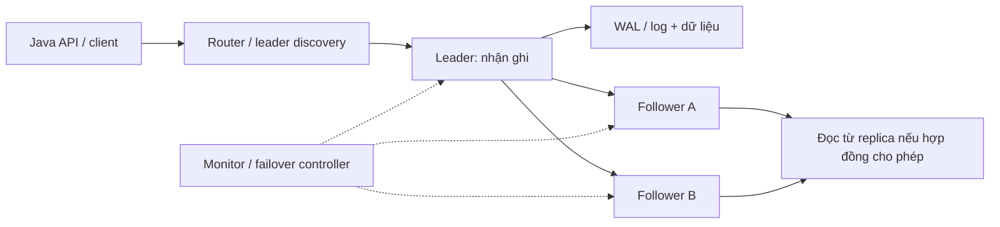
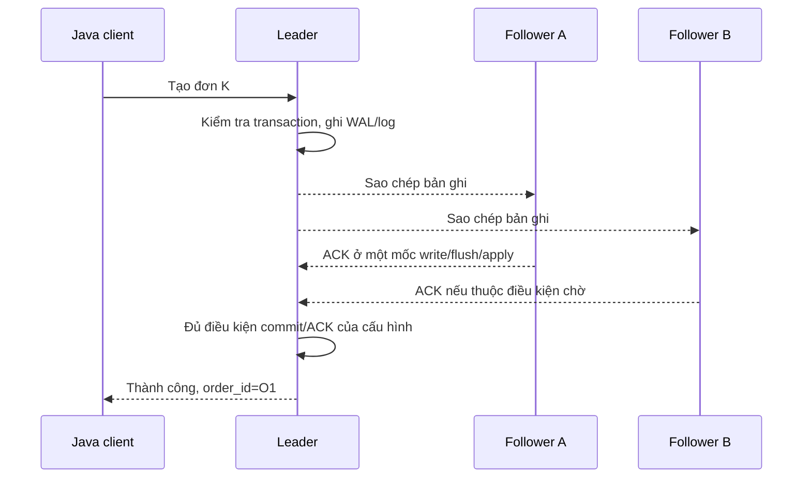
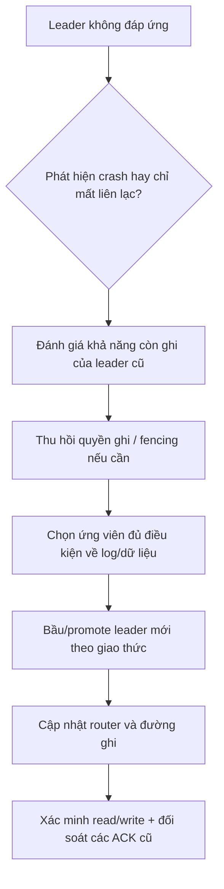

# Ghi theo nút lãnh đạo và chuyển đổi khi nút lỗi

## 1. Vì sao một hệ lưu trữ phân tán cần nút lãnh đạo?

Một ứng dụng Java lưu đơn hàng trên một database duy nhất có thể đọc và ghi qua cùng một kết nối. Khi tăng nhu cầu sẵn sàng, hệ thống triển khai thêm các bản sao dữ liệu trên nhiều máy. Lúc này xuất hiện câu hỏi quan trọng: **nếu hai máy cùng nhận lệnh cập nhật một bản ghi, ai quyết định thứ tự và kết quả cuối cùng?**

Trong kiến trúc **leader–follower** (còn gọi là primary–replica), một nút **leader** được trao quyền xử lý ghi cho một phạm vi dữ liệu. Các nút **follower** nhận những thay đổi theo cơ chế sao chép. Khi leader lỗi, hệ thống có thể chọn một follower phù hợp làm leader mới, cập nhật định tuyến và tiếp tục phục vụ ghi.

Chủ đề này nằm trong chương **Nền tảng phân tán** của module **DATA_PERSISTENCE_FUNDAMENTALS**. Mục tiêu là hiểu cách một quyết định ghi đi từ Java tới hệ lưu trữ, dữ liệu đã xác nhận tồn tại ở đâu, vì sao failover có thể mất dữ liệu hoặc gây ghi trùng, và cách kết hợp transaction, kiểm soát đồng thời, retry và quan sát hệ thống.

> **Câu hỏi nền tảng:** Khi API trả “ghi thành công”, hệ thống đã bảo vệ thay đổi ấy trước **loại lỗi nào**, và leader mới có chắc chắn mang theo những ghi đã được xác nhận hay không?

Sau bài học, người học cần có khả năng mô tả đường ghi, phân biệt replication bất đồng bộ/đồng bộ với giao thức đồng thuận, giải thích **split-brain**, **fencing**, **quorum**, **term/epoch**, thiết kế retry bằng định danh thao tác và lập bài kiểm thử failover có thể đối chiếu kết quả.

## 2. Vai trò leader, follower, client và bộ điều phối

| Thành phần | Vai trò chính | Điều không được ngầm giả định |
| --- | --- | --- |
| **Leader / primary** | Nhận lệnh ghi có thẩm quyền, sắp xếp/thực thi thay đổi trong phạm vi nó sở hữu | Chỉ vì node tự nhận mình là leader thì quyền ghi vẫn còn hợp lệ |
| **Follower / replica** | Nhận, lưu và có thể áp dụng thay đổi từ leader | Đã nhận bản ghi nghĩa là đã flush, apply hoặc có thể phục vụ đọc mới nhất |
| **Client / Java service** | Gửi lệnh, nhận kết quả, giữ operation ID và xử lý timeout | Timeout chứng minh transaction chưa commit |
| **Router / proxy / discovery** | Đưa ghi tới endpoint leader hiện tại | Router luôn đổi tuyến tức thời và không thể trỏ nhầm leader cũ |
| **Failover controller** | Quan sát lỗi, quyết định hoặc điều phối promotion, cấu hình lại node/định tuyến | Nhìn thấy mất kết nối là biết chắc node trước đó đã chết |
| **Kho lưu trạng thái điều phối** | Có thể lưu nhiệm kỳ, quyền sở hữu hoặc cấu hình cluster tùy kiến trúc | Mọi sản phẩm đều dùng cùng một giao thức bầu chọn |



Với **single-leader replication**, các lệnh ghi cho cùng một phạm vi được gửi về leader. Hệ thống có thể chia dữ liệu thành nhiều **partition/shard**, mỗi phần có leader riêng; “một leader” là **một leader cho một phạm vi dữ liệu**, không nhất thiết là một leader duy nhất cho toàn cluster.

Không nên nhầm **leader** của hệ lưu trữ với leader của ứng dụng hoặc lock leader trong một cron job. Chỉ định một pod làm leader để chạy batch **không tự trao quyền ghi** lên mọi bản sao database hoặc bảo đảm không có hai node cùng thực hiện side effect.

## 3. Đường đi của một lệnh ghi bình thường

Giả sử client gửi yêu cầu tạo đơn với `operation_id = K`:



Sơ đồ trên chỉ là **luồng khái niệm**. Thứ tự ghi local, gửi replica, flush, commit và trả ACK phụ thuộc DBMS/giao thức. Có hệ thống cho leader trả thành công sau khi WAL cục bộ được flush, trong khi follower chưa nhận gì; có hệ thống phải đợi một tập replica; có hệ dùng quorum replication log và chỉ công bố commit khi đạt quy tắc đa số.

Một **request thành công ở lớp HTTP** cũng không mô tả đầy đủ độ bền. Để đánh giá đúng, cần tách:

1. **Statement executed:** câu `INSERT`/`UPDATE` đã chạy trên leader nhưng transaction có thể chưa commit.
2. **Local commit/flush:** leader xác nhận transaction theo chính sách độ bền local.
3. **Replication write/flush/apply:** replica nhận, ghi tới bộ đệm, flush bền vững hoặc áp dụng WAL/log, tùy hệ thống.
4. **Cluster commit:** một giao thức hoặc chính sách đã đạt điều kiện cần trước khi công bố kết quả.
5. **API response:** ứng dụng Java nhận ACK từ database và trả lời client; phản hồi có thể mất trên mạng dù commit đã xảy ra.

**Không suy luận “replica có bản ghi” từ việc leader đã ACK** nếu cấu hình chỉ chờ local. Cũng không đồng nhất ACK nhận qua mạng với ACK đã flush bền vững.

## 4. Ba chính sách sao chép và đánh đổi độ bền

| Chính sách minh họa | Điều kiện thường được dùng để ACK ghi | Lợi ích | Rủi ro, đánh đổi |
| --- | --- | --- | --- |
| **Asynchronous replication** | Leader đã hoàn tất cam kết local, không đợi follower | Độ trễ ghi thấp, chịu được replica chậm | Nếu leader mất trước khi bản ghi sang follower được promote, một ghi đã ACK có thể mất |
| **Synchronous replication** | Chờ một hoặc nhiều follower đạt mốc đã cấu hình | Giảm cửa sổ mất ghi qua failover khi chọn đúng bản sao | Tăng latency, có thể chặn ghi khi thiếu follower đủ điều kiện |
| **Consensus/quorum commit** | Giao thức yêu cầu log được chấp nhận/ghi nhận bởi quorum theo điều kiện của hệ | Giúp xác định một lịch ghi thống nhất qua chuyển leader theo giả định của giao thức | Chi phí phối hợp, phụ thuộc quorum, yêu cầu election và leader fencing đúng |

“Đồng bộ” vẫn chưa đủ để kết luận đã an toàn. Cần hỏi **đồng bộ đến mốc nào**: replica mới *receive*, *write*, *flush*, hay *apply*? Chỉ ACK khi nhận byte chưa chắc giữ được byte đó nếu hệ điều hành replica crash trước flush.

### Vì sao replication bất đồng bộ có thể mất ghi đã ACK?

```text
T0  Leader L đang có order_count = 10, Follower F cũng = 10
T1  Client gửi tạo đơn K tới L
T2  L ghi và COMMIT đơn K, trả ACK thành công; count = 11
T3  WAL/log chứa K chưa tới F; F vẫn có count = 10
T4  L mất hoàn toàn, không thể phục hồi
T5  Controller promote F thành leader mới
T6  Client đọc leader mới: không thấy đơn K
```

Đây là **mất dữ liệu qua failover so với trạng thái đã xác nhận**, không phải dirty read. Ghi K có thể đã thật sự commit và bền vững trên đĩa L, nhưng node duy nhất giữ nó đã mất. Nếu L chỉ tạm mất kết nối rồi quay lại, hệ thống còn phải giải quyết việc lịch log của L và leader mới có thể đã phân nhánh.

### Replication đồng bộ vẫn cần failover đúng

Giả sử leader chỉ ACK sau khi follower F1 đã **flush** log K. Nếu L chết và controller promote **F2** chưa có K thay vì F1, dữ liệu K vẫn có thể biến mất khỏi đường phục vụ. Chính sách đồng bộ chỉ có ích cho mục tiêu RPO khi **quy tắc chọn leader mới bảo toàn các bản ghi được xem là đã commit**.

Quy trình failover, quyền promote, fencing và tiêu chí log của ứng viên là một phần của cam kết độ bền — không phải chi tiết vận hành có thể bỏ qua.

## 5. Khi nào cần bầu chọn leader mới?

Một hệ thống có thể xem xét failover khi:

- Leader crash, không còn tiến trình phục vụ hoặc phần cứng mất điện.
- Leader bị cô lập khỏi mạng kết nối tới phần lớn cluster.
- Nút còn chạy nhưng không phản hồi ghi trong ngưỡng timeout.
- Bảo trì chủ động muốn chuyển vai trò primary sang node khác.
- Node leader mất quyền sử dụng storage hoặc bị hệ điều phối thu hồi quyền sở hữu.

**Không có phản hồi không có nghĩa chắc chắn đã chết.** Network partition, GC pause dài, nghẽn I/O hoặc chậm scheduler có thể khiến một leader khỏe mạnh bị phía khác xem như không sống. Nếu hai phía của mạng đồng thời tự cho mình quyền ghi, trạng thái có thể phân nhánh.



Các bước là **checklist mục tiêu**, không hàm ý mọi sản phẩm tự động đi theo đúng thứ tự tuần tự này. Giao thức consensus có thể tích hợp nhiều bước thành election và quy tắc commit. Với database có streaming replication, một controller ngoài và cơ chế quản trị quyền ghi có thể là thành phần bắt buộc.

## 6. Split-brain: hai nút cùng tưởng mình là leader

**Split-brain** xảy ra khi hai thực thể có thể đồng thời tự nhận quyền ghi đối với cùng phạm vi dữ liệu, ví dụ primary cũ L vẫn phục vụ request trong lúc follower F đã được promote thành primary mới.

```text
                 NETWORK PARTITION

Client A -> L cũ -> COMMIT order O1
           [không thấy controller/F]

Client B -> F mới -> COMMIT order O2
           [được promote]

Khi mạng trở lại:
L có lịch ghi ... O1
F có lịch ghi ... O2
Hai lịch không tự gộp thành một thứ tự giao dịch hợp lệ.
```

Nếu hai bên cùng nhận ghi thì:

- `UNIQUE`, khóa ngoại và các ràng buộc DB chỉ áp dụng **trong từng nhánh dữ liệu**, không tự phân xử giữa hai leader độc lập.
- Hai node có thể tạo cùng mã đơn nhưng payload khác nhau.
- Việc đồng bộ lại không nhất thiết là “lấy bản mới hơn” theo timestamp; thời gian thực không đủ để quyết định quyền sở hữu đúng.
- Có nguy cơ mất hoặc ghi đè dữ liệu khi chọn một nhánh làm chuẩn, cùng các tác động ngoài DB đã phát sinh ở nhánh kia.

Không thể sửa split-brain chỉ bằng cách tăng timeout. Timeout quá dài làm failover chậm, timeout quá ngắn làm tăng khả năng false positive. Cần một **quy tắc cấp quyền ghi duy nhất** trong phạm vi cần bảo vệ.

### Fencing — ngăn leader cũ tiếp tục ghi

**Fencing** là cơ chế chặn một actor không còn quyền sở hữu khỏi thực hiện ghi, kể cả khi actor ấy không nhận được thông báo mình đã bị thay thế. Có những hình thức:

1. **Tắt/khóa nguồn ghi cũ:** cô lập thiết bị, hạ tầng hoặc quyền truy cập của primary cũ trước khi promote node mới (cơ chế cụ thể phụ thuộc hạ tầng).
2. **Lease có điều kiện và hạn sử dụng:** quyền ghi chỉ hợp lệ nếu actor còn lease; cần đặc biệt cẩn trọng với pause dài, clock và network partition.
3. **Fencing token / epoch tăng dần:** mỗi lần cấp quyền ghi sinh token lớn hơn; nơi thực thi tác động **kiểm tra token** và từ chối token cũ.
4. **Giao thức consensus:** election và commit rule bảo đảm node cũ không thể tiếp tục **commit hợp lệ** sau khi mất quyền theo nhiệm kỳ và quorum, nếu mọi bên tuân thủ giao thức.

Token chỉ có tác dụng nếu **nơi nhận lệnh ghi thật sự kiểm tra token**. Một client chỉ giữ biến `epoch=42` nhưng database hoặc storage không xác minh epoch thì không bảo vệ được dữ liệu.

## 7. Term/epoch, log position và quorum khác nhau thế nào?

Đối với các hệ thống dùng một giao thức bầu chọn tương tự Raft, **term** là số nhiệm kỳ tăng dần. Một leader thuộc term mới có quyền phục vụ theo điều kiện của giao thức; request mang term cũ có thể bị từ chối.

| Khái niệm | Ý nghĩa | Điều cần lưu ý |
| --- | --- | --- |
| **Term / epoch** | Thế hệ quyền sở hữu hoặc nhiệm kỳ leader | Không phải timestamp của bản ghi nghiệp vụ |
| **Log index / position** | Vị trí của một bản ghi trong nhật ký có thứ tự | Cần kết hợp cơ chế bảo đảm bản ghi đã commit |
| **Commit index** | Vị trí tới đó log được xem là committed theo giao thức | Không tương đương chỉ “leader đã viết tới vị trí này” |
| **Quorum** | Tập node đủ phiếu/ACK theo quy tắc | Kích thước và tính giao nhau giữa các quorum rất quan trọng |
| **Fencing token** | Giá trị/điều kiện chặn chủ thể đã hết quyền | Chỉ hiệu quả nếu tài nguyên được bảo vệ kiểm tra nó |

Với **đa số quorum** trong một cấu hình cố định có N thành viên, mọi tập đa số có giao nhau. Đó là một yếu tố giúp hai leader khác nhau không thể cùng có quorum hợp lệ để commit các log xung đột theo giao thức. Nhưng giao nhau **không tự đủ**: vẫn phải có quy tắc vote, election, cập nhật term và tính hợp lệ của log ứng viên.

Ví dụ cụm 3 node dùng consensus:

```text
Node A: leader term 12
Node B: follower term 12
Node C: follower term 12

A ghi entry K vào log.
A và B lưu entry theo điều kiện giao thức: đạt đa số 2/3.

A mất kết nối.
B được bầu trong term 13 theo quy tắc election/log phù hợp.
Cập nhật đã committed không được biến mất khỏi lịch sử hợp lệ.
```

Ví dụ này diễn giải một **giao thức consensus có điều kiện**, không mô tả cách PostgreSQL streaming replication mặc định vận hành. Thêm nữa, việc “ghi vào log” phải thỏa hợp đồng bền vững của hệ và lớp storage để chịu được loại crash đang xét.

### Không đánh đồng PostgreSQL streaming replication với Raft

PostgreSQL primary–standby phổ biến dùng **physical WAL streaming replication** và cơ chế đồng bộ cấu hình qua standby. PostgreSQL không tự biến mỗi lệnh `COMMIT` thành một commit Raft chỉ vì có thêm replica.

Một công cụ điều phối failover có thể dùng một kho trạng thái/consensus bên ngoài để ra quyết định leadership, nhưng điều đó không tự bảo đảm một WAL record đã ACK xuất hiện trên node được promote. Cần kiểm tra **cả quy tắc replication/commit của PostgreSQL lẫn quy tắc chọn primary mới/fencing**.

## 8. PostgreSQL: trạng thái primary, WAL và synchronous standby

### Trên nút có kết nối SQL

```sql
-- true: node đang trong recovery/standby; false: không ở recovery.
SELECT pg_is_in_recovery();

-- Các thiết lập về điều kiện chờ commit (tùy quyền đọc).
SHOW synchronous_commit;
SHOW synchronous_standby_names;
```

Với PostgreSQL, `synchronous_commit` có một số chế độ:

| Chế độ | Điều kiện ACK về mặt khái niệm | Giới hạn |
| --- | --- | --- |
| `off` | Cho phép phản hồi commit không đợi local WAL flush | Có rủi ro mất các commit gần đây nếu database/OS crash trước flush |
| `local` | Chờ WAL flush trên primary | Không đợi standby |
| `remote_write` | Có synchronous standby: chờ bản ghi đến mốc write trên standby | Write ở standby chưa nhất thiết là flush bền vững |
| `on` | Chờ local flush; nếu cấu hình synchronous standby, chờ flush WAL trên standby theo điều kiện | Không tự có bảo đảm qua failover nếu chọn nhầm node |
| `remote_apply` | Với synchronous standby, chờ dữ liệu được apply để có thể thấy trên standby tương ứng | Độ trễ apply có thể đáng kể; không đồng nghĩa mọi standby đều bắt kịp |

**Quan trọng:** nếu không cấu hình synchronous standby phù hợp, một giá trị như `on` chủ yếu cho biết cam kết local flush; không thể suy ra đã đồng bộ WAL xuyên node.

### Quan sát từ primary

```sql
-- Trên primary, xem tiến độ các kết nối replica gửi WAL.
SELECT application_name,
       state,
       sync_state,
       sent_lsn,
       write_lsn,
       flush_lsn,
       replay_lsn
FROM pg_stat_replication;

-- Vị trí WAL của primary (dùng để quan sát cùng mốc thời gian).
SELECT pg_current_wal_lsn();
```

`pg_stat_replication` phản ánh những standby/streaming connection mà primary đang quan sát; không phải danh sách mọi node được phép failover. Các vị trí `write_lsn`, `flush_lsn` và `replay_lsn` biểu thị những mốc khác nhau. Cần kiểm tra quyền truy cập, tần suất cập nhật thống kê và trạng thái kết nối.

### Quan sát từ standby

```sql
SELECT pg_is_in_recovery(),
       pg_last_wal_receive_lsn(),
       pg_last_wal_replay_lsn(),
       pg_last_xact_replay_timestamp();
```

Giá trị `pg_last_xact_replay_timestamp()` hữu ích để quan sát thời điểm replay transaction gần nhất nhưng **không phải độ trễ sao chép tuyệt đối**. Nếu primary không có giao dịch mới, timestamp có thể cũ dù standby hoàn toàn bắt kịp. So sánh LSN cùng với trạng thái primary và các mốc timestamp/lag phù hợp để tránh cảnh báo sai.

**LSN không phải transaction ID nghiệp vụ**; nó là vị trí trong luồng WAL. Khi chuyển primary, timeline và lịch sử WAL có thể thay đổi; không so sánh tùy tiện các vị trí từ hai timeline độc lập như một số thứ tự ứng dụng toàn cục.

### Điều kiện failover

Một triển khai PostgreSQL cần quyết định:

1. Có dùng asynchronous hay synchronous standby, và đợi mốc nào (`write`, `flush`, `apply`)?
2. Ứng viên nào đủ dữ liệu để giữ các commit đã ACK?
3. Ai có quyền promote node mới; ai khóa primary cũ nếu nó chỉ mất mạng?
4. Router/pool sẽ ngắt kết nối cũ và định tuyến lệnh ghi sang primary mới như thế nào?
5. Khi primary cũ trở lại, nó được đồng bộ/khởi tạo lại theo timeline mới ra sao thay vì tiếp tục ghi độc lập?

Đây là bài toán **giao thức và vận hành**, không chỉ một câu `SELECT pg_is_in_recovery()` hay một thao tác đổi DNS.

## 9. RPO, RTO và tính sẵn sàng dưới network partition

Một kiến trúc failover phải làm rõ hai mục tiêu:

- **RPO (Recovery Point Objective):** mức mất dữ liệu tối đa có thể chấp nhận khi phục hồi, thường được diễn đạt theo thời gian hoặc giao dịch đã xác nhận.
- **RTO (Recovery Time Objective):** thời gian tối đa mong muốn để khôi phục khả năng phục vụ sau sự cố.

Với replication bất đồng bộ, RPO khi primary mất hoàn toàn có thể lớn hơn 0 vì follower chưa nhận đủ các giao dịch đã ACK. Với synchronous replication, khả năng đạt RPO=0 **theo một phạm vi sự cố định nghĩa rõ** đòi điều kiện ACK, lưu trữ, lựa chọn standby và failover/fencing phù hợp.

| Ưu tiên | Hệ quả thiết kế thường gặp | Điều phải thử nghiệm |
| --- | --- | --- |
| Ghi rất nhanh | Ít chờ mạng/replica hơn | Số giao dịch ACK bị mất khi failover |
| Hạn chế mất ghi đã ACK | Chờ bản sao/quorum đủ điều kiện | p95/p99 commit, trạng thái khi replica chậm |
| RTO thấp | Tự động health check, leader election, routing | False failover, split-brain, client reconnect |
| Không nhận ghi phân nhánh | Fencing hoặc điều kiện quorum chặt | Trường hợp network partition/leader cũ trở lại |
| Cho phép đọc từ follower | Tách tải đọc khỏi leader | Replica lag, read-your-writes, đọc không đơn điệu |

Khi network partition, một hệ yêu cầu quorum cho ghi có thể **từ chối hoặc treo ghi** ở phân vùng không đạt quorum. Đây là lựa chọn nhằm tránh lịch ghi không thể hợp nhất, không nhất thiết là “database bị hỏng”. Hệ cho phép cả hai phân vùng ghi độc lập cần định nghĩa rõ cách phát hiện và giải quyết xung đột, tức đang vận hành một mô hình nhất quán khác.

Không nên dùng “CAP” như một câu trả lời thay cho đặc tả: cần nói rõ **loại thao tác**, **phạm vi dữ liệu**, **lỗi mạng**, **loại read**, **cam kết về ACK** và **quy tắc sau failover**.

## 10. Failover ảnh hưởng gì tới Java/JDBC?

Khi primary đổi, ứng dụng Java có thể gặp:

1. Connection đang dùng bị ngắt giữa một transaction.
2. Connection pool còn giữ các socket cũ hoặc endpoint cũ.
3. Lệnh ghi trên một standby mới được route nhầm trả lỗi read-only.
4. Việc đổi DNS/proxy có độ trễ, khiến một số request tiếp tục gửi tới node cũ.
5. `COMMIT` đã thành công nhưng response thất lạc; caller không biết outcome.
6. Read replica đang chậm, trả “không có bản ghi” dù primary trước đó đã ghi.

**Đừng dùng mã lỗi “connection refused” để kết luận mọi transaction đã rollback.** Nếu lỗi xảy ra **trước khi gửi thao tác**, rủi ro khác với lỗi xảy ra **sau khi gửi COMMIT**. Khi commit outcome chưa rõ, một retry tạo lệnh mới có thể ghi trùng.

### Một bảng xử lý theo giai đoạn

| Giai đoạn lỗi | Điều caller có thể biết | Cách xử lý |
| --- | --- | --- |
| Không lấy được connection | Chưa gửi SQL bằng connection đó | Chờ leader mới sẵn sàng, lấy connection mới, giới hạn retry |
| Đang chạy transaction, trước commit | Chưa có xác nhận commit; connection có thể hỏng | Bỏ connection lỗi, kiểm tra trạng thái/rollback nếu có thể, retry an toàn theo nghiệp vụ |
| Sau khi gửi COMMIT, mất phản hồi | **Commit có thể đã xảy ra** | Tra cứu theo operation ID hoặc retry idempotent với cùng định danh |
| Nhận được phản hồi commit thành công, sau đó failover | Ghi được ACK theo cấu hình cũ | Đối chiếu cam kết durability/failover, không giả định replica nào cũng có dữ liệu |
| Đọc từ follower sau failover | Có thể gặp snapshot cũ hoặc node chưa được định tuyến đúng | Dùng đường đọc có thẩm quyền/token nếu cần read-your-writes |

Trong mọi trường hợp, việc **tự động retry vô hạn** có thể làm quá tải cluster vừa failover. Nên có retry budget, exponential backoff với jitter, timeout tổng và circuit breaker; đồng thời phân biệt lỗi cố định như sai credentials/schema với lỗi tạm thời do chuyển leader.

## 11. Ví dụ PostgreSQL/JDBC: tạo đơn với operation ID ổn định

Để retry an toàn khi chuyển leader, ứng dụng cần một **định danh thao tác** không thay đổi giữa các lần gửi lại cùng ý định. Nó không thay thế chính sách durability, nhưng ngăn một thao tác được **thực hiện hai lần trên cùng lịch dữ liệu có thẩm quyền**.

Schema minh họa:

```sql
CREATE TABLE inventory (
    tenant_id UUID NOT NULL,
    sku TEXT NOT NULL,
    available INTEGER NOT NULL CHECK (available >= 0),
    PRIMARY KEY (tenant_id, sku)
);

CREATE TABLE created_orders (
    tenant_id UUID NOT NULL,
    operation_id UUID NOT NULL,
    payload_hash CHAR(64) NOT NULL,
    order_id UUID NOT NULL,
    sku TEXT NOT NULL,
    quantity INTEGER NOT NULL CHECK (quantity > 0),
    PRIMARY KEY (tenant_id, operation_id),
    UNIQUE (tenant_id, order_id),
    FOREIGN KEY (tenant_id, sku) REFERENCES inventory(tenant_id, sku)
);
```

Điều kiện nghiệp vụ:

- Cùng `tenant_id` + `operation_id` + cùng payload chuẩn hóa chỉ tạo **một đơn**, kể cả retry sau timeout.
- Cùng operation ID nhưng payload khác bị từ chối; không dùng lại ID ấy cho một ý định mới.
- Trừ kho và chèn đơn ở **cùng transaction**.
- `UPDATE inventory` có điều kiện `available >= quantity` để bảo vệ khi nhiều client cạnh tranh.
- `tenant_id` phải lấy từ principal được xác thực ở API, không tin trường client tự gửi.

Đoạn Java 17+ dùng `DataSource` trỏ tới một endpoint **được cấu hình để truy cập primary có thẩm quyền hiện tại**. Khả năng failover của router/datasource phải được xây dựng và kiểm chứng riêng.

```java
import java.sql.Connection;
import java.sql.PreparedStatement;
import java.sql.ResultSet;
import java.sql.SQLException;
import java.util.UUID;
import javax.sql.DataSource;

public final class OrderWriter {
    private final DataSource dataSource;

    public OrderWriter(DataSource dataSource) {
        this.dataSource = dataSource;
    }

    public UUID createOnce(
            UUID tenantId, UUID operationId, String payloadHash,
            String sku, int quantity) throws SQLException {
        if (tenantId == null || operationId == null
                || payloadHash == null || !payloadHash.matches("[0-9a-f]{64}")
                || sku == null || sku.isBlank() || quantity <= 0) {
            throw new IllegalArgumentException("Invalid order command");
        }

        try (Connection connection = dataSource.getConnection()) {
            connection.setTransactionIsolation(Connection.TRANSACTION_READ_COMMITTED);
            connection.setAutoCommit(false);
            try {
                UUID candidate = UUID.randomUUID();
                boolean inserted = insertOrder(
                        connection, tenantId, operationId, payloadHash,
                        candidate, sku, quantity);

                UUID result;
                if (inserted) {
                    int changed = decreaseInventory(
                            connection, tenantId, sku, quantity);
                    if (changed != 1) {
                        throw new IllegalStateException(
                                "Unknown SKU or insufficient inventory");
                    }
                    result = candidate;
                } else {
                    result = loadExisting(
                            connection, tenantId, operationId, payloadHash);
                }

                connection.commit();
                return result;
            } catch (SQLException | RuntimeException failure) {
                try {
                    connection.rollback();
                } catch (SQLException rollbackError) {
                    failure.addSuppressed(rollbackError);
                }
                throw failure;
            }
        }
    }

    private static boolean insertOrder(
            Connection c, UUID tenantId, UUID operationId,
            String payloadHash, UUID orderId,
            String sku, int quantity) throws SQLException {
        String sql = """
            INSERT INTO created_orders
                (tenant_id, operation_id, payload_hash, order_id, sku, quantity)
            VALUES (?, ?, ?, ?, ?, ?)
            ON CONFLICT (tenant_id, operation_id) DO NOTHING
            RETURNING order_id
            """;
        try (PreparedStatement st = c.prepareStatement(sql)) {
            st.setObject(1, tenantId);
            st.setObject(2, operationId);
            st.setString(3, payloadHash);
            st.setObject(4, orderId);
            st.setString(5, sku);
            st.setInt(6, quantity);
            try (ResultSet rows = st.executeQuery()) {
                return rows.next();
            }
        }
    }

    private static int decreaseInventory(
            Connection c, UUID tenantId, String sku, int quantity)
            throws SQLException {
        String sql = """
            UPDATE inventory
            SET available = available - ?
            WHERE tenant_id = ? AND sku = ? AND available >= ?
            """;
        try (PreparedStatement st = c.prepareStatement(sql)) {
            st.setInt(1, quantity);
            st.setObject(2, tenantId);
            st.setString(3, sku);
            st.setInt(4, quantity);
            return st.executeUpdate();
        }
    }

    private static UUID loadExisting(
            Connection c, UUID tenantId, UUID operationId,
            String payloadHash) throws SQLException {
        String sql = """
            SELECT payload_hash, order_id
            FROM created_orders
            WHERE tenant_id = ? AND operation_id = ?
            """;
        try (PreparedStatement st = c.prepareStatement(sql)) {
            st.setObject(1, tenantId);
            st.setObject(2, operationId);
            try (ResultSet rows = st.executeQuery()) {
                if (!rows.next()) {
                    throw new SQLException("Retryable missing operation outcome");
                }
                if (!payloadHash.equals(rows.getString("payload_hash"))) {
                    throw new IllegalArgumentException(
                            "Operation ID used with another request");
                }
                return (UUID) rows.getObject("order_id");
            }
        }
    }
}
```

**Diễn giải:** nếu lần đầu đã commit và dữ liệu còn nằm trong lịch phục vụ của primary hiện tại, lần retry dùng cùng operation ID sẽ đọc `order_id` cũ mà không trừ kho lần nữa. Nếu lần đầu rollback, claim insert cũng rollback, lần retry có thể thực hiện lại.

Với PostgreSQL ở `READ COMMITTED`, `ON CONFLICT DO NOTHING` có thể không trả dòng khi gặp một transaction cạnh tranh; việc `SELECT` tiếp theo là **statement mới** sẽ nhìn trạng thái đã commit theo snapshot mới sau khi tranh chấp được giải quyết.

**Giới hạn quan trọng:** code trên **không** tự bầu leader, không đảm bảo được RPO=0 và không xử lý mọi trường hợp failover. Nếu một commit đã ACK trước đó **bị mất qua failover bất đồng bộ**, bản ghi operation ID cũng có thể mất; lần retry trên leader mới sẽ tạo lại thao tác theo lịch mới. Điều đó không xóa được side effect bên ngoài đã xảy ra từ lần commit cũ. Nếu nghiệp vụ cần bảo toàn tác động xuyên failover, phải chọn chính sách durability/replication và đối soát phù hợp.

Khi `connection.commit()` ném lỗi do mất phản hồi, phần `rollback()` trong `catch` chỉ là nỗ lực dọn dẹp connection còn khả dụng; nó **không thể hoàn tác một commit đã được server thực hiện**. Tầng API nên đánh dấu kết quả **chưa rõ**, tái kết nối tới primary có thẩm quyền và tra cứu/retry **cùng operation ID**, thay vì tự tạo một ID mới.

`payloadHash` cần được tạo từ payload **chuẩn hóa** (bao gồm loại thao tác, tenant, SKU, quantity và các trường nghiệp vụ khác). Không dùng hash trực tiếp của chuỗi JSON tùy thứ tự field, cũng không coi hash là cơ chế xác thực.

## 12. Từ leader tới read replica: read-your-writes có còn không?

Ứng dụng có thể gửi ghi tới leader rồi gửi câu đọc tiếp theo tới follower:

```text
T0 Client gửi tạo đơn K tới leader L
T1 L COMMIT K và trả 201
T2 Client gửi GET /orders/K tới follower F
T3 F chưa replay WAL K
T4 F trả 404
T5 F replay K; lần đọc sau mới thấy đơn
```

Đây là hiện tượng **read-after-write không bảo đảm**, không phải bằng chứng database đã rollback. Nếu sản phẩm yêu cầu người dùng luôn thấy đơn vừa tạo:

- Đọc từ **leader/primary có thẩm quyền** trong phiên sau ghi, với điều kiện leader đó đã bảo toàn commit được ACK.
- Dùng **commit token, log position hoặc session watermark** nếu hệ thống hỗ trợ; chỉ đọc từ replica đã apply ít nhất tới mốc tương ứng.
- Chờ replica đủ mới hoặc chuyển về primary khi quá thời gian; phải định nghĩa timeout và UX.
- Tránh nạp một kết quả stale từ follower vào cache dùng chung khiến độ trễ hiển thị còn kéo dài sau khi follower đã theo kịp.

**Tăng isolation level trên replica không tự làm replica bắt kịp.** `REPEATABLE READ` có thể giữ ổn định một snapshot cũ; nó không bảo đảm read-your-writes qua tuyến đọc bất đồng bộ.

Sau failover, cần đặc biệt thận trọng với token/LSN phát sinh ở timeline cũ. Việc diễn giải token phải theo chính sách lịch sử và định danh cluster, không so số nguyên vị trí một cách mù quáng giữa các nhánh dữ liệu.

## 13. Hai lớp nhất quán: transaction trong leader và lịch sử của cluster

Một transaction trên leader có thể được thực thi với `SERIALIZABLE`, bảo vệ bất biến theo ngữ nghĩa của DBMS. Nhưng nếu commit chỉ tồn tại trên một primary cũ rồi bị mất khi promote replica khác, hệ thống vẫn có vấn đề **durability và lịch sử commit xuyên failover**.

Ngược lại, một cluster dùng consensus có thể duy trì một lịch ghi committed nhất quán giữa các nhiệm kỳ, nhưng một transaction nghiệp vụ thiết kế sai vẫn có thể **trừ tồn kho âm** nếu database không có constraint hoặc kiểm tra phù hợp.

| Câu hỏi | Bảo đảm liên quan |
| --- | --- |
| Hai request cùng giảm tồn kho có làm âm không? | Transaction, isolation, cập nhật nguyên tử, constraint |
| Bản ghi đã ACK có còn khi primary mất không? | Durability, replication ACK, failover selection |
| Cùng một request retry sau timeout có tạo hai đơn không? | Idempotency key và unique business constraint |
| Đọc follower có thấy ghi vừa commit không? | Read consistency, replication lag, session token |
| Hai node có đồng thời nhận ghi hợp lệ không? | Election, quorum, leader fencing |
| Lỗi xóa nhầm lan sang replica thì phục hồi sao? | Backup độc lập, PITR, restore/runbook |

**Replication không thay thế backup.** Một lệnh xóa nhầm hoặc dữ liệu bị sửa sai trên leader có thể được sao chép rất nhanh. Muốn khôi phục trước một lỗi nghiệp vụ đã commit, cần backup, nhật ký phục hồi theo thời điểm và quy trình đối soát.

## 14. Hiệu năng: leader là một điểm phối hợp, không phải vô hạn

Single-leader có ưu điểm làm rõ nơi quyết định thứ tự ghi, nhưng cũng tạo ra những giới hạn:

- **Write throughput:** leader xử lý cập nhật và có thể trở thành nút nghẽn CPU, I/O, khóa hoặc mạng.
- **Commit latency:** nếu chờ remote flush hoặc quorum ở miền khác, độ trễ mạng ảnh hưởng p95/p99.
- **Hot key / hot shard:** nhiều request ghi cùng hàng/tập khóa có thể xung đột dù cụm có nhiều follower.
- **Replication lag:** follower phải nhận và replay log; khi truy vấn nặng hoặc I/O chậm, dữ liệu đọc có thể cũ.
- **Failover pause:** trong khoảng leader mới chưa được xác định/routed đúng, ứng dụng có thể không ghi được.
- **Connection churn:** failover khiến pool kết nối lại hàng loạt; quá nhiều retry đồng thời làm quá tải primary mới.

Thêm follower thường giúp **tăng khả năng phục vụ đọc và dự phòng**, nhưng không tự tăng throughput ghi trên cùng một leader. Sharding có nhiều leader riêng cho từng partition có thể mở rộng ghi, đổi lại tăng độ phức tạp giao dịch nhiều shard, đặt khóa và vận hành.

Chọn hệ thống theo workload: tỷ lệ đọc/ghi, hot key, kích thước transaction, yêu cầu p99, phân bố địa lý và khoảng downtime/mất dữ liệu được phép. **Không chọn asynchronous replication chỉ vì benchmark một lệnh commit nhanh hơn** mà chưa lượng hóa số ghi đã ACK có thể mất qua failover.

## 15. Quan sát hệ thống: cần đo gì để biết failover an toàn?

| Nhóm | Metric / dữ kiện | Câu hỏi |
| --- | --- | --- |
| Leadership | Node leader hiện tại, term/epoch hoặc timeline tùy hệ, thời điểm chuyển vai | Có đổi leader bất thường hay có hai bên cùng nhận ghi? |
| Routing | Tỷ lệ lỗi read-only/stale leader, kết nối tới endpoint cũ | Client đã tới đúng leader chưa? |
| Replication | Log sent/write/flush/apply lag, replica health | Ứng viên failover đã bắt kịp những commit cần bảo toàn chưa? |
| Durability | Số operation ID đã ACK nhưng không còn sau promotion | RPO thực đo là bao nhiêu? |
| Availability | Thời gian từ lỗi tới ghi lại thành công | RTO quan sát được là bao lâu? |
| Latency | p50/p95/p99 commit latency, WAL flush/network wait | Bước nào gây chậm ghi? |
| Safety | Số lần fencing thất bại, ghi trên leader cũ, lịch phân nhánh | Có vi phạm single-writer không? |
| Retry | SQLSTATE/network timeout, retry budget, duplicate/conflict | Failover có tạo retry storm hoặc ghi trùng? |
| Data correctness | Bất biến đơn hàng/tồn kho, kết quả reconciliation | Dữ liệu cuối có còn đúng nghiệp vụ không? |

Metric cần **gắn với thời điểm ACK thực tế của API**. Nếu chỉ đếm record đã được server xử lý trước khi trả HTTP, không thể suy ra số giao dịch đã được client nhìn nhận là thành công. Với mục tiêu không mất ghi đã ACK, cần một danh sách ID độc lập đủ bền vững để đối chiếu sau sự cố.

## 16. Thiết kế thí nghiệm failover có thể lặp lại

Các thí nghiệm sau chỉ nên chạy trong **môi trường cô lập**, có dữ liệu giả và phương án phục hồi. Không tự ý tắt node production hoặc gây phân vùng mạng trên hệ thống đang phục vụ người dùng.

### Thí nghiệm A: primary mất sau ACK với replication bất đồng bộ

1. Tạo cluster thử nghiệm primary L và follower F, xác định mode replication đang dùng.
2. Gửi một chuỗi request có `operation_id` duy nhất; ghi **bên ngoài cluster bị thử** những ID đã được client nhận ACK.
3. Tạo một cửa sổ follower trễ WAL, sau đó mô phỏng sự cố primary không thể phục hồi.
4. Promote F theo runbook và chuyển đường ghi/đọc tới node mới.
5. Đối chiếu danh sách ID đã ACK với dữ liệu còn tồn tại; tính **số ghi đã ACK bị thiếu** và phạm vi thời gian của chúng.

Nếu không mất dữ liệu ở một lần chạy, đó **không** chứng minh replication bất đồng bộ luôn đạt RPO=0. Cần lặp lại nhiều lịch và kiểm chứng đặc tả cấu hình.

### Thí nghiệm B: synchronous standby và mất một node

1. Cấu hình synchronous standby, kiểm tra được mốc `flush` hoặc điều kiện ACK tương đương.
2. Xác minh node dự kiến promote đã có đủ log của các transaction được ACK.
3. Gây lỗi primary theo loại sự cố được phép thử; cho failover controller chọn node theo chính sách đã thiết kế.
4. Đo downtime, commit latency trước/sau lỗi, đối chiếu tập ID đã ACK.
5. Thử cả khi synchronous standby **mất kết nối trước commit**: hệ thống chờ, từ chối ghi hay hạ mức bảo đảm? Nếu tự động hạ cấp async, hợp đồng RPO có thay đổi không?

### Thí nghiệm C: network partition và fencing

1. Giả lập mạng làm controller/ứng viên không nhìn thấy primary cũ, nhưng primary cũ vẫn có một số client kết nối.
2. Thực hiện election/promotion theo cơ chế được kiểm thử.
3. Gửi lệnh ghi tới **cả endpoint cũ lẫn endpoint mới** sau mốc failover.
4. Khẳng định chỉ node giữ quyền hợp lệ được commit ghi mới, hoặc lệnh từ leader cũ bị từ chối/fenced.
5. Khi mạng phục hồi, kiểm tra node cũ không tự nhập vai leader và không thể áp lịch ghi phân nhánh.

Thử nghiệm này không thể thay bằng việc chỉ kill tiến trình primary: kill tiến trình làm mất khả năng ghi của primary cũ, còn network partition mới bộc lộ nguy cơ split-brain.

### Thí nghiệm D: kết quả COMMIT chưa rõ

1. Cho API ghi đơn với operation ID K; tạo lỗi kết nối **giữa lúc gửi COMMIT và nhận phản hồi**.
2. Kiểm tra client không tự tạo operation ID mới.
3. Sau khi có leader có thẩm quyền, tra cứu hoặc retry với **cùng K**, cùng payload chuẩn hóa.
4. Khẳng định không có hai đơn/trừ kho hai lần khi giao dịch đầu đã được bảo toàn.
5. Nếu chính sách replication cho phép mất commit sau failover, ghi rõ giới hạn kết luận và kế hoạch reconciliation với tác động ngoài DB.

### Thí nghiệm E: read-your-writes qua follower

1. Commit một order K trên leader.
2. Ngay sau ACK, đọc từ follower và ghi nhận trường hợp còn chậm.
3. Thử cơ chế routing về leader hoặc chờ watermark/apply position trước khi phục vụ.
4. Đối chiếu cả cache: một lần miss không được nạp kết quả “chưa có K” vào cache dài hạn khi đường đọc không đáp ứng ngưỡng mới cần thiết.

Trong tất cả thí nghiệm, lưu lại **trình tự sự kiện, term/timeline hoặc LSN khi thích hợp, transaction outcome, endpoint client dùng và trạng thái node sau failover**. Chỉ nhìn HTTP 200 hoặc việc hai node đang chạy sẽ bỏ sót những vi phạm nghiêm trọng nhất.

## 17. Runbook khi leader bị lỗi

Một runbook cho tổ chức vận hành có thể theo các bước:

1. **Phát hiện và đánh giá:** leader thật sự hỏng hay chỉ tạm mất network? Có request ghi đang xử lý và commit outcome chưa rõ không?
2. **Ngăn split-brain:** xác nhận cơ chế fencing/thu hồi quyền ghi cũ hoạt động trước hoặc cùng điều kiện promotion theo giao thức.
3. **Kiểm tra ứng viên:** xác định follower đủ điều kiện theo mốc WAL/log được ACK, không chỉ chọn node có CPU rảnh.
4. **Thực hiện election/promotion có kiểm soát:** tránh để hai controller thực hiện hai quyết định xung đột.
5. **Cập nhật đường ghi:** router, service discovery, pool và các endpoint phải phản ánh leader mới; cắt hoặc xác minh connection cũ.
6. **Xác nhận ứng dụng hoạt động:** tạo/đọc một thao tác test, kiểm tra transaction, constraint và retry an toàn.
7. **Đối soát đã ACK:** truy vấn operation ID đã thành công với client, kiểm tra khoảng mất dữ liệu so với mục tiêu RPO.
8. **Khôi phục dự phòng:** khi node cũ trở lại, không bật lại như primary chỉ vì dịch vụ sống; đưa vào lịch dữ liệu chính thức theo quy trình rejoin/restore.
9. **Đánh giá sau sự cố:** RTO thực tế, replica lag, lỗi reconnect, số retry, lỗi fencing, số bản ghi cần reconciliation.

Các thao tác promote/fence mang tính phá vỡ dịch vụ hoặc có thể làm mất dữ liệu nếu sai; cần công cụ quản trị và quy trình được kiểm thử riêng cho sản phẩm DBMS, hạ tầng và topology đang vận hành.

## 18. Những nhầm lẫn thường gặp

1. **“Có replica thì không bao giờ mất ghi đã ACK.”** Sai nếu replication async hoặc failover chọn replica chưa đủ log.
2. **“Leader mất phản hồi chắc chắn đã chết.”** Sai; có thể chỉ là network partition hoặc pause dài.
3. **“Chỉ cần đổi DNS sang follower là xong.”** Sai; còn promotion, fencing, connection, recovery và tính đúng lịch sử WAL/log.
4. **“Synchronous replication tự giải quyết split-brain.”** Không có bảo đảm chung như vậy; cần cơ chế quyền ghi và failover tương ứng.
5. **“PostgreSQL physical replication chính là Raft.”** Sai; physical WAL streaming và quorum consensus là hai cơ chế khác nhau.
6. **“Đã write log trên follower nghĩa là đã flush bền vững.”** Write và flush có ý nghĩa khác nhau.
7. **“Chỉ số WAL LSN chính là thứ tự giao dịch nghiệp vụ xuyên mọi timeline.”** Sai; phải hiểu lịch sử/timeline và hợp đồng log.
8. **“Tăng isolation level sẽ làm follower có ghi mới ngay.”** Isolation không đồng nghĩa đồng bộ replication.
9. **“Kết nối Java timeout nghĩa là đơn chưa được tạo.”** Commit có thể đã xảy ra nhưng ACK thất lạc.
10. **“Retry bằng order ID mới chắc không trùng.”** Có thể tạo hai tác động nghiệp vụ cho cùng ý định.
11. **“Fencing token do client tự giữ là đủ.”** Nơi ghi phải xác minh token và từ chối actor hết quyền.
12. **“Thêm nhiều follower sẽ tuyến tính tăng write throughput.”** Một leader của cùng shard vẫn có giới hạn riêng.
13. **“Leader election thay thế constraint và transaction.”** Không; bất biến nghiệp vụ vẫn cần được bảo vệ.
14. **“Replication là backup.”** Lỗi xóa nhầm vẫn có thể lan tới mọi replica.

## 19. Bài tập tự kiểm tra

**Câu 1.** Leader L đã ACK đơn K sau local commit nhưng follower F chưa nhận log. L bị hỏng hoàn toàn, F được promote. K biến mất. Đây là lỗi gì, có phải dirty read không?

**Câu 2.** Hệ có hai follower; leader chờ F1 flush WAL rồi ACK, nhưng controller khi failover promote F2 chưa có K. Chính sách synchronous commit có đủ bảo đảm RPO=0 không?

**Câu 3.** Khi mạng chia đôi, primary cũ vẫn nhận một số lệnh ghi, trong khi follower ở nhánh khác đã được promote. Tên rủi ro là gì và cần cơ chế bảo vệ nào?

**Câu 4.** Một token epoch tăng từ 7 lên 8 được cấp cho leader mới. Nếu database không kiểm tra epoch của request, token có tự ngăn được leader cũ ghi không?

**Câu 5.** Một cụm Raft ba node có log entry được commit theo giao thức bởi quorum hợp lệ. Vì sao không thể tùy tiện bầu một node có log thiếu entry đã commit làm leader?

**Câu 6.** Trên PostgreSQL, `synchronous_commit=remote_write` với synchronous standby. Có thể kết luận standby đã flush bền vững WAL không?

**Câu 7.** Java gửi `COMMIT` rồi socket reset trước phản hồi. API nên retry với operation ID mới hay giữ ID cũ? Kết quả nào chưa thể biết ngay?

**Câu 8.** Client tạo đơn trên leader rồi GET từ follower nhận 404. Điều này đủ chứng minh đơn đã rollback hay chưa tồn tại không?

**Câu 9.** Một kiến trúc ưu tiên RTO rất ngắn tự động promote khi timeout 100 ms, nhưng thiếu fencing. Vì sao có thể nguy hiểm dù failover có vẻ nhanh?

**Câu 10.** Một tổ chức muốn không mất bút toán đã ACK khi mất một node. Ngoài tăng số replica, cần xác định và thử nghiệm những gì?

**Gợi ý trả lời:**

1. Đây là **mất commit đã ACK qua failover với replication bất đồng bộ**; không phải đọc dữ liệu chưa commit.
2. **Không.** Failover phải chọn node mang được các commit đã ACK; đồng bộ với F1 nhưng promote F2 thiếu K vẫn làm K biến mất khỏi lịch phục vụ.
3. **Split-brain.** Cần fencing/thu hồi quyền ghi hoặc giao thức election/quorum ngăn hai leader commit hợp lệ.
4. **Không.** Token phải được tài nguyên lưu trữ hoặc nơi thực hiện tác động kiểm tra.
5. Quy tắc election/log safety phải bảo toàn entry đã committed qua nhiệm kỳ; candidate thiếu log tương ứng không được vi phạm điều kiện an toàn của giao thức.
6. **Không.** Remote write có thể chỉ ghi vào bộ đệm OS của standby; khác với flush.
7. Dùng **cùng operation ID và cùng payload** để tra cứu hoặc retry idempotent sau khi xác định primary có thẩm quyền. Commit outcome lúc mất ACK có thể chưa rõ.
8. **Không.** Follower có thể bị replication lag; cần đọc primary hoặc đợi vị trí apply phù hợp.
9. Timeout quá ngắn có thể nhận nhầm leader khỏe thành lỗi, dẫn tới hai bên cùng ghi nếu không có fencing, phá tính đúng dữ liệu.
10. Cần xác định ACK local/remote flush/quorum, miền lỗi, tiêu chí chọn node promote, fencing, mức RPO/RTO, kiểm thử phân vùng mạng, mất primary, retry/đối soát và backup/PITR.

## Kết luận

Ghi theo **nút lãnh đạo** cung cấp một nơi có thẩm quyền sắp xếp cập nhật cho một phạm vi dữ liệu. Nhưng khi leader bị lỗi, việc chuyển sang node mới **không chỉ là đổi địa chỉ kết nối**: phải bảo toàn lịch sử những ghi đã được xác nhận, ngăn leader cũ tiếp tục ghi, chọn bản sao đủ dữ liệu và bảo đảm client xử lý được kết quả commit chưa rõ.

Trong **DATA_PERSISTENCE_FUNDAMENTALS**, hãy gắn mọi quyết định về replication và failover với **điều kiện ACK**, **RPO/RTO**, **giao thức lãnh đạo**, **fencing**, **bất biến transaction**, **đường đọc có độ mới yêu cầu** và **retry idempotent ở ranh giới Java**. Chỉ khi kiểm thử được các lịch lỗi thực tế, hệ thống phân tán mới có thể vừa phục hồi nhanh vừa duy trì độ tin cậy của dữ liệu bền vững.
