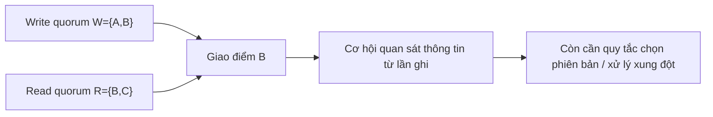
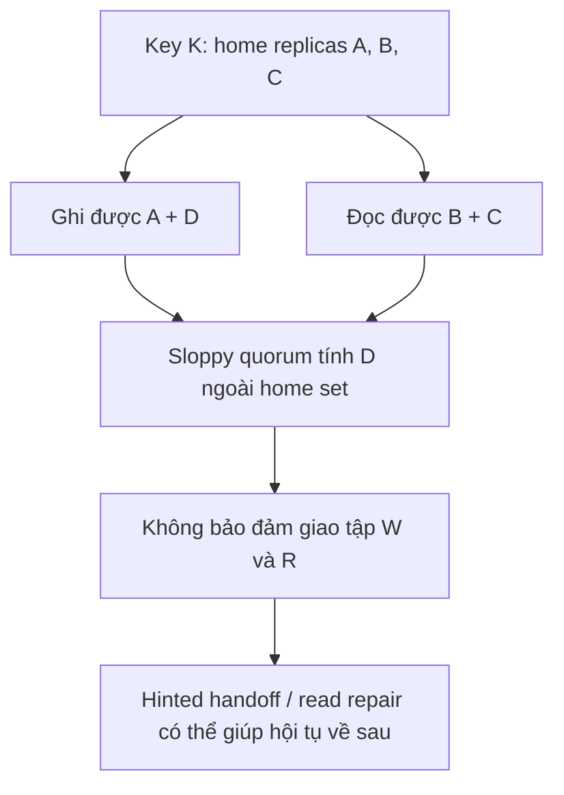
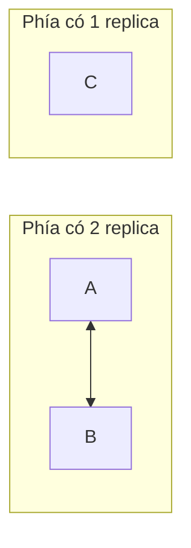
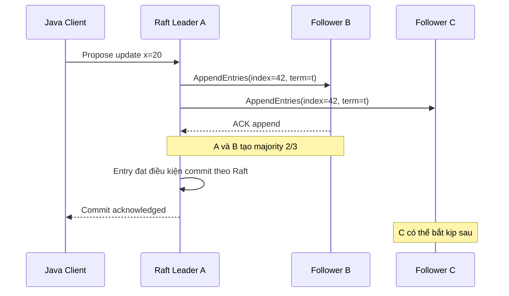

# Đọc và ghi theo quorum cùng các giới hạn cần kiểm chứng

Trong chương **Nền tảng phân tán** của module **DATA_PERSISTENCE_FUNDAMENTALS**, một câu hỏi nền tảng là: **khi dữ liệu được sao chép lên nhiều nút, cần bao nhiêu nút xác nhận một lần ghi và bao nhiêu nút tham gia một lần đọc để hệ thống đáp ứng yêu cầu nhất quán?**

Một số hệ thống cho phép ứng dụng lựa chọn mức xác nhận dựa trên **quorum**: thao tác hoàn tất khi nhận phản hồi hợp lệ từ một số replica đủ lớn. Mô hình `N`, `R`, `W` rất hữu ích để giải thích các đánh đổi giữa độ trễ, tính sẵn sàng và khả năng nhìn thấy dữ liệu mới. Tuy nhiên, **điều kiện giao tập quorum không phải lời bảo đảm độc lập rằng dữ liệu đọc ra luôn mới nhất hoặc mọi phép ghi đều nguyên tử**. Kết luận còn phụ thuộc cách xác định nhóm replica, thứ tự phiên bản, xử lý ghi đồng thời, timeout, failover, hệ thống có sử dụng consensus hay không và chính sách của sản phẩm cụ thể.

Đối với tầng persistence Java, hiểu quorum giúp lựa chọn consistency level phù hợp cho đọc/ghi, đánh giá retry sau lỗi không rõ kết quả, giới hạn sử dụng cache/replica đọc, và xây dựng bài kiểm thử mô phỏng sự cố. Bài này trình bày trước **mô hình quorum điều chỉnh được kiểu Dynamo**, rồi phân biệt với **majority quorum trong giao thức đồng thuận** như Raft. Những ví dụ số học là mô hình học thuật; khi triển khai phải đối chiếu hợp đồng của database và driver thực tế.

## 1. Dữ liệu có nhiều replica nghĩa là gì?

Giả sử hệ thống lưu trạng thái đơn hàng `order-101` trên ba nút:

```text
            Key: order-101
       ┌─────────────────────┐
       │ Replica A: PENDING  │
       │ Replica B: PENDING  │
       │ Replica C: PENDING  │
       └─────────────────────┘
```

Một request muốn đổi trạng thái đơn thành `CONFIRMED`. Nếu coordinator chỉ cần nút A chấp nhận bản ghi, phản hồi có thể nhanh, nhưng B và C chưa chắc nhận được thay đổi khi client đọc ngay sau đó. Nếu coordinator đợi nhiều replica hơn, xác suất một lần đọc sau đó gặp bản đã ghi có thể tốt hơn, nhưng thao tác có thể chậm hoặc lỗi khi các replica cần thiết không phản hồi.

Đầu tiên phải xác định **replica nào là chủ sở hữu hợp lệ của key**. Với hệ thống phân vùng dữ liệu, mỗi key có thể thuộc một nhóm replica khác nhau; ba máy trong sơ đồ là nhóm của **một key**, không có nghĩa toàn bộ cluster chỉ có ba máy.

### 1.1. Thuật ngữ cơ bản

| Thuật ngữ | Ý nghĩa | Điều không nên đánh đồng |
| --- | --- | --- |
| **Replication factor `N`** | Số replica dự kiến giữ bản sao của một key hoặc một phân vùng theo cấu hình | Tổng số máy của cluster |
| **Read quorum `R`** | Số phản hồi replica hợp lệ cần có để hoàn thành một phép đọc theo chính sách | Chỉ số lần gửi request đọc |
| **Write quorum `W`** | Số replica cần xác nhận ghi theo chính sách trước khi trả thành công | Số bản đã được mọi replica lưu vĩnh viễn |
| **Coordinator** | Nút hoặc thành phần điều phối yêu cầu qua các replica | Luôn là leader được bầu bởi consensus |
| **Consistency level** | Chính sách điều kiện xác nhận đọc/ghi | Đương nhiên là tính nhất quán tuyến tính |
| **Replica lag** | Mức chậm của bản sao so với các thay đổi được xác nhận ở nguồn | Chỉ xảy ra trong read replica của SQL |
| **Quorum intersection** | Hai tập replica đủ lớn có ít nhất một thành viên chung | Bản được trả về chắc chắn là phiên bản đúng |

Trong các hệ thống thực tế, ý nghĩa của “ACK” cần đọc kỹ: xác nhận đã nhận vào bộ nhớ, đã ghi log bền vững, đã áp dụng vào trạng thái máy hay đã commit trong một giao thức consensus **không phải cùng một cam kết**.

## 2. Toán học của quorum đọc và ghi

Với một key có **cùng tập `N` replica hợp lệ và ổn định**, nếu thao tác ghi lấy xác nhận của một tập `W` replica, còn một lần đọc lấy phản hồi từ một tập `R` replica, thì:

\[
R + W > N
\]

đảm bảo **hai tập có ít nhất một thành viên chung**, theo nguyên lý cộng kích thước tập hợp. Đây là tính chất giao tập, không phụ thuộc các replica nào cụ thể trả lời nhanh nhất.

### 2.1. Vì sao điều kiện này đúng về tập hợp?

Gọi \(S_W\) là tập replica đã xác nhận ghi, \(S_R\) là tập replica trả lời đọc, cả hai đều là tập con của \(S\), \(|S| = N\). Khi đó:

\[
|S_W \cap S_R| \geq |S_W| + |S_R| - N = W + R - N.
\]

Nếu \(W + R > N\) thì vế phải ít nhất bằng 1, nên không thể chọn hai tập hoàn toàn rời nhau. Nếu \(W + R \leq N\), vẫn **có thể** giao nhau, nhưng không được bảo đảm giao nhau theo kích thước tập.

Ví dụ `N=3`, `W=2`, `R=2`:

```text
Replica:       A      B      C
Write ACK:     ✓      ✓      -
Read ACK:      -      ✓      ✓
Intersection:         B
```

Đọc và ghi có ít nhất replica B chung **nếu cả hai lần đều dùng cùng nhóm A/B/C** và phản hồi thuộc đúng các thế hệ dữ liệu đang xét.



### 2.2. Còn điều kiện `W + W > N`?

Khi muốn **hai quorum ghi bất kỳ cũng giao nhau**, điều kiện tương ứng là:

\[
2W > N.
\]

Với `N=3, W=2`, hai nhóm ghi có hai thành viên đều không thể rời nhau. Nhưng giao tập ghi **không tự động biến hai update đồng thời thành một thao tác read-modify-write nguyên tử**. Muốn ngăn lost update hoặc kiểm soát xung đột, hệ thống còn phải dùng cơ chế serial ordering, compare-and-set, khóa phù hợp, hoặc giao thức đồng thuận tùy loại dữ liệu.

### 2.3. Các cấu hình mẫu

| `N` | `R` | `W` | `R+W>N`? | Đặc điểm chính |
| ---: | ---: | ---: | :---: | --- |
| 3 | 1 | 1 | Không | Đọc/ghi phản hồi ít replica; nguy cơ trả bản cũ nếu không có bảo đảm bổ sung |
| 3 | 2 | 2 | Có | Hai tập đọc/ghi giao nhau; thường được gọi quorum cân bằng |
| 3 | 3 | 1 | Có | Ghi có thể dễ hoàn thành hơn; đọc đòi tất cả replica |
| 3 | 1 | 3 | Có | Đọc có thể nhanh hơn; ghi đòi tất cả replica |
| 5 | 3 | 3 | Có | Giao tập với hai quorum kích thước 3 trong nhóm 5 |
| 5 | 2 | 3 | Không | Hai tập có thể không giao nhau |
| 5 | 4 | 2 | Có | Đọc đòi nhiều phản hồi; ghi cần ít hơn |

Các dòng này chỉ mô tả điều kiện tập hợp **khi replica set cố định**. Chúng không dự báo trực tiếp độ trễ p99, tình trạng failover, độ bền sau mất điện hoặc hành vi của một database cụ thể.

## 3. Quorum có thể bảo đảm điều gì, và chưa đủ bảo đảm điều gì?

Giả sử transaction ghi `x = 20` đã được coordinator báo thành công sau khi W replica xác nhận. Một lần đọc theo R replica xuất hiện **sau** thời điểm đó. Khi `R+W>N`, có một replica đã tham gia cả hai lần. Điều này cung cấp cơ sở để cơ chế đọc **nhìn thấy hoặc suy ra** bản ghi mới nhất của lần ghi ấy.

Để biến giao tập thành kết quả đúng, còn cần ít nhất các giả định:

1. **Cùng tập replica có ý nghĩa cho cùng key:** không có thay đổi membership làm hai quorum vô tình lấy từ hai nhóm không giao nhau.
2. **ACK ghi tương ứng với một phiên bản hợp lệ:** replica đã ghi/giữ thông tin cần thiết và không báo thành công trước mức bền vững mà ứng dụng đang mong đợi.
3. **Read coordinator lấy/giải quyết đúng metadata phiên bản:** không bỏ qua bản mới chỉ vì replica cũ trả lời nhanh hơn.
4. **Ghi đồng thời có quy tắc phân xử rõ ràng:** hệ thống có thể giữ nhiều phiên bản xung đột, dùng timestamp hoặc yêu cầu client giải quyết; không thể chỉ lấy “bản lớn nhất” nếu định nghĩa version sai.
5. **Không có lỗi ngoài mô hình chưa được bảo vệ:** ví dụ disk không tôn trọng flush, timestamp không đáng tin, partition hoặc sự kiện reconfiguration không được điều phối an toàn.
6. **Phạm vi nhất quán được xác định:** một key, nhiều key, một transaction hay một thao tác điều kiện; không mở rộng bảo đảm của một key thành atomicity toàn hệ thống.

**Phát biểu an toàn:** `R+W>N` là **điều kiện giao tập hữu ích**. Nó không phải bằng chứng đầy đủ về **linearizability**, **serializability**, **read-your-writes** hay **exactly-once**, nếu hệ thống chưa chứng minh cơ chế thực thi các bảo đảm ấy.

### 3.1. Giao nhau nhưng vẫn đọc sai phiên bản

Giả sử hai writer cập nhật cùng key gần như đồng thời:

```text
Writer A: x = 10
Writer B: x = 20
```

Nếu hệ thống giải quyết xung đột theo *last-write-wins* (LWW) bằng timestamp của máy gửi, lệch đồng hồ có thể làm bản **cũ hơn về thứ tự nghiệp vụ** mang timestamp lớn hơn và thắng. Dù quorum đọc gặp replica chứa cả hai ứng viên, việc chọn LWW vẫn có thể gây mất cập nhật theo ý định nghiệp vụ.

Nếu hệ thống sử dụng vector clock/version vector và trả lại **siblings**, client phải hợp nhất hoặc báo conflict theo ngữ nghĩa domain. Nếu nó chỉ trả bản được chọn theo thứ tự không phù hợp, “giao nhau” chưa chắc là “đọc ra ý định ghi cuối cùng mà client mong muốn”.

### 3.2. Giao nhau nhưng không có transaction nhiều key

`orders:101` có thể được ghi trên nhóm replica riêng với `inventory:101`. Ngay cả khi cả hai key dùng `R=2/W=2/N=3`, một reader vẫn có thể thấy trạng thái đơn mới và tồn kho cũ nếu các cập nhật không được đặt trong một giao thức transaction nhiều key phù hợp.

**Quorum trên từng key không tự cung cấp ACID transaction giữa nhiều key.** Muốn cùng commit hoặc rollback, cần kiểm tra DB có hỗ trợ transaction nhiều bản ghi/phân vùng với isolation nào, chi phí ra sao và ranh giới coordinator ở đâu.

## 4. Strict quorum và sloppy quorum: cùng một con số, bảo đảm khác nhau

Trong lập luận toán học ở mục 2, `N` là một **tập replica đã xác định** cho key. Một **strict quorum** chỉ tính các xác nhận từ những thành viên hợp lệ của tập đó. Một số hệ thống theo họ Dynamo còn cho phép **sloppy quorum** để nâng khả năng ghi khi replica dự kiến không sẵn sàng: coordinator tạm gửi dữ liệu tới một nút khác ngoài nhóm chủ sở hữu ưu tiên, đôi khi kèm **hinted handoff** để chuyển bản sao về đúng nút khi nó phục hồi.

Hai mô hình này không được đánh đồng.

### 4.1. Phản ví dụ giao tập bị phá bởi replica thay thế

Giả sử home replicas của key là `A`, `B`, `C`, với `N=3`, `W=2`, `R=2`.

```text
Home replicas:       A     B     C
Fallback replica:                      D

Thời điểm ghi:       A     -     -     D
                     ✓                 ✓

Thời điểm đọc:       -     B     C     -
                           ✓     ✓
```

Nếu hệ thống cho phép tính cả D vào hai ACK ghi, nhưng lần đọc tiếp theo chỉ lấy B và C, **tập W={A,D} và tập R={B,C} không giao nhau**, mặc dù về mặt số học `R+W=4>3`. Lý do là phép chứng minh đã áp dụng sai giả định: tập thành viên dùng cho W **không còn là tập con của cùng ba home replicas**.



Không phải mọi hệ thống cấu hình mức “QUORUM” đều dùng sloppy quorum và không phải mọi hệ thống có hinted handoff đều tính hinted replica giống nhau. Cần đọc hợp đồng cụ thể: **những replica nào được tính ACK**, trong trường hợp nút chết có cho dùng nút thay thế không, và đọc có biết đến những bản thay thế đó không.

### 4.2. Hinted handoff là cơ chế phục hồi, không phải phép màu nhất quán

Một **hint** thường ghi nhận việc một replica dự kiến tạm không nhận được update để chuyển lại sau. Nó có thể giúp hệ thống hội tụ khi nút trở lại, nhưng cần kiểm chứng:

- Hint có được lưu bền vững không, tồn tại bao lâu và nằm trên những nút nào?
- Khi replica nhận lại, hint có được replay theo thứ tự và phát hiện lỗi/duplicate không?
- Nếu nút giữ hint chết trước khi handoff thì dữ liệu được sửa chữa qua cơ chế nào khác?
- Hệ thống có **anti-entropy repair** hoặc đọc sửa chữa (read repair) để phát hiện bản sao lệch lâu dài không?
- Nếu một replica bị mất quá thời hạn giữ hint/tombstone thì hệ thống dựng lại nó ra sao?

Một hệ thống chỉ “thường xuyên đồng bộ lại” không cung cấp cùng bảo đảm với một hệ thống đã định nghĩa đầy đủ về **durability, recovery và convergence**.

### 4.3. Membership thay đổi cũng cần giao nhau qua thời gian

Ngay cả khi không có sloppy quorum, việc di chuyển shard, thay đổi replication factor, thêm/xóa node hoặc failover có thể đổi nhóm replica. Ví dụ lúc ghi key thuộc `{A,B,C}`, nhưng lúc đọc lại cấu hình đã chuyển sang `{D,E,F}`. Nếu không có giao thức chuyển dữ liệu và điều phối membership phù hợp, phép tính `R+W>N` trên từng nhóm không đủ bảo đảm dữ liệu đã được chuyển đến nhóm mới.

**Đặc biệt quan trọng:** khả năng duy trì giao tập cần được xem xét **giữa các cấu hình liên tiếp**, không chỉ trong một cấu hình tĩnh. Các hệ thống dùng consensus thường có quy trình thay đổi membership riêng (ví dụ joint consensus hoặc quy tắc quorum chuyển cấu hình); các hệ thống kiểu Dynamo dùng chiến lược di chuyển dữ liệu/repair khác. Không suy diễn rằng cơ chế nào cũng giống nhau.

## 5. Đọc quorum phải quyết định chọn phiên bản như thế nào?

Giả sử `R=2`, reader nhận:

```text
Replica A: value=PENDING, version=v7
Replica B: value=CONFIRMED, version=v8
```

Nếu `v8` là phiên bản mới hơn **theo cơ chế thứ tự được DB bảo đảm**, reader có thể trả bản `v8` và lên lịch sửa replica A. Nhưng câu “chọn version lớn hơn” chỉ chính xác khi định nghĩa **version** được chứng minh:

| Cách theo dõi phiên bản | Có thể làm được gì? | Giới hạn |
| --- | --- | --- |
| Sequence tăng bởi một leader / log chung | Xác lập thứ tự trên một luồng thao tác mà leader điều phối | Cần xử lý thay leader, term và commit index đúng giao thức |
| Version tăng có điều kiện trên một key | Phát hiện xung đột ghi với version cũ theo hợp đồng | Nếu nhiều writer không phối hợp, có thể cùng chọn version |
| Lamport timestamp | Cung cấp thứ tự logic phù hợp quan hệ nhân quả đã được theo dõi | Không tự tạo tổng thứ tự tương ứng “ghi cuối cùng” ngoài mô hình |
| Vector clock/version vector | Có thể phát hiện các phiên bản **đồng thời** không có quan hệ tổ tiên | Cần chính sách merge/sibling resolution; metadata tăng theo số tác nhân |
| Timestamp đồng hồ vật lý, LWW | Đơn giản cho loại dữ liệu chấp nhận chính sách ghi đè | Clock skew, cập nhật đồng thời và mất ý định ghi |
| CRDT với phép hợp nhất phù hợp | Một số loại dữ liệu hội tụ dù cập nhật đến khác thứ tự | Chỉ đúng cho cấu trúc/operation có tính chất CRDT; không áp dụng tùy tiện cho chuyển tiền |

### 5.1. LWW có thể làm mất cập nhật hợp lệ

Giả sử máy A có đồng hồ chạy nhanh hơn máy B một phút:

```text
Thời gian thực T1: A ghi trạng thái PENDING với timestamp 10:01
Thời gian thực T2: B (sau T1) ghi CONFIRMED với timestamp 10:00
```

Nếu hệ thống chọn bản lớn nhất theo timestamp do các máy cung cấp, bản `PENDING` ở T1 có thể thắng bản `CONFIRMED` ở T2, trái với thứ tự thực tế. Một số database sử dụng timestamp do coordinator tạo, logical clock hoặc giao thức khác để giảm rủi ro, nhưng phải kiểm tra **thứ tự nào** thực sự được bảo đảm.

Một quy tắc domain như `PENDING → CONFIRMED → SHIPPED` có thể không chấp nhận quay ngược trạng thái. Chỉ đọc theo quorum rồi chọn timestamp mới nhất chưa đủ; cần **conditional update/CAS hoặc state machine có kiểm soát xung đột**, tùy API database.

### 5.2. Read repair và anti-entropy không đồng nghĩa đọc luôn mới

Một hệ thống có thể phát hiện A đang giữ `v7` trong khi B giữ `v8`, rồi sửa A trong hoặc sau quá trình đọc. Cần kiểm tra:

- Read repair chạy đồng bộ trước phản hồi hay bất đồng bộ sau đó?
- Một lần đọc chỉ lấy `R` replica hay có thêm background reads từ những replica khác?
- Nếu một bản mới nằm trên replica không tham gia R, thuật toán có cách phát hiện nó không?
- Repair có bảo vệ tombstone/xóa dữ liệu, xử lý xung đột và version không?
- Nếu repair thất bại liên tục, hệ thống có anti-entropy định kỳ và metric backlog không?

**Một phép đọc quorum thành công** có thể chỉ nói rằng đủ replica đã trả lời theo chính sách; nó không chứng minh toàn bộ `N` replica đã hội tụ trước khi client nhận giá trị.

### 5.3. Xóa dữ liệu cần tombstone và quy tắc thu gom

Trong hệ thống sao chép bất đồng bộ, xóa một key ở một replica rồi loại bỏ mọi dấu vết ngay có thể nguy hiểm: một replica offline trở lại với giá trị cũ và hệ thống có thể **hồi sinh dữ liệu đã xóa**.

Nhiều thiết kế sử dụng **tombstone**: dấu xóa có version/timestamp, được lan truyền và giữ đủ lâu để các replica cũ học được việc xóa. Các câu hỏi quan trọng:

- Tombstone được quorum ghi/đọc và merge ra sao?
- Thời gian giữ tombstone có dài hơn giai đoạn cho phép replica offline không?
- Repair nào cần hoàn tất trước khi xóa dấu tombstone?
- Có cơ chế rebuild/reset replica đã offline quá lâu hay không?

Không được tự sửa giới hạn tombstone/GC chỉ vì thấy lưu trữ tăng mà không hiểu nguy cơ **deleted-data resurrection**.

## 6. Đổi `R` và `W` tác động tới độ trễ, khả dụng và tải

Một thao tác theo quorum phải chờ đủ phản hồi theo chính sách, nên độ trễ thường bị ảnh hưởng bởi **phản hồi chậm nhất trong số đủ R/W phản hồi được chọn**, network path và hoạt động lưu trữ của replica.

Tăng `W` có thể tăng chi phí/độ trễ ghi và làm ghi dễ thất bại hơn khi replica chậm. Tăng `R` có thể tăng độ trễ đọc và lượng công việc đọc, nhất là khi phải hợp nhất phiên bản. Nhưng không nên suy ra một quan hệ tuyến tính đơn giản: coordinator có thể gửi yêu cầu song song, early return khi đủ ACK, dùng speculative reads hoặc kỹ thuật riêng.

### 6.1. Điều gì xảy ra khi một replica chết?

Với **strict quorum** trên cùng `N=3` home replicas:

| Cấu hình | Nếu 1 replica không khả dụng | Nếu chỉ còn 1 replica |
| --- | --- | --- |
| `R=1`, `W=1` | Có thể đọc và ghi từ replica còn lại, theo điều kiện của DB | Có thể hoàn thành số lượng ACK; tính mới/durability cần đánh giá |
| `R=2`, `W=2` | Vẫn có thể hoàn thành trên 2 replica còn lại | Không đạt quorum đọc/ghi |
| `R=3`, `W=1` | Ghi có thể xong, đọc đòi 3 replica nên không đạt | Chỉ ghi có thể đáp ứng mức ACK |
| `R=1`, `W=3` | Đọc có thể xong, ghi không đủ 3 ACK | Chỉ đọc có thể đáp ứng mức ACK |

Đây là đánh giá về **khả năng đủ số phản hồi**, không bảo đảm mọi request thành công: hệ thống còn có thể từ chối do leader/metadata unavailable, timeout, lock, giới hạn tải hoặc việc mất quorum ở tầng consensus.

### 6.2. Phân hoạch mạng

Giả sử cluster 3 replica chia thành hai phía: `{A,B}` và `{C}`.



Với strict `R=2/W=2`, phía `{A,B}` có thể đủ phản hồi cho cả đọc và ghi, còn phía `{C}` không đủ. Với `R=1/W=1`, cả hai phía có thể chấp nhận các thao tác **nếu hệ thống cho phép hoạt động độc lập**, dẫn tới xung đột phải hòa giải khi mạng hồi phục.

Không nên khẳng định “chỉ cần chọn quorum là đã giải xong CAP”. Trong phân hoạch mạng, hệ thống phải quyết định **từ chối/bị chặn thao tác nào**, có được phép nhận ghi tách biệt không, có sử dụng leader/consensus để rào fencing không và sẽ xử lý dữ liệu hội tụ thế nào.

### 6.3. Chọn quorum theo failure domain

Nếu hai replica được đặt trên cùng một rack hoặc zone, nhận đủ `W=2` chưa chắc chịu được sự cố làm mất cả zone đó. Cần kiểm tra:

- Replica được đặt ở những **failure domain** nào: node, rack, zone, region.
- Số ACK từ các zone khác nhau có được yêu cầu bằng **policy riêng** không.
- Ghi `LOCAL_QUORUM` có đủ cho yêu cầu phục hồi khi **mất cả region** không.
- Chính sách read/write có tự fallback sang region khác hay không, và đánh đổi độ trễ.

**Số replica xác nhận là một phần của chiến lược độ bền**, nhưng xác nhận từ nhiều node cùng chung nguồn điện/đường mạng không tương đương xác nhận từ nhiều failure domain độc lập.

## 7. Majority quorum trong consensus khác `R/W` kiểu Dynamo

Từ “quorum” cũng được dùng trong các giao thức đồng thuận như **Paxos** hoặc **Raft**, nhưng không thể chuyển nguyên logic `R+W>N` của một mô hình key-value sang mọi database dùng consensus.

### 7.1. Raft: quorum tham gia quyết định thứ tự log

Ở mức khái niệm, một **nhóm Raft** có leader, follower và nhật ký các entry được đánh số theo thứ tự. Leader nhận đề xuất ghi, sao chép entry qua các thành viên; theo các quy tắc của Raft, một entry trong nhiệm kỳ hiện tại được xác nhận committed khi nó đạt đa số thích hợp, từ đó các entry trước nó cũng được commit theo luật giao thức. Thành viên leader phải tuân thủ **term, log matching, election restriction và commit rule**; chỉ đếm ACK mà không bảo vệ các quy tắc này là chưa đủ.



Đây là sơ đồ đơn giản hóa: `ACK append` chưa đồng nghĩa `commit` nếu không xét quy tắc **term/commit index** của Raft. Hợp đồng độ bền cũng phụ thuộc cách implementation lưu và đồng bộ log, không chỉ replication count.

Với nhóm ba thành viên Raft, **majority = 2**. Hai majority bất kỳ giao nhau, giúp bảo vệ các bất biến chọn leader và thứ tự log khi thay thế leader, miễn giao thức được tuân thủ đầy đủ. Giao điểm này tham gia **một hệ thống quy tắc đồng thuận**; nó không chỉ là “đọc 2 node, ghi 2 node, chọn giá trị mới nhất”.

### 7.2. Đọc linearizable từ một hệ thống consensus

Một lần ghi được commit qua majority **không mặc nhiên khiến mọi follower luôn trả kết quả mới nhất**. Follower có thể chậm áp dụng log hoặc chưa biết commit index mới.

Để cung cấp **linearizable read**, implementation thường cần một cơ chế chứng minh leader còn hợp lệ và đã biết các ghi committed có thể ảnh hưởng lần đọc, chẳng hạn:

- Leader xác minh quyền lãnh đạo bằng quorum/read-index tương ứng và đọc sau khi state machine áp dụng đủ commit index.
- Một cơ chế leader lease được chứng minh an toàn với các giả định về thời gian/đồng hồ mà hệ thống thực sự đáp ứng.
- Giao thức read barrier hoặc quy tắc đồng thuận chuyên biệt của database.

Đọc trực tiếp từ follower mà không kiểm tra freshness có thể cho **stale read**, dù writer trước đó đã nhận thành công từ majority. Không suy ra rằng “Raft dùng quorum nên mọi node đều tuyến tính hóa lượt đọc”.

### 7.3. Bảng phân biệt

| Khía cạnh | Quorum đọc/ghi kiểu Dynamo (mô hình điều chỉnh được) | Majority quorum trong Raft/Paxos |
| --- | --- | --- |
| Đơn vị phối hợp chính | Replica của một key/phân vùng; tùy kiến trúc | Một nhóm thành viên tham gia giao thức đồng thuận |
| Mục tiêu điển hình | Điều chỉnh xác nhận đọc/ghi, khả dụng và hội tụ | Chọn thứ tự/quyết định được các thành viên thống nhất |
| Lập luận giao tập | `R+W>N` khi cùng replica set | Quorum vote/accept/commit phải giao nhau theo quy tắc giao thức |
| Xử lý concurrent writes | Có thể giữ siblings, LWW, merge, CRDT hoặc CAS riêng | Log/ballot/term và state machine quyết định thứ tự ở nhóm |
| Đọc mới nhất | Phụ thuộc phiên bản, coordinator, topology, read repair và API | Phụ thuộc triển khai đường linearizable read/read-index/lease |
| Thay membership | Di chuyển replica, repair, phối hợp phiên bản | Quy trình reconfiguration tuân thủ giao tập giữa các cấu hình |
| Bảo đảm nhiều key | Không tự có | Một log có thứ tự trong một nhóm, nhưng transaction **qua nhiều shard** vẫn cần cơ chế riêng |

Không phải hệ thống nào cũng nằm trọn một cột. Có database kết hợp replication kiểu quorum với **lightweight transaction / Paxos** cho các thao tác điều kiện; có database xây trên nhiều nhóm Raft và bổ sung tầng transaction. Cần xác định **API nào sử dụng cơ chế nào** trước khi phát biểu về nhất quán.

### 7.4. Điều kiện `R+W>N` không thay thế CAS

Giả sử số dư đang là 100. Hai writer đồng thời đọc 100 rồi mỗi bên tính “số dư mới 70” cho thao tác trừ 30. Cả hai có thể ghi `70` và được quorum xác nhận, nhưng kết quả đúng của **hai giao dịch trừ 30 độc lập** phải là 40. Giao tập replica không tự sửa lỗi nghiệp vụ:

```text
Client A: READ balance=100 → WRITE balance=70
Client B: READ balance=100 → WRITE balance=70
Kết quả: 70, một lần trừ đã bị mất
```

Để tránh, cần thao tác **conditional/atomic update** ở nguồn dữ liệu authoritative:

```sql
-- Ví dụ SQL trong DB có transaction/atomic update phù hợp:
UPDATE accounts
   SET balance = balance - 30
 WHERE id = 101
   AND balance >= 30;
```

Với distributed key-value database không hỗ trợ SQL kiểu trên, cần kiểm tra API **compare-and-set/conditional write/transaction** của nó và nhất quán đi kèm. Không thay thế kiểm soát đồng thời bằng việc chỉ đổi consistency level từ `ONE` lên `QUORUM`.

## 8. Những bảo đảm phiên đọc cần nói rõ

Các thuật ngữ nhất quán khác nhau thường bị gom thành “strong consistency”, khiến người học tưởng chọn quorum là xong.

### 8.1. Linearizability

**Linearizability** yêu cầu mỗi thao tác có thể được xem như xảy ra tại một điểm tức thời giữa thời điểm bắt đầu và kết thúc, đồng thời tôn trọng **thứ tự thực tế**: nếu ghi A đã hoàn tất trước khi đọc B bắt đầu, B không được trả kết quả trước A trong lịch tuần tự hợp lệ cho đối tượng đó.

Đây là tính chất của **lịch sử thao tác và giao thức**, không chỉ kích thước tập phản hồi. `R+W>N` có thể là một thành phần xây dựng một triển khai tuyến tính hóa trong mô hình đủ chặt, nhưng không mặc nhiên biến hệ thống có LWW/sloppy quorum thành linearizable.

### 8.2. Read-your-writes

Sau khi một client nhận xác nhận ghi `order.status=CONFIRMED`, lượt đọc sau của chính client đó cần không bị quay về `PENDING`, nếu sản phẩm hứa **read-your-writes**. Một số hệ thống cung cấp session token, monotonic version hoặc cách đợi replica bắt kịp; số khác yêu cầu đọc từ leader/primary.

Ngay cả với một lựa chọn quorum theo toán học, read-your-writes có thể không đạt nếu:

- Lần ghi thực tế là sloppy quorum ngoài nhóm replica đọc.
- Quá trình failover/reconfiguration đưa request tới nhóm chưa hội tụ.
- Đường đọc dùng consistency level thấp hơn hoặc bản local cache/replica không nằm trong bảo đảm.
- Resolver chọn phiên bản cũ do timestamp/conflict semantics.

### 8.3. Monotonic reads

Nếu client đã thấy phiên bản `v8` tại T1, nó không nên nhận `v7` ở T2 trong một session **có yêu cầu monotonic reads**. Điều này không tự đạt khi load balancer luân phiên các node có replication lag khác nhau.

Một kỹ thuật là client giữ **minimum observed version** và yêu cầu lần đọc sau thỏa tối thiểu mốc đó; nếu replica chưa bắt kịp thì đợi, chuyển sang nguồn phù hợp hoặc trả lỗi có kiểm soát, **không âm thầm trả v7**.

### 8.4. Consistent prefix, causal consistency và eventual consistency

- **Consistent prefix:** không thấy một chuỗi event bỏ qua các tiền nhiệm bắt buộc trong thứ tự đã được định nghĩa.
- **Causal consistency:** nếu thao tác B phụ thuộc nhân quả vào A, observer không được thấy B mà chưa thấy A theo hợp đồng tương ứng.
- **Eventual consistency:** nếu ngừng cập nhật và cơ chế đồng bộ hoạt động theo giả định của hệ thống, các bản sao cuối cùng hội tụ; không có một thời gian tối đa xác định chỉ từ định nghĩa.

`R/W` là **tham số xác nhận**, còn các khái niệm trên là **hợp đồng hành vi**. Không thể suy rằng chọn `LOCAL_QUORUM` trong một region đồng nghĩa read-your-writes mạnh qua mọi region, hoặc rằng eventual consistency cho phép bỏ qua dữ liệu mãi mãi khi hệ thống ổn định.

### 8.5. Phân biệt consistency với durability

Một ghi có thể được nhiều replica ACK nhưng vẫn mất nếu các ACK chỉ xác nhận dữ liệu đã vào RAM và các replica cùng mất nguồn trước khi ghi bền vững. Ngược lại, dữ liệu có thể đã bền vững trên một replica nhưng reader từ replica khác chưa nhìn thấy.

| Tính chất | Câu hỏi riêng cần xác minh |
| --- | --- |
| **Durability** | Sau các kiểu sự cố đã hứa, ghi được xác nhận có còn khôi phục được không? |
| **Visibility** | Khi nào đọc ở node/region khác có thể thấy ghi đó? |
| **Ordering** | Ghi/đọc đồng thời được sắp thứ tự thế nào? |
| **Atomicity** | Bao nhiêu key/bảng/tài nguyên cùng commit hoặc rollback? |
| **Session guarantees** | Một client có thấy kết quả ghi của chính mình và không đi lùi không? |
| **Availability** | Trong những kiểu lỗi nào, hệ thống tiếp tục trả lời thao tác nào? |

Những tính chất này liên quan nhưng cần test và tài liệu **riêng**.

## 9. Đọc và ghi theo quorum trong nhiều vùng dữ liệu

Trong hệ thống đa vùng (multi-datacenter/multi-region), một consistency level có thể chỉ yêu cầu quorum **trong vùng hiện tại**, còn dữ liệu sang vùng khác được đồng bộ **bất đồng bộ**.

Ví dụ mô hình:

```text
Region A: A1 A2 A3        Region B: B1 B2 B3
          local quorum              local quorum

Client A WRITE LOCAL_QUORUM ở Region A → A1, A2 đã xác nhận
Replication sang Region B chưa hoàn tất
Client B READ LOCAL_QUORUM ở Region B → có thể thấy phiên bản cũ
```

Nếu muốn cam kết nhìn thấy dữ liệu **xuyên vùng**, cần hiểu consistency level ở phạm vi toàn cluster/region, chi phí network WAN và cách hệ thống điều phối xung đột. Không phải cứ chọn “quorum” theo **mỗi** region là tạo giao điểm giữa một quorum ở Region A và một quorum ở Region B.

### 9.1. Ranh giới sản phẩm cần kiểm chứng

Tên cấu hình như `ONE`, `QUORUM`, `LOCAL_QUORUM`, `ALL`, `LINEARIZABLE` không phải API thống nhất của mọi database. Hệ thống có thể:

- Có consistency level riêng cho read và write.
- Chỉ cho phép lựa chọn trên từng operation/table/transaction hoặc ấn định cố định.
- Quy định quorum trên nhóm replica trong một region thay vì toàn hệ thống.
- Dùng follower reads có giới hạn độ trễ hoặc yêu cầu read timestamp.
- Dùng leader commit qua consensus, không cho client chọn R/W như mô hình Dynamo.

**Không dùng string cấu hình từ một sản phẩm để suy ra cùng bảo đảm ở sản phẩm khác.** Trong nội dung giáo trình, phép tính `N/R/W` giúp người học hỏi đúng câu hỏi; hợp đồng triển khai vẫn là nguồn quyết định.

## 10. Thiết kế ranh giới persistence Java: policy rõ ràng, không rò rỉ chi tiết driver

Một repository trong Java nên thể hiện **mục đích nhất quán của use case** thay vì để tầng nghiệp vụ đoán xem tên consistency level của driver có ý nghĩa gì. Hai API đọc khác nhau có thể có yêu cầu khác nhau:

```text
GET /catalog/items:
    chấp nhận dữ liệu cũ trong SLA rõ ràng

GET /orders/{id}/status sau khi POST chuyển trạng thái:
    cần ít nhất phiên bản vừa ghi được xác nhận

POST /accounts/{id}/withdraw:
    cần conditional write và bất biến số dư;
    không được quyết định chỉ dựa trên cache hoặc quorum read
```

Một thiết kế adapter dùng các kiểu nội bộ minh họa:

```java
import java.util.Optional;
import java.util.UUID;

public interface ReplicatedOrderStore {
    enum ReadMode {
        EVENTUAL,
        QUORUM,
        VERIFIED_FRESH
    }

    enum WriteOutcome {
        APPLIED,
        VERSION_CONFLICT,
        UNKNOWN
    }

    record OrderSnapshot(
        UUID orderId,
        String status,
        long version
    ) {}

    record ChangeOrderCommand(
        UUID requestId,
        UUID orderId,
        long expectedVersion,
        String newStatus
    ) {}

    record WriteResult(
        WriteOutcome outcome,
        Optional<Long> version
    ) {}

    OrderSnapshot read(UUID orderId, ReadMode mode);

    WriteResult compareAndSet(ChangeOrderCommand command);

    Optional<WriteResult> findResultByRequestId(UUID requestId);
}
```

Đây là **hợp đồng ứng dụng mang tính minh họa**, không phải JDBC/NoSQL driver API có sẵn. Adapter phải làm rõ:

- `QUORUM` được map tới cơ chế nào trong backend; có hỗ trợ ở tất cả topology không?
- `VERIFIED_FRESH` có thật sự kiểm chứng độ mới ở một leader/primary hay dùng token/version với hợp đồng tương ứng không? **Không được âm thầm map nó thành read `ONE`.**
- `compareAndSet` có thực sự nguyên tử tại nguồn dữ liệu authoritative, hay chỉ thực hiện READ rồi WRITE riêng?
- `UNKNOWN` được trả khi client chưa thể xác định kết quả và **không được hiểu là rollback**.
- `findResultByRequestId` có dựa trên **bản ghi idempotency bền vững** được tạo nguyên tử cùng thay đổi hay không? Nếu backend không hỗ trợ, phải thiết kế một workflow với mức bảo đảm được công bố.

### 10.1. Đọc không được đi lùi sau một lần ghi

Nếu service nhận phiên bản `v17` từ một phép ghi được xác nhận, nó có thể yêu cầu lần đọc tiếp theo thỏa tối thiểu mốc đó:

```java
public final class OrderQueries {
    private final ReplicatedOrderStore store;

    public OrderQueries(ReplicatedOrderStore store) {
        this.store = store;
    }

    public ReplicatedOrderStore.OrderSnapshot readAtLeast(
            UUID orderId, long minVersion) {
        var snapshot = store.read(
            orderId,
            ReplicatedOrderStore.ReadMode.QUORUM
        );
        if (snapshot.version() >= minVersion) {
            return snapshot;
        }

        var fresh = store.read(
            orderId,
            ReplicatedOrderStore.ReadMode.VERIFIED_FRESH
        );
        if (fresh.version() < minVersion) {
            throw new IllegalStateException(
                "Minimum committed version is not visible"
            );
        }
        return fresh;
    }
}
```

Mã trên giả định `version` **tăng theo thứ tự đã commit của cùng order**, và backend **thực sự có đường VERIFIED_FRESH**. Nếu không, adapter phải công khai việc không hỗ trợ hoặc trả lỗi tạm thời; **không tự trả bản cũ để đạt availability bằng mọi giá** khi use case yêu cầu read-your-writes.

Mô hình trên không thay thế authorization/tenant isolation. Một bản ghi đúng phiên bản nhưng thuộc tenant khác vẫn không được trả. Nếu dùng cache phía trước adapter, cache phải tôn trọng `minVersion` và không làm mất bảo đảm freshness.

### 10.2. Ghi theo điều kiện cần hơn một `QUORUM` tùy chọn

Để chuyển đơn từ `PENDING` sang `CONFIRMED`, logic nghiệp vụ có thể:

1. Đọc bản hiện tại tại nguồn đủ tin cậy cho thao tác.
2. Kiểm tra điều kiện chuyển trạng thái.
3. Gửi **conditional write** với `expectedVersion` hoặc điều kiện trạng thái.
4. Nhận kết quả `APPLIED`, `VERSION_CONFLICT` hoặc `UNKNOWN` theo hợp đồng.
5. Nếu conflict, tải lại và quyết định theo domain; nếu unknown, **đối chiếu request ID** trước khi retry.

Nếu backend không hỗ trợ thao tác CAS nguyên tử, việc đóng gói hai lần gọi READ/WRITE vào một phương thức Java tên `compareAndSet` **không tạo CAS**. Chỉ triển khai API này sau khi có bằng chứng cụ thể về bảo đảm từ database hoặc coordinator.

### 10.3. `@Transactional` không gom nhiều quorum write thành một transaction

Trong Spring/JDBC, `@Transactional` có tác dụng với các resource được transaction manager điều phối. Nó không tự biến:

```java
@Transactional
public void placeOrder() {
    orderNoSqlGateway.writeOrder(...);
    inventoryOtherClusterGateway.reserve(...);
}
```

thành một transaction nguyên tử trên hai cluster hoặc hai cơ chế lưu trữ khác nhau. Mỗi gateway có thể xác nhận quorum riêng và thất bại độc lập. Nếu yêu cầu cross-system atomicity, cần một cơ chế transaction phân tán có hỗ trợ thực sự hoặc workflow/saga + compensation/idempotency. Không lấy `R+W>N` để chứng minh commit đồng thời của hai hệ thống.

### 10.4. Timeout là một phần của hợp đồng API

Thay vì để adapter tự retry vô hạn, cần quy định:

| Giới hạn | Câu hỏi cần trả lời |
| --- | --- |
| Connect timeout | Bao lâu để thiết lập kết nối trước khi bỏ cuộc? |
| Per-attempt timeout | Mỗi request tới replica/coordinator có giới hạn bao lâu? |
| Overall deadline | Toàn bộ use case phải trả kết quả trong bao lâu? |
| Retry budget | Được lặp bao nhiêu lần, với backoff/jitter nào? |
| Hedge/speculative read | Có tạo thêm tải hay làm đọc tới replica cũ không? |
| Quorum unavailability | Trả lỗi tạm thời, chuyển vùng hay giảm mức consistency được phép? |

Hạ consistency level từ `QUORUM` xuống `ONE` để “cứ trả về cho kịp” là **thay đổi hợp đồng nghiệp vụ**, không đơn thuần là tối ưu timeout. Chỉ cho phép khi endpoint đã công bố mức stale tương ứng.

## 11. Timeout và ACK bị mất: chưa chắc ghi đã thất bại

Giả sử ứng dụng Java gửi lệnh thay đổi trạng thái đơn qua coordinator:

```mermaid
sequenceDiagram
    participant Client as Java Client
    participant Coord as Coordinator
    participant A as Replica A
    participant B as Replica B
    Client->>Coord: WRITE order=CONFIRMED
    Coord->>A: Replicate update
    Coord->>B: Replicate update
    A-->>Coord: ACK
    B-->>Coord: ACK
    Note over Coord: Đã đạt W=2 theo policy
    Coord--xClient: ACK response bị mất
    Note over Client: Timeout; kết quả không chắc chắn
```

Phía client thấy timeout nhưng coordinator có thể đã đạt quorum, và có thể đã xác nhận ghi theo chính sách trước khi kết nối đứt. Ngược lại, coordinator có thể chưa bao giờ đạt quorum. Do đó:

> **Timeout không phải bằng chứng ghi chưa diễn ra.** Trạng thái cần được xác minh bằng một cơ chế authoritative/operation ID bền vững, chứ không chỉ dựa trên loại exception.

### 11.1. Vì sao retry có thể làm thao tác xảy ra hai lần?

Với một phép `PUT key=value` theo semantics tuyệt đối, gửi lại có thể là idempotent **ở giá trị chính**, nhưng chưa chắc mọi side effect (version, event, timestamp, audit, TTL) cũng idempotent.

Với lệnh `INCREMENT balance + 100`, `DECREMENT stock - 1`, chuyển tiền hoặc phát event, retry có thể thực hiện thêm một lần. Cần kiểm tra backend hỗ trợ idempotency token, transaction ID hoặc conditional write **được ghi bền vững cùng thay đổi** ở phạm vi nào. Nếu không có hỗ trợ sẵn, ứng dụng phải thiết kế deduplication hoặc workflow trạng thái.

```text
Client gửi operation_id=op-123: trừ 1 sản phẩm
Coordinator xử lý thành công nhưng ACK mất
Client retry lại với operation_id=op-123
Hệ thống kiểm tra operation_id bền vững:
    đã xử lý → trả kết quả đã lưu
    chưa xử lý và đủ điều kiện → thực hiện một lần
```

Điều kiện quan trọng: việc **ghi marker đã xử lý** và **thao tác trừ kho** phải có ranh giới nguyên tử hoặc giao thức chặn xử lý lặp phù hợp. Chỉ tạo UUID ở client không tự ngăn duplicate nếu hai request cùng UUID vẫn được phép ghi đồng thời.

### 11.2. Quorum timeout và commit uncertainty khác nhau thế nào?

Một hệ thống có thể định nghĩa thao tác chỉ được **acknowledged** sau khi đạt quorum; nhưng nếu request thất bại ở coordinator do timeout, có thể vẫn còn thay đổi đã đến một số replica. Sau khi coordinator hoặc worker thử lại, trạng thái có thể tiếp tục hội tụ.

Với hệ thống consensus, một entry có thể đã đạt quorum và commit nhưng client mất ACK; hoặc có entry đang được chấp nhận nhưng chưa commit mà sau failover được xử lý theo quy tắc log. Với hệ thống Dynamo-style, một số replica có thể giữ dữ liệu ngay cả khi coordinator báo write timeout.

**Điều cần xác minh:** một write timeout có nghĩa “không đạt mức ACK mà client yêu cầu trong thời gian chờ”, “đã rollback” hay “hoàn toàn không tạo dữ liệu nào”? Phần lớn API lưu trữ phân tán **không bảo đảm rollback mọi bản sao chỉ vì coordinator hết thời gian chờ**, nhưng quyết định cuối cùng phải dựa vào tài liệu và test của database cụ thể.

### 11.3. Retry không được tạo bão truy vấn

Một DB đang quá tải có thể chậm phản hồi, làm hàng nghìn client timeout rồi đồng loạt retry. Các lần retry tạo thêm tải, khiến DB càng chậm:

```text
Slow replicas → timeout → nhiều retry cùng lúc
       ↑                         |
       └──── tăng tải replica ──┘
```

Giải pháp gồm **giới hạn tổng số lần thử**, exponential backoff với jitter, deadline trên toàn request, circuit breaker/bulkhead khi phù hợp và giám sát tỉ lệ retry. Một tầng gateway và một tầng Java driver cùng tự retry có thể vô tình nhân số lần gọi; phải tính **retry budget xuyên các tầng**.

Không tự động retry ghi có side effect khi kết quả chưa rõ nếu chưa có idempotency/đối chiếu. Nếu một lần đọc yêu cầu freshness nhưng quorum không đạt, chuyển sang `ONE` chỉ hợp lệ khi caller **đã cho phép hạ consistency**.

## 12. Kiểm chứng quorum bằng sự cố thực tế

Phép tính `R+W>N` kiểm tra được bằng toán học, nhưng **bảo đảm của một hệ thống đang chạy** còn cần các kiểm thử sử dụng đúng backend, cấu hình driver, topology và kiểu lỗi đã giả định. Một test chỉ gửi một ghi và một đọc khi mọi node khỏe mạnh gần như không cho thấy được những giới hạn của quorum.

### 12.1. Xác định hợp đồng trước khi test

Trước khi chạy thử, ghi rõ:

| Thuộc tính | Câu hỏi cần trả lời |
| --- | --- |
| Phạm vi key | Một key, một partition, nhiều key hay một transaction cross-shard? |
| Replica set | `N` được tính từ home replicas nào, có thay đổi khi failover không? |
| Policy | `R` và `W` là số cố định, đa số hay mức `LOCAL_*` trong region? |
| ACK | Replica đã lưu vào đâu và độ bền nào được hứa khi gửi ACK? |
| Reader | Coordinator lấy từ replica nào, dùng phiên bản/cơ chế merge nào? |
| Đọc mới nhất | Hợp đồng là eventual, read-your-writes, monotonic hay linearizable? |
| Concurrent writes | Có CAS/LWT, siblings, LWW, conflict handler hay không? |
| Network partition | Phía thiếu quorum bị từ chối ra sao, có fallback/sloppy quorum không? |
| Repair | Hinted handoff, read repair và anti-entropy có deadline hay chỉ best-effort? |
| Failover | Replica membership thay đổi, leader cũ có bị fencing trước khi leader mới ghi không? |
| Timeout | Write/read timeout trả lỗi gì, có suy ra trạng thái write không? |

**Một yêu cầu như “N=3, R=2, W=2” là chưa đủ để ký SLA** nếu không trả lời các câu trên.

### 12.2. Ma trận fault injection

| Kịch bản | Cách gây lỗi trong môi trường cô lập | Điều cần quan sát |
| --- | --- | --- |
| Một replica không phản hồi | Ngắt một node khỏi nhóm ba | Strict `R=2/W=2` có thể hoạt động qua hai node còn lại; đo latency |
| Chỉ còn một replica | Ngắt hai trong ba node | Quorum 2 không đạt; có bị từ chối thật hay dùng sloppy/fallback? |
| Mạng chia 2–1 | Chặn traffic giữa hai phía | Những phía nào cho phép ghi và đọc, có phát sinh hai giá trị cạnh tranh không? |
| ACK client bị mất | Drop response sau khi server đã nhận đủ ACK | Client có lặp ghi ngoài ý muốn không; kết quả có thể được đối chiếu không? |
| Ghi đồng thời vào một key | Dùng hai writer với barrier | CAS/version conflict có được phát hiện, hay LWW làm mất cập nhật? |
| Reader chậm / stale | Delay phản hồi replica có bản mới hoặc cũ | Read coordinator chọn phiên bản như thế nào, có trả sớm sai hợp đồng? |
| Sloppy quorum | Cho home replica mất kết nối, cho fallback nhận ghi | Sau write success, read quorum trên home set có nhìn thấy ghi không? |
| Thay replica set | Migrate shard trong lúc đang ghi | Có mất giao điểm phiên bản, cần repair/chuyển tiếp ra sao? |
| Leader failover | Ngắt leader ngay trước/sau majority commit | Leader mới có thể xác nhận thứ tự log đúng và fencing leader cũ không? |
| Region lag | Chặn replication liên vùng sau LOCAL_QUORUM write | Client vùng khác có stale read không; độ trễ hội tụ bao nhiêu? |
| Replica offline lâu | Dừng replica quá thời hạn hint/tombstone | Có bị dữ liệu xóa hồi sinh khi replica trở lại không? |
| Storage crash | Dừng node không sạch sau ACK | Giá trị đã xác nhận có phục hồi theo durability contract không? |

Đối với kết quả mỗi ca, cần ghi lại **thời điểm bắt đầu/kết thúc**, operation ID, consistency level, topology, tập node đã phản hồi, version được trả và trạng thái cuối cùng sau khi mạng hồi phục. Kết quả chỉ từ một lần chạy có thể ngẫu nhiên đúng; các lịch chạy cạnh tranh cần **lặp nhiều lần**, có điều khiển và thu thập lịch sử đủ để phân tích.

### 12.3. Tái hiện tình huống lost update

Một bài test Java tích hợp có thể chạy hai writer độc lập, đồng bộ ở điểm ngay **sau đọc nhưng trước ghi**, rồi cùng gửi thay đổi:

```text
Khởi tạo balance=100, version=7

Writer A: READ balance=100/version=7
Writer B: READ balance=100/version=7
Barrier: cho cả hai tiếp tục đồng thời

A: muốn trừ 30 → đề xuất balance=70/version dự kiến 8
B: muốn trừ 30 → đề xuất balance=70/version dự kiến 8

Nếu có atomic CAS:
  một writer thành công từ version 7 sang 8
  writer còn lại nhận conflict, đọc lại version 8 và thử lại
  nếu đủ tiền, kết quả sau hai lần trừ hợp lệ phải là balance=40

Nếu không có atomic CAS:
  hai thao tác có thể cùng ghi balance=70
  mất một lần trừ dù mỗi ghi đều đạt W ACK
```

Test phải xác nhận **kết quả nghiệp vụ** và trạng thái ghi tương ứng, không chỉ kiểm tra có hai response “thành công”. Nếu backend không hỗ trợ atomic CAS hoặc cơ chế transaction phù hợp, testcase là bằng chứng cần **thay thiết kế dữ liệu**, không phải chỉ tăng quorum.

### 12.4. Đo linearizability cần lịch sử thao tác

Một cách kiểm tra linearizability của một key là thu thập:

```text
operation_id, type(READ/WRITE), input,
invoke_time, return_time, result/status,
node/coordinator, consistency_level
```

Sau đó dùng bộ kiểm tra lịch sử có khả năng tìm một thứ tự tuần tự hợp lệ **tôn trọng thứ tự thực tế** của những thao tác không chồng lấn. Ví dụ, nếu một `WRITE x=20` đã được xác nhận ở T1, mọi `READ` bắt đầu sau T1 mà trả `x=10` (và không có ghi hợp lệ chen vào) là dấu hiệu vi phạm read-after-write/linearizability theo hợp đồng đó.

Tuy nhiên, việc kiểm chứng kết quả khi write timeout/unknown phức tạp hơn: không được coi mọi timed-out write chắc chắn thất bại. Phân tích lịch sử phải xem các operation có trạng thái chưa rõ **có thể đã xảy ra** để tránh kết luận sai.

Một số kỹ thuật test hệ thống phân tán dùng fault injection với bộ kiểm tra linearizability, nhưng không nên khẳng định “pass một lượt test” là **chứng minh hình thức** giao thức an toàn với mọi lịch chạy hoặc mọi lỗi phần cứng.

## 13. Bộ chỉ số vận hành cần xem cùng consistency level

Một hệ thống đặt mức quorum có thể đáp ứng dữ liệu đúng nhưng quá chậm, hoặc trả nhanh trong lúc repair backlog tăng khiến các bản sao lệch lâu hơn kỳ vọng. Do vậy cần quan sát đồng thời **độ mới, độ bền, độ trễ, khả dụng và tình trạng repair**.

| Nhóm metric | Tín hiệu cần quan sát | Cách diễn giải thận trọng |
| --- | --- | --- |
| Quorum success/timeout | Tỷ lệ đạt R/W ACK theo key/region | Thành công về số ACK không tự chứng minh linearizable |
| Per-replica latency | Phân bố độ trễ từng node và coordinator | Tail latency có thể chi phối R/W completion |
| Write outcome unknown | Timeout sau khi đã gửi thao tác/commit | Có nguy cơ retry duplicate, cần idempotency/reconciliation |
| Replica divergence | Tỷ lệ read thấy các version khác nhau | Bản sao còn lệch, có thể cần repair hoặc kiểm tra conflict |
| Read repair / anti-entropy | Backlog, lỗi, thời gian hội tụ | Repair chậm làm stale kéo dài, kể cả khi thao tác quorum vẫn đáp ứng |
| Hinted handoff | Số hint, tuổi hint, số hint thất bại/hết hạn | Cần biết home replica đã nhận đủ thay đổi chưa |
| Membership changes | Số lần chuyển shard, leader change, election | Có rủi ro độ trễ, unavailable hoặc mất bảo đảm qua cấu hình |
| Follower/region lag | Version/index/position chậm nhất đã áp dụng | Read từ node chậm có thể stale, tùy hợp đồng |
| CAS conflict rate | Số write điều kiện bị từ chối | Có thể có contention cao hoặc retry từ snapshot cũ |
| Storage durability errors | Flush/sync failures, log corruption | Replication count không thay thế bảo vệ phần cứng |
| Tombstone/GC/repair age | Bản xóa tồn tại bao lâu, replica offline bao lâu | Tránh xóa dấu vết quá sớm khiến dữ liệu xóa hồi sinh |

Không đặt key người dùng hoặc operation ID có cardinality rất cao vào **metric label**. Dùng nhóm operation/region/consistency level để thống kê; log chi tiết phải có quyền truy cập, retention và che dữ liệu nhạy cảm phù hợp. Nếu một nhà cung cấp chỉ cho metric tổng quát, cần hiểu phần **không thể xác minh** bằng telemetry hiện có và bổ sung test định kỳ.

### 13.1. P99 latency và availability không phải hậu quả của công thức đơn lẻ

Ví dụ chọn `R=2/W=2` trên ba replica có thể làm write/read phụ thuộc vào phản hồi thứ hai nhanh nhất, nhưng độ trễ thực còn chịu ảnh hưởng:

- Coordinator có gửi song song hay tuần tự?
- Replica có flush WAL trước ACK hay chỉ đưa vào buffer?
- Ghi đi qua nhiều vùng địa lý hay cùng một zone?
- Có compaction, GC, repair, read-repair đồng bộ hoặc tranh chấp tài nguyên không?
- Driver có speculative retry hoặc chuyển coordinator sang node khác không?
- Thời gian tạo connection, xác thực, queue và deadline ở tầng Java có được tính không?

Đo hệ thống bằng workload thực tế, gồm burst traffic, key nóng, dữ liệu lớn, đồng thời ghi, sự cố node và thời gian hội tụ sau khi phục hồi. **Đừng biến điều kiện quorum thành lời hứa về một con số latency cụ thể**.

## 14. Chọn mức đọc/ghi theo mức rủi ro nghiệp vụ

Không phải mọi query đều yêu cầu linearizability. Vấn đề là **biết chính xác nơi nào được phép cũ và nơi nào không**:

| Use case | Yêu cầu thường gặp | Lựa chọn cần nghiên cứu | Điều phải kiểm chứng |
| --- | --- | --- | --- |
| Danh mục sản phẩm công khai | Có thể stale trong một khoảng SLA | Read eventual/local, cache/TTL, repair | Độ trễ đồng bộ, thời gian stale tối đa chấp nhận |
| Màn hình trạng thái đơn vừa xác nhận | Read-your-writes, không đi lùi phiên bản | Đọc leader/nguồn verified fresh, session token/version | Client vừa ghi có thể thấy đúng version từ mọi đường read được phép |
| Ghi log sự kiện độc lập, chấp nhận giao trùng | Durability theo RPO, event ID ổn định | Quorum write + dedup/outbox tùy backend | ACK đã bền vững ở đâu, retry có tạo duplicate không |
| Cập nhật tồn kho | Không bán vượt số lượng được phép | Conditional write/transaction trên nguồn authoritative | Atomicity của thay đổi, concurrent write conflict, failover |
| Chuyển tiền | Bất biến số dư và ledger, idempotent operation | Transaction/consensus phù hợp + yêu cầu xác nhận rõ | Commit uncertainty, serializability theo phạm vi tài khoản, audit/reconciliation |
| Thông tin phân quyền | Thu hồi quyền theo SLA bảo mật | Đường đọc authoritative / versioned policy | Không trả stale grant vượt giới hạn cho phép |
| Báo cáo tổng hợp | Có thể trễ, nhưng không sai tổng vô giải thích | Projection/read replica eventual | Phạm vi snapshot, watermark, xử lý out-of-order |
| Đồng bộ giữa hai region | RPO/RTO và read freshness xuyên vùng | Global policy hoặc workflow phù hợp | Local quorum có đủ không, hành vi khi mất region |

### 14.1. Không phải lúc nào `R=W=majority` cũng tối ưu

Nếu nghiệp vụ chỉ đọc catalogue, yêu cầu majority để đọc mọi key có thể tăng độ trễ/lượng công việc mà không đem lại giá trị người dùng tương xứng. Ngược lại, với cập nhật số dư, **majority read/write vẫn có thể không đủ** vì nghiệp vụ đòi thao tác điều kiện nguyên tử và transaction scope phù hợp.

Đánh đổi nên được quyết định từ:

1. **Rủi ro khi đọc stale:** hiển thị chậm hay vi phạm bất biến/ủy quyền?
2. **Rủi ro khi ghi chưa bền vững:** có cho phép mất dữ liệu đã xác nhận trong loại sự cố nào?
3. **Khả năng chịu lỗi mong muốn:** mất node, rack, zone hay cả region?
4. **Độ trễ tối đa:** user request hay async worker; có cross-region RTT không?
5. **Hợp đồng concurrency:** CAS, single-writer, transaction, conflict resolution có sẵn không?
6. **Vận hành:** repair, reconfiguration, monitoring và phục hồi thử nghiệm có khả thi không?

### 14.2. Một quyết định cần ghi vào tài liệu kiến trúc

Một bản mô tả ngắn cho một use case có thể là:

```text
Use case: xác nhận đơn hàng
Data authority: order service / dữ liệu authoritative của order
Replication: 3 replica ở 3 failure domains hợp lệ
Write contract: conditional version update + ACK policy đã kiểm chứng
Read contract: read-your-writes theo version đã trả cho client
Cross-region: eventual, trừ endpoint cần đọc authoritative
Commit unknown: truy vấn request_id bền vững trước khi retry
Conflict: từ chối expectedVersion cũ, không dùng LWW
Recovery: giám sát lag, repair và rebuild replica đã lỗi
Evidence: test concurrent writes, node failure, region failover, ACK lost
```

Đây là **mẫu hợp đồng**, không khẳng định một sản phẩm cụ thể đáp ứng được tất cả mục trên. Nếu backend không hỗ trợ một thuộc tính, tài liệu phải nói rõ hạn chế và thay đổi thiết kế use case tương ứng.

## 15. Các ngộ nhận phổ biến

### 15.1. “`R + W > N` nghĩa là đọc luôn trả bản mới nhất”

Sai nếu kết luận được nói mà không có điều kiện. Công thức chứng minh **giao tập** với cùng home replicas. Chưa có bằng chứng rằng read resolver chọn bản đúng, rằng write có thứ tự, membership không đổi hoặc rằng hệ thống không dùng sloppy quorum. Đối với linearizable read, cần chứng minh **giao thức và lịch sử thực thi**, không chỉ một bất đẳng thức.

### 15.2. “Quorum write thành công nghĩa là mọi replica đã đồng bộ”

Sai. Với `N=3/W=2`, replica thứ ba có thể chưa nhận thay đổi, đang offline hoặc chờ replay. **Đã đạt W ACK** không đồng nghĩa mọi `N` replica đã lưu/áp dụng xong.

### 15.3. “Một replica phản hồi nhanh là đủ, vì replica đó có dữ liệu đúng”

Không thể suy như vậy nếu hợp đồng chỉ bảo đảm eventual consistency. Replica phản hồi nhanh có thể là nút đang trễ. Nếu endpoint yêu cầu freshness, phải đọc theo đường API có bảo đảm đúng hoặc kiểm tra version tối thiểu.

### 15.4. “Dùng quorum đọc và ghi cho mọi key là có transaction ACID nhiều key”

Không. Thực hiện hai thao tác riêng trên hai partition có thể xảy ra partial success, kể cả mỗi thao tác có quorum riêng. Cần transaction nhiều key thực sự được backend hỗ trợ hoặc workflow xử lý trạng thái trung gian.

### 15.5. “LWW giải quyết mọi conflict đúng nghiệp vụ”

LWW có thể giúp replica hội tụ về **một giá trị**, nhưng có thể mất ý định ghi hợp lệ do skew hoặc cập nhật đồng thời. Một trạng thái nghiệp vụ không được đi lùi cần quy tắc chuyển trạng thái/CAS thay vì chọn timestamp lớn nhất tùy ý.

### 15.6. “Đã có hinted handoff thì khỏi cần repair”

Hint có giới hạn thời gian và độ bền; nút giữ hint cũng có thể lỗi. Các hệ thống cần cơ chế anti-entropy/rebuild và điều kiện bảo toàn tombstone phù hợp với failure model.

### 15.7. “Write timeout tức là không có dữ liệu nào được ghi”

Sai. Một số replica có thể đã giữ giá trị, coordinator có thể đã đủ ACK nhưng response mất; thao tác có thể cần reconciliation. Retry mù quáng nguy hiểm với counter, thanh toán, tồn kho và tạo event.

### 15.8. “Quorum trong Raft giống việc lấy đa số các giá trị rồi chọn mới nhất”

Không. Raft dùng term, log matching, leader election và commit rule để đồng thuận thứ tự log; linearizable reads còn có quy trình riêng. Đếm giá trị trả về từ follower không thay thế quy tắc giao thức.

### 15.9. “Quorum xuyên region được bảo đảm vì mỗi region có local quorum”

Không. Local quorum ở A và local quorum ở B có thể là hai tập **hoàn toàn khác nhau**. Nếu replication bất đồng bộ giữa vùng, đọc từ B ngay sau ghi A có thể stale.

### 15.10. “Chọn consistency level là đủ, không cần đo”

Không. Cần kiểm chứng kiểu ACK, quorum thực sự được tính từ đâu, failover, repair, khả dụng khi mất vùng và chi phí latency. Một cấu hình trông mạnh trên giấy có thể làm hệ thống không đạt SLA hoặc không bảo vệ được lỗi nằm ngoài giả định.

## 16. Checklist kiểm chứng một nền tảng phân tán

Khi đánh giá database mới hoặc review một repository Java dùng tính năng quorum, hãy trả lời lần lượt:

1. **Phạm vi replication là gì?** Cụ thể `N` theo key/partition, region và failure domain nào?
2. **Ai được tính vào W và R?** Chỉ home replicas hay có nút fallback/sloppy/hints?
3. **ACK có ý nghĩa gì?** Ghi vào RAM, WAL durable, log replicated, state machine applied hay transaction committed?
4. **Tập quorum có giao nhau qua failover/membership change không?** Có protocol chuyển cấu hình hoặc repair bảo đảm không?
5. **Read resolution dựa vào đâu?** LWW timestamp, vector version, causal information, consensus log hay CAS?
6. **Có thể ghi đồng thời không?** Backend từ chối conflict, merge siblings, hay chọn một bản thắng? Có bảo đảm tránh lost update không?
7. **Đọc sau ghi được bảo đảm đến đâu?** Một client, một region, một cluster, một key hay nhiều key?
8. **Tác vụ nhiều key cần transaction không?** Có atomic commit/isolation thực sự hay phải dùng saga/outbox?
9. **Khi mất ACK, ai biết kết quả?** Có idempotency key hoặc cách đối chiếu trạng thái đáng tin không?
10. **Khi mất node/zone/region, phép đọc và ghi nào còn thành công?** Có tự động hạ consistency không?
11. **Repair và tombstone vận hành ra sao?** Có backlog, hết hạn hint, nguy cơ xóa dữ liệu hồi sinh không?
12. **Độ trễ tại R/W yêu cầu có đạt SLA không?** Bao gồm p99, khi tải cao và lúc recovery.
13. **Chính sách cache/read replica có phá hợp đồng không?** Có min-version/read-your-writes routing không?
14. **Có bằng chứng từ fault injection chưa?** Node down, partition, skew, ACK lost, reconfiguration, concurrent updates.
15. **Đã công bố giới hạn chưa?** Những hành vi chưa kiểm chứng phải ghi là rủi ro, không coi mặc nhiên bảo đảm.

## 17. Câu hỏi tự kiểm tra

**Câu 1.** `N=3`, `W=2`, `R=2`. Tại sao hai tập phản hồi phải giao nhau trong mô hình strict với nhóm replica cố định?

**Gợi ý:** Vì \(|W \cap R| \geq W+R-N = 1\). Hai tập con có tổng kích thước 4 không thể rời nhau trong một tập chỉ có 3 phần tử.

**Câu 2.** Vì sao kết luận “`R+W>N` nên luôn linearizable” là quá mạnh?

**Gợi ý:** Cần thêm điều kiện về membership, độ bền của ACK, cách chọn phiên bản, xử lý write concurrency và cơ chế read/commit thực tế; sloppy quorum hoặc LWW có thể phá kỳ vọng đọc mới nhất.

**Câu 3.** Với home replicas `{A,B,C}`, một sloppy write lấy ACK `{A,D}` còn read lấy `{B,C}`. Tại sao `2+2>3` không cứu được lần đọc?

**Gợi ý:** Hai tập không nằm trong cùng tập ba home replicas; W sử dụng D ngoài nhóm nên phép chứng minh giao tập không áp dụng.

**Câu 4.** Hai client cùng đọc balance=100 rồi cùng ghi balance=70 theo quorum. Vì sao vẫn có lost update?

**Gợi ý:** Quorum không làm phép READ–COMPUTE–WRITE thành nguyên tử. Phải dùng conditional update/CAS hoặc transaction phù hợp.

**Câu 5.** Một ghi đạt majority trong Raft. Có được phép đọc follower bất kỳ và kết luận dữ liệu luôn mới nhất không?

**Gợi ý:** Không. Follower có thể lag; linearizable read cần cơ chế kiểm chứng leader/read-index/lease phù hợp và state machine áp dụng đủ commit index.

**Câu 6.** `LOCAL_QUORUM` write ở Region A và `LOCAL_QUORUM` read ở Region B có chắc giao nhau không?

**Gợi ý:** Không. Hai region có tập replica khác nhau, replication xuyên vùng có thể bất đồng bộ.

**Câu 7.** Client nhận write timeout nhưng replica đã xác nhận một số bản ghi. Có nên retry lệnh trừ hàng với operation ID mới không?

**Gợi ý:** Không nên khi chưa biết kết quả. Cần operation ID ổn định, idempotency/conditional write và đối chiếu trạng thái; timeout không chứng minh rollback.

**Câu 8.** Nếu `N=3/R=3/W=1`, bạn ưu tiên loại thao tác nào hoàn thành khi mất một replica?

**Gợi ý:** W chỉ yêu cầu một ACK nên về mặt số phản hồi ghi có thể tiếp tục, nhưng đọc R=3 không đạt. Các giới hạn coordinator/leader và durability vẫn phải được kiểm chứng.

**Câu 9.** Hai writer gửi `PENDING` rồi `CONFIRMED`, nhưng đồng hồ của writer sau chạy chậm. LWW có thể trả `PENDING` không?

**Gợi ý:** Có thể, nếu resolver chọn timestamp vật lý lớn nhất mà clock skew làm bản ghi cũ có timestamp lớn hơn. Cần quy tắc version/order phù hợp nghiệp vụ.

**Câu 10.** Vì sao xóa hết tombstone khi thấy DB chiếm nhiều dung lượng có thể nguy hiểm?

**Gợi ý:** Replica offline với bản cũ có thể quay lại và khiến dữ liệu đã xóa được hồi sinh nếu không còn metadata xóa để repair đúng.

**Điểm cần ghi nhớ:** **`R+W>N` là một chứng minh giao tập trên cùng nhóm replica, không phải chứng nhận độc lập về linearizability hoặc transaction nhiều key.** Để chọn quorum an toàn trong Java persistence, phải xác định những replica nào được tính ACK, cơ chế phân xử phiên bản, phạm vi đồng thuận/transaction, khả năng chịu lỗi và đường đọc sau ghi; cuối cùng phải **kiểm chứng bằng lịch sử thao tác và thử nghiệm sự cố**, không chỉ dựa vào tên consistency level.


