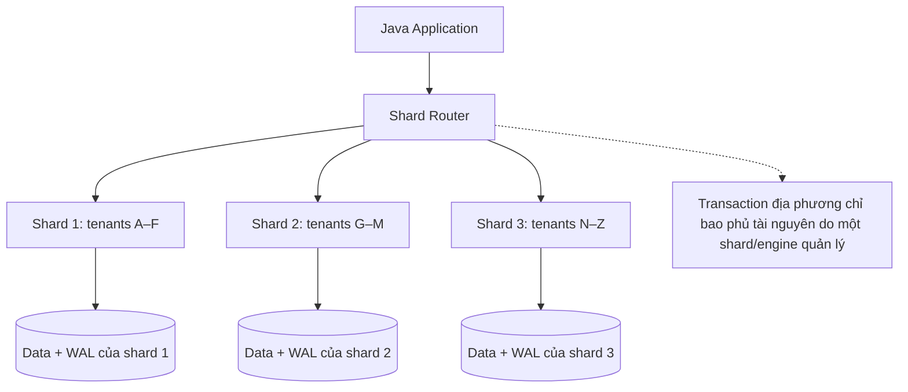
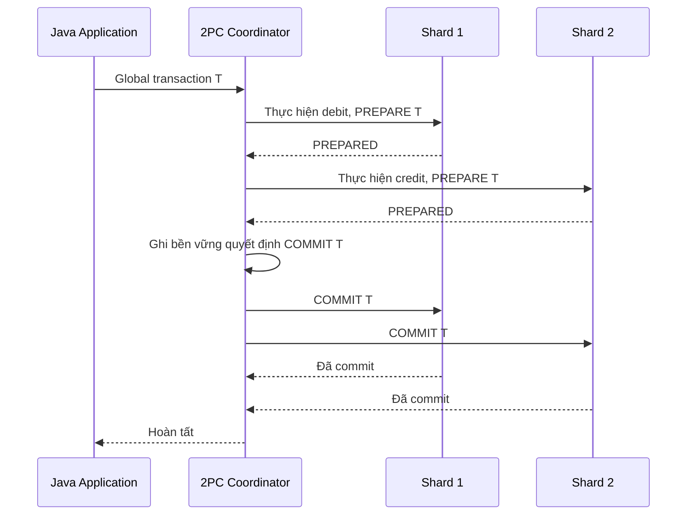
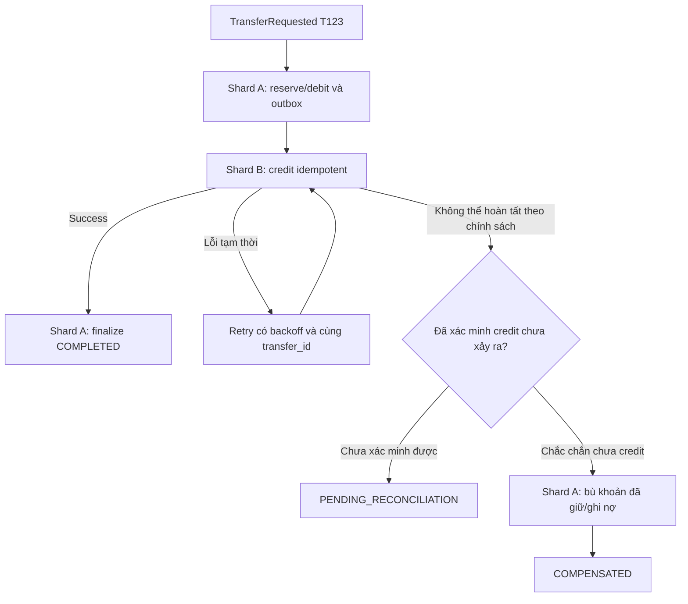

# Phạm vi giao dịch trong một phân mảnh và nhiều phân mảnh

## Mục tiêu học tập

Sau bài học, người học có thể:

- Phân biệt **partition** trong cùng một database với **shard** do nhiều database/nút độc lập quản lý, và xác định ranh giới ACID thực tế của từng loại.
- Giải thích vì sao nhiều hàng hoặc nhiều bảng **trên cùng một shard** thường có thể nằm trong một transaction địa phương, còn một thao tác trải qua **nhiều shard** không tự có tính nguyên tử.
- Thiết kế shard key, chiến lược routing và ranh giới aggregate để phần lớn thao tác nghiệp vụ diễn ra trong một shard.
- So sánh **distributed transaction/2PC/XA**, **saga**, **transactional outbox**, idempotency và reconciliation dựa trên yêu cầu nhất quán, khả dụng và độ phức tạp vận hành.
- Viết luồng Java/JDBC cho giao dịch cục bộ và nhận diện lý do hai lệnh `commit()` trên hai connection không tạo ra một transaction chung.
- Phân tích lỗi từng phần, timeout, retry, cô lập, ràng buộc toàn cục và kiểm thử recovery trong hệ thống lưu trữ phân tán.

## 1. Vấn đề cốt lõi: một hành động nghiệp vụ, nhiều nơi lưu dữ liệu

Một ứng dụng Java quản lý ví điện tử phục vụ hàng triệu khách hàng. Để mở rộng, hệ thống chia dữ liệu theo `tenant_id` hoặc `account_id` ra nhiều shard. Khi chuyển tiền giữa hai tài khoản nằm trên **cùng shard**, một database engine có thể cập nhật hai số dư trong **một transaction**. Nhưng khi hai tài khoản nằm ở **hai shard khác nhau**, ứng dụng không thể mặc nhiên coi hai câu SQL đó là một transaction chỉ vì chúng chạy trong cùng phương thức Java.

Ví dụ cần chuyển 100 đơn vị từ A ở shard 1 sang B ở shard 2:

```text
Shard 1: UPDATE account A SET balance = balance - 100;
Shard 1: COMMIT;  -- Đã xác nhận ghi nợ.

Shard 2: UPDATE account B SET balance = balance + 100;
Shard 2: COMMIT;  -- Nếu kết nối lỗi trước bước này thì sao?
```

Giả sử shard 1 commit thành công nhưng shard 2 mất kết nối và không ghi có. Hệ thống đã đi vào trạng thái **thành công một phần**: tổng tài sản có thể bị lệch cho đến khi xử lý bù hoặc khôi phục. Không có cơ chế tự động rollback lần commit trên shard 1 bằng `rollback()` của shard 2.

Trong module `DATA_PERSISTENCE_FUNDAMENTALS`, hiểu giới hạn này nối các kiến thức về giao dịch ACID, cô lập, kiểm soát đồng thời, kết nối, độ bền, mô hình dữ liệu và ranh giới persistence của Java với thực tế mở rộng database trên nhiều nút.

**Câu hỏi thiết kế:** một invariant nghiệp vụ cần được giữ trong **một transaction địa phương**, hay cần một **giao thức điều phối giữa nhiều tài nguyên lưu trữ**?

## 2. Thuật ngữ: partition không luôn đồng nghĩa shard độc lập

### 2.1. Partition trong một hệ quản trị

Một bảng PostgreSQL có thể được chia thành các **partition** theo vùng thời gian, tenant hoặc khóa khác. Nếu tất cả partition nằm dưới **cùng một PostgreSQL database instance** và transaction manager của instance đó quản lý chúng, một transaction có thể sửa nhiều partition và commit atomically theo cơ chế của database.

Việc hai hàng nằm ở **hai table partition** không tự làm chúng thành một giao dịch phân tán. Ví dụ một lệnh PostgreSQL thay đổi hai partition của một bảng được partition bằng `PARTITION BY RANGE` vẫn thuộc một transaction database thông thường, nếu cả hai partition do một engine quản lý.

### 2.2. Shard là ranh giới ownership/transaction

Trong kiến trúc sharding thông dụng, mỗi **shard** sở hữu một tập dữ liệu và có cơ chế commit/replication/failure riêng. Các shard có thể chạy trên những database instance hoặc cụm máy khác nhau. Một connection JDBC gắn với shard 1 không thể tự làm `COMMIT` nguyên tử cho shard 2.



Sơ đồ chỉ minh họa: phân vùng theo chữ cái là ví dụ dễ hiểu, không phải đề xuất cho workload thực. Có hệ thống **distributed SQL** hỗ trợ transaction nhiều partition/shard bằng một transaction coordinator và giao thức nội bộ; khi ấy client có thể dùng một API transaction nhưng **chi phí và phạm vi bảo đảm** vẫn do hệ thống phân tán triển khai, không phải mọi shard tự động có ACID toàn cụm.

| Thuật ngữ | Ý nghĩa | Quan hệ với transaction |
| --- | --- | --- |
| **Partition** | Phân chia logic/vật lý của bảng theo khóa/điều kiện | Có thể vẫn thuộc một transaction manager |
| **Shard** | Đơn vị sở hữu một phần dữ liệu, thường có database/leader/replica riêng | Một transaction cục bộ thường không bao phủ shard khác |
| **Replica** | Bản sao của dữ liệu một shard để chịu lỗi hoặc phục vụ đọc | Replica lag không tạo ra transaction phân tán; ảnh hưởng độ mới của đọc |
| **Coordinator** | Thành phần điều phối một workflow/transaction qua nhiều participant | Cần cơ chế ghi trạng thái bền vững và recovery |
| **Participant** | Database/shard tham gia thao tác phân tán | Chịu trách nhiệm chuẩn bị, commit hoặc thực hiện bước saga |

**Không suy phạm vi transaction từ tên thư mục, bảng, database URL hoặc số JVM.** Phải xác định **có bao nhiêu transaction manager độc lập** tham gia và hợp đồng commit của hệ thống cụ thể.

## 3. Shard key quyết định transaction cục bộ có thường xuyên xảy ra hay không

### 3.1. Co-location: dữ liệu thường giao dịch chung nên nằm cùng shard

Với ứng dụng SaaS, nếu mọi đơn hàng, chi tiết đơn và phương thức thanh toán nội bộ của một tenant thường cập nhật cùng nhau, đặt `tenant_id` làm thành phần **shard key** có thể giúp phần lớn use case vận hành trên một shard.

```text
tenant_42
  orders      -> shard 2
  order_items -> shard 2
  inventory   -> shard 2 (nếu tồn kho được sở hữu theo tenant)

tenant_99
  orders      -> shard 7
  order_items -> shard 7
```

Khi tất cả dữ liệu cần cập nhật thuộc cùng shard và **được một database transaction quản lý**, có thể dùng một `BEGIN`/`COMMIT`. Nếu tồn kho là **tài nguyên chia sẻ toàn hệ thống** thay vì riêng tenant, việc đặt bảng đơn hàng theo tenant chưa chắc giúp transaction giữ hàng ở một shard. Shard key phải phản ánh **aggregate và invariant**, không chỉ nhu cầu phân bố hàng.

### 3.2. Ưu điểm và nhược điểm của những kiểu chọn khóa

| Shard key | Điểm mạnh | Rủi ro |
| --- | --- | --- |
| `tenant_id` | Dễ co-locate các thao tác trong một tenant, thuận tiện cách ly quyền | Tenant lớn tạo hot shard; giao dịch qua tenant là cross-shard |
| `account_id` | Phân tán tải theo tài khoản | Chuyển tiền giữa hai tài khoản thường cross-shard |
| `order_id` | Phân phối đơn hàng, truy cập đơn theo ID nhanh | Tổng hợp dữ liệu theo khách hàng/tenant có thể fan-out |
| `created_at` / time bucket | Hữu ích cho dữ liệu sự kiện, lưu giữ và xóa theo thời gian | Dễ tạo hot partition ở khoảng mới nhất; một workflow có thể trải nhiều kỳ |

Khóa phân mảnh ảnh hưởng đến **routing, chỉ mục, uniqueness, joins, data locality, rebalancing và giao dịch**. Thêm shard không tự giải quyết một shard quá nóng nếu tất cả request vẫn đánh vào cùng một key.

### 3.3. Routing phải ổn định và kiểm tra quyền

Một cách trừu tượng phía Java:

```java
import java.util.UUID;
import javax.sql.DataSource;

interface ShardRouter {
    DataSource dataSourceForTenant(UUID tenantId);
}
```

Ứng dụng lấy `tenantId` từ ngữ cảnh đã **xác thực/ủy quyền**, không tin một tenant ID tùy ý do client gửi để truy cập dữ liệu khác. Khi routing, không để query trên shard A nhầm dữ liệu tenant B: câu SQL vẫn cần ràng buộc `tenant_id` và database role/Row Level Security khi phù hợp.

Trong thực tế, router có thể dùng consistent hashing, bảng ánh xạ tenant→shard hoặc dịch vụ metadata. Nếu có **di chuyển tenant giữa shard**, router và writer phải thống nhất epoch/generation hoặc giao thức chuyển ownership; nếu không, hai nút ứng dụng có thể ghi vào cả shard cũ và mới, tạo phân kỳ.

## 4. Giao dịch trong một shard: ACID nằm ở một điểm commit

Giả sử hai tài khoản thuộc cùng tenant và cùng nằm trên một PostgreSQL shard. Cơ sở dữ liệu quản lý hai bản ghi bằng **cùng transaction**:

```sql
CREATE TABLE account (
    tenant_id UUID NOT NULL,
    account_id UUID NOT NULL,
    balance NUMERIC(18, 2) NOT NULL
        CHECK (balance >= 0),
    PRIMARY KEY (tenant_id, account_id)
);

-- Hai tài khoản của cùng tenant/shard.
-- Dữ liệu minh họa; UUID phải được thay bằng định danh thử nghiệm hợp lệ.
```

Trong một transaction địa phương:

```sql
BEGIN;

UPDATE account
SET balance = balance - 100.00
WHERE tenant_id = :tenant_id
  AND account_id = :from_id
  AND balance >= 100.00;
-- Bắt buộc xác minh có đúng 1 hàng được cập nhật.

UPDATE account
SET balance = balance + 100.00
WHERE tenant_id = :tenant_id
  AND account_id = :to_id;
-- Bắt buộc xác minh có đúng 1 hàng được cập nhật.

COMMIT;
```

Cú pháp `:tenant_id` ở đây là **placeholder diễn giải**, không phải placeholder được `psql` hiểu nguyên bản. Trong JDBC, dùng dấu `?` của `PreparedStatement`. Nếu một bước trả 0 hàng hoặc có exception, **ROLLBACK** thay vì `COMMIT`. Với cùng connection/transaction, cả ghi nợ và ghi có thành công cùng nhau hoặc đều bị rollback theo hợp đồng ACID của PostgreSQL.

### 4.1. ACID cục bộ không tự giải quyết mọi bất biến

- **Atomicity:** commit/rollback cả hai thay đổi của transaction ở **cùng engine**.
- **Consistency:** database giữ các constraint khai báo; các invariant nghiệp vụ phức tạp vẫn cần mã/locking/isolation đúng.
- **Isolation:** `READ COMMITTED`, `REPEATABLE READ` hay `SERIALIZABLE` cho hành vi khác nhau; ví dụ hai hàng khác nhau vẫn có thể gây deadlock nếu nhiều luồng lấy khóa theo thứ tự ngược.
- **Durability:** các commit được xác nhận có bảo đảm theo cấu hình WAL, replication và lưu trữ của shard. Durability không đồng nghĩa đã có backup hoặc đã đồng bộ tới mọi replica.

Để hạn chế deadlock, chọn thứ tự thao tác/khóa nhất quán cho những workflow chuyển tiền có chiều ngược nhau. Để tránh xử lý lại một giao dịch tiền sau khi mất phản hồi, cần `transfer_id` hoặc idempotency key với constraint duy nhất, không chỉ dựa vào lệnh `UPDATE` hợp lệ.

### 4.2. Ví dụ Java/JDBC: chọn đúng shard và dùng một connection

Ví dụ sau là luồng cục bộ với PostgreSQL. `ShardRouter` chọn `DataSource` theo `tenantId`; cả hai lệnh ghi dùng **cùng một `Connection`**, có kiểm tra row count và rollback khi không đáp ứng điều kiện. Giả định tài khoản nguồn và đích đã được xác thực là cùng tenant; số tiền đã được xử lý theo quy tắc tiền tệ của hệ thống.

```java
import java.math.BigDecimal;
import java.sql.Connection;
import java.sql.PreparedStatement;
import java.sql.SQLException;
import java.util.UUID;
import javax.sql.DataSource;

public final class LocalTransferService {
    private final ShardRouter router;

    public LocalTransferService(ShardRouter router) {
        this.router = router;
    }

    public void transfer(
            UUID tenantId, UUID fromId, UUID toId, BigDecimal amount)
            throws SQLException {
        if (tenantId == null || fromId == null || toId == null
                || amount == null || amount.signum() <= 0
                || fromId.equals(toId)) {
            throw new IllegalArgumentException("Invalid transfer");
        }

        DataSource shard = router.dataSourceForTenant(tenantId);
        try (Connection connection = shard.getConnection()) {
            connection.setAutoCommit(false);
            try {
                int debited = updateBalance(
                        connection,
                        "UPDATE account SET balance = balance - ? "
                        + "WHERE tenant_id = ? AND account_id = ? "
                        + "AND balance >= ?",
                        amount, tenantId, fromId, amount);

                if (debited != 1) {
                    throw new IllegalStateException(
                            "Source not found or insufficient balance");
                }

                int credited = updateBalance(
                        connection,
                        "UPDATE account SET balance = balance + ? "
                        + "WHERE tenant_id = ? AND account_id = ?",
                        amount, tenantId, toId, null);

                if (credited != 1) {
                    throw new IllegalStateException(
                            "Destination account not found");
                }

                connection.commit();
            } catch (SQLException | RuntimeException error) {
                try {
                    connection.rollback();
                } catch (SQLException rollbackError) {
                    error.addSuppressed(rollbackError);
                }
                throw error;
            }
        }
    }

    private static int updateBalance(
            Connection connection, String sql, BigDecimal amount,
            UUID tenantId, UUID accountId, BigDecimal minimum)
            throws SQLException {
        try (PreparedStatement statement = connection.prepareStatement(sql)) {
            statement.setBigDecimal(1, amount);
            statement.setObject(2, tenantId);
            statement.setObject(3, accountId);
            if (minimum != null) {
                statement.setBigDecimal(4, minimum);
            }
            return statement.executeUpdate();
        }
    }
}
```

**Phạm vi của ví dụ:** nó chứng minh cách dùng một transaction trên một shard, **không phải** implementation hoàn chỉnh cho dịch vụ tài chính. Chưa có ledger/idempotency key, phí, hạn mức, quy trình phê duyệt, kiểm soát gian lận hoặc retry khi kết quả commit không rõ. Trong triển khai thật, ghi `transfer_id` vào bảng ledger có `UNIQUE (tenant_id, transfer_id)` **trong cùng transaction** để một yêu cầu đã xử lý không bị ghi nợ lần hai khi request được gửi lại.

Một số quy tắc thêm:

- Tránh giữ connection/transaction mở khi gọi API ngoài hoặc chờ người dùng.
- Nếu dùng Spring `@Transactional`, bảo đảm transaction manager và JDBC repositories thực sự tham gia vào **cùng DataSource của shard đã chọn**. Một annotation trên service không tự gộp hai DataSource tùy ý thành một transaction chung.
- Kết quả `COMMIT` có thể **không rõ** khi mất kết nối đúng lúc nhận phản hồi: database có thể đã commit dù client nhận lỗi. Không retry mù bằng thao tác ghi nợ mới; tra cứu theo idempotency key trước.
- Với nhiều shard, định tuyến tenant có thể thay đổi khi resharding. Transaction phải được ghim vào một shard ownership epoch xác định trong suốt vòng đời.

## 5. Giao dịch qua nhiều shard: không thể chỉ mở hai JDBC connection

Giả sử tài khoản A nằm trên shard 1 và B nằm trên shard 2:

```java
// VÍ DỤ SAI: không tạo được atomic transfer qua hai shard.
try (Connection a = shard1.getConnection();
     Connection b = shard2.getConnection()) {
    a.setAutoCommit(false);
    b.setAutoCommit(false);

    // execute debit on a
    // execute credit on b

    a.commit();
    b.commit(); // Có thể thất bại sau khi a đã commit!
}
```

Hai `Connection` có **hai transaction cục bộ khác nhau**. `a.commit()` và `b.commit()` không hợp thành một thao tác nguyên tử. Ngay cả khi đặt cả hai trong một `try` hoặc gắn `@Transactional` lên phương thức Java, phần transaction coordinator thực tế vẫn phải được xác định.

### Các kiểu kết quả có thể xuất hiện

| Trạng thái shard 1 | Trạng thái shard 2 | Kết quả |
| --- | --- | --- |
| Chưa commit, rollback | Chưa commit, rollback | Không có chuyển tiền |
| Commit debit | Commit credit | Cả hai bên đã ghi, nhưng có thể có khoảng thời gian quan sát không đồng bộ |
| Commit debit | Không commit credit | **Thành công một phần**, cần khôi phục/bù |
| Không rõ commit debit | Commit credit | Client không thể kết luận chỉ từ lỗi kết nối; cần đối soát |
| Commit debit | Không liên lạc được shard 2 lâu dài | Không thể đảm bảo cả nhất quán tức thì và khả dụng vô hạn bằng mã ứng dụng đơn giản |

Khác biệt giữa **lỗi đã biết** và **kết quả không rõ** rất quan trọng: timeout không chứng minh thao tác chưa xảy ra. Đây là nguyên nhân phải có ID giao dịch toàn cục, trạng thái được lưu bền vững, thao tác idempotent và công cụ recovery.

## 6. Two-phase commit (2PC): chuẩn bị trước, ra quyết định chung

**Two-phase commit (2PC)** dùng coordinator để điều phối nhiều participant sao cho các participant chuẩn bị trước khi kết thúc một quyết định commit/abort chung.

### Pha 1 — Prepare

1. Coordinator bắt đầu một global transaction ID duy nhất.
2. Các shard thực hiện thay đổi trong transaction cục bộ nhưng **chưa công bố commit cuối cùng**.
3. Coordinator gửi yêu cầu **PREPARE** đến từng participant.
4. Participant xác nhận đã chuẩn bị và ghi bền vững thông tin cần thiết để có thể tuân theo quyết định cuối cùng, hoặc từ chối prepare.

### Pha 2 — Commit hoặc Abort

- Nếu **tất cả** participant báo prepared, coordinator ghi **quyết định COMMIT bền vững** rồi gửi commit đến các participant.
- Nếu có participant không thể prepare, coordinator quyết định **ABORT/ROLLBACK** và phát lệnh rollback thích hợp.
- Nếu đường truyền lỗi sau quyết định, coordinator phải có khả năng **phát lại quyết định** để các participant còn treo hoàn tất.



### 6.1. Cái giá của 2PC

2PC có thể bảo vệ **atomic commit** giữa các participant khi coordinator và participant đáp ứng giao thức. Nhưng nó có các chi phí:

- Thêm round-trip mạng và thao tác ghi bền vững của coordinator/participant.
- Transaction đã **prepared** có thể giữ tài nguyên, lock và ảnh hưởng đến các giao dịch khác trong khi chờ quyết định.
- Coordinator mất liên lạc vào lúc nhạy cảm có thể để transaction ở trạng thái **in-doubt**; participant phải chờ recovery/điều phối lại, không thể tự suy đoán commit.
- Atomic commit **không tự đảm bảo một snapshot đọc toàn cục có isolation phù hợp**. Cần xem hợp đồng isolation/distributed serializability riêng của hệ thống.
- Sự cố mạng có thể làm giảm **availability**, đặc biệt khi participant đã prepared và không thể nhận quyết định.

**2PC không có nghĩa không bao giờ có trạng thái tạm thời chưa đồng bộ khi quan sát từng shard.** Nó hướng tới quyết định commit/abort nhất quán sau khi recovery, trong khi các API đọc riêng lẻ hoặc cơ chế cô lập vẫn có thể có hành vi khác nhau. Nếu ứng dụng yêu cầu nhìn một trạng thái toàn cục nguyên tử qua các bản đọc phân tán, cần hệ thống cung cấp đúng hợp đồng đọc/transaction đó.

### 6.2. PostgreSQL prepared transaction là cơ chế nền, không phải coordinator

PostgreSQL có các lệnh `PREPARE TRANSACTION`, `COMMIT PREPARED` và `ROLLBACK PREPARED` khi tính năng prepared transactions được cấu hình phù hợp. Ví dụ **chỉ để minh họa cú pháp**, không chạy trên production:

```sql
-- Trên shard thử nghiệm, với max_prepared_transactions được cấu hình.
BEGIN;
UPDATE account SET balance = balance - 100.00
WHERE tenant_id = '22222222-2222-2222-2222-222222222222'
  AND account_id = '11111111-1111-1111-1111-111111111111'
  AND balance >= 100.00;
-- Chỉ PREPARE nếu đã kiểm tra điều kiện và số hàng thực sự được sửa.
PREPARE TRANSACTION 'transfer-T123-shard1';

-- Sau khi coordinator quyết định chung và đã ghi quyết định bền vững:
COMMIT PREPARED 'transfer-T123-shard1';
-- Hoặc nếu quyết định abort:
-- ROLLBACK PREPARED 'transfer-T123-shard1';
```

Lệnh `PREPARE TRANSACTION` đưa transaction thành **prepared**; nó chưa commit và có thể tiếp tục giữ khóa. Không chạy cả commit và rollback cho cùng ID. Trong thực hành phải dùng ID duy nhất, ghi trạng thái coordinator bền vững và có quy trình giải quyết **in-doubt transactions**; không dựa vào một script thủ công để điều phối nhiều shard.

PostgreSQL `max_prepared_transactions` có thể mặc định vô hiệu hóa trên một số triển khai; cloud database/managed service có thể không hỗ trợ hoặc giới hạn chức năng này. Cần kiểm tra hợp đồng cụ thể của dịch vụ lưu trữ. Có thể quan sát prepared transaction qua `pg_prepared_xacts`; **không tự ý commit/rollback các transaction prepared chưa rõ chủ sở hữu** khi xảy ra sự cố.

### 6.3. XA/JTA trong Java và những hiểu nhầm

Trong hệ sinh thái Java, **JTA** định nghĩa API điều phối transaction, và `XAResource`/`XADataSource` có thể tham gia giao thức phân tán khi driver, resource manager và transaction manager hỗ trợ. Một nền tảng như Jakarta EE hoặc cấu hình transaction manager chuyên dụng có thể điều phối hai XA resource.

Tuy nhiên:

- `@Transactional` của Spring trên một `DataSourceTransactionManager` thông thường **không tự cung cấp XA** cho hai shard.
- Hai `DataSource`, kể cả cùng vendor PostgreSQL, không mặc nhiên tạo một global transaction.
- Dịch vụ cloud hoặc proxy kết nối có thể **không tương thích** với prepared transactions/XA.
- Coordinator phải có log bền vững, khôi phục sau restart, timeout, giám sát prepared transactions và chính sách vận hành rõ ràng.

Khi cần 2PC, chọn một stack **được kiểm chứng end-to-end** (transaction manager, XA drivers, database configuration và operational recovery), không tự viết nửa coordinator trong service Java rồi gọi đó là atomic.

## 7. Saga: nhiều transaction cục bộ, nhất quán qua workflow

Không phải hệ thống nào cũng muốn hoặc có thể giữ transaction prepared trên nhiều database. **Saga** phân rã một nghiệp vụ lớn thành những **transaction cục bộ đã commit**, mỗi bước có một hành động tiếp theo và, khi phù hợp, một **hành động bù (compensation)** nếu workflow không hoàn tất.

Ví dụ chuyển tài sản qua hai shard theo workflow có kiểm soát:

1. **Reserve/Debit trên shard A:** ghi một bản ghi chuyển tiền `PENDING` và giữ/ghi nợ khoản tiền, có `transfer_id` idempotent.
2. **Credit trên shard B:** ghi có đúng một lần theo `transfer_id`.
3. **Finalize trên shard A:** đánh dấu chuyển tiền đã hoàn tất theo cùng `transfer_id`.
4. Nếu bước credit không thể hoàn tất sau quy trình retry và xác nhận chưa được thực hiện, **compensate** trên A bằng nghiệp vụ hoàn trả và ghi trạng thái `COMPENSATED`.



**Saga không cung cấp atomicity tức thời như một transaction ACID duy nhất.** Giữa bước 1 và bước 2 có thể có trạng thái tạm thời không cân bằng; hệ thống phải định nghĩa rõ ý nghĩa của `PENDING`, thông tin người dùng nhìn thấy, SLA xử lý, lỗi trung gian và cách đối soát.

### 7.1. Compensation không phải database rollback

Một transaction đã commit ở shard A **không thể được rollback bằng `ROLLBACK` thông thường** sau đó. Compensation là **một transaction nghiệp vụ mới** và có thể cũng thất bại.

Ví dụ:

- Một đơn hàng đã giữ chỗ có thể bù bằng **release reservation**, nếu chưa sử dụng chỗ.
- Một giao dịch gửi email không thể “thu hồi email đã đọc” một cách hoàn hảo.
- Một khoản tiền đã chuyển sang bên thứ ba có thể yêu cầu một **giao dịch hoàn trả** với số liệu và log riêng, không chỉ đảo dấu một `UPDATE` mà bỏ qua kiểm tra pháp lý/nghiệp vụ.
- Nếu sau lỗi timeout không biết bước credit đã thành công chưa, **không tự hoàn trả ngay** vì có nguy cơ vừa hoàn trả trên A vừa đã ghi có trên B.

Vì thế, saga cần một **state machine**, ID bền vững, lịch sử thực thi, chính sách retry và phân loại lỗi. Các thao tác bù phải idempotent và được quan sát như nghiệp vụ thật.

### 7.2. Orchestration và choreography

| Cách điều phối | Mô tả | Ưu điểm | Rủi ro |
| --- | --- | --- | --- |
| **Orchestration** | Một saga coordinator lưu trạng thái và chỉ đạo từng bước | Dễ nhìn toàn bộ tiến độ, retry/timeout và chuyển trạng thái | Coordinator phải bền vững, tránh thành điểm yếu không thể phục hồi |
| **Choreography** | Các service phản ứng với sự kiện của bước trước | Giảm coupling tới một coordinator trung tâm | Dễ mất cái nhìn toàn cảnh, vòng sự kiện, khó đối soát và debug |

Một saga coordinator không cần giữ database transaction mở qua các lời gọi mạng. Ngược lại, nó phải **lưu trạng thái workflow** để có thể tiếp tục sau khi process Java restart. Với choreography, event delivery và việc xử lý tại mỗi consumer cũng phải được thiết kế theo at-least-once/idempotency.

## 8. Transactional outbox: nối commit cục bộ với thông điệp đáng tin cậy

Giả sử shard A đã commit việc giữ tiền rồi Java gọi message broker để thông báo cho shard B:

```text
BEGIN on shard A
UPDATE account ...
COMMIT on shard A
publish TransferReserved(T123) to broker
```

Nếu Java chết **sau commit nhưng trước publish**, shard B không nhận thông điệp. Nếu Java publish trước commit, shard A có thể rollback và shard B lại xử lý một sự kiện không có thay đổi đã commit tương ứng.

**Transactional outbox** xử lý cửa sổ lỗi ấy bằng cách ghi bản ghi event vào **cùng transaction cục bộ** với thay đổi nghiệp vụ:

```sql
-- Mô hình minh họa, trên một shard PostgreSQL.
CREATE TABLE transfer_outbox (
    event_id UUID PRIMARY KEY,
    tenant_id UUID NOT NULL,
    transfer_id UUID NOT NULL,
    event_type TEXT NOT NULL,
    payload JSONB NOT NULL,
    created_at TIMESTAMPTZ NOT NULL DEFAULT now(),
    published_at TIMESTAMPTZ
);

BEGIN;
-- UPDATE account ...;
-- INSERT transfer_ledger ...;
INSERT INTO transfer_outbox (
    event_id, tenant_id, transfer_id, event_type, payload)
VALUES (?, ?, ?, 'TransferReserved', ?::jsonb);
COMMIT;
```

Đây là đoạn SQL **minh họa dùng parameter binding**: dấu `?` là placeholder của JDBC, không phải SQL chạy trực tiếp trong `psql`. Các bước `UPDATE` và `INSERT transfer_ledger` chỉ là vị trí cần hiện thực trong transaction; để production-ready phải kiểm tra điều kiện, số hàng cập nhật và idempotency key.

Worker outbox sau đó:

1. Tải các event chưa publish theo thứ tự phù hợp và có cơ chế claim/lease.
2. Gửi đến broker với `event_id` và `transfer_id` ổn định.
3. Ghi nhận đã publish sau khi nhận acknowledgement theo hợp đồng broker.
4. Retry khi lỗi, có backoff, cảnh báo và dead-letter/reconciliation khi quá hạn.

**Outbox không tự đảm bảo exactly-once trên toàn chuỗi.** Nếu worker publish thành công nhưng chết trước khi cập nhật `published_at`, event có thể bị gửi lại. Consumer ở shard B phải **deduplicate theo ID sự kiện/nghiệp vụ** và thực thi idempotent trong cùng transaction với cập nhật dữ liệu.

### 8.1. Inbox/deduplication ở shard nhận

Ví dụ shard B có bảng:

```sql
CREATE TABLE processed_transfer_event (
    event_id UUID PRIMARY KEY,
    transfer_id UUID NOT NULL UNIQUE,
    processed_at TIMESTAMPTZ NOT NULL DEFAULT now()
);
```

Một consumer được triển khai đúng sẽ, **trong một transaction duy nhất trên shard B**:

1. Kiểm tra/ghi key dedup có unique constraint.
2. Nếu event đã xử lý, không ghi có lần hai.
3. Nếu là event mới, kiểm tra `transfer_id`, account đích, dữ liệu và trạng thái, rồi ghi có.
4. Commit **cùng lúc** bản ghi dedup và cập nhật số dư.

Nếu bước ghi có thất bại, rollback luôn bản ghi dedup; nếu transaction commit nhưng phản hồi tới broker mất, lần gửi lại sẽ nhận diện event đã xử lý. **Không dùng `SELECT exists` rồi `INSERT` ở hai transaction khác nhau** làm cơ chế dedup duy nhất, vì các consumer chạy đồng thời có thể cùng nhìn “chưa có”.

Trong thực tế, `event_id` và `transfer_id` có vai trò khác nhau: một transfer có thể phát **nhiều sự kiện theo giai đoạn**. Không đặt `UNIQUE(transfer_id)` trên inbox chung cho tất cả loại event nếu workflow hợp pháp cần xử lý nhiều event của cùng transfer; thay bằng khóa dedup phù hợp, chẳng hạn `(transfer_id, event_type, step_version)`. Bảng trên giả định **một event ghi có duy nhất cho mỗi transfer**.

### 8.2. Java orchestration ở mức hợp đồng nghiệp vụ

Một thiết kế domain/application không cần giữ hai connection mở trong khi chờ mạng:

```java
import java.util.UUID;

enum TransferState {
    REQUESTED, RESERVED, CREDITED, COMPLETED,
    COMPENSATING, COMPENSATED, NEEDS_RECONCILIATION
}

record TransferCommand(
        UUID transferId,
        UUID sourceAccount,
        UUID destinationAccount,
        long amountMinorUnits) {}

interface LocalDebitPort {
    // Ghi nợ/reserve và outbox trong cùng transaction của shard nguồn.
    void reserveOnce(TransferCommand command);
}

interface LocalCreditPort {
    // Ghi có và inbox dedup trong cùng transaction của shard đích.
    void creditOnce(TransferCommand command);
}

interface TransferSagaStore {
    // Trạng thái phải được lưu bền vững, có version/compare-and-set.
    TransferState stateOf(UUID transferId);
    void transitionOnce(
            UUID transferId, TransferState expected, TransferState next);
}
```

Đây là **hợp đồng thiết kế**, không phải toàn bộ saga engine. Những port này cần adapter thực thi transaction/constraint/timeout/retry đúng shard. Ngoài ra, cần xử lý mâu thuẫn trạng thái, sự kiện trễ, thiếu thông điệp, replay, giới hạn số lần retry, authorization và audit. Không gọi `creditOnce()` đồng bộ rồi mặc nhiên tin rằng coordinator sẽ hoàn tất khi máy chết giữa hai bước; phải có một nguồn **lưu trạng thái + giao việc bền vững**.

### 8.3. State machine, không chỉ cờ boolean

Một hàng `transfer(status='PENDING')` đơn lẻ thường chưa đủ để giải thích đã debit chưa, đã credit chưa, hay đang đợi đối soát. Trạng thái cần có:

- `transfer_id` hoặc idempotency key của yêu cầu.
- Trạng thái từng bước, version, số lần thử, thời hạn retry và thời điểm thay đổi.
- Tham chiếu tới ledger entries/event IDs để đối chiếu.
- Kết quả cuối cùng và lý do thất bại (đã xử lý hay chưa thể xác nhận).
- Cơ chế claim/lease để hai worker không cùng điều phối một bước.

Chỉ chuyển trạng thái bằng **compare-and-set/optimistic locking** hoặc cơ chế khóa phù hợp. Một workflow đã `COMPLETED` không được bị một event retry cũ đưa về `PENDING`.

## 9. Chọn 2PC hay saga theo invariant và yêu cầu vận hành

| Tiêu chí | 2PC / distributed transaction | Saga / local transactions |
| --- | --- | --- |
| Cam kết chính | Điều phối quyết định atomic commit/abort giữa participants | Mỗi bước cục bộ atomic; toàn workflow đạt kết quả qua các bước |
| Trạng thái trung gian | Participant có thể giữ prepared/locks; hành vi đọc tùy isolation | Trạng thái tạm thời có thể nhìn thấy, cần định nghĩa `PENDING` |
| Khi một shard không liên lạc được | Có thể chặn tiến trình commit/recovery | Có thể retry, tạm dừng hoặc compensate theo chính sách |
| Độ trễ | Thêm round trips, prepare và log bền vững | Workflow có thể kéo dài nhiều giây/phút, không giữ transaction mở |
| Cơ chế khôi phục | Coordinator log, resolution của in-doubt transactions | Saga store, outbox/inbox, retry, compensation, reconciliation |
| Phù hợp | Invariant cần atomic commit mạnh, stack hỗ trợ thật | Quy trình nghiệp vụ có thể mô hình hóa thành bước/bù |
| Rủi ro chính | Blocking, prepared locks, thiếu support XA/2PC | Thiết kế bù sai, duplicate event, trạng thái trung gian kéo dài |

**Không có lựa chọn thắng tuyệt đối.** Một thao tác phải commit atomically qua hai nguồn ghi có thể yêu cầu distributed transaction được DBMS hỗ trợ; một quy trình đặt hàng–thanh toán–vận chuyển thường có tác vụ ngoài DB và phù hợp với state machine/saga hơn. Khi invariant không thể cho phép trạng thái tạm thời mà nền tảng không hỗ trợ transaction nhiều shard đúng nghĩa, có thể phải **đặt dữ liệu cùng shard hoặc thay đổi mô hình sở hữu** thay vì cố vá bằng retry.

## 10. Những bất biến khó giữ khi dữ liệu trải qua nhiều shard

### 10.1. Unique constraint thường chỉ có hiệu lực tại một shard

Ví dụ mỗi shard có:

```sql
CREATE TABLE customer (
    tenant_id UUID NOT NULL,
    customer_id UUID NOT NULL,
    email TEXT NOT NULL,
    PRIMARY KEY (tenant_id, customer_id),
    UNIQUE (tenant_id, email)
);
```

Nếu **mọi khách hàng cùng tenant luôn được đặt trên cùng shard** thì `UNIQUE (tenant_id, email)` tại shard đó có thể bảo vệ tính duy nhất **trong tenant**. Nhưng nếu yêu cầu “email duy nhất trên **toàn hệ thống**” mà cùng một email có thể xuất hiện trên nhiều shard, unique constraint riêng lẻ trên từng shard **không đủ**.

Các hướng xử lý:

- Đặt toàn bộ dữ liệu thuộc phạm vi unique về cùng shard nếu khả thi.
- Có một **registry/ownership service** sở hữu khóa unique toàn cục và nhận yêu cầu tạo trước, với giao thức xác nhận/khôi phục rõ ràng.
- Dùng database phân tán **thực sự hỗ trợ global unique constraint** theo hợp đồng của nó.
- Thay đổi yêu cầu nghiệp vụ thành “unique trong tenant” nếu đó mới là giới hạn cần thiết, tránh ràng buộc toàn cục không cần thiết.

Tự chạy `SELECT email` trên tất cả shard trước rồi `INSERT` vào một shard **không an toàn** trước cạnh tranh: hai request có thể cùng nhìn “chưa tồn tại” và cùng insert. Fan-out read không thể thay thế cơ chế phân xử unique khi nhiều writer cùng chạy.

### 10.2. Foreign key và quan hệ giữa shard

Một foreign key thông thường trong một database có thể buộc `order_item.order_id` phải tham chiếu một đơn hợp lệ. Khi `order_item` và `order` ở hai shard độc lập, không nên mặc định ràng buộc `FOREIGN KEY` địa phương vẫn xác nhận được sự tồn tại trên shard khác.

Nếu relation luôn cần commit và xóa cùng nhau, ưu tiên co-location. Nếu không thể, định nghĩa quy tắc **eventual referential integrity**, bao gồm:

- Kiểm tra quyền sở hữu và tồn tại ở nơi có thẩm quyền khi tạo tham chiếu.
- Ghi trạng thái trung gian để xử lý điều kiện source chưa cập nhật.
- Reconciliation tìm tham chiếu mồ côi và quyết định sửa, bù hoặc cảnh báo.
- Chính sách khi xóa đối tượng nguồn: tombstone, sự kiện xóa, delay cho tới khi downstream xác nhận.

Không gọi một kiểm tra từ xa là “foreign key mạnh” nếu nó có cửa sổ lỗi khi hai service cạnh tranh tạo/xóa đối tượng.

### 10.3. Counter, quota và điều kiện tổng hợp

Giới hạn “toàn nền tảng chỉ có N vé” hoặc “tổng số tiền đã duyệt không vượt X” đòi hỏi bảo vệ một **invariant tổng hợp**. Nếu các shard tự giữ counter mà không có transaction/allocator được thiết kế cho invariant đó, hai shard có thể cùng cấp quyền vượt hạn mức.

Các lựa chọn thường gặp:

1. **Một chủ sở hữu quota:** mọi lệnh giữ quota cập nhật một hàng/counter có điều kiện tại một shard duy nhất.
2. **Phân bổ token/quota trước:** cấp ngân sách hữu hạn cho từng shard, có giao thức cấp lại/thu hồi và đối soát; có thể giảm giao dịch nhiều shard nhưng tăng phức tạp quản lý.
3. **Distributed transaction có hỗ trợ:** khi bắt buộc thay đổi nhiều nơi atomically theo hợp đồng hệ quản trị.
4. **Thay đổi phạm vi bất biến:** dùng quota riêng theo tenant nếu nghiệp vụ chấp nhận.

Một counter cache hoặc bảng tổng hợp eventual consistency phù hợp để **hiển thị tham khảo** nhưng không phải nơi cấp quota chắc chắn nếu không có cơ chế phân xử.

## 11. Isolation: atomic commit không đồng nghĩa serializability toàn cụm

Giả sử hai shard đều có transaction `SERIALIZABLE` địa phương. Hai giao dịch phân tán có thể cùng đọc điều kiện trên shard A và shard B rồi ghi trên những shard khác nhau. Nếu không có giao thức điều phối **xung đột và thứ tự toàn cục**, việc từng shard riêng lẻ serializable không tự chứng minh kết quả của toàn workflow là serializable.

### Phân biệt ba cam kết

| Cam kết | Câu hỏi nó trả lời | Điều chưa được bảo đảm |
| --- | --- | --- |
| **Local atomicity** | Các thao tác trên một shard có cùng commit/rollback không? | Các shard khác cũng commit |
| **Distributed atomic commit** | Các participant có cùng quyết định commit hoặc abort sau recovery không? | Mọi transaction phân tán được cô lập như chạy tuần tự |
| **Distributed serializability** | Lịch tương tác nhiều shard có tương đương một thứ tự tuần tự hợp lệ không? | Client luôn đọc mới nhất từ mọi replica/region nếu read policy cho phép stale |

Đọc theo snapshot nhất quán toàn cụm có thể cần **timestamp/transaction coordinator**, phiên bản dữ liệu và giao thức replication phù hợp. Một câu `SELECT` chạy trên read replica shard A rồi trên primary shard B có thể nhìn dữ liệu tại hai thời điểm khác nhau.

### Read-your-writes sau khi commit

Sau khi ghi trên shard A, đọc từ replica của chính shard ấy có thể thấy bản cũ do replication lag. Nếu use case hứa **read-your-writes**, có thể:

- Chuyển lần đọc sau ghi về leader/primary đã commit, hoặc
- Mang theo commit position/LSN/version và chỉ đọc replica khi đã bắt kịp mức cần thiết.

Không dùng `Thread.sleep(1000)` để giả định replica đã đồng bộ. Ngoài ra, nếu chuyển tiền saga đang ở `PENDING`, giao diện phải hiển thị trạng thái đó thay vì tự suy ra `COMPLETED` từ một số dư đã thay đổi.

### Timeout và kết quả giao dịch chưa biết

Một lời gọi `COMMIT` hoặc gửi message có thể thành công ở server nhưng phản hồi bị mất trên đường mạng. Client nhận timeout **không thể phân biệt chắc chắn** giữa:

- Request chưa tới server;
- Server đã thực hiện nhưng chưa commit;
- Server đã commit và chỉ mất acknowledgement.

Vì vậy mọi thao tác có tác dụng phụ cần một **ID ổn định** và đường đọc trạng thái để reconciliation. Không đơn giản retry toàn workflow với transfer ID mới, vì có thể tạo debit/credit hoặc event trùng.

## 12. Retry, idempotency và phát hiện lỗi trong Java

### 12.1. Một retry chỉ an toàn nếu kết quả lặp có ngữ nghĩa đúng

Các lỗi có thể gặp gồm timeout mạng, PostgreSQL `40001` (serialization failure), `40P01` (deadlock), unique violation `23505`, lỗi availability hoặc “coordinator không biết participant đã commit chưa”. Chúng **không cùng cách xử lý**:

| Lỗi | Cách xử lý gợi ý |
| --- | --- |
| Serialization failure/deadlock trong một transaction địa phương | Rollback rồi retry **toàn transaction** với giới hạn và backoff |
| Unique constraint do idempotency key đã tồn tại | Tra cứu kết quả yêu cầu cũ; không tự tạo một giao dịch mới |
| Commit acknowledgement bị mất | Tra cứu theo ID nghiệp vụ/coordinator; không tự khẳng định “chưa commit” |
| Shard không sẵn sàng | Giữ workflow `PENDING`, retry theo chính sách, có cảnh báo và reconciliation |
| Participant đã ghi rồi nhưng bước kế thất bại vĩnh viễn | Phân tích compensation hoặc manual review, không tự rollback transaction đã commit |
| Validation hoặc thiếu quyền | Trả lỗi nghiệp vụ, **không retry** như một lỗi hạ tầng |

Idempotency phải được thực thi **tại nơi ghi**, không chỉ bằng cache key trên frontend. Một ledger có `UNIQUE(transfer_id, step_name)` hoặc consumer inbox có unique event key, được ghi **trong cùng transaction** với thay đổi tiền/hàng, mới ngăn duplicate cạnh tranh ở mức phù hợp.

### 12.2. Ví dụ giao diện xử lý yêu cầu với ID ổn định

```java
import java.math.BigDecimal;
import java.util.UUID;

public record TransferRequest(
        UUID transferId,
        UUID sourceAccount,
        UUID destinationAccount,
        BigDecimal amount) {}

public enum TransferOutcome {
    ACCEPTED, PENDING, COMPLETED,
    REJECTED, NEEDS_RECONCILIATION
}

public interface TransferApplicationService {
    // Cùng transferId và cùng payload phải có ngữ nghĩa idempotent.
    TransferOutcome submit(TransferRequest request);
    TransferOutcome status(UUID transferId);
}
```

Đây là **hợp đồng application**, chưa phải toàn bộ implementation. Đối với API HTTP, có thể dùng `POST /transfers` với idempotency key và trả trạng thái `PENDING` khi workflow chưa thể kết luận. Endpoint tra cứu trạng thái giúp client biết kết quả mà không phải gửi lại yêu cầu mới với ID khác.

Nếu cùng `transferId` được gửi với **payload khác**, hệ thống phải từ chối hoặc theo chính sách xung đột, không âm thầm dùng kết quả của một yêu cầu khác. Điều này thường yêu cầu lưu request hash/nguồn–đích–số tiền cùng transaction tạo idempotency record.

### 12.3. Đừng giữ transaction mở qua HTTP giữa shard

Mã sau nhìn gọn nhưng nguy hiểm:

```java
// MẪU SAI: transaction địa phương còn giữ khóa khi chờ remote service.
@Transactional
public void transfer(/* ... */) {
    debitLocalAccount();
    remoteCreditService.credit(); // HTTP timeout chưa rõ đã ghi chưa.
    markCompleted();
}
```

Giao dịch database của `debitLocalAccount()` có thể giữ connection/khóa trong lúc chờ mạng, rồi rollback khi remote đã commit. Spring `@Transactional` trên một local transaction manager **không biến HTTP call thành participant trong cùng transaction**. Thiết kế tốt hơn là kết thúc transaction địa phương với trạng thái `PENDING`/outbox, rồi để saga worker xử lý remote step idempotent.

## 13. Resharding: chuyển dữ liệu là một giao dịch về quyền sở hữu

Một tenant có thể được chuyển từ shard A sang B để cân bằng tải. Việc sao chép hàng thành công chưa đủ: ứng dụng vẫn có thể ghi thêm vào shard A khi quá trình copy đang chạy.

Quy trình cần kiểm soát:

1. Ghi metadata `tenant → shard` với **generation/epoch** có thứ tự.
2. Sao chép và đối soát dữ liệu theo một checkpoint xác định.
3. Bắt kịp các thay đổi mới bằng CDC/log hoặc một cơ chế cutover được hỗ trợ.
4. Chuyển quyền nhận ghi sang shard mới theo **fencing token/epoch**; writer cũ phải bị từ chối hoặc route lại.
5. Kiểm tra số liệu, unique key, ledger, outbox và các workflow `PENDING` trước khi dọn dữ liệu cũ.

Nếu router cache mapping tenant→shard mà không có giới hạn tuổi/epoch, một instance cũ có thể tiếp tục ghi vào nguồn cũ sau cutover. **Dual-write** vào cả shard A và B không tự an toàn: cùng vấn đề atomic commit xuất hiện giữa hai nơi ghi. Hãy dùng cơ chế migrate/CDC/fencing được thiết kế cụ thể, không xem việc nhân đôi `INSERT` là một transaction.

Với saga đang chạy khi resharding, cần định nghĩa giao dịch đang mở sẽ tiếp tục ở shard cũ, được drain trước cutover hoặc được chuyển trạng thái có kiểm soát. Không thay `ShardRouter` tùy ý ở giữa hai bước mà quên idempotency và ownership của bản ghi.

## 14. Vận hành: đo những gì để không nhầm “chậm” với “mất giao dịch”?

Ở hệ thống chỉ có một database, có thể quan sát transaction duration, WAL, lock wait và lỗi kết nối. Với nhiều shard, cần thêm **định danh xuyên suốt** và chỉ số của coordinator/workflow.

### 14.1. Metrics và tracing

| Nhóm quan sát | Chỉ số/góc nhìn | Vì sao cần |
| --- | --- | --- |
| Routing | Tỷ lệ local vs cross-shard, route miss, shard mapping epoch | Biết shard key có thực sự giúp giảm giao dịch phân tán |
| Transaction địa phương | Commit/rollback, p95 duration, deadlock, serialization failure | Phát hiện một shard bị nghẽn hoặc giữ khóa quá lâu |
| 2PC | Prepared/in-doubt count, age, coordinator decision backlog, resolve latency | Phát hiện participant treo giữ khóa |
| Saga | `PENDING` age, retry count, `COMPENSATING`, `NEEDS_RECONCILIATION` | Biết workflow nào chưa đạt trạng thái cuối |
| Messaging | Outbox backlog, publish delay, inbox duplicates, event delivery lag | Phát hiện luồng event bị nghẽn hoặc lặp |
| Replication | Apply/replay lag, commit position, failover | Kiểm soát read-your-writes và độ mới |
| Sức khỏe shard | Connection pool, CPU, I/O, lock wait, kích thước dữ liệu, hot tenants | Tránh router dồn tải hoặc thiếu năng lực |
| Đối soát | Tỷ lệ ledger mismatch, khoản đang treo quá SLA, kết quả xử lý thủ công | Bảo đảm trạng thái cuối cùng không chỉ là “worker đã chạy” |

Gắn `transfer_id`, `saga_id`, `event_id`, `shard_id` và `tenant_id` theo **hình thức đã được phép** vào structured logs/tracing. Tránh ghi số thẻ, mật khẩu, token, nội dung nhạy cảm hoặc dữ liệu khách hàng chi tiết. Không dùng một trace span thành nguồn sự thật của commit; thông tin commit phải được lưu theo protocol của database/coordinator.

### 14.2. PostgreSQL: quan sát prepared transaction khi được sử dụng

```sql
SELECT gid, prepared, owner, database
FROM pg_prepared_xacts
ORDER BY prepared;
```

Một prepared transaction quá lâu có thể giữ lock và ảnh hưởng vacuum/transaction ID lifecycle. Người vận hành cần liên hệ global ID với quyết định coordinator bền vững để resolve đúng. **Không tự động rollback toàn bộ prepared transaction theo tuổi** nếu chưa biết quyết định commit: có thể làm sai một global transaction hợp lệ.

Với saga, một job đối soát cần định kỳ tìm workflow ở trạng thái trung gian quá lâu, kiểm tra bước nào đã có hiệu lực tại từng shard bằng **ID bền vững**, rồi thực hiện retry/bù hoặc yêu cầu can thiệp. Đối soát là một phần của correctness, không chỉ là công cụ hỗ trợ vận hành sau sự cố.

## 15. Kiểm thử giao dịch phân tán phải cố tình tạo lỗi từng phần

Unit test chỉ chạy một luồng hoàn tất thành công không chứng minh được correctness của hệ thống phân tán. Cần chủ động dừng, trễ hoặc làm hỏng từng bước ở môi trường thử nghiệm.

| Kịch bản | Điểm gây lỗi | Kết quả cần kiểm tra |
| --- | --- | --- |
| Local transaction rollback | Credit cùng shard trả 0 hàng sau debit | Debit được rollback; tổng tiền không đổi |
| Local commit mất acknowledgement | Server commit nhưng ngắt kết nối trước client nhận phản hồi | Retry cùng `transfer_id` không ghi tiền hai lần |
| Cross-shard naïve commit | Shard A commit, shard B không commit | Test phát hiện trạng thái thành công một phần, không báo hoàn tất |
| 2PC prepare failure | Shard B không chuẩn bị được | Coordinator quyết định abort và các participant không commit |
| 2PC coordinator mất kết nối | Cả hai participant đã PREPARED | Coordinator recovery từ durable log, giải quyết đúng quyết định |
| 2PC mất ACK commit | Participant đã commit nhưng ACK mất | Retry quyết định an toàn, không ra quyết định ngược |
| Saga lỗi trước publish | Local step + outbox đã commit, process chết | Worker sau restart vẫn phát event từ outbox |
| Saga publish trùng | Broker nhận event, publisher chết trước ghi ACK | Inbox dedup ngăn credit lặp |
| Saga event sai thứ tự | `Completed` đến trước `Reserved` | State machine không lùi trạng thái hay ghi tiền sai |
| Saga compensation lỗi | Credit chắc chắn chưa xảy ra; hoàn tiền lỗi tạm thời | Giữ `COMPENSATING` và retry, không tự tuyên bố đã bù |
| Unknown outcome | Credit timeout, không biết đã commit chưa | Giữ `NEEDS_RECONCILIATION`, tra cứu bằng ID trước bù/retry |
| Replica lag | Commit thành công ở primary, đọc từ replica cũ | Hợp đồng read-your-writes không bị vi phạm |
| Resharding cutover | Một instance dùng routing epoch cũ | Writer cũ bị fence hoặc route lại, không dual-write mất kiểm soát |

### 15.1. Thiết kế lịch thực thi có kiểm soát

Với transaction cục bộ, dùng **hai connection độc lập** và latch/barrier để kiểm tra tranh chấp, không dựa vào `Thread.sleep` như một chứng minh timing. Với saga, có thể làm worker xử lý event cố tình chết **sau khi ghi có nhưng trước ACK** rồi chạy lại đúng `transfer_id`; assert số dư chỉ tăng một lần và bản ghi inbox có trạng thái tương ứng.

Với 2PC, chạy trên môi trường/transaction manager hỗ trợ thật; chủ động mô phỏng coordinator restart và participant mất kết nối trong giai đoạn prepared. Bài kiểm thử phải có quy trình **dọn prepared transactions** an toàn theo global transaction log, tránh để tài nguyên treo trên môi trường test dùng chung.

### 15.2. Những bất biến cần assert cuối cùng

- Không có transfer `COMPLETED` nếu chưa chứng minh cả debit và credit đã có hiệu lực đúng một lần.
- Mỗi `transfer_id` có một trạng thái cuối được định nghĩa, không đồng thời `COMPLETED` và `COMPENSATED`.
- Không có số dư âm nếu nghiệp vụ cấm và SQL/constraint đã thiết kế để chặn.
- Khoản `PENDING` vượt SLA có cảnh báo/đối soát, không bị bỏ quên mãi.
- Không dùng event cũ đưa workflow trở về trạng thái trước.
- Sau retry, số dư/ledger không đổi thêm lần nữa nếu cùng ID đã được xử lý.
- Truy vấn toàn cục được ghi rõ là eventual hay snapshot nhất quán theo một protocol cụ thể; không suy kết quả chỉ từ fan-out SQL.

Đối với tài sản/tài chính, còn phải đối chiếu ledger độc lập và kiểm toán theo yêu cầu nghiệp vụ. Một kiểm thử “tổng số dư cuối bằng ban đầu” cần đi kèm kiểm tra trạng thái tiền đang chuyển, tài khoản trung gian, phí và quy tắc xử lý lỗi; chỉ tổng không đủ phát hiện tất cả sai phạm.

## 16. Bài tập tình huống

**Tình huống A — Partition hay shard?** Một bảng PostgreSQL phân vùng theo tháng, tất cả partition thuộc cùng database instance. Một transaction cập nhật tháng 10 và tháng 11. Có nhất thiết cần 2PC không? Vì sao?

**Tình huống B — Hai connection.** Java mượn hai connection từ hai database khác nhau, tắt auto-commit ở cả hai, thực hiện debit và credit rồi gọi `commit()` lần lượt. Có thể khẳng định nguyên tử toàn cục không?

**Tình huống C — Key phân mảnh.** Hệ thống SaaS có 95% transaction chỉ thay đổi dữ liệu của một tenant. Nên cân nhắc shard key nào để giảm giao dịch qua nhiều shard? Nếu có một tenant chiếm 40% tải thì rủi ro nào xuất hiện?

**Tình huống D — 2PC chuẩn bị xong.** Hai shard đều đã trả `PREPARED`, coordinator chết trước khi mọi participant nhận được quyết định. Có nên mỗi shard tự commit cho nhanh không? Coordinator cần lưu gì?

**Tình huống E — Saga credit timeout.** Debit trên shard A thành công; gọi credit sang shard B timeout. Ứng dụng không biết B đã ghi chưa. Có nên hoàn trả trên A ngay không? Cần ID và trạng thái nào?

**Tình huống F — Outbox gửi trùng.** Worker publish `TransferReserved(T123)` thành công rồi chết trước khi cập nhật `published_at`. Khi restart, nó publish lại. Làm sao ngăn shard B ghi có hai lần?

**Tình huống G — Unique toàn cục.** Mỗi shard có `UNIQUE(email)`. Một người tạo cùng email qua hai request đến hai shard khác nhau. Unique của từng shard có ngăn được không?

**Tình huống H — Hai bảng, một shard.** Giao dịch cập nhật order header và order item trên cùng database instance nhưng ở hai bảng/partition. Có thể giữ ACID bằng một transaction không? Điều kiện gì phải đúng?

**Tình huống I — Đọc sau ghi.** Shard A commit version 15 nhưng request tiếp theo route đến replica mới áp dụng tới version 14. Nếu service hứa read-your-writes, cần làm gì?

**Tình huống J — Resharding.** Tenant được chuyển từ shard 2 sang shard 9 nhưng một JVM còn cache route cũ. Việc chỉ copy toàn bộ hàng một lần có đủ chưa? Đề xuất cơ chế ngăn hai nơi ghi.

### Gợi ý đáp án

1. **Không nhất thiết.** Các partition do **cùng PostgreSQL transaction manager** quản lý nên một transaction có thể cập nhật nhiều partition. Số partition không đồng nghĩa số transaction coordinator.
2. **Không.** Hai `commit()` riêng có cửa sổ thành công một phần. Cần hỗ trợ distributed transaction thực sự hoặc thiết kế saga/compensation với trạng thái trung gian.
3. `tenant_id` có thể giúp co-locate phần lớn thay đổi. Tenant lớn vẫn có thể tạo **hot shard**, cần ngân sách tài nguyên, chiến lược chuyển shard hoặc thay đổi phân chia phù hợp.
4. **Không.** Participant đã prepared phải tuân theo **quyết định chung**. Coordinator cần durable log của global ID/participants/quyết định và giao thức recovery cho in-doubt transaction.
5. **Không hoàn trả mù.** Shard B có thể đã credit dù ACK mất. Dùng `transfer_id` idempotent, ledger/inbox và trạng thái `NEEDS_RECONCILIATION` để xác minh trước khi retry hoặc bù.
6. Dùng inbox/dedup key duy nhất trên shard B và thực hiện **ghi có + ghi bản ghi đã xử lý trong cùng transaction**. Event trùng không được ghi tiền thêm lần nữa.
7. **Không.** Unique constraint ở một shard không biết bản ghi trên shard khác; cần cùng owner, global registry hoặc database hỗ trợ global unique đúng nghĩa.
8. **Có**, nếu cả hai bảng/partition do một engine/transaction manager quản lý và các SQL chạy trong **cùng transaction/connection**. Không cần 2PC chỉ vì có nhiều bảng.
9. Route lần đọc sau ghi về primary hoặc mang theo commit position/version, chỉ dùng replica đã xác nhận bắt kịp.
10. **Chưa đủ.** Cần copy + catch-up changes, cập nhật routing epoch và **fencing** writer cũ; mọi transaction đang mở và saga đang chạy phải có quy tắc cutover rõ ràng.

## 17. Checklist thiết kế giao dịch theo shard

- [ ] Xác định rõ **partition thuộc một DB** hay **shard với transaction manager riêng**.
- [ ] Phân loại invariant nghiệp vụ nào cần atomicity **ngay lập tức**, invariant nào cho phép trạng thái trung gian.
- [ ] Chọn shard key để co-locate các aggregate thường ghi cùng nhau; đo tỷ lệ giao dịch cross-shard.
- [ ] Không coi hai JDBC connections hoặc một annotation `@Transactional` đơn lẻ là global transaction.
- [ ] Trong một shard, dùng một transaction thật, SQL có điều kiện, constraint và kiểm tra row count.
- [ ] Nếu cần 2PC, xác minh support của DB/driver/coordinator, durable decision log và quy trình recovery in-doubt.
- [ ] Nếu dùng saga, định nghĩa state machine, compensation thực tế, timeout, retry, owner và đối soát.
- [ ] Ghi outbox **cùng transaction địa phương** với thay đổi, xử lý event trùng bằng inbox/idempotency tại shard nhận.
- [ ] Mọi thao tác có tác dụng phụ mang `transfer_id`/operation ID ổn định; kết quả timeout được coi là **unknown** cho đến khi xác minh.
- [ ] Kiểm tra tính duy nhất, foreign key, quota và điều kiện tổng hợp **trên toàn phạm vi cần bảo vệ**, không chỉ trên từng shard.
- [ ] Tách local serializability, distributed atomic commit, global isolation và read-your-writes thành các cam kết riêng.
- [ ] Không giữ database transaction mở trong khi chờ HTTP, broker hoặc người dùng.
- [ ] Khi resharding, dùng routing epoch/fencing, catch-up và chiến lược chuyển các workflow đang chạy.
- [ ] Giám sát prepared/in-doubt transactions, saga `PENDING` age, outbox lag, retries, hot shards và reconciliation.
- [ ] Kiểm thử các lỗi **trước và sau commit**, mất ACK, event trùng, crash của coordinator, replica lag và chuyển shard.

**Ghi nhớ:** **Phạm vi giao dịch được quyết định bởi phạm vi transaction manager và dữ liệu thuộc quyền sở hữu của shard, không bởi số câu SQL hay số bảng.** Trong một shard, có thể tận dụng transaction ACID cục bộ. Khi một nghiệp vụ cần nhiều shard độc lập, phải lựa chọn **distributed transaction có điều phối thật** hoặc **workflow nhiều transaction cục bộ với saga, outbox, idempotency và recovery**. Điều quan trọng nhất là làm rõ invariant, trạng thái trung gian và điều gì phải xảy ra khi một bước commit thành công còn bước khác chưa biết kết quả.
