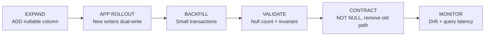

# Thêm trường với giá trị mặc định và dữ liệu đã tồn tại

> **Chương:** Tiến hóa dữ liệu  
> **Phạm vi:** `DATA_PERSISTENCE_FUNDAMENTALS` — từ mô hình dữ liệu, schema, truy vấn và chỉ mục đến giao dịch, kiểm soát đồng thời, ranh giới persistence cho Java, xử lý lỗi, bảo mật, sao lưu và vận hành.

## Mục tiêu học tập

Sau bài này, người học có thể:

1. Giải thích giá trị của một cột mới trên **các hàng đã tồn tại** khi dùng `ADD COLUMN` có hoặc không có `DEFAULT`.
2. Phân biệt **default của database**, default trong Java/JPA, giá trị `NULL`, thao tác `backfill` và ràng buộc `NOT NULL`.
3. Chọn giá trị mặc định đúng **ngữ nghĩa nghiệp vụ**, tránh biến dữ liệu lịch sử chưa rõ thành thông tin sai.
4. Thiết kế migration theo chiến lược **expand → backfill → validate → contract** để phiên bản Java cũ và mới có thể cùng hoạt động trong thời gian rollout.
5. Nhận diện tác động của PostgreSQL `ALTER TABLE`, khóa DDL, cơ chế **fast default** (từ PostgreSQL 11 đối với biểu thức default không volatile) và nguy cơ viết lại bảng.
6. Lập kế hoạch kiểm thử, đối soát và rollback/forward-fix với dữ liệu lớn mà không làm mất dữ liệu lịch sử.

## 1. Thêm cột mới tưởng đơn giản nhưng là thay đổi hợp đồng dữ liệu

Giả sử một hệ thống quản lý tài liệu có bảng:

```sql
CREATE TABLE document_record (
    id BIGINT PRIMARY KEY,
    title TEXT NOT NULL,
    created_at TIMESTAMPTZ NOT NULL DEFAULT now()
);

INSERT INTO document_record(id, title)
VALUES (1, 'Hướng dẫn'), (2, 'Biên bản');
```

Phiên bản ứng dụng mới muốn có cột `is_archived` để đánh dấu tài liệu đã lưu trữ. Trước khi thêm cột, phải trả lời:

- Hai tài liệu đã tồn tại sẽ có giá trị nào ở cột `is_archived`?
- Tạo tài liệu mới mà không truyền cột này sẽ nhận giá trị gì?
- Một phiên bản Java cũ, chưa biết cột mới, có còn `INSERT` được không?
- Có chấp nhận `NULL` không? Nếu có, nó nghĩa là “chưa xác định”, hay “chưa lưu trữ”?
- Khi nào có thể thêm `NOT NULL` mà không chặn luồng ghi đang chạy?
- Thao tác DDL có khóa bảng hoặc buộc PostgreSQL viết lại toàn bộ dữ liệu không?

Đây là thay đổi **schema**, **hợp đồng API/persistence** và có thể cả **ngữ nghĩa dữ liệu**. Migration SQL hoàn thành không bảo đảm mọi phiên bản ứng dụng và dữ liệu lịch sử đều đúng.

## 2. Quy tắc cơ bản của `DEFAULT` và dữ liệu cũ trong PostgreSQL

### 2.1. Các trường hợp quan trọng

| Câu lệnh | Giá trị nhìn thấy trên hàng đã tồn tại | Hành vi `INSERT` mới khi **bỏ qua cột** | Lưu ý |
| --- | --- | --- | --- |
| `ADD COLUMN is_archived BOOLEAN` | `NULL` | `NULL` | Cột nullable, chưa có default. |
| `ADD COLUMN is_archived BOOLEAN DEFAULT FALSE` | `FALSE` theo ngữ nghĩa SQL | `FALSE` | Vẫn có thể ghi `NULL` tường minh nếu không có `NOT NULL`. |
| `ADD COLUMN is_archived BOOLEAN NOT NULL DEFAULT FALSE` | `FALSE` | `FALSE` | Dùng khi chắc chắn mọi hàng lịch sử đều mang ý nghĩa `FALSE`. |
| `ALTER COLUMN is_archived SET DEFAULT FALSE` **sau khi cột đã tồn tại** | **Không tự sửa** các giá trị cũ, kể cả `NULL` | `FALSE` | Muốn đổi hàng cũ phải có `UPDATE`/backfill phù hợp. |
| `ALTER COLUMN is_archived DROP DEFAULT` | Không đổi các giá trị đã lưu hoặc giá trị logic của các hàng cũ | Nếu không cung cấp cột: `NULL` hoặc lỗi `NOT NULL` | Bỏ quy tắc mặc định cho thao tác ghi mới; không phải thao tác xóa dữ liệu. |

Trong PostgreSQL, khi thêm cột với `DEFAULT`, hàng cũ phải **đọc ra giá trị default theo ngữ nghĩa SQL**. Từ PostgreSQL 11, default không volatile thường được tối ưu để tránh cập nhật vật lý từng hàng ngay lúc `ALTER TABLE`; vì vậy không nên suy từ việc “không rewrite bảng” rằng các hàng lịch sử sẽ trả `NULL`.

Nếu câu `INSERT` **truyền rõ `NULL`**, database không thay `NULL` bằng `DEFAULT`. Khi cần default, phải **bỏ cột khỏi danh sách INSERT** hoặc viết từ khóa `DEFAULT`:

```sql
-- Giả định đã thêm cột NOT NULL DEFAULT FALSE.
INSERT INTO document_record(id, title)
VALUES (3, 'Tài liệu mới');
-- is_archived = FALSE vì cột bị bỏ qua.

INSERT INTO document_record(id, title, is_archived)
VALUES (4, 'Tài liệu khác', DEFAULT);
-- is_archived = FALSE.

-- Câu này bị từ chối do NOT NULL, không tự thành FALSE:
-- INSERT INTO document_record(id, title, is_archived)
-- VALUES (5, 'Tài liệu lỗi', NULL);
```

### 2.2. Không nhầm `NULL` với giá trị mặc định

`NULL` biểu diễn **không có giá trị được biết/ghi nhận** trong mô hình quan hệ, không đồng nghĩa với `FALSE`, `0` hoặc chuỗi rỗng.

Trong Java:

- `boolean` chỉ biểu diễn `true/false`, không biểu diễn `NULL`.
- `Boolean` có thể biểu diễn `true/false/null`; khi dùng làm input cần xử lý null theo quy tắc.
- `ResultSet.getBoolean(...)` trả `false` cả khi cột SQL là `NULL`; phải gọi `rs.wasNull()` nếu cần phân biệt.

Nếu mọi tài liệu cũ **chắc chắn chưa từng được lưu trữ** vì tính năng archive chưa tồn tại, `DEFAULT FALSE` cho cột mới có thể hợp lý. Nhưng nếu một nguồn lịch sử khác từng thực hiện archive mà chưa đồng bộ, mặc định `FALSE` cho tất cả dữ liệu cũ sẽ che giấu sự thật.

**Nguyên tắc:** chọn default vì có bằng chứng nghiệp vụ rằng giá trị đó đúng, không phải vì muốn câu `ALTER TABLE` ngắn hoặc tránh xử lý `NULL`.

## 3. Trường hợp đơn giản: tất cả dữ liệu cũ thực sự cùng một mặc định

Với bảng `document_record` của phần 1, giả định trước đây **không có nghiệp vụ lưu trữ tài liệu**, nên hai tài liệu cũ đều hợp lệ ở trạng thái chưa lưu trữ.

Migration PostgreSQL có thể viết:

```sql
ALTER TABLE document_record
ADD COLUMN is_archived BOOLEAN NOT NULL DEFAULT FALSE;
```

Sau migration:

```sql
SELECT id, title, is_archived
FROM document_record
ORDER BY id;
-- id=1, id=2 đều có is_archived = FALSE.

INSERT INTO document_record(id, title)
VALUES (3, 'Tài liệu do ứng dụng cũ ghi');
-- Dù INSERT cũ không biết is_archived, DB áp DEFAULT FALSE.
```

**Vì sao phù hợp cho rollout?** Phiên bản Java cũ thường không đưa cột mới vào `INSERT`, nên database tự điền `FALSE`. Phiên bản Java mới có thể đọc và ghi cột đó. Ràng buộc `NOT NULL` giúp các writer có ý định gửi `NULL` nhận lỗi thay vì làm hỏng mô hình dữ liệu.

Tuy nhiên, có ít nhất bốn điều kiện cần kiểm tra:

1. Giá trị `FALSE` thực sự đúng cho mọi hàng lịch sử theo yêu cầu nghiệp vụ.
2. Các câu `INSERT` cũ có **danh sách cột rõ ràng**; code dùng `INSERT ... VALUES (...)` không nêu cột có thể bị ảnh hưởng khi schema đổi.
3. Các truy vấn/mapper không phụ thuộc vào số cột hoặc thứ tự của `SELECT *`.
4. Chưa có reader cũ thực hiện thao tác `UPDATE` toàn hàng theo cách vô tình ghi giá trị default của object trở lại cột mới.

Mặc dù trên PostgreSQL 11+ thao tác thêm cột với default không volatile có thể rất nhanh, `ALTER TABLE` vẫn phải lấy **khóa DDL**, thường là `ACCESS EXCLUSIVE` trong trường hợp này. Nó có thể đợi transaction dài và chặn các thao tác khác trong lúc chờ/thi hành. “Fast default” **không có nghĩa không có lock**.

### 3.1. Đặt giới hạn chờ lock

Đối với môi trường có tải, có thể chạy migration trong một phiên có giới hạn chờ:

```sql
BEGIN;
SET LOCAL lock_timeout = '3s';
SET LOCAL statement_timeout = '30s';

ALTER TABLE document_record
ADD COLUMN is_archived BOOLEAN NOT NULL DEFAULT FALSE;

COMMIT;
```

Các con số chỉ minh họa: cần chọn theo SLO, độ lớn bảng, traffic và công cụ migration. Nếu timeout, migration thất bại và rollback, không nên retry liên tục không giới hạn trong giờ cao điểm. Cần quan sát lock wait, transaction dài và thử trên bản staging có cấu trúc/tải gần thực tế.

## 4. Khi nào PostgreSQL phải viết lại bảng?

Tối ưu **fast default** của PostgreSQL từ phiên bản 11 áp dụng cho biểu thức default **không volatile** khi thêm cột; giá trị default có thể được lưu trong metadata và trình bày như giá trị của những hàng cũ. Khi bảng được viết lại sau đó vì một lý do khác, giá trị logic đó có thể được materialize vào hàng.

Trường hợp biểu thức default **volatile**, ví dụ `clock_timestamp()`, yêu cầu có thể phải được đánh giá riêng cho từng hàng và dẫn đến rewrite:

```sql
-- KHÔNG nên chạy tùy tiện trên bảng lớn.
ALTER TABLE audit_record
ADD COLUMN observed_at TIMESTAMPTZ
DEFAULT clock_timestamp();
```

Điều này còn có vấn đề **ngữ nghĩa**: mọi hàng cũ có thực sự được tạo ở thời điểm migration không? Nếu muốn lưu thời điểm phát sinh gốc, phải backfill từ dữ liệu/audit đáng tin, không lấy thời điểm chạy DDL làm sự kiện lịch sử.

| Yếu tố | Nguy cơ |
| --- | --- |
| Phiên bản PostgreSQL trước 11 | Các tối ưu mặc định của phiên bản mới không thể giả định tồn tại. |
| Default volatile hoặc thay đổi kiểu có rewrite | I/O lớn, WAL tăng, lock giữ lâu, ảnh hưởng replication và dung lượng. |
| Bảng có nhiều tỷ hàng | Ngay cả quét xác minh `NOT NULL` hoặc backfill cũng có chi phí lớn. |
| Transaction đang chạy lâu | DDL có thể bị kẹt chờ lock; request sau tiếp tục xếp hàng. |
| Giá trị default không đúng nghiệp vụ | DDL nhanh nhưng dữ liệu sau migration sai về mặt ý nghĩa. |

**Không dùng “fast default” như lý do bỏ qua kế hoạch triển khai.** Cần đọc hành vi của đúng phiên bản PostgreSQL và kiểm tra khóa, chi phí WAL/replica, kế hoạch rollback và tính tương thích ứng dụng.

## 5. Trường hợp khó: cột mới phải được tính từ dữ liệu lịch sử

Giả sử hệ thống hỗ trợ có bảng `support_ticket` với mức nghiêm trọng `severity` (1 đến 5), và phiên bản mới muốn thêm `priority_band`:

- `severity = 1` hoặc `2` → `HIGH`.
- `severity = 3` → `MEDIUM`.
- `severity = 4` hoặc `5` → `LOW`.

Đây là **quy tắc nghiệp vụ được giả định là đã phê duyệt** cho ví dụ. Nếu dữ liệu cũ có `severity` không hợp lệ, phải phân loại và sửa theo nguồn chuẩn trước, không suy đoán.

```sql
CREATE TABLE support_ticket (
    id BIGINT PRIMARY KEY,
    severity SMALLINT NOT NULL CHECK (severity BETWEEN 1 AND 5),
    summary TEXT NOT NULL
);

INSERT INTO support_ticket(id, severity, summary)
VALUES
    (1001, 2, 'Sự cố đăng nhập'),
    (1002, 3, 'Không thấy báo cáo'),
    (1003, 5, 'Yêu cầu cập nhật nhãn');
```

Ở đây không thể chọn `DEFAULT 'MEDIUM'` cho mọi hàng cũ: ticket 1001 phải là `HIGH`, ticket 1003 phải là `LOW`. Nếu chỉ muốn thêm cột với một trạng thái `UNKNOWN` có ý nghĩa riêng, cần thiết kế quy tắc xử lý `UNKNOWN`; không được đồng nhất nó với kết quả phân loại đã xác minh.

Giải pháp là triển khai theo các giai đoạn, thay vì thêm ngay `NOT NULL DEFAULT 'MEDIUM'`.

## 6. Mô hình expand → backfill → validate → contract

### 6.1. Expand: thêm cột tương thích ngược

```sql
ALTER TABLE support_ticket
ADD COLUMN priority_band TEXT;

ALTER TABLE support_ticket
ADD CONSTRAINT ck_ticket_priority_band_values
CHECK (priority_band IN ('HIGH', 'MEDIUM', 'LOW'))
NOT VALID;
```

`priority_band` ban đầu nullable: các hàng cũ đọc ra `NULL`, và phiên bản ứng dụng cũ chưa biết cột mới vẫn có thể tạo ticket nếu chưa đến giai đoạn thắt chặt. `CHECK` chấp nhận `NULL` theo ngữ nghĩa SQL; còn những giá trị **khác null** ngoài ba lựa chọn bị từ chối. Tùy phiên bản/cấu hình PostgreSQL, việc thêm `NOT VALID` có thể giúp tránh quét xác minh toàn bộ dữ liệu ngay lúc tạo constraint, nhưng DDL vẫn có lock và phải được đo.

**Không đặt `NOT NULL` quá sớm.** Khi còn writer cũ chỉ gửi `severity`, nó sẽ tạo hàng có `priority_band = NULL` và thất bại nếu cột đã bắt buộc ngay từ đầu.

### 6.2. Nâng cấp ứng dụng: ghi cả trường cũ và mới

Trong giai đoạn chuyển tiếp, **mọi luồng ghi mới** cần tạo giá trị `priority_band` từ `severity` cùng một transaction. Cách đơn giản là tính trên server và truyền cả hai cột trong cùng `INSERT`/`UPDATE`.

```sql
INSERT INTO support_ticket(id, severity, priority_band, summary)
VALUES (1004, 1, 'HIGH', 'Lỗi không truy cập được hệ thống');

UPDATE support_ticket
SET severity = 4,
    priority_band = 'LOW'
WHERE id = 1001;
```

Trước khi cho phép đổi `severity` từ API/worker, hãy đảm bảo mọi phiên bản ứng dụng còn hoạt động đều **duy trì cùng quy tắc**. Nếu một instance cũ sửa `severity` mà không sửa `priority_band` đã backfill, dữ liệu có thể bị lệch dù cả hai trường đều `NOT NULL`.

Trong môi trường rollout dài, một số lựa chọn là:

- Đưa việc tính `priority_band` vào **cơ chế chung tại DB** (ví dụ generated column khi quy tắc thực sự thuần theo `severity`, hoặc trigger được thiết kế/kiểm thử cẩn thận), nếu muốn mọi writer kể cả writer cũ luôn nhất quán.
- Tạm không cho writer cũ cập nhật `severity` sau khi cutover, hoặc triển khai phiên bản tương thích trước rồi mới backfill.
- Với giao thức dual-write ở ứng dụng, đảm bảo mỗi update có điều kiện/optimistic version trong cùng transaction và có truy vấn đối soát dữ liệu lệch.

Nếu `priority_band` luôn có thể suy ra hoàn toàn từ `severity`, hãy cân nhắc **không lưu hai trường độc lập** mà dùng biểu thức tính, view hoặc generated column thích hợp. Việc lưu dư dữ liệu làm tăng rủi ro drift và chi phí migration.

### 6.3. Backfill: bổ sung dữ liệu cũ thành từng lô

Nếu bảng lớn và lưu hai trường là yêu cầu đã quyết định, tránh một `UPDATE` khổng lồ giữ khóa rất lâu. PostgreSQL cho phép chọn các hàng chưa backfill thành batch:

```sql
-- Chạy từng transaction ngắn, lặp cho đến khi 0 hàng được cập nhật.
BEGIN;

WITH batch AS (
    SELECT id
    FROM support_ticket
    WHERE priority_band IS NULL
    ORDER BY id
    LIMIT 1000
    FOR UPDATE SKIP LOCKED
)
UPDATE support_ticket AS t
SET priority_band = CASE
    WHEN t.severity IN (1, 2) THEN 'HIGH'
    WHEN t.severity = 3 THEN 'MEDIUM'
    WHEN t.severity IN (4, 5) THEN 'LOW'
    ELSE NULL
END
FROM batch
WHERE t.id = batch.id
  AND t.priority_band IS NULL
RETURNING t.id, t.priority_band;

COMMIT;
```

Đoạn SQL trên minh họa **một batch**, không phải một lệnh chạy mãi. Bộ điều phối (Java/job migration) lặp với giới hạn tải, commit giữa các batch, ghi số hàng thành công, lỗi và checkpoint. `SKIP LOCKED` có thể giúp nhiều worker bỏ qua hàng đang bị khóa, nhưng các hàng bận liên tục có thể chưa được xử lý; cần lượt quét cuối **không bỏ sót** khi traffic đã ổn định hoặc đã kiểm soát writer.

Ưu điểm của điều kiện `WHERE priority_band IS NULL` là không ghi đè một giá trị mà writer mới đã cập nhật. Nhưng nó **không giải quyết triệt để** chuyện writer cũ sửa `severity` sau khi backfill, vì lúc ấy `priority_band` không còn null. Phải giải quyết giao thức ghi ở phần 6.2 và đối soát bất biến sau đó.

Với dữ liệu có hàng `severity` không thuộc 1–5 (do import cũ chưa validate), biểu thức `ELSE NULL` cố tình không bịa một phân loại. Job cần ghi nhận những hàng không thể backfill để xử lý riêng. Trong lược đồ minh họa, `CHECK` đã ngăn trường hợp ấy khi dữ liệu hợp lệ; tình huống được nêu để nhắc kiểm tra nguồn thực tế.

### 6.4. Validate: đo sự đầy đủ và đúng ngữ nghĩa

Sau khi các writer đã tuân thủ quy tắc mới và các batch đã hoàn thành:

```sql
-- Số hàng còn thiếu phân loại:
SELECT COUNT(*) AS missing_priority_band
FROM support_ticket
WHERE priority_band IS NULL;

-- Số hàng không khớp quy tắc nguồn chuẩn:
SELECT COUNT(*) AS inconsistent_priority_band
FROM support_ticket
WHERE priority_band IS DISTINCT FROM
    CASE
        WHEN severity IN (1, 2) THEN 'HIGH'
        WHEN severity = 3 THEN 'MEDIUM'
        WHEN severity IN (4, 5) THEN 'LOW'
        ELSE NULL
    END;

-- Chỉ validate constraint đã được bổ sung ở bước expand:
ALTER TABLE support_ticket
VALIDATE CONSTRAINT ck_ticket_priority_band_values;
```

**Các số đếm phải bằng 0** trước khi tuyên bố đủ dữ liệu theo mô hình này. Phải giải thích cách đo trong hệ thống vẫn ghi liên tục: nhiều truy vấn `READ COMMITTED` có thể nhìn các snapshot khác nhau; nếu cần cùng một ảnh chụp để chứng minh, dùng transaction với mức cô lập phù hợp, hoặc tổ chức cutover có kiểm soát.

Việc `CHECK` đã validate chỉ chứng minh giá trị khác null nằm trong tập cho phép; nó **không chứng minh** phân loại đúng theo `severity`. Truy vấn đối soát quan hệ giữa hai cột vẫn cần thiết.

### 6.5. Contract: chỉ thắt chặt khi writer cũ đã dừng

Sau khi không còn ứng dụng/job phiên bản cũ ghi thiếu `priority_band` và các bước đối soát đạt:

```sql
-- Tùy phiên bản PostgreSQL và kế hoạch lock,
-- có thể dùng CHECK đã validate để hỗ trợ SET NOT NULL.
ALTER TABLE support_ticket
ADD CONSTRAINT ck_ticket_priority_band_present
CHECK (priority_band IS NOT NULL) NOT VALID;

ALTER TABLE support_ticket
VALIDATE CONSTRAINT ck_ticket_priority_band_present;

ALTER TABLE support_ticket
ALTER COLUMN priority_band SET NOT NULL;

-- Chỉ sau khi xác nhận NOT NULL đã có hiệu lực,
-- constraint tạm có thể được loại bỏ nếu không còn cần:
ALTER TABLE support_ticket
DROP CONSTRAINT ck_ticket_priority_band_present;
```

Ở các phiên bản PostgreSQL hỗ trợ tối ưu tương ứng, một `CHECK` đã validate chứng minh cột không null có thể giúp `SET NOT NULL` tránh quét lại toàn bộ bảng. Nhưng **mỗi lệnh DDL vẫn có yêu cầu lock** và có thể chờ/ảnh hưởng traffic. Không mặc định tối ưu áp dụng như nhau ở mọi phiên bản; kiểm tra trên đúng môi trường.

Nếu `priority_band` là trường bắt buộc do **ứng dụng mới phải tính và gửi**, không nhất thiết thêm `DEFAULT` tại DB. Việc để cột `NOT NULL` **không có default** giúp phát hiện code mới quên gửi dữ liệu, thay vì âm thầm gán một nhãn không chính xác.



## 7. Vì sao `SET DEFAULT` không phải backfill?

Giả sử giai đoạn đầu đã thêm một cột không có default:

```sql
ALTER TABLE document_record
ADD COLUMN review_state TEXT;

-- Hàng cũ có review_state = NULL.
```

Sau đó đội vận hành quyết định đặt default cho bản ghi mới:

```sql
ALTER TABLE document_record
ALTER COLUMN review_state SET DEFAULT 'PENDING';
```

**Hàng đã tồn tại không được tự sửa** từ `NULL` thành `PENDING` chỉ vì câu `SET DEFAULT`. Các câu `INSERT` mới **bỏ qua cột** sẽ dùng `PENDING`, nhưng dữ liệu lịch sử vẫn giữ `NULL` cho đến khi có thao tác backfill.

Nếu quy tắc nghiệp vụ xác nhận mọi hàng lịch sử phải là `PENDING`, mới thực hiện một backfill có kiểm soát:

```sql
UPDATE document_record
SET review_state = 'PENDING'
WHERE review_state IS NULL;
```

Với bảng lớn, chia batch như phần 6 thay vì chạy `UPDATE` toàn bảng mà không đo chi phí. Còn nếu các hàng cũ đã qua quy trình duyệt ở hệ thống khác, `PENDING` sẽ là **thông tin giả**: phải đối soát từ hệ thống nguồn hoặc giữ `UNKNOWN`/`NULL` theo mô hình đã phê duyệt.

**Lưu ý về thay đổi default sau này:** default là quy tắc **cho thao tác ghi mới**, không phải một đường dẫn tự động chỉnh sửa dữ liệu lịch sử. Cần phân biệt thời điểm cấu hình default, thời điểm backfill và thời điểm thắt chặt `NOT NULL`.

## 8. Java, JDBC và JPA: đừng để default ở hai nơi mâu thuẫn

### 8.1. JDBC: bỏ cột khác truyền `NULL`

Ứng dụng Java cũ có thể tiếp tục viết:

```java
jdbc.update("""
    INSERT INTO document_record (id, title)
    VALUES (?, ?)
    """, id, title);
// DB tự áp DEFAULT FALSE cho is_archived.
```

Nhưng code mới truyền `NULL` tường minh sẽ **không kích hoạt default**:

```java
// Ví dụ lỗi với cột NOT NULL:
jdbc.update("""
    INSERT INTO document_record (id, title, is_archived)
    VALUES (?, ?, ?)
    """, id, title, null);
```

Với `PreparedStatement`, phải chọn một trong các cách rõ ràng: bỏ cột để DB default, truyền giá trị nghiệp vụ đã xác định, hoặc dùng biểu thức SQL `DEFAULT` khi cần. Không kỳ vọng driver tự thay `NULL` thành default.

### 8.2. JPA: field initializer khác default ở DB

Ví dụ entity Hibernate/JPA cho tài liệu:

```java
import jakarta.persistence.Column;
import jakarta.persistence.Entity;
import jakarta.persistence.Id;
import jakarta.persistence.Table;

@Entity
@Table(name = "document_record")
public class DocumentRecord {
    @Id
    private Long id;

    @Column(name = "title", nullable = false)
    private String title;

    @Column(name = "is_archived", nullable = false)
    private boolean archived = false;

    protected DocumentRecord() {}

    public DocumentRecord(Long id, String title) {
        this.id = id;
        this.title = title;
    }

    public boolean isArchived() {
        return archived;
    }

    public void archive() {
        archived = true;
    }
}
```

Trong mã này, `boolean archived = false` là **default trong object Java**. Provider có thể sinh `INSERT` với giá trị `false` rõ ràng, không cần sử dụng SQL `DEFAULT`. Database default vẫn cần thiết cho writer khác bỏ qua cột, còn field initializer không tự cập nhật hàng cũ nếu schema chưa migration.

Ngược lại, nếu khai báo `Boolean archived` và để `null`, một số mapping JPA có thể sinh SQL truyền `NULL` tường minh, làm câu `INSERT` bị `NOT NULL` từ chối dù cột DB có default. Không suy ra `@Column(nullable = false)` hoặc `@Column(columnDefinition = "... DEFAULT ...")` tự biến đổi giá trị object lúc chạy; annotation/DDL generation không thay thế schema migration.

Nếu cấu hình ORM chủ động bỏ cột khỏi `INSERT` để DB điền default, cần hiểu cách **đồng bộ lại giá trị generated** vào entity managed (`refresh`/mapping phù hợp) và phải thử nghiệm với provider/phiên bản thật. Tránh phụ thuộc vào một annotation đặc thù Hibernate mà chưa xác minh SQL được tạo.

### 8.3. Rollout có cả entity cũ và entity mới

Ở chiến lược expand/backfill/contract, ứng dụng Java bản mới phải **đọc được cả hàng chưa backfill**. Với cột nullable:

```java
// Java/JPA mapping giai đoạn quá độ:
@Column(name = "priority_band")
private String priorityBand; // Cho phép null trong giai đoạn expand.

public String effectiveBand() {
    if (priorityBand != null) {
        return priorityBand;
    }
    // Chỉ áp phép suy ra này khi quy tắc nghiệp vụ đã được phê duyệt
    // và dữ liệu severity lịch sử đủ tin cậy.
    return classify(severity);
}
```

Sau khi backfill và `NOT NULL` đã đạt, có thể chuyển mapping/validation sang dạng bắt buộc trong một release tương thích tiếp theo. Cần tránh việc Java tự ghi một placeholder vào DB khi chưa chứng minh dữ liệu cũ thực sự thuộc nhóm đó.

**Đọc không đồng nghĩa ghi:** ứng dụng có thể tạm chấp nhận dữ liệu thiếu khi đọc để giữ tính tương thích, nhưng mọi đường ghi mới cần áp quy tắc nguồn chuẩn. Nếu dùng Spring Data JPA, dirty checking có thể ghi cả những field khác đã thay đổi; hãy kiểm tra SQL thực tế và optimistic locking khi nhiều phiên bản ứng dụng cùng thao tác một hàng.

## 9. Dữ liệu lớn, khóa và giao dịch trong migration

Một migration dùng `UPDATE` toàn bảng có thể tạo nhiều WAL, áp lực I/O, bloat, replication lag và transaction dài. Thời gian hoàn tất vì vậy không chỉ phụ thuộc số hàng mà còn phụ thuộc index, trigger, FK, tốc độ lưu trữ và truy vấn đồng thời.

| Cách thực hiện | Lợi ích | Rủi ro / điều kiện |
| --- | --- | --- |
| `ADD COLUMN ... DEFAULT constant NOT NULL` ở PostgreSQL 11+ | Thường tránh rewrite toàn bảng nếu default không volatile, phù hợp dữ liệu lịch sử cùng một giá trị | Vẫn cần khóa DDL; default phải đúng nghiệp vụ. |
| `ADD COLUMN` nullable rồi backfill theo batch | Tránh giao dịch cập nhật khổng lồ; dễ giới hạn tải và kiểm tra tiến độ | Phải quản lý giai đoạn coexistence và giá trị null. |
| `UPDATE` một lần trên toàn bảng | SQL đơn giản, có thể phù hợp bảng nhỏ | Transaction/lock/WAL lớn, khó tạm dừng hoặc rollback với bảng lớn. |
| `CHECK ... NOT VALID` rồi `VALIDATE CONSTRAINT` | Có thể tách xác minh dữ liệu cũ khỏi DDL ban đầu | Ràng buộc vẫn tác động đến ghi mới; lock/quét của validate cần kế hoạch. |
| Generated column cho dữ liệu suy ra thuần túy | Giảm nguy cơ dual-write lệch | Tùy tính năng/phiên bản DB và chi phí lưu/ghi; cần xem tác động schema. |

**Mỗi batch cần transaction ngắn** và cơ chế retry cho deadlock/serialization failure nếu dùng cùng workload. Không retry mù quáng một migration gặp timeout ở thời điểm commit mà không biết đã commit hay chưa: cần kiểm tra tiến độ theo khóa/trạng thái và thiết kế thao tác backfill idempotent.

Thời gian chờ lock và tổng thời gian chạy DDL khác nhau: `lock_timeout` giới hạn chờ lấy khóa; `statement_timeout` giới hạn câu SQL theo quy tắc PostgreSQL. Cả hai phải tương thích chính sách vận hành, không mặc định cùng giá trị cho mọi bảng.

## 10. Kiểm thử tương thích và xác minh sau triển khai

### 10.1. Bộ kiểm tra tối thiểu

| Kịch bản | Kỳ vọng |
| --- | --- |
| Hàng lịch sử trước `ADD COLUMN ... DEFAULT FALSE` | Đọc ra `FALSE` nếu default hợp lệ cho hàng cũ. |
| Writer cũ `INSERT` bỏ cột mới | Hoạt động với default DB nếu đã thiết kế như vậy. |
| Writer truyền `NULL` tường minh vào cột `NOT NULL` | Bị từ chối, không được DB tự chuyển thành default. |
| `SET DEFAULT` trên cột đã có hàng `NULL` | Các hàng `NULL` cũ **vẫn null**. |
| Backfill batch chạy lặp | Lần chạy lại không sửa hàng đã được backfill đúng và không tạo dữ liệu giả. |
| Writer mới ghi trong khi backfill | Không bị backfill ghi đè field đã được writer cập nhật; không tạo drift với cột nguồn. |
| Có writer cũ thay đổi `severity` | Phải có chiến lược giữ cặp `severity`/`priority_band` nhất quán. |
| Tắt bản ứng dụng cũ rồi thêm `NOT NULL` | Mọi writer còn chạy đã cung cấp dữ liệu hợp lệ; validation và constraint đạt. |
| Migration timeout khi chờ lock | Rollback không để lại trạng thái schema nửa chừng; pipeline báo lỗi rõ. |
| Khôi phục backup từ trước migration | Ứng dụng/schema tương thích với mốc restore; có kế hoạch chạy lại migration đúng thứ tự. |

### 10.2. Kiểm tra dữ liệu có nguồn chuẩn

Với bảng tài liệu, khi giả định dữ liệu cũ đều chưa archive:

```sql
SELECT COUNT(*) AS invalid_archived_flag
FROM document_record
WHERE is_archived IS NULL;
-- Phải là 0 khi đã áp NOT NULL.
```

Với ticket:

```sql
SELECT
    COUNT(*) FILTER (WHERE priority_band IS NULL)
        AS missing_band,
    COUNT(*) FILTER (
        WHERE priority_band IS DISTINCT FROM
            CASE
                WHEN severity IN (1, 2) THEN 'HIGH'
                WHEN severity = 3 THEN 'MEDIUM'
                WHEN severity IN (4, 5) THEN 'LOW'
                ELSE NULL
            END
    ) AS inconsistent_band
FROM support_ticket;
```

Số `0` trong một lần kiểm tra không đủ chứng minh các writer tương lai đều tuân thủ nếu chưa kiểm soát tất cả đường ghi. Nên có giám sát sau rollout: số hàng null, tỷ lệ lệch, lock wait, thời lượng migration, replication lag, lỗi constraint và tần suất retry.

### 10.3. Kiểm tra ứng dụng Java theo phiên bản

Chạy thử:

1. **Schema cũ + ứng dụng cũ**: baseline trước thay đổi.
2. **Schema expand + ứng dụng cũ**: writer cũ không hỏng khi cột mới xuất hiện.
3. **Schema expand + ứng dụng mới**: đọc được hàng chưa backfill, ghi cặp cột đúng.
4. **Schema đã backfill + hai phiên bản cùng chạy**: xác minh không drift qua thao tác cập nhật cạnh tranh.
5. **Schema contract + chỉ ứng dụng mới**: `NOT NULL` không làm fail các luồng ghi hợp lệ.

Không cần/không nên yêu cầu ứng dụng mới chạy trên **schema cũ chưa expand** nếu kế hoạch deploy quy định DDL expand luôn phải chạy trước. Nhưng cần thể hiện ràng buộc thứ tự đó rõ trong pipeline và runbook rollback.

## 11. Rollback, forward-fix và an toàn dữ liệu

**Rollback ứng dụng** không giống **rollback schema**. Trong một triển khai theo bước:

- Sau **expand**, schema thường vẫn tương thích với ứng dụng cũ, nên có thể rollback code mà không cần `DROP COLUMN`.
- Sau khi **contract** yêu cầu trường mới bắt buộc mà writer cũ không cung cấp, rollback code về bản cũ có thể gây lỗi ghi. Cần kế hoạch rollback rõ, ví dụ giữ cửa sổ tương thích trước khi thắt chặt schema.
- Sau khi cột mới đã chứa dữ liệu nghiệp vụ quan trọng, `DROP COLUMN` có thể phá hủy dữ liệu thật, không nên dùng như bước rollback “tự động”.
- Nếu backfill tạo giá trị sai, cần xác định nguồn dữ liệu chính xác và viết **forward-fix**/migration sửa có kiểm chứng. Không lấy giá trị mặc định để xóa nhòa các lịch sử khác nhau.
- Backup và restore phải được thử nghiệm: snapshot trước migration không có cột mới, ứng dụng sau migration cần đúng phiên bản schema hoặc quy trình replay migration tương ứng.

Giới hạn quyền DDL và migration runner theo nguyên tắc tối thiểu, lưu lịch sử thay đổi schema qua công cụ migration (ví dụ Flyway/Liquibase nếu dự án sử dụng), review script và xác định rollback plan **trước khi phát hành**. Không dùng tính năng ORM tự động cập nhật schema ở production để thay một migration đã được kiểm soát.

## 12. Bài thực hành

**Bài A — Default đúng nghĩa**

Hệ thống `document_record` có 100.000 hàng lịch sử, trước đây chưa có chức năng archive. Hãy:

1. Viết `ALTER TABLE` bổ sung `is_archived BOOLEAN NOT NULL DEFAULT FALSE` trên PostgreSQL phù hợp.
2. Giải thích giá trị đọc được của hàng cũ và hành vi của writer Java cũ khi bỏ qua cột.
3. Thử insert với `is_archived = NULL` và giải thích vì sao default không thay thế `NULL`.
4. Đo thời gian chờ lock và thời gian DDL; nêu vì sao fast default vẫn cần kế hoạch triển khai.
5. Viết kiểm tra số hàng null và bài thử sau khi restore từ backup.

**Bài B — Không được bịa dữ liệu lịch sử**

Hệ thống ticket có `severity` 1–5. Cần thêm `priority_band` đúng theo quy tắc ở phần 5. Hãy:

1. Thêm cột nullable và ràng buộc giá trị hợp lệ theo giai đoạn expand.
2. Thiết kế app version mới ghi đồng thời `severity` và `priority_band`; chỉ ra rủi ro khi instance cũ vẫn thay `severity`.
3. Viết backfill theo batch 1.000 hàng/transaction, có thể chạy lại, đo tiến độ và xử lý hàng bị khóa.
4. Viết truy vấn đếm null và truy vấn phát hiện `priority_band` không khớp `severity`.
5. Chỉ khi mọi writer còn chạy tương thích và dữ liệu đã được xác minh, thêm `NOT NULL` theo quy trình contract.
6. Chuẩn bị phương án nếu DDL bị lock timeout, backfill bị ngắt, hoặc cần rollback phiên bản ứng dụng.

**Câu hỏi tự kiểm tra**

1. `ALTER TABLE ... ADD COLUMN x BOOLEAN DEFAULT FALSE` và `ALTER TABLE ... ALTER COLUMN x SET DEFAULT FALSE` khác nhau thế nào đối với **hàng đã tồn tại**?
2. Vì sao `INSERT` truyền `NULL` tường minh không dùng default của cột?
3. Khi nào `DEFAULT FALSE` cho cột mới trên dữ liệu lịch sử là sai về mặt nghiệp vụ dù SQL chạy thành công?
4. Tại sao trên PostgreSQL 11+ thêm default không volatile thường nhanh hơn default volatile với bảng lớn?
5. Fast default có loại bỏ yêu cầu lock DDL không?
6. Trong rollout nhiều phiên bản, tại sao `NOT NULL` cần được trì hoãn tới sau khi writer cũ đã được nâng cấp?
7. Vì sao backfill chỉ những hàng `priority_band IS NULL` vẫn chưa đủ nếu writer cũ tiếp tục sửa `severity`?
8. `@Column(nullable = false)` có tự cập nhật schema và dữ liệu cũ trên production không?
9. Việc `flush`/`commit` của JPA liên quan thế nào đến default DB và lỗi constraint?
10. Nếu đã ghi dữ liệu có ý nghĩa vào cột mới, vì sao `DROP COLUMN` không phải chiến lược rollback an toàn?

## Ghi nhớ

**Default không chỉ là cú pháp SQL mà là một cam kết về ý nghĩa dữ liệu.** Khi thêm cột có `DEFAULT`, PostgreSQL cho các hàng đã tồn tại một giá trị logic tương ứng; khi chỉ `SET DEFAULT` trên cột đã có, dữ liệu lịch sử **không tự được backfill**. Mọi lệnh `INSERT` bỏ qua cột có thể dùng default, còn `NULL` tường minh không được tự thay bằng default.

Với cột mới không thể gán cùng một giá trị đúng cho tất cả dữ liệu lịch sử, hãy **expand → nâng cấp writer → backfill từng lô → validate → contract**. Thiết kế transaction, kiểm soát writer cũ/mới, kiểm tra khóa và hiệu năng PostgreSQL, ánh xạ JDBC/JPA, đối soát bất biến và lộ trình rollback trước khi triển khai. Mục tiêu cuối cùng không phải chỉ là thêm một cột thành công, mà là **giữ được dữ liệu cũ đúng nghĩa và để mọi phiên bản Java hoạt động an toàn trong quá trình tiến hóa schema**.
