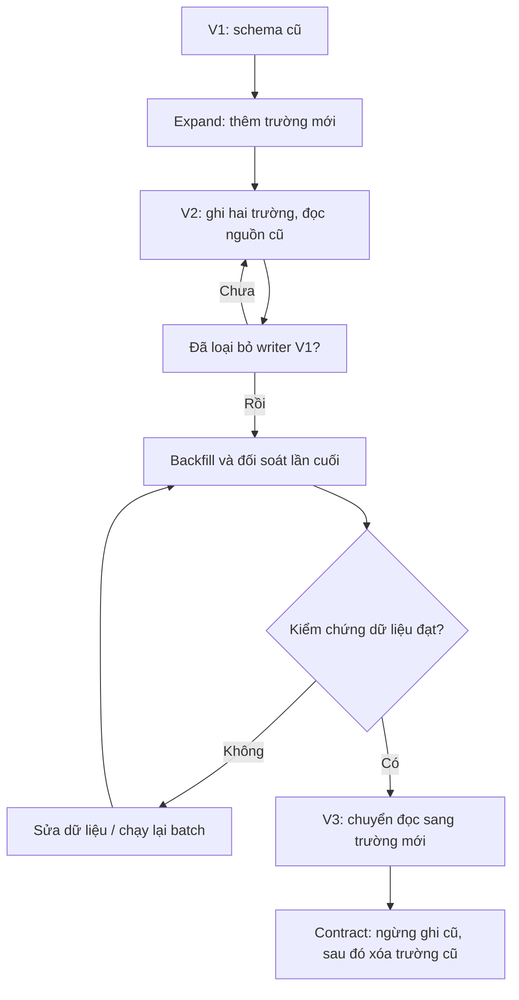

# Đổi tên hoặc đổi kiểu mà vẫn bảo toàn dữ liệu

Một ứng dụng Java không thể giữ nguyên mô hình dữ liệu mãi mãi. Một cột tên khách hàng cần đổi từ `customer_name` sang `display_name`; mã tiền tệ đang lưu bằng chuỗi cần đổi thành số nguyên đơn vị nhỏ nhất; một định danh `INTEGER` cần tăng lên `BIGINT`. Các thay đổi có vẻ đơn giản, nhưng **lược đồ, dữ liệu đã tồn tại và nhiều phiên bản ứng dụng đang chạy phải được tiến hóa cùng nhau**. Chỉ sửa tên thuộc tính trong Java rồi chạy một câu `ALTER TABLE` có thể làm API cũ lỗi, mất độ chính xác hoặc làm dữ liệu mới và cũ lệch nhau.

Đây là bài học thuộc chương **Tiến hóa dữ liệu** của mô-đun **DATA_PERSISTENCE_FUNDAMENTALS**. Mô-đun giúp hiểu lưu trữ bền vững từ mô hình dữ liệu, schema, truy vấn, chỉ mục tới transaction, cô lập và kiểm soát đồng thời; đồng thời thiết kế ranh giới persistence trong Java, xử lý lỗi kết nối, nâng cấp schema, bảo mật, sao lưu và tối ưu hiệu năng. Mục tiêu của bài là xây dựng **quy trình đổi tên hoặc đổi kiểu an toàn, có thể triển khai dần, kiểm chứng được và có phương án phục hồi**, thay vì chỉ học cú pháp DDL.

Ví dụ tập trung vào PostgreSQL và Spring JDBC/JPA. Thời gian khóa, thao tác có rewrite bảng hay không, transaction DDL và hành vi conversion tùy DBMS, phiên bản và kích thước dữ liệu; không suy ra chi phí production từ một thử nghiệm trên bảng nhỏ.

## 1. “Bảo toàn dữ liệu” cần bảo vệ những gì?

Đổi schema thành công không đồng nghĩa dữ liệu đã được bảo toàn. Có ít nhất năm khía cạnh phải xem xét:

| Khía cạnh | Câu hỏi cần trả lời | Ví dụ lỗi |
|---|---|---|
| **Đầy đủ** | Mọi bản ghi cần chuyển đã được chuyển chưa? | Bỏ sót hàng bị khóa khi chạy batch |
| **Giữ nguyên ý nghĩa** | Giá trị mới diễn đạt đúng giá trị cũ theo nghiệp vụ không? | `12.99` bị chuyển thành `12` vì ép về integer |
| **Ràng buộc** | Khóa chính, khóa ngoại, uniqueness, nullability còn đúng không? | Đổi từ `BIGINT` sang `INTEGER` làm mất khả năng biểu diễn ID lớn |
| **Tương thích ứng dụng** | Phiên bản cũ/mới đọc và ghi chính xác trong thời gian chuyển không? | Một instance cũ tiếp tục ghi cột cũ sau khi cột mới đã backfill |
| **Phục hồi và truy vết** | Có thể xác minh, sửa lỗi hoặc quay lại trạng thái đáng tin cậy không? | Xóa cột gốc trước khi kiểm tra chuyển đổi và backup |

Một yêu cầu cụ thể nên được diễn đạt bằng **bất biến dữ liệu**: ví dụ `display_name` phải bằng `customer_name` sau khi hoàn thành đồng bộ; hoặc `amount_cents` phải bằng **chính xác** 100 lần số tiền thập phân cũ, không làm tròn âm thầm. Bất biến này quyết định câu SQL kiểm chứng, không chỉ quyết định tên kiểu mới.

### 1.1. Phân biệt các loại thay đổi

| Thay đổi | Có thể chỉ là metadata? | Rủi ro chủ yếu |
|---|---|---|
| Đổi tên cột `name` → `display_name` | Trong PostgreSQL thường là đổi metadata, không viết lại giá trị hàng | SQL/ORM/view/job/ETL cũ dùng tên cột cũ sẽ lỗi |
| Đổi tên bảng | Thường là đổi metadata | SQL, migration, quyền truy cập và các tích hợp dựa trên tên không đồng bộ |
| Nới `VARCHAR(50)` → `VARCHAR(100)` | Có trường hợp không cần viết lại bảng | Phụ thuộc DBMS; hợp đồng API và validation vẫn phải được điều chỉnh |
| `INTEGER` → `BIGINT` | Không nên mặc định là metadata-only | Có thể cần rewrite bảng/index và khóa DDL; Java mapping phải đổi |
| `TEXT` → `NUMERIC` | Thường cần chuyển từng giá trị | Dữ liệu không parse được, precision/scale/rounding, thời gian rewrite |
| `NUMERIC` → `INTEGER` | Có nguy cơ mất thông tin | Fraction bị làm tròn/cắt, overflow, giá trị âm hoặc null |
| `TIMESTAMP` → `TIMESTAMPTZ` | Có thay đổi cách diễn giải giá trị | Timezone giả định, daylight saving time, dữ liệu lịch sử |

**Không có một quy tắc “đổi kiểu rộng hơn luôn an toàn” cho mọi kiểu.** Một kiểu có miền giá trị lớn hơn vẫn có thể đổi semantics về timezone, collation, precision, cách so sánh hoặc định dạng trên wire. Phải xác định rõ dữ liệu nào cần giữ nguyên và dữ liệu nào được phép chuẩn hóa.

## 2. Vì sao `ALTER TABLE` trực tiếp không phải lúc nào cũng đủ?

Trong PostgreSQL, có thể đổi tên nhanh:

```sql
ALTER TABLE customers RENAME COLUMN customer_name TO display_name;
```

Về dữ liệu, các giá trị hàng thường được giữ nguyên vì đây là thay đổi metadata. Nhưng ngay sau khi rename, ứng dụng V1 vẫn thực hiện `SELECT customer_name FROM customers` sẽ lỗi. Nếu hệ thống rolling deployment gồm nhiều pod/instance, một số instance V1 có thể còn phục vụ request trong lúc V2 đã được phát hành.

Đổi kiểu trực tiếp cũng có thể rủi ro:

```sql
ALTER TABLE invoices
ALTER COLUMN amount_text TYPE NUMERIC(18, 2)
USING amount_text::NUMERIC(18, 2);
```

Nếu tồn tại giá trị `'unknown'` hoặc chuỗi không hợp lệ, lệnh có thể lỗi. Nếu có giá trị nhiều hơn hai chữ số thập phân, ép kiểu có thể thay đổi độ chính xác theo quy tắc của kiểu đích. Lệnh có thể buộc hệ thống quét/viết lại nhiều dữ liệu và xây dựng lại index, gây khóa và I/O lớn. **Không dùng câu trên như hướng dẫn chạy trực tiếp lên production khi chưa kiểm tra dữ liệu và chi phí DDL.**

### 2.1. Khóa và transaction của DDL PostgreSQL

- Nhiều thao tác `ALTER TABLE`, bao gồm rename cột và đổi kiểu, yêu cầu khóa cấp bảng mạnh như `ACCESS EXCLUSIVE`. Ngay cả thao tác metadata rất nhanh cũng có thể **chờ transaction khác**, rồi khiến các query đến sau phải chờ theo hàng đợi khóa.
- PostgreSQL hỗ trợ thực hiện nhiều thay đổi schema trong transaction, nhưng **rollback DDL không thay thế kế hoạch tương thích giữa các phiên bản ứng dụng**. Không phải DBMS nào cũng có cùng ngữ nghĩa transaction DDL.
- Một số chuyển đổi kiểu buộc **table rewrite** và rebuild index; những chuyển đổi khác có thể tránh rewrite. Phải kiểm tra phiên bản PostgreSQL và đặc tính kiểu đích cụ thể.
- Đặt `lock_timeout` và `statement_timeout` phù hợp cho migration cần khả năng dừng nhanh; tránh migration giữ khóa sau khi chờ quá lâu. Thử trên dữ liệu đại diện và quan sát các transaction đang mở trước khi chạy.

Khi ứng dụng có thể dừng toàn bộ writer/reader và triển khai code + schema đồng bộ trong một maintenance window, đổi trực tiếp có thể chấp nhận được. Khi yêu cầu **zero/low downtime, rolling deployment hoặc phục hồi không cần restore toàn bộ DB**, cần quy trình nhiều giai đoạn.

## 3. Expand – Migrate – Contract: mô hình tiến hóa an toàn

**Expand–Migrate–Contract** tách một thay đổi phá vỡ tương thích thành các bước nhỏ:

1. **Expand:** bổ sung cột/kiểu mới mà không xóa cấu trúc cũ; bản ứng dụng cũ vẫn chạy được.
2. **Migrate:** triển khai ứng dụng có khả năng đọc/ghi trong giai đoạn chuyển tiếp, backfill dữ liệu cũ theo lô và xác minh hai biểu diễn tương đương.
3. **Cutover:** chuyển toàn bộ đọc/ghi chính sang biểu diễn mới khi đã xác nhận không còn instance cũ và dữ liệu đã đồng bộ.
4. **Contract:** xóa cột/logic cũ **sau** cửa sổ tương thích và có kế hoạch rollback/restore phù hợp.



**Tại sao phải giữ nguồn cũ làm chuẩn trong lúc V1 vẫn tồn tại?** Một V1 có thể ghi **chỉ cột cũ**. Nếu V2 ưu tiên đọc cột mới ngay sau một đợt backfill, V2 có thể đọc giá trị cũ của cột mới dù V1 vừa cập nhật cột cũ. Có ba hướng phối hợp: (a) trong giai đoạn cùng tồn tại, V2 **đọc cột cũ là nguồn chuẩn**; (b) dùng trigger/database synchronization được thiết kế và kiểm thử để mọi writer đều giữ hai cột đồng bộ; (c) tạm ngừng writer khi chuyển đổi. Ví dụ bên dưới dùng hướng (a) để tránh đồng bộ phức tạp trong DB.

## 4. Ví dụ đổi tên cột: `customer_name` → `display_name`

Giả sử ứng dụng đang dùng bảng:

```sql
CREATE TABLE customers (
    id BIGINT GENERATED ALWAYS AS IDENTITY PRIMARY KEY,
    customer_name TEXT NOT NULL,
    updated_at TIMESTAMPTZ NOT NULL DEFAULT now()
);

INSERT INTO customers(customer_name)
VALUES ('Lan Nguyen'), ('Minh Tran');
```

Mục tiêu là đổi tên trường theo ngôn ngữ miền thành `display_name`, nhưng các instance V1 vẫn có thể chạy khi triển khai V2.

### 4.1. Expand: thêm cột mới, không xóa cột cũ

```sql
ALTER TABLE customers ADD COLUMN display_name TEXT;
```

Cột mới ban đầu **nullable**, vì bảng đã có dữ liệu. Không thêm `NOT NULL` ngay nếu chưa thể đảm bảo mọi hàng hiện có đều có giá trị và mọi writer đang chạy đều ghi cột mới. PostgreSQL có thể thực hiện thêm cột nullable không default nhanh, nhưng thao tác DDL vẫn phải lấy khóa và cần kiểm tra tình trạng production.

### 4.2. Triển khai V2: đọc cột cũ và ghi cả hai cột

Đối với tên khách hàng, trong giai đoạn V1/V2 còn đồng thời, quy ước **`customer_name` là nguồn chuẩn**:

```java
import java.util.Objects;
import org.springframework.jdbc.core.JdbcTemplate;
import org.springframework.stereotype.Service;
import org.springframework.transaction.annotation.Transactional;

@Service
public class CustomerNameService {
    private final JdbcTemplate jdbc;

    public CustomerNameService(JdbcTemplate jdbc) {
        this.jdbc = jdbc;
    }

    @Transactional
    public void changeName(long customerId, String newName) {
        Objects.requireNonNull(newName, "newName");
        if (newName.isBlank()) {
            throw new IllegalArgumentException("Name must not be blank");
        }

        int updated = jdbc.update("""
                UPDATE customers
                SET customer_name = ?, display_name = ?, updated_at = now()
                WHERE id = ?
                """, newName, newName, customerId);
        if (updated != 1) {
            throw new IllegalArgumentException("Customer not found");
        }
    }

    public String readNameDuringTransition(long customerId) {
        return jdbc.queryForObject(
                "SELECT customer_name FROM customers WHERE id = ?",
                String.class, customerId);
    }
}
```

Trong V2, câu `UPDATE` ghi **cả hai cột trong cùng SQL statement và transaction**, tránh tình huống một cột commit còn cột kia không commit do hai câu lệnh autocommit riêng. V1 vẫn ghi `customer_name` và đọc nó; V2 cũng đọc `customer_name` nên không bị stale vì một lần ghi V1 không cập nhật `display_name`.

`@Transactional` có hiệu lực khi method được gọi qua Spring transaction proxy và `JdbcTemplate` dùng đúng datasource được quản lý. Với một câu `UPDATE` duy nhất, statement đã nguyên tử trong DB; annotation còn có ý nghĩa khi mở rộng nghiệp vụ thêm nhiều SQL phải commit cùng nhau. **Không trả về `display_name` cho các API cần tính mới nhất trong giai đoạn này**, trừ khi đã có cơ chế đồng bộ chắc chắn cho mọi writer.

### 4.3. Chỉ backfill hoàn tất sau khi writer V1 đã dừng

Có thể chạy backfill sơ bộ trước, nhưng việc đối soát cuối cùng phải thực hiện khi **không còn writer chỉ ghi cột cũ**. Cần kiểm tra pod, job, script vận hành, consumer, import/export, batch định kỳ và các client ngoài ứng dụng. Chỉ quan sát số instance V2 tăng lên chưa đủ để khẳng định tất cả writer cũ đã ngừng.

Với bảng lớn, thực hiện nhiều batch ngắn thay vì một transaction khổng lồ:

```sql
WITH batch AS (
    SELECT id
    FROM customers
    WHERE display_name IS DISTINCT FROM customer_name
    ORDER BY id
    LIMIT 1000
    FOR UPDATE SKIP LOCKED
)
UPDATE customers AS c
SET display_name = c.customer_name
FROM batch AS b
WHERE c.id = b.id
RETURNING c.id;
```

Chạy lại batch trong các transaction ngắn, commit sau từng batch. `IS DISTINCT FROM` so sánh an toàn với `NULL`; `SKIP LOCKED` bỏ qua hàng đang bị khóa nên **một lượt không trả hàng chưa chứng minh dữ liệu đã khớp toàn bộ** khi còn tranh chấp. Phải chạy bước kiểm tra đầy đủ ở thời điểm ổn định; không giữ transaction/row lock trong lúc gọi HTTP hoặc xử lý ngoài DB.

```sql
SELECT count(*) AS mismatched_rows
FROM customers
WHERE display_name IS DISTINCT FROM customer_name;
-- Phải bằng 0 trước khi chấp nhận chuyển đọc.

SELECT count(*) AS null_new_names
FROM customers
WHERE display_name IS NULL;
-- Phải bằng 0 nếu tên mới không cho phép NULL.
```

V2 vẫn ghi đồng thời cả hai cột; một `UPDATE` V2 sau backfill giữ chúng khớp. Khi tất cả writer V1 đã ngừng, có thể làm **đối soát cuối** và xác nhận không còn đường ghi khác bỏ qua `display_name`.

### 4.4. Cutover: chuyển reader sang cột mới

Sau khi dữ liệu và ứng dụng đã sẵn sàng, phát hành V3 đọc `display_name`. Có thể giữ **dual write** thêm một khoảng để rollback về V2 dễ dàng, miễn mọi writer đều đã theo quy ước mới. Sau đó chặn đường ghi cột cũ qua code, chuyển nguồn chuẩn sang cột mới và xác minh một chu kỳ vận hành trước khi xóa cột cũ.

Đừng đổi cách đọc lẫn cách ghi và drop cột trong cùng một deploy. Với JPA, kiểm tra `@Column(name = "display_name")`, named query, native SQL, projection, `RowMapper`, migration, database view, stored procedure, ETL, CDC publication và consumer. Một cột không còn xuất hiện trong Java entity không đồng nghĩa mọi hệ thống bên ngoài đã ngừng phụ thuộc vào nó.

### 4.5. Contract: áp constraint và xóa cột cũ

Khi mọi dữ liệu đã khớp và writer đã ghi cột mới đầy đủ, có thể áp ràng buộc không null. Với PostgreSQL, một cách triển khai có kiểm soát ở bảng lớn là thêm check chưa validate, rồi validate để tránh một số kiểu khóa quét bảng dài:

```sql
ALTER TABLE customers
ADD CONSTRAINT customers_display_name_nn
CHECK (display_name IS NOT NULL) NOT VALID;

ALTER TABLE customers
VALIDATE CONSTRAINT customers_display_name_nn;

-- Khi đã kiểm tra mức khóa và cửa sổ DDL phù hợp:
ALTER TABLE customers
ALTER COLUMN display_name SET NOT NULL;
```

`NOT VALID` cho check constraint **không kiểm tra hàng lịch sử ngay lúc thêm**, nhưng ràng buộc vẫn được thực thi với hàng được chèn/cập nhật từ thời điểm đó; do vậy chỉ thêm nó **sau** giai đoạn đã backfill phù hợp. Với một check đã validate chứng minh không null, một số phiên bản PostgreSQL có thể tránh scan lặp khi `SET NOT NULL`; việc này và mức khóa phải được kiểm tra theo phiên bản. Sau khi đặt `NOT NULL`, có thể gỡ check trùng lặp nếu phù hợp với quy chuẩn schema.

Chỉ khi **không còn code/SQL bên ngoài dùng `customer_name`** và đã qua thời gian rollback đã quyết định mới chạy:

```sql
ALTER TABLE customers DROP COLUMN customer_name;
```

Trong PostgreSQL, drop column có thể chỉ đánh dấu metadata và **không lập tức thu hồi dung lượng đĩa**. Đây vẫn là thay đổi phá vỡ tương thích cần khóa bảng; không coi việc drop thành công là bằng chứng mọi consumer đã được nâng cấp.

## 5. Ví dụ đổi kiểu: số tiền dạng `TEXT` → `BIGINT` đơn vị nhỏ nhất

Giả sử hệ thống cũ lưu số tiền bằng chuỗi thập phân `amount_text = '125.40'` theo **một đơn vị tiền tệ có hai chữ số thập phân**. Hệ thống mới muốn dùng `amount_cents BIGINT` để tránh xử lý số tiền bằng `double` và biểu diễn chính xác từng đơn vị nhỏ nhất.

Đây không phải phép đổi tên đơn thuần. Cần định nghĩa rõ **miền đầu vào, quy tắc làm tròn, giá trị âm, null, giới hạn kiểu đích và đơn vị đo**. Nếu dữ liệu gồm nhiều loại tiền tệ có số chữ số thập phân khác nhau, quy tắc `× 100` **không áp dụng chung**; phải dựa vào currency và hợp đồng nghiệp vụ của từng loại.

### 5.1. Thiết lập schema và dữ liệu mẫu

```sql
CREATE TABLE invoice_lines (
    id BIGINT GENERATED ALWAYS AS IDENTITY PRIMARY KEY,
    amount_text TEXT NOT NULL
);

INSERT INTO invoice_lines(amount_text)
VALUES ('125.40'), ('0.05'), ('1000');
```

Mục tiêu chuyển đổi cho dữ liệu mẫu:

| `amount_text` cũ | `amount_cents` mới | Giải thích |
|---|---:|---|
| `'125.40'` | 12540 | 125 đơn vị và 40 phần trăm đơn vị |
| `'0.05'` | 5 | Không được chuyển thành `0` |
| `'1000'` | 100000 | Giá trị không có phần thập phân mặc định phần lẻ bằng 0 |

Nếu ứng dụng từng lưu `'12,50'`, `'12.345'`, `'N/A'`, `' 12.50 '`, số âm hoặc chuỗi có tiền tố currency, phải quyết định **quy tắc sửa/loại/đối soát** trước khi chuyển; không âm thầm làm tròn hoặc thay giá trị không parse được bằng 0.

### 5.2. Expand: thêm cột mới nullable

```sql
ALTER TABLE invoice_lines ADD COLUMN amount_cents BIGINT;
```

Để tránh ép kiểu sai, trước hết kiểm tra từng nhóm giá trị. Ví dụ sau quy định **không âm**, dấu thập phân là dấu chấm, có tối đa hai chữ số lẻ và không có ký tự thừa. Bước một **chưa ép sang số** nên các giá trị không hợp lệ không gây lỗi cast:

```sql
SELECT id, amount_text
FROM invoice_lines
WHERE amount_text !~ '^[0-9]+([.][0-9]{1,2})?$'
   OR length(split_part(amount_text, '.', 1)) > 17;
```

Giới hạn 17 chữ số nguyên là **điều kiện bảo thủ cho ví dụ**, nhằm tránh số quá lớn khi nhân 100 thành `BIGINT`. Nó có thể loại cả chuỗi có nhiều số 0 đứng đầu dù về mặt số học vẫn biểu diễn được; trường hợp này cần làm sạch dữ liệu có chủ đích, không tự bỏ qua. Chỉ khi truy vấn trên **không còn hàng** mới chạy kiểm tra giá trị số tiếp theo:

```sql
SELECT id, amount_text
FROM invoice_lines
WHERE amount_text::NUMERIC > 92233720368547758.07;
```

`92233720368547758.07` là số lớn nhất tương ứng với `BIGINT` tối đa tính theo 100 đơn vị nhỏ nhất. Với dữ liệu đã qua các bước kiểm tra, phép nhân `amount_text::NUMERIC * 100` giữ nguyên giá trị hai chữ số lẻ và có thể chuyển chính xác sang `BIGINT`. **Không gộp điều kiện regex và phép cast không an toàn trong một mệnh đề `WHERE ... OR ...` rồi giả định SQL luôn đánh giá regex trước**; optimizer không hứa thứ tự short-circuit. Các truy vấn validation phải chạy trên dữ liệu nhất quán với thời điểm backfill/cutover.

Nếu phát hiện giá trị không hợp lệ, xuất danh sách ID để xử lý theo nguồn có thẩm quyền và ghi lại quyết định sửa. Một migration không nên làm mất dữ liệu chỉ vì “đổi kiểu cho qua”.

### 5.3. Ứng dụng chuyển tiếp ghi cả biểu diễn cũ và mới

Trong thời gian V1 còn ghi `amount_text`, ứng dụng V2 vẫn đọc biểu diễn cũ làm nguồn chuẩn. V2 ghi **cả hai cột trong cùng transaction** sau khi chuyển đổi một cách chính xác:

```java
import java.math.BigDecimal;
import java.math.RoundingMode;
import org.springframework.jdbc.core.JdbcTemplate;
import org.springframework.stereotype.Service;
import org.springframework.transaction.annotation.Transactional;

@Service
public class InvoiceAmountWriter {
    private final JdbcTemplate jdbc;

    public InvoiceAmountWriter(JdbcTemplate jdbc) {
        this.jdbc = jdbc;
    }

    @Transactional
    public void changeAmount(long lineId, BigDecimal amount) {
        if (amount == null || amount.signum() < 0) {
            throw new IllegalArgumentException("Amount must be nonnegative");
        }

        // Cấm làm tròn mất phần lẻ: chỉ cho phép giá trị biểu diễn
        // chính xác bằng hai chữ số thập phân.
        BigDecimal exact = amount.setScale(2, RoundingMode.UNNECESSARY);
        long cents = exact.movePointRight(2).longValueExact();
        String legacy = exact.toPlainString();

        int updated = jdbc.update("""
                UPDATE invoice_lines
                SET amount_text = ?, amount_cents = ?
                WHERE id = ?
                """, legacy, cents, lineId);

        if (updated != 1) {
            throw new IllegalArgumentException("Invoice line not found");
        }
    }
}
```

`RoundingMode.UNNECESSARY` yêu cầu chuyển scale chính xác; nếu phải bỏ phần lẻ có ý nghĩa, Java ném `ArithmeticException` thay vì tự làm tròn. `longValueExact()` cũng ném lỗi khi vượt miền biểu diễn hoặc vẫn còn phần thập phân. Nếu nhiều currency, quantity âm, thuế, tỷ giá hoặc đơn vị nhỏ nhất khác nhau, cần thay toàn bộ phép chuyển đổi theo **quy tắc miền đã được phê duyệt**, không dùng chung ví dụ này cho mọi khoản tiền.

Một writer V1 vẫn có thể cập nhật **chỉ `amount_text`**. Vì vậy V2 chưa được đọc `amount_cents` làm nguồn chuẩn trong giai đoạn V1 còn hoạt động. Để tránh xung đột, cấm dùng một nơi ghi amount bằng phép chuyển đổi mới còn nơi khác đọc một giá trị cents chưa backfill mà không có kế hoạch chuyển trạng thái.

### 5.4. Backfill sau khi dữ liệu hợp lệ và writer cũ đã ngừng

Khi đã xác minh không còn writer V1, chạy batch ngắn; ở đây mỗi batch xử lý những hàng chưa có giá trị mới:

```sql
WITH batch AS (
    SELECT id
    FROM invoice_lines
    WHERE amount_cents IS NULL
    ORDER BY id
    LIMIT 1000
    FOR UPDATE SKIP LOCKED
)
UPDATE invoice_lines AS i
SET amount_cents = (i.amount_text::NUMERIC * 100)::BIGINT
FROM batch AS b
WHERE i.id = b.id
RETURNING i.id;
```

Điều kiện tiên quyết: **mọi `amount_text` có thể parse được, có tối đa hai chữ số lẻ và trong miền biểu diễn**, đã được kiểm tra trước khi batch chạy; writer V2 còn hoạt động phải giữ hai cột đồng bộ. Mỗi batch commit riêng, log phạm vi và số hàng thành công để có thể chạy lại khi chết giữa chừng. Với bảng lớn, có thể cần đánh số lô theo ID và lưu checkpoint, nhưng không được bỏ qua hàng bị `SKIP LOCKED` rồi xem như đã hoàn tất vĩnh viễn.

Sau backfill, kiểm tra **toàn bộ biểu diễn**, không chỉ đếm số ô `NULL`:

```sql
SELECT count(*) AS missing_amounts
FROM invoice_lines
WHERE amount_cents IS NULL;

SELECT count(*) AS mismatched_amounts
FROM invoice_lines
WHERE amount_cents IS DISTINCT FROM
      (amount_text::NUMERIC * 100)::BIGINT;

SELECT id, amount_text, amount_cents
FROM invoice_lines
WHERE amount_cents IS DISTINCT FROM
      (amount_text::NUMERIC * 100)::BIGINT
ORDER BY id
LIMIT 100;
```

**Cả hai số đếm phải bằng 0** trước khi chuyển đọc, và các truy vấn đối chiếu phải được chạy khi nguồn dữ liệu đủ ổn định. Nếu còn mismatch, sửa nguyên nhân (writer cũ, mapping sai, dữ liệu bẩn), rồi chạy lại các batch đồng bộ; không cứ thấy “hầu hết hàng đúng” là drop cột cũ. Với hệ thống nhiều node, việc “không còn V1” phải bao gồm cả job, ETL, consumer, script admin và các thành phần không nằm trong đợt deploy HTTP service.

### 5.5. Cutover và contract của phép đổi kiểu

Sau khi xác minh, phiên bản ứng dụng mới có thể đọc `amount_cents`, kiểm tra lại giá trị trên luồng thật và giữ dual write một thời gian để có thể quay về reader cũ. Sau đó ngừng ghi `amount_text` và chỉ khi chắc chắn không còn bất kỳ consumer dùng giá trị cũ mới bỏ nó.

```sql
ALTER TABLE invoice_lines
ADD CONSTRAINT invoice_amount_cents_nn
CHECK (amount_cents IS NOT NULL) NOT VALID;

ALTER TABLE invoice_lines
VALIDATE CONSTRAINT invoice_amount_cents_nn;

ALTER TABLE invoice_lines
ALTER COLUMN amount_cents SET NOT NULL;

-- Contract cuối cùng, thực hiện ở một đợt riêng sau thời gian tương thích:
ALTER TABLE invoice_lines DROP COLUMN amount_text;
```

Ràng buộc không âm trên `amount_cents` và giới hạn miền có thể được bổ sung tùy nghiệp vụ. Khi chuyển sang `BIGINT`, Java nên sử dụng `long`/`Long`, mapping JDBC/JPA đúng kiểu và **không dùng `int` hoặc số thực nhị phân `double` để biểu diễn giá trị tiền cần chính xác**. Thay đổi kiểu ở DB còn có thể ảnh hưởng JSON API, Avro/Protobuf schema, CSV export, báo cáo và các phép so sánh/aggregate.

## 6. Một số kiểu dữ liệu có bẫy chuyển đổi đặc biệt

| Chuyển đổi | Nguy cơ | Cách bảo vệ |
|---|---|---|
| `INTEGER` → `BIGINT` | Việc thay đổi kích thước dữ liệu/index có thể cần rewrite và khóa mạnh | Kiểm tra DDL cost, index/PK/FK liên quan; đổi Java `Integer`/`int` → `Long`/`long` đúng thời điểm |
| `BIGINT` → `INTEGER` | Giá trị ngoài miền biểu diễn làm lỗi hoặc mất thông tin | Kiểm tra `min/max`, không cast khi còn giá trị ngoài miền |
| `TEXT` → `NUMERIC(p,s)` | Không parse được, sai locale, làm tròn hoặc vượt precision | Kiểm tra định dạng, miền, đơn vị, rounding policy; dùng `BigDecimal` cho tính toán chính xác |
| `NUMERIC` → `DOUBLE PRECISION` | Mất độ chính xác thập phân khi dùng floating point | Chỉ chấp nhận nếu miền cho phép sai số; không dùng để ghi sổ tài chính |
| `TIMESTAMP` → `TIMESTAMPTZ` | Giá trị local thiếu timezone có thể bị hiểu thành instant sai | Xác định timezone gốc cho từng tập dữ liệu, xử lý DST/giá trị nhập mơ hồ |
| Chuỗi → enum/lookup | Giá trị cũ không có trong enum mới, phân biệt chữ hoa/thường | Thống kê từng giá trị, mapping rõ và chuẩn hóa theo quyết định miền |
| Chuỗi/binary → JSON/JSONB | Dữ liệu cũ không phải JSON hợp lệ, thay đổi cách biểu diễn/truy vấn | Parse + validate schema, lưu raw input khi cần xử lý lỗi, so sánh ngữ nghĩa |
| Đổi collation/encoding | Thứ tự sắp xếp, so sánh equality/uniqueness có thể thay đổi | Kiểm tra normalization/collation, phát hiện giá trị có thể xung đột sau chuyển |

### 6.1. Ví dụ timezone: không tự thêm múi giờ theo cảm tính

Nếu cột cũ `occurred_local TIMESTAMP WITHOUT TIME ZONE` thực sự lưu **giờ địa phương ở một vùng đã được xác định**, có thể chuyển thành instant bằng quy tắc có thể audit:

```sql
ALTER TABLE events ADD COLUMN occurred_at_utc TIMESTAMPTZ;

UPDATE events
SET occurred_at_utc = occurred_local AT TIME ZONE 'Asia/Ho_Chi_Minh'
WHERE occurred_at_utc IS NULL;
```

Câu SQL chỉ đúng nếu **mọi giá trị trong ví dụ thực sự thuộc múi giờ đó**. Nếu một phần dữ liệu nhập tại múi giờ khác, hoặc chứa giờ mơ hồ/không tồn tại do DST, không thể phục hồi instant chính xác chỉ từ cột `TIMESTAMP` không kèm thông tin vùng. Phải dựa trên lịch sử nguồn nhập, timezone per record hoặc quy tắc nghiệp vụ xác nhận trước khi chuyển. Trong Java, phân biệt `LocalDateTime` (không có offset/zone) và `Instant`/`OffsetDateTime` (mô tả thời điểm/offset thích hợp); không mặc định JVM default timezone trùng môi trường dữ liệu.

### 6.2. Đổi khóa chính hoặc khóa ngoại cần xem cả đồ thị phụ thuộc

Nếu bảng `orders.id INTEGER` được tham chiếu bởi `order_items.order_id INTEGER`, đổi mỗi `orders.id` sang `BIGINT` mà không rà soát bảng con và Java DTO có thể gây mismatch mapping hoặc lỗi constraint. Migration phải xét **tất cả cột FK, index, sequence/identity, API ID, message schema và những hệ ngoài**. Một thay đổi tên ID hoặc kiểu ID có thể phải theo quy trình chuyển tiếp nhiều bảng, dữ liệu và dịch vụ, không phải chỉ một lệnh `ALTER COLUMN`.

Nếu tạo ID mới rồi chuyển các FK, phải có **bảng ánh xạ old ID → new ID**, kiểm tra không trùng/không thiếu và giữ ánh xạ trong thời gian consumer cũ còn dùng ID cũ. Không biến đổi định danh có ý nghĩa nghiệp vụ mà không có kế hoạch cho URL, cache, log và dữ liệu đã phát sang hệ ngoài.

## 7. Tương thích hai chiều trong rolling deployment

Trong nhiều hệ thống, **schema mới được áp dụng trước khi ứng dụng mới chạy**. Nhưng một khoảng thời gian sau đó vẫn còn ứng dụng V1, V2, job cũ, migration chưa xong và các request đã bắt đầu từ phiên bản trước. Việc chuyển đổi phải được kiểm tra theo **ma trận phiên bản** chứ không chỉ theo thứ tự câu lệnh SQL.

| Giai đoạn | Schema đang có | Writer được phép | Reader được phép | Điều kiện trước bước kế tiếp |
|---|---|---|---|---|
| A. Ban đầu | Chỉ cột cũ | V1 ghi cũ | V1 đọc cũ | Kiểm kê toàn bộ phụ thuộc |
| B. Expand | Cả cột cũ và mới, mới nullable | V1 ghi cũ | V1 đọc cũ | DDL thành công, V1 vẫn ổn |
| C. Triển khai V2 | Cả hai | V1 ghi cũ; V2 ghi cả hai | V1/V2 đều đọc **cũ** | Không còn writer V1 hoặc tương đương |
| D. Backfill/verify | Cả hai | Chỉ writer ghi cả hai | Đọc cũ làm nguồn chuẩn | Mismatch bằng 0; không còn đường ghi lệch |
| E. Cutover | Cả hai | Writer ghi cả hai, sau đó chuyển sang mới | V3 đọc mới; V2 còn đọc cũ nếu dual write được duy trì | Reader V2/V1 đã dừng, đã qua cửa sổ rollback |
| F. Contract | Chỉ cột mới | V4 chỉ ghi mới | V4 chỉ đọc mới | Không còn code/integration dùng schema cũ |

**Điểm then chốt:** ở giai đoạn E, nếu vẫn có reader V2 đọc cột cũ thì **không được ngừng dual write**. Ở giai đoạn F, khi drop cột cũ thì một pod V1/V2 cũ được khởi động lại có thể lập tức lỗi. Vì vậy rollback image/version của ứng dụng phải có chính sách tương ứng với mức schema đã tiến hóa.

### 7.1. Những đường ghi thường bị bỏ quên

- Background worker và scheduled job chạy trên phiên bản deployment riêng.
- Script vận hành, `psql` thủ công, batch import và công cụ BI có quyền `UPDATE` trực tiếp.
- Consumer nhận sự kiện cũ từ queue và chạy logic chuyển đổi khác.
- ORM dirty checking có thể ghi một trạng thái entity cũ làm mất cập nhật của writer khác nếu mapping/version không phù hợp.
- CDC connector, logical replication hoặc hệ cache/search index vẫn dùng tên cột và kiểu dữ liệu cũ.
- Hệ thống downstream parse JSON/Avro/Protobuf với kiểu hoặc tên field không tương thích.

Với nhiều writer không thể cập nhật cùng lúc, **DB trigger để đồng bộ hai cột** là một lựa chọn nhưng phải có quy tắc nguồn chuẩn rõ, tránh vòng lặp và tác động phụ, kiểm tra thứ tự trigger, bulk import, replication, contention và chi phí ghi. Trigger có thể giúp bảo vệ dữ liệu trong giai đoạn chuyển tiếp, **không tự bảo đảm mọi dịch vụ ngoài DB đồng bộ**. Không triển khai trigger hai chiều một cách mù quáng: khi hai cột có giá trị khác nhau phải quyết định bên nào thắng hoặc từ chối ghi.

## 8. Backfill theo lô mà không tạo transaction quá dài

Chạy một câu `UPDATE` vài chục triệu hàng trong một transaction có thể giữ row lock lâu, phát sinh WAL lớn, tăng replica lag, gây bloat và làm rollback tốn kém. Với PostgreSQL, có thể phân lô theo ID và commit từng nhóm; tuy nhiên cách chọn nhóm phải tránh **bỏ sót hàng đang bị khóa**.

### 8.1. Mẫu batch có thể chạy lại

```text
Lặp:
  BEGIN
  Chọn tối đa N hàng chưa đồng bộ bằng một điều kiện kiểm tra rõ ràng
  UPDATE từ dữ liệu nguồn hiện tại, RETURNING ID đã sửa
  COMMIT
  Ghi metric: số hàng sửa, tốc độ, lỗi, replica lag, lock wait

Sau khi còn ít hoặc 0 hàng trong một batch:
  Không kết luận hoàn thành từ SKIP LOCKED
  Kiểm tra lại toàn bộ bất biến, xử lý các hàng bị bỏ qua
  Chỉ cutover khi số hàng sai khác thật sự bằng 0
```

Để không lặp lại từ đầu quá nhiều lần ở bảng lớn, có thể dùng **high-water mark** theo ID hoặc thời gian, nhưng cần quản lý các hàng đến muộn, giá trị được sửa lại và những hàng từng bị `SKIP LOCKED`. Một checkpoint đơn thuần `last_id = 100000` có thể khiến hàng ID 99999 đang bị khóa bị bỏ qua vĩnh viễn. Giải pháp có thể gồm vòng quét bù, một bảng trạng thái theo hàng hoặc cơ chế claim có retry; **toàn cục vẫn phải kiểm tra mismatch**.

### 8.2. Tính đúng đắn dưới cập nhật đồng thời

Giả sử backfill chọn hàng 42 có tên cũ `Lan`; đồng thời request mới đổi tên thành `Linh`. Nếu job đọc `Lan` ra Java rồi chạy một `UPDATE display_name = 'Lan'` muộn, nó có thể ghi đè giá trị mới. Mẫu an toàn hơn là **lấy khóa hàng và sao chép từ cột nguồn ngay trong SQL** khi cập nhật; đồng thời mọi writer đang hoạt động phải tuân thủ quy ước nguồn chuẩn và dual write. Cơ chế khóa và điều kiện cập nhật phụ thuộc isolation level và loại query.

Không dùng `SELECT` trên read replica để lấy giá trị dùng cho backfill ghi primary khi cần dữ liệu mới nhất: replica lag có thể khiến bản mới được ghi từ dữ liệu đã cũ. Nếu backfill thông qua CDC, phải theo dõi vị trí log, độ trễ và chính sách áp dụng update theo version để tránh event cũ ghi đè event mới.

### 8.3. Điều tiết tải và khả năng chạy lại

- Chọn batch size bằng đo lường: latency, số row lock, WAL, replica lag và độ dài transaction, không đặt cứng 10.000 hàng cho mọi bảng.
- Dùng connection pool/concurrency limit riêng hoặc quota phù hợp để migration không chiếm hết tài nguyên của request nghiệp vụ.
- Đặt thời gian chờ khóa, deadline, backoff có jitter và giới hạn retry cho lỗi tranh chấp; phân biệt lỗi dữ liệu không hợp lệ với lỗi tạm thời.
- Giữ phép chuyển đổi **idempotent**: chạy lại không làm tăng giá trị lần nữa. `SET amount_cents = amount_text::NUMERIC * 100` có thể chạy lại; `SET amount_cents = amount_cents * 100` thì không.
- Ghi lại script/phiên bản chạy, phạm vi lô, số hàng cập nhật, lỗi và những ID cần xử lý thủ công; có kế hoạch tạm dừng và tiếp tục từ trạng thái đã kiểm chứng.
- Giữ quyền truy cập tối thiểu và hạn chế ghi log dữ liệu cá nhân; không xuất bản toàn bộ thông tin khách hàng chỉ để debug migration.

## 9. Đánh giá DDL, chỉ mục và constraint trên PostgreSQL

Thay đổi schema có thể ảnh hưởng lock, index, statistics và query planner. Trước khi chạy lên production, đánh giá ít nhất:

| Bước | Tác động cần khảo sát | Cách giảm rủi ro |
|---|---|---|
| `ALTER TABLE ADD COLUMN` | Có khóa DDL; một số dạng default/constraint có chi phí cao hơn | Bổ sung nullable trước, đặt constraint sau khi backfill |
| `RENAME COLUMN` | Thường đổi metadata nhanh nhưng đòi khóa bảng | Thay bằng expand/contract nếu rolling deployment cần cả tên cũ/mới |
| `ALTER COLUMN TYPE ... USING` | Có thể rewrite bảng/index, gây lock và I/O lớn | Validate dữ liệu, chạy staging với dữ liệu đại diện hoặc dùng cột mới để migrate dần |
| `SET NOT NULL` và `VALIDATE CONSTRAINT` | Kiểm tra dữ liệu; vẫn có các khóa với mức độ khác nhau | Thêm CHECK phù hợp, backfill trước, validate theo cơ chế hỗ trợ |
| Xây index mới | Tốn CPU/IO; tạo index thông thường có thể cản ghi | Xem xét `CREATE INDEX CONCURRENTLY` khi cần giảm chặn ghi |
| Drop cột/index cũ | Phá vỡ code cũ, có thể giữ metadata/dung lượng đến lúc bảo trì | Trì hoãn đến khi không còn reader/writer cũ; đo lock và lên lịch |

Nếu cần index hỗ trợ truy vấn trên cột mới, PostgreSQL cho phép:

```sql
CREATE INDEX CONCURRENTLY idx_customers_display_name
ON customers (display_name);
```

**`CREATE INDEX CONCURRENTLY` không được thực thi trong một transaction block tường minh** và có quy tắc riêng với failure; một lần thất bại có thể để lại index không hợp lệ cần kiểm tra/dọn theo hướng dẫn của phiên bản DB. Không mặc định công cụ migration sẽ tự chạy bước này ngoài transaction: Flyway/Liquibase hoặc runner cần cấu hình thích hợp. Index trên tên hiển thị cũng không luôn cần thiết; chỉ tạo nếu có query thật sự hưởng lợi và nếu collation/search semantics đã được xác định.

Đối với thao tác DDL ngắn nhưng có nguy cơ đợi khóa, có thể sử dụng thời gian chờ giới hạn trong transaction migration riêng:

```sql
BEGIN;
SET LOCAL lock_timeout = '2s';
SET LOCAL statement_timeout = '10s';
ALTER TABLE customers ADD COLUMN IF NOT EXISTS alternate_name TEXT;
COMMIT;
```

Đây là **ví dụ cấu hình thời gian chờ**, không phải một bước cần thực hiện trong migration `customer_name` → `display_name` ở phần 4. Nếu bị timeout hoặc phát hiện cột đã tồn tại khác kiểu, cần dừng và điều tra thay vì tiếp tục theo trạng thái đoán. `IF NOT EXISTS` không chứng minh cột hiện có mang đúng kiểu, constraint hay semantics. `statement_timeout` và `lock_timeout` không thay thế kế hoạch thực thi/rollback, đặc biệt khi migration dài hơn một statement.

## 10. Kiểm chứng dữ liệu trước, trong và sau cutover

Một migration đáng tin cậy phải có **bằng chứng định lượng** rằng dữ liệu đã được chuyển đúng:

1. **Baseline:** ghi nhận số hàng theo nhóm, số null, min/max, tỷ lệ parse lỗi và các giá trị bất thường trước khi chạy.
2. **Trong lúc backfill:** đo số hàng đã cập nhật, tốc độ, lỗi, số row đang sai khác, replica lag, lock wait và bộ nhớ/I/O; giữ danh sách những hàng không chuyển được.
3. **Trước cutover:** xác minh không còn writer cũ; chạy kiểm tra mismatch toàn bộ dữ liệu hoặc theo một snapshot/đối soát đáng tin cậy, xác thực constraint và mapping Java.
4. **Sau cutover:** kiểm tra transaction nghiệp vụ thật, kết quả đọc qua API, dữ liệu mới phát sinh, kiểm tra không còn lệch giữa biểu diễn cũ/mới trong cửa sổ dual write.
5. **Trước contract:** theo dõi truy vấn/việc ghi vào cột cũ từ job, BI, ETL và app trong một khoảng đủ dài; xác nhận backup/khả năng khôi phục.

### 10.1. Đếm hàng là cần nhưng chưa đủ

Nếu bảng nguồn và đích đều có 1.000.000 hàng, vẫn có thể có 10.000 hàng bị chuyển sai giá trị. Tương tự tổng số tiền bằng nhau **không chứng minh từng hóa đơn đúng** vì các sai số có thể bù nhau. Cần kết hợp:

- Kiểm tra **từng hàng** bằng ID và phép biến đổi tương đương (`IS DISTINCT FROM` khi có null).
- Kiểm tra ràng buộc: `NULL`, tính duy nhất, FK, miền giá trị và trạng thái nghiệp vụ.
- Đối chiếu tổng hợp theo các nhóm (tenant, tháng, trạng thái) để phát hiện cụm dữ liệu bất thường.
- Lấy mẫu có chủ đích ở biên: giá trị 0, rất lớn, không hợp lệ, Unicode, null, timezone biên, dữ liệu được tạo/chỉnh trong thời gian backfill.
- So sánh checksum/hash có quy tắc canonical rõ khi cần; **hash trùng hoặc tổng bằng nhau không thể thay thế mọi kiểm tra ngữ nghĩa**.

### 10.2. Lựa chọn snapshot và thời điểm đối chiếu

Nếu một bản ghi được writer thay đổi liên tục giữa hai câu `SELECT` để đối chiếu, số mismatch có thể phản ánh **khác thời điểm đọc**, không phải lỗi migration. Với PostgreSQL `READ COMMITTED`, mỗi statement có snapshot riêng; nếu cần báo cáo nhất quán giữa nhiều statement, cân nhắc một transaction read-only với isolation phù hợp, hoặc tạm ngừng writer/cắt chuyển có kiểm soát. Giữ snapshot rất lâu trên bảng lớn lại có chi phí MVCC/vacuum, nên cần chọn kỹ giữa thời gian khóa, thời gian quét và cách đối soát theo version.

Khi đối soát dữ liệu tài chính hoặc định danh xuyên hệ, sử dụng nguồn authoritative và operation ID/version rõ; đừng để read replica đang lag trở thành bằng chứng rằng bản ghi không tồn tại.

## 11. Phục hồi khi migration không hoàn tất hoặc kết quả sai

Phải phân biệt **rollback ứng dụng**, **rollback DDL** và **khôi phục dữ liệu**:

| Trạng thái | Có thể làm gì? | Hạn chế |
|---|---|---|
| Đã `ADD COLUMN`, chưa chuyển reader | Giữ nguyên app cũ, tiếp tục hoặc dọn cột mới sau khi xác minh an toàn | DDL vẫn có thể ảnh hưởng lock và metadata |
| Đang backfill, dữ liệu mới chưa hoàn chỉnh | Tạm dừng, sửa nguyên nhân, chạy lại batch idempotent | Không đọc cột mới làm nguồn chuẩn khi chưa đạt validation |
| Đã cutover đọc mới, còn dual write | Có thể chuyển reader về cũ nếu cột cũ còn chính xác và mọi writer vẫn duy trì nó | Nếu đã có writer chỉ ghi mới, cột cũ có thể stale |
| Đã ngừng ghi cũ hoặc drop cột cũ | Thường cần forward fix, migration ngược có kiểm chứng hoặc restore | Không giả định deploy lại V1 là đủ để phục hồi dữ liệu đã bị mất |
| Ép kiểu làm tròn/mất thông tin | Chỉ có thể khôi phục đầy đủ từ nguồn gốc/backup đáng tin cậy | Không thể suy ra lại các chữ số đã mất từ số đã làm tròn |

**Backup/PITR phải được kiểm chứng bằng thử nghiệm restore**, không chỉ dựa vào việc một job backup có trạng thái `SUCCESS`. Trước migration có rủi ro cao, phải biết restore mất bao lâu, điểm khôi phục nào đáp ứng RPO/RTO, ai có quyền thực hiện và ảnh hưởng đến **những ghi mới của ứng dụng khác**. Restore toàn DB về thời điểm cũ có thể làm mất dữ liệu hợp lệ được tạo sau đó; đôi khi cần khôi phục vào môi trường riêng rồi trích xuất và đối soát những hàng cần sửa.

Một phương án **forward fix** thường hợp lý hơn rollback schema khi nhiều app đã dùng kiểu mới: bổ sung một cột sửa lỗi, vá mapping/converter, chạy lại backfill, xác minh rồi cutover có kiểm soát. Nhưng phải giữ audit trail và không tự chuyển lại dữ liệu đã bị sửa bởi người dùng nếu không có quy tắc xung đột.

## 12. Flyway, Liquibase và việc chia migration thành nhiều bản phát hành

Trong ứng dụng Spring, Flyway hoặc Liquibase thường được dùng để **quản lý phiên bản migration**, ghi nhận lịch sử và bảo đảm thứ tự thay đổi. Công cụ chỉ điều phối script: **nó không tự chứng minh schema mới an toàn với ứng dụng cũ hoặc dữ liệu không bị mất khi cast**.

Một lịch phát hành minh họa:

```text
Release 1: migration EXPAND (thêm cột mới nullable)
Release 2: ứng dụng V2 ghi cả hai, đọc cũ
Job riêng: backfill + scan/đối soát, có thể chạy nhiều đợt
Release 3: ngừng writer V1, xác nhận mismatch=0, chuyển đọc mới
Release 4: ngừng ghi cũ, thêm constraint và đo metrics
Release 5: migration CONTRACT (drop cột cũ sau thời gian tương thích)
```

Với công cụ migration:

- **Không sửa nội dung một versioned migration đã được áp dụng ở môi trường khác** để thay đổi kết quả ngầm. Cần tạo migration mới hoặc dùng cơ chế sửa lịch sử được quản lý chặt khi thực sự cần.
- Không để một startup của mỗi pod tự chạy backfill hàng chục triệu dòng khi đang scale out. Backfill lớn nên là **job được điều phối một lần hoặc có cơ chế claim/idempotency**, theo dõi được tiến độ và có quota.
- Cẩn trọng với migration PostgreSQL cần chạy **ngoài transaction**, chẳng hạn `CREATE INDEX CONCURRENTLY`; cấu hình runner theo khả năng của phiên bản công cụ và DB.
- Không dùng Hibernate `ddl-auto=update` để thay thế migration có kiểm chứng trên production. ORM mapping cần phản ánh schema tại từng release; migration database phải có thứ tự phát hành và rollback policy riêng.
- Không deploy release contract trước khi xác nhận các consumer dùng schema cũ đã rời hệ thống. Schema compatibility phải được kiểm tra cả ở API, event và batch bên ngoài.

Với multi-tenant hoặc sharded database, migration phải được theo dõi **theo từng database/shard**. Một shard đã được cập nhật không đồng nghĩa tất cả shard đã sẵn sàng. Cần version/health gate trước khi chuyển request hoặc schema-dependent code sang shard chưa đạt phiên bản.

## 13. Kiểm thử các ranh giới tương thích và lỗi giữa chừng

Không chỉ kiểm tra script SQL hoàn tất trên một fixture sạch. Một kế hoạch đúng phải trải qua các tình huống **cũ/mới cùng chạy và lỗi ở từng mốc**:

| Kịch bản | Cách thử | Bằng chứng cần có |
|---|---|---|
| V1 chạy trên schema đã expand | Nâng schema nhưng giữ ứng dụng V1 | Mọi câu đọc/ghi V1 vẫn chạy đúng |
| V1 và V2 cùng cập nhật một hàng | Chạy hai instance/connection và đồng bộ lịch ghi | V2 đọc nguồn chuẩn cũ, không dùng giá trị mới stale |
| Ghi V2 ở giữa hai bước nghiệp vụ | Gây exception/rollback | Cả hai cột hoặc cùng ghi thành công hoặc cùng rollback |
| Backfill bị dừng giữa batch | Kill worker hoặc fault injection có kiểm soát | Các batch đã commit còn đúng; job chạy lại không làm chuyển đổi lặp sai |
| Hàng đang bị khóa khi chạy `SKIP LOCKED` | Giữ một row lock ở connection khác | Job không coi hàng bị bỏ qua là hoàn tất; đối soát cuối tìm ra |
| Chuỗi tiền không hợp lệ | Thêm `'12.345'`, `'N/A'`, số quá lớn | Migration từ chối hoặc đưa vào danh sách xử lý; không làm tròn/thay bằng 0 |
| Chuyển đổi tiền ở biên | Dùng `0.01`, max `BIGINT` theo cents, giá trị âm | Mapping đúng với miền đã thỏa thuận; phát hiện overflow |
| Thay đổi timezone | Dữ liệu từ nhiều vùng/giờ DST biên | Không tự suy diễn instant cho giá trị không đủ thông tin |
| Thử deploy V3 rồi rollback app | V3 đọc mới, khôi phục V2 khi dual write còn tồn tại | V2 vẫn có thể đọc chính xác cột cũ trong cửa sổ rollback |
| Chạy V1 sau contract | Cố dùng query cũ sau khi drop cột | Test xác nhận lỗi dự kiến để đảm bảo không được rollback code sai thời điểm |
| DDL lúc có transaction dài | Giữ transaction ở kết nối A rồi chạy migration ở B | `lock_timeout` hoạt động; ứng dụng không bị treo ngoài ngân sách |
| Kiểm tra constraint thực tế | Ghi hàng thiếu/null sau khi validate constraint | DB từ chối giá trị vi phạm, mapping/app xử lý lỗi phù hợp |

Với PostgreSQL, dùng integration test trên phiên bản DB tương đương production. Kiểm tra `EXPLAIN` và thống kê query để biết cột/index mới có phục vụ workload thật không. Khi test có transaction, chú ý Spring Test có thể tự mở một transaction và rollback sau test, từ đó **che lỗi chỉ phát sinh tại commit**. Phải có test đến đúng ranh giới commit, kiểm tra kết quả qua connection độc lập và dùng barrier/latch thay vì hy vọng một `Thread.sleep` tạo race condition.

Không thực hiện thử nghiệm phá hoại hoặc ngắt kết nối trên production. Với bảng lớn, dựng dữ liệu đại diện đủ về số hàng, kích thước index, phân bố giá trị lỗi và tần suất cập nhật để ước tính thời gian migration, WAL/replica lag, disk space và lock wait.

## 14. Tình huống tổng hợp: đổi mã khách hàng từ số sang chuỗi

Một ứng dụng đang dùng `customers.customer_code INTEGER`, nhưng yêu cầu mới cho phép mã có tiền tố vùng, ví dụ `VN-000123`. Trực tiếp đổi cột sang `TEXT` và sửa Java field từ `Integer` sang `String` có vẻ đơn giản, nhưng thực tế nhiều dữ liệu lịch sử được tham chiếu bởi `orders.customer_code`, URL, cache và sự kiện đã phát.

Quy trình hợp lý:

1. **Xác định ý nghĩa mã:** đây là mã hiển thị có thể thay đổi hay định danh khóa chính ổn định? Nếu mã hiển thị, ưu tiên giữ **surrogate key bất biến** (`customer_id BIGINT/UUID`) làm FK và thêm `customer_code` mới; tránh buộc thay mọi FK vì một quy tắc đặt mã mới.
2. **Expand:** thêm cột `customer_code_new TEXT` hoặc bảng ánh xạ mã, giữ khóa và cột cũ để V1 vẫn chạy; đặt unique constraint theo phạm vi đã xác nhận (toàn hệ hay theo tenant).
3. **Định nghĩa phép ánh xạ:** ví dụ `123` → `VN-000123` chỉ khi có bằng chứng mọi mã cũ thuộc vùng `VN`; không giả định prefix của khách hàng nếu dữ liệu có nhiều vùng. Lưu mapping/audit để có thể đối chiếu.
4. **Phát hành V2 tương thích:** ứng dụng ghi cả hai biểu diễn khi điều đó còn có ý nghĩa. Nếu mã mới chứa chữ mà kiểu cũ không biểu diễn được, **không thể dual-write đầy đủ cho mọi giá trị mới**; cần tạm chặn tính năng cấp mã mới cho đến sau cutover hoặc thiết kế compatibility adapter với hợp đồng rõ.
5. **Backfill và xác minh:** so sánh số hàng, ánh xạ từng khách, uniqueness, FK, dữ liệu downstream và các đường truy cập API. Cần kiểm tra collision, ví dụ hai quy tắc chuẩn hóa khác nhau cùng tạo mã mới giống nhau.
6. **Cutover:** chuyển toàn bộ hệ thống sang mã mới, cập nhật read/write endpoints, DTO và sự kiện; giữ mã cũ như alias chỉ đọc trong cửa sổ chuyển tiếp nếu cần.
7. **Contract:** bỏ những trường/constraint cũ khi tất cả client, báo cáo và consumer đã sẵn sàng; giữ bảng ánh xạ nếu liên kết lịch sử cần tra cứu lâu dài.

Ví dụ cho thấy một phép đổi kiểu **không phải lúc nào cũng song ánh**. Nếu định dạng mới chứa giá trị không thể biểu diễn bằng cột cũ, muốn giữ khả năng chạy V1 phải **trì hoãn việc phát sinh dữ liệu mới không tương thích** hoặc chủ động kết thúc hỗ trợ V1; chỉ dual-write không thể giải quyết giới hạn miền giá trị.

## 15. Các nhầm lẫn thường gặp

- **“Đổi tên cột trong PostgreSQL nhanh nên không ảnh hưởng ứng dụng.”** Sai: dữ liệu có thể nguyên vẹn nhưng SQL/ORM V1 không còn tìm thấy tên cũ; thao tác DDL vẫn cần khóa.
- **“Thêm cột mới rồi chạy backfill một lần là có thể chuyển đọc.”** Sai nếu writer cũ còn ghi vào cột cũ hoặc batch bỏ qua hàng đang bị khóa.
- **“`COALESCE(new_column, old_column)` luôn an toàn.”** Không đúng khi cột mới có giá trị **không null nhưng stale** do writer cũ cập nhật cột cũ sau backfill.
- **“`VARCHAR` sang `INTEGER` chỉ cần `CAST`.”** Sai: dữ liệu bẩn, overflow, leading zeros có ý nghĩa nghiệp vụ và null có thể làm đổi semantics.
- **“Hai bảng cùng số hàng tức dữ liệu không mất.”** Sai: phải đối chiếu nội dung từng hàng và các bất biến, không chỉ số lượng.
- **“`NUMERIC` sang `DOUBLE` không ảnh hưởng đến tiền.”** Sai: floating point nhị phân không biểu diễn chính xác mọi giá trị thập phân.
- **“Nếu migration lỗi, chỉ cần deploy lại bản app cũ.”** Sai sau khi đã drop cột cũ hoặc bắt đầu ghi dữ liệu không còn biểu diễn được bằng schema cũ.
- **“`@Transactional` bao cả backfill là an toàn hơn.”** Không mặc nhiên: một transaction lớn có thể giữ khóa, tạo WAL và kéo dài rollback; cần batch ngắn và kiểm chứng.
- **“Chạy trên staging thành công nghĩa production cũng nhanh.”** Không chắc: index, số hàng, replication, concurrent writers và transaction dài làm chi phí khác đáng kể.
- **“Có backup là có thể rollback tức thì.”** Sai: restore phải được thử nghiệm, có RTO/RPO và phải bảo vệ những ghi hợp lệ sau thời điểm backup.
- **“Chỉ sửa JPA entity là đủ.”** Sai nếu còn native SQL, view, stored procedure, event schema, job ETL, API contract hoặc báo cáo BI dùng cấu trúc cũ.

## 16. Checklist triển khai đổi tên/đổi kiểu không mất dữ liệu

1. **Mục tiêu và phép ánh xạ đã rõ chưa?** Có quy định null, đơn vị, precision, rounding, timezone, ký tự và ID mới/cũ?
2. **Đã thống kê dữ liệu trước đổi chưa?** Có hàng không hợp lệ, giá trị trùng sau chuẩn hóa, overflow hoặc giá trị không thể biểu diễn không?
3. **Đã kiểm kê phụ thuộc?** App, repository, native SQL, job, ETL, view, trigger, event/API, index, PK/FK và tài liệu ngoài có bị tác động không?
4. **Có cần rolling deployment?** Nếu có, đã xác định ma trận tương thích V1/V2/V3 và thời điểm nguồn chuẩn chuyển cột chưa?
5. **Writer cũ còn tồn tại không?** Có cơ chế đảm bảo V1 không gây stale values ở cột mới trước cutover không?
6. **Backfill có lặp an toàn không?** Có batch, checkpoint, giới hạn tài nguyên và vòng đối soát các hàng bị bỏ qua không?
7. **Đã xác minh từng giá trị và constraint chưa?** Mismatch=0, null/unique/FK hợp lệ, không làm tròn hoặc đổi timezone trái nghiệp vụ?
8. **DDL đã được thử với tải thật chưa?** Có `lock_timeout`, ước tính rewrite/index/WAL/disk, maintenance window hoặc cách chia migration thích hợp?
9. **Rollback/forward fix có ranh giới rõ không?** Sau bước nào V1 không còn dùng được, sau bước nào cần restore/đối soát?
10. **Backup và khôi phục đã thực sự kiểm chứng chưa?** Có RPO/RTO, phương án restore vào môi trường riêng và bản ghi audit?
11. **Spring migration runner có đúng thứ tự không?** Flyway/Liquibase, transaction mode, job backfill, schema version giữa các shard và quyền truy cập được quản lý chưa?
12. **Đã quan sát sau cutover chưa?** Theo dõi dữ liệu mới phát sinh, câu query cũ, schema error, mismatch, p95/p99 và replica lag trước khi contract?

**Kết luận:** Đổi tên hoặc đổi kiểu an toàn không chỉ là viết lệnh `ALTER TABLE`, mà là **điều khiển một quá trình chuyển giao nguồn sự thật**. Hãy bổ sung cấu trúc mới trước, cho code cũ và mới cùng tồn tại theo quy tắc rõ ràng, chuyển dữ liệu bằng phép biến đổi chính xác và có thể chạy lại, kiểm chứng bất biến dưới cạnh tranh thực tế, rồi mới chuyển đọc/ghi và loại bỏ cấu trúc cũ. Trong ứng dụng Java, việc quản lý transaction, tương thích các phiên bản, retry, backup và khả năng phục hồi quyết định liệu schema tiến hóa có thực sự **bảo toàn dữ liệu và ý nghĩa nghiệp vụ** hay không.
