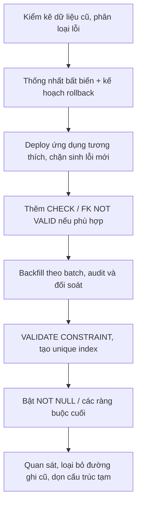

# Đặt ràng buộc mới khi dữ liệu cũ chưa đáp ứng

## 1. Một thay đổi schema đúng về nghiệp vụ vẫn có thể triển khai thất bại

Ứng dụng Java từng cho phép đơn hàng không có khách hàng, giá trị âm do dữ liệu nhập thử và trạng thái tự do như `ARCHIVED`. Sau một thời gian vận hành, nhóm quyết định áp dụng quy tắc mới:

- Mỗi đơn hàng phải có một khách hàng hợp lệ.
- Tổng tiền không được âm và không được để trống.
- Trạng thái chỉ thuộc tập `NEW`, `PAID`, `CANCELLED`.
- Email của khách hàng, nếu được cung cấp, không được trùng sau khi chuẩn hóa theo quy tắc nghiệp vụ.

Thiết kế ràng buộc trên bảng trống rất dễ. Khó khăn xuất hiện khi **bảng đang chứa dữ liệu lịch sử không đạt quy tắc** và ứng dụng vẫn liên tục đọc/ghi. Một lệnh `ALTER TABLE` có thể bị từ chối ngay do hàng cũ sai, khóa bảng lâu, làm phiên bản ứng dụng cũ ngừng ghi hoặc tạo ra khoảng thời gian hai bản triển khai hiểu dữ liệu khác nhau.

Trong chương **Tiến hóa dữ liệu** của **DATA_PERSISTENCE_FUNDAMENTALS**, mục tiêu là học cách chuyển **một lược đồ có dữ liệu thực** sang **một tập bất biến mạnh hơn** mà vẫn bảo toàn dữ liệu, giao dịch và khả năng vận hành. Các ví dụ dùng PostgreSQL và Java/JDBC; cú pháp, khóa DDL và khả năng triển khai trực tuyến phải được đối chiếu với DBMS/phiên bản mục tiêu.

> **Nguyên tắc:** Không coi việc thêm constraint là một thao tác đơn lẻ. Đây là **quá trình chuyển trạng thái dữ liệu và hợp đồng ghi** gồm kiểm kê, chặn lỗi mới, sửa dữ liệu cũ, xác minh rồi mới hoàn tất ràng buộc.

## 2. Constraint bảo vệ điều gì, và loại nào khó bổ sung?

| Loại ràng buộc | Ý nghĩa | Dữ liệu lịch sử thường gây trở ngại |
| --- | --- | --- |
| `NOT NULL` | Cột bắt buộc có giá trị | Các hàng có `NULL` |
| `CHECK` | Biểu thức điều kiện dữ liệu phải thỏa | Giá trị âm, trạng thái không còn hợp lệ, quan hệ giữa nhiều cột sai |
| `FOREIGN KEY` | Giá trị tham chiếu phải có bản ghi nguồn tương ứng, trừ trường hợp null được phép | **Orphan row**: mã khách hàng đã bị xóa hoặc chưa từng tồn tại |
| `UNIQUE` / unique index | Khóa nghiệp vụ không được trùng trong phạm vi quy định | Email/số đơn hàng trùng, khác chữ hoa thường hoặc khoảng trắng |
| `PRIMARY KEY` | Danh tính duy nhất và không null | ID trống hoặc trùng |
| Exclusion constraint / các ràng buộc đặc thù | Ngăn một số quan hệ chồng lấn, ví dụ khung giờ đặt chỗ | Các khoảng thời gian đã chồng lấn nhau |

Không phải mọi constraint đều được tạo/kiểm chứng giống nhau. **PostgreSQL hỗ trợ `NOT VALID` đối với `CHECK` và `FOREIGN KEY`**, giúp thêm ràng buộc mà chưa quét để chứng minh toàn bộ dữ liệu cũ hợp lệ. Sau đó dùng `VALIDATE CONSTRAINT` để kiểm tra dữ liệu lịch sử. Không thể giả định `UNIQUE` hoặc `PRIMARY KEY` có thể được bổ sung bằng đúng cú pháp `NOT VALID` đó.

Một điểm dễ nhầm là **logic ba giá trị của SQL**. Với:

```sql
CHECK (total >= 0)
```

giá trị `total = NULL` cho kết quả `UNKNOWN`, và `CHECK` của PostgreSQL không coi `UNKNOWN` là vi phạm. Nếu mục tiêu là **không null và không âm**, dùng `NOT NULL` kết hợp `CHECK (total >= 0)`, hoặc trong giai đoạn chuyển đổi có thể dùng:

```sql
CHECK (total IS NOT NULL AND total >= 0)
```

Quy tắc dữ liệu phải được phát biểu chính xác, không chỉ viết một biểu thức trông có vẻ đúng.

## 3. Ví dụ xuyên suốt: bảng cũ đang chứa ba dạng dữ liệu sai

Đoạn SQL sau tạo một **bộ dữ liệu thử nghiệm** trên PostgreSQL. Tên bảng bắt đầu bằng `demo_` để tránh nhầm với dữ liệu sản xuất.

```sql
CREATE TABLE demo_customers (
    id BIGINT PRIMARY KEY,
    email TEXT
);

CREATE TABLE demo_orders (
    id BIGINT PRIMARY KEY,
    customer_id BIGINT,
    status TEXT,
    total NUMERIC(12, 2)
);

INSERT INTO demo_customers(id, email) VALUES
    (1, 'alice@example.com'),
    (2, 'ALICE@example.com'),
    (3, NULL);

INSERT INTO demo_orders(id, customer_id, status, total) VALUES
    (101, 1,   'NEW',      100.00),
    (102, 999, 'ARCHIVED', -20.00),
    (103, NULL, NULL,         0.00),
    (104, 2,   'PAID',      30.00);
```

Những vấn đề đang tồn tại:

1. Đơn `102` tham chiếu `customer_id = 999`, nhưng khách `999` không tồn tại.
2. Đơn `102` có trạng thái `ARCHIVED` ngoài tập mới và tổng tiền âm.
3. Đơn `103` không có khách hàng và không có trạng thái.
4. Hai email của khách `1` và `2` khác cách viết chữ hoa nhưng giống nhau khi so sánh `lower(email)`.

Nếu thêm ngay một khóa ngoại thông thường, `NOT NULL`, `CHECK` hoặc unique index phù hợp, việc tạo constraint có thể thất bại vì **dữ liệu đang có**. Nếu vô tình chạy migration này trong lần khởi động service, cả bản triển khai có thể không hoạt động.

## 4. Bước đầu tiên: kiểm kê bằng truy vấn có thể đo được

Trước khi sửa dữ liệu, phải biết có **bao nhiêu hàng sai**, chúng thuộc nhóm nào và có thể xác định nguyên nhân không. Đừng chỉ kiểm tra một vài hàng mẫu.

### Hàng thiếu thông tin hoặc vi phạm điều kiện

```sql
SELECT id, customer_id, status, total
FROM demo_orders
WHERE customer_id IS NULL
   OR status IS NULL
   OR status NOT IN ('NEW', 'PAID', 'CANCELLED')
   OR total IS NULL
   OR total < 0
ORDER BY id;
```

### Hàng tham chiếu khách hàng không còn tồn tại

```sql
SELECT o.id, o.customer_id
FROM demo_orders AS o
LEFT JOIN demo_customers AS c
       ON c.id = o.customer_id
WHERE o.customer_id IS NOT NULL
  AND c.id IS NULL
ORDER BY o.id;
```

`NULL` ở `customer_id` là lỗi thuộc chính sách bắt buộc có khách, còn một giá trị **không null nhưng không tìm được khách** là lỗi khóa ngoại. Cần đếm riêng hai tình trạng vì cách phục hồi có thể khác nhau.

### Email trùng theo chuẩn hóa được chọn

```sql
SELECT lower(btrim(email)) AS normalized_email,
       COUNT(*) AS duplicates,
       array_agg(id ORDER BY id) AS customer_ids
FROM demo_customers
WHERE email IS NOT NULL
  AND btrim(email) <> ''
GROUP BY lower(btrim(email))
HAVING COUNT(*) > 1
ORDER BY duplicates DESC, normalized_email;
```

Hàm `lower(btrim(email))` chỉ là **ví dụ quy tắc chuẩn hóa**, không phải thuật toán định danh email đúng cho mọi hệ thống. Quy tắc chữ hoa/thường, Unicode, khoảng trắng, collation và chính sách tài khoản phải được xác định theo nghiệp vụ trước khi hợp nhất hay loại trùng.

### Báo cáo trước migration

Lưu lại số lượng hàng theo từng lỗi, tổng số hàng, những khóa đang bị ảnh hưởng và thời điểm đọc. Một số hàng có thể vi phạm **nhiều điều kiện đồng thời**, nên cộng số lỗi từng nhóm không nhất thiết bằng số hàng khác nhau cần sửa.

Nếu bảng đang nhận ghi, kết quả kiểm kê chỉ là một **ảnh chụp tại thời điểm truy vấn**. Các ghi mới sau đó có thể tạo thêm dữ liệu sai nếu chưa có cơ chế ngăn; vì vậy scan trước một lần chưa phải bằng chứng migration sẽ thành công khi triển khai thực tế.

## 5. Xác định chính sách xử lý dữ liệu cũ trước khi chạy UPDATE

Không phải dữ liệu không hợp lệ nào cũng có một cách sửa đúng. Ví dụ đơn `102` tham chiếu khách `999` có thể là:

- Một lỗi nhập liệu có thông tin đối soát xác nhận khách đúng là `1`.
- Một khách hàng đã bị xóa nhầm và cần phục hồi.
- Một đơn hàng từ hệ thống cũ cần gắn với hồ sơ khách hàng đặc biệt theo quy định.
- Một bản ghi thử không nên tồn tại trong môi trường production, nhưng chỉ được xóa theo quy trình đã phê duyệt.

**Không tự động gắn mọi orphan order vào một “khách mặc định”** để qua khóa ngoại nếu điều đó làm sai quyền sở hữu, hóa đơn hoặc lịch sử giao dịch. Tương tự, không tự đổi tổng tiền âm thành 0 cho dữ liệu tài chính thật mà chưa đối soát.

Một bảng quyết định giúp tránh sửa bừa:

| Lỗi cũ | Lựa chọn có thể hợp lệ | Điều phải phê duyệt/đối soát |
| --- | --- | --- |
| `customer_id` không tồn tại | Khôi phục khách, remap theo dữ liệu nguồn, cách ly bản ghi | Quyền sở hữu và lịch sử nghiệp vụ |
| `customer_id IS NULL` | Tìm khách từ order reference; bổ sung đúng mối liên hệ | Không suy đoán từ tên/email gần giống |
| `status` không thuộc tập mới | Ánh xạ trạng thái cũ sang trạng thái mới hoặc bổ sung một trạng thái nghiệp vụ hợp lệ | Ý nghĩa của từng trạng thái trong workflow |
| `total < 0` | Tách thành refund/credit, sửa lỗi nhập, giữ cấu trúc nghiệp vụ khác | Sổ cái, thuế, đối soát thanh toán |
| Email trùng | Hợp nhất tài khoản có kiểm soát, chọn email liên hệ mới đã xác thực | Quyền truy cập và dữ liệu thuộc từng tài khoản |

Với **bộ dữ liệu thử nghiệm duy nhất** ở phần 3, nếu đã xác minh được các quyết định sửa mẫu, có thể minh họa:

```sql
-- CHỈ dùng cho dữ liệu demo sau khi đã xác minh cách sửa tương ứng.
UPDATE demo_orders
SET customer_id = 1, status = 'NEW', total = 0.00
WHERE id = 102;

UPDATE demo_orders
SET customer_id = 1, status = 'NEW'
WHERE id = 103;

UPDATE demo_customers
SET email = 'bob@example.com'
WHERE id = 2;
```

Đây **không phải script làm sạch production**. Trong dữ liệu thật, phải có mapping nguồn đáng tin cậy, bản ghi audit, số lượng cập nhật kỳ vọng, khả năng kiểm tra lại và kế hoạch phục hồi khi ánh xạ sai.

## 6. Chiến lược expand → chặn ghi sai → backfill → validate → contract

Một lộ trình nhiều giai đoạn giúp tránh dừng toàn bộ hệ thống:



| Giai đoạn | Dữ liệu cũ | Ghi mới | Tiêu chí chuyển giai đoạn |
| --- | --- | --- | --- |
| **Kiểm kê/thiết kế** | Có thể còn sai | Có thể còn sinh sai nếu không chặn | Có báo cáo phạm vi và chính sách xử lý |
| **Expand** | Chưa được sửa hết | Ứng dụng mới chấp nhận schema trung gian | Có đường ghi phù hợp và phiên bản cũ còn tương thích |
| **Chặn ghi sai** | Vẫn có hàng legacy sai | Constraint `NOT VALID` bắt đầu kiểm tra ghi mới, hoặc cơ chế ghi có thẩm quyền tương ứng | Lỗi mới không tiếp tục phát sinh |
| **Backfill** | Được sửa theo batch | Ghi vẫn diễn ra theo quy tắc mới | Số vi phạm cũ giảm về 0 |
| **Validate** | Được DB kiểm tra toàn bộ | Tiếp tục được ràng buộc kiểm tra | Validation/index build thành công |
| **Contract** | Chỉ còn dữ liệu đúng | Các phiên bản ứng dụng đều hiểu hợp đồng mới | Có thể bật `NOT NULL`, thu gọn đường cũ |

Thứ tự cụ thể có thể thay đổi. Ví dụ không phải mọi hệ thống chịu được áp ngay một `CHECK NOT VALID` nếu worker cũ vẫn thường xuyên **UPDATE lại các hàng legacy chưa sửa**: PostgreSQL sẽ kiểm tra constraint trên hàng đang được cập nhật và có thể từ chối, kể cả khi worker chỉ muốn đổi một cột khác. Vì thế phải thử tương thích ứng dụng cũ, chọn cách làm sạch hoặc chuyển đường ghi theo lộ trình phù hợp, thay vì áp dụng máy móc thứ tự.

**Mục đích của `NOT VALID` không phải “cho phép mọi dữ liệu sai tiếp tục được ghi”.** Nó cho phép bỏ qua **quét kiểm chứng dữ liệu đang tồn tại tại lúc thêm constraint**, trong khi các INSERT/UPDATE mới chịu quy tắc constraint đó.

## 7. Thêm CHECK với `NOT VALID` trên PostgreSQL

Ta muốn mỗi hàng có tổng tiền không null, không âm; trạng thái hợp lệ và không null; khách hàng không null.

Trên bảng demo **chưa làm sạch**, có thể thêm các CHECK constraint:

```sql
ALTER TABLE demo_orders
ADD CONSTRAINT ck_demo_orders_total_valid
CHECK (total IS NOT NULL AND total >= 0) NOT VALID;

ALTER TABLE demo_orders
ADD CONSTRAINT ck_demo_orders_status_valid
CHECK (
    status IS NOT NULL
    AND status IN ('NEW', 'PAID', 'CANCELLED')
) NOT VALID;

ALTER TABLE demo_orders
ADD CONSTRAINT ck_demo_orders_customer_present
CHECK (customer_id IS NOT NULL) NOT VALID;
```

Các hàng cũ 102 và 103 vẫn nằm trong bảng sau khi thêm constraint vì PostgreSQL **chưa kiểm chứng toàn bộ dữ liệu cũ**. Nhưng một `INSERT` hoặc `UPDATE` mới tạo hàng vi phạm sẽ bị DB từ chối. Nếu cập nhật một hàng legacy sai, hãy đảm bảo **hàng sau khi UPDATE thỏa mọi CHECK đang có**, hoặc cân nhắc thứ tự chuyển đổi trước khi triển khai constraint.

### Validate sau khi dữ liệu đã được sửa

Sau khi backfill, chạy:

```sql
ALTER TABLE demo_orders VALIDATE CONSTRAINT ck_demo_orders_total_valid;
ALTER TABLE demo_orders VALIDATE CONSTRAINT ck_demo_orders_status_valid;
ALTER TABLE demo_orders VALIDATE CONSTRAINT ck_demo_orders_customer_present;
```

Nếu vẫn còn hàng sai, lệnh validate tương ứng **thất bại** và constraint vẫn chưa ở trạng thái validated. Phải sửa dữ liệu hoặc làm rõ chính sách; không “bỏ qua lỗi” rồi cho rằng bảng đã đạt hợp đồng mới.

Với PostgreSQL, validation của `CHECK` có thể cần quét bảng. Nó thường sử dụng chế độ khóa ít hạn chế hơn so với một số thao tác thay đổi cấu trúc trực tiếp và có thể cho phép ghi đồng thời, nhưng **không miễn phí hay không khóa hoàn toàn**. Tải I/O, CPU, lock wait và phiên bản PostgreSQL vẫn phải được khảo sát cho bảng lớn.

### Kiểm tra trạng thái validation

```sql
SELECT conname, contype, convalidated
FROM pg_constraint
WHERE conrelid = 'demo_orders'::regclass
ORDER BY conname;
```

`convalidated = false` cho biết constraint chưa được xác minh trên toàn bộ dữ liệu lịch sử. Đừng dùng việc “constraint có tên trong catalog” làm bằng chứng tất cả hàng đã hợp lệ.

## 8. Thêm FOREIGN KEY khi đang còn orphan row

Nếu chạy ngay:

```sql
ALTER TABLE demo_orders
ADD CONSTRAINT fk_demo_orders_customer
FOREIGN KEY (customer_id)
REFERENCES demo_customers(id);
```

database sẽ phải kiểm tra dữ liệu cũ và phát hiện `customer_id = 999` không có bản ghi tham chiếu. Trên PostgreSQL có thể dùng:

```sql
ALTER TABLE demo_orders
ADD CONSTRAINT fk_demo_orders_customer
FOREIGN KEY (customer_id)
REFERENCES demo_customers(id)
NOT VALID;
```

Nhờ đó, việc thêm constraint **không bắt buộc xử lý xong tất cả orphan trong chính lệnh DDL**. Các thao tác ghi mới vẫn phải tuân thủ ràng buộc. Khi dữ liệu cũ đã được sửa:

```sql
ALTER TABLE demo_orders
VALIDATE CONSTRAINT fk_demo_orders_customer;
```

Một khóa ngoại thông thường cho phép `NULL` ở cột tham chiếu nếu không có `NOT NULL` riêng. Vì vậy **validate FK thành công không chứng minh mọi đơn hàng có khách**; còn cần `CHECK (customer_id IS NOT NULL)` hoặc `NOT NULL`.

Lưu ý phía bảng tham chiếu: `demo_customers(id)` phải có khóa duy nhất/primary key thích hợp để FK tham chiếu. Ngược lại, PostgreSQL **không tự tạo index trên cột `demo_orders.customer_id` chỉ vì thêm FK**; với bảng lớn, index trên phía tham chiếu thường hữu ích cho join và thao tác cập nhật/xóa khách, nhưng cần đánh giá workload và chi phí ghi.

Ví dụ:

```sql
-- PostgreSQL: chạy riêng ngoài transaction block tường minh.
CREATE INDEX CONCURRENTLY ix_demo_orders_customer_id
ON demo_orders(customer_id);
```

Index không sửa được orphan. Nó chỉ giúp truy vấn và một số thao tác kiểm tra/duy trì quan hệ hiệu quả hơn.

## 9. Bật NOT NULL khi bảng đã từng chứa NULL

Việc chuyển thẳng:

```sql
ALTER TABLE demo_orders
ALTER COLUMN customer_id SET NOT NULL;
```

sẽ thất bại nếu còn hàng null, và trên bảng lớn có thể yêu cầu kiểm tra dữ liệu cũng như lock DDL đáng kể.

Một lộ trình hợp lý trên PostgreSQL:

1. Thống nhất quy tắc không null và sửa ứng dụng để không ghi null mới.
2. Thêm `CHECK (customer_id IS NOT NULL) NOT VALID` để khóa đường ghi sai, sau khi đã đánh giá tương thích với UPDATE legacy.
3. Backfill các hàng có null bằng dữ liệu **được xác minh**.
4. Chạy `VALIDATE CONSTRAINT` với CHECK không null đó.
5. Đổi cột sang `NOT NULL` khi môi trường phù hợp và giữ/loại CHECK tạm theo kế hoạch.

```sql
-- Chỉ sau khi ck_demo_orders_customer_present đã được VALIDATE.
ALTER TABLE demo_orders ALTER COLUMN customer_id SET NOT NULL;
ALTER TABLE demo_orders ALTER COLUMN status SET NOT NULL;
ALTER TABLE demo_orders ALTER COLUMN total SET NOT NULL;
```

Ba lệnh ví dụ dựa trên các CHECK đã được validate ở phần 7. Một số phiên bản PostgreSQL có thể dùng CHECK đã xác minh để tránh quét lại toàn bộ bảng khi `SET NOT NULL`, nhưng **DDL vẫn cần khóa thích hợp** và hành vi chính xác tùy phiên bản/biểu thức chứng minh. Đừng quảng bá mẹo này như cách “hoàn toàn không khóa bảng”.

Sau khi cột đã có `NOT NULL`, có thể xem xét loại CHECK chỉ kiểm tra `IS NOT NULL` nếu không còn lý do giữ, nhưng **không xóa nhầm các điều kiện nghiệp vụ** như `total >= 0` hay tập trạng thái hợp lệ. Kiểm tra schema và bản migration trước khi drop.

## 10. UNIQUE là bài toán khác: phát hiện trùng và tạo index đồng thời

Khác `CHECK` và `FOREIGN KEY`, PostgreSQL không hỗ trợ chiến lược “thêm `UNIQUE NOT VALID` rồi validate” theo cách tương tự. Với bảng lớn cần tránh chặn ghi dài, một lựa chọn là **`CREATE UNIQUE INDEX CONCURRENTLY`** sau khi làm sạch dữ liệu và chặn phát sinh trùng mới.

Ví dụ yêu cầu nghiệp vụ: email **nếu có và không rỗng** phải duy nhất theo `lower(btrim(email))` trong bảng demo.

### Kiểm tra trùng trước

```sql
SELECT lower(btrim(email)) AS normalized_email,
       COUNT(*) AS count_rows
FROM demo_customers
WHERE email IS NOT NULL
  AND btrim(email) <> ''
GROUP BY lower(btrim(email))
HAVING COUNT(*) > 1;
```

Nếu còn kết quả, cần giải quyết theo nghiệp vụ (chọn email đã xác minh, hợp nhất tài khoản có kiểm soát, v.v.). **Không tự động nối thêm hậu tố số** vào email thật chỉ để qua unique constraint; điều đó có thể làm sai danh tính, thông báo hoặc quyền truy cập.

### Tạo unique index online ở PostgreSQL

```sql
-- Chạy khi dữ liệu trùng đã được xử lý
-- và các đường ghi mới không còn được phép sinh trùng.
CREATE UNIQUE INDEX CONCURRENTLY uq_demo_customers_email_normalized
ON demo_customers (lower(btrim(email)))
WHERE email IS NOT NULL
  AND btrim(email) <> '';
```

Đây là **unique expression index có predicate**: nó chặn các email không rỗng có giá trị chuẩn hóa giống nhau; `NULL` và chuỗi toàn khoảng trắng **không nằm trong phạm vi uniqueness của index này**. Nếu email bắt buộc có giá trị hợp lệ, phải bổ sung quy tắc không null/không blank riêng.

Những giới hạn phải ghi nhớ:

- `CREATE INDEX CONCURRENTLY` của PostgreSQL **không chạy bên trong explicit transaction block**. Công cụ migration phải cấu hình bước này ngoài transaction tương ứng.
- Lệnh có thể mất thời gian, dùng nhiều tài nguyên và phải chờ một số transaction lâu; “CONCURRENTLY” **không có nghĩa không ảnh hưởng workload**.
- Nếu có một ghi trùng mới xuất hiện trong lúc index được xây dựng, quá trình có thể thất bại. Cần ngăn phát sinh trùng từ các đường ghi có thẩm quyền, không chỉ chạy scan một lần trước đó.
- Khi tạo unique index concurrently thất bại, PostgreSQL có thể để lại **index không hợp lệ**. Cần kiểm tra catalog và xử lý đúng trước khi retry; trong một số giai đoạn index đang xây có thể đã tham gia kiểm tra uniqueness.
- Unique index trên biểu thức hoặc predicate như trên **không thể mặc nhiên biến thành table UNIQUE constraint bằng `ADD CONSTRAINT ... USING INDEX`**. Một index duy nhất vẫn có thể tự thực thi quy tắc dữ liệu được chọn; nếu bắt buộc cần table constraint theo cấu trúc khác, phải thiết kế cột/khóa thích hợp.

Kiểm tra trạng thái index:

```sql
SELECT cls.relname AS index_name,
       idx.indisvalid,
       idx.indisready
FROM pg_index AS idx
JOIN pg_class AS cls ON cls.oid = idx.indexrelid
WHERE cls.relname = 'uq_demo_customers_email_normalized';
```

Nếu index không hợp lệ, không coi migration thành công. Điều tra lỗi và cân nhắc quy trình `DROP INDEX CONCURRENTLY` rồi xây lại trong môi trường phù hợp; các bước này phải phối hợp với quy trình thay đổi và tránh để ứng dụng tưởng rằng uniqueness đã được bảo đảm trong lúc index chưa sẵn sàng.

## 11. Chặn dữ liệu lỗi mới: phiên bản ứng dụng cũ là một phần của bài toán

Giả sử service mới validate `status` thuộc `NEW/PAID/CANCELLED`, nhưng batch job cũ vẫn gửi `ARCHIVED`. Sau khi thêm CHECK, batch job cũ sẽ gặp lỗi constraint. Nếu job lại retry vô hạn, hệ thống có thể bị quá tải và trễ xử lý dữ liệu.

**Chỉ deploy validation trong một API mới là chưa đủ** nếu còn nhiều đường ghi:

- REST API và các instance đang chạy rolling deploy.
- Consumer message queue, scheduler, import CSV, tác vụ ETL.
- Script vận hành và thao tác từ công cụ quản trị.
- Stored procedure, trigger hoặc dịch vụ khác cùng ghi một bảng.

Trước khi bật constraint, cần lập danh sách **mọi writer** có thể bị ảnh hưởng. Trong quá trình deploy chồng lấp phiên bản, schema trung gian phải chấp nhận những ghi hợp lệ của cả phiên bản cũ và mới, hoặc phải có kế hoạch chuyển lưu lượng/feature flag/thoát phiên bản cũ rõ ràng.

| Rủi ro | Dấu hiệu khi triển khai | Biện pháp |
| --- | --- | --- |
| Writer cũ phát sinh trạng thái không hợp lệ | SQLSTATE `23514` tăng đột ngột | Deploy writer tương thích trước, giám sát lỗi theo service |
| Job sửa trường khác trên hàng legacy sai | UPDATE bị CHECK NOT VALID từ chối | Làm sạch hàng trước, thay đổi đường ghi hoặc sắp lịch phù hợp |
| Hai request cùng tạo email chuẩn hóa trùng | Unique index build thất bại hoặc một request bị từ chối | Điều phối danh tính tại nơi ghi và xử lý conflict đúng |
| Rolling deploy đọc/ghi schema khác nhau | Lỗi thiếu cột, sai enum hoặc payload | Expand trước, hỗ trợ cả hai dạng trong thời gian chuyển đổi |
| Backfill tranh chấp với giao dịch nghiệp vụ | Lock wait, deadlock hoặc dữ liệu bị ghi đè | Batch nhỏ, condition theo phiên bản, kiểm tra xung đột |

**Ràng buộc database là lớp bảo vệ cuối**, nhưng cách triển khai hợp lệ không đồng nghĩa ngắt toàn bộ ghi ngay lập tức. Cần chọn thời điểm và hình thức bảo vệ để ứng dụng vẫn vận hành trong suốt migration.

## 12. Backfill theo batch: dữ liệu nhiều và vẫn có ghi đồng thời

Với bảng hàng triệu dòng, một transaction `UPDATE` tất cả hàng có thể giữ lock lâu, tạo lượng WAL lớn, gây áp lực replication, tăng bloat và khiến phục hồi khó khăn. Cần thiết kế **batch nhỏ, có checkpoint và có thể chạy lại an toàn**.

### Tách phát hiện khỏi quyết định sửa

Ví dụ truy vấn lấy một tập hàng legacy sai để **điều tra** và khóa khi xử lý:

```sql
BEGIN;

SELECT o.id, o.customer_id, o.status, o.total
FROM demo_orders AS o
WHERE o.customer_id IS NULL
   OR o.status IS NULL
   OR o.status NOT IN ('NEW', 'PAID', 'CANCELLED')
   OR o.total IS NULL
   OR o.total < 0
   OR (
       o.customer_id IS NOT NULL
       AND NOT EXISTS (
           SELECT 1 FROM demo_customers AS c
           WHERE c.id = o.customer_id
       )
   )
ORDER BY o.id
LIMIT 100
FOR UPDATE SKIP LOCKED;

-- Tra quyết định sửa từ nguồn dữ liệu đáng tin cậy.
-- UPDATE từng hàng được xác minh trong chính transaction này.
COMMIT;
```

`SKIP LOCKED` giúp các worker backfill song song tránh chờ các hàng đang bị worker khác khóa, nhưng trả về tập hàng **không phải ảnh chụp đầy đủ nhất quán của mọi dữ liệu sai**; đây là cơ chế lấy việc theo batch, không phải công cụ đếm chính xác tổng vi phạm. Phải lặp lại cho tới khi kết quả scan kiểm chứng cuối không còn lỗi.

Không được giữ transaction mở hàng phút trong khi chờ con người phê duyệt. Trên dữ liệu thật, nên chuẩn bị **bảng quyết định sửa đã được xác nhận** trước rồi backfill nhanh trong transaction. Hệ thống cần theo dõi mỗi batch: số hàng chọn, số hàng sửa, số hàng thất bại và lý do.

### Chỉ cập nhật khi trạng thái vẫn đúng

Giả sử việc sửa một trạng thái cũ đã được phê duyệt:

```sql
UPDATE demo_orders
SET status = 'CANCELLED'
WHERE id = :order_id
  AND status = 'ARCHIVED';
```

Điều kiện `AND status = 'ARCHIVED'` tránh ghi đè một trạng thái đã được ứng dụng khác sửa trong lúc batch đang chạy. Với dữ liệu thay đổi nhiều trường, có thể dùng `version`, so sánh trạng thái gốc hoặc khóa transaction để ngăn **lost update**. Ghi nhận số dòng thay đổi; `0` có thể có nghĩa dòng đã được sửa hoặc dữ liệu đầu vào không còn phù hợp, không nên retry vô hạn.

**Cảnh báo với CHECK NOT VALID:** nếu cùng hàng còn vi phạm một CHECK khác, một UPDATE chỉ đổi `status` vẫn có thể bị từ chối. Phải **sửa đủ các cột sai trong cùng một UPDATE** hoặc điều chỉnh lộ trình thêm constraint/backfill sao cho tương thích.

### Tính idempotent của backfill

Batch chạy lại không được nhân đôi side effect. Ví dụ:

- Không gửi email mỗi lần một hàng được kiểm lại.
- Không tạo thêm đơn mới khi chỉ cần sửa quan hệ khách hàng.
- Không chỉnh tổng tiền bằng phép cộng/trừ tích lũy mỗi lần retry.
- Lưu audit mapping và mốc xử lý để kiểm chứng phiên bản cũ→mới.

Đừng báo thành công chỉ vì mọi batch không ném lỗi. Cần **scan lại toàn bộ bất biến** hoặc yêu cầu DB validate constraint để chứng minh không còn vi phạm.

## 13. Tác động của DDL lên khóa và khả năng sẵn sàng

Một kế hoạch “online migration” vẫn có thể làm nghẽn ứng dụng nếu DDL chờ khóa rồi chặn các request phía sau. Bảng sau tóm tắt xu hướng trong PostgreSQL; **mức khóa chính xác tùy lệnh và phiên bản**.

| Thao tác | Nguy cơ vận hành | Cách giảm rủi ro |
| --- | --- | --- |
| `ADD CHECK ... NOT VALID` | Cần lock DDL trong lúc sửa metadata; có thể chờ transaction dài | Lệnh ngắn, lock timeout, khảo sát writer cũ |
| `VALIDATE CONSTRAINT` | Quét dữ liệu; gây I/O, CPU, lock wait dù thường cho phép DML đồng thời | Chạy theo thời điểm phù hợp, giám sát tài nguyên |
| `ALTER COLUMN SET NOT NULL` | Có thể quét bảng và cần lock mạnh; phụ thuộc CHECK đã chứng minh và phiên bản | Validate CHECK trước, đo trên dữ liệu gần production |
| `CREATE UNIQUE INDEX CONCURRENTLY` | Quét nhiều lần, tranh chấp với ghi, có thể để lại index invalid | Kiểm tra trùng, giảm writer lỗi, theo dõi build |
| Backfill nhiều hàng | WAL, bloat, replica lag, khóa hàng | Batch nhỏ, giới hạn tốc độ, checkpoint |
| `DROP` cấu trúc cũ | Ảnh hưởng phiên bản ứng dụng đang chạy | Chỉ contract sau khi mọi reader/writer đã chuyển |

Ví dụ giới hạn thời gian chờ lock cho một bước DDL ngắn:

```sql
BEGIN;
SET LOCAL lock_timeout = '3s';

ALTER TABLE demo_orders
ADD CONSTRAINT ck_demo_orders_id_positive
CHECK (id > 0) NOT VALID;

COMMIT;
```

Đây là **một constraint minh họa riêng** về cách giới hạn lock wait. Nó không thay thế các constraint nghiệp vụ ở phần trước. Nếu không lấy được khóa trong thời gian quy định, lệnh thất bại và transaction phải rollback; công cụ triển khai nên báo lỗi rõ thay vì im lặng vượt qua.

Không dùng timeout quá ngắn một cách máy móc: lock timeout phải phù hợp với tải, mục tiêu dịch vụ và lịch triển khai. `statement_timeout`, thời gian chạy validation và lock timeout là các giới hạn khác nhau. Hãy giám sát active transaction, lock wait, tiến độ index build, throughput, WAL và replica lag trong lúc migration.

## 14. Lớp Java/JDBC khi constraint mới được áp dụng

Application validation giúp trả lỗi dễ hiểu, nhưng **không thay thế database constraint** khi có cạnh tranh hoặc đường ghi khác. Ví dụ repository ghi đơn hợp lệ vào schema mới:

```java
import java.math.BigDecimal;
import java.sql.Connection;
import java.sql.PreparedStatement;
import java.sql.SQLException;
import javax.sql.DataSource;

public final class OrderRepository {
    private final DataSource dataSource;

    public OrderRepository(DataSource dataSource) {
        this.dataSource = dataSource;
    }

    public void insert(
            long orderId, long customerId, String status, BigDecimal total)
            throws SQLException {
        if (orderId <= 0 || customerId <= 0 || total == null
                || total.signum() < 0
                || !("NEW".equals(status) || "PAID".equals(status)
                || "CANCELLED".equals(status))) {
            throw new IllegalArgumentException("Invalid order data");
        }

        try (Connection connection = dataSource.getConnection()) {
            connection.setAutoCommit(false);

            try (PreparedStatement statement = connection.prepareStatement(
                    "INSERT INTO demo_orders " +
                    "(id, customer_id, status, total) VALUES (?, ?, ?, ?)")) {
                statement.setLong(1, orderId);
                statement.setLong(2, customerId);
                statement.setString(3, status);
                statement.setBigDecimal(4, total);
                statement.executeUpdate();
                connection.commit();
            } catch (SQLException | RuntimeException failure) {
                try {
                    connection.rollback();
                } catch (SQLException rollbackError) {
                    failure.addSuppressed(rollbackError);
                }
                throw failure;
            }
        }
    }
}
```

Đoạn mã kiểm tra đầu vào trong Java, dùng `PreparedStatement` để bind giá trị và rollback khi lỗi. Nhưng nó vẫn có thể nhận lỗi từ DB:

| SQLSTATE PostgreSQL | Tình huống | Quy tắc xử lý |
| --- | --- | --- |
| `23502` | Vi phạm `NOT NULL` | Tìm đường ghi thiếu field; thường sửa input hoặc mã |
| `23514` | Vi phạm `CHECK` | Xem tên constraint, đối chiếu bất biến nghiệp vụ |
| `23503` | Vi phạm `FOREIGN KEY` | Khách chưa tồn tại, bị xóa cạnh tranh hoặc scope sai |
| `23505` | Vi phạm `UNIQUE` | Phân biệt retry cùng ý định với xung đột business key |
| `40001` | Serialization failure | Retry **toàn transaction**, đọc lại điều kiện |
| `40P01` | Deadlock | Xử lý transaction bị chọn rollback, retry có giới hạn |

Một `23505` không đồng nghĩa “request đã thành công”. Đặc biệt khi áp unique email, cần biết **constraint/index nào từ chối**, liệu hai khách là cùng một người hay hai ý định khác nhau, rồi trả thông báo phù hợp. Đừng nuốt toàn bộ lỗi SQL để “mượt” quá trình rollout.

Nếu kết nối mất **khi đang commit**, kết quả có thể chưa rõ từ phía caller; rollback trong `catch` không thể hoàn tác một commit đã hoàn thành. Các API tạo dữ liệu quan trọng nên có **operation ID ổn định**, unique business key và tra cứu/retry idempotent khi cần, thay vì gửi lệnh mới mù quáng.

### Spring và ORM cần chú ý gì?

Nếu ứng dụng dùng JPA/Hibernate, validation có thể chạy ở tầng Java, còn kiểm tra constraint thật xảy ra tại **flush/commit**. Exception có thể được dịch thành `DataIntegrityViolationException` hoặc lớp khác tùy stack. Để chẩn đoán, cần truy tìm SQLSTATE/vendor code, tên constraint và transaction outcome, không chỉ bắt lỗi ngay sau `repository.save()`.

Rolling deploy còn phải kiểm tra version mapper/entity: một bản ứng dụng cũ gửi `NULL` hoặc trạng thái bỏ đi sẽ thất bại sau khi constraint có hiệu lực. Đây là tín hiệu ứng dụng không còn tương thích với schema, không phải lý do xóa constraint ngay khi thấy lỗi.

## 15. Công cụ migration: làm rõ ranh giới transaction

Flyway, Liquibase hoặc công cụ tương đương giúp quản lý phiên bản schema và đảm bảo script đã được áp dụng theo thứ tự. Nhưng **không biến một lệnh DDL rủi ro thành an toàn chỉ nhờ đặt nó trong migration file**.

Các bước nên được chia thành migration nhỏ có thể quan sát:

```text
V1__create_legacy_tables.sql              (đã tồn tại trong quá khứ)
V2__add_check_and_fk_not_valid.sql         (bật kiểm tra ghi mới)
V3__prepare_backfill_mapping.sql           (nếu cần bảng dữ liệu đối soát)
Job: controlled-backfill                  (batch có checkpoint)
V4__validate_existing_constraints.sql     (chỉ khi dữ liệu đạt)
V5__create_email_unique_index.sql          (non-transactional CONCURRENTLY)
V6__set_required_columns_not_null.sql      (sau validate)
V7__remove_deprecated_write_paths.sql      (sau khi app cũ đã dừng)
```

Đây là **ví dụ phân chia công việc**, không phải tên tệp bắt buộc. Với PostgreSQL:

- `CREATE INDEX CONCURRENTLY` không được đặt trong transaction block tường minh. Cần cấu hình tương ứng trong công cụ migration, chẳng hạn tách riêng migration không chạy trong transaction nếu công cụ/phiên bản hỗ trợ.
- Một số thao tác DDL khác có thể rollback nếu transaction thất bại; đừng suy ra **mọi thao tác schema trên mọi DBMS** đều transactional.
- Không để migration startup tự backfill hàng triệu bản ghi và giữ lock hàng giờ. Tách job có tốc độ/giám sát phù hợp khỏi startup path nếu cần.
- Không sửa lại nội dung migration đã chạy trên môi trường khác; dùng migration mới để điều chỉnh theo quy trình kiểm soát phiên bản.
- Ghi rõ bước nào **có thể rollback về schema cũ**, bước nào đã làm thay đổi dữ liệu nghiệp vụ khó hoàn tác và yêu cầu khôi phục từ bản backup.

Một migration thất bại giữa chừng, nhất là khi chạy ngoài transaction, phải được chẩn đoán ở trạng thái thực tế trước khi retry. Đừng giả định toàn bộ script luôn tự rollback sạch về trạng thái ban đầu.

## 16. Phương án rollback và phục hồi không chỉ là `DROP CONSTRAINT`

Nếu sau rollout ứng dụng báo hàng loạt lỗi vì writer cũ, lựa chọn có thể là:

1. Tạm dừng đường ghi cũ hoặc bật feature flag chặn giá trị sai.
2. Chuyển về bản ứng dụng tương thích với constraint mới.
3. Nếu thật sự cần nới quy tắc tạm thời, đánh giá hậu quả và áp dụng migration thay đổi constraint **có phê duyệt**, thay vì xóa vội ràng buộc.
4. Đối soát các bản ghi được sửa: rollback schema **không tự khôi phục email, tổng tiền hay customer ID đã backfill**.
5. Khi sai mapping dữ liệu, sử dụng audit/source of truth hoặc phương án phục hồi dữ liệu đã diễn tập.

Một `DROP CONSTRAINT` có thể giúp ứng dụng cũ ghi tiếp nhưng cũng cho phép **dữ liệu sai mới** xuất hiện. Nếu đã thực hiện backfill làm thay đổi ý nghĩa của trạng thái hoặc quan hệ khách hàng, quay về code cũ có thể không còn hiểu dữ liệu mới. Do đó “rollback ứng dụng” và “rollback dữ liệu” là hai quyết định riêng.

Trước khi triển khai, cần backup/PITR theo yêu cầu, kiểm tra quyền khôi phục, thời gian phục hồi và khả năng đối soát những ghi hợp lệ đã xảy ra **sau** thời điểm backup. Không tự restore toàn bộ production chỉ vì một constraint mới thất bại, vì làm như vậy có thể mất các giao dịch mới.

## 17. Kiểm thử trên môi trường giống production

Một kiểm thử migration hữu ích không chỉ chạy script trên bảng trống. Cần tái hiện **dữ liệu xấu và các phiên bản writer đang tồn tại**.

### Kịch bản A — CHECK với dữ liệu legacy

1. Khởi tạo `demo_orders` có hàng `102` âm, trạng thái `ARCHIVED`.
2. Thêm `CHECK ... NOT VALID`, xác minh DDL thành công dù còn legacy sai.
3. Thử `INSERT` mới với `total=-1`; phải bị từ chối.
4. Thử UPDATE legacy chỉ sửa một cột không liên quan; xác minh tác động của constraint mới tới ghi cũ.
5. Backfill hợp lệ, chạy `VALIDATE CONSTRAINT`; xác minh `convalidated=true`.

### Kịch bản B — Foreign key và null

1. Đưa vào một orphan có `customer_id=999` và một order có `customer_id=NULL`.
2. Thêm FK `NOT VALID`; kiểm tra INSERT tham chiếu khách không tồn tại bị từ chối.
3. Sau khi sửa orphan, validate FK.
4. Xác nhận order có null vẫn không bị FK bắt, và chỉ bị loại khi có CHECK/NOT NULL tương ứng.

### Kịch bản C — Unique email

1. Đưa vào email trùng sau `lower(btrim(...))`.
2. Chạy truy vấn kiểm tra; phải tìm thấy trùng.
3. Trên môi trường thử nghiệm, cố build unique index để quan sát lỗi và kiểm tra trạng thái index còn lại.
4. Xử lý dữ liệu demo theo mapping được xác minh, dọn index không hợp lệ theo quy trình, build lại.
5. Gửi hai INSERT/UPDATE cạnh tranh tạo cùng email chuẩn hóa; chỉ một kết quả hợp lệ theo unique index.

### Kịch bản D — Backfill đang diễn ra cùng lưu lượng thật

1. Seed bảng lớn có tỷ lệ hàng sai, bật workload đọc/ghi của **cả phiên bản cũ và mới nếu có giai đoạn chồng lấp**.
2. Chạy backfill theo batch với tốc độ giới hạn.
3. Đo lock wait, latency p95/p99, WAL, replica lag, deadlock và connection pool.
4. Thử crash worker giữa batch; khởi chạy lại và xác nhận idempotency.
5. Sau khi job hoàn thành, scan lại bất biến và validate DB; không chỉ dựa vào số batch đã chạy.

### Kịch bản E — Rollback và xử lý lỗi ứng dụng

1. Kiểm tra JDBC/JPA ánh xạ đúng lỗi `23502/23503/23505/23514`.
2. Nếu một transaction cập nhật nhiều bảng rồi vi phạm constraint, xác nhận **toàn bộ transaction rollback**.
3. Xác nhận hệ thống không retry vô hạn một request sai dữ liệu.
4. Thử rolling deploy với ứng dụng cũ để phát hiện writer không còn tương thích.
5. Thực hành rollback schema có kiểm soát và đối soát dữ liệu đã sửa.

Các bài test phải chạy với **DBMS/phiên bản mục tiêu**, không chỉ dựa vào database in-memory có cú pháp gần giống. Khóa và hành vi DDL online khác nhau giữa PostgreSQL, MySQL, SQL Server và các nền tảng quản lý dịch vụ.

## 18. Quan sát trong và sau rollout

Một dashboard migration nên theo dõi:

| Chỉ số | Ý nghĩa | Dấu hiệu cần hành động |
| --- | --- | --- |
| Số hàng vi phạm từng bất biến | Backfill có tiến tới hoàn tất không | Không giảm, tăng trở lại hoặc còn nhóm không có chính sách sửa |
| `pg_constraint.convalidated` | Constraint đã kiểm tra dữ liệu cũ chưa | Constraint tồn tại nhưng chưa validated |
| `pg_index.indisvalid` | Unique index có dùng được theo kế hoạch không | Index invalid sau build thất bại |
| SQLSTATE `23502/23503/23505/23514` theo service | Writer nào còn gửi dữ liệu sai | Tăng đột biến sau khi bật constraint |
| Lock wait, deadlock, DDL wait | Migration có ảnh hưởng availability không | DDL giữ/chờ khóa dài |
| WAL throughput, replication lag | Backfill gây tải sao chép ra sao | Replica không bắt kịp hoặc lưu trữ tăng nhanh |
| Batch size, batch latency, checkpoint | Job có tiến độ và khả năng resume không | Bị kẹt cùng một nhóm hàng hoặc retry vô hạn |
| Mapping/audit reconciliation | Dữ liệu sau sửa có đúng nghiệp vụ không | Đơn đổi khách sai hoặc tổng tiền lệch sổ nguồn |

**Thành công về mặt kỹ thuật** là constraint được validate hoặc unique index hợp lệ; **thành công về mặt nghiệp vụ** còn yêu cầu tất cả bản ghi đã được xử lý **đúng ý nghĩa**. Không đồng nhất hai kết quả này.

## 19. Những sai lầm thường gặp

1. **Chạy `ALTER COLUMN SET NOT NULL` ngay trên bảng còn null.** Lệnh sẽ thất bại và có thể ảnh hưởng availability nếu chờ/quét lâu.
2. **Cho rằng `CHECK (x > 0)` tự cấm `NULL`.** Biểu thức CHECK nhận UNKNOWN không phải vi phạm.
3. **Hiểu `NOT VALID` là cho phép ghi sai mới.** PostgreSQL vẫn kiểm tra các INSERT/UPDATE tiếp theo.
4. **Chỉ sửa một trường trên hàng legacy vi phạm nhiều CHECK.** UPDATE có thể vẫn bị từ chối vì các trường khác chưa hợp lệ.
5. **Dùng `NOT VALID` cho mọi constraint.** UNIQUE/PRIMARY KEY cần chiến lược khác; cú pháp không thể áp dụng máy móc.
6. **Tạo unique index khi chưa loại trùng hoặc chưa chặn writer sinh trùng.** Build có thể thất bại, để lại index invalid.
7. **Coi unique expression/partial index là table UNIQUE constraint bình thường.** Phạm vi áp dụng và khả năng gắn constraint có thể khác.
8. **Tự gán khách hàng mặc định cho orphan.** Dữ liệu qua được FK nhưng sai quyền sở hữu và lịch sử.
9. **Tự đổi tổng tiền âm thành 0.** Có thể xóa dấu vết refund, credit hoặc làm lệch số liệu tài chính.
10. **Chỉ chạy migration trên database trống.** Không kiểm thử dữ liệu cũ hoặc tải production.
11. **Không kiểm tra writer cũ trong rolling deploy.** Constraint mới khiến consumer hoặc batch job ngừng ghi.
12. **Dồn toàn bộ backfill vào một transaction rất lớn.** Tăng lock, WAL, bloat, replica lag và khó khôi phục.
13. **Coi `CREATE INDEX CONCURRENTLY` là không khóa/không ảnh hưởng.** Nó vẫn dùng tài nguyên, có lock và có trạng thái thất bại cần xử lý.
14. **Coi validation xong là dữ liệu đã được sửa đúng nghiệp vụ.** Constraint chỉ chứng minh các điều kiện kỹ thuật.
15. **Drop constraint để “rollback” và quên dữ liệu đã backfill.** Schema rollback không tự đảo ngược việc sửa hàng cũ.

## 20. Bài tập tự kiểm tra

**Câu 1.** Bảng `payments` đang có `amount = NULL` và `amount = -1`. Nhóm thêm `CHECK (amount >= 0)` rồi kết luận đã cấm cả null và âm. Kết luận đúng không?

**Câu 2.** Trên PostgreSQL, bảng `orders` có orphan row. Đội muốn chặn phát sinh orphan mới nhưng chưa sửa xong lịch sử. Có thể dùng cơ chế nào?

**Câu 3.** Sau khi thêm `CHECK (total >= 0) NOT VALID`, một worker cập nhật trường `updated_at` trên hàng legacy còn `total=-5` và bị từ chối. Đây có phải lỗi database không tuân theo `NOT VALID`?

**Câu 4.** Một bảng có 50.000 email trùng sau chuẩn hóa. Có nên tạo `UNIQUE INDEX CONCURRENTLY` rồi mặc định hệ thống tự xóa các bản ghi thừa?

**Câu 5.** Vì sao cần kiểm tra toàn bộ writer chứ không chỉ triển khai validation ở API chính trước khi bật constraint?

**Câu 6.** `FOREIGN KEY` đã validate thành công nhưng vẫn có đơn không có khách. Điều này có thể xảy ra không, và cần thêm ràng buộc gì?

**Câu 7.** Job backfill đã báo “100% batch processed”, nhưng truy vấn phát hiện lỗi vẫn trả nhiều hàng. Có thể đánh dấu migration hoàn tất chưa?

**Câu 8.** Unique index concurrently thất bại giữa chừng. Có được tiếp tục deploy và coi uniqueness đã được bảo đảm vì object index vẫn có tên không?

**Câu 9.** Một service Java đang retry vô hạn sau `23514` vì cho rằng đó là lỗi tạm thời. Chính sách retry nào phù hợp hơn?

**Câu 10.** Một migration đã đổi `status='ARCHIVED'` thành `CANCELLED` theo mapping sai. Sau đó chạy `DROP CONSTRAINT` để rollback schema. Có tự khôi phục được trạng thái ban đầu của từng đơn không?

**Câu 11.** Vì sao validation CHECK/FOREIGN KEY và tạo unique index đều cần kiểm tra locking, WAL, replica lag khi bảng lớn?

**Câu 12.** Sau khi bật ràng buộc mới, một consumer cũ chỉ còn chạy trên một pod vẫn ghi `NULL` vào cột `status`. Nên bỏ constraint hay xử lý vấn đề tương thích thế nào?

**Gợi ý trả lời:**

1. **Không.** `CHECK (amount >= 0)` có thể cho phép `NULL`; phải bổ sung `NOT NULL` hoặc điều kiện `amount IS NOT NULL` rõ ràng.
2. Thêm `FOREIGN KEY ... NOT VALID` rồi sửa orphan và chạy `VALIDATE CONSTRAINT` khi dữ liệu đạt, với điều kiện đã đánh giá tương thích các đường ghi.
3. **Không.** `NOT VALID` bỏ qua việc scan hàng cũ khi thêm ràng buộc, nhưng UPDATE mới vẫn phải thỏa constraint; cần sửa đủ trường sai hoặc đổi lộ trình.
4. **Không.** Phải xác minh danh tính và quyết định xử lý trùng theo nghiệp vụ; unique index không tự làm sạch dữ liệu cũ.
5. Vì job, consumer, version cũ hoặc script có thể tiếp tục tạo dữ liệu sai và bị constraint từ chối.
6. **Có.** FK cho phép null nếu cột tham chiếu chưa `NOT NULL`; cần CHECK không null/NOT NULL riêng.
7. **Chưa.** Scan lại dữ liệu và DB validation phải PASS; checkpoint của job không thay thế chứng minh bất biến.
8. **Không.** Kiểm tra `indisvalid`, nguyên nhân build thất bại, xử lý index chưa hợp lệ rồi build lại theo quy trình.
9. `23514` thường là lỗi dữ liệu vi phạm CHECK, cần sửa input/quy tắc hoặc phân tích tên constraint, không retry vô hạn cùng payload.
10. **Không.** DDL rollback không hoàn tác các UPDATE đã commit; cần audit/mapping nguồn hoặc phương án phục hồi và đối soát.
11. Vì validation phải đọc/kiểm tra dữ liệu, index build cần quét và phối hợp với ghi, backfill tạo WAL; tất cả có thể tăng độ trễ và ảnh hưởng availability.
12. Trước tiên xử lý/deploy lại writer cũ để tương thích. Nới constraint chỉ khi đã đánh giá hậu quả và có kế hoạch được phê duyệt.

## Kết luận

Thêm constraint khi dữ liệu lịch sử chưa đáp ứng là một **bài toán tiến hóa dữ liệu có trạng thái**, không chỉ là cú pháp `ALTER TABLE`. Với PostgreSQL, `CHECK` và `FOREIGN KEY NOT VALID` cho phép bắt đầu kiểm soát ghi mới trước khi kiểm chứng toàn bộ dữ liệu cũ; `VALIDATE CONSTRAINT` chứng minh dữ liệu lịch sử hợp lệ; `NOT NULL` và `UNIQUE` cần kế hoạch riêng theo điều kiện và khả năng online của từng thao tác.

Trong **DATA_PERSISTENCE_FUNDAMENTALS**, một lộ trình an toàn phải kết hợp **kiểm kê dữ liệu, quyết định backfill đúng nghiệp vụ, triển khai tương thích, ràng buộc ở database, transaction và retry chính xác, giám sát tải/khóa cùng kiểm thử phục hồi**. Không đánh đổi ý nghĩa của dữ liệu chỉ để có một schema “đẹp”; constraint có giá trị khi nó diễn đạt và bảo vệ được bất biến thật của ứng dụng trong cả trạng thái lịch sử lẫn các ghi tương lai.
