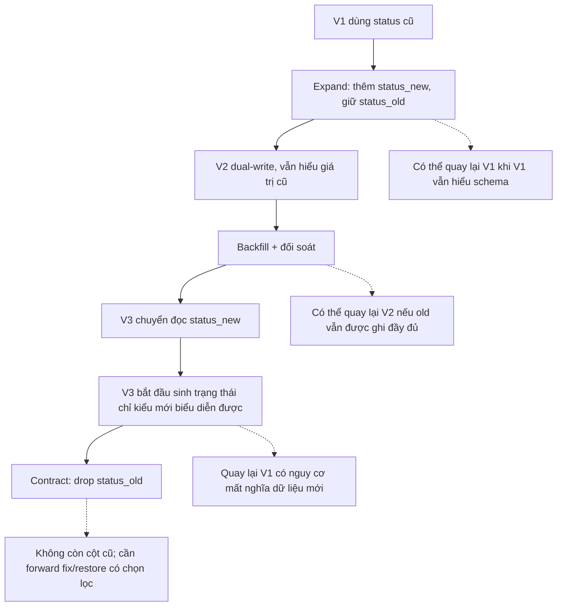

# Đánh giá khả năng quay lui với thay đổi không đảo ngược

Một phiên bản ứng dụng Java có thể được triển khai rồi quay về bản cũ trong vài phút, nhưng dữ liệu của nó **không nhất thiết quay về cùng trạng thái**. Nếu migration đã xóa một cột, gộp nhiều trạng thái thành một, làm tròn số tiền, thay đổi định danh hoặc xóa hồ sơ hàng loạt, câu lệnh `ROLLBACK` hay một script `DOWN` có thể không khôi phục được thông tin ban đầu. Cũng có trường hợp dữ liệu còn nguyên nhưng hệ thống vẫn không thể chạy ứng dụng cũ vì schema, protocol hoặc những ràng buộc mới đã thay đổi.

Bài học thuộc chương **Tiến hóa dữ liệu** của mô-đun **DATA_PERSISTENCE_FUNDAMENTALS**. Mô-đun hướng đến hiểu nguyên lý lưu trữ bền vững trong ứng dụng, từ chọn mô hình dữ liệu, schema, truy vấn, chỉ mục đến giao dịch, cô lập và kiểm soát đồng thời; người học thiết kế ranh giới persistence trong Java, xử lý lỗi kết nối, tiến hóa schema, bảo mật, sao lưu và tối ưu hiệu năng. Tại đây, mục tiêu là biết **đánh giá khả năng quay lui trước khi thay đổi**, xác định thông tin nào không thể phục hồi bằng phép biến đổi ngược, lập chiến lược backup/restore hoặc *roll forward*, và xây dựng các điểm quyết định có thể kiểm chứng.

Ví dụ dùng PostgreSQL, JDBC/Spring và công cụ migration ở mức khái niệm. Hợp đồng transaction, DDL, backup, lock và khả năng phục hồi phụ thuộc DBMS, phiên bản, phần cứng và cách cấu hình thực tế. Một quy trình được mô tả là *khả thi* chỉ khi những giả định của môi trường triển khai được đáp ứng và đã được thử nghiệm.

## 1. “Quay lui” thực chất có nhiều nghĩa

Trong một cuộc họp triển khai, câu “nếu lỗi thì rollback” thường không đủ cụ thể. Cần tách ít nhất năm loại thao tác:

| Thao tác được gọi là rollback | Nội dung thật sự | Giới hạn |
|---|---|---|
| **Database transaction rollback** | Hủy các ghi chưa commit của một transaction | Không hủy commit trước đó; không thu hồi email, HTTP call hay sự kiện đã phát |
| **Application rollback** | Chạy lại bản Java/API cũ | Bản cũ có thể không hiểu schema, giá trị enum hoặc payload mới |
| **Schema down migration** | Chạy DDL để đưa lược đồ về hình dạng trước đó | Có thể khôi phục tên cột mà **không khôi phục giá trị gốc** |
| **Data restore / PITR** | Lấy lại dữ liệu từ bản sao lưu hay trạng thái ở thời điểm trước | Có thể đánh mất các ghi hợp lệ xảy ra sau mốc restore nếu khôi phục toàn DB |
| **Business compensation** | Thực hiện nghiệp vụ bù trừ (hoàn tiền, hủy giữ chỗ, tạo bút toán đảo) | Không phải đảo ngược vật lý; có thể thất bại, tốn thời gian và phải audit |

Trong PostgreSQL, `ROLLBACK` có thể đảo những `UPDATE`, `DELETE`, `ALTER TABLE` còn nằm trong **cùng một transaction chưa commit**, theo hợp đồng transactional DDL. Nhưng sau khi migration commit và các phiên bản ứng dụng tiếp tục ghi dữ liệu mới, một transaction khác **không thể đơn giản gọi `ROLLBACK` để quay ngược thời gian**. Với một số thao tác như `CREATE INDEX CONCURRENTLY`, còn có quy tắc không chạy trong transaction block; phải xử lý riêng theo công cụ và phiên bản PostgreSQL.

Hãy ghi rõ trong kế hoạch: “Rollback **ứng dụng** tới V1 vẫn dùng được đến mốc X”; “Rollback **schema** chỉ được phép trước bước contract”; hoặc “Sau mốc Y, chỉ **roll forward** và khôi phục có chọn lọc”. Không dùng một nhãn `reversible = true` chung cho toàn bộ thay đổi.

## 2. Thế nào là thay đổi không đảo ngược?

Một phép biến đổi (f) từ dữ liệu cũ sang dữ liệu mới có thể đảo ngược **không mất thông tin** nếu tồn tại phép (g) sao cho (g(f(x))=x) với **mọi giá trị hợp lệ** trong miền nghiệp vụ. Khi nhiều giá trị cũ cùng tạo ra một giá trị mới, dữ liệu mới không đủ để suy ra duy nhất dữ liệu cũ.

Ví dụ, chuyển trạng thái giao hàng từ tập `{SHIPPED_BY_AIR, SHIPPED_BY_ROAD}` thành `SHIPPED` làm mất phương thức vận chuyển:

```text
SHIPPED_BY_AIR  ─┐
                 ├──> SHIPPED
SHIPPED_BY_ROAD ─┘

Chỉ biết SHIPPED không thể suy ra trước đó là AIR hay ROAD.
```

Phân biệt **khả nghịch về mặt thông tin** với **khả năng quay lui về mặt vận hành**:

- Đổi `INTEGER` sang `BIGINT` có thể giữ nguyên từng giá trị số và có phép chuyển ngược trên **miền `INTEGER`**. Tuy nhiên sau khi triển khai, ứng dụng mới có thể đã ghi giá trị vượt miền `INTEGER`; lúc này chuyển ngược không còn an toàn. DDL cũng có thể tốn thời gian/khóa lớn.
- Đổi tên `customer_name` sang `display_name` giữ nguyên giá trị về mặt dữ liệu, nhưng việc rename ngay trong một rolling deployment khiến ứng dụng cũ dùng tên cột cũ lỗi. Phép biến đổi schema có thể đảo ngược nhưng **cửa sổ tương thích không được bảo đảm**.
- `DELETE` một hàng đã commit có thể khôi phục từ backup hoặc audit log đáng tin cậy, nhưng không thể suy ra nội dung đầy đủ chỉ từ bảng hiện tại. Nếu backup đã hết hạn, khôi phục là bất khả thi từ các nguồn còn lại.
- Hash một giá trị bí mật bằng hàm băm một chiều hoặc loại bỏ dữ liệu nhận dạng theo quy định bảo mật có thể được thiết kế để **không thể tái dựng**, và không nên coi việc khôi phục thông tin đã xóa là mặc định được phép.

Vì vậy, đánh giá phải xét **phép biến đổi, miền dữ liệu sau thay đổi, dữ liệu gốc còn được giữ ở đâu, thời điểm commit và các hệ thống khác đã tiêu thụ thay đổi chưa**.

## 3. Phân loại rủi ro thay đổi trước khi viết migration

| Nhóm thay đổi | Ví dụ | Khả năng đảo ngược | Điều kiện cần chứng minh |
|---|---|---|---|
| **Thêm thuần túy** | Thêm cột nullable, thêm bảng mới | Thường dễ bỏ cấu trúc mới | Không còn code phụ thuộc, không xóa mất dữ liệu mới có giá trị |
| **Đổi metadata** | Rename cột/bảng | Có thể đổi lại tên | Tất cả app/consumer hiểu tên được dùng ở mỗi giai đoạn |
| **Chuyển đổi không mất thông tin** | `INTEGER` → `BIGINT` | Có điều kiện | Giá trị mới còn trong miền cũ; không thay semantics; DDL an toàn |
| **Chuyển đổi mất thông tin** | `NUMERIC(18,4)` → `NUMERIC(18,2)`; gộp enum | Không thể tự đảo từ giá trị mới | Có nguồn gốc/ánh xạ chi tiết và quyền được phục hồi |
| **Xóa cấu trúc/dữ liệu** | Drop column, delete rows, drop table | Không thể dựng lại từ schema hiện hành | Bản sao dữ liệu đáng tin cậy, kế hoạch restore và thời hạn giữ |
| **Đổi định danh/quan hệ** | Đổi PK, merge customers, tách bảng | Có điều kiện rất khó | Mapping old↔new đầy đủ, FK/consumer/event còn tra cứu được |
| **Thay đổi phân tán** | Đổi shard key, chuyển dữ liệu tenant | Phụ thuộc trạng thái hệ thống | Routing ownership, fencing, log bắt kịp và quy trình cutover |
| **Tác dụng ngoài DB** | Gửi thông báo, thanh toán, xóa object bên ngoài | Không được DB tự hoàn tác | API idempotency, bằng chứng, bù trừ và đối soát |

Đừng đánh giá chỉ theo tên lệnh SQL. Một `UPDATE` có thể phá hủy thông tin nhiều hơn `ALTER TABLE`, ví dụ `UPDATE customers SET birth_date = NULL` hoặc `UPDATE payments SET amount = round(amount, 0)`. Ngược lại, một câu `DROP COLUMN` có thể được **trì hoãn** trong chiến lược expand–migrate–contract để tránh biến thay đổi thành không đảo ngược quá sớm.

### 3.1. Các dấu hiệu cần bật cảnh báo trước khi triển khai

- Mapping **nhiều-một**: nhiều trạng thái, loại tiền hoặc định danh cũ bị gộp thành một giá trị.
- **Ép kiểu hẹp hơn**: giảm precision/scale, `BIGINT` → `INTEGER`, cắt độ dài hoặc đổi cách diễn giải timestamp/timezone.
- **Xóa**: `DROP`, `TRUNCATE`, `DELETE`, làm sạch dữ liệu bằng cách ghi đè giá trị gốc.
- **Cập nhật tất cả hàng** hoặc rewrite bảng lớn: khóa kéo dài, WAL, replica lag và khó quay về khi đã có ghi mới.
- **Thay đổi hợp đồng**: ứng dụng cũ hoặc consumer cũ không parse được enum, event schema, ID hay kiểu dữ liệu mới.
- **Liên quan nhiều hệ**: database, cache, search index, broker hoặc dịch vụ ngoài dùng các trạng thái chuyển tiếp khác nhau.
- **Giữ dữ liệu bị hạn chế**: bản sao phục vụ rollback có thể trái chính sách bảo mật, lưu giữ hoặc yêu cầu xóa thông tin.

## 4. Đánh giá bằng các mốc thời gian và cửa sổ quay lui

Một thay đổi có thể an toàn để đảo ngược tại thời điểm T1 nhưng không còn an toàn tại T3. Ví dụ:



Hãy đặt **điểm không thể quay lui an toàn (*point of no safe return*)** không chỉ tại lúc drop cột mà còn tại lúc ứng dụng bắt đầu tạo **dữ liệu không thể biểu diễn bằng phiên bản cũ**. Ví dụ: V3 cho phép trạng thái `PARTIALLY_REFUNDED`, nhưng V1 chỉ có `PAID` và `REFUNDED`. Dù cột cũ còn tồn tại, nếu không có biểu diễn tương đương theo nghiệp vụ thì V1 không thể xử lý đầy đủ.

Ma trận quyết định trong một lịch rolling deployment:

| Mốc | Schema | Dữ liệu đang được ghi | Rollback app V1? | Rollback schema? |
|---|---|---|---|---|
| M0 | Chỉ schema cũ | Chỉ biểu diễn cũ | Có theo điều kiện ban đầu | Chưa thay đổi |
| M1 expand | Cũ + mới | App cũ vẫn ghi cũ | Thường có, nếu DDL tương thích | Có thể drop phần mới **nếu chưa là nguồn dữ liệu duy nhất** |
| M2 backfill | Cũ + mới | Dual-write giữ biểu diễn cũ đầy đủ | Có điều kiện; phải kiểm chứng dữ liệu mới không vượt miền cũ | Chỉ sau khi xác minh mọi ghi mới còn khôi phục được |
| M3 cutover | Cũ + mới | App bắt đầu dùng semantics mới | **Có thể không** nếu tạo giá trị mới không biểu diễn được | Việc drop mới có thể làm mất dữ liệu có giá trị |
| M4 contract | Chỉ schema mới | Không còn ghi cũ | Không trực tiếp | Chỉ restore/forward fix theo kế hoạch có bằng chứng |

**Rollback window** phải được xác định bằng điều kiện quan sát được, không chỉ “trong vòng 30 phút”. Nếu sau 5 phút đã có các giá trị không thể dùng với V1, rollback V1 có thể đã không còn đúng dù đồng hồ chưa hết hạn.

## 5. Ví dụ 1: gộp trạng thái và đánh mất thông tin nguồn

Hệ thống giao vận ban đầu lưu cách vận chuyển trong `shipments.status_code`:

```sql
CREATE TABLE shipments (
    id BIGINT GENERATED ALWAYS AS IDENTITY PRIMARY KEY,
    status_code TEXT NOT NULL CHECK (
        status_code IN (
            'CREATED', 'SHIPPED_BY_AIR', 'SHIPPED_BY_ROAD', 'DELIVERED'
        )
    )
);

INSERT INTO shipments(status_code) VALUES
('SHIPPED_BY_AIR'), ('SHIPPED_BY_ROAD'), ('DELIVERED');
```

Nhóm sản phẩm muốn đơn giản hóa trạng thái thành `CREATED`, `SHIPPED`, `DELIVERED`. Có thể thêm cột mới và backfill:

```sql
ALTER TABLE shipments ADD COLUMN status_group TEXT;

UPDATE shipments
SET status_group = CASE status_code
    WHEN 'SHIPPED_BY_AIR'  THEN 'SHIPPED'
    WHEN 'SHIPPED_BY_ROAD' THEN 'SHIPPED'
    ELSE status_code
END;
```

Ở thời điểm này, **thông tin cách vận chuyển chưa mất** vì `status_code` còn chứa giá trị gốc. Nếu vẫn bảo toàn `status_code` khi có ghi mới, có thể chuyển reader V2 giữa hai biểu diễn và đối chiếu.

Sai lầm xảy ra nếu xem đoạn sau là một phép đổi ngược hoàn chỉnh:

```sql
-- Đây KHÔNG phải phép đảo ngược hợp lệ của phép gộp trên:
UPDATE shipments
SET status_code = CASE status_group
    WHEN 'SHIPPED' THEN 'SHIPPED_BY_ROAD'
    ELSE status_group
END;
```

Hàng từng là `SHIPPED_BY_AIR` sẽ bị gán thành `SHIPPED_BY_ROAD`. Câu SQL chạy thành công nhưng **thay đổi sự thật nghiệp vụ**. Việc chèn một giá trị mặc định không phải phục hồi dữ liệu.

### 5.1. Điều kiện bảo toàn thông tin để còn quay lui

Trước khi contract, cần trả lời:

1. **Cột cũ còn được lưu không?** Cần giữ `status_code` hoặc một bảng dữ liệu gốc có quan hệ ID và phiên bản rõ ràng.
2. **Mọi thay đổi sau backfill có cập nhật nguồn gốc không?** Một snapshot được chụp tại T0 không thể khôi phục những thay đổi hợp lệ diễn ra sau T0 nếu chỉ có dữ liệu mới bị gộp.
3. **Có trạng thái chỉ phiên bản mới hiểu không?** Nếu V3 cho phép `RETURNED_TO_SENDER` mà V1 không hỗ trợ, không thể tự suy ra trạng thái cũ.
4. **Cột cũ là nguồn chuẩn hay bản sao?** Phải nêu rõ chính sách khi hai cột mâu thuẫn và tránh các writer ghi lệch.
5. **Đã có dữ liệu bên ngoài tiêu thụ kiểu mới chưa?** Search index, stream sự kiện và API client có thể cần quy trình cập nhật riêng.

Với giai đoạn V1/V2 cùng hoạt động, một phương án là **V2 vẫn đọc/ghi `status_code` làm nguồn chuẩn**, đồng thời ghi `status_group` để chuẩn bị cutover. Khi không còn V1, chạy backfill cuối, kiểm chứng và chỉ chuyển V3 sang `status_group` sau khi xác định việc thu hẹp miền là chấp nhận được. Nếu muốn hỗ trợ rollback V1 lâu hơn, **giữ nguyên thông tin chi tiết** (chẳng hạn thuộc tính `shipping_method`) cho mọi thay đổi mới; nếu nghiệp vụ đã quyết định không còn lưu chi tiết, phải thông báo rõ rollback V1 sẽ mất khả năng tái tạo những giá trị đó.

### 5.2. Kiểm chứng dữ liệu trước khi drop

```sql
SELECT count(*) AS mismatched
FROM shipments
WHERE status_group IS DISTINCT FROM CASE status_code
    WHEN 'SHIPPED_BY_AIR'  THEN 'SHIPPED'
    WHEN 'SHIPPED_BY_ROAD' THEN 'SHIPPED'
    ELSE status_code
END;

SELECT status_code, status_group, count(*) AS rows
FROM shipments
GROUP BY status_code, status_group
ORDER BY status_code, status_group;
```

Kết quả `mismatched = 0` chứng minh **hai biểu diễn khớp quy tắc hiện tại**, không chứng minh phép biến đổi đã trở nên khả nghịch. Nó càng không bảo đảm mọi consumer hoặc phiên bản ứng dụng cũ có thể chạy với trạng thái mới. Trước khi xóa `status_code`, phải ghi nhận rõ **tính năng nào không thể rollback** và bằng chứng restore/forward fix.

## 6. Ví dụ 2: giảm độ chính xác số tiền không thể tự khôi phục

Giả sử có cột `amount NUMERIC(18,4)` lưu giá trị như `12.3456`, nhưng schema mới muốn `amount_cents BIGINT` biểu diễn **hai chữ số thập phân**. Nếu chính sách mới cho phép làm tròn:

```text
amount cũ          amount_cents sau làm tròn
12.3449       ->   1234
12.3451       ->   1235
12.3456       ->   1235
```

Từ `1235` không thể xác định bản gốc là `12.3451`, `12.3456` hay một giá trị khác. Đây là **mất thông tin**, không phải lỗi dữ liệu có thể sửa bằng `ALTER TABLE` ngược.

### 6.1. Đo mức mất thông tin trước migration

Đối với một hệ đã xác định chính xác một currency có hai chữ số đơn vị nhỏ nhất, kiểm tra xem mọi giá trị cũ **đã đúng ở độ chính xác 2 chữ số hay chưa**:

```sql
-- Bảng minh họa: charges(id BIGINT PK, amount NUMERIC(18,4) NOT NULL)
SELECT count(*) AS non_exact_rows
FROM charges
WHERE (amount * 100) <> trunc(amount * 100);

SELECT id, amount, amount * 100 AS expected_minor_units
FROM charges
WHERE (amount * 100) <> trunc(amount * 100)
ORDER BY id
LIMIT 100;
```

Nếu `non_exact_rows > 0`, phép chuyển sang cents không giữ nguyên đủ thông tin. Phải quyết định **cấm đổi kiểu, thay đổi nghiệp vụ để chấp nhận một chính sách làm tròn có audit, hoặc bảo tồn giá trị gốc ở cấu trúc riêng**. Với dữ liệu tài chính, quyết định làm tròn là một quyết định nghiệp vụ/pháp lý, không phải mặc định của mã Java.

Khi dữ liệu đã được chứng minh chính xác theo đơn vị nhỏ nhất, tiếp tục kiểm tra **miền của kiểu đích** trước cast:

```sql
SELECT count(*) AS outside_bigint_range
FROM charges
WHERE amount * 100 >  9223372036854775807::NUMERIC
   OR amount * 100 < -9223372036854775808::NUMERIC;
```

Chỉ khi hai điều kiện sai lệch và vượt miền đều **bằng 0**, phép chuyển `amount * 100` mới có thể biểu diễn bằng `BIGINT` mà không mất thông tin số học đối với tập dữ liệu đã kiểm tra. Nếu dữ liệu cho phép `NULL`, cần kiểm chứng `NULL` và quy tắc thay thế riêng; ví dụ này giả định `amount NOT NULL`. Nếu nhiều currency, mỗi loại có số chữ số thập phân riêng thì biểu thức nhân 100 phải được thay bằng quy tắc dựa trên currency đã xác thực.

### 6.2. Mẫu giữ hai biểu diễn trong Java

```java
import java.math.BigDecimal;
import java.math.RoundingMode;

public final class MoneyMigration {
    private MoneyMigration() {}

    // Chỉ dành cho miền tiền tệ dùng chính xác 2 chữ số thập phân.
    public static long toCentsLosslessly(BigDecimal amount) {
        if (amount == null) {
            throw new IllegalArgumentException("Amount is required");
        }
        BigDecimal exact = amount.setScale(2, RoundingMode.UNNECESSARY);
        return exact.movePointRight(2).longValueExact();
    }
}
```

`RoundingMode.UNNECESSARY` và `longValueExact()` từ chối dữ liệu cần làm tròn hoặc vượt miền `long`, thay vì lặng lẽ làm mất thông tin. Với trường hợp **chủ ý làm tròn**, không gọi API là *lossless*; tạo bước chuyển đổi riêng có chính sách được chấp nhận, lưu kết quả đối chiếu/tổng chênh lệch và xử lý tác động đến ledger. Không dùng `double` rồi nhân 100 cho khoản tiền cần chính xác.

### 6.3. Dữ liệu gốc cần được giữ trong bao lâu?

Nếu ứng dụng mới còn tạo dữ liệu mà bản cũ **không biểu diễn được**, có hai lựa chọn thực tế: không cho tạo các giá trị mới đó cho tới khi hết cửa sổ rollback, hoặc **đóng cửa sổ rollback** và ưu tiên phương án roll-forward/khôi phục có chọn lọc. Cột gốc chỉ hữu ích nếu còn được cập nhật đúng cho những hàng đã thay đổi sau cutover. Lưu `amount_old` từ trước cutover nhưng sau đó chỉ ghi `amount_cents` **không tự bảo đảm** có thể phục hồi dữ liệu sau cutover.

## 7. Mất dữ liệu do xóa và giải pháp khôi phục thật sự

Các lệnh `DROP COLUMN`, `DROP TABLE`, `DELETE` hoặc `TRUNCATE` có thể khiến dữ liệu gốc không còn truy cập được từ schema hiện hành. Một câu `ALTER TABLE ADD COLUMN name TEXT` có thể tạo lại **cấu trúc** của cột đã drop, nhưng **không khôi phục** giá trị trước đó.

```sql
-- Đổi trực tiếp không tạo bản sao giá trị trước khi xóa:
ALTER TABLE customers DROP COLUMN legacy_reference;

-- Chỉ thêm lại cấu trúc, không khôi phục dữ liệu:
ALTER TABLE customers ADD COLUMN legacy_reference TEXT;
```

Khi thao tác xóa **đã commit**, cách phục hồi không thể dựa vào lời hứa "cứ chạy DOWN migration". Có thể cần:

- **Bảng nguồn cũ được giữ tạm** trong cùng DB theo chính sách bảo mật, nếu được cập nhật đúng hoặc có mốc snapshot rõ.
- **Bản sao lưu/PITR đã được thử restore**, khôi phục vào một database tách biệt rồi trích các giá trị cần thiết.
- **Audit/event log đầy đủ và đáng tin**, có khả năng tái dựng trạng thái theo thứ tự, không bị thiếu sự kiện và có định danh ổn định.
- **Ánh xạ migration có phiên bản**, đặc biệt khi đổi key hoặc gộp bản ghi.
- **Quy trình forward fix** khi phục hồi dạng cũ không còn an toàn cho các giao dịch mới.

### 7.1. Vì sao một bản backup trước migration chưa đủ cho mọi trường hợp?

Giả sử backup được tạo lúc 10:00, migration xóa cột lúc 10:10, và ứng dụng vẫn tiếp nhận 1.000 đơn mới từ 10:10 đến 10:15. Restore toàn DB về 10:00 có thể lấy lại cột cũ, **nhưng mất 1.000 đơn hợp lệ** nếu không có cơ chế replay/merge phù hợp.

```text
10:00    Backup/PITR checkpoint
10:10    Schema migration đã commit
10:11    Order A mới được commit
10:12    Order B mới được commit
10:15    Phát hiện lỗi migration

Restore toàn DB về 10:00:
  + Có dữ liệu cũ trước migration
  - Không tự giữ được Order A và Order B
```

Vì thế **RPO** (mức mất dữ liệu được chấp nhận) và **RTO** (thời gian phục hồi) phải được xác định cùng nghiệp vụ, không chỉ cùng DBA. Với hệ thống nhiều tenant hoặc nhiều bảng không liên quan, restore toàn DB có thể ảnh hưởng rất rộng. Một giải pháp là restore PITR tới mốc phù hợp **trên một instance tạm biệt lập**, rồi trích xuất dữ liệu cũ theo khóa và đối chiếu với database đang phục vụ; cách này yêu cầu thời gian, dung lượng, quyền và chính sách xử lý các hàng đã thay đổi.

### 7.2. PITR không đồng nghĩa "undo một migration, giữ tất cả cái khác"

Point-in-time recovery phát lại WAL/backup đến **một thời điểm cụ thể** theo khả năng và cấu hình của hệ thống. Nó không phải lệnh SQL để hoàn tác chọn lọc một câu `ALTER TABLE` trong khi giữ nguyên mọi commit khác. Việc khôi phục có chọn lọc cần quy trình **merge theo ID/version**, kiểm tra khóa ngoại và đối chiếu những cập nhật hợp lệ diễn ra giữa mốc snapshot và hiện tại.

Ví dụ một ID khách hàng trong backup là `customer_name = 'An'`, nhưng hiện tại người dùng đã đổi thành `'Anh'`. Copy toàn bộ hàng từ backup vào production có thể **làm mất cập nhật mới**, dù khôi phục được cột đã drop. Phải xác định trường nào cần phục hồi, bản hiện tại nào có thẩm quyền và cách giải quyết xung đột.

## 8. Đánh giá rollback bằng hồ sơ rủi ro trước khi chạy

Thay vì chỉ hỏi "migration có script `DOWN` không?", hãy lập một **hồ sơ khả năng quay lui** cho từng thay đổi. Ví dụ:

| Trường đánh giá | Câu trả lời minh họa |
|---|---|
| Thay đổi nào sẽ diễn ra? | `shipments.status_code` chi tiết → `status_group` rút gọn |
| Loại mất thông tin? | Mapping nhiều-một; `SHIPPED` không còn cho biết AIR/ROAD |
| Nguồn dữ liệu gốc nào còn lại? | Cột cũ còn trong giai đoạn expand; backup đã kiểm thử |
| Khoảng thời gian V1 còn hoạt động? | V1 tiếp tục đọc/ghi `status_code` tới mốc cắt chuyển |
| Khi nào không thể rollback V1? | Khi V3 sinh trạng thái mới không có biểu diễn hợp lệ ở V1 hoặc ngừng duy trì cột cũ |
| Rủi ro với transaction mới sau migration? | Restore toàn DB có thể loại bỏ những đơn hàng mới |
| Biện pháp giảm rủi ro? | Dual-write có nguồn chuẩn, backfill idempotent, đối soát, trì hoãn DROP |
| Kế hoạch khi vượt điểm không thể quay lui? | Roll forward, khôi phục cột gốc có chọn lọc từ nguồn đáng tin nếu được phép |
| Bằng chứng đã thử? | Restore diễn tập, test V1↔V2, test lỗi giữa từng bước và truy vấn mismatch |
| Người quyết định go/no-go? | Owner dữ liệu, chủ nghiệp vụ và người chịu trách nhiệm vận hành được phân quyền |

### 8.1. Ma trận lựa chọn phương án phục hồi

| Điều kiện thực tế sau sự cố | Phương án ưu tiên | Vì sao |
|---|---|---|
| Chưa commit transaction thay đổi dữ liệu | `ROLLBACK` transaction | Hủy toàn bộ phần ghi trong phạm vi transaction nếu DB còn hoạt động và hợp đồng bảo đảm |
| Đã expand nhưng chưa đổi reader hoặc ghi dữ liệu mới | Chạy lại V1, giữ cột thêm chưa dùng; dọn sau | Ít rủi ro hơn một DDL `DOWN` khẩn cấp |
| Đã backfill nhưng còn cột gốc đồng bộ đầy đủ | Chuyển reader về cột gốc và sửa V2, trì hoãn contract | Không cần restore toàn DB; vẫn phải xác minh tương thích |
| Đã chuyển reader, có dữ liệu mới không biểu diễn được ở V1 | **Roll forward** hoặc adapter có ngữ nghĩa được duyệt | V1 không thể xử lý đúng mọi giá trị mới |
| Đã xóa thông tin gốc nhưng còn backup đáng tin | Khôi phục có chọn lọc vào môi trường riêng và merge | Hạn chế mất các commit hợp lệ sau điểm backup |
| Đã xóa thông tin gốc, không có nguồn dữ liệu hợp pháp để phục hồi | Ghi nhận mất thông tin, xử lý nghiệp vụ và forward fix | Không bịa lại giá trị; đánh giá ảnh hưởng và nghĩa vụ thông báo |
| Ngoại hệ thống đã có tác dụng | Compensation/reconciliation | Không thể dùng database rollback để thu hồi HTTP, email hay thanh toán |

Với mỗi phương án, cần một **điều kiện vào**, **điều kiện thành công** và **điều kiện dừng**. Ví dụ "quay lại V2" chỉ hợp lệ khi cột cũ còn hiện hữu và phản ánh tất cả thay đổi hợp lệ kể từ cutover. "Roll forward" chỉ hợp lệ khi có thể sửa dữ liệu mới mà không vi phạm bất biến nghiệp vụ hoặc quyền lưu giữ.

### 8.2. Đánh giá ảnh hưởng theo ba trục

- **Mức độ phá hủy thông tin:** phép biến đổi có một-một, nhiều-một hay xóa dữ liệu? Còn nguồn để đảo chính xác không?
- **Mức độ phụ thuộc:** bao nhiêu service, shard, replica, consumer, API/client và batch đã dùng schema hoặc semantics mới?
- **Chi phí phục hồi:** downtime, RPO/RTO, dung lượng restore, WAL, số hàng phải merge, công sức đối soát và thời gian hoàn tất nghiệp vụ?

Một thay đổi metadata nhỏ có thể nghiêm trọng nếu phá vỡ hàng trăm consumer; một thay đổi dữ liệu mất thông tin có thể chấp nhận được nếu nghiệp vụ **cố ý từ bỏ thông tin đó** theo chính sách đã duyệt và không còn đường rollback ứng dụng cũ. Mức rủi ro cần phản ánh **tác động thật**, không chỉ số lệnh SQL.

## 9. Thiết kế triển khai theo hướng có điểm dừng rõ ràng

Không nên buộc một thao tác xóa hoặc cast mất thông tin diễn ra cùng release với việc thêm cột mới. Một kế hoạch có thể gồm:

```text
Phase 0  Điều tra dữ liệu + kiểm kê consumer + diễn tập restore
   |
Phase 1  EXPAND: bổ sung cột/bảng mới, không xóa dữ liệu cũ
   |
Phase 2  DUAL SUPPORT: V2 ghi/đọc tương thích theo nguồn chuẩn
   |
Phase 3  MIGRATE: backfill theo batch, ghi metric và chạy lại được
   |
Phase 4  VERIFY: đối chiếu từng hàng, constraint, luồng ghi mới
   |
Phase 5  CUTOVER: chuyển đọc sang schema mới, giữ nguồn cũ khi còn rollback
   |
        [GO/NO-GO: có còn thể quay lui an toàn không?]
   |
Phase 6  CONTRACT: ngừng hỗ trợ schema cũ sau thời gian tương thích
   |
Phase 7  DELETE: xóa dữ liệu cũ theo chính sách và bằng chứng duyệt
```

Giai đoạn `CONTRACT` hoặc `DELETE` có thể là **release riêng**, không bắt buộc chạy ngay khi V3 hoạt động. Giữ cấu trúc cũ một thời gian **không có nghĩa giữ vô hạn**: dữ liệu nhạy cảm, chi phí storage, replication và retention phải được đánh giá.

### 9.1. Feature flag và version gating

Với một tính năng bắt đầu tạo dữ liệu không tương thích V1, có thể đặt **feature flag** cho phần ghi mới:

1. Đã expand schema và deploy V2 tương thích cho mọi writer.
2. Backfill, validate, theo dõi query error và replication lag.
3. Chuyển reader tới schema mới nhưng **chưa cho phép giá trị mới vượt miền V1**.
4. Khi hệ thống sẵn sàng và được duyệt, bật feature flag cho giá trị mới; **đây có thể là mốc kết thúc khả năng rollback V1**.
5. Theo dõi ảnh hưởng, giữ kế hoạch forward fix/compensation phù hợp và chỉ contract sau đó.

Feature flag không tự hoàn tác dữ liệu đã ghi. Khi tắt flag, những hàng trước đó chứa trạng thái V1 không hiểu **vẫn tồn tại**. Phải xác định ai có quyền thay đổi flag, cách đồng bộ các instance và cơ chế chặn ghi nếu phiên bản ứng dụng cũ vẫn còn chạy.

### 9.2. Đặt guardrail trong PostgreSQL khi migration nặng

Với DDL yêu cầu khóa bảng, đặt ngưỡng thời gian phù hợp để không chờ vô hạn:

```sql
BEGIN;
SET LOCAL lock_timeout = '2s';
SET LOCAL statement_timeout = '15s';

-- Chỉ minh họa thao tác expand, không phải phá hủy dữ liệu.
ALTER TABLE shipments ADD COLUMN IF NOT EXISTS migration_version INTEGER;

COMMIT;
```

`IF NOT EXISTS` chỉ tránh lỗi tên cột đã tồn tại; **không xác minh kiểu, default hay bất biến của cột đang có**. Cần kiểm tra cấu trúc thực tế trước khi tiếp tục nếu migration từng chạy dở. `lock_timeout` và `statement_timeout` giúp giới hạn một số cửa sổ rủi ro, không phải rollback strategy. Với các bước như `CREATE INDEX CONCURRENTLY`, điều kiện transaction khác; không sao chép nguyên khối `BEGIN` trên vào thao tác không được phép chạy trong transaction block.

### 9.3. Phân lô để có khả năng dừng và chạy lại

Backfill lớn nên có các transaction ngắn và cơ chế resume/idempotency. Ví dụ với bảng `shipments`, chỉ cập nhật hàng có cột mới khác phép biến đổi:

```sql
WITH batch AS (
    SELECT id
    FROM shipments
    WHERE status_group IS DISTINCT FROM CASE status_code
        WHEN 'SHIPPED_BY_AIR'  THEN 'SHIPPED'
        WHEN 'SHIPPED_BY_ROAD' THEN 'SHIPPED'
        ELSE status_code
    END
    ORDER BY id
    LIMIT 500
    FOR UPDATE SKIP LOCKED
)
UPDATE shipments AS s
SET status_group = CASE s.status_code
    WHEN 'SHIPPED_BY_AIR'  THEN 'SHIPPED'
    WHEN 'SHIPPED_BY_ROAD' THEN 'SHIPPED'
    ELSE s.status_code
END
FROM batch AS b
WHERE s.id = b.id
RETURNING s.id;
```

Lệnh có thể chạy lại; mỗi batch commit riêng và không cộng dồn theo kiểu `SET amount = amount * 100`. Tuy nhiên `SKIP LOCKED` **có thể bỏ qua hàng đang bị khóa**. Khi một lượt không trả hàng, phải chạy kiểm chứng đầy đủ ở thời điểm phù hợp và xử lý những hàng bị bỏ qua, không kết luận tất cả đã khớp chỉ từ batch cuối. Việc giữ cột cũ làm nguồn chuẩn trong giai đoạn đồng bộ cũng phải đi kèm kiểm soát writer cũ để tránh giá trị mới bị stale.

## 10. Công cụ migration và ý nghĩa thật của `DOWN`

Flyway, Liquibase hoặc cơ chế migration tự xây dựng có thể lưu lịch sử version, điều phối thứ tự DDL và ngăn chạy trùng một số script. Tuy nhiên **công cụ migration không thể tái tạo thông tin đã mất nếu không có nguồn dữ liệu bổ sung**.

Ví dụ một thay đổi có thể được biểu diễn bằng hai script:

```sql
-- UP (minh họa cấu trúc)
ALTER TABLE shipments ADD COLUMN status_group TEXT;

-- DOWN (chỉ khôi phục hình dạng schema, KHÔNG tái tạo nghiệp vụ)
ALTER TABLE shipments DROP COLUMN IF EXISTS status_group;
```

`DOWN` này chỉ có ý nghĩa khi `status_code` vẫn còn và là dữ liệu chính xác. Nếu V3 đã ghi chỉ vào `status_group`, drop nó **làm mất các thay đổi sau cutover**. Chỉ nhìn thấy cặp `UP/DOWN` không chứng minh khả năng rollback. Tương tự, nếu bước `UP` là `DROP COLUMN status_code`, bước `DOWN` chỉ `ADD COLUMN status_code TEXT` sẽ tạo cột rỗng, không khôi phục giá trị gốc.

Với **Flyway**, không mặc định rằng mọi phiên bản và bản phân phối đều có lệnh undo migration thích hợp hoặc undo tự sinh. Với **Liquibase**, rollback theo changelog có thể bị giới hạn hoặc cần khai báo thủ công tùy loại change. Dù công cụ có rollback feature, vẫn phải thử với dữ liệu đã **phát sinh sau migration**, chứ không chỉ thử trên một database trống.

### 10.1. Thiết kế migration không phá hủy theo từng release

| Release | Thao tác schema | Thao tác ứng dụng | Bằng chứng trước khi đi tiếp |
|---|---|---|---|
| R1 | Thêm cột mới nullable | V1 vẫn hoạt động | Test V1 với schema expand |
| R2 | Không drop cột cũ | V2 dual-write/đọc nguồn chuẩn | Không còn writer cũ làm lệch dữ liệu |
| Job | Backfill idempotent theo batch | V2 vẫn tương thích | Mismatch=0 và kiểm chứng bất biến |
| R3 | Giữ schema cũ+mới | V3 chuyển đọc, khóa tính năng chỉ biểu diễn mới nếu còn cần rollback | Integration test reader/rollback, monitor lỗi |
| R4 | Bổ sung constraint phù hợp | Bật semantics mới khi được duyệt | Quyết định kết thúc rollback V1 và phương án forward fix |
| R5 | Drop cột/constraint cũ theo chính sách | Chỉ V4 dùng schema mới | Không còn dependency cũ, backup/restore đã kiểm chứng |

Nếu hệ có **nhiều shard hoặc tenant database**, migration cần theo dõi version của từng shard. Không được triển khai code chỉ hiểu schema R4 vào shard vẫn ở R1 rồi suy đoán mọi transaction đều an toàn. Schema version, routing và khả năng quay lui phải được kiểm chứng trên toàn bộ phạm vi dữ liệu chịu tác động.

## 11. Những phụ thuộc ngoài database cũng có thể không đảo ngược

Không phải chỉ dữ liệu nằm trong bảng mới bị ảnh hưởng. Một thay đổi schema thường đi kèm **API, event, search index, cache và tác vụ bên ngoài**:

- **Sự kiện đã phát**: consumer có thể đã xử lý `OrderCompletedV2`. Việc quay DB về V1 không thu hồi event đã phát hoặc tác dụng mà consumer ghi vào DB riêng.
- **Tìm kiếm và báo cáo**: search index/warehouse đã nhận dữ liệu schema mới. Chạy lại app cũ có thể phát payload không tương thích; phải có cơ chế rebuild/reindex hoặc chuyển đổi schema.
- **Thanh toán**: trạng thái migration mới có thể đã kích hoạt khoản thu hoặc hoàn tiền. Database rollback không hoàn tác một giao dịch tiền tệ được provider xác nhận.
- **Tệp/object storage**: xóa hoặc ghi đè object có thể không khôi phục được nếu không bật versioning/retention hoặc có backup phù hợp.
- **Bộ nhớ đệm**: cache có thể chứa serialized object phiên bản mới; app cũ deserialize lỗi hoặc suy diễn sai giá trị. Cần versioning, TTL hoặc invalidation thích hợp.

Giả sử V3 phát event mang enum `PARTIALLY_REFUNDED` mà consumer V1 chỉ hiểu `PAID` và `REFUNDED`. Khi rollback producer về V1, dữ liệu/event cũ trong broker **không tự đổi về định dạng V1**. Cần hợp đồng **backward/forward compatibility** cho event, schema registry khi phù hợp và khả năng replay/dedup.

### 11.1. Idempotency và outbox khi cần phát sự kiện trong migration

Nếu quá trình chuyển dữ liệu vừa cập nhật row vừa phát message, cách viết sau có dual-write risk:

```text
UPDATE database -> COMMIT thành công
process crash
publish MigrationCompleted -> chưa thực hiện
```

Có thể dùng **transactional outbox** để ghi row dữ liệu và ý định phát event **trong cùng local DB transaction**; dispatcher phát sau và consumer khử trùng lặp theo `event_id`. Cơ chế này thường mang ngữ nghĩa **at-least-once**, nên event có thể được giao nhiều lần. Nó không làm những phép chuyển đổi mất thông tin trở nên đảo ngược, nhưng giúp workflow phục hồi nếu process dừng giữa các bước.

Nếu kết quả `COMMIT` không xác định do mất kết nối, cần đối soát bằng `operation_id` hoặc migration batch ID ổn định từ **nguồn có thẩm quyền** trước khi ghi lại. Không được suy luận một exception JDBC nghĩa là transaction chắc chắn chưa commit; không phát lại lệnh không idempotent với ID hoàn toàn mới.

### 11.2. Bù trừ khác với xóa dấu vết

Một quy trình đã gửi thông báo có thể gửi thông báo đính chính. Một khoản thanh toán có thể được hoàn tiền/void theo hợp đồng provider. Một dữ liệu đã dùng cho mô hình dự đoán có thể yêu cầu reprocess. Đây là **compensation**: một thao tác nghiệp vụ mới có audit, không phải phục hồi đúng từng bit về trạng thái trước.

Không phải mọi tác dụng đều bù trừ được: email đã được đọc không thể thu hồi; một sản phẩm đã giao có thể phát sinh phí hoàn; một dữ liệu đã bị tiết lộ không thể "unread". Khi đánh giá khả năng rollback, phải ghi rõ **hậu quả không thể đảo** và ai chịu trách nhiệm xử lý.

## 12. Bảo mật, lưu giữ và quyền được phục hồi dữ liệu

Giữ bản sao dữ liệu cũ để rollback có thể hữu ích, nhưng không phải lúc nào cũng hợp lệ. Những yêu cầu bảo mật và quyền riêng tư có thể **cấm tái tạo hoặc kéo dài thời gian lưu** một số thông tin:

- **Xóa theo yêu cầu hợp lệ:** không tự đưa dữ liệu đã phải xóa trở lại production bằng restore mà chưa áp dụng lại các thao tác xóa theo chính sách.
- **Retention:** bảng backup/archive chứa cột cũ cũng phải có lịch xóa, quyền truy cập và cơ chế kiểm toán theo mức nhạy cảm tương ứng.
- **Secrets/keys:** một giá trị đã hash, token đã thay thế hoặc khóa mã hóa đã được hủy có thể được chủ đích thiết kế không thể phục hồi; không tìm cách tái dựng từ dữ liệu thiếu quyền.
- **Mã hóa:** backup phải có chiến lược quản lý khóa; một bản sao dữ liệu mã hóa không phục hồi được nếu khóa bị mất, còn sao chép cả khóa thiếu kiểm soát làm tăng rủi ro lộ dữ liệu.
- **Phân vùng địa lý:** việc đưa backup lên môi trường thử khác region có thể vi phạm chính sách cư trú dữ liệu. Kiểm tra điều kiện trước khi tạo instance tạm để trích dữ liệu.

**Khả năng kỹ thuật để phục hồi** và **quyền được phép phục hồi** là hai câu hỏi độc lập. Nếu dữ liệu gốc bị loại bỏ vì nghĩa vụ pháp lý hoặc bảo vệ người dùng, kế hoạch đúng có thể là **chấp nhận không thể rollback về dữ liệu đã xóa**, thay vì cố giữ một bản sao bí mật để phục hồi về sau. Cần phối hợp với owner bảo mật/tuân thủ và lưu bằng chứng quyết định.

## 13. Kiểm thử phục hồi, không chỉ kiểm thử migration thành công

Một test chỉ chứng minh `UP` chạy thành công trên database nhỏ sẽ bỏ sót phần khó nhất: **nếu công việc đã commit và có ghi mới, liệu phương án phục hồi còn đúng không?**

| Kịch bản | Cách thử | Bất biến cần xác nhận |
|---|---|---|
| Rollback trước commit | Ném lỗi giữa transaction thay đổi dữ liệu | DB không lưu phần ghi chưa commit; tài nguyên giải phóng |
| V1 chạy trên schema expand | Deploy schema thêm cột, vẫn dùng V1 | SQL/ORM/API V1 không bị phá vỡ |
| V1/V2 chạy đồng thời | V1 ghi cũ, V2 ghi hai cột, kiểm soát lịch bằng latch | V2 không đọc bản mới bị stale, dữ liệu không bị ghi lệch |
| Backfill bị dừng giữa batch | Fault injection sau vài batch commit | Có thể resume; không chuyển đổi hai lần hoặc bỏ sót ID |
| Batch bỏ qua row lock | Giữ khóa tại một connection khác trong lúc `SKIP LOCKED` | Kiểm chứng cuối phát hiện hàng bị bỏ qua |
| Chuyển kiểu làm tròn | Fixture `12.3449`, `12.3451`, giá trị tràn miền | Hệ từ chối khi yêu cầu lossless; không ngầm làm tròn |
| Gộp enum nhiều-một | Tạo cả AIR/ROAD rồi chuyển sang SHIPPED | Kiểm tra không tồn tại phép đảo tự suy ra AIR/ROAD |
| App mới ghi giá trị không có trong V1 | Bật flag, tạo enum mới, thử rollback V1 | Bộ kiểm tra/gate chặn rollback không tương thích |
| Backup trước, có thêm ghi mới sau migration | Restore vào instance tạm, so sánh với DB hiện tại | Có chiến lược giữ/merge các commit hợp lệ sau backup |
| DROP cột sau contract | Thử chạy `DOWN` tạo lại cột | Test cho thấy cột mới rỗng, không coi là restore dữ liệu |
| Consumer nhận event V2 rồi app rollback V1 | Gửi event phiên bản mới qua broker test | Consumer có compatibility/replay/dedup phù hợp |
| Mất kết nối lúc commit | Tạo trạng thái outcome không chắc chắn có kiểm soát | Đối soát bằng operation ID; không ghi trùng |
| DDL bị chặn bởi transaction dài | Giữ transaction A, chạy DDL B có `lock_timeout` | Migration dừng có kiểm soát và không gây tắc nghẽn kéo dài |

Với test recovery, không chỉ kiểm tra số lượng row. Cần **đối chiếu từng giá trị có ý nghĩa**, primary/foreign keys, unique constraints, version, mốc commit và những tác dụng ngoài DB. Khi dùng `@Transactional` trên test Spring, hãy chú ý framework có thể tự rollback transaction test lúc kết thúc, qua đó che mất lỗi chỉ xảy ra lúc **commit thật**. Test phục hồi nên kiểm tra trạng thái qua transaction/connection độc lập sau khi ranh giới nghiệp vụ kết thúc.

### 13.1. Diễn tập restore theo RPO/RTO

Một lần diễn tập đáng tin cậy cần thực hiện đủ quy trình:

1. Tạo backup/PITR điểm xuất phát trong môi trường được phép; kiểm tra tính khả dụng của file backup và khóa mã hóa.
2. Khôi phục sang **instance tạm tách biệt**, không ghi đè production trong khi chỉ mới thử nghiệm.
3. Xác minh schema, row count, checksum/hash theo tiêu chí phù hợp, dữ liệu mẫu và các bất biến nghiệp vụ.
4. Giả lập các **ghi hợp lệ sau backup**; thực hiện một phương án merge/replay được duyệt và kiểm tra không ghi đè thay đổi mới.
5. Đo thời gian thực tế từ lúc phát hiện đến lúc dịch vụ đáp ứng lại (RTO) và lượng dữ liệu thiếu/chưa đối soát (RPO).
6. Ghi nhận thao tác, quyền thực thi, công cụ và các điểm thất bại; cập nhật runbook trước khi cho phép migration phá hủy thông tin.

**Có backup nhưng chưa thử restore** không phải bằng chứng đủ cho quyết định drop dữ liệu có giá trị. Nếu không đáp ứng RPO/RTO hoặc không thể merge các ghi mới mà không vi phạm bất biến, cần thay đổi phương án triển khai trước khi release contract.

## 14. Go/no-go checklist cho thay đổi không đảo ngược

Trước khi chạy bước có thể mất thông tin, owner cần xác nhận những câu hỏi sau:

1. **Thông tin nào bị mất?** Có mapping nhiều-một, phép làm tròn, cast hẹp, xóa row/cột, hoặc ID không thể tái dựng không?
2. **Dữ liệu gốc có nguồn authoritative nào còn lại?** Bảng cũ, audit log, snapshot, backup/PITR có thực sự chứa đủ những giá trị cần khôi phục không?
3. **Sau cutover có writer nào chỉ ghi schema mới?** Nếu có, cột cũ/backup có còn phản ánh các cập nhật mới không?
4. **Có giá trị mà app cũ không hiểu?** Tại mốc nào được phép bật tính năng tạo giá trị đó và ai duyệt kết thúc khả năng rollback?
5. **Bao nhiêu hệ thống đã nhận dữ liệu mới?** API, event, job, BI, search, cache và hệ thống ngoài có cần adapter/reindex/compensation không?
6. **Các bất biến dữ liệu đã được đo chưa?** Mismatch=0, định dạng/miền hợp lệ, PK/FK/unique và không mất precision ở những trường bắt buộc lossless?
7. **Đã dừng writer/consumer cũ chưa?** Có bằng chứng từ deployment, queue, cron và tích hợp ngoài thay vì chỉ nhìn pod chính?
8. **DDL có đáp ứng ngưỡng khóa, WAL, disk và replica lag?** Có giới hạn timeout, batch, lịch chạy và cách tạm dừng không?
9. **Runbook chọn rollback hay roll forward có điều kiện rõ không?** Ai quyết định, dựa trên metric nào, trong khoảng thời gian nào?
10. **Backup/PITR đã thử restore và merge với dữ liệu mới chưa?** RPO/RTO có đạt mục tiêu đã cam kết không?
11. **Bản sao phục vụ rollback có hợp pháp và an toàn không?** Có retention, quyền truy cập, mã hóa và xử lý lại các yêu cầu xóa dữ liệu không?
12. **Đã test các cửa sổ lỗi chưa?** Commit ambiguous, ghi mới sau backup, rollback app sau khi có enum mới, event trùng/sai thứ tự và đường khôi phục thất bại?

Nếu một câu trả lời quan trọng còn **không xác định**, lựa chọn thường an toàn hơn là **chưa thực hiện bước phá hủy**: giữ schema mở rộng, giảm phạm vi phát hành hoặc tạm tắt tính năng tạo dữ liệu không tương thích, rồi bổ sung kiểm chứng. Không để áp lực hoàn thành release trở thành lý do suy đoán rằng dữ liệu mất có thể tái tạo về sau.

## 15. Tình huống tổng hợp: đổi hệ thống trạng thái giao hàng

Một doanh nghiệp đang chuyển từ `SHIPPED_BY_AIR/ROAD` sang `SHIPPED` và thêm `RETURNED_TO_SENDER`. Nhóm phát triển lên kế hoạch một migration duy nhất: tạo `status_group`, backfill, xóa `status_code`, deploy V3. Môi trường staging thành công và CI báo xanh. Nhưng trên production còn một job V1 đọc `status_code` mỗi giờ và một consumer V2 bắt đầu ghi `RETURNED_TO_SENDER`. Sau khi release, việc deploy V1 trở lại vừa lỗi SQL vì cột đã drop vừa không có cách biểu diễn trạng thái mới.

Đánh giá đúng trước triển khai sẽ thay đổi kế hoạch:

- **Release A:** thêm cột mới và kiểm tra V1 hoạt động; không xóa cột gốc.
- **Release B:** V2 duy trì biểu diễn cũ, có mapping rõ, kiểm kê và nâng cấp job V1; chưa phát sinh trạng thái chỉ V3 hiểu.
- **Backfill:** chạy batch idempotent với query đối soát `mismatched=0`, ghi metric và kiểm tra cả các cập nhật phát sinh trong quá trình backfill.
- **Release C:** V3 đọc mới nhưng chỉ bật `RETURNED_TO_SENDER` khi đã thống nhất **kết thúc khả năng rollback sang V1** hoặc có adapter được phê duyệt. Giữ cột cũ cho tới khi thực sự sẵn sàng contract.
- **Release D:** xóa cột cũ sau khi xác minh mọi writer/reader/job/consumer đã chuyển, backup được diễn tập, không còn yêu cầu giữ dữ liệu chi tiết và có phương án forward fix/đối soát.

Nếu V3 có lỗi sau khi bắt đầu ghi `RETURNED_TO_SENDER`, giải pháp mặc định **không phải** rollback V1 và gán trạng thái mới thành `SHIPPED` tùy tiện. Tùy lỗi, có thể phát hành bản vá V3, chặn ghi trạng thái mới, sửa migration/DTO, hoặc dùng quy trình chuyển đổi dữ liệu đã được nghiệp vụ duyệt. Nếu cần khôi phục `status_code` chi tiết, chỉ những hàng có nguồn gốc đáng tin (cột còn cập nhật, audit đầy đủ hoặc bản restore tương thích) mới có thể phục hồi chính xác.

## 16. Nguyên tắc cần ghi nhớ

- **Rollback ứng dụng, rollback transaction, DOWN migration, restore và bù trừ là những thao tác khác nhau.** Luôn nêu rõ loại và phạm vi.
- **Có SQL đảo ngược về mặt cú pháp không chứng minh dữ liệu đảo ngược được.** Phép gộp, làm tròn, xóa hay hash có thể phá hủy thông tin nguồn.
- **Thời điểm hết khả năng rollback có thể đến trước khi DROP cột.** Việc tạo dữ liệu mới mà V1 không hiểu đã đủ để làm rollback V1 không an toàn.
- **Expand–migrate–contract trì hoãn điểm phá hủy**, giúp kiểm chứng và giảm rủi ro; không bảo đảm rollback vĩnh viễn nếu writer mới ngừng duy trì biểu diễn cũ.
- **Backup/PITR cần được thử restore**, và restore toàn DB về quá khứ có thể làm mất các giao dịch hợp lệ mới. Khi cần, phục hồi vào môi trường riêng và merge có kiểm soát.
- **Rollback không thu hồi tác dụng ngoài DB.** Với event, thanh toán và tác vụ phân tán, cần idempotency, outbox, đối soát và compensation.
- **Phục hồi phải tôn trọng bảo mật và retention.** Khả năng kỹ thuật không đồng nghĩa được phép giữ hoặc tái dựng thông tin đã phải xóa.
- **Trước bước phá hủy, phải có bằng chứng go/no-go và runbook**: bất biến dữ liệu, cửa sổ rollback, chủ sở hữu quyết định, giới hạn lock/tải và tiêu chí thành công.

**Kết luận:** Khi tiến hóa dữ liệu trong Java và PostgreSQL, câu hỏi quan trọng không phải “có thể viết lệnh rollback không?” mà là **“có thể phục hồi chính xác dữ liệu và nghiệp vụ trong trạng thái hệ thống thực tế nào?”**. Một thay đổi không đảo ngược phải được xác định từ trước, trì hoãn bằng các bước tương thích khi cần, kiểm chứng bằng dữ liệu thật và có phương án khôi phục hoặc roll-forward đã diễn tập. Đó mới là nền tảng để đưa ra quyết định triển khai có trách nhiệm mà không đánh đổi dữ liệu bền vững của ứng dụng.
