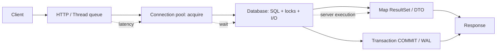
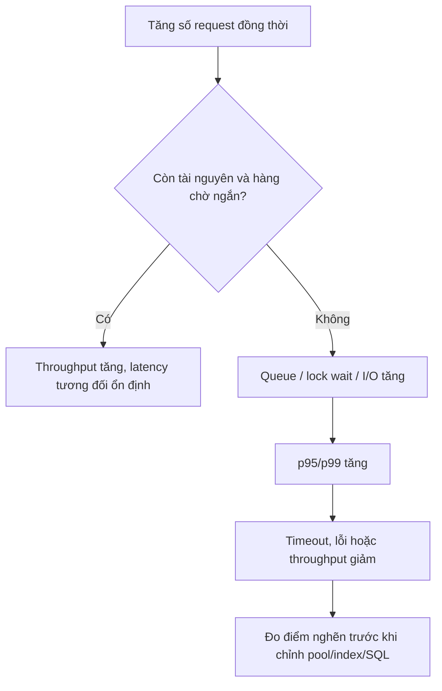
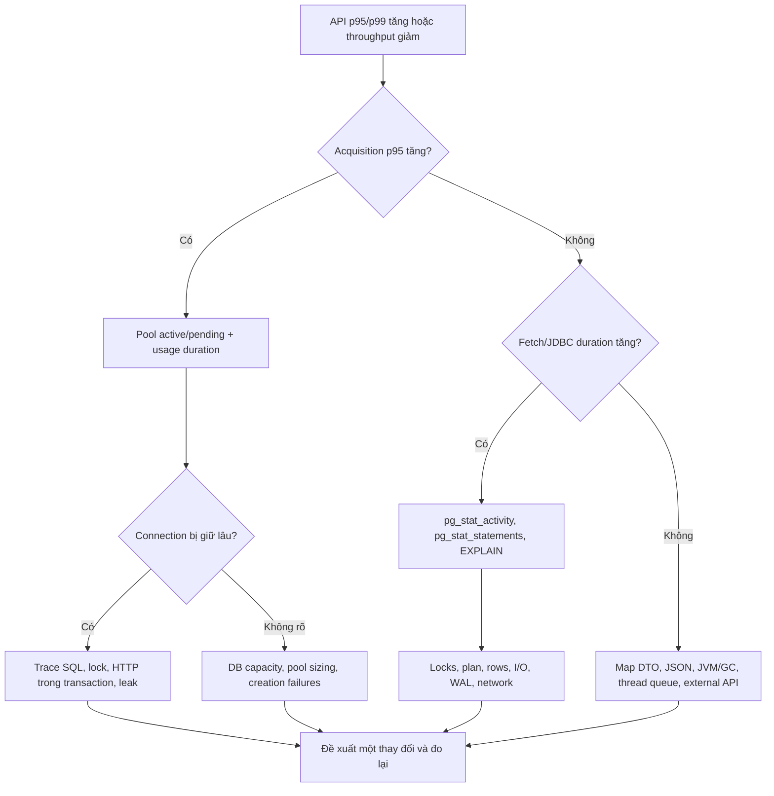

# Đo độ trễ, thông lượng và mức sử dụng tài nguyên

## Mục tiêu học tập

Sau bài học, người học có thể:

- Phân biệt **độ trễ (latency)**, **thông lượng (throughput)**, **mức đồng thời (concurrency)** và **mức sử dụng tài nguyên (utilization)** trong tầng persistence của ứng dụng Java.
- Định nghĩa phép đo đúng ranh giới: từ HTTP request, transaction, thời gian chờ pool, thời gian SQL đến commit và thời gian truyền dữ liệu.
- Diễn giải p50/p95/p99, histogram, error rate và các chỉ số kết nối, CPU, bộ nhớ, I/O, WAL, khóa và cache mà không đánh đồng giá trị trung bình với trải nghiệm người dùng.
- Dùng Java/Micrometer và các thống kê PostgreSQL để xác định điểm nghẽn mà vẫn giữ an toàn cho production.
- Thiết kế bài đo tải có workload, kích thước dữ liệu, tỷ lệ đọc/ghi, concurrency và tiêu chí đúng đắn rõ ràng.
- Đề xuất hướng tối ưu có thể kiểm chứng bằng số liệu trước/sau, đồng thời nhận diện tác dụng phụ lên độ bền, cô lập, kết nối và an toàn dữ liệu.

## 1. Hiệu năng persistence là gì và vì sao cần đo nhiều chiều?

Một API Java trả danh sách đơn hàng mất 40 ms khi chỉ có một người dùng nhưng tăng lên 1,8 giây vào giờ cao điểm. PostgreSQL báo mỗi câu SQL chỉ mất 20 ms. Có phải database đã được tối ưu tốt và vấn đề nằm ở HTTP?

**Chưa thể kết luận.** Request có thể dành 1,5 giây **chờ mượn connection** từ HikariCP, 20 ms chạy SQL, 100 ms ánh xạ hàng thành object và phần còn lại để serialize hoặc xếp hàng ở web server. Một câu SQL nhanh không tự đảm bảo API nhanh khi có nhiều request đồng thời.

Trong module `DATA_PERSISTENCE_FUNDAMENTALS`, người học tìm hiểu mô hình dữ liệu, schema, query, index, giao dịch, cô lập, resource, độ bền và tối ưu hiệu năng. Những lựa chọn này tạo ra trade-off: thêm index có thể giảm độ trễ đọc nhưng tăng chi phí ghi và bảo trì; bật đồng bộ WAL giúp giữ durability nhưng tăng chi phí commit; khóa rộng giảm race condition ở một số bài toán nhưng có thể gây chờ.

**Hiệu năng không phải một con số đơn lẻ.** Cần đặt tối thiểu ba câu hỏi:

1. **Latency:** một công việc hoàn thành trong bao lâu, kể cả thời gian chờ?
2. **Throughput:** hệ thống hoàn tất bao nhiêu công việc hợp lệ trong một đơn vị thời gian?
3. **Resource utilization:** các tài nguyên hữu hạn đang bận bao nhiêu, đang chờ ở đâu, và còn bao nhiêu dư địa?



Sơ đồ mô tả một luồng khái niệm; trong ứng dụng thật, thứ tự thực thi SQL, ánh xạ và commit phụ thuộc use case. Không phải mọi request đều commit, và một request có thể thực hiện nhiều câu SQL.

### Một ví dụ số liệu ban đầu

| Chỉ số trong 5 phút | Giờ tải thấp | Giờ cao điểm |
| --- | ---: | ---: |
| Throughput API đơn hàng thành công | 80 request/s | 150 request/s |
| Latency API p50 | 45 ms | 110 ms |
| Latency API p95 | 90 ms | 1.800 ms |
| Latency SQL trung bình | 18 ms | 22 ms |
| Thời gian mượn connection p95 | 5 ms | 1.450 ms |
| Pool active/pool max | 6/20 | 20/20 |
| Pool pending | 0 | 45 |

Dữ liệu giả định này gợi ý **chờ connection pool** là ứng viên quan trọng để điều tra, chứ chưa chứng minh pool quá nhỏ. Pool cạn có thể là hậu quả của SQL khác chậm, transaction giữ kết nối khi gọi API ngoài, deadlock, leak hoặc concurrency vượt năng lực database.

## 2. Độ trễ: đo đúng một công việc từ đầu đến cuối

**Latency** là thời gian từ một điểm bắt đầu xác định tới một điểm kết thúc xác định. Nếu thiếu định nghĩa ranh giới, hai biểu đồ mang cùng tên “latency” có thể đo những thứ hoàn toàn khác.

### 2.1. Những loại latency cần phân biệt

| Phạm vi đo | Bắt đầu → Kết thúc | Ý nghĩa |
| --- | --- | --- |
| **HTTP end-to-end** | Request đến ranh giới dịch vụ → response hoàn tất | Gần trải nghiệm client hơn, nhưng chưa gồm mọi network ngoài server |
| **Use case** | Service bắt đầu thực hiện nghiệp vụ → trả kết quả/lỗi | Bao gồm nhiều lần đọc/ghi, mapping, gọi ngoài nếu có |
| **Connection acquisition** | Bắt đầu mượn pool → có `Connection` hoặc timeout | Đo hàng đợi và chi phí lấy kết nối |
| **SQL execution** | Bắt đầu execute JDBC → hoàn thành theo hợp đồng API | Có thể gồm network, chờ server/lock; streaming rows có thể diễn ra sau đó |
| **Result consumption** | Bắt đầu đọc `ResultSet` → ánh xạ xong | Phản ánh fetch, network, mapping và số hàng |
| **Transaction duration** | Bắt đầu transaction → commit/rollback hoàn tất | Quan trọng cho lock holding và resource usage |
| **Commit latency** | Bắt đầu `commit()` → có kết quả/exception | Có thể phụ thuộc WAL flush, replication và network |

Chú ý: `executeQuery()` trả về một `ResultSet` **không có nghĩa mọi hàng đã được đọc**. Tùy JDBC driver, fetch size và cursor, phần lớn thời gian chuyển dữ liệu có thể nằm trong các lần `next()`. Nếu chỉ đo lời gọi `executeQuery()`, bạn có thể bỏ qua chi phí của kết quả lớn.

### 2.2. Phân rã latency và tránh cộng trùng

Trong một luồng tuần tự, có thể ước lượng:

\[
L_{\text{request}} \approx L_{\text{queue}} + L_{\text{acquire}} +
L_{\text{DB}} + L_{\text{mapping}} + L_{\text{response}}
\]

Đây là mô hình phân rã minh họa. Trong luồng có nhiều query, xử lý song song, gọi API ngoài hay stream response, một số khoảng thời gian **chồng lên nhau**. Không được cộng `SQL duration` và `transaction duration` nếu transaction đã bao hàm SQL; cũng không cộng trực tiếp p95 của từng giai đoạn để dự đoán p95 tổng.

**Đo duration bằng đồng hồ đơn điệu** như `System.nanoTime()`. Không dùng hiệu hai giá trị `System.currentTimeMillis()` để đo đoạn code ngắn: đồng hồ tường có thể bị chỉnh và độ phân giải có thể không phù hợp. Timestamp theo UTC vẫn hữu ích để ghép log, trace và biểu đồ.

### 2.3. Average, p50, p95 và p99

Giả sử 100 request có 95 request hoàn thành trong 30 ms và 5 request mất 1.000 ms. Trung bình là:

\[
\bar L = \frac{95 \times 30 + 5 \times 1000}{100} = 78{,}5\ \text{ms}
\]

Con số trung bình 78,5 ms che việc 5% người dùng đợi một giây. Vì vậy cần histogram và percentile:

- **p50 (median):** khoảng 50% quan sát có latency không vượt giá trị đó.
- **p95:** khoảng 95% quan sát có latency không vượt giá trị đó; giúp thấy phần chậm mà trung bình bỏ sót.
- **p99:** phản ánh phần rất chậm, thường nhạy với lock wait, GC pause, pool contention và đuôi phân phối.
- **Max:** giá trị lớn nhất trong cửa sổ; có thể hữu ích nhưng rất nhạy với ngoại lệ và kích thước mẫu.

Percentile là **giá trị xấp xỉ tùy phương pháp tính/histogram**, không phải luôn một số tuyệt đối. p99 với 50 quan sát không ổn định như p99 với hàng triệu quan sát. Không lấy trung bình của p95 giữa các instance để tính p95 toàn cụm; phải **gộp histogram/phân phối** hoặc dùng kỹ thuật tổng hợp phù hợp.

### 2.4. Đo cả lỗi và timeout

Một tối ưu có thể làm latency p95 của **request thành công** giảm mạnh chỉ vì những request chậm nhất chuyển thành **timeout/lỗi và bị loại khỏi thống kê**. Do đó, báo cáo phải thể hiện:

- Số request bắt đầu, hoàn tất, thất bại và timeout;
- Latency theo outcome/status hoặc chính sách đo rõ ràng;
- Tỷ lệ error và timeout trong cùng cửa sổ;
- Phân bố theo endpoint/use case (không gộp checkout với catalog).

**Tăng tốc bằng cách làm rơi request không phải cải thiện hiệu năng đúng nghĩa.** Một SLO có thể là “99% request đọc đơn hàng thành công dưới 200 ms trong cửa sổ đo được định nghĩa, đồng thời lỗi do dịch vụ dưới 0,1%”; các con số cần do nghiệp vụ xác định, không có giá trị mặc định cho mọi dịch vụ.

## 3. Thông lượng, concurrency và điểm bão hòa

**Throughput** là số đơn vị công việc hoàn thành trên một khoảng thời gian. Chọn **đơn vị** trước khi so sánh:

- `requests/s`: số request HTTP hoàn tất;
- `transactions/s`: số transaction database commit/rollback hoặc transaction nghiệp vụ (phải ghi rõ loại);
- `queries/s`: số câu SQL chạy;
- `rows/s` hoặc `MB/s`: dữ liệu được xử lý/truyền;
- `orders/min`: đơn hàng nghiệp vụ đã xử lý thành công.

Một request có thể thực hiện 20 câu SQL và hai transaction, nên `requests/s`, `queries/s` và `transactions/s` không hoán đổi được. Cũng cần phân biệt **offered load** (yêu cầu đến) với **completed throughput** (đã hoàn tất). Nếu 300 req/s đến nhưng chỉ 180 req/s hoàn tất và 120 req/s tiếp tục xếp hàng, throughput không phải 300 req/s.

### 3.1. Little's Law

Trong điều kiện hệ thống ổn định và ranh giới đo nhất quán:

\[
N \approx \lambda \times W
\]

Với:

- `N`: số công việc trung bình **đang ở trong hệ**;
- `λ`: throughput hoàn tất trung bình, đơn vị công việc/giây;
- `W`: thời gian trung bình mỗi công việc ở trong hệ, tính bằng giây.

Ví dụ có 120 request/s hoàn tất, latency trung bình 0,2 giây, thì số request trung bình trong phạm vi đó xấp xỉ `120 × 0,2 = 24`. Nếu đo **connection đã mượn**, phải dùng tốc độ mượn và **thời gian giữ connection**; không dùng trực tiếp độ trễ HTTP nếu connection chỉ được mượn một phần vòng đời request.

Little's Law là **quan hệ giữa các giá trị trung bình dưới giả định phù hợp**, không nói mỗi request dùng đúng `N` connection, không xác định p99 và không bảo đảm hệ đã đạt năng lực tối đa.

### 3.2. Tại sao tăng concurrency chưa chắc tăng throughput?

Khi số người dùng đồng thời tăng, throughput thường tăng ban đầu, rồi tiến tới ngưỡng tài nguyên hữu hạn. Sau đó:

- CPU database có thể bão hòa;
- I/O hoặc WAL flush trở thành giới hạn;
- nhiều transaction tranh chấp cùng hàng/khóa;
- connection pool và thread pool tạo hàng đợi;
- GC pressure hoặc dữ liệu trả về quá lớn làm tăng latency;
- hệ thống bắt đầu timeout và **completed throughput** có thể giảm.



**Điểm bão hòa** phải được tìm qua tải có kiểm soát, không suy ra bằng một ngưỡng CPU cố định. Database có thể chậm do khóa hàng dù CPU chỉ 30%; ngược lại CPU 90% có thể chấp nhận được nếu latency, lỗi và headroom vẫn nằm trong SLO.

## 4. Mức sử dụng tài nguyên: không chỉ nhìn CPU

**Utilization** cho biết một tài nguyên đang bận ở mức nào so với công suất/cấu hình của nó. **Saturation** thể hiện khi nhu cầu vượt khả năng phục vụ và công việc phải chờ hoặc bị loại. **Errors** phản ánh hoạt động thất bại. Ba góc nhìn này giúp tránh việc thấy tài nguyên bận là mặc định “sắp hỏng”.

| Tầng | Cần đo | Dấu hiệu có thể liên quan |
| --- | --- | --- |
| **JVM/application** | CPU, thread, GC pause, heap/direct memory, allocation, request queue | CPU hot, stop-the-world pause, out-of-memory, thread starvation |
| **Connection pool** | Active, idle, pending, acquisition/usage duration, timeout | Pool cạn, transaction giữ connection lâu, leak hoặc DB chậm |
| **Database CPU** | CPU theo tiến trình/host, số backend active, query CPU | SQL tính toán nặng, plan chưa phù hợp, quá nhiều query |
| **Database I/O** | Disk throughput, IOPS, await/latency, cache hit/read, temp files | Truy vấn đọc quá nhiều trang, sort/hash tràn disk |
| **Locks/concurrency** | Lock wait, deadlock, transaction age, blocked queries | Hot row, transaction dài, thứ tự khóa không ổn định |
| **WAL/commit** | WAL bytes, fsync/commit latency, checkpoint I/O, replica lag | Ghi nhiều, cấu hình durability, storage chậm |
| **Network** | RTT, bytes, packet retransmit, kết nối hỏng | Truyền result set lớn, nhiều round trips JDBC |
| **Storage capacity** | Dung lượng còn, bloat, tốc độ tăng dữ liệu và index | Thiếu disk, vacuum/chỉ mục kém hiệu quả |

Không gộp CPU host và CPU của database thành một metric nếu máy chạy nhiều dịch vụ. Trên môi trường container cần chú ý **CPU quota, memory limit** và việc host có thể còn dư tài nguyên trong khi container đã bị throttling.

### 4.1. Độ bận và thời gian chờ có thể ngược kỳ vọng

Một transaction bị chặn 10 giây trên khóa hàng có thể tiêu tốn rất ít CPU nhưng khiến response chậm 10 giây và giữ connection của pool trong thời gian đó. Vì thế **CPU thấp không chứng minh database khỏe**.

Tương tự, tăng pool từ 20 lên 100 có thể chỉ cho thêm 80 transaction tranh chấp cùng một hàng, làm queue/lock wait sâu hơn và tiêu thụ nhiều bộ nhớ backend. Đo nguyên nhân trước khi chỉnh cấu hình.

### 4.2. Hiểu cache hit

Một tỷ lệ **buffer cache hit** cao là gợi ý về việc đọc dữ liệu từ bộ nhớ, nhưng không tự chứng minh truy vấn hiệu quả. Một query đọc một triệu trang trong RAM vẫn có thể chậm; một query scan tuần tự có `shared_blks_read` có thể phù hợp với workload phân tích. Đánh giá **số trang đọc, số hàng trả, kế hoạch thực thi và latency** cùng nhau.

## 5. Đo thời gian trong Java: từ đồng hồ đơn điệu tới Micrometer

### 5.1. Mẫu tối thiểu với `System.nanoTime()`

Khi cần biết một đoạn code có mất bao lâu, đo từ ngay trước thao tác tới khi thao tác kết thúc, **kể cả exception**:

```java
public void doWork() {
    long started = System.nanoTime();
    try {
        performDatabaseWork();
    } finally {
        long elapsedNanos = System.nanoTime() - started;
        // Chuyển elapsedNanos thành metric với đơn vị rõ ràng.
        recordDuration(elapsedNanos);
    }
}
```

`System.nanoTime()` dành cho đo khoảng thời gian trong process. Sử dụng **chênh lệch** giữa hai lần gọi, không diễn giải giá trị tuyệt đối thành timestamp UTC. `finally` giúp lần đo không bỏ sót các thao tác thất bại; nhưng cũng cần ghi outcome để không gộp lỗi vào latency thành công một cách vô tình.

Không đặt `System.out.println(...)` hoặc ghi log đồng bộ cho **mỗi** thao tác trong benchmark tải lớn: I/O log có thể tự làm tăng latency đang đo.

### 5.2. Ví dụ JDBC + Micrometer: đo acquire và fetch riêng

Micrometer là thư viện phổ biến để ghi metric trong ứng dụng Java/Spring. Ví dụ sau đo ba khoảng:

- `acquire`: thời gian mượn `Connection` (bao gồm cả trường hợp mượn lỗi);
- `fetch`: thời gian tạo statement, thực thi và tiêu thụ `ResultSet`;
- `total`: toàn bộ thao tác repository gồm mượn và trả connection.

```java
import io.micrometer.core.instrument.MeterRegistry;
import io.micrometer.core.instrument.Timer;
import java.sql.Connection;
import java.sql.PreparedStatement;
import java.sql.ResultSet;
import java.sql.SQLException;
import java.util.ArrayList;
import java.util.List;
import java.util.UUID;
import java.util.concurrent.TimeUnit;
import javax.sql.DataSource;

record OrderSummary(UUID id, String status) {}

public final class OrderQueryRepository {
    private final DataSource dataSource;
    private final Timer acquireTimer;
    private final Timer fetchTimer;
    private final Timer totalTimer;

    public OrderQueryRepository(DataSource dataSource, MeterRegistry registry) {
        this.dataSource = dataSource;
        this.acquireTimer = Timer.builder("persistence.connection.acquire")
                .tag("operation", "list_orders")
                .register(registry);
        this.fetchTimer = Timer.builder("persistence.order.fetch")
                .tag("operation", "list_orders")
                .register(registry);
        this.totalTimer = Timer.builder("persistence.order.total")
                .tag("operation", "list_orders")
                .register(registry);
    }

    public List<OrderSummary> findRecent(UUID tenantId, int limit)
            throws SQLException {
        if (tenantId == null || limit < 1 || limit > 100) {
            throw new IllegalArgumentException("Invalid query");
        }
        long totalStart = System.nanoTime();
        try {
            long acquireStart = System.nanoTime();
            Connection connection;
            try {
                connection = dataSource.getConnection();
            } finally {
                acquireTimer.record(
                        System.nanoTime() - acquireStart, TimeUnit.NANOSECONDS);
            }

            try (connection) {
                long fetchStart = System.nanoTime();
                try (PreparedStatement ps = connection.prepareStatement("""
                        SELECT id, status
                        FROM sales_order
                        WHERE tenant_id = ?
                        ORDER BY created_at DESC, id DESC
                        LIMIT ?
                        """)) {
                    ps.setObject(1, tenantId);
                    ps.setInt(2, limit);
                    try (ResultSet rows = ps.executeQuery()) {
                        List<OrderSummary> results = new ArrayList<>();
                        while (rows.next()) {
                            results.add(new OrderSummary(
                                    rows.getObject("id", UUID.class),
                                    rows.getString("status")));
                        }
                        return results;
                    }
                } finally {
                    fetchTimer.record(
                            System.nanoTime() - fetchStart,
                            TimeUnit.NANOSECONDS);
                }
            }
        } finally {
            totalTimer.record(
                    System.nanoTime() - totalStart, TimeUnit.NANOSECONDS);
        }
    }
}
```

Ví dụ dùng Java hỗ trợ text blocks và cú pháp `try (connection)`, tương ứng Java 17+ trong bối cảnh khóa học. Nó giả định bảng `sales_order(tenant_id, id, status, created_at)` đã tồn tại; không tạo schema mới trong ví dụ đo.

**Các giới hạn cần hiểu khi đọc metric:**

- `persistence.order.fetch` ở đây **không chỉ là server SQL execution time**. Nó bao gồm `prepareStatement`, network, chờ DB, lấy các hàng qua driver, ánh xạ object và đóng statement/result set. Để tách server execution, cần thêm quan sát phía PostgreSQL/tracing.
- `total` bao gồm `acquire` và `fetch` nhưng còn có chi phí đóng connection, overhead Java và các bước khác. Không cộng `total + acquire + fetch`.
- `Timer` đo cả trường hợp lỗi nhờ `finally`; muốn tách outcome, instrument thêm counter theo loại lỗi đã chuẩn hóa, không gắn exception message làm tag.
- Đo với `limit <= 100` để kiểm soát dữ liệu trả về; với phân trang thật, cần index và thứ tự có tính quyết định, chẳng hạn `(tenant_id, created_at DESC, id DESC)` nếu workload phù hợp.
- Câu SQL trong ví dụ có thể bị chậm do index, kế hoạch, khóa, result set hoặc pool; metric chỉ giúp phân tách giai đoạn, không tự cho biết giải pháp.

### 5.3. Histogram và nhãn có cardinality thấp

`Timer` của Micrometer có thể cấu hình phân phối histogram/SLO buckets để tính percentile và chia sẻ histogram cho Prometheus hoặc backend khác. Nên thống nhất đơn vị, thời gian bucket, tỷ lệ sampling và kích thước chuỗi thời gian.

**Chỉ dùng tag ít giá trị**: tên use case, nhóm SQL, outcome và shard group đã giới hạn. Không gắn `userId`, `orderId`, tham số SQL, IP, email, URL chứa ID hoặc toàn bộ exception message: cardinality cao có thể làm metric backend bùng nổ bộ nhớ và chi phí, đồng thời lộ dữ liệu.

Khi dùng Spring Boot với Micrometer/Actuator, pool HikariCP thường có metric như `hikaricp.connections.active`, `idle`, `pending`, `acquire`, `usage` (phụ thuộc cấu hình và phiên bản). Xác minh các meter được export trong chính hệ thống đang chạy; **không phơi endpoint quản trị** ra Internet nếu chưa có bảo vệ quyền.

### 5.4. Dùng tracing để nối các đoạn thời gian

Distributed tracing có thể nối `HTTP request → application service → pool → JDBC → commit` theo trace/span ID. Một span giúp tìm luồng chịu ảnh hưởng, nhưng:

- Span không thay thế histogram để tính p95/p99 toàn dịch vụ;
- Sampling có thể bỏ qua nhiều request, đặc biệt những request hiếm;
- Span cha và span con có thời gian **chồng lấn**, không cộng bừa các duration;
- SQL text và tham số có thể chứa dữ liệu nhạy cảm; log/trace cần được khử định danh và phân quyền.

Đối với yêu cầu độ bền, còn đo `commit()` và trạng thái WAL/replication; một span kết thúc không tự chứng minh data đã được đồng bộ sang mọi replica.

## 6. PostgreSQL: từ tổng quan tới câu SQL gây tốn tài nguyên

Các truy vấn quan sát dưới đây ưu tiên **chỉ đọc**. Khi đo trên production, cần quyền phù hợp, xem chi phí truy vấn giám sát và tránh xuất dữ liệu nhạy cảm ra ticket/chat công khai.

### 6.1. `pg_stat_activity`: ai đang chạy, chờ hoặc giữ transaction?

```sql
SELECT
    pid,
    application_name,
    state,
    wait_event_type,
    wait_event,
    now() - query_start AS query_age,
    now() - xact_start AS transaction_age,
    pg_blocking_pids(pid) AS blocking_pids,
    left(query, 120) AS query_sample
FROM pg_stat_activity
WHERE datname = current_database()
  AND backend_type = 'client backend'
ORDER BY xact_start NULLS LAST, query_start NULLS LAST;
```

Diễn giải:

- `state = 'active'`: backend đang chạy một lệnh; `wait_event_type = 'Lock'` giúp tìm query bị chặn bởi transaction khác.
- `state = 'idle in transaction'`: transaction vẫn mở nhưng hiện không chạy SQL; có thể giữ khóa, snapshot và gây ảnh hưởng đến VACUUM.
- `state = 'idle'`: backend đang rảnh; thường là connection vật lý hợp lệ trong pool, **không phải bằng chứng connection leak**.
- `query_age` có ý nghĩa hạn chế khi backend không active; `query_start` có thể là mốc lệnh cuối. Cần đọc cùng `state` và xem `transaction_age`.

Một backend đang chờ khóa có thể dùng rất ít CPU nhưng tạo latency lớn. Khi đó tăng CPU hoặc index chưa chắc giải quyết đúng nguyên nhân; cần tìm bên chặn và phạm vi transaction.

### 6.2. `pg_stat_database`: xu hướng toàn database

```sql
SELECT
    datname,
    numbackends,
    xact_commit,
    xact_rollback,
    blks_read,
    blks_hit,
    tup_returned,
    tup_fetched,
    tup_inserted,
    tup_updated,
    tup_deleted,
    temp_files,
    temp_bytes,
    deadlocks,
    stats_reset
FROM pg_stat_database
WHERE datname = current_database();
```

Những counter như `xact_commit`, `blks_read` và `deadlocks` là **tích lũy từ lần reset thống kê**, không phải tốc độ trên giây. Muốn tính `transactions/s`, lấy **chênh lệch counter giữa hai mẫu** chia cho số giây thực tế, kiểm tra reset/restart/wrap và chỉ so cùng database. `numbackends` là số hiện tại, không phải counter.

Ví dụ:

```text
10:00:00 xact_commit = 1.200.000
10:01:00 xact_commit = 1.206.000
=> commit throughput xấp xỉ (6.000 / 60) = 100 commit/s
```

Đây là throughput **transaction commit của database**, không phải 100 đơn hàng thành công mỗi giây. Một đơn hàng có thể tạo nhiều transaction; một transaction cũng có thể xử lý nhiều đơn.

Tỷ lệ hit tính từ `blks_hit / (blks_hit + blks_read)` khi mẫu số hợp lệ chỉ là một chỉ báo **shared buffer hit**, không phải tỷ lệ hit của CPU cache, OS page cache hay cache ứng dụng. Nên tính trên một cửa sổ đo thay vì tỷ lệ tích lũy nhiều tháng, và xem cùng độ lớn thực tế của I/O.

### 6.3. `pg_stat_statements`: tìm các mẫu SQL tiêu tốn nhiều thời gian

Nếu extension `pg_stat_statements` đã được DBA bật/cấu hình, có thể quan sát các câu lệnh được chuẩn hóa. Ví dụ với các phiên bản PostgreSQL phổ biến có `total_exec_time` và `mean_exec_time`:

```sql
SELECT
    queryid,
    calls,
    round(total_exec_time::numeric, 2) AS total_exec_ms,
    round(mean_exec_time::numeric, 2) AS mean_exec_ms,
    rows,
    shared_blks_hit,
    shared_blks_read,
    temp_blks_written,
    left(query, 150) AS query_sample
FROM pg_stat_statements
ORDER BY total_exec_time DESC
LIMIT 20;
```

**Không tự ý bật extension hoặc đổi cấu hình trên production** trong bài thực hành. `pg_stat_statements` cần hỗ trợ/cấu hình như `shared_preload_libraries` tùy môi trường; cấu trúc cột, quyền xem và phiên bản có thể khác. Trên hệ không có extension, truy vấn sẽ lỗi; hãy kiểm tra khả năng quan sát đã được cấu hình cùng DBA.

`total_exec_time` giúp tìm mẫu SQL tiêu tốn nhiều **thời gian tổng cộng** do vừa chậm vừa chạy nhiều lần. `mean_exec_time` cho độ trễ trung bình theo lời gọi, **không phải p95**; `rows` là tổng hàng trả/sửa tùy loại câu lệnh. Có thể dùng phép chênh lệch các counter qua cửa sổ tải để xem một mẫu SQL thực sự gây vấn đề tại giờ cao điểm, thay vì chỉ xếp hạng từ nhiều ngày trước.

Không đưa đầy đủ câu SQL chứa literal nhạy cảm vào dashboard hoặc kênh công khai. Câu truy vấn ở đây chỉ lấy một đoạn sample phục vụ xác định mẫu; bảo mật log/metric vẫn cần được xem xét.

### 6.4. WAL, checkpoint và I/O theo phiên bản

Những chỉ số như tốc độ tạo WAL, thời gian đồng bộ WAL, I/O read/write/fsync và checkpoint có thể giải thích vì sao **giao dịch ghi** chậm dù phần `UPDATE` xử lý nhanh. PostgreSQL có các view như `pg_stat_wal` và, ở một số phiên bản mới hơn, `pg_stat_io`; tên cột/chỉ số và mức thống kê thay đổi theo phiên bản.

Đọc đúng phiên bản trước khi viết truy vấn monitoring cụ thể. `pg_stat_io` xuất hiện từ PostgreSQL 16; không giả định nó tồn tại ở PostgreSQL cũ. Ngoài database view, đối chiếu với số đo OS/container và storage để xem latency thiết bị, disk queue, throughput và giới hạn IOPS.

**Không tắt `fsync` hay `synchronous_commit` chỉ để cải thiện benchmark rồi dùng kết quả ấy chứng minh cấu hình production an toàn.** Những thiết lập này đổi hợp đồng durability; so sánh hiệu năng phải giữ yêu cầu dữ liệu của nghiệp vụ nhất quán.

## 7. `EXPLAIN` và `EXPLAIN ANALYZE`: tìm nơi SQL thực sự tốn thời gian

Khi biết **mẫu SQL** đáng nghi, xem execution plan giúp trả lời database đã quét bao nhiêu hàng, dùng index nào, join ra sao và có sort/hash tốn bộ nhớ hay không.

Ví dụ truy vấn lịch sử đơn của một tenant:

```sql
EXPLAIN (ANALYZE, BUFFERS)
SELECT id, status, created_at
FROM sales_order
WHERE tenant_id = '11111111-1111-1111-1111-111111111111'
  AND status = 'PAID'
ORDER BY created_at DESC, id DESC
LIMIT 50;
```

Đây là ví dụ **SELECT trên dữ liệu thử nghiệm** với ID giả. Cần quyền truy cập dữ liệu phù hợp và biết query này có chi phí chấp nhận được. Không chạy một plan `ANALYZE` tùy tiện trên câu SQL nguy hiểm/đắt đỏ ở production.

### `EXPLAIN` khác `EXPLAIN ANALYZE` thế nào?

- `EXPLAIN` thuần cung cấp **kế hoạch ước lượng** của optimizer, thông thường không thực thi câu SQL.
- `EXPLAIN ANALYZE` **thực sự thực thi** câu SQL để ghi runtime statistics; nếu áp dụng vào `UPDATE`/`DELETE`/`INSERT`, nó có thể tạo thay đổi dữ liệu. Với những câu DML trong môi trường thử nghiệm, có thể cần `BEGIN; EXPLAIN (ANALYZE, BUFFERS) ...; ROLLBACK;` và hiểu rõ side effects, trigger, sequence/external action **không nhất thiết được rollback hoàn toàn**.
- Một câu `SELECT` có hàm volatile hoặc side effect vẫn cần được xem xét; không suy rằng mọi `SELECT` đều vô hại.
- `BUFFERS` cho biết các buffer page hits/reads/writes ở mức PostgreSQL, không phải thời gian network giữa Java và DB.

### Những thành phần cần đọc trong plan

| Thành phần | Câu hỏi cần đặt |
| --- | --- |
| `Seq Scan` | Quét toàn bảng có phù hợp với độ lớn và selectivity, hay thiếu index? |
| `Index Scan` / `Index Only Scan` | Index nào được dùng, có cần truy cập heap, visibility map ảnh hưởng ra sao? |
| `Rows Removed by Filter` | Database đã đọc nhiều hàng rồi loại bỏ bao nhiêu? |
| `actual rows` so với `rows` ước lượng | Thống kê dữ liệu/độ lệch phân phối có dẫn đến plan sai? |
| `Nested Loop` / `Hash Join` / `Merge Join` | Join có phù hợp lượng dữ liệu hay tạo hàng triệu lần dò? |
| `Sort`, `Disk` / temp blocks | Có sort hoặc hash spill ra disk, `work_mem` có liên quan? |
| `Buffers: shared hit/read` | Query đụng bao nhiêu page, đang phụ thuộc I/O ra sao? |
| `Planning Time` / `Execution Time` | Chi phí optimizer và thực thi phía server có đáng kể? |

Các số `actual time` trong plan có phạm vi **node** và có thể được báo theo mỗi vòng lặp (`loops`); không cộng cơ học thời gian của mọi node vì node cha bao gồm công việc node con. `Execution Time` phía server cũng không bao gồm toàn bộ thời gian ánh xạ DTO, serialize response hoặc mọi chi phí vận chuyển dữ liệu tới client.

### Một index có thể cải thiện latency nhưng đổi throughput ghi

Với workload truy vấn ở trên, có thể cân nhắc một index:

```sql
-- Chỉ là ứng viên trên môi trường thử nghiệm; chưa phải thay đổi production.
CREATE INDEX idx_sales_order_tenant_status_created
ON sales_order (tenant_id, status, created_at DESC, id DESC);
```

Trước khi tạo, cần kiểm tra index tương đương đã tồn tại chưa và đo plan. Index này có thể tăng tốc lọc + sắp xếp đúng workload nhưng cũng tăng **dung lượng, WAL và chi phí INSERT/UPDATE/DELETE**. Trong production có thể cần cân nhắc `CREATE INDEX CONCURRENTLY` và kế hoạch migration an toàn. Không chọn index chỉ từ một lần chạy query trên dataset nhỏ.

## 8. Thiết kế benchmark có thể so sánh được

Một benchmark tốt phải có **workload đại diện**, **ranh giới đo ổn định** và **tính đúng đắn được xác nhận**. Nếu chạy trên database chỉ có 100 hàng trong khi production có 100 triệu hàng, hoặc chỉ dùng một user trong khi production có 500 request đồng thời, kết luận có thể không áp dụng được.

### 8.1. Xác định mục tiêu và giả thuyết

Ví dụ:

> Với 200 request/s gồm 80% đọc đơn, 15% tạo đơn và 5% cập nhật thanh toán, latency p95 của API đọc phải dưới 250 ms, lỗi do hệ thống dưới 0,1%; khi tăng tải từ 100 lên 200 request/s, không làm tăng tỷ lệ giao dịch thất bại do lock timeout vượt ngưỡng đã đặt.

Những con số là **mục tiêu giả định**, không phải khuyến nghị mặc định. Giả thuyết đo cần cụ thể: “Thời gian mượn connection đang tăng do transaction giữ kết nối quá lâu” tốt hơn “database chậm”.

### 8.2. Kiểm soát những biến đầu vào

| Biến | Ví dụ cần cố định/mô tả |
| --- | --- |
| Dữ liệu | Số hàng, phân phối theo tenant, số index, kích thước cột, dữ liệu skew |
| Workload | Tỷ lệ read/write, số câu SQL/request, độ lớn result set, transaction scope |
| Thời gian | Warm-up JVM/JIT, thời gian steady-state, tổng số mẫu |
| Tải | Request arrival rate, số client đồng thời, think time, ramp-up/ramp-down |
| Môi trường | CPU/memory limit, disk/IOPS, topology network, DB version, pool size |
| Cấu hình | Isolation level, index, `fsync`/WAL, logging, cache và replica routing |
| Lỗi | Retry policy, timeout, rejected requests, circuit breaker |

**Đo đúng dữ liệu sẽ chạy trong đời thực**: nếu một tenant lớn chiếm 60% traffic, dữ liệu test phân đều giữa 100 tenant có thể không tái hiện được hot shard, hot row và cache pressure.

### 8.3. Kiểm thử closed-loop và open-loop

Với **closed-loop load generator**, một virtual user chỉ gửi request kế tiếp sau khi request hiện tại hoàn tất và sau think time. Nếu server chậm đi, tốc độ request tự giảm, có thể làm **độ trễ nhìn có vẻ ổn định** vì tải đã giảm theo.

Với **open-loop**, request được phát theo lịch arrival rate định trước, độc lập thời gian hoàn tất. Điều này giúp kiểm tra khả năng xử lý nhu cầu đến theo thời gian nhưng có thể làm hàng đợi tăng nhanh khi hệ thống bão hòa.

Hiện tượng **coordinated omission** xuất hiện khi phép đo bỏ qua các request *lẽ ra đã đến* trong khoảng server đang chậm. Khi so p99, phải biết công cụ tải tạo traffic và ghi nhận latency theo mô hình nào; không đưa kết quả closed-loop và open-loop cạnh nhau như thể hoàn toàn tương đương.

### 8.4. Bốn giai đoạn của một lần benchmark

1. **Chuẩn bị:** tạo dữ liệu đại diện, kiểm tra schema/index, cấu hình metrics và xác định baseline. Có phương án reset dữ liệu giữa các lần test nếu workload ghi.
2. **Warm-up:** chạy đủ để JVM/JIT, connection pool, buffer cache và hệ thống ổn định ở mức dự kiến; không trộn giai đoạn warm-up vào số liệu steady-state.
3. **Đo:** chạy thời lượng đủ dài trên tải đã định, ghi throughput hoàn tất, latency histogram, error/timeout, utilization và các tài nguyên liên quan.
4. **Xác minh và lặp lại:** kiểm tra tính đúng đắn (không mất đơn, không bán vượt tồn kho), so nhiều lần, ghi biến động, sau đó chỉ thay **một nhóm nguyên nhân** và đo lại.

Khi cần xác định giới hạn năng lực, chạy **load step test** tăng dần tải và quan sát khi p95/p99, pending, lỗi hoặc hàng đợi bắt đầu tăng bất thường. Trong môi trường không đủ an toàn, không cố tạo tải cực hạn vào production.

### 8.5. Đừng tối ưu bằng cách giảm độ đúng đắn

Một biến thể benchmark có thể rất nhanh vì tắt foreign key, không đồng bộ WAL, bỏ kiểm tra version, bỏ transaction hoặc chấp nhận dirty/partial reads. Nếu production yêu cầu ACID, phép đo đó **không cùng hợp đồng**.

Đặt các tiêu chí kiểm chứng song song với latency:

- Số lượng đơn hàng tạo thành công đúng bằng số yêu cầu được xác nhận;
- Không tạo trùng theo idempotency key;
- Tồn kho không âm, số dư hợp lệ và không vượt quota;
- Commit đã xác nhận giữ đúng cam kết durability theo cấu hình yêu cầu;
- Retry không tạo tác dụng phụ lặp ngoài database.

## 9. Chẩn đoán theo triệu chứng thay vì thay cấu hình theo cảm giác

Khi API chậm, bắt đầu từ **ranh giới người dùng** rồi lần lượt đi vào các giai đoạn có bằng chứng. Một sơ đồ điều tra:



Sơ đồ giúp chọn **bằng chứng tiếp theo**, không chứng minh nguyên nhân chỉ bằng một nhánh. Có thể đồng thời tồn tại SQL chậm, pool contention, GC và lock wait; các hiệu ứng khuếch đại lẫn nhau khi tải tăng.

### 9.1. Tình huống A: index thiếu ở query đọc danh sách

**Quan sát:** latency p95 của endpoint tìm đơn tăng khi số hàng lớn; `pg_stat_statements` cho thấy một mẫu query dùng phần lớn tổng thời gian; `EXPLAIN` có `Seq Scan` với nhiều hàng bị loại và sort lớn.

**Giả thuyết:** truy vấn theo `tenant_id`, `status` và `created_at` thiếu access path thích hợp hoặc plan chọn quét rộng.

**Thử nghiệm:** trên dữ liệu đại diện, đo plan và độ trễ trước/sau ứng viên index; xác minh số hàng trả và thứ tự không đổi; đo thêm throughput ghi, WAL và kích thước index.

**Không nên:** tạo index ngay sau khi thấy `Seq Scan`. Với bảng nhỏ hoặc điều kiện ít chọn lọc, `Seq Scan` có thể tối ưu hơn index scan.

### 9.2. Tình huống B: N+1 query khi ORM đọc quan hệ

**Quan sát:** mỗi request trả 50 đơn nhưng phát 51 hoặc nhiều hơn câu SQL; query đơn lẻ rất nhanh, toàn request vẫn chậm do nhiều round-trip.

**Giả thuyết:** JPA lazy loading tạo N+1 khi mapping đơn → chi tiết.

**Thử nghiệm:** đếm query/request và trace, sau đó cân nhắc DTO projection, fetch join phù hợp, batch fetching hoặc truy vấn có phân trang đúng. So latency và số byte/hàng truyền qua mạng.

**Không nên:** fetch join mọi collection một cách mù quáng; có thể tạo tích Descartes, duplicate rows, tốn memory và làm phân trang không còn như kỳ vọng.

### 9.3. Tình huống C: pool cạn do HTTP call trong transaction

**Quan sát:** PostgreSQL `pg_stat_activity` có nhiều backend `idle`, HikariCP báo toàn bộ connection đang được mượn và pending tăng; SQL nhanh nhưng usage duration rất cao.

**Giả thuyết:** một service đã mượn connection, rồi gọi API thanh toán hoặc xử lý file trước khi kết thúc transaction.

**Thử nghiệm:** theo trace xác định lúc borrow/return, kiểm tra ranh giới `@Transactional` và đường lỗi. Tách công việc ngoài DB khỏi transaction khi nghiệp vụ cho phép; nếu cần side effect đáng tin cậy sau commit, dùng outbox/saga với idempotency.

**Không nên:** kết luận connection leak chỉ vì active cao hoặc tăng pool vô hạn để che việc giữ connection lâu.

### 9.4. Tình huống D: tốc độ ghi chậm dù CPU thấp

**Quan sát:** p95 commit tăng, WAL bytes/s và storage latency tăng, throughput ghi không tăng khi thêm thread. Cùng lúc `UPDATE` từng hàng có thể vẫn xử lý nhanh.

**Giả thuyết:** điểm nghẽn nằm ở flush WAL, I/O đồng bộ, checkpoint hoặc replication acknowledgement theo cấu hình.

**Thử nghiệm:** đối chiếu commit latency, WAL/checkpoint/storage và số transaction nhỏ; cân nhắc batching/group commit ở phạm vi hợp lệ, tối ưu số index/bytes ghi và thiết bị lưu trữ phù hợp.

**Không nên:** tắt độ bền của commit nếu hợp đồng yêu cầu dữ liệu đã xác nhận không bị mất sau crash.

## 10. Chọn đòn bẩy tối ưu theo bằng chứng

Những thay đổi hiệu năng phổ biến có **lợi ích và tác dụng phụ**. Mọi đề xuất nên có giả thuyết và phép đo để biết nó có giúp đúng use case không.

| Giải pháp | Khi nào đáng thử | Trade-off cần kiểm tra |
| --- | --- | --- |
| **Thêm/sửa index** | Query lọc hoặc sort tốn nhiều page, plan chưa hợp lý | Chi phí ghi/WAL, dung lượng index, maintenance và migration lock |
| **Đổi truy vấn/DTO projection** | Trả quá nhiều cột/hàng, N+1, nhiều network round trips | Query phức tạp hơn, join nhân bản dữ liệu, ranh giới domain |
| **Pagination/keyset** | Danh sách sâu, `OFFSET` lớn, result set lớn | Thứ tự ổn định, semantics khi dữ liệu thay đổi |
| **Batching** | Nhiều statement nhỏ, overhead mạng/commit cao | Transaction dài, lỗi từng phần, lock duration, batch size |
| **Giảm transaction scope** | Pool usage cao, lock wait, HTTP trong transaction | Phải giữ nguyên tính nguyên tử của những bước thực sự phụ thuộc |
| **Tối ưu connection pool** | Pending cao do pool giới hạn nhưng DB còn headroom | Pool lớn có thể quá tải DB; phải xét tổng mọi instance |
| **Caching** | Dữ liệu đọc lặp, ít thay đổi, có freshness budget | Stale data, invalidation, memory, stampede, quyền dữ liệu |
| **Partition/sharding** | Dữ liệu/throughput lớn vượt năng lực một owner và workload phù hợp | Routing, cross-shard transaction, rebalance, global invariants |
| **Tối ưu WAL/storage** | Commit/write-bound, fsync/IO là bottleneck | Chi phí phần cứng, cấu hình durability và replication |
| **Giới hạn concurrency/backpressure** | Hệ quá tải, queue dài hoặc resource cạnh tranh | Có thể reject/chờ request; cần SLO và admission policy rõ |

### 10.1. Tối ưu theo *tổng chi phí* thay vì chi phí một câu query

Giả sử thêm index làm một SELECT giảm từ 80 ms xuống 10 ms, nhưng INSERT tăng từ 8 ms lên 12 ms. Nếu workload có 95% SELECT, đây có thể là đánh đổi tốt; nếu 95% INSERT thì chưa chắc. Cần so **throughput nghiệp vụ, tail latency, CPU/IO, WAL và lỗi** theo phân phối workload thực tế.

Tương tự, một query trả 10.000 hàng có `Execution Time` phía PostgreSQL chỉ 20 ms nhưng mất 700 ms ở Java do fetch/serialization; thêm index có thể không cải thiện phần chi phí lớn nhất. Có thể cần hạn chế số hàng trả, dùng phân trang hoặc định dạng truyền dữ liệu hợp lý.

### 10.2. Không biến cache thành nguồn quyết định bất biến

Cache có thể tăng throughput đọc, nhưng dùng tồn kho hoặc số dư từ cache để xác nhận giao dịch có thể phá bất biến. Đường đọc danh mục có thể có `stale-if-error` theo hợp đồng; đường ghi đơn hàng cần SQL nguyên tử, constraint, version hoặc isolation thích hợp tại nguồn có thẩm quyền. Khi benchmark, phải đo cả khả năng đảm bảo **đúng dữ liệu**.

### 10.3. Phát triển một giả thuyết đo được

Một đề xuất sửa hiệu năng nên trả lời:

1. **Triệu chứng cụ thể:** latency p95 endpoint nào, ở mức tải nào, trong khung giờ nào?
2. **Bằng chứng:** metric nào chứng minh phần thời gian đang nằm ở pool, SQL, lock, WAL hoặc mapping?
3. **Giả thuyết nhân quả:** thay đổi gì sẽ giảm thời gian/chi phí đó?
4. **Tác dụng phụ:** ảnh hưởng tới memory, write throughput, độ bền, bảo mật và nhất quán?
5. **Tiêu chí thành công:** cải thiện bao nhiêu trên cùng workload, có giữ error rate và invariant không?

Nếu sau thay đổi, p50 giảm nhưng p99 tăng gấp ba hoặc tỷ lệ timeout tăng, chưa thể coi là tối ưu thành công. Phải xét đúng SLO và use case ưu tiên.

## 11. Thiết kế dashboard và SLO cho tầng persistence

SLO tốt đặt kỳ vọng về **trải nghiệm dịch vụ**, không chỉ “DB CPU dưới 70%”. Ví dụ giả định cho API tạo đơn:

| Hạng mục | Mục tiêu minh họa | Chỉ số cần xuất |
| --- | --- | --- |
| Độ trễ end-to-end | 95% request hợp lệ kết thúc dưới 300 ms | Latency histogram theo endpoint, outcome |
| Tỷ lệ thành công | Ít nhất 99,9% request xử lý theo hợp đồng trong kỳ đo | Total, success, failure, timeout, rejected |
| Thông lượng cam kết | Xử lý được 150 đơn/s ở tải đại diện | Completed orders/s, offered orders/s, backlog |
| Chờ pool | p95 acquisition dưới 15 ms khi tải mục tiêu | Hikari acquire histogram, active/idle/pending |
| An toàn nghiệp vụ | Không tạo đơn trùng hoặc bán quá tồn kho | Idempotency conflicts, invariant violation |
| Độ bền | Commit không hạ cấp cấu hình bền vững | Commit latency, WAL/storage/replication status |

Các mục tiêu trên chỉ phục vụ bài học, phải được điều chỉnh theo sản phẩm, ngân sách vận hành và hệ thống thật. Không thể coi một request trả `409 Conflict` vì khách đặt cùng đơn hai lần là lỗi hệ thống theo cùng cách với `503 Service Unavailable`; định nghĩa phân loại outcome rõ ràng.

### 11.1. Counter, gauge và histogram

- **Counter:** số lần một sự kiện xảy ra (request completed, DB timeout, deadlock). Tính rate từ thay đổi theo thời gian và xử lý reset.
- **Gauge:** giá trị tức thời (pool active, pending, heap used). Một gauge được lấy mẫu mỗi 30 giây có thể bỏ qua spike 1 giây; kết hợp với histogram và trace khi cần.
- **Histogram/timer:** phân phối duration hoặc size qua bucket; hữu ích để tính p95/p99 tổng hợp qua nhiều instance nếu cấu hình bucket thống nhất.

Không lấy `p95(instance-A) + p95(instance-B)` rồi chia hai: percentile **không tuyến tính**. Một instance xử lý 90% request có ảnh hưởng khác instance chỉ có 10%; gộp các bucket đúng theo traffic hoặc backend quan sát chung.

### 11.2. Ví dụ truy vấn Prometheus khi có histogram

Giả sử đã export histogram request duration với tên `http_server_requests_seconds_bucket`, nhãn `uri` và các bucket được cấu hình phù hợp. Một PromQL minh họa:

```promql
histogram_quantile(
  0.95,
  sum by (le, uri) (
    rate(http_server_requests_seconds_bucket[5m])
  )
)
```

Đây là **ví dụ với classic histogram**. Tên metric thực tế, label có sẵn và semantic của instrumentation thay đổi theo Spring Boot, Micrometer/Prometheus và cấu hình. Nếu histogram không được xuất, truy vấn này không có dữ liệu; nếu dùng native histogram, cách truy vấn khác. Phải xác minh metric tại môi trường đang chạy, không suy ra từ ví dụ.

Chọn `uri` là tên route đã **chuẩn hóa** như `/orders/{id}`; không gắn path thực chứa ID riêng từng request, vì cardinality lớn và có thể lộ dữ liệu.

### 11.3. Báo động nên bám vào triệu chứng có tác động

Một alert chỉ vì CPU DB vượt 80% trong 10 giây có thể tạo nhiễu. Ưu tiên kết hợp:

- Error/timeout rate vượt ngưỡng;
- p95/p99 latency hoặc backlog tăng kéo dài;
- Pool pending và acquire time cao, hoặc nhiều transaction `idle in transaction`;
- Lock wait/deadlock tăng;
- Disk gần đầy, WAL/replication lag và các rủi ro mất dữ liệu;
- SLO burn rate hoặc các metric liên quan trải nghiệm thực.

Một số cảnh báo về **an toàn dữ liệu** (disk full, corruption, bất biến sai, backup không phục hồi được) có thể cần ưu tiên ngay cả khi p95 vẫn tốt. Hiệu năng và tính đúng đắn là các mục tiêu phải theo dõi đồng thời.

## 12. Đo trước/sau: một ví dụ quyết định dựa trên dữ liệu

Giả sử đội Java nghi ngờ query danh sách bị N+1. Hai phiên bản được đo trên cùng tập dữ liệu, tỉ lệ read/write và tải 100 request/s, đã warm-up và kiểm tra kết quả trả về tương đương.

| Chỉ số | Trước | Sau tối ưu DTO projection | Nhận xét |
| --- | ---: | ---: | --- |
| SQL statements/request (trung vị) | 51 | 2 | Giảm network round trips |
| End-to-end latency p50 | 180 ms | 80 ms | Trải nghiệm trung vị tốt hơn |
| End-to-end latency p95 | 650 ms | 170 ms | Cải thiện phần chậm |
| End-to-end latency p99 | 1.200 ms | 290 ms | Ít tail latency hơn |
| Hikari acquire p95 | 120 ms | 12 ms | Connection được trả nhanh hơn |
| Error/timeout rate | 0,2% | 0,1% | Cần xác nhận ý nghĩa thống kê |
| PostgreSQL CPU | 55% | 45% | Có thêm headroom trong tải này |

Đây là số liệu **giả lập nhằm luyện cách kết luận**, không phải kết quả chạy benchmark. Dữ liệu gợi ý DTO projection giúp giảm truy vấn và thời gian giữ connection, nhưng **không chứng minh quan hệ nhân quả** nếu đồng thời thay đổi nhiều yếu tố hoặc nền tảng DB có tải khác nhau. Nên lặp lại nhiều lần, ghi biến động, kiểm soát noise và kiểm tra đúng các invariants.

### Điều gì sẽ làm kết luận không đáng tin?

- Lần “sau” có dữ liệu ít hơn hoặc cache đã nóng, còn lần “trước” cache lạnh;
- Tải client tự giảm khi server chậm (coordinated omission);
- Chỉ tính request thành công trong khi các request chậm đã timeout;
- Tạo index mới đồng thời với thay code nhưng quy toàn bộ lợi ích cho DTO;
- Không đo throughput ghi, nên bỏ qua việc index mới làm INSERT đắt hơn;
- Dùng average để kết luận trong khi SLO đo p95/p99.

Khi không chắc, ghi rõ **phạm vi phép đo và các giới hạn**, thay vì tuyên bố một thay đổi luôn nhanh hơn.

## 13. Bài tập thực hành và câu hỏi tự kiểm tra

### Bài 1 — Đọc latency theo phân phối

Một API có 95 request mất 30 ms và 5 request mất 1.000 ms. Tính latency trung bình. Nếu p95 được nội suy theo một quy ước cụ thể, giá trị có thể khác tùy cách tính; vậy chỉ số nào giúp phát hiện nhóm request 1 giây? Vì sao không nên chỉ công bố trung bình?

### Bài 2 — SQL nhanh nhưng API chậm

Tại tải 200 request/s, API p95 là 1.500 ms, SQL execution trung bình 25 ms, Hikari acquire p95 là 1.100 ms, active=max và pending tăng. Hãy nêu ít nhất ba giả thuyết và các số liệu cần kiểm tra trước khi tăng pool.

### Bài 3 — Hiểu `pg_stat_database`

Trong 60 giây, `xact_commit` tăng từ 800.000 lên 809.000. Có bao nhiêu commit/s? Nếu một request nghiệp vụ tạo hai transaction, có thể coi số commit/s bằng số request thành công/s không?

### Bài 4 — So sánh các percentile

Instance A xử lý 9.000 request với p95 = 100 ms. Instance B xử lý 1.000 request với p95 = 600 ms. Có thể lấy `(100 + 600) / 2 = 350 ms` để tính p95 toàn cụm không? Nêu cách tổng hợp đúng hơn.

### Bài 5 — N+1 hay index?

Controller trả 100 đơn, mỗi đơn lazy-load danh sách chi tiết khi serialize. PostgreSQL báo từng query mất 2 ms nhưng request mất 700 ms. Nên đo gì và có những tối ưu nào, cùng rủi ro của fetch join nhiều collection?

### Bài 6 — `EXPLAIN ANALYZE`

Một lập trình viên chạy `EXPLAIN (ANALYZE, BUFFERS) DELETE FROM sales_order ...` trên production để “chỉ xem plan”. Điều gì nguy hiểm? `EXPLAIN` thuần có khác gì? Vì sao ngay cả rollback cũng không chứng minh mọi side effect đã biến mất?

### Bài 7 — Pool lớn hơn có giúp?

Hikari pool tăng từ 20 lên 80 connection. Throughput chỉ tăng 2%, p99 tăng từ 400 ms lên 1.200 ms, lock wait cao gấp ba. Bạn kết luận thế nào và nên đo lại các phần nào?

### Bài 8 — Ghi dữ liệu nhanh hơn bằng cách tắt `fsync`

Một benchmark PostgreSQL cho thấy throughput ghi tăng rõ sau khi tắt `fsync` và giảm đồng bộ commit. Có thể đưa cấu hình này lên production để đạt SLO mà không xem xét gì khác không? Cam kết nào bị ảnh hưởng?

### Bài 9 — Workload chưa đại diện

Nhóm kiểm thử dùng 1.000 hàng, một tenant, một user và chạy 500 request tuần tự. Production có 50 triệu hàng, nhiều tenant, 20% lệnh ghi và 300 request đồng thời. Kết luận benchmark hiện tại có giá trị trong phạm vi nào? Cần bổ sung những biến nào?

### Bài 10 — Đo kết quả thật

Một bản tối ưu làm `p95` của request thành công giảm 30%, nhưng tỷ lệ timeout tăng từ 0,1% lên 3%. Có thể tuyên bố bản mới nhanh hơn và tốt hơn không? Bạn sẽ đặt tiêu chí thành công thế nào?

### Bài 11 — Cache hit cao nhưng SQL vẫn chậm

Database có shared buffer hit ratio 99,5%; một truy vấn báo `shared_blks_hit` tới hàng triệu page và chỉ trả 20 hàng. Hit ratio cao có chứng minh plan tốt không? Bạn sẽ xem gì trong `EXPLAIN`?

### Bài 12 — Đo hàng đợi bằng Little's Law

Một luồng việc ổn định xử lý 50 yêu cầu/giây, thời gian trung bình mỗi yêu cầu trong phạm vi đo là 0,4 giây. Ước lượng concurrency trung bình. Có thể từ đó suy ra cần đúng 20 JDBC connection không?

### Gợi ý đáp án

1. Trung bình `(95 × 30 + 5 × 1000) / 100 = 78,5 ms`. Cần xem tail qua p95/p99/histogram và count các request rất chậm. Giá trị p95 tại biên nhóm có thể thay đổi theo định nghĩa percentile, nên không lấy một p95 không có bối cảnh làm bằng chứng duy nhất.
2. Kiểm tra transaction giữ connection lâu do HTTP/CPU, query/lock wait làm usage tăng, connection leak hoặc pool nhỏ trước tải hợp lệ. Đo Hikari usage/acquire, active/pending, trace borrow/return, `pg_stat_activity` và throughput/CPU/IO DB. Tăng pool chỉ khi DB còn headroom và giả thuyết được xác minh.
3. `9.000 / 60 = 150 commit/s`. Không thể suy ra request/s nếu mỗi request có nhiều transaction hoặc một transaction xử lý nhiều nghiệp vụ.
4. **Không.** Percentile không cộng/trung bình tuyến tính. Gộp histogram theo các bucket thống nhất và lượng mẫu tương ứng hoặc dùng dữ liệu latency thô trên toàn cụm.
5. Đếm SQL/request, thời gian round-trip, số hàng/byte truyền và mapping. Cân nhắc DTO projection, batch fetching, truy vấn tổng hợp hoặc fetch join có kiểm soát; fetch nhiều collection có thể nhân số hàng và phá ý nghĩa pagination.
6. `EXPLAIN ANALYZE` **chạy thật DELETE**, có thể xóa hàng, kích hoạt trigger và tạo tải. `EXPLAIN` thuần thường chỉ lập plan. Rollback không nhất thiết đảo được mọi side effect ngoài transaction hoặc thay đổi của sequence; dùng môi trường thử nghiệm và kế hoạch an toàn.
7. Hệ có thể đang **bão hòa do contention**, thêm connection làm nhiều transaction chờ khóa hơn, tăng p99. Nên giảm transaction scope/hot row và phân tích lock wait, usage, throughput theo tải; không tăng pool tiếp theo quán tính.
8. **Không.** Có thể làm yếu durability và tăng rủi ro dữ liệu không nhất quán sau crash. Phải giữ hợp đồng ACID theo nghiệp vụ và thử tối ưu SQL, batching, WAL/storage/hardware trong phạm vi an toàn.
9. Benchmark chỉ mô tả workload rất nhỏ và tuần tự. Cần dataset/phan phối tenant đại diện, read/write mix, concurrency/arrival rate, index, cache trạng thái, network/storage và kiểm thử correctness dưới contention.
10. **Không thể coi là cải thiện tổng thể**: nhiều request chậm đã timeout, có thể khiến phân phối của request thành công “đẹp” giả tạo. Báo cáo cả latency và error/timeout rate theo SLO; yêu cầu không giảm correctness/availability để đổi lấy con số p95.
11. **Không.** Query có thể quét rất nhiều page từ RAM rồi loại gần hết. Xem rows removed by filter, estimated vs actual rows, scan type, join, sort, số page và index phù hợp.
12. `N ≈ 50 × 0,4 = 20` công việc đang ở trong hệ. Không suy ra 20 JDBC connection nếu request chờ HTTP, xếp hàng hoặc chỉ giữ connection một phần thời gian; cần thời gian **mượn connection** và tốc độ mượn.

## 14. Checklist đo và tối ưu persistence trong ứng dụng Java

- [ ] Xác định **workload nghiệp vụ**, SLO và phạm vi request/transaction cần đo.
- [ ] Phân biệt thời gian end-to-end, pool acquire, query/fetch, mapping và commit.
- [ ] Dùng `System.nanoTime()` hoặc timer thích hợp đo duration; dùng timestamp tường cho correlation, không tính khoảng thời gian bằng đồng hồ dễ bị chỉnh.
- [ ] Theo dõi **p50/p95/p99/histogram cùng throughput, errors và timeout**, không chỉ trung bình.
- [ ] Ghi đúng đơn vị `requests/s`, `queries/s`, `transactions/s`, `bytes/s`; tách offered load khỏi completed throughput.
- [ ] Không lấy trung bình percentile của nhiều instance; dùng histogram đủ mẫu và định nghĩa cửa sổ đo.
- [ ] Theo dõi CPU, GC, heap/direct memory, thread queue, pool active/idle/pending và thời gian giữ connection.
- [ ] Quan sát DB CPU, buffer reads/hits, disk I/O, temp files, WAL/commit, lock wait và tuổi transaction.
- [ ] Đọc counter PostgreSQL bằng **delta theo thời gian**, chú ý reset và phiên bản view/extension.
- [ ] Khi xem plan, hiểu `EXPLAIN ANALYZE` thực thi SQL; tránh DML có side effect trên production.
- [ ] Không gắn ID riêng tư, SQL literal hay exception message làm metric tags/traces công khai.
- [ ] Benchmark với dữ liệu, phân phối, kích thước result set, tải, cache và cấu hình durability/transaction đại diện.
- [ ] Có warm-up, steady-state, nhiều lần đo và kiểm soát coordinated omission.
- [ ] Kiểm tra **bất biến, tính đúng đắn, timeout và error rate** sau mọi thay đổi hiệu năng.
- [ ] Chọn tối ưu theo điểm nghẽn đã đo; cân nhắc chi phí index, WAL, lock, connection và cache.
- [ ] Không tăng pool, tắt durability hay bỏ constraint như một cách che triệu chứng.
- [ ] Ghi lại baseline, giả thuyết, thay đổi, kết quả trước/sau và giới hạn của phép đo.

**Ghi nhớ:** Đo hiệu năng persistence phải nối **độ trễ mà người dùng trải nghiệm**, **thông lượng công việc được hoàn tất** và **tài nguyên thực sự bận hoặc đang chờ**. Một SQL nhanh chưa chắc làm API nhanh; CPU thấp chưa chắc database không nghẽn; cache hit cao chưa chắc truy vấn hiệu quả. Trong Java, kết hợp timer/trace, connection-pool metrics và thống kê PostgreSQL trên workload đại diện để tìm nguyên nhân, rồi kiểm chứng tối ưu **mà không làm yếu giao dịch, độ bền, phân quyền hoặc tính toàn vẹn dữ liệu**.
