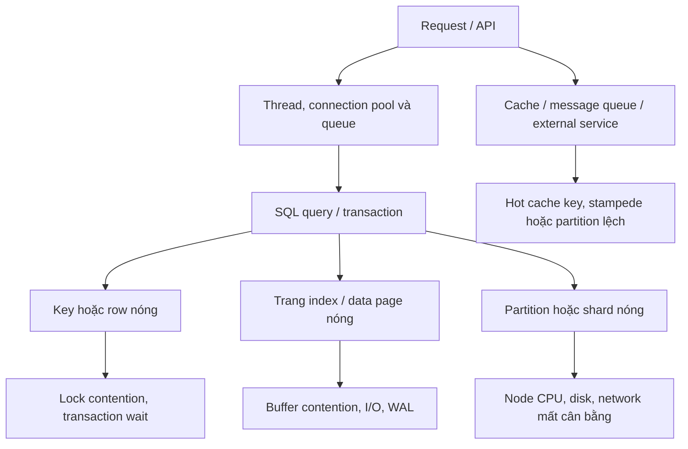
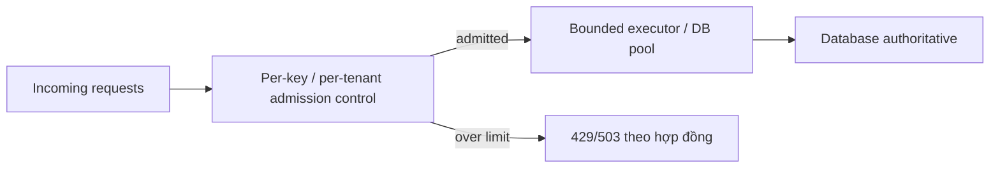

# Phân bố dữ liệu và điểm nóng truy cập

Trong chương **Hiệu năng** của module **DATA_PERSISTENCE_FUNDAMENTALS**, câu hỏi cốt lõi không chỉ là “database có bao nhiêu dòng?” mà còn là **những dòng, khóa, trang chỉ mục và phân vùng nào đang phải phục vụ phần lớn lưu lượng?** Hai hệ thống có cùng số bản ghi, cùng CPU và cùng số kết nối vẫn có thể có độ trễ rất khác nhau nếu một hệ thống chịu tải phân bố tương đối đều, còn hệ thống kia nhận nhiều truy cập tập trung vào một phần dữ liệu nhỏ.

Ví dụ, một website bán hàng có một triệu sản phẩm nhưng phần lớn request trong đợt mở bán chỉ đọc hoặc cập nhật tồn kho của **một sản phẩm duy nhất**. Thêm chỉ mục, tăng số thread hoặc chia bảng thành 32 partition chưa chắc giải quyết được tắc nghẽn. Thậm chí, nếu nhiều giao dịch đều `UPDATE` cùng một hàng tồn kho, database phải phối hợp chúng để bảo đảm **không bán vượt số lượng còn lại**. Đây là một điểm nóng cần phân tích cả **hiệu năng và tính đúng đắn**.

Bài học này giúp người phát triển Java nhận diện phân bố dữ liệu lệch (*data skew*), điểm nóng truy cập (*hotspots*), đo tải theo khóa/tenant/shard, đọc chỉ số PostgreSQL, và chọn giải pháp từ chỉ mục, thay đổi truy vấn, phân vùng, caching tới điều tiết tải. Mục tiêu là **giảm tranh chấp ở đúng tầng đang nghẽn** mà không đánh đổi lén lút những bảo đảm về transaction, isolation, bảo mật hoặc durability.

## 1. Phân biệt phân bố dữ liệu với phân bố lưu lượng

Một bảng `orders` có thể chứa 100 triệu bản ghi tương đối đều giữa các tháng, nhưng 95% truy vấn chỉ hỏi các đơn hàng tạo trong hôm nay. Ngược lại, nhiều tenant có thể có số dòng khác nhau rất nhiều nhưng mỗi tenant hiếm khi được truy cập. Vì vậy cần ít nhất ba góc nhìn:

| Góc nhìn | Câu hỏi | Ví dụ |
| --- | --- | --- |
| **Phân bố dữ liệu** (*data distribution*) | Các giá trị, kích thước hàng và dữ liệu vật lý nằm ở đâu? | 70% dòng thuộc một tenant, một partition lớn bất thường |
| **Phân bố truy cập** (*access distribution*) | Request đang đọc/ghi khóa nào, bao nhiêu lần và trong khoảng nào? | 90% yêu cầu đọc cùng `product_id`, dù nó chỉ có một hàng |
| **Phân bố chi phí** (*cost distribution*) | Thao tác nào chiếm CPU, I/O, khóa, memory, network và connection? | Một query hiếm nhưng quét hàng triệu dòng chiếm đa số I/O |

**Nhiều dữ liệu không nhất thiết là điểm nóng; ít dữ liệu cũng có thể rất nóng.** Một hàng `global_counter` dài vài chục byte có thể gây tranh chấp lớn hơn một bảng sự kiện hàng terabyte chỉ được ghi/đọc tuần tự theo các khóa phân tán.

### 1.1. Các dạng lệch thường gặp

- **Lệch tần suất giá trị:** trạng thái `ACTIVE` chiếm phần lớn bảng, trong khi `CANCELLED` rất hiếm.
- **Lệch theo tenant:** một khách hàng doanh nghiệp tạo nhiều giao dịch hơn phần lớn tenant còn lại.
- **Lệch theo thời gian:** toàn bộ ghi mới đi vào partition hiện tại, hoặc tăng đột biến theo giờ.
- **Lệch theo khóa phổ biến:** một ID sản phẩm, bài viết, tài khoản hoặc user profile được đọc liên tục.
- **Lệch theo thao tác:** cùng một khóa có thể đọc hàng nghìn lần nhưng hiếm ghi; một khóa khác ít đọc mà cập nhật liên tục.
- **Lệch theo chi phí:** mỗi truy vấn có thể rất khác nhau về số hàng quét, số page chạm, số round-trip và thời gian giữ khóa.
- **Lệch theo địa lý:** một region, một zone hoặc một node nhận phần lớn truy cập.

Phân loại như vậy giúp tránh giải pháp sai: **thêm read replica** có thể cải thiện điểm nóng đọc khi chấp nhận replica lag, nhưng không loại bỏ tranh chấp cập nhật trên một hàng authoritative.

## 2. Nhận diện hotspot ở những cấp độ khác nhau

Một điểm nóng có thể nằm ở nhiều tầng, kể cả khi người dùng chỉ thấy “API chậm”.



| Điểm nóng | Triệu chứng gợi ý | Cơ chế có thể gây ra |
| --- | --- | --- |
| **Một hàng dữ liệu** | Nhiều transaction chờ, TPS không tăng dù tăng thread | Row-level locking, update conflict, ghi nối tiếp để bảo vệ invariant |
| **Một khóa ứng dụng** | Lượng request theo key rất lớn, cache hit vẫn chậm | Hot key, single-key serialization, cùng đường gọi backend |
| **Một index leaf/page** | CPU/đợi tài nguyên nội bộ cao khi ghi hàng loạt | Nhiều insert/update chạm vùng page hoặc index gần nhau |
| **Một phân vùng** | Một partition lớn hoặc bận hơn phần còn lại | Partition key lựa chọn không cân bằng, ghi dồn partition mới nhất |
| **Một shard/node** | Một node quá tải, node khác nhàn | Hash bị skew theo access, tenant rất lớn, routing lệch |
| **Một connection pool** | Pending threads tăng, acquisition timeout | Query/transaction giữ connection lâu, pool không đủ hoặc DB quá tải |
| **Một cache key** | Cache node CPU/network cao; khi hết TTL DB đột ngột quá tải | Hot key, cache stampede, invalidation hàng loạt |
| **Một queue partition** | Lag chỉ tăng ở một partition dù consumer khác rảnh | Partition key quá tập trung, xử lý tuần tự một khóa |

Không nên gắn nhãn “hotspot DB” chỉ vì API p99 tăng. Cần xác định **tài nguyên nào bão hòa trước**. Có thể DB vẫn còn CPU nhưng request bị chặn vì connection pool cạn; có thể pool còn rảnh nhưng giao dịch xếp hàng chờ khóa một hàng.

### 2.1. Điểm nóng đọc và điểm nóng ghi khác nhau

Với một khóa được đọc liên tục nhưng ít thay đổi, cache hoặc read replica có thể hấp thụ phần lớn request. Với một khóa ghi liên tục, database phải kiểm soát thứ tự thay đổi và tính nguyên tử; cache không thể thay thế transaction chỉ bằng cách giảm số round-trip.

Ví dụ:

```text
GET /products/101                → đọc nhiều, ít ghi
POST /products/101/reserve       → nhiều ghi cạnh tranh cùng tồn kho
```

Hai endpoint truy cập cùng ID nhưng không nên dùng cùng một giải pháp tối ưu. Endpoint GET có thể chấp nhận dữ liệu tồn kho hơi trễ để hiển thị; endpoint reserve cần thực hiện **thao tác có điều kiện trên nguồn dữ liệu authoritative** để không bán vượt số lượng.

## 3. Mô hình hóa mức độ lệch phân bố

Một mô hình đơn giản giả định request được phân đều trên \(K\) khóa:

\[
P(X = k) = \frac{1}{K}.
\]

Khi đó, với \(Q\) request trong một cửa sổ đo, mỗi khóa có khoảng \(Q/K\) request trung bình. Nhưng nhiều hệ thống thật có **phân bố đuôi dài**: một số ít khóa được truy cập thường xuyên, phần lớn khóa hiếm khi được chạm.

Một mô hình tham khảo là **phân bố Zipf**:

\[
P(X = k) = \frac{k^{-s}}{\sum_{i=1}^{K} i^{-s}}, \qquad s > 0,
\]

trong đó \(k\) là **thứ hạng mức độ phổ biến** (1 là phổ biến nhất), không phải giá trị ID thực. Khi \(s\) tăng, tần suất có xu hướng tập trung mạnh hơn vào các khóa ở đầu bảng xếp hạng.

Mô hình Zipf hữu ích khi tạo workload benchmark, **không được mặc định rằng mọi dữ liệu production tuân theo Zipf**. Hãy đo phân bố thật, tính cả các đợt flash sale hoặc traffic burst vốn có thể khác xa phân bố trung bình cả ngày.

### 3.1. Ví dụ số học

Giả sử trong một cửa sổ có 100.000 lượt đọc trên 1.000 sản phẩm:

| Mẫu | Sản phẩm nóng nhất | Các sản phẩm còn lại |
| --- | ---: | --- |
| Phân bố gần đều | Khoảng 100 lượt | Chia gần đều |
| Phân bố lệch | 40.000 lượt | 60.000 lượt chia cho 999 sản phẩm |

Trong mẫu lệch, **40% traffic dồn vào đúng một khóa**, mặc dù khóa này chỉ chiếm 0,1% số lượng sản phẩm. Hash ID của sản phẩm vào 16 shard vẫn đưa **toàn bộ 40.000 lượt** tới một shard, trừ khi hệ thống chủ động tạo cơ chế phân tách hoặc caching riêng.

### 3.2. Không chỉ đo trung bình

Cần xét ít nhất:

- **Top-k share:** tỉ lệ request thuộc top 1, top 10, top 100 khóa/tenant.
- **Max-to-mean:** tải shard bận nhất so với tải trung bình các shard trong cùng cửa sổ.
- **p95/p99 latency theo nhóm khóa hoặc tenant:** p99 tổng thể có thể che giấu một khách hàng lớn đang bị nghẽn.
- **Concurrency per key:** bao nhiêu transaction cùng cố sửa một khóa tại cùng thời điểm.
- **Hot key lifespan:** điểm nóng kéo dài nhiều giờ hay chỉ vài giây.
- **Work per request:** số trang quét, số hàng cập nhật, độ dài transaction, số SQL cho một request.

Một phép đo duy nhất tại “giờ trung bình” dễ bỏ sót đặc điểm nguy hiểm nhất của hệ thống. Độ phân giải thời gian của thống kê cần đủ nhỏ để nhìn thấy các **burst** mà hệ thống đang gặp.

## 4. Đọc thống kê PostgreSQL để phát hiện phân bố lệch

PostgreSQL thu thập thống kê về **giá trị dữ liệu**, **truy vấn**, **I/O** và **tiến trình**. Các nguồn này phục vụ những câu hỏi khác nhau và không có một bảng hệ thống nào tự trả lời đầy đủ “khóa nào nóng nhất trong 5 giây vừa rồi?”.

### 4.1. `pg_stats`: giá trị dữ liệu nào phổ biến?

Sau khi cơ chế `ANALYZE` thu thập thống kê trên bảng, view `pg_stats` cho biết các thông tin như `null_frac`, `n_distinct`, `most_common_vals`, `most_common_freqs` và histogram của những cột thích hợp:

```sql
SELECT attname,
       null_frac,
       n_distinct,
       most_common_vals,
       most_common_freqs
FROM pg_stats
WHERE schemaname = 'public'
  AND tablename = 'orders'
  AND attname IN ('tenant_id', 'status');
```

Ví dụ nếu `most_common_vals` cho `status` có giá trị `PENDING` với tần suất rất cao, optimizer có thể biết phân bố không đều. Nhưng phải hiểu các giới hạn:

- **Thống kê là ước lượng dựa trên mẫu** tại thời điểm thu thập, không phải phép đếm toàn bảng luôn cập nhật.
- Cột `n_distinct` có cách diễn giải giá trị âm như tỷ lệ ước lượng trên tổng số hàng; không nên đọc nó như số lượng âm theo nghĩa thông thường.
- Các giá trị phổ biến **trong dữ liệu** không nhất thiết là những giá trị **được truy cập nhiều nhất**.
- `most_common_vals` có thể chứa giá trị nhạy cảm; chỉ xem qua kết nối có quyền và môi trường phù hợp.
- Các thống kê của từng cột có thể không biểu đạt tương quan giữa nhiều cột, ví dụ `tenant_id` và `status`.

Khi nhiều cột có tương quan quan trọng, PostgreSQL hỗ trợ **extended statistics** cho một số loại thống kê đa cột, chẳng hạn dependencies/ndistinct/MCV. Cần chọn loại phù hợp với query shape và xác minh bằng execution plan; không tự tạo mọi thống kê vì chúng cũng có chi phí thu thập và lưu trữ.

### 4.2. `pg_stat_statements`: query shape nào tốn nhiều tài nguyên?

Khi extension `pg_stat_statements` đã được cài đặt/cấu hình và người đọc có quyền phù hợp:

```sql
SELECT queryid,
       calls,
       round(total_exec_time::numeric, 1) AS total_ms,
       round(mean_exec_time::numeric, 2) AS mean_ms,
       rows,
       shared_blks_hit,
       shared_blks_read
FROM pg_stat_statements
ORDER BY total_exec_time DESC
LIMIT 15;
```

Các trường trên áp dụng cho những phiên bản PostgreSQL có schema tương ứng; cần kiểm tra phiên bản extension và quyền truy cập. Extension có thể cần cấu hình như `shared_preload_libraries` và khởi động lại server trước khi thống kê hoạt động đúng.

**Điểm cần tránh hiểu lầm:** `pg_stat_statements` chủ yếu gom theo dạng câu SQL đã chuẩn hóa và ngữ cảnh thống kê, không tự chia số lần theo `product_id=101` với `product_id=102`. Một query `UPDATE inventory SET ... WHERE product_id = $1` có thể được ghi nhận chung, khiến **một hot key** ẩn sau tổng số lượt gọi. Muốn biết tải theo giá trị tham số, nên dùng **instrumentation ở ứng dụng hoặc tracing đã lọc**, không bật log toàn bộ bind parameter trong production.

### 4.3. Phân biệt query chậm vì kế hoạch thực thi hay vì khóa

Ví dụ phân tích câu đọc với dữ liệu/ID thử nghiệm:

```sql
EXPLAIN (ANALYZE, BUFFERS)
SELECT id, status, created_at
FROM orders
WHERE tenant_id = 42
  AND status = 'PENDING'
ORDER BY created_at DESC, id DESC
LIMIT 50;
```

`EXPLAIN (ANALYZE)` **thực thi câu SQL thực tế**; với `UPDATE`, `DELETE` hoặc `INSERT`, nó có thể làm thay đổi dữ liệu, nên không tự chạy các câu đó trên production. Có thể dùng transaction và `ROLLBACK` để khảo sát một số DML trong môi trường kiểm soát, nhưng `ROLLBACK` không hoàn tác mọi side effect bên ngoài hoặc tác động của sequence. Thực nghiệm được ưu tiên ở môi trường test với dữ liệu đại diện.

Khi xem execution plan, cần chú ý:

- `actual rows` so với `rows` ước lượng: chênh lệch lớn gợi ý thống kê chưa mô tả đúng phân bố hoặc correlation.
- `loops`: một nhánh chạy rất nhiều lần có thể tạo chi phí lớn dù mỗi lần rẻ.
- `Buffers`: phân biệt page được đọc từ shared buffers và page cần đọc thêm từ tầng lưu trữ; đo nhiều lần để giảm hiệu ứng warm-up.
- `Sort`, `Hash`, `Nested Loop`, `Seq Scan`, `Index Scan` cùng số hàng được xử lý; không kết luận `Seq Scan` luôn sai.
- `Planning Time` và `Execution Time` là các thành phần khác nhau; thời gian chờ lấy connection ở Java nằm **ngoài** phần này.

Một câu SQL nhanh khi chạy độc lập vẫn có thể gây độ trễ lớn khi nhiều transaction cùng cập nhật một hàng và phải đợi **row lock**. Do đó cần kết hợp execution plan với thông tin **wait** và **transaction duration**.

### 4.4. Nhận diện lock wait qua `pg_stat_activity`

Ví dụ quan sát các backend đang chờ lock:

```sql
SELECT pid,
       wait_event_type,
       wait_event,
       now() - query_start AS elapsed,
       pg_blocking_pids(pid) AS blocking_pids
FROM pg_stat_activity
WHERE datname = current_database()
  AND wait_event_type = 'Lock'
ORDER BY elapsed DESC;
```

`pg_blocking_pids` cho biết các tiến trình có liên quan đến việc chặn theo cơ chế lock manager, không tự nói **khóa nghiệp vụ** nào gây ra mọi độ trễ. Có nhiều loại chờ khác như `LWLock`, I/O hoặc client/network wait; không nên chỉ lọc `Lock` rồi kết luận DB không có tranh chấp nếu kết quả rỗng.

Có thể dùng thêm `pg_locks`, `pg_stat_user_tables`, các thống kê I/O tương ứng phiên bản PostgreSQL và metric connection pool. Đọc `query` thô trong `pg_stat_activity` hoặc log bind parameters có thể làm lộ dữ liệu nhạy cảm; cần quyền quan sát tối thiểu và chính sách xử lý thông tin.

### 4.5. Bảng triệu chứng và phép đo

| Hiện tượng | Kiểm tra ưu tiên | Điều chưa được chứng minh |
| --- | --- | --- |
| Một tenant rất lớn | `pg_stats`, thống kê số hàng theo tenant được phép | Tenant đó cũng tạo nhiều QPS nhất |
| Một query tốn phần lớn CPU | `pg_stat_statements` + `EXPLAIN` | Mọi lần gọi query đều chậm vì cùng nguyên nhân |
| Request ghi chậm khi tải cao | `pg_stat_activity`, blocking PIDs, transaction duration | Chỉ tăng connection pool sẽ cải thiện |
| Một partition nhiều dữ liệu | Kích thước partition, distribution theo thời gian | Partition lớn nhất chính là node đang nghẽn |
| p99 chậm nhưng median tốt | Tracing từng bước, phân nhóm tenant/key, wait metrics | Chỉ có một SQL statement gây lỗi |
| Sau thêm index ghi chậm | Write latency, index size/page, WAL, vacuum | Index mới chắc chắn là nguyên nhân duy nhất |

## 5. Instrumentation tại Java: đo đúng khóa mà không lộ dữ liệu

Một lớp repository/service thường biết **tên thao tác nghiệp vụ**, **tenant**, **shard** hoặc **nhóm key**. Đây là thông tin database statistics có thể không biểu đạt đầy đủ.

```java
public final class OrderReader {
    private final OrderRepository repository;
    private final Metrics metrics;

    public OrderReader(OrderRepository repository, Metrics metrics) {
        this.repository = repository;
        this.metrics = metrics;
    }

    public OrderView load(long tenantId, long orderId) {
        long started = System.nanoTime();
        try {
            return repository.findVisibleOrder(tenantId, orderId);
        } finally {
            long elapsed = System.nanoTime() - started;
            metrics.recordDuration(
                "load_visible_order",
                elapsed
            );
        }
    }
}
```

`Metrics`, `OrderRepository` và `OrderView` là interface/kiểu minh họa. `System.nanoTime()` thích hợp đo **elapsed time** trong một JVM, không phải timestamp để so giữa nhiều máy. Timer ở ví dụ bao trùm thời gian của phương thức repository, có thể gồm acquisition time của connection, queue và network. Muốn biết nó chậm ở đâu, cần thêm các điểm đo riêng và trace context.

### 5.1. Vì sao không đặt `tenantId` và `orderId` vào mọi metric label?

Metric label có độ phân biệt rất cao làm tăng số time series, tiêu thụ bộ nhớ và có thể làm lộ dữ liệu người dùng. Thay vì tạo hàng triệu series dạng `latency{order_id="..."}`, có thể:

1. Ghi metric aggregate theo **operation**, vùng, shard và nhóm tenant được quản lý chặt.
2. Dùng **sampling hoặc heavy-hitter detector** để xác định top-k key nóng trong một cửa sổ ngắn, giới hạn kích thước bộ nhớ.
3. Truy dấu bằng correlation ID trong hệ thống log/tracing **được cấp quyền**, có lọc hoặc mã hóa trường nhạy cảm.
4. Lưu dashboard theo shard/partition và hạng mức tải, không công khai ID tài khoản/đơn hàng.
5. Tách chỉ số **đọc** và **ghi**, bởi cùng key nóng có biện pháp giảm tải khác nhau.

Khi hệ thống multi-tenant, việc báo “tenant A đang chiếm 70% tài nguyên” có thể là thông tin thương mại nhạy cảm; quyền truy cập vào dashboard và log cũng thuộc phạm vi bảo mật dữ liệu.

### 5.2. Đo ở nhiều tầng để tìm nút nghẽn đầu tiên

```text
HTTP request elapsed
  ├── xác thực/validate
  ├── đợi task executor
  ├── connection acquisition wait
  ├── SQL round-trip
  │     ├── DB lock wait
  │     ├── CPU + logical I/O
  │     └── physical I/O / WAL
  ├── map DTO / serialize
  └── gửi response
```

Không nên cộng các con số được lấy từ những clock hoặc metric có phạm vi khác nhau mà coi chúng là phép phân rã chính xác 100%. Một request có thể thực hiện nhiều truy vấn, song song hoặc có overlap; các số liệu cần được định nghĩa đúng điểm bắt đầu/kết thúc và sampling.

## 6. Điểm nóng hàng dữ liệu: tranh chấp cập nhật và bất biến nghiệp vụ

Hãy xét bảng tồn kho với một hàng cho mỗi cặp `tenant_id, product_id`:

```sql
CREATE TABLE inventory (
    tenant_id   BIGINT NOT NULL,
    product_id  BIGINT NOT NULL,
    available   INTEGER NOT NULL CHECK (available >= 0),
    version     BIGINT NOT NULL DEFAULT 0,
    PRIMARY KEY (tenant_id, product_id)
);
```

Để giữ hàng một cách nguyên tử trên PostgreSQL, service có thể dùng:

```sql
UPDATE inventory
SET available = available - :quantity,
    version = version + 1
WHERE tenant_id = :tenant_id
  AND product_id = :product_id
  AND available >= :quantity
RETURNING available, version;
```

`:` là cú pháp named parameter của một số lớp truy cập dữ liệu Java, **không phải placeholder SQL thuần của JDBC**. JDBC `PreparedStatement` thông thường dùng `?`. Nếu câu lệnh không trả hàng, caller phải xét **hết hàng hay thiếu sản phẩm** theo hợp đồng nghiệp vụ; không được báo đã giữ hàng thành công.

Một điểm nóng khi hàng nghìn request cùng trừ kho một sản phẩm có thể là **điều không thể xóa hoàn toàn bằng tuning index**: mọi cập nhật phải phối hợp quanh cùng trạng thái `available`. Việc tăng `maximumPoolSize` lên rất lớn có thể khiến nhiều transaction chỉ **đợi khóa** hơn, làm p99 và contention xấu đi.

### 6.1. Phân biệt mutex ứng dụng và row lock tại DB

Đặt `synchronized` trong một JVM có thể giảm số thread của **instance đó** cùng tranh chấp, nhưng không bảo vệ nhiều instance của service, worker và batch job đang ghi cùng bảng. Khóa đúng ở nguồn dữ liệu giúp giữ invariant trong phạm vi transaction, với điều kiện tất cả đường ghi đều tuân thủ.

Những lựa chọn thực tế:

- **Conditional update:** thực hiện kiểm tra và cập nhật trong một SQL/transaction, xác minh số hàng.
- **Optimistic locking:** đọc `version`, cập nhật có điều kiện theo `version`, và xử lý conflict/retry có giới hạn. Khi nhiều writer cùng một hàng, tỷ lệ conflict có thể cao.
- **Pessimistic locking:** khóa hàng rõ ràng trước các bước phụ thuộc, nếu cần; phải đánh giá lock ordering, deadlock và thời gian giữ khóa.
- **Giới hạn đồng thời theo khóa:** queue/bulkhead tại application để tránh gửi quá nhiều transaction tranh chấp; không thay thế ràng buộc DB.
- **Đổi mô hình nghiệp vụ:** phân bổ quota/escrow theo các nhóm trước, hoặc xử lý tuần tự qua một actor/worker có owner rõ ràng, khi hợp đồng cho phép.

**Đừng “shard” một hàng số dư hoặc tồn kho thành nhiều hàng độc lập mà không định nghĩa lại tính đúng đắn.** Nếu invariant là tổng số lượng không được âm, việc mỗi shard quyết định dựa trên một phần dữ liệu có thể dẫn tới cấp phát sai khi các shard không phối hợp. Một thiết kế quota được phân trước cho từng vùng có thể giảm tranh chấp, nhưng cần quy tắc cấp phát, chuyển quota, thu hồi và đối chiếu chặt chẽ.

### 6.2. Transaction càng dài, điểm nóng càng tệ

Một pattern có hại:

```text
BEGIN
UPDATE inventory WHERE product_id=101
→ giữ lock
→ gọi API thanh toán qua mạng 2 giây
COMMIT
```

Những transaction khác cùng sản phẩm phải đợi trong khi transaction đầu đang chờ API ngoài. Hãy rút ngắn ranh giới transaction, đưa external side effects vào workflow/outbox phù hợp, và đo **lock wait** chứ không chỉ thời gian của riêng lệnh `UPDATE`.

## 7. Điểm nóng chỉ mục và trang dữ liệu

Không phải mọi bottleneck ghi đều do một **row lock**. Một số workload có nhiều hàng khác nhau nhưng các thao tác vẫn đụng cùng vùng dữ liệu vật lý hoặc cùng cấu trúc index.

### 7.1. Insert khóa tăng dần

Ví dụ bảng event dùng ID tăng liên tục:

```sql
CREATE TABLE events (
    id BIGINT GENERATED ALWAYS AS IDENTITY PRIMARY KEY,
    tenant_id BIGINT NOT NULL,
    occurred_at TIMESTAMPTZ NOT NULL,
    payload JSONB NOT NULL
);
```

Các insert mới theo ID tăng thường đi tới **phía phải của B-tree index**. Đây có thể là một điểm tập trung thao tác trên các trang index cuối, đặc biệt ở mức ghi đồng thời rất cao. Tuy nhiên cần tránh kết luận rằng khóa tuần tự luôn chậm:

- Khóa tăng thường có **tính cục bộ** tốt hơn, ít gây truy cập ngẫu nhiên trong B-tree so với một số kiểu ID phân tán.
- Sequence được PostgreSQL tối ưu cho việc sinh giá trị và không phải một row counter transaction thông thường; `nextval` **không bị rollback** như UPDATE một hàng.
- Độ nghẽn còn phụ thuộc tốc độ insert, số index, đặc tính page/latch, bloat, WAL, cấu hình lưu trữ và phiên bản DB.
- Thay khóa tuần tự bằng UUID ngẫu nhiên có thể phân tán vị trí insert nhưng cũng tăng kích thước index, page split và I/O ngẫu nhiên. UUID có tính thứ tự theo thời gian có đánh đổi khác.

**Phải có bằng chứng từ profiling trước khi đổi chiến lược ID.** Đừng dùng UUID v4/v7 hay một kỹ thuật “randomize key” chỉ vì lý thuyết có rightmost page contention; trong nhiều workload, khóa tăng và index nhỏ lại là lựa chọn tốt.

### 7.2. Bảng có nhiều index

Mỗi insert, delete hoặc update liên quan cột được index có thể phải duy trì các cấu trúc index tương ứng. Một hệ thống đọc nhanh nhờ rất nhiều index có thể ghi chậm và làm tăng WAL/dung lượng.

```sql
-- Ví dụ index cho truy vấn tenant, trạng thái, mới nhất.
CREATE INDEX orders_tenant_status_recent_idx
ON orders (tenant_id, status, created_at DESC, id DESC);
```

Index trên có thể hữu ích cho truy vấn:

```sql
SELECT id, status, created_at
FROM orders
WHERE tenant_id = :tenant_id
  AND status = 'PENDING'
ORDER BY created_at DESC, id DESC
LIMIT 50;
```

Nhưng có phù hợp hay không phải được xác nhận bằng `EXPLAIN`, thống kê selectivity và kích thước/khối lượng cập nhật thật. Nếu cột `status` thay đổi rất thường xuyên, index chứa `status` có thể làm tăng chi phí update và hạn chế cơ hội **HOT update** của PostgreSQL (*Heap-Only Tuple*, **khác nghĩa với hot key**), vốn phụ thuộc việc những cột được index có thay đổi hay không cùng điều kiện về trang dữ liệu. Tạo index mới **không miễn phí cho đường ghi**.

### 7.3. Ghi theo thời gian vào partition mới nhất

Một bảng sự kiện được range partition theo tháng có thể dồn **toàn bộ insert hôm nay** vào partition tháng hiện tại. Partition của tháng cũ giúp quản lý retention và pruning, nhưng **không tự phân tán write load của hiện tại**.

Nếu partition hiện tại là bottleneck, cần cân nhắc workload đọc, khóa partition, index và I/O, thay vì chỉ tăng số partition quá khứ. Có thể sử dụng hash subpartition hoặc đưa dữ liệu sang nhiều shard vật lý khi cần, nhưng mỗi tầng bổ sung làm tăng số object, độ phức tạp quản trị và số lượng partition/index mà planner phải xử lý.

### 7.4. Dữ liệu nóng không nhất thiết phải nằm trong RAM

Một phần dữ liệu nhỏ được truy cập liên tục có thể nằm trong shared buffers và đạt tỷ lệ cache hit cao, nhưng hệ thống vẫn chậm do **khóa/latch, WAL, CPU hoặc serialization**. Ngược lại, một vùng dữ liệu lớn hơn bộ nhớ và truy cập ngẫu nhiên có thể tạo I/O vật lý đáng kể dù không có hàng nào bị cập nhật cùng lúc.

Không kết luận “cache hit cao = không còn bottleneck”, cũng không kết luận “I/O cao = chỉ cần nhiều RAM”. Cần xem **loại truy cập**, chi phí từng truy vấn và bộ phận đang đợi.

## 8. Chọn partition key và shard key

**Partitioning** tổ chức dữ liệu thành các phần theo quy tắc được định nghĩa. **Sharding** thường chỉ việc đặt các phần dữ liệu trên **nhiều đơn vị lưu trữ/nút** có thể mở rộng tài nguyên độc lập. Một bảng partition trong một PostgreSQL instance **không tự biến thành nhiều máy chủ**; nó vẫn dùng CPU, I/O, WAL và connection của instance đó.

Một khóa phân chia tốt cần xét cả:

1. **Tính cân bằng dữ liệu:** số hàng/kích thước mỗi phần.
2. **Tính cân bằng truy cập:** QPS, TPS, byte/s và CPU mỗi phần, đặc biệt ở p99.
3. **Cách truy vấn:** có lọc theo khóa partition/shard để tránh quét nhiều phần không?
4. **Tính cục bộ transaction/join:** hai dòng cần cập nhật nguyên tử có nằm cùng shard không?
5. **Tăng trưởng và di chuyển dữ liệu:** có tái cân bằng khi thêm node hoặc tenant lớn không?
6. **Tenant isolation/bảo mật:** có chặn được truy vấn chéo tenant và giới hạn noisy neighbor không?

### 8.1. Chia theo thời gian

Thích hợp khi truy vấn và retention theo thời gian:

```sql
CREATE TABLE audit_events (
    event_id BIGINT NOT NULL,
    occurred_at TIMESTAMPTZ NOT NULL,
    tenant_id BIGINT NOT NULL,
    body JSONB NOT NULL,
    PRIMARY KEY (event_id, occurred_at)
) PARTITION BY RANGE (occurred_at);

CREATE TABLE audit_events_2026_11
    PARTITION OF audit_events
    FOR VALUES FROM ('2026-11-01 00:00:00+00')
             TO ('2026-12-01 00:00:00+00');
```

Trong PostgreSQL, unique/primary key của một partitioned table phải tuân theo các yêu cầu về cột partition key; ví dụ đã bao gồm `occurred_at`. Đây là thiết kế minh họa, cần chuẩn bị partition cho các kỳ tiếp theo và chính sách xử lý dữ liệu ngoài phạm vi partition. Nếu query có predicate thời gian phù hợp, planner có thể **partition prune** các phần không cần đọc; vẫn phải kiểm chứng execution plan.

**Điểm nóng tiềm ẩn:** toàn bộ event hiện tại ghi vào partition tháng 11. Muốn chia tải ghi sang nhiều node phải thiết kế thêm physical distribution, không chỉ tách từng tháng.

### 8.2. Hash partition theo tenant

```sql
CREATE TABLE tenant_events (
    tenant_id BIGINT NOT NULL,
    event_id BIGINT NOT NULL,
    body JSONB NOT NULL,
    PRIMARY KEY (tenant_id, event_id)
) PARTITION BY HASH (tenant_id);

CREATE TABLE tenant_events_p0 PARTITION OF tenant_events
    FOR VALUES WITH (MODULUS 4, REMAINDER 0);
CREATE TABLE tenant_events_p1 PARTITION OF tenant_events
    FOR VALUES WITH (MODULUS 4, REMAINDER 1);
CREATE TABLE tenant_events_p2 PARTITION OF tenant_events
    FOR VALUES WITH (MODULUS 4, REMAINDER 2);
CREATE TABLE tenant_events_p3 PARTITION OF tenant_events
    FOR VALUES WITH (MODULUS 4, REMAINDER 3);
```

Hash partition có thể giúp phân bố **nhiều tenant tương đối độc lập** trên các partition theo giá trị hash. Nhưng **mọi hàng của một tenant nhất định** thường vẫn vào cùng một partition khi hash theo tenant ID. Nếu một tenant tạo 80% lượt ghi, partition chứa tenant đó vẫn quá tải.

Tương tự ở hệ thống sharding phân tán: hash shard key ngẫu nhiên hóa vị trí của **nhiều key khác nhau**, không chia đôi tải từ **một key duy nhất**. Cần xét tenant lớn (*whale tenant*) riêng bằng isolation, split tenant theo nhóm khóa con hoặc một mô hình có thể điều phối transaction và query tương ứng.

## 9. Sharding nâng cao: virtual buckets, salting và tái cân bằng

Khi dữ liệu thực sự nằm trên nhiều máy chủ, lựa chọn **shard key** ảnh hưởng trực tiếp đến cân bằng tải, số nút truy vấn mỗi request và khả năng giữ transaction cục bộ. Một hash function “phân bố đều” **chỉ có nghĩa khi đầu vào đủ đa dạng** và lưu lượng mỗi khóa không tập trung cực đoan.

### 9.1. Logical bucket và physical shard

Một chiến lược là phân ánh xạ từ **logical bucket** sang **physical shard**, thay vì gắn khóa trực tiếp vào máy vật lý:

```text
entity key → hash → bucket (0..255)
                          |
                  routing configuration
                          |
                 physical shard/node

buckets 0..63    → shard A
buckets 64..127  → shard B
buckets 128..191 → shard C
buckets 192..255 → shard D
```

Khi cần thêm máy, hệ thống có thể di chuyển một số bucket và cập nhật routing theo quy trình có kiểm soát. Consistent hashing và virtual nodes là những kỹ thuật liên quan, nhưng **chi tiết thuật toán/routing khác nhau giữa sản phẩm**.

Chúng giúp giải quyết **mất cân bằng giữa nhiều bucket**; không làm một *single hot key* tự chia thành hàng trăm đơn vị ghi độc lập. Nếu khóa nóng chiếm 40% traffic, bucket chứa khóa vẫn có thể chiếm gần 40% traffic bất kể có thêm bao nhiêu node.

### 9.2. Salt hoặc stripe để phân tán tải

Một cách chủ động chia một nhóm truy cập lớn là thêm một thành phần **bucket/stripe** vào khóa:

```text
Không chia:
    event_key = tenant_id

Có chia:
    event_key = (tenant_id, stripe)
    stripe = stable_hash(event_id) mod 16
```

Khi mỗi event có ID đủ phân tán, các event của một tenant rất nóng có thể được trải trên 16 nhóm. Tuy nhiên hệ thống phải chấp nhận và xử lý:

- **Đọc dữ liệu tenant** có thể phải truy vấn nhiều stripe rồi hợp nhất (*fan-out/fan-in*).
- **Thứ tự toàn tenant** không còn tự có nếu dữ liệu ở nhiều stripe.
- **Unique constraint** như `(tenant_id, external_reference)` có thể cần cơ chế kiểm tra toàn cục khác, bởi unique tại từng stripe không chặn trùng giữa stripe.
- **Transaction nhiều stripe** có thể đắt hoặc không được database hỗ trợ nguyên tử.
- **Reshard** từ 16 lên 32 stripe cần chiến lược chuyển dữ liệu/routing và đọc hai thế hệ key trong giai đoạn chuyển đổi.
- Chọn stripe ngẫu nhiên ở mỗi lần retry có thể ghi cùng một event lên hai stripe; phải cố định theo operation ID hoặc dùng idempotency bền vững.

**Salt không miễn phí:** nó chuyển một phần chi phí từ ghi sang **đọc, tổng hợp, vận hành và nhất quán**. Chỉ dùng khi đã chứng minh bottleneck nằm ở một nhóm khóa có thể chia tách về mặt ngữ nghĩa.

### 9.3. Split tenant lớn có cần thiết?

Thay vì cố buộc mọi tenant vào cùng cách phân vùng, hệ thống multi-tenant đôi khi đặt **tenant rất lớn vào shard riêng** hoặc tách workload của nó theo đối tượng con. Điều này có thể giảm ảnh hưởng của một tenant lên các tenant khác (*noisy neighbor*), nhưng cần thiết kế cách di chuyển không làm mất hoặc nhân đôi dữ liệu:

1. Chọn khóa và phạm vi di chuyển.
2. Copy dữ liệu với snapshot/checkpoint đáng tin.
3. Đồng bộ các ghi phát sinh trong thời gian copy bằng change log/CDC hoặc dual-write được quản lý chặt.
4. Kiểm tra checksum, số bản ghi và các bất biến nghiệp vụ.
5. Chuyển routing bằng phiên bản cấu hình/fencing, tránh hai shard cùng nhận ghi không phối hợp.
6. Giữ đường rollback/đối soát trong thời gian xác nhận.

Không nên chỉ thay `tenant_id -> newShard` trong một config rồi coi chuyển shard hoàn tất. Khi routing sai hoặc client giữ config cũ, cùng tenant có thể bị đọc/ghi ở hai nơi.

### 9.4. Hotspot do thứ tự khóa

Nếu các shard được chọn theo **range** của ID tăng dần hoặc timestamp, các bản ghi mới thường đi vào một shard ở cuối dải. Hash ID có thể phân tán ghi tốt hơn nhưng làm một truy vấn range theo thời gian tốn nhiều shard. Một thiết kế kết hợp bucket theo hash và partition theo thời gian có thể phù hợp, nhưng cần cân bằng số lượng partition, chi phí query và retention.

## 10. Giảm điểm nóng ghi mà không làm sai phép tính

Một giải pháp hiệu quả trong những tình huống thích hợp là thay đổi **đơn vị ghi** thay vì chỉ thêm replica hoặc index.

### 10.1. Bộ đếm phân dải (*striped/sharded counter*)

Thay một hàng:

```sql
UPDATE global_counters SET value = value + 1 WHERE name = 'page_views';
```

bằng nhiều hàng counter được chọn theo bucket:

```sql
CREATE TABLE counter_stripes (
    metric_name TEXT NOT NULL,
    stripe_id INTEGER NOT NULL,
    value BIGINT NOT NULL DEFAULT 0,
    PRIMARY KEY (metric_name, stripe_id)
);

-- Bảng được nạp sẵn các stripe hợp lệ.
UPDATE counter_stripes
SET value = value + 1
WHERE metric_name = :metric_name
  AND stripe_id = :stripe_id;
```

Ứng dụng chọn `stripe_id` theo event/request ID ổn định hoặc thuật toán phân bổ tải có kiểm soát, ví dụ:

```java
int stripeFor(UUID eventId, int stripeCount) {
    if (stripeCount <= 0) {
        throw new IllegalArgumentException("stripeCount");
    }
    return Math.floorMod(eventId.hashCode(), stripeCount);
}
```

Để đọc tổng:

```sql
SELECT COALESCE(SUM(value), 0) AS total
FROM counter_stripes
WHERE metric_name = :metric_name;
```

Thay vì tất cả update chờ **một row lock**, chúng có thể phân tán qua nhiều row lock. Nhưng đọc tổng cần gom nhiều hàng; với nhiều shard vật lý, tổng có thể không đến từ cùng một snapshot toàn cục nếu backend không hỗ trợ. **Không dùng sharded counter kiểu eventual để thay thế số dư tài khoản hoặc tồn kho cần kiểm soát nguyên tử**, trừ khi đã thiết kế quota/escrow hay transaction phù hợp.

Ngoài ra, câu `UPDATE value = value + 1` **không idempotent**: nếu client timeout sau commit rồi retry, có thể cộng hai lần. Chọn stripe ổn định là cần thiết để không di chuyển giữa các shard, nhưng **chưa đủ để ngăn cộng trùng**; còn cần event ID/dedup được ghi nguyên tử trong phạm vi hệ thống hỗ trợ.

### 10.2. Gom ghi (*batching*) đúng bối cảnh

Nếu nhiều event độc lập có thể được gom thành một lần ghi:

- Giảm số round-trip giữa Java và DB.
- Giảm overhead chuẩn bị statement và commit cho từng event.
- Có thể cải thiện thông lượng với batch insert hoặc cơ chế bulk load phù hợp.

Nhưng:

- Batch quá lớn có thể giữ transaction và lock lâu, tạo WAL spike và tăng latency p99.
- Batch không tự giúp nhiều lần `UPDATE` cùng một hàng; vẫn cần kiểm soát contention và thứ tự.
- Khi batch chứa cả event tốt và xấu, phải định nghĩa kết quả từng phần và retry mà không ghi trùng.
- `executeBatch()` trên JDBC có thể có hành vi báo `BatchUpdateException` và update counts tùy driver/chế độ; phải thiết kế transaction và error handling rõ.

Ví dụ:

```java
try (Connection c = dataSource.getConnection()) {
    c.setAutoCommit(false);
    try (PreparedStatement ps = c.prepareStatement(
            "INSERT INTO event_log(event_id, tenant_id, body) VALUES (?, ?, ?)")) {
        for (Event event : events) {
            ps.setObject(1, event.id());
            ps.setLong(2, event.tenantId());
            ps.setString(3, event.jsonBody());
            ps.addBatch();
        }
        ps.executeBatch();
        c.commit();
    } catch (SQLException | RuntimeException failure) {
        try {
            c.rollback();
        } catch (SQLException rollbackFailure) {
            failure.addSuppressed(rollbackFailure);
        }
        throw failure;
    }
}
```

Đây là code minh họa dùng các kiểu `Event`/`dataSource` do ứng dụng định nghĩa, giả định connection có trạng thái mặc định phù hợp. Trong production, cần xác định giới hạn batch, độ lớn payload, idempotency khi mất ACK ở `commit()`, cách đóng connection và timeout. Nếu framework sở hữu transaction, hãy dùng abstraction phù hợp thay vì tự thay đổi `autoCommit` của connection do framework quản lý.

### 10.3. Queue một khóa nóng theo thứ tự

Nếu tất cả lệnh trên một tài khoản phải có thứ tự rõ ràng, có thể đặt chúng vào một **queue partition** theo account ID để một owner xử lý tuần tự. Cách này giảm đám đông transaction cùng chạy tới DB và có thể tối ưu việc gom ghi.

Nhưng nó chỉ chuyển điểm nghẽn thành **một lane có giới hạn**. Một account nhận nhiều request hơn khả năng xử lý của lane sẽ tích backlog. Queue không tự bảo đảm đúng một lần; cần message ID, xử lý duplicate, ACK đúng thời điểm và trạng thái bền vững. Nếu hệ thống chuyển owner giữa các consumer, cần cơ chế fencing hoặc bảo đảm không có hai owner đồng thời ghi không được điều phối.

### 10.4. Pre-aggregation và read model

Với trang dashboard “số đơn hôm nay”, thay vì mỗi request chạy:

```sql
SELECT COUNT(*) FROM orders
WHERE tenant_id = :tenant_id
  AND created_at >= :day_start
  AND created_at < :next_day;
```

có thể duy trì một bảng tổng hợp theo ngày/tenant hoặc một read model bất đồng bộ. Giảm chi phí đọc phải đánh đổi thêm chi phí ghi/đồng bộ, version và khả năng **stale**. Nếu báo cáo dùng cho kiểm toán, phải phân biệt số liệu tạm thời với số liệu đã đối soát và cho phép rebuild tổng hợp từ dữ liệu gốc.

## 11. Điểm nóng đọc: cache, replica và single-flight

Đọc một sản phẩm cực kỳ phổ biến có thể khiến DB bận, nhưng nhiều request có thể **chia sẻ cùng một snapshot đủ mới** nếu nghiệp vụ cho phép. Caching là một trong những cách giảm tải phổ biến, đặc biệt với dữ liệu đọc nhiều/ghi ít.

### 11.1. Cache-aside và nguy cơ cache stampede

Luồng đọc điển hình:

```text
GET product:101
  → cache HIT: trả snapshot
  → cache MISS: SELECT DB → PUT cache → trả kết quả
```

Với khóa cực nóng, khi cache entry hết hạn, hàng nghìn request có thể cùng **MISS** rồi cùng truy vấn DB. Đây là *cache stampede* hoặc *thundering herd*. Mức cache hit trung bình 99% **không loại trừ** việc DB chịu burst rất lớn trong vài trăm mili giây sau một đợt hết hạn đồng loạt.

Các kỹ thuật:

- **Single-flight/per-key load coordination:** chỉ một loader cho một key trong phạm vi được quản lý, các request khác cùng chờ kết quả.
- **TTL jitter:** thêm dao động cho hạn sử dụng các key để tránh hết hạn hàng loạt.
- **Stale-while-revalidate:** cho phép trả snapshot cũ trong thời gian giới hạn rồi refresh ngầm, **chỉ khi nghiệp vụ cho phép**.
- **Negative caching:** cache “không tồn tại” với TTL/chính sách phù hợp, chú ý dữ liệu mới tạo và security enumeration.
- **Rate limit/bulkhead:** giới hạn số lượt truy cập DB khi cache hỏng.
- **Cache warming:** chuẩn bị dữ liệu cho một số key nóng trước sự kiện lớn, tránh làm ấm ồ ạt gây quá tải.

Single-flight trong một JVM **không tự phối hợp** với các instance khác. Distributed lock có thể giảm stampede toàn cluster nhưng bổ sung lỗi lock expiry, crash và thời gian chờ. Với một số hệ thống, chỉ cần **single-flight cục bộ + DB backpressure + TTL ngắn** đã là lựa chọn đơn giản hơn, sau khi đo bằng tải thật.

### 11.2. Cache giảm QPS, không làm tăng độ mới của dữ liệu

Một cache có thể chứa bản cũ sau khi DB commit. Thao tác `cache.put` trước commit có thể làm người đọc thấy giá trị chưa được xác nhận; `cache.evict` sau commit có thể bị mất nếu app crash; reader cũ có thể `PUT` lại bản stale sau lần invalidate.

Khi cần bảo đảm **read-your-writes** hoặc tránh dữ liệu đi lùi:

- Cân nhắc cache snapshot có **version** được cập nhật cùng dữ liệu DB.
- Sử dụng so sánh/ghi nguyên tử hoặc version barrier để không nạp lại bản cũ.
- Với endpoint rất nhạy cảm, đọc primary/đường authoritative hoặc yêu cầu min-version.
- Nếu invalidation phải được giao bền vững, ghi **outbox event** cùng DB transaction; consumer xử lý idempotent, chấp nhận độ trễ eventual consistency.

**Đừng dùng cache của trạng thái tồn kho để quyết định cho phép trừ kho.** Nó có thể hỗ trợ UI, nhưng chính database authoritative phải bảo vệ invariant ghi bằng conditional update/constraint/transaction.

### 11.3. Read replicas có giúp một hot key không?

Read replicas có thể chia bớt lượt đọc khỏi primary, nhưng có các điều kiện:

- Replica cần đủ khả năng xử lý và chịu được độ trễ replication.
- Route theo khu vực địa lý hoặc người dùng phải cân bằng tải giữa replica, không để mọi request vẫn đổ vào một node.
- Một số request cần read-your-writes hoặc linearizable read có thể **không được gửi tới replica chưa bắt kịp**.
- Mọi ghi vẫn phải qua đường authoritative/consensus theo hợp đồng; thêm read replica không chữa tranh chấp cập nhật cùng một row.
- Thêm replica có thể làm tăng I/O replication, dung lượng và công vận hành; không phải tăng thông lượng vô hạn.

Một read replica có cùng 100 triệu dòng với primary nhưng chỉ có một vài dashboard report quét dữ liệu vẫn có thể quá tải. Cần đo query mix của từng replica, replication lag và ảnh hưởng tới các SLA đọc.

## 12. Noisy neighbor và giới hạn tài nguyên giữa tenant

Trong dịch vụ multi-tenant, một tenant tạo một đợt batch lớn có thể chiếm connection pool, CPU, I/O, lock và cache của tenant khác. Đây là **noisy-neighbor problem**.

Một số biện pháp:

1. **Per-tenant concurrency limit:** giới hạn số transaction đang hoạt động của tenant đó.
2. **Per-tenant rate limit và quota:** bảo vệ hệ thống khỏi một burst vượt khả năng thiết kế, với tín hiệu throttle rõ.
3. **Fair scheduling:** bảo đảm batch của tenant lớn không làm interactive traffic của tenant nhỏ bị đói tài nguyên.
4. **Workload isolation:** tách read/batch workers, pool, queue hoặc shard khi số liệu cho thấy cần thiết.
5. **Query budgets:** timeout, giới hạn số hàng/bytes được trả, tránh truy vấn không phân trang.
6. **Tenant-specific tuning:** tối ưu index hoặc chuyển tenant lớn sang vùng tài nguyên chuyên biệt nếu cost/độ phức tạp hợp lý.

### 12.1. Backpressure không giống lỗi database

Nếu hệ thống đang xử lý tối đa 100 request ghi đồng thời an toàn, request thứ 101 có thể **đợi trong queue có giới hạn** hoặc nhận thông báo quá tải. Việc để 10.000 request nằm trong hàng chờ vô hạn có thể làm tăng latency, giữ bộ nhớ và làm timeout dây chuyền.



Khi trả HTTP `429` hay `503`, cần định nghĩa rõ rate limit hay service overload, có `Retry-After` phù hợp hay không và client có thể retry **an toàn** hay không. Với thao tác ghi đã gửi tới DB nhưng bị timeout gần commit, không được tự tuyên bố “chưa xử lý” chỉ vì một lớp ứng dụng đang quá tải.

### 12.2. Giới hạn theo khóa không thay thế transaction

Nếu chọn chỉ cho **một task per product ID** chạy trong executor của instance A, instance B vẫn có thể xử lý product đó đồng thời. Cơ chế này hữu ích để giảm tải **cục bộ**, nhưng không tự tạo khóa phân tán. Khi có nhiều instance, invariant vẫn phải được bảo vệ ở database hoặc bằng một giao thức ownership/fencing đủ mạnh.

Nếu queue chia partition theo khóa, mỗi khóa có thể được xử lý tuần tự trong một consumer group theo chính sách broker. Tuy nhiên cần kiểm soát **rebalance/failover**, duplicate delivery, xử lý idempotent và nguy cơ một hot key làm nghẽn cả partition queue.

## 13. Liên hệ giữa connection pool và phân bố tải

Pool size là một **giới hạn đồng thời**, không phải bộ tăng tốc kỳ diệu:

```text
Request A..Z → pool có 20 connection → DB
                        |
              nhiều transaction cùng
              UPDATE một hàng tồn kho
```

Nếu 20 transaction cùng cạnh tranh một row lock, tăng pool lên 100 có thể tăng độ dài hàng chờ tại DB. Ngược lại, pool quá nhỏ khiến những truy vấn độc lập phải đợi vô ích. Mục tiêu là tìm **điểm cân bằng** dựa trên tải thật, đặc biệt là phân bố loại truy vấn và thời gian giữ connection.

Theo dạng cơ bản của **định luật Little**, khi hệ thống ổn định:

\[
L \approx \lambda \times W,
\]

trong đó \(L\) là số đơn vị công việc đang tồn tại trung bình, \(\lambda\) là tốc độ hoàn tất và \(W\) là thời gian ở trong hệ thống tương ứng. Nếu đo **thời gian giữ connection**, công thức có thể giúp ước lượng mức mượn đồng thời trung bình; **không phải** công thức trực tiếp để quyết định `maximumPoolSize`, vì còn burst, tail latency, DB limit, lock wait và số instance.

Một ví dụ định lượng **giả định**:

```text
Tốc độ:                  200 thao tác DB/giây
Thời gian giữ connection: 0,050 giây trung bình
Số connection mượn trung bình: ≈ 10
```

Ngay cả khi mức trung bình là 10, một burst của hot tenant vẫn có thể tạo backlog và tăng p99. Cần đo **active/idle/pending connections, acquisition time, transaction duration, DB lock waits** cùng nhau trước khi thay pool size.

### 13.1. Virtual threads không thay đổi giới hạn database

Java virtual threads giúp chạy nhiều tác vụ I/O blocking với chi phí quản lý luồng thường thấp hơn platform threads. Nhưng 10.000 virtual threads đang cố mượn pool 20 connections **không thể có 10.000 giao dịch JDBC đang dùng 10.000 kết nối cùng lúc**.

Thay vì nâng vô hạn số luồng để xử lý hot key, hãy giới hạn concurrency phù hợp, giảm transaction duration và xác định nguồn contention. Virtual threads không biến row lock hoặc disk bandwidth thành tài nguyên vô hạn.

## 14. Quy trình chẩn đoán có hệ thống

Khi latency tăng và nghi có điểm nóng, có thể làm theo trình tự:

1. **Xác định SLO và đơn vị công việc.** Endpoint nào? Đọc hay ghi? p95/p99, error rate và throughput của nhóm tenant/key nào?
2. **Đo phân bố truy cập.** Top-k key/tenant, QPS/TPS theo shard và khoảng thời gian đủ nhỏ để thấy burst.
3. **Tìm tài nguyên bão hòa.** Pool wait, row lock, LWLock, CPU, I/O, WAL, queue, cache node hay network?
4. **Kiểm tra SQL và plan.** `pg_stat_statements`, `EXPLAIN`, thống kê dữ liệu, số hàng được quét, index usage và dữ liệu trả về.
5. **Kiểm tra hình thái partition/sharding.** Có tenant lớn hay shard tải cao bất thường? Partition mới nhất có đang nhận toàn bộ ghi?
6. **Thử tối ưu đơn giản trước.** Bỏ N+1, tránh `SELECT *`, giảm vòng đời transaction, thêm index phù hợp, phân trang, gộp truy vấn và cache dữ liệu đủ an toàn.
7. **Nếu nghẽn vẫn ở một khóa**, cân nhắc per-key admission, quota allocation, striped counter, event queue hoặc thay mô hình ghi theo bất biến.
8. **Nếu nghẽn ở shard/node**, cân nhắc virtual buckets/rebalance, tenant isolation và read replicas khi đúng loại workload.
9. **Kiểm chứng lại với burst, skew và lỗi.** Không chỉ đo throughput trung bình; kiểm tra p99, retries, lock waits, bloat, WAL và kết quả nghiệp vụ.
10. **Chuẩn bị rollback.** Mọi thay đổi index, partition routing, cache policy hoặc shard mapping phải có kế hoạch đảo chiều và giám sát sau triển khai.

### 14.1. Tối ưu query trước hay shard trước?

Thường nên **đo và tối ưu truy vấn trước khi thêm nhiều node**, vì một query quét nhiều dữ liệu trên một node có thể thành **query quét nhiều dữ liệu trên hàng chục node** sau khi shard, đồng thời tăng network/fan-out overhead.

Tuy nhiên, nếu một shard đã đầy dung lượng, đã vượt giới hạn I/O hoặc tenant cần cô lập riêng, việc phân chia vật lý có thể cần thiết song song với tối ưu SQL. Không có quy tắc cứng “luôn phải làm X trước Y”; lựa chọn cần dựa trên nút nghẽn quan sát được.

## 15. Thiết kế thực nghiệm phân bố dữ liệu và điểm nóng

Mục tiêu thực nghiệm không chỉ là “tối ưu được bao nhiêu phần trăm”, mà phải xác minh **nguyên nhân gây nghẽn** và bảo đảm kết quả sau tối ưu vẫn đúng. Nên chạy trên **database test cô lập** có schema, thống kê, cấu hình và lưu lượng gần production ở phạm vi hợp lý; không cố tình bắn hàng nghìn giao dịch tranh chấp vào hệ thống đang phục vụ người dùng.

### 15.1. Cùng dữ liệu, đổi phân bố request

Chuẩn bị một bảng `inventory` có nhiều sản phẩm và số lượng tồn ban đầu đủ lớn. Tạo hai workload:

| Đặc tính | Workload A: gần đều | Workload B: hot key |
| --- | --- | --- |
| Số sản phẩm | 10.000 | 10.000 |
| Số request dự kiến | Bằng nhau | Bằng nhau |
| Phân bố khóa | Chọn sản phẩm gần đều | 50% request tới một sản phẩm |
| Tác vụ | `UPDATE inventory` có điều kiện | Cùng câu SQL, cùng transaction |
| Mức concurrency | Giữ cố định khi so sánh | Giữ cố định khi so sánh |
| Kỳ vọng cần kiểm tra | Tranh chấp có thể phân tán | Hot row có thể nối đuôi lock waits |

Đây là **workload nhân tạo** để phát hiện mức nhạy của hệ thống với skew, không phải bằng chứng phân bố production cũng có 50% traffic cho một khóa.

Các bước:

1. **Làm mới dữ liệu test và thống kê** giữa hai kịch bản; giữ schema/index, pool size và cấu hình DB giống nhau.
2. **Warm-up** hệ thống trong khoảng đủ để giảm nhiễu do JIT, cold cache và tạo connection.
3. **Chạy ở nhiều mức concurrency**, ví dụ 4, 16, 64, 128 tác vụ, với cùng giới hạn tổng request và thời gian đo.
4. **Đo thông lượng thành công, p50/p95/p99 latency**, số transaction conflict/deadlock, lock wait, active/pending connections và CPU/I/O.
5. **Xác nhận tính đúng đắn:** mỗi lần reserve thành công trừ đúng lượng yêu cầu, số tồn không âm và retry không ghi trùng.
6. **Lặp lại nhiều lần**, báo độ phân tán kết quả; không kết luận từ một lần chạy do nhiễu lịch chạy/network.

Điều cần quan sát: khi tăng concurrency, throughput của workload B có thể **bão hòa sớm hơn** workload A nếu nhiều transaction cùng phải cập nhật một hàng. Nếu không thấy điều đó, hãy xem hệ thống có đang bị giới hạn ở một tầng khác như executor, pool, round-trip hay log flush.

### 15.2. Kết hợp đọc và ghi vào cùng khóa

Một workload khác có tỷ lệ 95% GET và 5% UPDATE vào một sản phẩm:

```text
Kịch bản 1: mọi GET đọc primary
Kịch bản 2: GET qua cache-aside, TTL có giới hạn
Kịch bản 3: GET qua cache + single-flight + rate limit fallback

Đo:
  - DB read QPS và p99
  - cache hit/miss và stampede tại lúc hết hạn
  - write p99 và thời gian cập nhật hiển thị
  - mức stale sau commit
  - hành vi nếu cache server bị ngắt
```

Không chỉ so sánh “cache càng nhiều thì càng nhanh”: một chính sách cache trả tồn kho cũ quá lâu có thể cải thiện latency nhưng làm người dùng nhận thông tin sai. Cần ghi **mức độ trễ được chấp nhận** trong yêu cầu, rồi đánh giá cả tốc độ lẫn độ mới.

### 15.3. Kiểm thử shard skew và rebalancing

Với nhiều shard/bucket, thử ít nhất ba phân bố:

- **Uniform keys + uniform traffic:** kiểm tra overhead cơ bản của routing.
- **Uniform key count + skewed traffic:** cùng số key ở mỗi shard nhưng một số key nhận nhiều request.
- **Skewed tenant sizes + skewed traffic:** nhiều tenant nhỏ và một vài tenant rất lớn.

Ghi lại **max/mean throughput theo shard**, CPU/IO per shard, số request bị redirect khi routing thay đổi, độ trễ các query có fan-out và trạng thái dữ liệu trước/sau di chuyển. Khi giả lập mất node hoặc chuyển tenant lớn, xác minh không có ghi bị mất/nhân đôi và không xảy ra hai chủ sở hữu cùng chấp nhận ghi sai quy tắc.

### 15.4. Mẫu bảng kết quả để so sánh

| Chỉ số | Trước tối ưu | Sau tối ưu | Giải thích bắt buộc |
| --- | --- | --- | --- |
| Successful TPS | Đo thực nghiệm | Đo thực nghiệm | Giữ cùng workload và correctness |
| p95/p99 latency | Đo thực nghiệm | Đo thực nghiệm | Kiểm tra tail, không chỉ trung bình |
| DB lock wait | Đo thực nghiệm | Đo thực nghiệm | Hot row đã giảm tranh chấp chưa? |
| Cache stale age | Đo thực nghiệm | Đo thực nghiệm | Có đánh đổi freshness để đạt tốc độ không? |
| CPU/I/O shard bận nhất | Đo thực nghiệm | Đo thực nghiệm | Có chuyển nghẽn sang node khác không? |
| Pool pending/timeouts | Đo thực nghiệm | Đo thực nghiệm | Admission control có hoạt động? |
| Duplicate/retry errors | Đo thực nghiệm | Đo thực nghiệm | Có phá idempotency không? |

Không điền số minh họa vào bảng rồi trình bày như kết quả benchmark thật. Một thay đổi giảm p99 nhưng làm mất dữ liệu hoặc giảm isolation **không thể coi là tối ưu thành công**.

## 16. Hai tình huống phân tích kiến trúc

### 16.1. Flash sale một sản phẩm: 95% request dồn vào một hàng

Giả sử hệ thống bán 2.000 sản phẩm giới hạn, lượng người mua tăng đột ngột. Thiết kế ban đầu:

```text
HTTP requests → 100 worker threads
            → getConnection từ pool
            → SELECT available
            → UPDATE inventory cùng product_id
            → gọi payment provider trong transaction
            → COMMIT
```

Những vấn đề có thể xuất hiện:

- **Read-then-write race:** nếu cập nhật không có điều kiện bảo vệ, hai request cùng thấy số tồn cũ.
- **Hot row lock:** nhiều transaction nối đuôi trên cùng hàng.
- **Long transaction:** gọi payment API khi giữ lock/connection.
- **Timeout và retry trùng:** người dùng bấm lại sau khi đã bị trừ hàng hoặc thanh toán nhưng chưa thấy ACK.
- **Pool bão hòa:** thêm thread chỉ tăng request chờ, không tăng khả năng update một row.

Một thiết kế cải thiện theo mức rủi ro:

1. **Bảo vệ invariant bằng conditional UPDATE** và kiểm tra affected rows; không dựa vào giá trị tồn kho trong cache.
2. **Tách thanh toán thành workflow** có trạng thái bền vững và provider idempotency; không giữ DB transaction trong lúc chờ network ngoài.
3. **Admission control** cho mặt hàng nóng, giữ queue có giới hạn; phản hồi từ chối rõ khi quá tải.
4. Nếu bottleneck vẫn là một hàng và SLA yêu cầu throughput cao hơn, cân nhắc **phân bổ trước inventory quota** cho nhiều worker/partition với invariant tổng được chứng minh, hoặc một actor xử lý tuần tự nhưng tối ưu batch theo quy tắc.
5. Dùng cache cho màn hình giới thiệu tồn kho với chính sách stale công khai; transaction mới là nơi quyết định còn hàng.
6. Kiểm thử mất ACK ở thời điểm commit, concurrent buyers và retry cùng `request_id` để tránh trùng đơn/charge.

Không có công nghệ index hoặc cache nào tự chứng minh rằng hệ thống không bán quá 2.000 sản phẩm. Đó là **bất biến nghiệp vụ** cần kiểm chứng bằng transaction/conditional write và kiểm thử đối kháng.

### 16.2. Một tenant chiếm 70% workload trong hệ thống SaaS

Giả sử hệ thống quản lý đơn cho 1.000 tenant, nhưng một tenant lớn tạo 70% event ghi vào bảng. Dữ liệu hash theo `tenant_id` thành 16 logical shard; một shard chứa tenant lớn liên tục bị full CPU/I/O, trong khi nhiều shard khác rất rảnh.

Các phương án đánh đổi:

| Hướng xử lý | Giúp điều gì? | Giới hạn |
| --- | --- | --- |
| Tối ưu SQL/index và batch | Giảm chi phí mỗi event | Không thay số event của tenant lớn |
| Per-tenant queue/rate limit | Giảm ảnh hưởng tenant lớn lên tenant khác | Có thể tăng backlog của chính tenant lớn |
| Chuyển tenant sang shard riêng | Cô lập noisy neighbor | Tenant vẫn có thể quá tải trên shard của mình |
| Stripe event của tenant theo event ID | Phân tán write load qua nhiều phần | Query fan-out và thứ tự theo tenant phức tạp hơn |
| Read replica và cache | Giảm read workload | Không chữa hot write path |
| Thay schema/time partition | Tối ưu retention, query theo thời gian | Partition hiện tại có thể vẫn nóng |
| Rebalance virtual buckets | Phân đều nhiều bucket khác nhau | Không tự chia một hot key duy nhất |

Quyết định phải dựa trên **mục tiêu**: chỉ cần các tenant nhỏ không bị chậm (isolation), hay cần **nâng thông lượng của tenant lớn**? Hai mục tiêu có thể dẫn đến hai thiết kế khác nhau.

### 16.3. Vì sao các biện pháp có thể chuyển hotspot sang nơi khác?

Tối ưu một tầng có thể chỉ **dịch chuyển nút nghẽn**:

- Tăng batch insert làm giảm round-trip nhưng khiến WAL/disk ghi thành đợt lớn hơn.
- Thêm cache cho key nóng giảm DB read nhưng làm cache node/network thành điểm nóng.
- Tăng số shard giúp phân tán ghi nhưng tăng fan-out reads và chi phí tổng hợp.
- Dùng queue tuần tự giúp giảm DB lock contention nhưng tăng queue lag của hot key.
- Tăng số worker giảm backlog ngắn hạn nhưng lại làm DB pool bão hòa.
- Thêm index làm query đọc nhanh hơn nhưng tăng chi phí ghi và maintenance.

Sau mỗi thay đổi cần đo lại toàn bộ đường đi request, đặc biệt **p99, throughput thành công, lỗi, retry và độ mới của dữ liệu**.

## 17. Checklist khi thiết kế persistence chịu tải lệch

Trước khi thay index, partition key, cache policy hay connection pool, hãy kiểm tra:

1. **Đã đo phân bố request theo key/tenant/shard chưa?** Đếm theo thời gian, phân biệt đọc/ghi và các burst.
2. **Đã phân biệt phân bố dữ liệu và phân bố truy cập chưa?** Tenant nhiều bản ghi không nhất thiết là tenant có QPS cao nhất.
3. **Hotspot nằm chính xác ở đâu?** Row lock, index page, partition, shard, cache node, queue hay pool?
4. **Đã xem execution plan và thống kê giá trị chưa?** `pg_stats`, `pg_stat_statements`, `EXPLAIN`, query tracing có được dùng đúng ngữ cảnh không?
5. **Có một hoặc vài hot key không?** Nếu có, hash sharding toàn bộ bảng có thực sự chia được tải của các key đó không?
6. **Có invariant nghiệp vụ cần bảo vệ không?** Số dư/tồn kho/unique constraint có được kiểm tra bằng thao tác nguyên tử ở nguồn authoritative không?
7. **Transaction có quá dài không?** Có gọi HTTP, chờ queue, xử lý file hoặc sleep khi đang giữ DB lock/connection không?
8. **Index mới có lợi cho đọc nhưng làm ghi chậm không?** Đã đo page/index size, WAL, cập nhật cột index và bloat chưa?
9. **Partition/shard key có giúp truy vấn phổ biến không?** Có giữ locality của join, tránh fan-out quá lớn và hỗ trợ pruning không?
10. **Hot tenant được cô lập hay được tăng throughput?** Hai mục tiêu này có giải pháp khác nhau; đã công bố rõ chưa?
11. **Đã cân nhắc cache stampede và stale reads chưa?** Không đưa dữ liệu chưa commit vào cache và có chính sách invalidation/TTL đúng SLA.
12. **Đã đặt giới hạn concurrency và backpressure chưa?** Không để queue vô hạn hoặc để hàng nghìn request cùng đợi một row lock.
13. **Batch/sharding có làm hỏng idempotency không?** Retry cùng event có tăng counter, tạo đơn hoặc ghi event hai lần không?
14. **Có thử failure/rebalance chưa?** Chuyển shard, crash sau commit, mất ACK, cache outage và consumer duplicate được xử lý thế nào?
15. **Đã đo trước/sau công bằng chưa?** Giữ cùng workload, correctness, cấu hình và cửa sổ thời gian đo; báo cả p99 và throughput.
16. **Có kế hoạch rollback và repair không?** Thay đổi routing, index hoặc key format phải có đường khôi phục đáng tin.

## 18. Câu hỏi tự kiểm tra

**Câu 1.** Một bảng có 10 triệu sản phẩm nhưng 60% lượt GET chỉ đọc một sản phẩm. Vì sao tăng số partition theo `product_id` chưa chắc giảm độ trễ?

**Gợi ý:** Partitioning có thể chia nhiều key, nhưng cùng một `product_id` vẫn đi đến một partition. Với điểm nóng đọc có thể cần cache/replica/routing; phải xác định bottleneck trước.

**Câu 2.** `pg_stats` cho biết một tenant chiếm 40% số dòng. Có thể kết luận tenant đó chiếm 40% tải DB không?

**Gợi ý:** Không. `pg_stats` chủ yếu mô tả phân bố giá trị dữ liệu, không đo request QPS hay chi phí truy cập theo tenant. Cần instrumentation/tracing và metric workload.

**Câu 3.** Hai transaction cùng `UPDATE inventory` trên một hàng. Vì sao nâng connection pool từ 20 lên 200 có thể làm p99 xấu hơn?

**Gợi ý:** Nhiều connection hơn có thể chỉ tạo thêm transaction chờ row lock. Throughput của critical section không tăng theo pool size, còn memory/overhead và độ dài hàng chờ có thể tăng.

**Câu 4.** Tại sao hash partition theo `tenant_id` vẫn có thể khiến một partition nóng?

**Gợi ý:** Một tenant rất lớn vẫn rơi vào một partition. Hash phân tán nhiều tenant khác nhau, không chia tải của một tenant duy nhất.

**Câu 5.** Vì sao đổi khóa primary key tuần tự thành UUID ngẫu nhiên không luôn tăng hiệu năng insert?

**Gợi ý:** Có thể giảm tập trung vào trang cuối B-tree trong một số workload, nhưng làm mất locality, tăng kích thước index và I/O ngẫu nhiên. Cần profiling và benchmark trước.

**Câu 6.** Nếu counter được chia thành 16 stripe, việc tăng mỗi stripe bằng `UPDATE value=value+1` đã bảo đảm retry không cộng trùng chưa?

**Gợi ý:** Chưa. `UPDATE ... +1` không idempotent; event/operation ID cần được deduplicate theo một phạm vi nguyên tử phù hợp.

**Câu 7.** Một cache key có hit rate 99%. Database vẫn có thể bị nghẽn khi key đó hết TTL không?

**Gợi ý:** Có. Nhiều request đồng thời cache miss và cùng gọi DB (*stampede*). Single-flight, TTL jitter và backpressure có thể giảm tải.

**Câu 8.** Vì sao `EXPLAIN (ANALYZE, BUFFERS)` không nên chạy tùy tiện với `DELETE` hoặc `UPDATE` ở production?

**Gợi ý:** `ANALYZE` ở đây yêu cầu DB thực thi câu lệnh, có thể thay đổi dữ liệu và gây tác động thật. Cần test cô lập và hiểu rollback không hoàn tác mọi side effect.

**Câu 9.** Một câu SQL chạy 5 ms khi thử thủ công nhưng request production mất 3 giây. Cần đo thêm những gì?

**Gợi ý:** Pool acquisition, queue wait, lock wait, transaction duration, số câu SQL trên request, network, dữ liệu và concurrency thực tế; 5 ms độc lập không đại diện cho đường đi production.

**Câu 10.** Vì sao queue tuần tự theo `product_id` vừa có thể giúp, vừa có thể trở thành điểm nóng mới?

**Gợi ý:** Nó giới hạn transaction cùng tranh chấp trong DB, nhưng một hot key có thể vượt tốc độ xử lý của một lane và tích backlog; vẫn cần idempotency, failover và giới hạn queue.

**Câu 11.** Dùng thêm read replica có bảo đảm `POST` thành công rồi `GET` ngay luôn thấy dữ liệu mới không?

**Gợi ý:** Không. Replica có thể lag; cần đường đọc authoritative hoặc session version/read-your-writes phù hợp cho endpoint đó.

**Câu 12.** Một thay đổi giảm p99 40% nhưng làm sai số dư sau các lần retry. Có được xem là thành công không?

**Gợi ý:** Không. Kết quả tối ưu phải giữ invariant, idempotency và durability đúng hợp đồng; hiệu năng chỉ có ý nghĩa khi tính đúng đắn không bị phá.

**Điểm cần ghi nhớ:** **Hiệu năng persistence chịu ảnh hưởng mạnh bởi phân bố truy cập, không chỉ kích thước dữ liệu hay số lượng index.** Hãy đo hot key/tenant/shard cùng lock, I/O, pool và p99; phân biệt điểm nóng đọc với điểm nóng ghi; lựa chọn partitioning, caching, batching, salting hoặc queue phù hợp; và luôn kiểm chứng rằng tối ưu không làm mất tính nguyên tử, nhất quán, bảo mật hay khả năng khôi phục.


