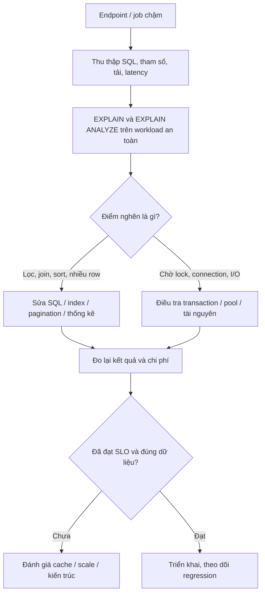

# Đánh giá kế hoạch truy vấn trước khi thêm cache hoặc nâng tài nguyên

> **Chương:** Hiệu năng  
> **Phạm vi:** `DATA_PERSISTENCE_FUNDAMENTALS` — hiểu lưu trữ dữ liệu bền vững, mô hình dữ liệu, schema, truy vấn, chỉ mục, transaction, tính cô lập và kiểm soát đồng thời; thiết kế ranh giới persistence cho Java, xử lý lỗi kết nối, tiến hóa schema, bảo mật, sao lưu và tối ưu hiệu năng.

## Mục tiêu học tập

Sau bài học, người học có thể:

1. Phân biệt **truy vấn chậm** do kế hoạch thực thi, thiếu/chọn sai chỉ mục, thống kê sai, đọc quá nhiều dữ liệu, khóa chờ và tài nguyên hệ thống.
2. Đọc kế hoạch PostgreSQL với `EXPLAIN`, `EXPLAIN (ANALYZE, BUFFERS)`; phân biệt **ước lượng của planner** với kết quả **đo khi thực thi**.
3. Nhận diện các dấu hiệu đáng điều tra: sai lệch số hàng ước lượng/thực tế, `Seq Scan` không phù hợp, `Nested Loop` có nhiều `loops`, `Sort` tràn đĩa, `Rows Removed by Filter` lớn và truy vấn N+1.
4. Đề xuất và kiểm chứng cải tiến về truy vấn, chỉ mục, phân trang, thống kê hoặc mô hình dữ liệu **trước** khi thêm cache hay nâng CPU/RAM.
5. Đo hiệu năng từ ứng dụng Java và database bằng workload đại diện, xác nhận tính đúng đắn của kết quả và đánh giá đánh đổi của mỗi phương án.

## 1. Vì sao phải xem kế hoạch truy vấn trước?

Khi endpoint liệt kê đơn hàng có độ trễ p95 tăng từ 80 ms lên 1,8 giây, hai phản ứng thường gặp là **thêm Redis cache** hoặc **tăng cấu hình máy database**. Cả hai đều có thể hữu ích trong tình huống phù hợp, nhưng nếu nguyên nhân là một truy vấn quét hàng triệu dòng để lấy 50 đơn hàng, cache và máy lớn hơn chỉ che giấu phần nào vấn đề:

- Cache cần chính sách hết hạn, vô hiệu hóa, nhất quán khi cập nhật và xử lý cache miss; một request miss vẫn phải chạy truy vấn chậm.
- Tăng CPU/RAM không sửa được truy vấn chọn sai hàng, quét dữ liệu thừa hay contention do transaction dài.
- Cả cache và scale có thể tăng chi phí vận hành, trong khi một thay đổi truy vấn/chỉ mục đúng có thể giảm tải cho **tất cả request**, kể cả khi không có cache.

**Kế hoạch truy vấn** (*query execution plan*) cho biết database dự định lấy, lọc, nối, sắp xếp và tổng hợp dữ liệu như thế nào. PostgreSQL sử dụng *query planner* để chọn một kế hoạch dựa trên thống kê, cấu trúc chỉ mục, điều kiện truy vấn và mô hình chi phí.

Điều quan trọng không phải “có `Index Scan` là tốt” hay “có `Seq Scan` là xấu”, mà là: **kế hoạch này có hợp với số lượng hàng, phân bố dữ liệu và yêu cầu latency/throughput của workload hay không?**



## 2. Đo đúng vấn đề trước khi mở `EXPLAIN`

Một endpoint có thể chậm vì nhiều nguyên nhân ngoài thời gian thực thi một câu SQL. Trước khi tối ưu, cần xác định:

| Cần ghi nhận | Vì sao quan trọng |
| --- | --- |
| p50, p95, p99 latency ở API và tại database | Trung bình nhanh không loại trừ đuôi chậm do lock hoặc hàng đợi. |
| Số request/giây, số người dùng đồng thời, connection đang dùng | Cùng SQL có thể nhanh khi chạy một mình nhưng nghẽn khi tải cao. |
| SQL thực sự được gửi và **giá trị tham số đại diện** | Tenant lớn/nhỏ, trạng thái đơn hàng và khoảng thời gian tạo ra kế hoạch khác nhau. |
| Số hàng trả về, dung lượng payload và số round-trip | Lỗi N+1 hoặc tải quá nhiều cột có thể chiếm phần lớn latency. |
| Thời gian chờ connection pool, network, DB execution, mapping/JSON | Tránh tối ưu planner khi bottleneck nằm ở pool hoặc serialize. |
| Thời gian lock wait, I/O, CPU, memory, cache hit và temp files | Phân biệt kế hoạch quét đắt với tài nguyên đang cạnh tranh. |
| Phiên bản PostgreSQL, schema, index, thống kê, phân bố dữ liệu | Kế hoạch có thể đổi sau migration, tăng trưởng dữ liệu hoặc ANALYZE. |

Nên lấy truy vấn từ log/tracing/metrics thực tế, xóa dữ liệu nhạy cảm trước khi chia sẻ. Đừng chỉ chọn một câu SQL có thời gian cao nhất: một truy vấn mất 30 ms nhưng chạy 10.000 lần/phút có thể tiêu thụ tổng tài nguyên lớn hơn một truy vấn 2 giây chạy vài lần/ngày.

Nếu extension `pg_stat_statements` đã được cấu hình và bật, có thể dùng số liệu tổng hợp để tìm truy vấn tốn tổng thời gian:

```sql
-- Chỉ chạy khi extension pg_stat_statements có sẵn.
SELECT
    queryid,
    calls,
    total_exec_time,
    mean_exec_time,
    rows,
    shared_blks_hit,
    shared_blks_read,
    query
FROM pg_stat_statements
ORDER BY total_exec_time DESC
LIMIT 20;
```

`pg_stat_statements` gom thống kê theo câu lệnh chuẩn hóa; nó **không thay thế** trace cho từng tenant/parameter và không cung cấp trực tiếp p95 API. Chi phí thời gian còn tùy khoảng đo và việc reset thống kê; cần đối chiếu với monitoring ở ứng dụng.

## 3. Ví dụ xuyên suốt: lấy 50 đơn hàng gần nhất

Giả sử hệ thống Java phục vụ nhiều tenant, mỗi tenant có lịch sử hàng trăm nghìn đơn. Endpoint cần 50 đơn `PAID` gần nhất trước một con trỏ phân trang.

Lược đồ PostgreSQL minh họa:

```sql
CREATE TABLE purchase_order (
    order_id BIGINT GENERATED ALWAYS AS IDENTITY PRIMARY KEY,
    tenant_id BIGINT NOT NULL,
    status TEXT NOT NULL CHECK (
        status IN ('NEW', 'PAID', 'CANCELLED')
    ),
    created_at TIMESTAMPTZ NOT NULL DEFAULT now(),
    total_amount NUMERIC(18, 2) NOT NULL CHECK (total_amount >= 0)
);

-- Bảng thực tế đã có nhiều hàng; không cần sinh dữ liệu giả
-- chỉ để thấy một kế hoạch minh họa.
```

Truy vấn ban đầu thường được viết:

```sql
SELECT order_id, created_at, total_amount
FROM purchase_order
WHERE tenant_id = 7
  AND status = 'PAID'
ORDER BY created_at DESC, order_id DESC
LIMIT 50 OFFSET 100000;
```

Ngay cả khi có chỉ mục hữu ích, `OFFSET 100000` thường khiến database phải đi qua nhiều hàng trước khi bỏ qua 100.000 hàng đầu. Khi dữ liệu tăng, trang càng sâu càng tốn công. Mục tiêu tối ưu không chỉ là tăng tốc phần quét, mà còn **tránh yêu cầu database xử lý lượng dữ liệu không cần thiết**.

Ví dụ phân trang theo **keyset/seek** với cặp khóa sắp xếp ổn định:

```sql
-- Giả định cursor của trang trước là
-- created_at = '2026-11-22 00:00:00+00', order_id = 900000.
SELECT order_id, created_at, total_amount
FROM purchase_order
WHERE tenant_id = 7
  AND status = 'PAID'
  AND (created_at, order_id)
      < (TIMESTAMPTZ '2026-11-22 00:00:00+00', 900000)
ORDER BY created_at DESC, order_id DESC
LIMIT 50;
```

Với thứ tự cả hai trường giảm dần, phép so sánh tuple `<` chọn các hàng nằm **sau** con trỏ. `order_id` giải quyết trường hợp nhiều đơn có cùng `created_at`. Trang đầu tiên bỏ điều kiện cursor; endpoint thật phải giới hạn `LIMIT` và ký/kiểm tra cursor khi cần bảo vệ dữ liệu đa tenant.

**Đánh đổi:** keyset pagination rất hiệu quả cho duyệt tuần tự nhưng không hỗ trợ trực tiếp “nhảy đến trang 5.000” theo số thứ tự. Khi dữ liệu được chèn/xóa giữa các request, các trang không tạo thành một snapshot bất biến; nếu yêu cầu xuất báo cáo tại một mốc cố định, cần thiết kế snapshot hoặc watermark riêng.

## 4. `EXPLAIN` và `EXPLAIN ANALYZE` khác nhau thế nào?

### 4.1. Xem kế hoạch ước lượng bằng `EXPLAIN`

```sql
EXPLAIN
SELECT order_id, created_at, total_amount
FROM purchase_order
WHERE tenant_id = 7
  AND status = 'PAID'
ORDER BY created_at DESC, order_id DESC
LIMIT 50;
```

`EXPLAIN` thông thường **không chạy truy vấn**; nó cho biết kế hoạch PostgreSQL dự định dùng cùng các ước lượng chi phí/hàng. Đọc phần này trước để quan sát có `Seq Scan`, `Index Scan`, `Sort` hay các `Join` nào. Nhưng số `cost` không phải thời gian tính bằng mili giây.

### 4.2. Đo khi thực thi bằng `EXPLAIN (ANALYZE, BUFFERS)`

```sql
EXPLAIN (ANALYZE, BUFFERS, SETTINGS)
SELECT order_id, created_at, total_amount
FROM purchase_order
WHERE tenant_id = 7
  AND status = 'PAID'
ORDER BY created_at DESC, order_id DESC
LIMIT 50;
```

`ANALYZE` trong cú pháp trên yêu cầu **thực thi câu SQL** rồi thêm số liệu đo `actual time`, `actual rows`, `loops`, thời gian planning/execution và buffer usage. `BUFFERS` cho biết mức sử dụng buffer, còn `SETTINGS` có thể hiện các thiết lập khác mặc định ảnh hưởng đến kế hoạch.

**Cảnh báo:** `EXPLAIN ANALYZE` thực thi cả câu lệnh ghi. Không chạy tùy tiện `EXPLAIN ANALYZE INSERT/UPDATE/DELETE` trên production; rollback trong transaction có thể hoàn tác thay đổi DB, nhưng tác động ngoài DB hoặc một số side effect không nhất thiết hoàn tác. Ngay cả với `SELECT`, truy vấn rất tốn tài nguyên hoặc gọi hàm có side effect vẫn có rủi ro. Ưu tiên môi trường kiểm thử có dữ liệu/phân bố đại diện và biện pháp giới hạn phù hợp.

Khi một kế hoạch có nhiều node, tùy chọn `TIMING OFF` có thể giảm chi phí đo từng node nhưng vẫn cung cấp số hàng và tổng thời gian:

```sql
EXPLAIN (ANALYZE, BUFFERS, TIMING OFF, SUMMARY ON)
SELECT order_id, created_at, total_amount
FROM purchase_order
WHERE tenant_id = 7
  AND status = 'PAID'
ORDER BY created_at DESC, order_id DESC
LIMIT 50;
```

Không so sánh một lần chạy có cache nóng với lần chạy khác có cache lạnh rồi kết luận chắc chắn index nào nhanh hơn. Chạy lặp, giữ workload/parameter tương đương và xem xét độ biến động.

## 5. Đọc các trường quan trọng trong kế hoạch

| Thuộc tính | Ý nghĩa | Câu hỏi nên đặt |
| --- | --- | --- |
| `cost=startup..total` | Điểm chi phí tương đối do planner ước lượng, **không phải ms** | Vì sao planner thấy phương án này rẻ hơn phương án khác? |
| `rows` (ước lượng) | Số hàng node dự kiến trả | Ước lượng lệch xa thực tế hay không? |
| `width` | Kích thước trung bình mỗi hàng theo ước lượng | Có đang kéo nhiều cột/dữ liệu lớn không? |
| `actual time=start..end` | Thời gian đo được khi node chạy, thường tính **theo mỗi lần chạy node** | Node nào thực sự tốn thời gian? |
| `actual rows` và `loops` | Số hàng trung bình mỗi lần node chạy và số lần chạy | Một node có bị gọi lại hàng nghìn lần không? |
| `Rows Removed by Filter` | Hàng đã đọc nhưng bị bộ lọc loại | Có đang quét quá nhiều vì điều kiện/index không phù hợp? |
| `Index Cond` / `Filter` / `Recheck Cond` | Điều kiện dùng tại mức index/lọc/kiểm tra lại | Điều kiện `WHERE` có thực sự giúp giới hạn phạm vi đọc từ index? |
| `Buffers: shared hit/read` | Block có sẵn trong shared buffer hoặc cần đọc vào đó | Dữ liệu được truy cập nhiều không; có áp lực I/O không? |
| `temp read/written`, `Sort Method` | Sắp xếp/hash ghi dữ liệu tạm ra đĩa | Có cần giảm số hàng/sửa index hoặc điều chỉnh giới hạn bộ nhớ? |
| `Planning Time` và `Execution Time` | Thời gian lập và chạy kế hoạch | Chậm chủ yếu ở planner hay executor? |

**Cách hiểu `loops`:** nếu node hiển thị `actual rows=2000 loops=50`, số hàng được node xuất qua tất cả lần chạy có thể xấp xỉ **100.000 hàng**, vì `actual rows` là số trung bình mỗi vòng. Con số đó có thể giải thích vì sao một `Nested Loop` với đầu vào ngoài nhỏ vẫn đắt nếu nhánh trong phải tìm/quét nhiều hàng lặp lại.

`Buffers: shared hit` là cache trang của PostgreSQL, không đồng nghĩa “không dùng CPU”; `shared read` thể hiện lần đọc block vào shared buffers, nhưng bản thân nó chưa chứng minh thiết bị vật lý đã thực hiện một lần đọc đĩa vì hệ điều hành còn có cache. Khi cần đánh giá thời gian I/O chi tiết, kiểm tra khả năng bật `track_io_timing` và các chỉ số tương ứng, cân nhắc chi phí theo dõi.

Một dạng kế hoạch **minh họa cấu trúc**, không phải kết quả đo từ bảng ví dụ:

```text
Limit
  -> Sort
       Sort Key: created_at DESC, order_id DESC
       Sort Method: external merge  (tràn ra đĩa, nếu plan báo vậy)
       -> Seq Scan on purchase_order
            Filter: (tenant_id = ... AND status = 'PAID')
            Rows Removed by Filter: ...
```

Với dữ liệu lớn và truy vấn chỉ cần 50 hàng, hãy hỏi vì sao cần lọc, sort rồi mới limit. Tuy nhiên, **Seq Scan không tự động là lỗi**: nó có thể tốt nhất khi bảng nhỏ, điều kiện trả phần lớn bảng, hoặc đọc tuần tự rẻ hơn đi qua index và truy xuất heap từng hàng.

## 6. Các dấu hiệu thường dẫn tới kế hoạch đắt

### 6.1. Ước lượng số hàng sai

Nếu planner dự kiến 10 hàng nhưng thực tế trả 200.000 hàng, nó có thể chọn `Nested Loop` hoặc chiến lược join không phù hợp. Nguyên nhân có thể là:

- Thống kê chưa được cập nhật sau import, backfill hay thay đổi phân bố dữ liệu.
- Giá trị tenant/status phân bố lệch (một tenant chiếm phần lớn dữ liệu).
- Nhiều điều kiện có tương quan, trong khi planner không nắm đủ quan hệ giữa các cột.
- Kiểu dữ liệu/cast/function trong predicate làm suy yếu khả năng ước lượng và sử dụng index.

Với PostgreSQL, `ANALYZE` cập nhật thống kê của bảng, nhưng việc chạy trên production cần đánh giá thời điểm và tài nguyên:

```sql
-- Ví dụ để chủ động cập nhật statistics sau một import lớn.
ANALYZE purchase_order;
```

Khi hai cột có tương quan mạnh, **extended statistics** có thể giúp cho một số loại dự đoán:

```sql
-- Minh họa: tạo statistics cho tenant_id và status.
CREATE STATISTICS st_order_tenant_status
    (mcv, dependencies)
ON tenant_id, status
FROM purchase_order;

ANALYZE purchase_order;
```

`CREATE STATISTICS` là đối tượng schema; cần migration/đánh giá đúng workload và phiên bản PostgreSQL. Extended statistics **không giải quyết mọi loại tương quan**, không thay thế kiểm tra `EXPLAIN` sau khi cập nhật statistics và không tự biến mọi join thành nhanh.

### 6.2. Quét/lọc quá nhiều rồi mới giới hạn

Truy vấn chỉ lấy 50 hàng nhưng plan trả `Rows Removed by Filter` rất lớn hoặc phải `Sort` nhiều hàng. Hãy kiểm tra:

1. `WHERE` có lọc được sớm bằng index không?
2. Thứ tự `ORDER BY` có được index đáp ứng không?
3. Có dùng `OFFSET` lớn trong khi có thể dùng keyset?
4. Các predicate có áp hàm/cast lên cột khiến không dùng được index như mong muốn không?
5. Có chọn `SELECT *` rồi vận chuyển các cột JSON/text lớn trong khi API chỉ cần vài cột không?

Nếu kết quả phải lọc và sắp xếp trên tập lớn vì yêu cầu nghiệp vụ thật, có thể cần mô hình read model, materialized view hoặc phân vùng phù hợp. Nhưng hãy chứng minh chi phí trước, thay vì thêm cache cho một truy vấn chưa được thiết kế tốt.

### 6.3. Join lặp lại và N+1 từ Java

Một `EXPLAIN` duy nhất có thể rất tốt, nhưng endpoint vẫn chậm vì ORM chạy 1 câu lấy danh sách đơn, sau đó **50 câu nữa** để đọc quan hệ khách hàng theo từng đơn. Đó là lỗi **N+1 query** ở tầng truy cập dữ liệu.

Đánh giá bằng trace số câu SQL trong một request, không chỉ kế hoạch một câu:

- Với JPA, xem xét DTO projection, `JOIN FETCH`, `EntityGraph`, batch fetch theo nhu cầu và ảnh hưởng đến phân trang.
- Với Spring JDBC, tránh gọi `findCustomer(order.customerId)` bên trong vòng lặp; gom khóa và đọc một lần bằng truy vấn phù hợp.
- Kiểm tra lại số hàng nhân lên do join quan hệ 1-n và số dữ liệu truyền qua mạng.

Tối ưu plan mà bỏ qua N+1 có thể không cải thiện đáng kể latency endpoint.

### 6.4. Sort/hash tràn đĩa

Khi plan báo `Sort Method: external merge`, `Disk: ...` hoặc `temp read/written` lớn, truy vấn có thể sắp xếp/hash trên tập dữ liệu vượt bộ nhớ được cấp cho thao tác.

Các hướng xử lý theo thứ tự:

1. Giảm số hàng trước khi sort/join bằng điều kiện lọc và cách truy vấn phù hợp.
2. Xem có index cung cấp thứ tự cần thiết không.
3. Chỉ điều chỉnh `work_mem` theo phép đo và tải đồng thời; bộ nhớ này có thể dùng **cho nhiều thao tác trong mỗi query và nhiều query đồng thời**, nên tăng toàn cục tùy tiện có thể gây cạn RAM.

Đừng tăng RAM database chỉ vì một truy vấn sort tràn đĩa nếu chính truy vấn đang lấy quá nhiều hàng không cần thiết.

## 7. Thiết kế index theo predicate và thứ tự truy vấn

Với ví dụ chỉ lấy đơn hàng `PAID`, một **partial composite index** có thể phù hợp:

```sql
-- Thao tác trên hệ thống đang ghi cần kế hoạch DDL riêng.
-- CONCURRENTLY không được chạy trong transaction block.
CREATE INDEX CONCURRENTLY ix_po_paid_tenant_created_id
ON purchase_order (tenant_id, created_at DESC, order_id DESC)
INCLUDE (total_amount)
WHERE status = 'PAID';
```

Ý tưởng:

- `tenant_id` đứng đầu vì truy vấn cố định một tenant.
- `created_at DESC, order_id DESC` đi theo thứ tự `ORDER BY`; khi có cursor, DB có thể duyệt từ vị trí thích hợp.
- Predicate `WHERE status = 'PAID'` làm index chỉ chứa đơn đã thanh toán, phù hợp khi endpoint tập trung vào đúng trạng thái này.
- `INCLUDE (total_amount)` có thể giúp kế hoạch `Index Only Scan` nếu điều kiện cần cho index-only scan được đáp ứng; PostgreSQL vẫn có thể phải truy cập heap để kiểm tra visibility, tùy visibility map/vacuum.

**Không phải cứ tạo index là PostgreSQL sẽ dùng.** Với bảng nhỏ, tập kết quả lớn, thống kê khác hoặc truy vấn có tham số trạng thái, planner có thể chọn phương án khác. Đặc biệt, **partial index chỉ dùng được khi planner chứng minh predicate của query suy ra predicate của index**. Truy vấn có `status = ?` trong một generic prepared plan có thể không chứng minh được điều kiện `status = 'PAID'` cho mọi giá trị tham số.

Nếu cùng một API thường truy vấn nhiều trạng thái, có thể cân nhắc index không partial như:

```sql
-- Chỉ xem như một phương án khác, không mặc định tạo cả hai.
CREATE INDEX CONCURRENTLY ix_po_tenant_status_created_id
ON purchase_order
    (tenant_id, status, created_at DESC, order_id DESC);
```

So sánh bằng plan của đúng SQL/parameter và tải ghi. Mỗi index tăng dung lượng, chi phí `INSERT`/`UPDATE`/`DELETE`, WAL, thời gian vacuum và có thể ảnh hưởng khả năng duy trì dữ liệu bền vững. Đừng thêm nhiều chỉ mục trùng lặp khi chưa đo lợi ích biên.

`CREATE INDEX CONCURRENTLY` làm giảm mức chặn ghi so với tạo index thông thường trong nhiều trường hợp, nhưng vẫn có thể chạy lâu, đợi transaction cũ và khi thất bại có thể để lại index không hợp lệ cần kiểm tra/khắc phục. Việc dùng nó trong công cụ migration phải cấu hình transaction phù hợp.

### 7.1. Kiểm tra sau khi tạo index

```sql
EXPLAIN (ANALYZE, BUFFERS)
SELECT order_id, created_at, total_amount
FROM purchase_order
WHERE tenant_id = 7
  AND status = 'PAID'
  AND (created_at, order_id)
      < (TIMESTAMPTZ '2026-11-22 00:00:00+00', 900000)
ORDER BY created_at DESC, order_id DESC
LIMIT 50;
```

Các tiêu chí:

1. Số hàng/buffer phải đọc giảm như kỳ vọng chưa?
2. Có bỏ được sort lớn không? Có `Index Cond` tương ứng với tenant và cursor không?
3. Kế hoạch cho tenant nhiều dữ liệu và tenant ít dữ liệu có đều ổn không?
4. Số lần truy cập heap khi `Index Only Scan` có thấp hay không?
5. Thời gian p95/p99 ở ứng dụng có cải thiện khi tăng tải đồng thời không?
6. Chi phí ghi, dung lượng index và replication lag có trong ngưỡng chấp nhận không?

Phải so sánh **trước/sau với cùng dữ liệu hoặc môi trường tương đương**. Một truy vấn đầu tiên chạy lạnh rồi truy vấn thứ hai chạy nóng có thể đánh lừa về hiệu quả của index mới.

## 8. Tham số Java/JDBC có thể làm kế hoạch khác ví dụ SQL tĩnh

Ứng dụng Java thường sử dụng `PreparedStatement`, Spring JDBC hoặc truy vấn JPA. Câu SQL được gửi có placeholder và kiểu tham số:

```java
import java.math.BigDecimal;
import java.time.OffsetDateTime;
import java.util.List;
import java.util.Map;
import org.springframework.jdbc.core.namedparam.NamedParameterJdbcTemplate;
import org.springframework.stereotype.Repository;

record OrderRow(
    long orderId,
    OffsetDateTime createdAt,
    BigDecimal totalAmount
) {}

@Repository
public class OrderReadRepository {
    private final NamedParameterJdbcTemplate jdbc;

    public OrderReadRepository(NamedParameterJdbcTemplate jdbc) {
        this.jdbc = jdbc;
    }

    // Lấy trang tiếp theo; trang đầu dùng truy vấn không có cursor.
    public List<OrderRow> nextPaidPage(
            long tenantId,
            OffsetDateTime cursorTime,
            long cursorOrderId,
            int limit) {

        if (cursorTime == null || limit < 1 || limit > 100) {
            throw new IllegalArgumentException("Invalid cursor or limit");
        }

        return jdbc.query("""
            SELECT order_id, created_at, total_amount
            FROM purchase_order
            WHERE tenant_id = :tenantId
              AND status = 'PAID'
              AND (created_at, order_id)
                  < (:cursorTime, :cursorOrderId)
            ORDER BY created_at DESC, order_id DESC
            LIMIT :limit
            """,
            Map.of(
                "tenantId", tenantId,
                "cursorTime", cursorTime,
                "cursorOrderId", cursorOrderId,
                "limit", limit
            ),
            (rs, i) -> new OrderRow(
                rs.getLong("order_id"),
                rs.getObject("created_at", OffsetDateTime.class),
                rs.getBigDecimal("total_amount")
            )
        );
    }
}
```

Đoạn code dùng Java 17+ và Spring JDBC; giả định PostgreSQL JDBC driver hỗ trợ đọc `TIMESTAMPTZ` thành `OffsetDateTime`. `limit` được ràng buộc để tránh yêu cầu xuất số lượng hàng quá lớn. Đây là truy vấn đọc và **không chứa cache**; tối ưu đầu tiên nằm ở SQL, tham số và index.

Trong thực tế, một driver có thể dùng server-side prepared statement sau một số lần gọi, và PostgreSQL có thể cân nhắc **custom plan** hoặc **generic plan**. Kế hoạch dùng literal trên `psql` chưa chắc đại diện cho kế hoạch thực thi của ứng dụng, đặc biệt khi các giá trị tham số lệch phân bố.

Ví dụ phân tích qua SQL `PREPARE` trong môi trường kiểm thử:

```sql
PREPARE paid_page(bigint, timestamptz, bigint, integer) AS
SELECT order_id, created_at, total_amount
FROM purchase_order
WHERE tenant_id = $1
  AND status = 'PAID'
  AND (created_at, order_id) < ($2, $3)
ORDER BY created_at DESC, order_id DESC
LIMIT $4;

EXPLAIN (ANALYZE, BUFFERS)
EXECUTE paid_page(
    7, TIMESTAMPTZ '2026-11-22 00:00:00+00', 900000, 50
);

DEALLOCATE paid_page;
```

Có thể so sánh kế hoạch khi thay đổi dữ liệu tenant/cursor và cài đặt `plan_cache_mode` **chỉ trong phiên thử nghiệm có kiểm soát**, tránh tự chỉnh toàn hệ thống để ép một loại plan. Cần xem truy vấn thật, parameter binding, timezone và thống kê thực tế trước khi đưa kết luận.

## 9. Nhận diện lỗi không nằm ở planner

Không phải endpoint chậm nào cũng cần index.

| Triệu chứng | Dấu hiệu phân biệt | Hướng điều tra |
| --- | --- | --- |
| Query chạy nhanh khi độc lập, chậm ở peak | `pg_stat_activity` cho thấy chờ lock/đợi tài nguyên | Transaction dài, deadlock, khóa hàng/DDL, connection pool. |
| DB thời gian SQL thấp, API vẫn chậm | Trace cho thấy nhiều thời gian ở pool/network/serialize | N+1, pool sizing, payload, JVM GC, mạng. |
| `EXPLAIN ANALYZE` nhanh nhưng p99 cao | Một số lần chạy bị chờ hoặc tham số khác biệt | Tách theo tenant/parameter, đo concurrency và wait events. |
| Mọi truy vấn cùng chậm khi tải tăng | CPU/I/O saturation, quá nhiều kết nối hoặc quá nhiều transaction | Giới hạn đồng thời, pool sizing, query mix, tài nguyên. |
| Ghi bị nghẽn dù SELECT nhanh | Lock contention, WAL, index write amplification, fsync | Rút ngắn transaction, giảm index thừa, thiết kế ghi phù hợp. |
| Read replica trả dữ liệu trễ | Replication lag, failover/consistency requirement | Quy định nơi đọc, watermark/LSN, không chỉ tăng cache. |

PostgreSQL có thể cung cấp thông tin quan sát các phiên hiện tại:

```sql
-- Chỉ xem những hoạt động mà tài khoản có quyền quan sát.
SELECT pid, state, wait_event_type, wait_event,
       now() - xact_start AS transaction_age
FROM pg_stat_activity
WHERE datname = current_database()
  AND xact_start IS NOT NULL
ORDER BY transaction_age DESC NULLS LAST;
```

Một transaction lâu chưa chắc là thủ phạm của mọi truy vấn chậm, nhưng là tín hiệu cần kiểm tra: nó có thể giữ khóa, cản vacuum hoặc DDL. Nếu SQL thực thi phần lớn thời gian chờ lock, thêm index hoặc cache chưa chắc xử lý nguyên nhân.

## 10. Khi nào cache là lựa chọn đúng?

**Cache là một phương án tối ưu sau khi hiểu mẫu truy cập**, không phải lệnh “sửa tất cả SQL chậm”. Nó phù hợp hơn khi:

- Tập kết quả được đọc nhiều lần với cùng điều kiện, chi phí tính lại tương đối cao.
- Dữ liệu được phép **cũ trong một cửa sổ** đã định nghĩa, hoặc có giao thức invalidation/versioning đủ tin cậy.
- Cache hit dự kiến đủ cao, kích thước payload và cardinality key có thể quản lý.
- Có đường xử lý khi cache miss/outage, tránh làm database quá tải đột ngột.
- Có khả năng đo **hit ratio, staleness, memory, invalidate lag và tải DB** sau triển khai.

Ví dụ danh sách “20 sản phẩm nổi bật” có thể cache ngắn hạn nếu nghiệp vụ cho phép độ trễ, trong khi **kiểm tra tồn kho để chốt đơn, số dư tài khoản, hạn mức và quyền truy cập** cần xác nhận bằng nguồn chuẩn với transaction/constraint phù hợp.

### 10.1. Rủi ro của cache nếu chưa sửa query gốc

Nếu truy vấn gốc mất 2 giây và cache hit 95%, 5% request còn lại vẫn mất 2 giây; khi cache bị xóa hàng loạt hoặc lỗi, tất cả request có thể rơi xuống truy vấn đắt (*cache stampede*). Cache thêm tính phức tạp: stale result, tenant isolation, quyền truy cập, TTL, invalidation và khả năng đọc sau ghi.

Để dùng cache-aside an toàn, phải có:

1. **Nguồn chuẩn xác định** và hợp đồng độ mới dữ liệu.
2. **Key chứa đủ ranh giới phân quyền/tenant** và phiên bản schema cache khi cần.
3. Cách invalidation sau khi DB commit, ví dụ outbox/CDC cho trường hợp cần tránh bỏ sót.
4. Kiểm tra đồng thời, vì reader có thể nạp giá trị cũ trở lại cache sau một lần xóa.
5. Circuit breaker/rate limit/coalescing cho tình huống cache miss hàng loạt.

Cache không được tự trở thành nguồn ghi ngược vào DB; việc đối soát lỗi cache phải dựa trên trạng thái authoritative, không ghi đè dữ liệu đúng bằng bản sao cũ.

## 11. Khi nào nâng tài nguyên hoặc thay đổi kiến trúc?

Khi truy vấn đã được tối ưu đúng mức, plan và dữ liệu thống kê tương đối hợp lý, nhưng workload vẫn vượt CPU/I/O/memory hoặc nhu cầu thông lượng, tăng tài nguyên có thể là quyết định kinh tế và kỹ thuật đúng.

| Phương án | Khi cân nhắc | Đánh đổi cần đo |
| --- | --- | --- |
| Tăng CPU/RAM/I/O cho DB | Nhiều truy vấn hợp lý cùng tranh tài nguyên; bottleneck đo được | Chi phí, giới hạn máy, kế hoạch failover và độ bền. |
| Tăng/giảm connection pool | Pool chờ nhiều hoặc DB quá tải do số kết nối | Số thread/session, CPU context switching, transaction dài. |
| Read replica | Luồng đọc cho phép độ trễ và không cần ngay dữ liệu mới nhất | Replication lag, RPO, consistency, tải primary cho ghi. |
| Partitioning | Truy vấn có điều kiện phân vùng rõ, dữ liệu lớn theo thời gian/tenant | Quản trị nhiều partition, pruning, index và migration. |
| Read model/materialized view | Báo cáo tổng hợp rất đắt và độ mới có hợp đồng rõ | Đồng bộ, refresh, schema evolution và kiểm soát trễ. |
| Cache | Kết quả đọc lặp lại, staleness được chấp nhận | Invalidation, stampede, chi phí memory, sai lệch dữ liệu. |

**Không scale trước khi đo bottleneck.** Nếu p99 chậm vì khóa một hàng “nóng”, thêm CPU không loại bỏ việc mọi transaction phải đợi cùng khóa. Nếu DB đã quá tải vì hàng nghìn truy vấn N+1, tăng pool có thể làm DB nghẽn nặng hơn.

## 12. Quy trình thử nghiệm và triển khai một tối ưu

Một vòng cải tiến có thể kiểm chứng:

1. **Chốt mục tiêu:** ví dụ endpoint p95 không quá 150 ms tại 200 request/giây, kết quả phải đúng và giới hạn tài nguyên/chi phí được xác định.
2. **Chụp baseline:** SQL, trace, phân bố tenant, số hàng, plan, số round-trip, buffer usage, CPU/I/O, lock wait và thời gian p95/p99.
3. **Tạo giả thuyết cụ thể:** “`OFFSET` 100.000 gây quét thừa” hoặc “thiếu index cho tenant + thời gian”; tránh nói chung chung “database chậm”.
4. **Thay một nhóm biến có kiểm soát:** sửa pagination hoặc tạo index trên môi trường thử; đo lại. Nếu thay đồng thời SQL, index, RAM và cache thì khó biết phần nào có tác dụng.
5. **Kiểm tra tính đúng:** cùng tập dữ liệu/quy tắc sort, không lẫn tenant, không thiếu/nhân bản đơn hàng, vẫn bảo vệ giao dịch và phân quyền.
6. **Kiểm tra tải thực tế:** tenant lớn/nhỏ, cache nóng/lạnh, request đồng thời, peak traffic, tốc độ ghi, pool và lock wait.
7. **Tính chi phí phụ:** dung lượng index, WAL, độ trễ ghi, vacuum, tăng độ phức tạp code và thay đổi kế hoạch khi dữ liệu lớn lên.
8. **Triển khai có rollback:** dùng migration index phù hợp, quan sát regression và chỉ xóa index cũ khi có bằng chứng không còn cần.
9. **Đo lại sau triển khai:** xác nhận SLO thực tế và cập nhật dashboard; nếu chưa đạt, xét cache/scale dựa trên số liệu mới.

Một tối ưu đáng tin phải vừa giảm thời gian, vừa **giữ nguyên kết quả nghiệp vụ**, đồng thời không đẩy chi phí quá mức sang transaction ghi hoặc hệ thống vận hành.

## 13. Những hiểu lầm dễ gây tối ưu sai

| Nhận định sai | Sửa cách hiểu |
| --- | --- |
| “`Seq Scan` luôn chậm.” | Seq scan có thể hợp lý khi bảng nhỏ hoặc cần đọc phần lớn hàng. |
| “Có `Index Scan` nghĩa là đã nhanh.” | Index scan vẫn có thể đọc quá nhiều hàng, heap page hoặc vòng lặp join. |
| “`cost=1000` tức mất 1000 ms.” | `cost` là đơn vị ước lượng tương đối, không phải đồng hồ đo thời gian. |
| “`EXPLAIN ANALYZE` chỉ giải thích, không chạy truy vấn.” | Nó **thực thi** SQL; cần cẩn thận với DML và tác động phụ. |
| “Cache hit cao nghĩa là đã tối ưu.” | Cache có thể che truy vấn miss rất đắt hoặc trả dữ liệu cũ sai. |
| “Thêm RAM sẽ sửa mọi truy vấn bị sort.” | Trước hết giảm dữ liệu phải sort, sửa SQL/index; xem concurrency. |
| “Nhiều index luôn làm SELECT nhanh mà không có hại.” | Index tăng chi phí ghi, WAL, dung lượng và bảo trì. |
| “Chỉ đo truy vấn SQL trong psql là đủ.” | Parameter, generic plan, pool, N+1, mạng và concurrency có thể khác ứng dụng Java. |
| “Nâng connection pool giúp DB chịu tải tốt hơn.” | Pool lớn có thể làm tăng cạnh tranh, lock wait và quá tải. |
| “Tăng tài nguyên rẻ hơn tối ưu SQL nên luôn chọn scale.” | Cần so tổng chi phí, SLO, throughput, rủi ro và khả năng tăng trưởng. |

## 14. Bài thực hành: tối ưu endpoint danh sách đơn hàng

**Bối cảnh:** bảng `purchase_order` có nhiều triệu bản ghi, tenant 7 chiếm phần lớn dữ liệu. API `GET /orders?status=PAID` trả tối đa 50 đơn/trang. Ứng dụng Java đang sử dụng `OFFSET` lớn và thỉnh thoảng bị chậm trên production.

**Nhiệm vụ:**

1. Thu thập trace gồm SQL thật, tham số, số request, latency p50/p95/p99, số câu SQL/request và thời gian chờ pool/DB. Xác định SLO cần đạt.
2. Chạy `EXPLAIN` với một tập tham số đại diện. Sau đó trên môi trường kiểm thử an toàn dùng `EXPLAIN (ANALYZE, BUFFERS)` để đo; ghi lại `rows`, `actual rows`, `loops`, buffer usage, `Sort` và thời gian.
3. Đo plan cho **tenant nóng** và **tenant nhỏ**. Giải thích vì sao một kế hoạch nhanh cho tenant nhỏ có thể chậm với tenant nóng.
4. Chuyển `OFFSET` sang keyset pagination với cặp khóa `(created_at, order_id)`; chứng minh không bỏ sót hàng có cùng `created_at` trong dữ liệu thử ổn định.
5. Thử partial composite index `(tenant_id, created_at DESC, order_id DESC) WHERE status='PAID'` và một phương án không partial. Đo lợi ích/chi phí chứ không mặc định giữ cả hai.
6. Chạy truy vấn từ `PreparedStatement`/Spring JDBC với tham số thật; kiểm tra trường hợp plan khác SQL literal và trường hợp có N+1 từ code.
7. Đo dưới tải đồng thời và kiểm tra chi phí `INSERT`/`UPDATE` sau khi thêm index.
8. Chỉ khi cách truy vấn/chỉ mục đã hợp lý mà chưa đạt SLO, lập luận bằng số liệu liệu cache hay tăng tài nguyên có phù hợp hay không; ghi rõ rủi ro stale data và đường cache miss.

**Bảng kiểm chứng**

| Tình huống | Kết luận cần chứng minh |
| --- | --- |
| Truy vấn `OFFSET` 100.000 | Có hoặc không có nhiều công việc bỏ đi; số row/buffer/time thực tế là bao nhiêu? |
| Truy vấn keyset | Có dùng thứ tự/index phù hợp, chỉ đọc số row cần thiết, vẫn đúng kết quả. |
| Index mới | Có cải thiện p95/p99 và buffer usage; chi phí ghi trong ngưỡng chấp nhận. |
| Tenant nhỏ và tenant lớn | Kế hoạch/độ trễ có thể khác; không đánh giá chỉ một bộ tham số. |
| Mô phỏng nhiều request cùng lúc | Không xuất hiện bottleneck mới ở pool, lock wait hoặc CPU. |
| Cache bị mất toàn bộ | Database vẫn chịu được đường đọc miss trong mức dịch vụ đã thiết kế. |
| Endpoint có ràng buộc bảo mật tenant | Tối ưu không làm bỏ điều kiện `tenant_id` và không trả dữ liệu sai tenant. |

**Câu hỏi tự đánh giá**

1. `EXPLAIN` khác `EXPLAIN (ANALYZE, BUFFERS)` thế nào? Vì sao cần cảnh giác khi chạy trên câu `UPDATE`?
2. Vì sao không thể lấy `cost` trong kế hoạch làm mili giây để so trực tiếp với SLO?
3. Một node có `actual rows=3000`, `loops=100` gợi ý loại chi phí lặp nào?
4. Khi nào `Seq Scan` là quyết định tốt hơn `Index Scan`?
5. Vì sao thống kê cũ và phân bố tenant lệch có thể khiến planner chọn sai join?
6. Khi nào partial index `WHERE status='PAID'` có thể không được dùng bởi prepared statement có `status = ?`?
7. Vì sao `INCLUDE(total_amount)` không bảo đảm luôn có `Index Only Scan`?
8. `OFFSET` lớn khác keyset pagination về khối lượng công việc và tính năng điều hướng như thế nào?
9. Nếu `EXPLAIN ANALYZE` báo SQL nhanh nhưng endpoint p99 chậm, phải kiểm tra những lớp nào ngoài planner?
10. Vì sao cache không giải quyết triệt để truy vấn miss quá đắt? Khi nào scale thực sự có căn cứ?

## Ghi nhớ

**Hãy tối ưu theo bằng chứng trước khi thêm tầng hệ thống.** Đo đúng SQL, tham số và tải thực; đọc `EXPLAIN` để hiểu kế hoạch, dùng `EXPLAIN (ANALYZE, BUFFERS)` có kiểm soát để so sánh ước lượng với thực tế. Từ số hàng, loops, lọc, sort, buffer và thời gian, xác định liệu nên sửa truy vấn, chỉ mục, thống kê, phân trang hay ranh giới transaction trước.

Cache và nâng tài nguyên vẫn là những công cụ cần thiết khi workload đòi hỏi, nhưng chúng không thay thế thiết kế persistence đúng. Chỉ triển khai sau khi đã đánh giá ảnh hưởng đến tính nhất quán, lỗi kết nối, chi phí ghi, độ bền dữ liệu, vận hành và SLO của ứng dụng Java.
