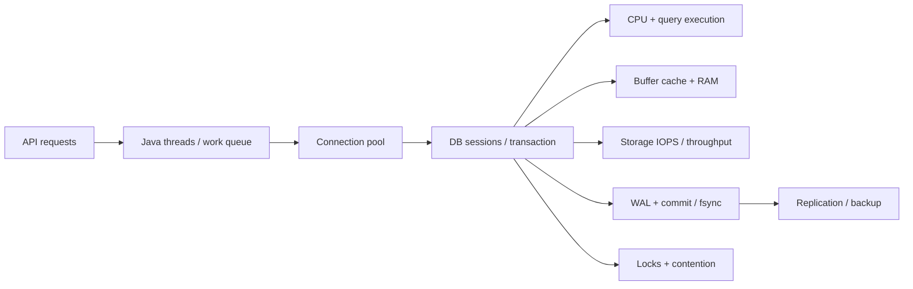

# Đánh giá giới hạn năng lực và phần tài nguyên dự phòng

Một cơ sở dữ liệu có thể phục vụ rất nhanh khi chỉ có vài request, nhưng bắt đầu tăng độ trễ, timeout hoặc khóa chờ khi lưu lượng đạt một ngưỡng nhất định. Trạng thái đó thường bị phát hiện quá muộn: CPU đã cao, connection pool hết kết nối rảnh, WAL tăng nhanh hoặc các truy vấn đọc trên replica bị chậm. Chỉ theo dõi **CPU trung bình** hay số lượng connection được cấu hình là không đủ để biết hệ thống còn chịu được bao nhiêu tải.

**Giới hạn năng lực (*capacity limit*)** là lượng công việc hệ thống có thể xử lý **một cách bền vững với điều kiện chất lượng xác định**, chẳng hạn p95 độ trễ dưới 150 ms, tỷ lệ lỗi dưới 0,1%, độ trễ replica dưới 2 giây và không tích tụ backlog vô hạn. **Phần tài nguyên dự phòng (*headroom*)** là năng lực còn lại sau khi trừ tải thực tế hoặc tải dự kiến, được dành cho tăng trưởng, biến động, tác vụ nền, bảo trì và sự cố.

Bài học thuộc chương **Hiệu năng** của mô-đun **DATA_PERSISTENCE_FUNDAMENTALS**. Mô-đun bao quát lưu trữ bền vững, mô hình dữ liệu, lược đồ, truy vấn, chỉ mục, giao dịch, cô lập và kiểm soát đồng thời; người học thiết kế ranh giới persistence cho Java, xử lý lỗi kết nối, tiến hóa schema, bảo mật, sao lưu và tối ưu hiệu năng. Ở đây, mục tiêu là biết **đặt ngân sách tài nguyên và đo năng lực có thể duy trì**, không chỉ chạy một benchmark tìm số request/giây lớn nhất.

Các ví dụ dựa trên PostgreSQL, JDBC và HikariCP/Spring; kết luận về khả năng mở rộng phải được đo trên phiên bản DB, cấu hình, phần cứng, dữ liệu và phân bố truy vấn thật. Những tỷ lệ dự phòng trong bài là **giả định minh họa**, không phải ngưỡng bắt buộc cho mọi hệ thống.

## 1. Phân biệt tải, thông lượng, năng lực và phần dự phòng

| Khái niệm | Ý nghĩa | Ví dụ |
|---|---|---|
| **Offered load** | Lượng công việc thực sự được gửi tới hệ thống, kể cả việc cuối cùng bị từ chối | 800 request/s tới API |
| **Completed throughput** | Lượng công việc hoàn tất trong một khoảng thời gian | 760 request/s thành công |
| **Concurrency** | Số công việc đang được thực hiện hoặc đang chờ tại một thời điểm | 30 transaction đang giữ connection, 20 đang chờ pool |
| **Latency** | Thời gian một yêu cầu phải đợi để có kết quả; nên xem phân vị | p95 end-to-end 140 ms |
| **Sustainable capacity** | Mức tải giữ được SLO và tài nguyên ổn định qua thời gian thử đủ dài | 900 request/s với hỗn hợp truy vấn cố định |
| **Headroom** | Khoảng chênh giữa năng lực đạt SLO và tải cần phục vụ | Năng lực 900, tải 630 → còn 270 request/s (30% năng lực) |
| **Saturation** | Nhu cầu vượt khả năng của một tài nguyên hoặc hàng đợi tăng dần | Pool không có connection rảnh, độ trễ chờ tăng |

**Capacity không phải một con số độc lập với workload.** Một database xử lý 5.000 truy vấn chỉ đọc bằng primary key mỗi giây không có nghĩa cũng xử lý được 5.000 giao dịch ghi nhiều hàng, 5.000 truy vấn `JOIN` lớn hoặc 5.000 request có gọi dịch vụ ngoài. Cần mô tả **đơn vị công việc, tỷ lệ đọc/ghi, kích thước bản ghi, dữ liệu nóng, concurrency, transaction duration và SLO** kèm mỗi phép đo.

Không lấy **đỉnh throughput trong 10 giây** làm năng lực bền vững nếu sau đó heap tăng, disk queue tích lũy, replica lag kéo dài hoặc tỷ lệ timeout cao. Một hệ thống có thể trả lời rất nhiều request trong một khoảng ngắn bằng cách tích backlog để xử lý sau; đó không phải bằng chứng nó chịu được tải đó liên tục.

### 1.1. Năng lực là giới hạn của tài nguyên gây nghẽn trước tiên

Một request persistence đi qua nhiều lớp:



Tăng CPU không giải quyết được nếu bottleneck là random I/O hoặc khóa hàng; tăng connection pool không giải quyết được một truy vấn thiếu chỉ mục; thêm replica đọc không làm single-primary tự tăng năng lực ghi. **Capacity toàn đường đi bị giới hạn bởi tài nguyên hoặc giai đoạn không theo kịp tải**.

## 2. Lập bản đồ tài nguyên của lớp persistence

| Tài nguyên / thành phần | Chỉ số nên quan sát | Dấu hiệu gần giới hạn | Điều dễ hiểu nhầm |
|---|---|---|---|
| CPU DB | CPU sử dụng, run queue, CPU time theo query | CPU cao kéo dài, latency tăng, throughput tăng chậm | CPU thấp không đồng nghĩa DB rảnh nếu đang chờ I/O/lock |
| RAM và buffer cache | RSS, cache hit, memory grant/temp usage, swap | Tràn bộ nhớ, swap, temp spill, OOM | Cache hit cao không loại trừ query hoặc ghi chậm |
| Storage | IOPS, read/write latency, throughput, queue depth, disk utilization | I/O wait cao, checkpoint/commit chậm, queue tích tụ | IOPS danh nghĩa trên brochure không phải mức duy trì được |
| WAL / transaction log | WAL bytes/s, fsync latency, backlog, archive lag | Commit chậm, log/slot giữ WAL, đầy volume | Có disk trống lúc này không có nghĩa đủ cho failure kéo dài |
| Connection pool Java | Active/idle/pending, acquisition time, hold time | Request đợi pool, connection timeout | `maximumPoolSize` lớn không tạo thêm CPU/IOPS cho DB |
| DB connections | Session count, active vs idle-in-transaction | Quá nhiều backend, memory/context switching, transaction treo | Số connection không bằng số query đang thực thi |
| Locks / MVCC | Lock wait, deadlocks, transaction age, vacuum lag | Ghi tranh chấp, lock queue, bloat | CPU thấp trong lúc chờ khóa không phải còn headroom |
| Replication | Lag bytes/time, replay position, apply rate, failover readiness | Replica đọc dữ liệu cũ, WAL giữ nhiều, failover rủi ro | Replica khỏe không bảo đảm dữ liệu đã bắt kịp |
| Network | RTT, bandwidth, retransmit, số round trip | Query nhỏ nhưng latency lớn, timeout do mạng | Nhiều round trip có thể lấn át thời gian SQL |
| Tác vụ nền | Autovacuum, backup, PITR archive, index build, migration | Tải tăng theo lịch, độ trễ giao dịch spike | Benchmark không chạy maintenance thường lạc quan |

Nguồn bottleneck có thể **chuyển chỗ** sau khi tối ưu. Ví dụ thêm index làm giảm I/O đọc nhưng tăng chi phí ghi và WAL; tăng pool giúp tăng concurrent work nhưng gây tranh chấp khóa; partition giúp retention tốt hơn nhưng không tự tạo thêm I/O của một node. Vì thế sau mỗi thay đổi phải đo lại toàn bộ đường đi.

## 3. Định nghĩa SLO và kịch bản tải trước khi đo

Số liệu capacity không có ý nghĩa nếu điều kiện thành công chưa rõ. Một SLO minh họa cho API đặt hàng có thể gồm:

```text
Đơn vị công việc: 1 request POST /orders = 1 nghiệp vụ tạo đơn
Workload mix: 70% đọc theo ID, 20% cập nhật tồn kho, 10% báo cáo nhỏ
Steady state: tải tăng theo các bậc và giữ đủ lâu để ổn định
SLO giao dịch tương tác: p95 < 150 ms, p99 < 400 ms
Tỷ lệ lỗi: < 0,1% (định nghĩa rõ có tính 4xx nghiệp vụ hay không)
Độ trễ replication cho API đọc eventual: p95 lag < 2 s
Độ bền: không chấp nhận mất dữ liệu đã xác nhận commit theo chính sách DB
Điều kiện phụ: pool wait và backlog không tăng không giới hạn
```

**Các con số chỉ phục vụ bài toán mẫu**. Hệ thống ngân hàng, thống kê phân tích, tìm kiếm hoặc batch ingestion có yêu cầu rất khác. Một phép đo cần công bố rõ môi trường: vCPU, RAM, loại đĩa, network, phiên bản DB, kích thước bảng/index, tỉ lệ cache warm/cold, transaction isolation, pool size, connection limits, dạng request và số client tải.

### 3.1. Tải trung bình không phải tải thiết kế

Phân biệt:

- **Average load:** trung bình theo giờ/ngày, thích hợp để đánh giá chi phí nhưng thường che đỉnh.
- **Peak sustained load:** đỉnh kéo dài trong khoảng quan trọng như 15 phút/1 giờ, dùng để tính năng lực cần duy trì.
- **Burst load:** đỉnh rất ngắn do khuyến mãi, cron, retry storm hoặc cache miss, cần queue/admission control và ngân sách đột biến riêng.
- **Growth forecast:** tải dự đoán trong 3–12 tháng, có biên độ không chắc chắn.
- **Degraded mode:** nhu cầu khi một node, một replica, một vùng sẵn sàng hoặc một thành phần storage gặp sự cố.

Khi ước lượng từ lịch sử, cần tính **peak theo từng loại workload**, không chỉ gộp tất cả request như nhau. Một đợt batch backfill lúc thấp điểm có thể gây IO/WAL lớn hơn nhiều so với một đợt GET nhiều request; kế hoạch bảo trì phải tính được phần tài nguyên nó dùng cùng tải thông thường.

## 4. Công thức headroom và một ví dụ tính năng lực

Với một workload đã được định nghĩa, đặt (C_{\mathrm{SLO}}) là **mức thông lượng tối đa đo được mà hệ thống vẫn giữ SLO trong điều kiện thử**, và (D) là tải cần phục vụ. Phần dư về thông lượng:

\[
H_{\mathrm{abs}} = C_{\mathrm{SLO}} - D
\]

Tỷ lệ headroom tính trên năng lực:

\[
H_{\mathrm{ratio}} = \frac{C_{\mathrm{SLO}}-D}{C_{\mathrm{SLO}}}
                  = 1 - \frac{D}{C_{\mathrm{SLO}}}
\]

Ví dụ hệ thống giữ được SLO ở **1.000 giao dịch/giây** trong bài test dài đủ đại diện; đỉnh dự báo là **650 giao dịch/giây**. Khi đó:

```text
Sustainable capacity tại SLO: 1.000 transactions/s
Planned peak demand:             650 transactions/s
Absolute headroom:               350 transactions/s
Headroom ratio:                  35% năng lực đã đo
Utilization theo năng lực:       65%
```

Ở ví dụ này **35% không phải 35% CPU rảnh**. Năng lực tính bằng giao dịch/giây, trong khi CPU, disk hoặc lock có thể bão hòa ở các thời điểm và mức tải khác nhau. Không suy từ tỷ lệ headroom throughput sang tỷ lệ headroom của mọi tài nguyên.

Nếu muốn giữ phần dự phòng tối thiểu `h` của năng lực, nhu cầu thiết kế cần thỏa:

\[
D_{\mathrm{design}} \le (1-h)\,C_{\mathrm{SLO}}
\]

Ví dụ đặt `h = 0,2` như **quy tắc nội bộ giả định**, một hệ có năng lực 1.000 giao dịch/giây nên dự kiến phục vụ không quá 800 giao dịch/giây theo cùng mix công việc. Tỷ lệ 20% không phải tiêu chuẩn ngành cố định; có hệ cần nhiều hơn vì tải biến động hoặc failover, có hệ được phép chấp nhận suy giảm có kiểm soát.

### 4.1. Headroom phải được tính riêng theo tài nguyên

Một DB có thể đạt 65% năng lực giao dịch/giây nhưng **volume WAL chỉ còn trống 10 GiB** và tăng 2 GiB/giờ khi replica bị ngắt. Khi đó thời gian chịu đựng sự cố về storage có thể chỉ khoảng 5 giờ trước khi cạn dung lượng, bất kể CPU còn rảnh. Đo riêng:

- **CPU margin:** tải CPU hiện tại so với mức thực nghiệm còn giữ p95/p99 SLO.
- **I/O margin:** IOPS, throughput, read/write latency và queue depth so với ngưỡng của volume trên workload tương ứng.
- **Connection margin:** số connection thực sự cần dưới tải bình thường và sau failover so với giới hạn của DB và pool.
- **Disk/WAL time-to-full:** lượng trống khả dụng chia cho **tốc độ tăng ròng trong kịch bản xấu** (đơn vị nhất quán).
- **Lock/contention margin:** khi số concurrent writers tăng, mức độ tranh chấp có thể phi tuyến dù CPU và memory còn rảnh.

Phần dự phòng hữu dụng nhất là **phần còn lại của tài nguyên gây giới hạn mục tiêu**, được kiểm chứng bằng thử nghiệm; không lấy giá trị nhỏ nhất của những phần trăm không cùng đơn vị mà không diễn giải.

## 5. Dùng định luật Little để ước lượng kết nối đang hoạt động

Trong một hệ thống ổn định, định luật Little cho biết:

\[
L = \lambda W
\]

Với `λ` là tốc độ hoàn tất **giao dịch DB mỗi giây**, `W` là **thời gian trung bình một giao dịch giữ connection** (giây), `L` là **số connection trung bình đang được mượn để xử lý các giao dịch đó**. Đây là mối quan hệ trung bình theo thời gian, **không phải công thức tính pool size tối ưu chỉ từ p95**.

Ví dụ API hoàn tất **250 transaction/s**, thời gian giữ connection trung bình **40 ms = 0,040 s**:

\[
L = 250\times 0{,}040=10\ \text{connections}
\]

Điều đó có nghĩa **trung bình** 10 connection bị chiếm bởi nhóm giao dịch đang xét. Không có nghĩa pool 10 connection đủ dùng ở mọi thời điểm: burst, các transaction dài hơn trung bình, jitter trong scheduler, query chậm và thời gian chờ lock có thể làm số connection cần đồng thời vượt 10. Phải đo **phân bố thời gian giữ connection, thời gian chờ lấy connection và số pending acquisition** dưới tải thật.

Nếu một service có 8 instance, mỗi instance có pool 20 connection, nó **có thể** mở tối đa 160 connection tới DB chỉ từ một service này. Nếu có thêm 4 service khác, worker, dashboard và migration, tổng phải được ngân sách trên **DB server**, không nhìn một pool riêng lẻ.

```text
DB connection budget
  = service A: 8 instances x 20 = 160
  + service B: 4 instances x 10 =  40
  + background jobs / admin       =  20
  + database-reserved capacity    =  phần còn lại
```

Không được tăng tất cả `maximumPoolSize` cho tới khi tổng vượt `max_connections`. PostgreSQL dành một số connection cho vai trò quản trị và chính DB cần memory/process capacity; giới hạn kết nối lớn hơn chưa chắc cải thiện throughput. Khi service autoscale tăng số instance, **tổng connection budget tăng theo** dù RPS toàn hệ chưa tăng tương ứng.

### 5.1. Vì sao tối ưu transaction duration thường tạo thêm năng lực?

Từ \(L=\lambda W\), nếu λ không đổi và thời gian giữ connection giảm từ 40 ms xuống 20 ms, trung bình connection đang mượn giảm từ 10 xuống 5. Đây là lợi ích lớn nếu pool đang là bottleneck. Cách giảm W gồm loại bỏ N+1 query, dùng index phù hợp, batch statement, giới hạn lock wait và **không gọi HTTP chậm trong transaction DB**. Tuy nhiên, nếu DB bị nghẽn CPU hay I/O, giảm thời gian giữ connection mà không giảm công việc thật có thể chỉ chuyển bottleneck, nên vẫn cần đo.

## 6. Dự phòng cho sự cố: capacity bình thường khác capacity suy giảm

**Headroom ngày thường** trả lời câu hỏi còn phục vụ được bao nhiêu tải nếu mọi thành phần khỏe. **Failure headroom** trả lời câu hỏi hệ thống còn đáp ứng SLO nào nếu một tài nguyên bị mất, phải chạy backup, thực hiện failover hoặc một node giảm hiệu suất.

Giả sử ba read replicas độc lập cùng phục vụ một loại truy vấn, mỗi replica bền vững ở **400 request/s** với cùng SLO và dữ liệu đã bắt kịp. Tổng năng lực đọc lý thuyết trong giả định phân phối đều là 1.200 request/s. Với tải đọc đỉnh 700 request/s:

```text
3 replica khỏe:         3 x 400 = 1.200 read request/s
Tải đỉnh:                          700 read request/s
Headroom bình thường: (1200-700)/1200 = 41,7%

Mất 1 replica:         2 x 400 =   800 read request/s
Headroom khi suy giảm: (800-700)/800 = 12,5%
```

Hệ thống **đủ điều kiện throughput về mặt số học** trong ví dụ, nhưng chỉ còn 12,5% dự phòng khi sự cố và chưa tính overhead failover, cache lạnh hay mất cân bằng tải. Nếu mục tiêu là **vẫn giữ 20% headroom sau khi mất một replica**, tải thiết kế không được vượt \(800\times 0{,}8=640\) request/s. Đỉnh 700 request/s **không đạt** mục tiêu dự phòng đó, dù ngày thường còn 41,7% headroom.

### 6.1. Công thức cho tình huống N-1

Với `N` node **thực sự thay thế được cho nhau**, mỗi node có năng lực \(c\) cho **cùng workload**, giả định định tuyến cân bằng và không có overhead khác:

\[
C_{\mathrm{degraded}}=(N-1)c
\]

Nếu muốn giữ tỷ lệ dự phòng \(h_{\mathrm{degraded}}\) sau khi mất một node:

\[
D_{\mathrm{peak}}\le (1-h_{\mathrm{degraded}})\,(N-1)c
\]

Đây chỉ là **mô hình gần đúng**. Trong thực tế node có thể khác cấu hình, dữ liệu/cache không cân bằng, truy vấn phải được route theo tenant/shard, replica cần replay log trước khi đọc và connection pool có thể vẫn trỏ vào node hỏng. Năng lực suy giảm phải được **thử bằng bài failover có kiểm soát** chứ không chỉ nhân số node.

### 6.2. Không áp dụng phép nhân đó bừa bãi cho primary ghi

Trong kiến trúc PostgreSQL single-primary với các physical read replicas, **chỉ primary thường nhận ghi nghiệp vụ**. Thêm hai read replicas không biến throughput ghi thành ba lần. Khi primary lỗi, một standby được promote, nhưng có thể có thời gian gián đoạn, cache khác, replication lag và routing thay đổi. Phải đánh giá:

- Năng lực ghi của **primary mới** sau promotion với workload thật.
- RPO/RTO, tình trạng WAL và khả năng standby đã nhận/áp dụng dữ liệu cần thiết.
- Thời gian ứng dụng phát hiện failover, làm mới connection, retry an toàn và tránh ghi hai nơi.
- Phân phối đọc khi một replica được chọn làm primary mới và số node chỉ-đọc giảm.

Với sharding, N-1 cũng không tự đúng: nếu mỗi tenant có shard owner riêng, mất một shard không khiến shard khác tự có đủ dữ liệu hoặc quyền sở hữu để thay thế. Cần replication/failover hoặc cơ chế tái phân bố dữ liệu riêng cho từng shard.

### 6.3. Reserve cho maintenance và tác vụ bắt buộc

Ngoài sự cố mất node, hệ thống cần chừa năng lực cho autovacuum, backup, WAL archiving, index build, schema migration và replay sau failover. Một bài đo chỉ chạy workload request sạch, không có maintenance, có thể đánh giá sai giới hạn vận hành.

Khi có maintenance window, tải có thể giảm chủ động hoặc một phần năng lực bị dành riêng cho job. Hãy lập **kịch bản xấu khả dĩ**: lưu lượng cao + backup đang chạy + replica lag; không cần giả định mọi tai họa cùng xảy ra, nhưng cũng không giả định các sự cố luôn độc lập. Headroom phải phù hợp với các rủi ro mà hệ thống cam kết chịu được.

## 7. Phương pháp thử năng lực bền vững thay vì đo một đỉnh QPS

Một phép kiểm thử capacity có thể triển khai theo chu trình sau:

1. **Chốt mục tiêu:** SLO, phân bố request, kích thước dữ liệu, tỷ lệ đọc/ghi, concurrency, dữ liệu nóng và thời gian thử.
2. **Đo baseline:** lưu lượng thường, độ trễ p50/p95/p99, lỗi, CPU, RAM, I/O, WAL, pool, locks, replica lag, tốc độ tăng disk.
3. **Tăng tải theo bậc:** ví dụ 100 → 200 → 400 → 600 → 800 transaction/s; giữ mỗi bậc đủ lâu để queue, cache, checkpoint và background work phản ánh điều kiện ổn định.
4. **Tìm điểm suy giảm:** xác định bậc mà latency/tỷ lệ lỗi vượt SLO, throughput không tăng tương ứng, queue tăng hoặc tài nguyên vượt giới hạn an toàn.
5. **Lặp lại gần ngưỡng:** dùng bậc nhỏ hơn quanh điểm giới hạn và thời gian dài hơn để xác định \(C_{\mathrm{SLO}}\) có thể **duy trì**.
6. **Thử burst, soak và failover:** kiểm tra đỉnh ngắn, chạy nhiều giờ, mất replica, backup, bão connection, retry storm và cache lạnh.
7. **Xác lập headroom:** so sánh tải dự báo với năng lực bình thường và suy giảm; ghi rõ điều kiện môi trường và mức độ tin cậy.
8. **Đặt ngưỡng cảnh báo và lịch đo lại:** khi workload mix, schema, index, số instance, driver hoặc DB instance type đổi, kết quả cũ có thể không còn đúng.

### 7.1. Tránh coordinated omission trong benchmark

Trong một bộ tạo tải **closed-loop**, client thường chờ response xong mới gửi request tiếp. Khi backend chậm, chính client **giảm tốc độ yêu cầu**, khiến benchmark không tái tạo được lưu lượng thực sự sẽ tới trong lúc hệ thống quá tải. Hiện tượng có thể làm các thống kê độ trễ trông đẹp hơn thực tế, thường gọi là *coordinated omission*.

Để đánh giá khả năng giữ SLO theo tốc độ đến định trước, cân nhắc **open-loop load generation** với lịch request không phụ thuộc việc request trước đã hoàn thành, có giới hạn an toàn cho bộ tạo tải và ghi nhận cả request bị từ chối hoặc hết hạn. Phải phân biệt **offered load**, **accepted load**, **completed throughput** và số request còn đợi. Nếu máy tạo tải bị quá tải, kết quả đo backend cũng không còn đáng tin.

### 7.2. Các dạng kiểm thử phục vụ mục tiêu khác nhau

| Kiểu thử | Cách thực hiện | Thông tin thu được |
|---|---|---|
| Baseline | Tải bình thường, thời gian đủ quan sát | Hành vi khỏe, độ trễ và tài nguyên tham chiếu |
| Step/ramp | Tăng tải theo các bậc có giữ ổn định | Điểm bắt đầu bão hòa và tác nhân gây nghẽn |
| Stress | Vượt giới hạn theo kịch bản an toàn | Cách thất bại, timeout, admission control, khả năng hồi phục |
| Soak/endurance | Chạy nhiều giờ ở mức gần tải thiết kế | Memory leak, bloat, WAL buildup, pool leak, backlog tăng |
| Burst/spike | Tăng đột ngột rồi giảm | Khả năng hấp thụ đỉnh và thời gian queue trở lại bình thường |
| Degraded/failover | Mất một replica hoặc chuyển vai trò DB trong test | Năng lực khi sự cố, RTO, lag, connection recovery |
| Maintenance overlap | Chạy backup/migration/analyze cùng tải nghiệp vụ | Reserve thực tế dành cho tác vụ nền |

Không thực hiện stress test phá hoại database production. Khi phép đo cần môi trường gần production, phải xin quyền vận hành và cấu hình giới hạn số request, thời lượng, dữ liệu test và quy trình dừng; sử dụng dữ liệu đã khử nhạy cảm hoặc tổng hợp. Đừng dùng load test làm công cụ dò giới hạn trên hệ đang phục vụ người dùng nếu không có kiểm soát.

## 8. Chỉ số PostgreSQL dùng để tìm resource bottleneck

Không có một câu SQL duy nhất trả về "DB còn 23% capacity". Cần kết hợp **database views, OS/cloud metrics, connection pool và application tracing**. Các view PostgreSQL cung cấp ngữ cảnh để biết tài nguyên nào đang chờ, nhưng không thay thế IOPS/CPU/network metrics do hệ điều hành hoặc nền tảng cung cấp.

### 8.1. Session, transaction dài và lock wait

```sql
SELECT state,
       wait_event_type,
       wait_event,
       count(*) AS sessions
FROM pg_stat_activity
WHERE datname = current_database()
GROUP BY state, wait_event_type, wait_event
ORDER BY sessions DESC;
```

Một số session ở trạng thái `idle in transaction` có thể giữ snapshot và tài nguyên; session `active` nhưng có `wait_event_type = 'Lock'` đang đợi khóa thay vì sử dụng CPU để thực thi SQL. Cần chú ý quyền quan sát, trường hợp `NULL` và các truy vấn nội bộ khác. Quan sát các transaction giữ lâu:

```sql
SELECT pid, application_name, state,
       now() - xact_start AS transaction_age,
       wait_event_type, wait_event
FROM pg_stat_activity
WHERE datname = current_database()
  AND xact_start IS NOT NULL
ORDER BY xact_start
LIMIT 20;
```

Đừng tự động `pg_terminate_backend` theo tuổi transaction mà chưa biết công việc đó là backup, migration hay một nghiệp vụ đang commit. Cần chính sách timeout, quyền hạn và runbook rõ ràng; dừng nhầm backend có thể làm rollback công việc dài hoặc gián đoạn người dùng.

### 8.2. Throughput, deadlock và cache ở mức database

```sql
SELECT datname,
       xact_commit,
       xact_rollback,
       deadlocks,
       blks_read,
       blks_hit,
       temp_files,
       temp_bytes,
       stats_reset
FROM pg_stat_database
WHERE datname = current_database();
```

Các trường như `xact_commit`, `xact_rollback`, `blks_read`, `blks_hit` là **counter tích lũy kể từ thời điểm reset thống kê**; muốn biết transaction/s hay I/O rate phải lấy **hai mẫu và chia chênh lệch cho khoảng thời gian** phù hợp. Không gọi `xact_commit` hiện tại là TPS, cũng không dùng cache-hit ratio làm chỉ số duy nhất để kết luận storage khỏe. `temp_bytes` tăng nhanh có thể gợi ý sort/hash spill; xem thêm execution plan và cấu hình memory cho truy vấn.

### 8.3. Query fingerprint và thời gian thực thi

Nếu extension `pg_stat_statements` được **cài đặt, cấu hình preload và cấp quyền phù hợp**, có thể xem nhóm truy vấn gây tổng tải lớn:

```sql
SELECT queryid,
       calls,
       total_exec_time,
       mean_exec_time,
       rows,
       query
FROM pg_stat_statements
ORDER BY total_exec_time DESC
LIMIT 20;
```

Các cột và khả năng truy cập phụ thuộc phiên bản PostgreSQL/extension. **Tổng execution time** giúp tìm nhóm truy vấn chiếm nhiều tài nguyên, nhưng giá trị đó có thể phản ánh chờ I/O, lock hay những yếu tố khác, không chỉ CPU. Kết hợp `EXPLAIN (ANALYZE, BUFFERS)` trên môi trường an toàn với dữ liệu đại diện và metrics hệ thống. `EXPLAIN ANALYZE` **thực sự chạy câu SQL**, nên phải cực kỳ cẩn trọng với câu ghi hoặc truy vấn nặng trên production.

### 8.4. Replication, WAL và giới hạn storage

Trên primary có physical replication phù hợp, có thể xem trạng thái replica đang kết nối:

```sql
SELECT application_name, state, sync_state,
       sent_lsn, write_lsn, flush_lsn, replay_lsn,
       write_lag, flush_lag, replay_lag
FROM pg_stat_replication;
```

Các số liệu lag dạng thời gian có **ngữ nghĩa phụ thuộc thời điểm commit và hoạt động replication**, không phải thước đo tuyệt đối về độ cũ của mọi dữ liệu khi không có ghi. Có thể so sánh LSN với các hàm phù hợp trong phiên bản DB để theo dõi chênh lệch byte, đồng thời kiểm tra retention WAL, replication slots và tốc độ apply. Chỉ nhìn `pg_stat_replication` không mô tả hết tình trạng backup, archived WAL hay network.

Ở PostgreSQL có các view như `pg_stat_wal`, `pg_stat_bgwriter`, `pg_stat_checkpointer`, `pg_stat_io` tùy phiên bản để quan sát WAL/checkpoint/I/O. **Không truy vấn một view chưa có trên phiên bản đang chạy rồi xem lỗi đó là sự cố hệ thống**; phải xác nhận nguồn metric được hỗ trợ và kết hợp với disk/network telemetry của host hoặc cloud provider.

### 8.5. Tính tốc độ bằng hai mẫu dữ liệu, không nhìn counter đơn lẻ

Giả sử `xact_commit` tăng từ 10.000.000 lên 10.018.000 trong **60 giây**, không có reset/restart giữa hai mẫu. Tốc độ commit trung bình trong khoảng là:

\[
\frac{10.018.000 - 10.000.000}{60} = 300\ \text{commits/s}
\]

Đây là **tốc độ commit của các transaction database** trong khoảng đó, chưa chắc bằng số business request/giây: một request có thể thực hiện nhiều transaction hoặc một transaction xử lý nhiều đơn vị công việc. Nếu stats bị reset giữa hai mẫu, phải bỏ cặp đo hoặc điều chỉnh theo nguồn dữ liệu thay vì tạo ra tốc độ âm. Không lưu raw query chứa tham số nhạy cảm vào dashboard có nhiều người xem.

## 9. Connection pool trong Java: ngân sách toàn cụm và backpressure

Mỗi ứng dụng Java thường dùng một **connection pool**, chẳng hạn HikariCP. Pool giúp tái sử dụng connection và giới hạn số session mở từ một instance, nhưng không bảo đảm DB chịu được mọi số connection mà pool có thể tạo.

Ví dụ một cấu hình Spring Boot (giá trị **chỉ minh họa**, cần hiệu chỉnh theo kết quả đo):

```yaml
spring:
  datasource:
    hikari:
      maximum-pool-size: 16
      minimum-idle: 4
      connection-timeout: 2000
      validation-timeout: 1000
      max-lifetime: 1800000
```

Ở HikariCP, `connection-timeout` là **mili giây chờ mượn connection**, không phải giới hạn thời gian của toàn bộ SQL transaction. `max-lifetime` quản lý tuổi connection vật lý theo cách của pool; giá trị phù hợp nên được chọn tương thích với timeout của mạng/DB. `minimum-idle` và `maximum-pool-size` ảnh hưởng cách pool sử dụng tài nguyên trong lúc không tải hoặc tải tăng. Không copy các giá trị này vào production mà chưa đo latency, độ ổn định connection, thời gian giữ connection và giới hạn tổng của DB.

### 9.1. Tính tổng connection khi autoscale

Giả sử:

| Nguồn kết nối | Số instance | Max pool mỗi instance | Tổng có thể dùng |
|---|---:|---:|---:|
| API service | 10 | 16 | 160 |
| Background worker | 4 | 8 | 32 |
| Report service | 2 | 8 | 16 |
| Migration, monitoring, admin | Dự trù riêng | — | 12 |
| **Tổng dự trù** | | | **220** |

Nếu PostgreSQL có `max_connections = 220`, mô hình này **không an toàn**: chưa tính connection dự trữ do PostgreSQL quản lý, sự tăng instance trong rolling deployment hoặc reconnect storm, và bản thân 220 backend có thể vượt ngưỡng hiệu năng DB. Phải dành phần cho administration/recovery và **đặt ngân sách tổng thấp hơn mức hệ thống chịu được đã đo**, không chỉ thấp hơn một tham số cấu hình.

Một phương án là giảm pool size ở từng instance, giới hạn số instance tối đa, sử dụng connection pooler thích hợp như PgBouncer với hiểu biết về transaction/session pooling và các tính năng phụ thuộc session, hoặc tăng năng lực DB khi có bằng chứng thực nghiệm. Với transaction pooling, cần kiểm tra prepared statements, temporary tables, session settings, advisory locks và các tính năng phụ thuộc session trước khi áp dụng.

### 9.2. Pool nhỏ có thể tốt hơn pool lớn

Nếu một primary có thể thực thi hiệu quả khoảng 24 truy vấn nặng cùng lúc, việc cho 300 truy vấn cùng chạy có thể làm CPU scheduling, lock contention và I/O queue tệ đi. Phần còn lại **nên chờ ở hàng đợi có giới hạn** hoặc bị từ chối đúng cách ở tầng ứng dụng, thay vì mở thêm connection để mọi transaction cùng tranh tài nguyên.

Khi thử các kích thước pool, đo **completed throughput, p95/p99 latency và tỷ lệ timeout** chứ không chỉ số session được mở. Tăng pool từ 16 lên 32 có thể giúp nếu pool đang chặn tải mà DB còn năng lực; nhưng nếu DB bão hòa, tăng pool có thể khiến hệ chậm hơn. Khi pool bị nghẽn, cần kiểm tra **thời gian giữ connection** và những thao tác kéo dài transaction trước khi kết luận thiếu số lượng connection.

## 10. Giới hạn đồng thời và thời gian chờ trong application service

Khi ứng dụng có những truy vấn đọc báo cáo tương đối nặng, một **semaphore** có thể giới hạn số báo cáo đang chiếm công việc DB của một instance. Khi hết permit, trả lỗi quá tải hoặc chờ ngắn với deadline thay vì cho mọi request mở thêm connection. Đây là một dạng **admission control/backpressure** tại ranh giới persistence.

Giả sử đã có bảng `orders(id BIGINT, customer_id BIGINT, status TEXT)` và chỉ mục phù hợp:

```sql
CREATE INDEX idx_orders_customer_id_desc
ON orders (customer_id, id DESC);
```

Ví dụ JDBC chỉ đọc tối đa 200 hàng mỗi lần, không giữ connection khi gọi dịch vụ khác:

```java
import java.sql.Connection;
import java.sql.PreparedStatement;
import java.sql.ResultSet;
import java.sql.SQLException;
import java.util.ArrayList;
import java.util.List;
import java.util.concurrent.RejectedExecutionException;
import java.util.concurrent.Semaphore;
import java.util.concurrent.TimeUnit;
import javax.sql.DataSource;

record OrderSummary(long id, String status) {}

public final class BoundedOrderReader {
    private final DataSource dataSource;
    private final Semaphore permits = new Semaphore(8); // Mỗi instance.

    public BoundedOrderReader(DataSource dataSource) {
        this.dataSource = dataSource;
    }

    public List<OrderSummary> recentOrders(long customerId, int limit)
            throws SQLException, InterruptedException {
        if (limit < 1 || limit > 200) {
            throw new IllegalArgumentException("limit must be 1..200");
        }

        // 150 ms chỉ minh họa; cần tính theo deadline thực tế.
        if (!permits.tryAcquire(150, TimeUnit.MILLISECONDS)) {
            throw new RejectedExecutionException("Database read capacity reached");
        }

        try (Connection connection = dataSource.getConnection();
             PreparedStatement statement = connection.prepareStatement("""
                     SELECT id, status
                     FROM orders
                     WHERE customer_id = ?
                     ORDER BY id DESC
                     LIMIT ?
                     """)) {
            statement.setLong(1, customerId);
            statement.setInt(2, limit);
            statement.setQueryTimeout(3); // Giây; phụ thuộc JDBC driver.

            try (ResultSet rows = statement.executeQuery()) {
                List<OrderSummary> answer = new ArrayList<>(limit);
                while (rows.next()) {
                    answer.add(new OrderSummary(
                            rows.getLong("id"), rows.getString("status")));
                }
                return answer;
            }
        } finally {
            permits.release();
        }
    }
}
```

Vòng đời permit được bảo vệ bởi `finally`; connection, statement và result set được đóng qua `try-with-resources`, kể cả khi query lỗi. `RejectedExecutionException` phải được tầng API ánh xạ thành phản hồi có hợp đồng quá tải thích hợp (ví dụ `503` hoặc `429` tùy lý do), không âm thầm trả danh sách rỗng như thể không có đơn hàng.

**Giới hạn của đoạn mã:** semaphore có 8 permit **trên mỗi JVM**, nên 10 instance có thể tạo tới 80 tác vụ đọc đồng thời. Không coi đây là giới hạn toàn cụm; nếu cần budget chung, phải phối hợp ở tầng điều phối hoặc điều chỉnh tổng số instance/pool phù hợp. `setQueryTimeout(3)` không giới hạn toàn bộ thời gian chờ mượn connection hay thời gian API chờ semaphore; để giữ SLO 150 ms phải phân bổ deadline end-to-end nghiêm ngặt hơn. `customerId` phải được kiểm tra quyền truy cập; truy vấn không tự bảo đảm người dùng được đọc mọi khách hàng.

### 10.1. Giữ transaction ngắn để không dùng hết phần dự phòng

Một tác vụ theo mẫu **đọc DB → gọi HTTP chậm → ghi DB** sẽ giữ connection lâu nếu toàn bộ được bọc trong một `@Transactional`. Với cùng 100 request/s, giữ connection trung bình 1 giây có nghĩa xấp xỉ 100 connection đang bị chiếm; nếu chỉ giữ 50 ms cho SQL thì trung bình khoảng 5 connection, giả định các điều kiện của định luật Little đáp ứng. Tuy nhiên, việc tách transaction phải đi kèm thiết kế nhất quán: trạng thái trung gian, outbox, idempotency và đối soát nếu hai bước DB cần phối hợp với dịch vụ ngoài.

Giảm transaction duration là một chiến thuật tăng capacity, **không phải lý do bỏ những bất biến cần cùng commit**. Không tách một transaction ghi dữ liệu quan trọng thành nhiều autocommit độc lập chỉ để giảm thời gian giữ connection mà không có phương án bảo toàn dữ liệu.

## 11. Dự phòng dung lượng: disk, WAL, backup và tốc độ tăng trưởng

Storage capacity cần hai phép đo khác nhau: **dung lượng còn trống** và **tốc độ sinh dữ liệu/log**. Một volume còn trống nhiều có thể cạn nhanh nếu replication slot bị giữ WAL hoặc job import bùng nổ. Một volume gần đầy nhưng dữ liệu không tăng cũng cần chính sách dự phòng, song mức khẩn cấp và thời gian xử lý khác nhau.

Ước lượng đơn giản thời gian tới khi hết dung lượng:

\[
T_{\mathrm{full}} \approx
\frac{\text{usable free bytes}}{\text{net growth bytes/second}}
\]

Ví dụ volume có **120 GiB trống**, hệ thống tăng ròng **8 GiB WAL/giờ** khi một replica không bắt kịp. Nếu toàn bộ dung lượng đều có thể sử dụng, mức thời gian lý thuyết là 15 giờ. Nhưng nếu yêu cầu **giữ 30% dung lượng trống làm ngưỡng an toàn** so với 120 GiB hiện có, chỉ được phép tiêu thụ 84 GiB trước khi chạm ngưỡng, tương đương **10,5 giờ** ở tốc độ đó. Con số này chỉ dùng để minh họa; tốc độ tăng có thể thay đổi và cùng lúc còn data files, temp files, backup hoặc log khác.

Không tự xóa file WAL trong `pg_wal` để lấy dung lượng trống: có thể làm hỏng khả năng recovery/replication. Nếu disk bị đe dọa bởi WAL retention, cần xác định nguyên nhân (replication slot, archiving, standby bị lag, cấu hình retention), lập kế hoạch giải phóng an toàn theo hướng dẫn DB và xác nhận RPO/RTO. Nếu không kiểm soát được tốc độ tăng, ưu tiên giảm/giới hạn nguồn ghi hoặc mở rộng storage theo runbook.

### 11.1. Ba loại dự phòng storage khác nhau

- **Dung lượng dữ liệu và index:** tăng theo số bản ghi, retention, bloat, index mới và partition; đặc biệt sau backfill hoặc `UPDATE` hàng loạt.
- **WAL/redo và file tạm:** tăng do tốc độ ghi, checkpoint, replication lag, truy vấn sort/hash hoặc công việc schema migration.
- **Backup/PITR:** cần không gian và băng thông riêng để chạy backup, giữ archive và **thử restore**, không được xem replica đang chạy là bản backup đủ khả năng phục hồi xóa nhầm.

Kế hoạch phải xem xét **burst disk usage** trong các tình huống khó chịu: index build concurrently tạo index mới, migration rewrite bảng cần thêm dung lượng, replication slot giữ WAL, restore tạm cần volume và backup có thể đọc nhiều dữ liệu trong khi workload vẫn chạy. Không chỉ tính disk bằng số byte của bảng chính.

### 11.2. Autovacuum, bloat và transaction đọc dài

Trong PostgreSQL/MVCC, cập nhật/xóa thường tạo những phiên bản hàng cũ cần được VACUUM dọn dẹp khi đủ điều kiện. Transaction hoặc snapshot bị giữ lâu có thể cản trở việc thu hồi các phiên bản cũ cần thiết, làm bloat và tăng I/O. Nếu theo dõi throughput nhưng bỏ qua thời gian dài của export/transaction `idle in transaction`, bài đo capacity có thể tỏ ra khỏe trong một giờ nhưng suy giảm sau nhiều ngày.

Không tùy tiện vô hiệu hóa autovacuum để tăng tốc benchmark. Đây là công việc nền thiết yếu cho vận hành và ngăn rủi ro transaction ID wraparound. Thử capacity nên bao gồm **nhịp maintenance đại diện**, đồng thời theo dõi VACUUM progress, dead tuples và thời gian transaction dài theo khả năng giám sát của phiên bản DB.

## 12. Dự báo nhu cầu và thời điểm phải tăng năng lực

Một dự báo tối giản giả định tải đỉnh hiện tại (D_0) tăng đều tỷ lệ (g) mỗi kỳ trong (n) kỳ:

\[
D_n = D_0(1+g)^n
\]

Nếu tải đỉnh hiện tại **650 transaction/s**, dự báo tăng **8% mỗi tháng**, sau 6 tháng:

\[
D_6 = 650(1{,}08)^6\approx 1.031{,}5\ \text{transactions/s}
\]

Nếu năng lực bền vững đang đo được là 1.000 transaction/s, kế hoạch **không đủ** ở tháng thứ sáu theo giả định đó, chưa kể headroom bắt buộc. Thậm chí yêu cầu giữ 20% reserve nghĩa là giới hạn tải thiết kế chỉ 800 transaction/s, nên cần hành động **sớm hơn** thời điểm chạm 1.000.

Trong thực tế, tốc độ tăng không cố định, tỷ lệ đọc/ghi có thể thay đổi, người dùng lớn tạo hotspot và đợt marketing tạo peak ngoài xu hướng. Hãy lập ba kịch bản **thấp/cơ sở/cao**, đo sai số dự báo và cập nhật sau mỗi kỳ. Một forecast có ích phải đưa ra **ngày/điều kiện kích hoạt hành động** (mua thêm năng lực, cải thiện SQL, partition, điều chỉnh pool) cùng thời gian cần để triển khai an toàn, không chỉ một biểu đồ dự đoán.

### 12.1. Ngưỡng cảnh báo dẫn tới quyết định

Ví dụ một hệ đặt mục tiêu giữ ít nhất 20% reserve trong kịch bản mất một replica; có thể xây dựng cảnh báo theo **mức sử dụng năng lực suy giảm đã đo**, p95 latency, pool pending, disk time-to-full và replication lag. Không dùng một ngưỡng CPU 80% cho mọi hệ mà không biết workload bottleneck ở đâu. Các cảnh báo nên có khoảng thời gian quan sát và phân cấp để không tạo noise do spike vài giây.

Chẳng hạn nếu capacity ở trạng thái suy giảm `C_degraded = 800 request/s` và mục tiêu dự phòng `h = 0,2`, ngưỡng tải thiết kế là **640 request/s**. Nếu dự báo đỉnh trong vài tuần tới vượt 640, cần **lên kế hoạch trước**: tối ưu đọc, tăng số replica thực sự thay thế được cho nhau, tăng năng lực từng node hoặc điều chỉnh nhu cầu. Không đợi đến khi hệ đã chạm 800 trong một lần sự cố mới bắt đầu xử lý.

## 13. Tối ưu đúng bottleneck trước khi mua thêm tài nguyên

Khi capacity test cho thấy một giới hạn, cần xác định nguyên nhân để chọn biện pháp có tác dụng thực sự:

| Bottleneck chủ đạo | Hướng xử lý đầu tiên | Khi mở rộng hạ tầng có ích |
|---|---|---|
| CPU query cao | Xem execution plan, index, N+1 query, projection, truy vấn lặp và batch | DB CPU tăng khi code/query đã hợp lý nhưng năng lực CPU vẫn thiếu |
| Random I/O hoặc scan lớn | Index chọn lọc, thống kê, query rewrite, giảm row width, partition pruning khi thích hợp | Storage IOPS/throughput tăng và cache phù hợp khi workload đòi hỏi |
| Lock wait / deadlock | Giữ transaction ngắn, sắp xếp thứ tự khóa, atomic conditional update, retry có backoff | Thêm CPU/node không giải quyết một khóa nóng; phải thay cách phân chia tranh chấp |
| Pool acquire chậm | Đo hold time, query duration, connection leak, async task giữ connection | Điều chỉnh pool có kiểm soát nếu DB còn khả năng nhận thêm concurrency |
| Nhiều transaction đọc kéo dài | Phân trang theo khóa, streaming đóng đúng lifecycle, tách export khỏi request | Read replica/worker riêng khi mô hình đọc và freshness cho phép |
| WAL/disk đầy khi replica lag | Khôi phục replication/archiving, giảm burst ghi, thiết kế retention/backup | Mở rộng storage khi tốc độ tăng hợp lệ và ngân sách downtime cho phép |
| Read QPS nhiều, ghi còn nhẹ | Cache với invalidation, query tuning, read replica nếu chấp nhận lag | Thêm replica đọc có thể chia tải phù hợp với routing và lag SLO |
| Write QPS vượt một primary | Giảm round trip, gộp ghi, giới hạn hotspot, chọn schema/index hợp lý | Vertical scale hoặc sharding khi ranh giới nghiệp vụ, routing và transaction cho phép |

### 13.1. Index không miễn phí và partition không tự nhân công suất

Một index mới có thể giảm thời gian `SELECT`, nhưng tăng chi phí `INSERT/UPDATE/DELETE`, WAL, backup, vacuum và dung lượng. Dùng `EXPLAIN`/số liệu đọc-ghi để đánh giá tác động trên **cùng workload mix**. Nếu chỉ benchmark truy vấn đọc, phương án nhiều index sẽ trông tốt hơn thực tế nơi write chiếm 40%.

Partition giúp pruning và retention, nhưng nếu mọi partition vẫn ở cùng một server, tổng CPU và I/O của server **không tự tăng**. Sharding có thể phân phối write qua nhiều primary nhưng làm routing, uniqueness và transaction nhiều shard phức tạp hơn; chi phí vận hành cũng cần một phần dự phòng mới. Replication phục vụ read scaling/availability nhưng không giải quyết giới hạn write của một primary đơn lẻ.

### 13.2. Bảo vệ backend bằng chấp nhận tải có giới hạn

Khi request đến nhanh hơn backend có thể xử lý bền vững, **queue vô hạn** chỉ chuyển vấn đề từ database sang bộ nhớ và thời gian chờ. Một hệ thống cần:

1. Giới hạn concurrent work tại API/worker, số request đợi, thời hạn trong queue và số connection đang mượn.
2. Timeout theo tầng (pool acquisition, query, HTTP, transaction) phù hợp deadline tổng thể.
3. Retry chỉ với lỗi và thao tác có thể retry an toàn; backoff có jitter, max attempts và retry budget để tránh khuếch đại tải.
4. Circuit breaker/admission control để từ chối sớm khi dependency bão hòa, thay vì đưa mọi request vào queue đã tắc.
5. Đường giảm cấp dịch vụ (**graceful degradation**) phù hợp nghiệp vụ: tạm dừng báo cáo nặng, giảm độ tươi của thống kê, chuyển export sang job; không bỏ qua kiểm tra số dư hoặc ghi dữ liệu không an toàn.

Không nên trả `200 OK` với dữ liệu trống để che lỗi quá tải. API cần mã lỗi có hợp đồng, `Retry-After` hợp lý khi dùng, operation ID để đối soát yêu cầu ghi chưa rõ kết quả và metric phân biệt request bị từ chối với request hoàn tất.

## 14. Tình huống tổng hợp: giờ cao điểm của API đặt hàng

Giả sử một ứng dụng Java/Spring có 10 instance API, PostgreSQL primary, ba read replicas và worker phát sự kiện qua outbox. Thống kê ngày thường ghi nhận:

| Mục đo | Giá trị minh họa |
|---|---:|
| Đỉnh ghi đặt hàng dự báo | 650 transaction/s |
| Năng lực primary tại SLO đã đo trong soak test | 1.000 transaction/s |
| Thời gian giữ connection trung bình ở đỉnh | 40 ms |
| Connection trung bình cho 650 transaction/s theo Little | 26 connection trên toàn nhóm giao dịch |
| Pool API | 10 instance × 16 = tối đa 160 connection |
| Năng lực đọc mỗi replica tại SLO | 400 read request/s |
| Đỉnh đọc trên các replica | 700 read request/s |
| Dung lượng trống trên volume chứa WAL trong sự cố giả định | 120 GiB |
| Tốc độ WAL tăng ròng nếu một replica/slot giữ log | 8 GiB/giờ |

Đánh giá:

**Bước 1 — Kiểm tra headroom của primary ghi.** `H = (1000-650)/1000 = 35%`. Đủ theo mục tiêu bình thường giả định 20%, nhưng cần thử primary failover vì replica phục vụ đọc không tự làm tổng write capacity tăng. Số connection trung bình theo Little `650 × 0,040 = 26` là con số **trung bình của toàn workload đo**, không chứng minh pool 26 là đủ cho burst hoặc chứng minh 160 connection đều hữu ích.

**Bước 2 — Kiểm tra dự phòng đọc sau mất node.** Ba replica, mỗi replica chịu được 400 request/s, nên năng lực khỏe là 1.200 request/s. Mất một replica còn 800 request/s; với tải 700, **headroom suy giảm chỉ 12,5%**, thấp hơn mục tiêu ví dụ 20%. Nếu cần giữ SLO với thêm một sự cố hoặc cache lạnh, mức dự phòng này càng đáng quan tâm. Thêm replica chỉ có ích sau khi đo năng lực thật và kiểm tra khả năng route request, replica lag và mô hình failover.

**Bước 3 — Kiểm tra connection budget.** Mười pool API có thể mở tối đa 160 connection, còn worker, migration, admin và các phiên bản deployment song song có ngân sách riêng. Cần xác minh giới hạn thực trên DB, thời gian chờ pool và khả năng phục vụ ở throughput cần thiết. Không tăng pool lên 32/instance chỉ vì p99 tăng nếu nguyên nhân là lock contention.

**Bước 4 — Kiểm tra dung lượng và thời gian ứng phó.** Với volume có 120 GiB trống và WAL tăng 8 GiB/giờ trong tình huống xấu, thời gian tới khi đầy có thể khoảng 15 giờ nếu không có tăng trưởng khác; đặt ngưỡng dự phòng 30% phần trống thì thời gian hành động chỉ khoảng 10,5 giờ. Phải báo động sớm hơn, kiểm tra WAL archiving/slot, restore/failover và không xóa WAL bằng tay.

**Bước 5 — Ra quyết định có điều kiện.** Nếu SLO đọc phải giữ nguyên trong mọi kịch bản mất một replica và **vẫn còn ít nhất 20% headroom**, hệ chưa đạt yêu cầu. Nếu doanh nghiệp cho phép giảm cấp báo cáo không quan trọng trong sự cố, có thể đặt admission control cho báo cáo nặng và đo SLO của endpoint quan trọng riêng. Kế hoạch cải thiện ghi có thể ưu tiên giảm transaction hold time, tuning truy vấn và kiểm tra WAL; kế hoạch cải thiện đọc có thể thêm replica hoặc cache sau khi thử read-your-writes và độ trễ replication. Mọi thay đổi phải được đo lại ở đúng workload mix.

### 14.1. Runbook khi chạm ngưỡng năng lực

```text
Tín hiệu: pool pending tăng + p95 vượt SLO
  |
  +--> CPU DB cao?      -> xem top query/plan và offered load
  +--> Lock wait cao?   -> tìm transaction/row hotspot và lock owner
  +--> Storage chậm?    -> xem I/O latency, checkpoint, WAL, replica lag
  +--> Consumer chậm?   -> xem transaction hold time / HTTP trong DB scope
  |
  +--> Giảm tải có kiểm soát: hạn chế export / queue / retry budget
  +--> Bảo vệ dữ liệu: không bỏ constraint, không retry commit unknown
  +--> Ghi lại mốc lỗi, DB/pool metrics và quyết định xử lý
  `--> Khi hồi phục: đo backlog drain và headroom thực còn lại
```

Trọng tâm của runbook là **giữ tính đúng đắn dữ liệu và khả năng phục hồi** trong khi giảm tải. Không vô hiệu hóa khóa, `fsync`, ràng buộc dữ liệu hoặc cơ chế sao lưu chỉ để thấy latency tạm giảm; những hành động đó có thể đổi sự cố hiệu năng thành mất dữ liệu.

## 15. Những nhầm lẫn thường gặp khi đánh giá capacity

- **“CPU 50% nghĩa là còn 50% năng lực.”** Sai khi I/O, lock, network, WAL hoặc một lõi CPU nóng mới là bottleneck; p95 có thể xấu dù CPU trung bình thấp.
- **“Tăng `max_connections` là tăng throughput.”** Không mặc nhiên: quá nhiều backend có thể làm tăng memory, context switching và contention.
- **“Pool active thấp nghĩa là dư connection.”** Không luôn đúng: có thể request bị từ chối ở tầng trước, API chờ thread, DB đang khóa hoặc pool metrics chỉ phản ánh một instance.
- **“Chỉ cần đo request/s lớn nhất.”** Sai nếu throughput có được bằng queue dài, timeout cao, replica lag tăng hoặc memory/disk tích backlog.
- **“Replica tăng năng lực ghi.”** Không đúng với kiến trúc single-primary phổ biến; read replicas chủ yếu dùng cho đọc/HA theo cấu hình.
- **“Partitioning làm DB tự phân phối tải qua nhiều server.”** Không đúng nếu các partition vẫn trên cùng node.
- **“Có một replica khỏe là đã có N-1 capacity.”** Không đủ nếu replica không bắt kịp, phải promote, cache lạnh hoặc mất một node khiến năng lực dưới nhu cầu.
- **“Backup dùng ít CPU khi rảnh nên không cần reserve.”** Sai nếu backup/index build/WAL archive chạy trùng giờ cao điểm hoặc dùng cùng storage bandwidth.
- **“`maxPoolSize = 16` chỉ là 16 connection của cả hệ.”** Sai: với 10 instance có thể là 160, chưa kể worker và instance tăng thêm.
- **“Có sẵn 120 GiB trống nên chưa cần theo dõi.”** Sai nếu WAL tăng nhanh do replication lag hoặc job tạo log; cần tính **time-to-full**.
- **“p95 100 ms đảm bảo mọi request hoàn thành dưới 100 ms.”** Sai: 5% request có thể lâu hơn; phải xem p99, timeout và giới hạn thời gian nghiệp vụ.
- **“Retry vô hạn giúp tận dụng phần dư.”** Sai: khi backend đang nghẽn, retry có thể làm tăng tải và kéo dài khủng hoảng.

## 16. Checklist đánh giá năng lực và dự phòng trước production

1. **Workload đã được định nghĩa chưa?** Phân biệt request đọc/ghi, transaction/s, tỷ lệ query, row width, dữ liệu nóng, tỉ lệ cache và lượng batch.
2. **SLO nào quyết định capacity?** Có p95/p99, tỷ lệ lỗi, replica freshness và độ bền dữ liệu tương ứng không?
3. **Năng lực đo có bền vững không?** Test đủ dài, có checkpoint/vacuum/backup phù hợp, queue không tăng mãi, không có coordinated omission?
4. **Tài nguyên nào chạm giới hạn trước?** CPU, I/O, memory, WAL, pool, DB sessions, lock wait, disk hay network đã có số liệu chứng minh?
5. **Headroom bình thường và sau sự cố là bao nhiêu?** Đã tính trên degraded capacity, không chỉ tổng năng lực lúc khỏe?
6. **N+1 có thực sự khả thi không?** Các replica/shard có cùng dữ liệu, đủ cache, đúng quyền ghi/đọc và routing/failover đáng tin chưa?
7. **Connection budget có tính tất cả instance không?** Bao gồm API, worker, rollout trùng phiên bản, migration, admin, read/write pools và autoscale?
8. **Timeout/backpressure được phối hợp chưa?** Có queue hữu hạn, request deadline, acquisition/query timeout, retry budget và graceful degradation?
9. **Storage time-to-full có được cảnh báo không?** Có giám sát WAL retention, archiving, temp files, index build, autovacuum, bloat và diễn tập restore?
10. **Tăng trưởng đã tính chưa?** Có kịch bản cơ sở/cao và thời điểm kích hoạt kế hoạch tối ưu hoặc mở rộng trước khi hết headroom?
11. **Thay đổi hiệu năng có giữ đúng bất biến?** Index, cache, read replica, partition/shard và giảm transaction có gây dữ liệu cũ, thiếu uniqueness hay dual write không?
12. **Đã kiểm tra kế hoạch khi mất năng lực?** Có runbook failover, giảm tải, đối soát commit unknown và đo thời gian phục hồi backlog không?

**Kết luận:** Giới hạn năng lực persistence không nằm ở một con số CPU, số connection hay QPS quảng cáo. Nó là **mức công việc hỗn hợp mà toàn hệ thống có thể duy trì trong các điều kiện SLO, an toàn dữ liệu và vận hành cụ thể**. Phần tài nguyên dự phòng phải được đánh giá cả khi mọi node khỏe lẫn khi mất một phần năng lực, đang bảo trì hoặc có burst bất thường. Với PostgreSQL và Java, cách tiếp cận đáng tin cậy là **đo đúng workload, tìm bottleneck, giới hạn concurrency và transaction duration, tính dự phòng theo kịch bản, diễn tập failover và đo lại sau mỗi thay đổi**.


