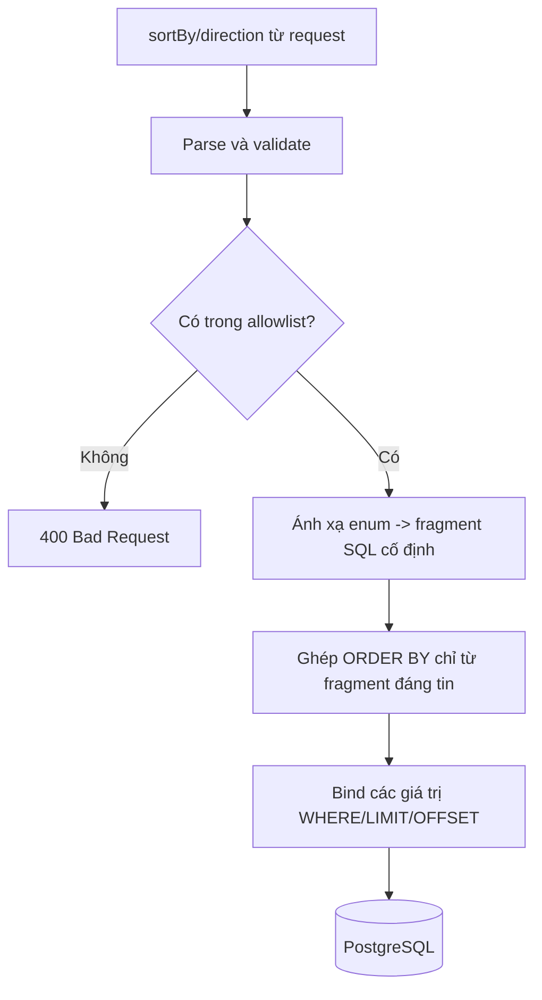
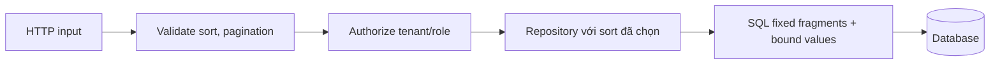

# Kiểm soát tên trường và hướng sắp xếp do người dùng lựa chọn

> **Chương:** An toàn dữ liệu  
> **Phạm vi:** `DATA_PERSISTENCE_FUNDAMENTALS` — hiểu cách lưu trữ dữ liệu bền vững, mô hình dữ liệu, schema, truy vấn, chỉ mục, giao dịch, tính cô lập và kiểm soát đồng thời; thiết kế ranh giới persistence an toàn cho Java, bảo mật, xử lý lỗi, tiến hóa schema và tối ưu hiệu năng.

## Mục tiêu học tập

Sau bài này, người học có thể:

1. Giải thích vì sao **tên cột, biểu thức trong `ORDER BY` và từ khóa `ASC`/`DESC`** không thể được bind như một giá trị SQL bằng `PreparedStatement`.
2. Nhận diện rủi ro **SQL injection** và rủi ro lộ dữ liệu qua chức năng sắp xếp dù các điều kiện `WHERE` đã được tham số hóa.
3. Thiết kế **allowlist trường sắp xếp và hướng sắp xếp**, ánh xạ từ tên công khai của API sang biểu thức SQL cố định do server sở hữu.
4. Hiện thực truy vấn an toàn bằng Java/Spring JDBC, đồng thời biết cách giới hạn property cho Spring Data `Sort` và truy vấn JPA Criteria.
5. Giữ thứ tự xác định khi phân trang, bảo vệ phạm vi tenant/quyền truy cập và đo chi phí chỉ mục khi cho phép nhiều cách sắp xếp.

## 1. Tình huống: API cho phép người dùng chọn thứ tự

Một API danh sách đơn hàng có thể nhận:

```text
GET /orders?sortBy=createdAt&direction=desc&page=0&size=20
GET /orders?sortBy=totalAmount&direction=asc&page=0&size=20
```

Ở giao diện, đây là chức năng bình thường: người dùng muốn đơn mới nhất trước hoặc giá trị đơn nhỏ nhất trước. Ở tầng persistence, tham số `sortBy` điều khiển **tên cột/biểu thức SQL**, còn `direction` điều khiển **cú pháp SQL**.

Một cách ghép SQL dễ mắc:

```java
// KHÔNG AN TOÀN: cả hai chuỗi đều đến từ phía client.
String sql = """
    SELECT o.id, o.created_at, o.total_amount
    FROM purchase_order o
    WHERE o.tenant_id = ?
    ORDER BY
    """ + sortBy + " " + direction;

// Dù tenantId vẫn bind bằng ?, phần ORDER BY đã bị ghép tùy ý.
```

Nếu `sortBy` hoặc `direction` chứa dấu phẩy, lời gọi hàm, chú thích SQL, biểu thức có điều kiện hoặc cú pháp khác, câu lệnh thực thi không còn giống thiết kế của ứng dụng. Không nhất thiết kẻ tấn công phải chèn được nhiều statement mới gây hại: **một biểu thức SQL được chấp nhận trong `ORDER BY` cũng có thể làm tăng chi phí truy vấn, thay đổi logic sắp xếp hoặc tạo kênh suy luận thông tin**.

**Nguyên tắc:** phía client được chọn từ **những lựa chọn mà API công bố**; phía client không được tự viết tên trường SQL, alias, tên hàm, biểu thức hoặc hướng sắp xếp gửi nguyên vẹn vào câu truy vấn.

### 1.1. Giá trị dữ liệu khác cấu trúc câu SQL

| Thành phần | Có nên lấy trực tiếp từ client rồi ghép SQL? | Cách xử lý |
| --- | --- | --- |
| `tenant_id`, `status`, mốc thời gian lọc | Không | Bind qua `?` hoặc tham số có tên. |
| `LIMIT` và `OFFSET` | Không | Kiểm tra khoảng số, sau đó bind làm giá trị. |
| Tên cột trong `ORDER BY` | Không | Chọn **biểu thức cố định** từ allowlist phía server. |
| `ASC` / `DESC` | Không | Parse thành enum và xuất ra đúng một token cố định. |
| `NULLS FIRST` / `NULLS LAST` | Không | Định nghĩa chính sách cố định hoặc enum được giới hạn. |
| Tên bảng, schema, alias, collation, hàm SQL | Không | Sở hữu hoàn toàn ở phía server; không truyền string tùy ý. |
| Tên trường công khai như `createdAt` | Có thể nhận làm **dữ liệu đầu vào** | Kiểm tra khớp allowlist rồi ánh xạ sang SQL cố định. |

Binding tham số phù hợp với **giá trị**, ví dụ `WHERE tenant_id = ?`. Nó không làm cho tham số trở thành một token ngôn ngữ SQL.

```sql
-- Không phải cách chọn tên cột động như mong muốn:
SELECT id, created_at
FROM purchase_order
ORDER BY ?;
```

Một placeholder ở vị trí biểu thức được coi như **giá trị tham số**, không được thay bằng tên cột SQL. Nếu bind chuỗi `created_at`, database không tự diễn giải nó thành tham chiếu tới cột `created_at`. Ở một số ngữ cảnh/DBMS, câu lệnh này có thể bị từ chối hoặc chỉ sắp xếp theo một hằng số, không đạt yêu cầu.

## 2. Dữ liệu và chức năng mẫu

Xét một hệ thống nhiều tenant có bảng đơn hàng PostgreSQL:

```sql
CREATE TABLE purchase_order (
    id BIGINT GENERATED ALWAYS AS IDENTITY PRIMARY KEY,
    tenant_id BIGINT NOT NULL,
    created_at TIMESTAMPTZ NOT NULL DEFAULT now(),
    total_amount NUMERIC(18, 2) NOT NULL CHECK (total_amount >= 0),
    status TEXT NOT NULL CHECK (
        status IN ('NEW', 'PAID', 'CANCELLED')
    )
);

CREATE INDEX ix_po_tenant_created_id
ON purchase_order (tenant_id, created_at DESC, id DESC);
```

API chỉ hỗ trợ **ba trường công khai**:

| Tên ở API | Biểu thức SQL server cho phép | Mặc định |
| --- | --- | --- |
| `createdAt` | `o.created_at` | `DESC` |
| `totalAmount` | `o.total_amount` | Theo yêu cầu, nếu không có thì `DESC` |
| `id` | `o.id` | Theo yêu cầu, nếu không có thì `DESC` |

Các thuộc tính như `tenant_id`, token nội bộ, dữ liệu nhạy cảm hoặc biểu thức tùy ý **không nằm trong allowlist**. Nếu một trường không được phép hiển thị hay sắp xếp đối với vai trò hiện tại, không nên đưa nó vào allowlist của vai trò đó.

Hợp đồng API khuyến nghị:

- `sortBy` chỉ nhận `createdAt`, `totalAmount` hoặc `id`; thiếu tham số dùng `createdAt`.
- `direction` chỉ nhận `asc`/`desc`; thiếu tham số dùng `desc`.
- Giá trị lạ, ký tự thừa, biểu thức SQL hay tên trường nội bộ phải bị **từ chối rõ ràng** (ví dụ HTTP 400), không ghép vào SQL.
- `page` và `size` phải là số nguyên trong khoảng cho phép, tránh tràn số và truy vấn quá lớn.
- Mọi truy vấn giữ điều kiện tenant/quyền truy cập, bất kể trường sắp xếp nào được chọn.

Không nên âm thầm chuyển mọi chuỗi lạ thành `createdAt`: việc trả về một kết quả tưởng thành công cho request không hợp lệ che giấu lỗi tích hợp, làm khó kiểm thử và theo dõi.

## 3. Phòng vệ chính: allowlist và ánh xạ phía server

**Allowlist** là tập hữu hạn các lựa chọn có ý nghĩa nghiệp vụ, được khai báo trong mã nguồn/cấu hình được kiểm soát bởi server.



Lợi ích của **ánh xạ**, thay vì dùng thẳng tên client:

1. API dùng `createdAt` nhưng SQL dùng `o.created_at`. Cấu trúc bảng có thể đổi mà không buộc client gửi tên cột DB.
2. Chỉ những trường đã review mới được sắp xếp; tránh lộ cấu trúc và dữ liệu riêng tư.
3. Trường tính toán có thể được định nghĩa bằng **biểu thức cố định** do lập trình viên kiểm soát, không cho người dùng tự cung cấp biểu thức.
4. Hướng và cách xử lý `NULL` được điều khiển tường minh, nhất quán với index và phân trang.
5. Test có thể kiểm tra **toàn bộ tập lựa chọn**, thay vì cố đoán mọi cú pháp injection có thể xuất hiện.

### 3.1. Enum cho trường và hướng

Mỗi tên SQL trong enum **phải là literal được review**, không phải chuỗi được cấu thành từ dữ liệu request:

```java
import java.util.Locale;

enum OrderSortField {
    CREATED_AT("createdAt", "o.created_at"),
    TOTAL_AMOUNT("totalAmount", "o.total_amount"),
    ID("id", "o.id");

    private final String apiName;
    private final String sqlExpression;

    OrderSortField(String apiName, String sqlExpression) {
        this.apiName = apiName;
        this.sqlExpression = sqlExpression;
    }

    String sqlExpression() {
        return sqlExpression;
    }

    static OrderSortField parse(String raw) {
        if (raw == null || raw.isEmpty()) {
            return CREATED_AT;
        }
        for (OrderSortField field : values()) {
            if (field.apiName.equals(raw)) {
                return field;
            }
        }
        throw new IllegalArgumentException("Unsupported sort field");
    }
}

enum OrderSortDirection {
    ASC("ASC"),
    DESC("DESC");

    private final String keyword;

    OrderSortDirection(String keyword) {
        this.keyword = keyword;
    }

    String keyword() {
        return keyword;
    }

    static OrderSortDirection parse(String raw) {
        if (raw == null || raw.isEmpty()) {
            return DESC;
        }
        return switch (raw.toLowerCase(Locale.ROOT)) {
            case "asc" -> ASC;
            case "desc" -> DESC;
            default -> throw new IllegalArgumentException(
                    "Unsupported sort direction");
        };
    }
}
```

Chỉ `CREATED_AT`, `TOTAL_AMOUNT`, `ID` và `ASC`/`DESC` có thể đi vào phần cấu trúc SQL. Kể cả nếu client gửi `created_at`, `o.created_at`, `createdAt DESC`, dấu phẩy hoặc biểu thức SQL, `parse` đều từ chối vì không khớp tên public.

Quy tắc chấp nhận chữ hoa/chữ thường, khoảng trắng và giá trị mặc định là **hợp đồng của API**. Ví dụ chọn tên trường phân biệt chữ hoa/chữ thường, nhưng hướng thì không; có thể thay đổi chính sách đó nếu được mô tả rõ và vẫn dùng allowlist. Không có quy tắc bảo mật nào buộc phải dùng regex tổng quát như `[a-zA-Z_]+` để chấp nhận mọi tên cột “trông hợp lệ”.

### 3.2. Vì sao chỉ “lọc ký tự nguy hiểm” không đủ?

Một blacklist loại dấu nháy đơn, dấu chấm phẩy hoặc chuỗi `--` vẫn không biến input thành **tên trường được phép**:

- `ORDER BY` nhận biểu thức, tên hàm, toán tử và nhiều cấu trúc khác, không phải chỉ một identifier trần.
- Biến thể cú pháp, khoảng trắng, encoding và thay đổi driver/DBMS có thể vượt qua blacklist.
- Một tên trường SQL **hợp lệ về cú pháp** vẫn có thể không được phép truy cập hoặc có chi phí rất cao.

**Escaping/quoting identifier** là cơ chế cần thiết khi server thật sự phải xử lý tên đối tượng động trong một chức năng quản trị được thiết kế riêng; nó **không thay thế** việc quyết định client có quyền chọn đối tượng đó hay không. Với sort của ứng dụng, allowlist từ API sang SQL là lựa chọn rõ ràng và dễ kiểm tra hơn.

## 4. Spring JDBC: ghép fragment đáng tin, bind mọi giá trị

Ví dụ repository dùng `NamedParameterJdbcTemplate`. Các trường SQL và hướng đều xuất phát từ enum ở phần 3, trong khi `tenantId`, `limit` và `offset` vẫn được bind:

```java
import java.math.BigDecimal;
import java.time.OffsetDateTime;
import java.util.List;
import org.springframework.jdbc.core.namedparam.MapSqlParameterSource;
import org.springframework.jdbc.core.namedparam.NamedParameterJdbcTemplate;
import org.springframework.stereotype.Repository;

record OrderView(
        long id, OffsetDateTime createdAt, BigDecimal totalAmount) {}

@Repository
public class OrderReadRepository {
    private final NamedParameterJdbcTemplate jdbc;

    public OrderReadRepository(NamedParameterJdbcTemplate jdbc) {
        this.jdbc = jdbc;
    }

    public List<OrderView> list(
            long tenantId,
            String rawSortBy,
            String rawDirection,
            int page,
            int size) {

        if (tenantId <= 0 || page < 0 || page > 500 || size < 1 || size > 100) {
            throw new IllegalArgumentException("Invalid paging parameters");
        }

        OrderSortField field = OrderSortField.parse(rawSortBy);
        OrderSortDirection direction =
                OrderSortDirection.parse(rawDirection);

        // Những token này chỉ đến từ enum do server sở hữu.
        String orderBy =
                field.sqlExpression() + " " + direction.keyword();

        // Bảo đảm thứ tự ổn định khi có nhiều hàng cùng giá trị.
        if (field != OrderSortField.ID) {
            orderBy += ", o.id " + direction.keyword();
        }

        String sql = """
            SELECT o.id, o.created_at, o.total_amount
            FROM purchase_order o
            WHERE o.tenant_id = :tenantId
            ORDER BY
            """ + orderBy + """

            LIMIT :pageSize OFFSET :offset
            """;

        long offset = (long) page * size;
        MapSqlParameterSource args = new MapSqlParameterSource()
                .addValue("tenantId", tenantId)
                .addValue("pageSize", size)
                .addValue("offset", offset);

        return jdbc.query(sql, args,
            (rs, rowNum) -> new OrderView(
                rs.getLong("id"),
                rs.getObject("created_at", OffsetDateTime.class),
                rs.getBigDecimal("total_amount")));
    }
}
```

Các thành phần:

- `OrderSortField.parse` **không trả lại raw input**; nó chỉ trả enum có fragment cố định.
- `OrderSortDirection.parse` chỉ cho phép `ASC` hoặc `DESC`, không cho `NULLS FIRST` hoặc một expression bất kỳ từ client.
- `tenantId` và số phân trang là **giá trị**, nên bind bằng named parameter. Query vẫn bị giới hạn tenant.
- `ORDER BY ..., o.id ...` bổ sung khóa duy nhất để hai hàng cùng `created_at` hoặc `total_amount` có thứ tự xác định. Khi đã sắp xếp theo `id` thì không cần thêm lần nữa.
- Page và size được giới hạn; `offset` dùng `long` để tránh phép nhân `int` tràn số. Giới hạn `page <= 500` là chính sách minh họa, không tự bảo đảm truy vấn sâu luôn nhanh.
- `OffsetDateTime` cần driver PostgreSQL/JDBC tương thích; mapping thực tế nên được kiểm tra bằng integration test.

**Phân quyền:** trong ví dụ `tenantId` được giả định là giá trị đáng tin từ ngữ cảnh xác thực ở tầng service. Không nhận `tenantId` từ query string rồi mặc nhiên cho phép client xem dữ liệu tenant khác.

**Lưu ý về mã nguồn:** Java text block đòi hỏi cú pháp xuống dòng phù hợp; chuỗi `sql` trên giữ dấu xuống dòng giữa `ORDER BY` và tên cột. Không nối thêm raw `sortBy`/`direction` ở bước nào khác của luồng.

### 4.1. Kết quả SQL cho các lựa chọn hợp lệ

| Input API | `ORDER BY` thực sự được tạo |
| --- | --- |
| `sortBy=createdAt&direction=desc` | `ORDER BY o.created_at DESC, o.id DESC` |
| `sortBy=createdAt&direction=asc` | `ORDER BY o.created_at ASC, o.id ASC` |
| `sortBy=totalAmount&direction=asc` | `ORDER BY o.total_amount ASC, o.id ASC` |
| `sortBy=id&direction=desc` | `ORDER BY o.id DESC` |
| `sortBy=created_at` | Bị từ chối; không dùng tên DB nội bộ. |
| `sortBy=createdAt%20DESC` | Bị từ chối; không diễn giải biểu thức client. |
| `direction=DESC%20NULLS%20LAST` | Bị từ chối; hướng không còn là một trong hai lựa chọn. |

Trong log, nên ghi `sortField=CREATED_AT`/`direction=DESC` đã parse để quan sát; nếu cần ghi raw input không hợp lệ, giới hạn độ dài và loại thông tin nhạy cảm/ký tự điều khiển theo chính sách logging.

## 5. Spring Data và JPA: đừng biến tên property tùy ý thành quyền truy vấn

### 5.1. `Sort.by` của Spring Data

Spring Data thường cho phép:

```java
Sort sort = Sort.by(
    Sort.Direction.DESC,
    "createdAt"
);
```

Đây là API hữu ích khi property đã được **ứng dụng chọn và xác minh**. Nhưng không nên viết:

```java
// KHÔNG NÊN: người dùng quyết định property path không có allowlist.
Sort sort = Sort.by(userProvidedProperty);
```

Vấn đề không chỉ là injection nguyên bản theo cách ghép SQL. Tùy module và đường truy vấn, Spring Data/JPA có cơ chế xác minh property path; nhưng nếu để client chọn tùy ý, nó có thể yêu cầu trường không công bố, quan hệ lồng nhau, trường nhạy cảm hoặc truy vấn tốn kém. Ngoài ra một số cơ chế cho phép biểu thức sort không an toàn có chủ đích, ví dụ `JpaSort.unsafe`, **không được đưa chuỗi user input vào đó**.

Áp dụng allowlist trước khi tạo Spring Data `Sort`:

```java
import org.springframework.data.domain.Sort;

public final class SafeSpringSort {
    private SafeSpringSort() {}

    public static Sort fromApi(String sortBy, String direction) {
        OrderSortField field = OrderSortField.parse(sortBy);
        OrderSortDirection dir = OrderSortDirection.parse(direction);

        // Property name của ENTITY, không phải tên cột SQL.
        String property = switch (field) {
            case CREATED_AT -> "createdAt";
            case TOTAL_AMOUNT -> "totalAmount";
            case ID -> "id";
        };

        Sort.Direction springDir = (dir == OrderSortDirection.ASC)
                ? Sort.Direction.ASC
                : Sort.Direction.DESC;

        Sort primary = Sort.by(springDir, property);
        return field == OrderSortField.ID
                ? primary
                : primary.and(Sort.by(springDir, "id"));
    }
}
```

Trong JPA, `createdAt`/`totalAmount` phải là **tên property mapped của entity**, khác với `created_at`/`total_amount` trong SQL. Nếu entity có mapping khác, cần cập nhật **bảng ánh xạ do server quản lý**, không nhận tên thuộc tính tự do từ client.

### 5.2. JPA Criteria khi cần biểu thức có kiểu

Với JPA Criteria API, server có thể chọn một `Path` theo enum thay vì ghép chuỗi SQL:

```java
import jakarta.persistence.EntityManager;
import jakarta.persistence.criteria.CriteriaBuilder;
import jakarta.persistence.criteria.CriteriaQuery;
import jakarta.persistence.criteria.Expression;
import jakarta.persistence.criteria.Root;

// Bên trong phương thức service/repository có EntityManager hợp lệ.
OrderSortField field = OrderSortField.parse(rawSortBy);
OrderSortDirection direction = OrderSortDirection.parse(rawDirection);

CriteriaBuilder cb = entityManager.getCriteriaBuilder();
CriteriaQuery<PurchaseOrder> cq = cb.createQuery(PurchaseOrder.class);
Root<PurchaseOrder> order = cq.from(PurchaseOrder.class);

Expression<?> sortExpr = switch (field) {
    case CREATED_AT -> order.get("createdAt");
    case TOTAL_AMOUNT -> order.get("totalAmount");
    case ID -> order.get("id");
};

cq.select(order)
  .where(cb.equal(order.get("tenantId"), authorizedTenantId));

jakarta.persistence.criteria.Order primary =
        (direction == OrderSortDirection.ASC)
            ? cb.asc(sortExpr)
            : cb.desc(sortExpr);
jakarta.persistence.criteria.Order tieBreak =
        (direction == OrderSortDirection.ASC)
            ? cb.asc(order.get("id"))
            : cb.desc(order.get("id"));

if (field == OrderSortField.ID) {
    cq.orderBy(primary);
} else {
    cq.orderBy(primary, tieBreak);
}

List<PurchaseOrder> page =
    entityManager.createQuery(cq)
        .setFirstResult(offset)
        .setMaxResults(pageSize)
        .getResultList();
```

`PurchaseOrder` là entity minh họa với property `id`, `tenantId`, `createdAt` và `totalAmount`; `authorizedTenantId`, `offset` và `pageSize` phải được xác thực/giới hạn trước. Ví dụ này dùng JPA Criteria để biểu đạt mục đích truy vấn bằng API typed hơn, không dùng `SQL ORDER BY` được ghép từ string client.

**Đừng nhầm Criteria API với tự động phân quyền:** nếu thiếu `tenantId` hoặc cho phép client chọn một path nhạy cảm, truy vấn vẫn vi phạm yêu cầu bảo mật. Allowlist + kiểm tra scope vẫn cần thiết, dù framework có bảo vệ một số dạng cú pháp SQL injection.

## 6. Sắp xếp ổn định và phân trang

### 6.1. Vì sao cần khóa phụ duy nhất?

Giả sử có ba đơn hàng cùng `total_amount = 150000`. Query chỉ ghi:

```sql
ORDER BY total_amount DESC
LIMIT 2 OFFSET 0;
```

SQL không cam kết thứ tự giữa các hàng có `total_amount` bằng nhau. Trang tiếp theo với `OFFSET 2` có thể bị trùng hoặc thiếu hàng nếu thứ tự của các bản ghi đồng hạng thay đổi giữa hai lần chạy, dù dữ liệu không đổi.

Thêm khóa duy nhất `id` tạo **thứ tự toàn phần** trong một tập kết quả đã xác định:

```sql
SELECT id, total_amount, created_at
FROM purchase_order
WHERE tenant_id = 7
ORDER BY total_amount DESC, id DESC
LIMIT 20 OFFSET 20;
```

Lưu ý: khóa phụ giúp ổn định khi **tập dữ liệu đứng yên**. Nếu giữa hai request có đơn hàng mới, bị xóa hoặc thay giá trị sort, `OFFSET` vẫn có thể bị dịch vị trí. Để phân trang lớn, cân nhắc **keyset/seek pagination**, snapshot hoặc watermark tùy cam kết nhất quán của API.

### 6.2. Keyset theo một lựa chọn cụ thể

Khi sort `createdAt DESC, id DESC`, con trỏ lưu cả hai trường:

```sql
SELECT id, created_at, total_amount
FROM purchase_order
WHERE tenant_id = :tenantId
  AND (created_at, id) < (:cursorTime, :cursorId)
ORDER BY created_at DESC, id DESC
LIMIT :limit;
```

Với thứ tự `ASC` tương ứng, điều kiện có thể đổi thành `(created_at, id) > (:cursorTime, :cursorId)`. **Không tự nhận chuỗi `<` hay `>` từ client**; code chọn nhánh cố định theo enum hướng. Các giá trị cursor vẫn được bind, còn kiểu/định dạng cursor cần validate trước.

Khi cho phép sort `totalAmount` hoặc nhiều field, logic keyset phải dùng **đúng trường, hướng và thứ tự tie-breaker** đã xác nhận. Cursor nên gắn với tenant, bộ lọc, phiên bản hợp đồng sắp xếp và có thể ký/kiểm tra để chống sửa nội dung trái phép. Nếu chưa hỗ trợ keyset cho một trường, API có thể giới hạn page sâu hoặc chỉ dùng cơ chế phân trang đã kiểm chứng.

### 6.3. `NULL`, collation và giá trị đặc biệt

Ví dụ `ORDER BY last_reviewed_at ASC` có các hàng `NULL`. PostgreSQL có chính sách thứ tự `NULL` mặc định phụ thuộc hướng; nếu nghiệp vụ muốn nhất quán, ứng dụng phải quy định rõ `NULLS FIRST` hoặc `NULLS LAST` như **fragment cố định được review**.

Không để client truyền nguyên chuỗi `NULLS FIRST` hoặc tên `COLLATE` vào SQL. Với sắp xếp văn bản, collation có thể ảnh hưởng thứ tự và việc dùng index; cần thống nhất quy tắc so sánh, Unicode/case và loại index phù hợp. Đối với dữ liệu tiền, dùng `NUMERIC`/`BigDecimal` thay vì so sánh giá như chuỗi.

## 7. Giới hạn chức năng sort để bảo vệ dữ liệu và hiệu năng

Một trường có thể hợp lệ về mặt cú pháp nhưng không nên cho sắp xếp tự do:

- **Thông tin nhạy cảm:** trường nội bộ về rủi ro tín dụng, trạng thái điều tra hoặc thuộc tính riêng tư có thể bị suy luận qua vị trí xếp hạng, ngay cả khi cột không nằm trong `SELECT`.
- **Quan hệ nhiều bảng:** sort theo thuộc tính của bảng liên quan có thể buộc `JOIN` đắt, sinh hàng trùng hoặc gây mất ý nghĩa phân trang.
- **Biểu thức không giới hạn:** sort theo một biểu thức tùy ý do client gửi có thể làm tăng CPU hoặc đọc dữ liệu ngoài phạm vi dự kiến.
- **Nhiều tiêu chí tùy ý:** một danh sách `sort=a,b,c,...` không giới hạn có thể làm truy vấn và số kết hợp chỉ mục khó kiểm soát.

Đối với chức năng cần nhiều tiêu chí, nên định nghĩa tập lựa chọn như:

```text
createdAt:desc,totalAmount:asc
```

Sau khi parse, **mỗi cặp field:direction** phải qua allowlist và giới hạn **số tiêu chí tối đa**, không dùng `split(",")` rồi nối nguyên chuỗi chưa xác minh. Cần xử lý field trùng, tie-breaker và điều kiện tenant theo một thứ tự đã công bố.

Nên giới hạn `size` và `page`, tránh khai báo một sort field mới mà không đo SQL/plan với dữ liệu thật. Với trường thông thường không có index phù hợp, `ORDER BY` có thể phải sort rất nhiều hàng rồi mới trả `LIMIT 20`.

### 7.1. Chỉ mục phải phù hợp cả lọc và thứ tự

Ví dụ để lấy 20 đơn mới nhất của một tenant:

```sql
EXPLAIN (ANALYZE, BUFFERS)
SELECT id, created_at, total_amount
FROM purchase_order
WHERE tenant_id = 7
ORDER BY created_at DESC, id DESC
LIMIT 20;
```

Index `(tenant_id, created_at DESC, id DESC)` ở phần 2 có thể hỗ trợ lọc theo tenant và duyệt theo thứ tự mà không cần sort lớn. Nhưng việc cho phép `ORDER BY total_amount` có thể đòi hỏi một kế hoạch khác hoặc index riêng nếu workload đủ quan trọng.

**Không tạo index cho mọi tổ hợp sort** chỉ vì API nhận nhiều lựa chọn: index tăng dung lượng, chi phí ghi, WAL và thời gian bảo trì. Xem `EXPLAIN (ANALYZE, BUFFERS)` trên môi trường phù hợp, đo latency p95/p99, số hàng và bộ nhớ sort trước khi quyết định.

`EXPLAIN ANALYZE` **thực sự chạy truy vấn**; cẩn trọng với SQL ghi hoặc hàm có tác động phụ. Truy vấn chỉ đọc minh họa ở trên phù hợp hơn để phân tích nhưng vẫn có thể tiêu thụ nhiều tài nguyên.

## 8. Tách vấn đề injection khỏi xác thực và phân quyền

Cho dù `ORDER BY` được allowlist, truy vấn vẫn có thể không an toàn nếu `WHERE` bị ghép chuỗi hoặc thiếu kiểm tra quyền:

```java
// SAI: chỉ sort đã an toàn không cứu được điều kiện lọc ghép input.
String unsafeWhere =
    "WHERE o.tenant_id = " + userSuppliedTenantId;
```

Thiết kế phù hợp:

1. Controller parse `sortBy`/`direction` và giới hạn pagination.
2. Service lấy **tenant và quyền** từ principal đã xác thực, không tin tenant do client tự khai báo.
3. Service gọi repository với enum sort đã xác minh hoặc DTO đã validate.
4. Repository dùng SQL/Criteria cố định cho phạm vi dữ liệu; bind mọi giá trị trong `WHERE`.
5. Database thực thi constraint và quyền truy cập; có thể dùng Row-Level Security nếu phù hợp mô hình đa tenant.
6. API chỉ trả field được phép đọc, không vô tình lộ thông tin qua error, log hoặc thời gian phản hồi có thể tránh được.



**Defense in depth:** database user của ứng dụng chỉ nên có quyền tối thiểu; service có giới hạn truy vấn, timeout, logging phù hợp; lỗi `IllegalArgumentException` ở tầng request nên được ánh xạ thành lỗi nhập liệu thay vì trả stack trace SQL ra bên ngoài.

## 9. Những sai lầm thường gặp

| Sai lầm | Nguyên nhân/rủi ro | Cách đúng |
| --- | --- | --- |
| Ghép `ORDER BY ` + `sortBy` | Client điều khiển cấu trúc SQL. | Ánh xạ `sortBy` qua allowlist thành token server cố định. |
| Dùng `ORDER BY ?` để bind tên cột | Placeholder đại diện giá trị, không phải identifier. | Chọn cột bằng enum hoặc Criteria API. |
| Ghép trực tiếp `ASC`/`DESC` từ client | Client có thể thêm cú pháp ngoài hợp đồng. | Enum chỉ có `ASC` và `DESC`. |
| Regex chỉ cho ký tự chữ và dấu gạch dưới | Tên hợp lệ về hình thức chưa chắc được phép. | Allowlist cả tên public và quyền truy cập field. |
| Escaping identifier rồi xem là đã phân quyền | Escaping không quyết định field nào được công bố. | Xác thực quyền, allowlist và review expression. |
| Truyền raw property vào Spring Data `Sort` | Có thể cho sắp xếp theo field/path không chủ đích. | Parse API field và map sang entity property cố định. |
| Dùng `JpaSort.unsafe(userInput)` | Cho phép biểu thức tùy ý vào sort. | Không dùng với nội dung không đáng tin. |
| Chỉ sort theo cột không unique | Kết quả nhiều trang có thể không ổn định. | Thêm tie-breaker unique, cân nhắc keyset/snapshot. |
| Cho phép sort tất cả field vì “chỉ đọc” | Lộ thuộc tính, tải truy vấn nặng và tăng bề mặt tấn công. | Công bố một tập trường có chủ đích theo use case/role. |
| Chỉ giới hạn `sortBy` mà bỏ qua `page/size` | Query có thể trả quá nhiều hàng hoặc phân trang sâu rất đắt. | Validate limit/offset/cursor và đo performance. |
| Sửa sort nhưng bỏ lọc `tenant_id` | Truy cập trái phép dữ liệu tenant khác. | Giữ xác thực, phân quyền và predicate bắt buộc. |
| Cho API tự gửi tên cột DB | Ràng buộc client vào schema và lộ cấu trúc nội bộ. | Dùng tên public ổn định, ánh xạ server-side. |

## 10. Kiểm thử bảo mật và tính đúng đắn

**Test theo tập lựa chọn hợp lệ trước:** kiểm tra SQL được tạo cho `createdAt`, `totalAmount`, `id` theo cả `asc` và `desc`. Với mỗi trường, dùng ít nhất hai hàng có giá trị bằng nhau và xác nhận `id` làm tie-breaker.

Sau đó kiểm tra đầu vào không hợp lệ:

| Input | Kỳ vọng |
| --- | --- |
| `sortBy=createdAt`, `direction=DESC` | Hợp lệ theo chính sách hướng không phân biệt hoa/thường. |
| `sortBy=created_at` | Bị từ chối vì đây không phải tên public trong allowlist. |
| `sortBy=createdAt DESC` | Bị từ chối; không cho thêm biểu thức. |
| `sortBy=createdAt,price` | Bị từ chối nếu API chỉ cho một field. |
| `sortBy=(SELECT 1)` | Bị từ chối, không đưa chuỗi này vào câu SQL. |
| `sortBy=internalRiskScore` | Bị từ chối nếu chưa được công bố/ủy quyền. |
| `direction=descending` | Bị từ chối; không trùng enum. |
| `direction=desc NULLS LAST` | Bị từ chối; client không được cung cấp SQL fragment. |
| `size=0` hoặc `size=1000000` | Bị từ chối do vượt giới hạn số hàng. |
| `page=-1` hoặc số nguyên vượt miền hỗ trợ | Bị từ chối, không gửi số phân trang sai vào DB. |
| Tenant A truy vấn ID/đơn của tenant B | Không trả dữ liệu thuộc tenant B, kể cả khi sort hợp lệ. |

### 10.1. Kiểm thử tích hợp với PostgreSQL

1. Chèn dữ liệu mẫu cho hai tenant, có các đơn cùng `created_at` và cùng `total_amount`.
2. Kiểm tra kết quả đã sort đúng thứ tự của API, không chỉ kiểm tra request trả HTTP 200.
3. Sử dụng input sắp xếp lạ và xác nhận API trả lỗi đầu vào; không có SQL nào chứa nguyên raw input sai.
4. Bật log câu SQL có tham số trong môi trường thử nghiệm, xác nhận `WHERE tenant_id` và `LIMIT/OFFSET` được bind.
5. Kiểm tra JPA `Sort`/Criteria thật sự tham chiếu đúng property và không truy cập field không được phép.
6. Thử concurrent insert/update trong khi phân trang; xác nhận giới hạn của offset và cách dùng cursor/snapshot khi có yêu cầu nhất quán mạnh.
7. Đo `EXPLAIN`/độ trễ của từng trường cho phép; thay đổi allowlist nếu một lựa chọn gây tải không chấp nhận được.

Các test bảo mật không chỉ là “gửi một chuỗi có dấu nháy rồi xem có lỗi hay không”. Một thiết kế tốt có bằng chứng **theo cấu trúc**: mọi đoạn SQL động đều xuất phát từ enum/constant đã được review, còn dữ liệu request chỉ đi qua nhánh parse hoặc bind.

## 11. Thực hành: xây API danh sách đơn hàng an toàn

**Bối cảnh:** API cần hỗ trợ sắp xếp theo thời điểm tạo, tổng tiền và ID. Người dùng thuộc một tenant cụ thể; danh sách lớn cần phân trang. Team muốn tránh SQL injection mà vẫn cho người dùng chọn chiều tăng/giảm.

**Nhiệm vụ:**

1. Tạo bảng `purchase_order` như phần 2 và các hàng mẫu cho ít nhất hai tenant.
2. Viết hai enum allowlist: `OrderSortField` và `OrderSortDirection`. Không enum nào nhận biểu thức SQL từ client làm thuộc tính.
3. Viết repository Spring JDBC với `NamedParameterJdbcTemplate`: ghép `ORDER BY` chỉ từ enum, bind `tenantId`, `limit`, `offset`.
4. Thêm tie-breaker `id` để giữ thứ tự xác định khi nhiều đơn có cùng giá trị sort.
5. Đặt `tenantId` từ ngữ cảnh xác thực ở service, kiểm tra role nếu một trường chỉ được phép cho nhóm người dùng cụ thể.
6. Viết unit test cho tất cả cặp field/hướng hợp lệ, và test input không nằm trong allowlist. Kiểm tra SQL được tạo không chứa chuỗi người dùng chưa xác minh.
7. Chuyển logic sort sang Spring Data `Sort` hoặc JPA Criteria; chứng minh việc ánh xạ public field sang entity property vẫn giữ nguyên allowlist.
8. Dùng `EXPLAIN (ANALYZE, BUFFERS)` trong môi trường phù hợp để đánh giá sort `createdAt` và `totalAmount`. Giải thích chi phí chỉ mục và giới hạn phân trang sâu.
9. Thử trang có dữ liệu đồng hạng, dữ liệu thêm/xóa giữa hai request và tình huống cursor không phù hợp với trường sort hiện tại.

**Câu hỏi tự đánh giá**

1. Vì sao `PreparedStatement` bind `sortBy` vào `ORDER BY ?` không giúp chọn tên cột?
2. Khác nhau giữa validate bằng regex tên hợp lệ và ánh xạ allowlist là gì?
3. Vì sao `ASC`/`DESC` cần được kiểm soát tường minh dù chỉ có hai từ khóa?
4. Trong ví dụ SQL, `o.created_at` khác `createdAt` ở API và ở JPA entity như thế nào?
5. Nếu Spring Data `Sort` đã kiểm tra property path, tại sao vẫn cần allowlist từ góc nhìn bảo mật/nghiệp vụ?
6. Vì sao `JpaSort.unsafe` không được nhận input từ client?
7. Lý do cần thêm `id` vào `ORDER BY total_amount` là gì? Điều đó có giải quyết hoàn toàn khi dữ liệu thay đổi giữa các trang không?
8. Khi dùng keyset cho `createdAt DESC`, cursor phải có những thành phần nào và điều kiện so sánh thay đổi ra sao khi chọn `ASC`?
9. Một trường không xuất hiện trong `SELECT` có thể tạo rủi ro gì nếu cho phép client sort theo nó?
10. Vì sao giới hạn `size`/`page` và điều kiện tenant vẫn cần thiết ngay cả khi toàn bộ `ORDER BY` đã an toàn?

## Ghi nhớ

**Tham số hóa dữ liệu là cần thiết nhưng chưa đủ cho truy vấn có thứ tự do người dùng chọn.** Tên trường, biểu thức SQL và hướng `ASC`/`DESC` là **cấu trúc câu lệnh**, không phải những giá trị có thể thay thế trực tiếp bằng placeholder. Đừng ghép raw input vào `ORDER BY`; hãy parse thành lựa chọn thuộc **allowlist** rồi ánh xạ sang fragment SQL hoặc property/Criteria cố định do server kiểm soát.

Với ứng dụng Java, kết hợp allowlist với bind tham số, giới hạn phân trang, tie-breaker xác định, ranh giới tenant và quyền truy cập. Đo chi phí thực thi cho từng trường được phép và kiểm thử cả input bất thường lẫn dữ liệu đồng hạng. Một thiết kế tốt vừa chặn SQL injection, vừa giữ API ổn định và bảo đảm hiệu năng, tính nhất quán của dữ liệu.
