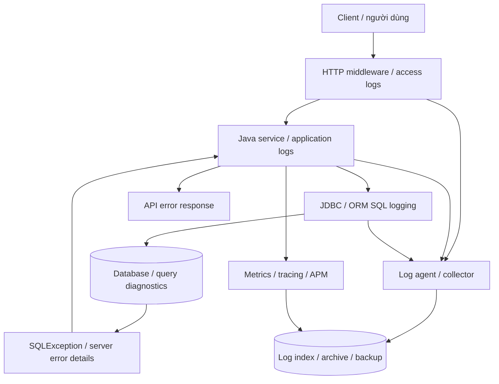
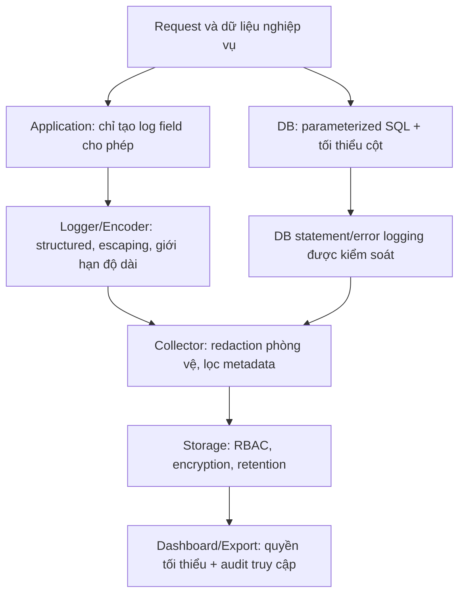
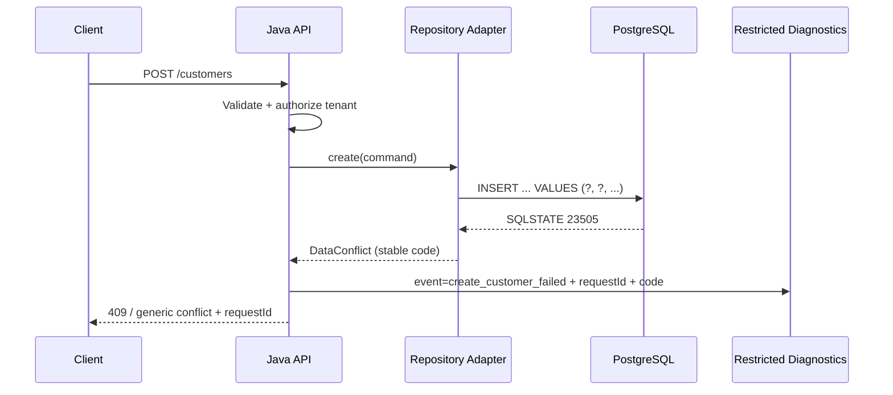

# Che thông tin nhạy cảm trong log, truy vấn và lỗi

## Mục tiêu học tập

Sau bài học, người học có thể:

- Xác định những loại dữ liệu cần bảo vệ khi ứng dụng Java truy cập persistence: bí mật đăng nhập, khóa API, token, số tài khoản, định danh cá nhân, dữ liệu khách hàng và thông tin nội bộ của hệ thống.
- Phân biệt **không thu thập (data minimization)**, **che một phần (masking)**, **loại bỏ/thay thế (redaction)**, **giả danh có khóa (pseudonymization)**, **mã hóa** và **kiểm soát quyền truy cập**.
- Chỉ ra các đường rò rỉ qua log HTTP, log JDBC/ORM, câu SQL, dữ liệu truy vấn, stack trace, thông báo lỗi, metrics và distributed tracing.
- Viết ví dụ Java sử dụng `PreparedStatement`, logging theo danh sách trường cho phép, exception mapping và correlation ID mà không phát tán dữ liệu nhạy cảm.
- Thiết kế các truy vấn hoặc DTO chỉ trả dữ liệu đủ dùng, kiểm tra quyền theo tenant, và hiểu giới hạn bảo vệ khi dùng SQL view hoặc masking tại database.
- Xây dựng test và quy trình vận hành để phát hiện lộ dữ liệu, ngăn lặp lại và xử lý sự cố khi thông tin nhạy cảm đã vào log.

## 1. Vì sao log và câu truy vấn cũng là một bề mặt rò rỉ dữ liệu?

Một dịch vụ Java nhận yêu cầu xem thông tin khách hàng. Dữ liệu cá nhân trong bảng database có thể được mã hóa ở ổ đĩa và chỉ tài khoản ứng dụng được phép đọc. Nhưng nếu lập trình viên ghi:

```java
// VÍ DỤ SAI: không đưa dữ liệu thật vào log như thế này.
log.info("Customer lookup: email={}, token={}", email, bearerToken);
```

thì **email và bearer token** có thể xuất hiện trong log của ứng dụng, stdout container, hệ thống thu thập tập trung, dashboard, bản sao lưu log, thông báo lỗi gửi chat hoặc ticket hỗ trợ. Một cơ chế mã hóa ở database **không bảo vệ bản sao được tạo ra trong log**.

Tương tự, một câu SQL được ghép trực tiếp từ đầu vào:

```java
// VÍ DỤ SAI: vừa có nguy cơ SQL injection vừa lộ dữ liệu.
String sql = "SELECT * FROM customer WHERE email = '" + email + "'";
log.debug("SQL: {}", sql);
```

có hai vấn đề **khác nhau**:

1. **SQL injection:** nội dung do người dùng cung cấp có thể thay đổi cấu trúc câu lệnh.
2. **Rò rỉ dữ liệu qua quan sát:** chuỗi truy vấn chứa email được đưa vào log, trace hoặc các công cụ chẩn đoán.

Đổi sang `PreparedStatement` giải quyết một phần lớn rủi ro SQL injection bằng cách tách **cấu trúc SQL** và **giá trị tham số**, nhưng **không tự bảo đảm** giá trị bind không bị công cụ debug JDBC/ORM hoặc database ghi lại. Hai nguy cơ phải được kiểm soát độc lập.

Trong phần **An toàn dữ liệu** của module `DATA_PERSISTENCE_FUNDAMENTALS`, vấn đề này gắn trực tiếp với thiết kế ranh giới persistence trong Java, bảo mật kết nối, giao dịch, truy vấn, schema, xử lý lỗi và khả năng vận hành. Một hệ thống chỉ an toàn khi dữ liệu nhạy cảm được bảo vệ **trên toàn bộ đường đi**, không chỉ trong bảng lưu trữ.

### Đường đi của dữ liệu và những nơi có thể sinh bản sao



**Tư duy cốt lõi:** càng nhiều nơi sao chép dữ liệu, số lượng quyền, thời hạn lưu và đường phát tán cần kiểm soát càng lớn. Ưu tiên **không phát sinh bản sao nhạy cảm** ngay từ đầu thay vì hy vọng bộ lọc cuối pipeline có thể xóa sạch mọi dấu vết.

## 2. Phân loại dữ liệu: cái gì được phép vào log?

Một hệ thống có thể có nhiều loại dữ liệu có mức rủi ro khác nhau. Quy tắc cụ thể phụ thuộc pháp luật, hợp đồng, chính sách công ty và loại hệ thống; bảng dưới là **ví dụ phân loại kỹ thuật**, không thay thế chính sách bảo vệ dữ liệu của tổ chức.

| Loại dữ liệu | Ví dụ | Cách xử lý log/trace mặc định |
| --- | --- | --- |
| **Bí mật xác thực** | Password, private key, API key, refresh/access token, session cookie, OTP | **Không ghi**, kể cả một phần token nếu không có chính sách chuyên biệt; không đưa vào URL/tag |
| **Thông tin thanh toán nhạy cảm** | Số thẻ đầy đủ, CVV, thông tin ngân hàng, khóa thanh toán | Không ghi raw; chỉ metadata được phê duyệt hoặc định danh thay thế |
| **Dữ liệu cá nhân (PII)** | Email, số điện thoại, địa chỉ, mã định danh, ngày sinh | Mặc định không ghi raw; chọn ID thay thế/masking theo mục đích được phép |
| **Dữ liệu nghiệp vụ bí mật** | Giá hợp đồng, mức lương, số dư, lịch sử giao dịch, hồ sơ sức khỏe | Không ghi payload; nếu cần audit, dùng schema tối thiểu có quyền riêng |
| **Chi tiết nội bộ** | JDBC URL, host DB, tên bảng riêng, SQL có tham số, stack trace | Không trả cho client; hạn chế ở kênh vận hành có quyền |
| **Telemetry ít nhạy cảm** | Tên use case cố định, trạng thái thành công, mã lỗi chuẩn hóa, duration, số hàng | Thường có thể ghi sau khi đánh giá rủi ro và cardinality |
| **Correlation ID** | ID do server sinh để nối request–log–trace | Có thể ghi khi không chứa thông tin cá nhân hoặc bí mật; vẫn kiểm soát quyền/retention |

**Lưu ý:** một `customerId` tưởng chỉ là số kỹ thuật nhưng vẫn có thể trở thành dữ liệu cá nhân nếu nó liên kết trực tiếp tới một người. Một `tenantId` có thể tiết lộ tên khách hàng hoặc quan hệ hợp đồng. Không mặc định mọi định danh nội bộ đều an toàn để đưa vào log công khai.

### 2.1. Phân loại theo mục đích sử dụng

Một trường có thể được dùng theo các mục đích khác nhau:

- **Chẩn đoán kỹ thuật:** cần biết endpoint nào lỗi, loại database error, thời lượng và ID truy vết; thường không cần nội dung email hoặc access token.
- **Kiểm toán nghiệp vụ:** cần biết ai đã thực hiện hành động gì, kết quả gì, lúc nào; có thể cần định danh đã phê duyệt, chữ ký hoặc log bất biến trong hệ thống **audit riêng**.
- **Hỗ trợ khách hàng:** có thể cần 4 chữ số cuối của mã giao dịch hoặc email đã che, nhưng không cần số thẻ đầy đủ.
- **Phát hiện lạm dụng:** đôi khi cần correlation ổn định giữa các sự kiện; có thể dùng pseudonymization có khóa và kiểm soát truy cập.

**Không nên dùng log debug làm sổ cái kiểm toán.** Audit log có schema, quyền, tính toàn vẹn, thời hạn lưu và lý do thu thập riêng; nó cũng phải tránh chứa bí mật không cần thiết.

## 3. Những kỹ thuật che dữ liệu và giới hạn của chúng

| Kỹ thuật | Cách làm | Phù hợp | Điều không được hiểu nhầm |
| --- | --- | --- | --- |
| **Không ghi (omit)** | Không tạo trường chứa dữ liệu nhạy cảm | Mật khẩu, token, payload giao dịch | Không thể tra lại giá trị từ log; đó thường là mục tiêu tốt |
| **Redaction** | Thay toàn bộ bằng `[REDACTED]` hoặc loại field | Header, body, thông tin lỗi không được phép hiển thị | Bộ lọc cuối pipeline có thể bỏ sót bản sao ở tầng trước |
| **Masking** | Chỉ hiện một phần theo chính sách | Email hỗ trợ, 4 số cuối định danh được phép | Phần hiện ra vẫn có thể nhận diện hoặc suy luận ra dữ liệu |
| **Tokenization** | Thay raw value bằng token ngẫu nhiên tra được trong kho riêng | Tham chiếu tới dữ liệu có kiểm soát | Kho ánh xạ token vẫn là mục tiêu cần bảo vệ; không phải mã hóa tự động |
| **Pseudonymization có khóa** | HMAC trên định danh chuẩn hóa để tạo dấu liên kết | Correlation giữa event nội bộ khi được phép | Có thể liên kết sự kiện, vẫn là dữ liệu cần bảo vệ; lộ khóa ảnh hưởng riêng tư |
| **Encryption** | Dùng khóa mã hóa để bảo vệ dữ liệu được lưu/truyền | Database, backup, log archive khi thực sự cần giữ dữ liệu | Nếu plaintext đã được log trước khi mã hóa ở tầng lưu, bí mật vẫn tồn tại trong hệ thống log |
| **Access control / retention** | Giới hạn người đọc, hệ thống nhận và thời gian lưu | Mọi loại log/tracing | Không sửa được việc đã thu thập quá mức hoặc gửi sang sai hệ thống |

**Masking có thể giúp giảm mức tiết lộ nhưng không đồng nghĩa ẩn danh.** Hiển thị `a***@example.com` vẫn tiết lộ domain, ký tự đầu và đôi khi đủ để đoán một người. Bốn số cuối của tài khoản cũng vẫn có thể là thông tin cá nhân. Chỉ che dữ liệu sau khi đã quyết định rằng **một phần đó thực sự cần** cho nhiệm vụ.

### 3.1. Vì sao regex xóa bí mật không nên là phòng tuyến duy nhất?

Một regex như `replaceAll("\\d{16}", "[REDACTED]")` có thể:

- Bỏ sót số thẻ có dấu cách/dấu gạch hoặc định dạng mới;
- Xóa nhầm 16 chữ số hợp lệ trong timestamp, mã bưu kiện hay tài khoản không thuộc loại cần che;
- Bỏ qua email/token nằm trong JSON nested, URL đã encode hoặc exception cause;
- Chỉ hoạt động **sau khi** dữ liệu nhạy cảm đã tồn tại trong log event gốc.

Vì vậy, **allowlist trường** tại nơi tạo log thường đáng tin hơn một danh sách mẫu cần xóa. Redaction ở log collector là **phòng tuyến bổ sung** cho dữ liệu không tránh được, không phải lý do để ghi toàn bộ request rồi lọc sau.

### 3.2. Hash trần không tự ẩn danh định danh dễ đoán

Để liên kết sự kiện theo cùng email, nhiều người dùng `SHA-256(email)` rồi cho rằng email đã ẩn danh. Nhưng email, số điện thoại hoặc mã vùng có không gian đoán được; kẻ có dữ liệu đầu vào ứng viên có thể băm chúng và so sánh với log (dictionary attack).

Một **HMAC có khóa bí mật** chống cách thử đoán ngoại tuyến nếu khóa được giữ an toàn. Tuy nhiên, cùng đầu vào vẫn tạo cùng đầu ra dưới cùng khóa, nên có thể theo dõi cùng người qua nhiều event. Nó là **giả danh**, không phải ẩn danh hoàn toàn. Phải quy định mục đích, vòng đời khóa, rotation, kiểm soát quyền và thời hạn giữ log.

## 4. Ngăn rò rỉ ngay tại ứng dụng Java

### 4.1. Đừng log toàn bộ request, entity hoặc đối tượng người dùng

Ví dụ thường gặp:

```java
// VÍ DỤ SAI: toString() có thể chứa email, token hoặc địa chỉ.
log.info("Received request: {}", request);

// VÍ DỤ SAI: JPA entity có thể chứa thông tin nhạy cảm,
// lazy relations hoặc toàn bộ dữ liệu thanh toán.
log.debug("Updated customer: {}", customerEntity);

// VÍ DỤ SAI: ghi nguyên response có thể phát tán thêm PII.
log.info("Response: {}", responseBody);
```

`record` trong Java sinh `toString()` chứa giá trị các thành phần, trừ khi được override. Với Lombok `@Data`, `@ToString` hoặc serializer debug, object có thể chứa thêm các quan hệ lồng nhau. **Không dựa vào `toString()` như một phép lọc bảo mật**.

Thay bằng log được tạo chủ động với **trường đã phê duyệt**:

```java
import org.slf4j.Logger;
import org.slf4j.LoggerFactory;
import java.util.UUID;

public final class CustomerLookupService {
    private static final Logger LOG =
            LoggerFactory.getLogger(CustomerLookupService.class);

    private final CustomerRepository repository;

    public CustomerLookupService(CustomerRepository repository) {
        this.repository = repository;
    }

    public CustomerSummary find(UUID tenantId, UUID customerId) {
        String operationId = UUID.randomUUID().toString();
        long started = System.nanoTime();
        LOG.info("customer_lookup_started operation_id={}", operationId);

        try {
            CustomerSummary result =
                    repository.findAuthorized(tenantId, customerId);
            LOG.info("customer_lookup_completed operation_id={} outcome=success",
                    operationId);
            return result;
        } catch (RuntimeException error) {
            LOG.warn("customer_lookup_failed operation_id={} error_type={}",
                    operationId, safeErrorCode(error));
            throw error;
        } finally {
            long elapsedMs = (System.nanoTime() - started) / 1_000_000L;
            LOG.debug("customer_lookup_duration operation_id={} elapsed_ms={}",
                    operationId, elapsedMs);
        }
    }

    private static String safeErrorCode(RuntimeException error) {
        if (error instanceof CustomerNotFound) {
            return "NOT_FOUND";
        }
        if (error instanceof PersistenceUnavailable) {
            return "PERSISTENCE_UNAVAILABLE";
        }
        return "UNEXPECTED";
    }
}
```

`CustomerRepository`, `CustomerSummary`, `CustomerNotFound` và `PersistenceUnavailable` là các kiểu giả định trong kiến trúc ứng dụng; ví dụ tập trung vào **chính sách logging**. Trong code thật, cần biết repository đã xác thực quyền theo tenant. Không ghi `tenantId`/`customerId` nếu chính sách phân loại định danh chưa cho phép; `operationId` mới được sinh riêng cho điều tra, không được tạo từ email hoặc token.

**Chú ý đến lời gọi lỗi:** `LOG.error("Failure", error)` thường in toàn bộ stack trace và cause; một `SQLException` hoặc lỗi validator có thể chứa SQL literal, tham số, tên bảng hoặc dữ liệu người dùng. Việc truyền exception làm đối số cuối cho logger không tự động che nội dung. Với sự cố cần stack trace, nên dùng **kênh chẩn đoán hạn chế quyền** và chính sách sanitize theo nguồn lỗi, không đẩy raw exception vào luồng log truy cập rộng.

### 4.2. Correlation ID và MDC không phải nơi đổ dữ liệu người dùng

SLF4J `MDC` giúp gắn các trường cố định như `request_id`, `trace_id` vào log. Một mẫu có quyền sở hữu rõ:

```java
import org.slf4j.MDC;
import java.util.UUID;

public void handleRequest() {
    String requestId = UUID.randomUUID().toString();
    try (MDC.MDCCloseable ignored = MDC.putCloseable(
            "request_id", requestId)) {
        executeUseCase();
    }
}
```

Ví dụ này dùng MDC với một ID server sinh. Trên thread pool, phải dọn MDC để không lẫn context giữa các request; với async/reactive, cách truyền context khác nhau theo framework, không mặc định `ThreadLocal` tự di chuyển qua thread khác. **Không đặt `Authorization`, `Cookie`, email hoặc toàn bộ request body vào MDC.**

### 4.3. Chặn log injection

Một giá trị do client điều khiển có thể chứa ký tự xuống dòng, chuỗi giống timestamp hoặc cú pháp JSON, khiến log text bị giả mạo thêm event. Không đưa input tự do vào message log; nếu bắt buộc ghi một trường được phép, dùng structured logger/encoder có xử lý escaping, giới hạn độ dài và whitelist ký tự theo ngữ nghĩa.

Không tin rằng logger dùng placeholder `{}` đã tự động **sanitize nội dung**: placeholder giúp tránh nối chuỗi thủ công nhưng vẫn có thể ghi toàn bộ giá trị được truyền vào.

## 5. Truy vấn dữ liệu: chọn đúng trường và che ở đúng ranh giới

### 5.1. Không dùng `SELECT *` khi use case chỉ cần vài trường

Giả sử bảng `customer` có email, số điện thoại, địa chỉ giao hàng, thông tin xác minh và một định danh công khai. Trang danh sách chỉ cần tên hiển thị và trạng thái tài khoản.

```sql
-- VÍ DỤ KHÔNG NÊN DÙNG cho trang danh sách:
SELECT *
FROM customer
WHERE tenant_id = ?;

-- HỢP LÝ HƠN: chỉ tải những trường màn hình thực sự cần.
SELECT public_id, display_name, account_status
FROM customer
WHERE tenant_id = ?
ORDER BY public_id
LIMIT ?;
```

Trong JDBC, dấu `?` được bind bằng `PreparedStatement`. Query thứ hai giảm số bản sao nhạy cảm đi qua driver, bộ nhớ Java, ORM entity, serializer và hệ thống tracing. Nó cũng có thể giảm dữ liệu truyền qua network, nhưng lợi ích hiệu năng cần được đo theo workload.

**Data minimization** là lớp bảo vệ quan trọng hơn việc dùng `SELECT *` rồi che email lúc trả HTTP: trường nhạy cảm đã bị đọc vào ứng dụng và có thể vô tình được log ở bất cứ bước nào trước khi serialize.

### 5.2. Dùng `PreparedStatement`, không ghép dữ liệu thành SQL literal

```java
import java.sql.Connection;
import java.sql.PreparedStatement;
import java.sql.ResultSet;
import java.sql.SQLException;
import java.util.UUID;
import javax.sql.DataSource;

public final class CustomerStatusReader {
    private final DataSource dataSource;

    public CustomerStatusReader(DataSource dataSource) {
        this.dataSource = dataSource;
    }

    public String findStatus(UUID tenantId, UUID publicId)
            throws SQLException {
        String sql = """
                SELECT account_status
                FROM customer
                WHERE tenant_id = ? AND public_id = ?
                """;
        try (Connection connection = dataSource.getConnection();
             PreparedStatement statement = connection.prepareStatement(sql)) {
            statement.setObject(1, tenantId);
            statement.setObject(2, publicId);

            try (ResultSet rows = statement.executeQuery()) {
                return rows.next() ? rows.getString("account_status") : null;
            }
        }
    }
}
```

Đoạn mã giả định ứng dụng đã xác định và kiểm tra `tenantId` theo ngữ cảnh xác thực. Trong thực tế, trả `null` có thể được thay bằng `Optional` hoặc kết quả miền thích hợp để phân biệt không tìm thấy và không được phép truy cập; lỗi database phải được xử lý ở ranh giới lỗi. Mục đích chính ở đây là **tham số hóa SQL, lọc tenant và không đọc cột nhạy cảm không cần thiết**.

#### Tham số hóa SQL giải quyết những gì?

| Cơ chế | Nguy cơ được giảm | Điều chưa được bảo vệ |
| --- | --- | --- |
| Bind `?` bằng `PreparedStatement` | Giảm SQL injection vì tham số được truyền như dữ liệu | Logger của JDBC/ORM có thể ghi bind values |
| Không in `sql + params` | Giảm bản sao giá trị nhạy cảm tại application log | DB/query diagnostic có thể ghi statement và tham số |
| Chọn đúng các cột | Giảm việc truyền các cột nhạy cảm vào Java | Cột vẫn tồn tại trong DB và cần quyền/backup phù hợp |
| Lọc theo tenant | Giảm nguy cơ đọc nhầm dữ liệu tenant | Cần xác thực/ủy quyền và bảo vệ cả mọi đường ghi |
| Mask DTO hoặc response | Giảm giá trị lộ cho client | Không xóa dữ liệu thô đã tải hoặc log ở tầng trước |

Với tên bảng, tên cột hoặc `ORDER BY` động, **bind parameter không thay cho identifier**. Không nối raw input vào identifier; hãy dùng danh sách cột/sort được phép và mapping cố định trong mã.

### 5.3. Mask trong phép chiếu SQL khi người gọi chỉ cần thông tin gợi ý

Một trang hỗ trợ khách hàng chỉ cần biết số điện thoại nào đang đăng ký thông qua **vài số cuối đã được cho phép hiển thị**:

```sql
-- PostgreSQL: giả định hỗ trợ viên đã được kiểm tra quyền theo tenant.
SELECT
    public_id,
    CASE
        WHEN phone IS NULL THEN NULL
        WHEN length(phone) > 4
            THEN repeat('*', length(phone) - 4) || right(phone, 4)
        ELSE '[REDACTED]'
    END AS phone_hint
FROM customer
WHERE tenant_id = ?
  AND public_id = ?;
```

Đoạn truy vấn **không trả nguyên cột `phone`** cho use case này. Nhưng nó vẫn đọc dữ liệu gốc bên trong database để biến đổi, và giá trị `phone_hint` có thể tiết lộ một phần thông tin. Tên cột, số ký tự lộ và quyền hiển thị phải xuất phát từ chính sách nghiệp vụ. Với số điện thoại có ký tự `+`, khoảng trắng hoặc dấu gạch, chính sách che cần thống nhất cách chuẩn hóa nếu cần.

Nếu dùng một SQL view đã mask, hãy cấp quyền theo **least privilege**: role chỉ nên thấy view/những cột được cho phép, không tự có quyền đọc bảng thô. Cần kiểm thử với đúng DB role của người truy cập. **Không mặc định view là lớp bảo mật đầy đủ**: trong PostgreSQL, quyền truy cập và hành vi Row Level Security qua view phụ thuộc owner, cấu hình view và phiên bản; phải xác minh với DBA thay vì suy luận từ `CREATE VIEW`.

### 5.4. Query result và pagination vẫn có thể gây rò rỉ

Khi query trả hàng nghìn record chứa email hoặc địa chỉ:

- Một `ResultSet` bị log/debug toàn bộ có thể đưa dữ liệu hàng loạt lên log;
- Exception trong mapper có thể chứa raw row để mô tả lỗi conversion;
- Công cụ APM có thể chụp SQL statement, bind values hoặc response body;
- Query export dữ liệu hàng loạt có thể tạo file CSV/JSON không được phân quyền;
- Nhiều công cụ BI hoặc notebook giữ **kết quả truy vấn** trong history, cache và bản tải xuống.

Vì vậy, thiết kế **projection, giới hạn số hàng, tenant scope, quyền truy vấn, thời hạn giữ và kênh xuất dữ liệu** trước khi chỉ tập trung vào việc che giá trị trong log.

## 6. PostgreSQL và công cụ ORM: truy vấn có thể xuất hiện ở đâu?

Ngay cả khi Java không gọi `LOG.debug("SQL ...")`, thông tin truy vấn vẫn có thể được ghi hoặc hiển thị ở tầng khác. Đây là những điểm cần rà soát theo cấu hình và **phiên bản đang sử dụng**:

| Nguồn quan sát | Có thể chứa | Kiểm soát đề xuất |
| --- | --- | --- |
| **Hibernate SQL logger** | Câu SQL phát ra, có thể gồm literal hoặc thông tin schema | Tắt debug/trace SQL không cần thiết; kiểm soát quyền log |
| **Hibernate JDBC bind logger** | Giá trị tham số bind, kể cả email/token nếu query dùng chúng | Không bật bind-value TRACE trên production có dữ liệu thật nếu chưa có cơ chế che được kiểm chứng |
| **JDBC proxy/logger** | SQL + parameters + thời gian truy vấn | Cấu hình chặn raw params, dùng mã query/operation thay vì in dữ liệu |
| **PostgreSQL statement/error logs** | Câu SQL, một số giá trị tham số/chi tiết lỗi tùy cấu hình | Rà `log_statement`, `log_min_duration_statement`, `log_min_error_statement` và tham số logging |
| **`pg_stat_activity`** | `query` hoặc hoạt động của backend | Hạn chế quyền xem thống kê; tránh copy query nguyên văn |
| **`pg_stat_statements`** | Mẫu câu SQL, query ID, chỉ số thực thi | Query normalization không phải cơ chế khử dữ liệu nhạy cảm được bảo đảm cho mọi câu lệnh |
| **`auto_explain` / plan logs** | Kế hoạch truy vấn và predicate trong một số cấu hình | Đánh giá mức nhạy cảm, sampling và nơi lưu log |
| **APM / trace collector** | Database statement, tags, query args, exception events | Chỉ thu thuộc tính đã kiểm tra; hạn chế sampling/capture payload |
| **SQL console/history** | Câu query thực thi thủ công và file xuất | Quy định cách truy vấn, phân quyền máy trạm và thời hạn lưu history |

### 6.1. Tắt SQL bind logging là một thao tác bảo mật, không chỉ giảm độ ồn

Với Hibernate, tên logger và khả năng log bind parameter thay đổi theo major version. Một số phiên bản dùng category như `org.hibernate.orm.jdbc.bind` ở mức `TRACE`. Nếu bật loại này để debug, một lệnh:

```sql
SELECT id FROM customer WHERE email = ?;
```

có thể khiến **giá trị bind email** xuất hiện trong log dù cấu trúc SQL dùng placeholder. Với hệ thống có dữ liệu thật, phải xác định chính xác category đã bật, logger nào chuyển nội dung sang console/collector, thời gian lưu và ai được xem.

**Không bật TRACE toàn ORM trên production** như một thao tác mặc định khi điều tra độ trễ. Thường có thể đo timing, số lượng query, plan, `queryid` và pool metrics mà không cần capture raw parameters. Nếu thực sự cần chẩn đoán có dữ liệu nhạy cảm, sử dụng môi trường dữ liệu tổng hợp hoặc quy trình truy cập đặc biệt có phạm vi/thời hạn ngắn và phê duyệt phù hợp.

### 6.2. Các tham số log PostgreSQL cần được kiểm tra

Trong cấu hình PostgreSQL có những tham số liên quan như:

- `log_statement`: kiểm soát nhóm statement được log.
- `log_min_duration_statement`: ghi các statement vượt ngưỡng thời gian được cấu hình.
- `log_min_error_statement`: có thể ghi statement liên quan tới error khi đạt ngưỡng.
- `log_parameter_max_length` và `log_parameter_max_length_on_error`: ở các phiên bản hỗ trợ, kiểm soát lượng giá trị bind parameter được ghi trong những ngữ cảnh tương ứng.
- `log_line_prefix`: thêm metadata giúp tương quan sự kiện, nhưng tránh đưa payload người dùng vào phần prefix do ứng dụng tùy biến.

**Cảnh báo:** ngữ nghĩa, phạm vi áp dụng, mặc định và khả năng thay đổi các tham số phụ thuộc phiên bản PostgreSQL và dịch vụ quản lý. Không chép một đoạn cấu hình trên mạng rồi mặc định các nguồn log đã sạch. DBA cần xem chính tài liệu/`SHOW` của phiên bản đang chạy, thử với **giá trị giả lập** ở môi trường riêng, và kiểm tra file log/collector thực sự nhận được gì.

Không có một thiết lập server đơn lẻ nào bảo vệ tất cả bản sao do ứng dụng, proxy, JDBC driver, query console và tracing tạo ra.

### 6.3. Quan sát lock và connection mà không cần lấy nguyên SQL text

Khi điều tra query chậm hoặc transaction treo, một truy vấn thống kê có thể chỉ chọn các trường vận hành:

```sql
SELECT
    pid,
    state,
    wait_event_type,
    wait_event,
    now() - xact_start AS transaction_age,
    pg_blocking_pids(pid) AS blocking_pids
FROM pg_stat_activity
WHERE datname = current_database()
  AND backend_type = 'client backend'
ORDER BY xact_start NULLS LAST;
```

Truy vấn trên **không lấy cột `query`**, qua đó giảm nguy cơ vô tình copy literal SQL vào ticket. Tuy nhiên `pid` và thông tin thống kê vẫn là dữ liệu nội bộ; quyền xem được kiểm soát theo vai trò. Tương tự, nếu `pg_stat_statements` đã được bật, có thể ưu tiên các chỉ số `queryid`, `calls`, `total_exec_time` và `shared_blks_read` để xếp hạng chi phí mà không xuất `query` nguyên văn:

```sql
-- Chỉ chạy nếu extension/phiên bản hỗ trợ các cột này.
SELECT
    queryid,
    calls,
    round(total_exec_time::numeric, 2) AS total_exec_ms,
    shared_blks_read
FROM pg_stat_statements
ORDER BY total_exec_time DESC
LIMIT 20;
```

`queryid` phục vụ nhận diện mẫu câu lệnh, không phải một mã bảo mật để chứng minh SQL không chứa dữ liệu nhạy cảm. Với một số loại statement, thông tin tên bảng, identifier hoặc literal vẫn có thể tồn tại trong plan/log khác. Việc giảm dữ liệu trong câu `SELECT` chẩn đoán là **một lớp phòng vệ**.

### 6.4. `EXPLAIN` cũng cần lưu ý quyền truy cập

`EXPLAIN` có thể hiển thị filter condition, tên bảng/index và các literal hoặc thống kê liên quan tới truy vấn. Không dán plan chứa dữ liệu thực hoặc SQL nhạy cảm vào issue công khai. `EXPLAIN ANALYZE` còn **thực thi câu SQL**, nên không chạy trên lệnh ghi/xóa ở production chỉ để “xem hiệu năng” mà chưa hiểu tác dụng phụ và quyền.

Các công cụ quản trị database, migration và backup cũng có log/history riêng; cần áp cùng chính sách phân loại dữ liệu cho các kênh này.

## 7. Lỗi database và HTTP: thông báo đúng nhưng không tiết lộ nội bộ

Một ứng dụng có thể tạo lỗi từ nhiều tầng:

```text
Client input -> Validation -> Service -> JDBC/ORM -> PostgreSQL
                                      |
                                      v
                                SQLException
                                      |
                            Error mapping boundary
                                      |
                        Stable code + safe response
```

Đoạn mã không nên có dạng:

```java
// VÍ DỤ SAI: thông báo vendor có thể chứa SQL, column, value hoặc host.
catch (SQLException error) {
    return ResponseEntity.status(500).body(error.getMessage());
}
```

Message từ database có thể bao gồm tên constraint/table, giá trị gây trùng, chi tiết câu truy vấn, tên host, lỗi kết nối hoặc tham số. Nó được tạo để chẩn đoán hệ quản trị, **không phải thông báo an toàn cho người dùng cuối**.

### 7.1. Phân loại lỗi từ tín hiệu có cấu trúc

Trong PostgreSQL, `SQLSTATE` giúp phân loại lỗi mà không cần đưa raw `SQLException.getMessage()` ra ngoài:

| SQLSTATE ví dụ | Ý nghĩa phổ biến | Cách xử lý thường phù hợp |
| --- | --- | --- |
| `23505` | Unique violation | Chuyển thành conflict nghiệp vụ nếu đúng constraint dự kiến; không lộ giá trị duplicate |
| `23503` | Foreign-key violation | Xử lý dữ liệu tham chiếu không hợp lệ, tránh lộ sự tồn tại của tài nguyên không được phép xem |
| `23502` | Not-null violation | Xem lại validation/schema; không trả tên cột nhạy cảm |
| `40001` | Serialization failure | Rollback và cân nhắc retry **toàn transaction** có giới hạn |
| `40P01` | Deadlock detected | Rollback, retry có kiểm soát và điều tra thứ tự khóa |
| Nhóm `08xxx` | Lỗi kết nối | Báo không khả dụng tạm thời; kiểm tra commit outcome trước khi retry side effect |

**Không map mọi `23505` thành “Email đã tồn tại”**: cùng SQLSTATE có thể đến từ unique constraint khác. Chỉ ánh xạ sang thông điệp nghiệp vụ cụ thể khi adapter biết **rõ thao tác và ràng buộc nào** có thể gây lỗi và việc tiết lộ đó được phép; không trích tên/value constraint từ raw error để đưa thẳng ra client.

Lỗi timeout ngay khi `commit()` đặc biệt nguy hiểm: việc mất response không chứng minh transaction chưa commit. Nếu use case tạo đơn hoặc chuyển tiền, dùng idempotency key và đường tra cứu trạng thái; không retry mù chỉ vì client nhận HTTP 500.

### 7.2. Trả lỗi API có cấu trúc, tách chi tiết nội bộ

Một hợp đồng phản hồi đơn giản:

```json
{
  "code": "PERSISTENCE_UNAVAILABLE",
  "message": "Không thể hoàn tất yêu cầu lúc này.",
  "requestId": "4ed37b44-9bc7-4e9e-89ea-3eb8403a7f74"
}
```

`requestId` là ID ví dụ được server tạo để truy vết; không phải email, số thẻ hay token. HTTP status nên phản ánh loại tình huống (chẳng hạn `503` cho backend tạm không khả dụng), nhưng không cho biết connection URL, tên database, user DB, SQL query hoặc stack trace.

Một mapper thuần Java có thể giữ ranh giới rõ:

```java
public record PublicError(
        String code, String message, String requestId) {}

public final class PublicErrorMapper {
    private PublicErrorMapper() {}

    public static PublicError map(
            RuntimeException error, String requestId) {
        if (error instanceof CustomerNotFound) {
            return new PublicError(
                    "NOT_FOUND", "Không tìm thấy tài nguyên.", requestId);
        }
        if (error instanceof DataConflict) {
            return new PublicError(
                    "CONFLICT", "Yêu cầu xung đột với trạng thái hiện tại.",
                    requestId);
        }
        if (error instanceof PersistenceUnavailable) {
            return new PublicError(
                    "PERSISTENCE_UNAVAILABLE",
                    "Không thể hoàn tất yêu cầu lúc này.", requestId);
        }
        return new PublicError(
                "INTERNAL_ERROR", "Đã xảy ra lỗi hệ thống.", requestId);
    }
}
```

`CustomerNotFound`, `DataConflict` và `PersistenceUnavailable` ở đây đại diện cho **exception ứng dụng được định nghĩa có chủ đích**. Controller hoặc `@RestControllerAdvice` của Spring chuyển `PublicError` thành status/code thích hợp. Nếu cần phân biệt `403` và `404`, quyết định phải dựa trên chính sách ủy quyền; không tiết lộ sự tồn tại của tài nguyên chỉ để giúp debug.

### 7.3. Lưu nguyên nhân lỗi nhưng đừng tự động log nguyên nhân

Một adapter có thể giữ `SQLException` làm `cause` trong exception nội bộ để hệ thống có khả năng điều tra; **điều đó không cho phép** in toàn bộ exception vào log hoặc response. Định nghĩa logging policy tại điểm bắt và truyền qua tầng ngoài:

- Log mã lỗi chuẩn hóa, tên thao tác cố định, `requestId` và thông tin thống kê đủ dùng.
- Khi cần xem stack, dùng một kênh chẩn đoán kiểm soát quyền và kỹ thuật sanitize được kiểm chứng, hoặc môi trường tái hiện với dữ liệu tổng hợp.
- Không ghép `exception.getMessage()`, `getNextException()`, raw SQL, parameters hoặc `toString()` của entity vào response.
- Đặt giới hạn độ dài và xử lý control characters với mọi chuỗi từ bên ngoài đi vào log.

Một câu thông báo lỗi **hữu ích** vẫn có thể an toàn: “Không tìm thấy đơn hàng” hoặc “Yêu cầu xung đột phiên bản” thường đủ cho client hành động; vị trí lỗi JDBC, pool và schema nằm ở hệ thống quan sát nội bộ.

## 8. Metrics và distributed tracing: không phải nơi lưu định danh người dùng

Khi điều tra độ trễ persistence, hệ thống thường có metrics của HTTP, HikariCP, JDBC và PostgreSQL. Một metric có label chứa dữ liệu cá nhân vừa tạo rủi ro bảo mật, vừa làm hệ thống quan sát tốn tài nguyên vì **cardinality cao**.

### 8.1. Tag an toàn và tag nguy hiểm

| Metric/trace field | Ví dụ | Đánh giá |
| --- | --- | --- |
| `operation=list_customer` | Tên use case cố định | Thường chấp nhận được |
| `outcome=success / timeout / conflict` | Danh sách enum ngắn | Thường chấp nhận được |
| `db.system=postgresql` | Loại hệ quản trị | Có thể được phép; vẫn là metadata nội bộ |
| `db.statement_fingerprint=...` | Mẫu query không chứa raw params | Hữu ích nếu công cụ tạo fingerprint theo chính sách bảo mật |
| `customer.email=...` | Email từ request | Không đưa vào metric tag hoặc trace mặc định |
| `authorization=Bearer ...` | Token HTTP | **Không được ghi** |
| `tenant.id=...` | Một giá trị riêng cho từng tenant | Có thể tiết lộ quan hệ hợp đồng và gây cardinality; cần đánh giá riêng |
| `url.full=/reset?token=...` | URL có token trong query | Không thu nguyên URL, phải loại/redact query nhạy cảm |
| `db.connection_string=...` | URI có host/user/password | Không gửi toàn bộ connection string vào telemetry |

Giữ các nhãn đo ở tập giá trị **nhỏ và ổn định** như `operation`, `outcome`, `pool` đã chuẩn hóa, `shard_group` nếu có chính sách. Không gắn `userId`, `email`, `orderId`, SQL bind value hoặc exception message làm label. Những giá trị này có thể tạo hàng triệu chuỗi thời gian và lan tới backup/dashboard.

### 8.2. Span/trace nên mô tả hành động, không sao chép payload

Một trace cho use case đọc đơn có thể có cấu trúc:

```text
HTTP GET /orders/{id}      142 ms
  order.read                133 ms
    connection.acquire      11 ms
    db.select_orders       101 ms
    dto.mapping             14 ms
response serialization       9 ms
```

Tên route được **chuẩn hóa**; không đưa ID thật, email hay token từ URL vào `span.name`. Thời gian và số lượng hàng (nếu phù hợp) thường đủ giúp phân biệt truy vấn chậm, chờ pool và mapping nặng.

Một số SDK/instrumentation tự thu `db.statement`, `url.full`, `http.request.header.*` hoặc `exception.message`. **Không mặc định cấu hình mặc định của SDK là an toàn cho hệ thống dữ liệu thật**. Cần kiểm kê:

- Thuộc tính nào được tạo tự động, kể cả ở span bị lỗi;
- Thuộc tính nào được exporter gửi trước khi processor che dữ liệu;
- Collector xử lý gì trước khi dữ liệu vào dashboard, archive hoặc third-party SaaS;
- Span event/exceptions có đính kèm stack/cause hoặc SQL text không;
- Sampling có thay đổi loại nội dung capture hay chỉ thay đổi tần suất?

Sampling **giảm số bản sao**, không biến việc thu raw secret thành an toàn: chỉ một trace chứa token cũng có thể là sự cố.

### 8.3. Ví dụ Micrometer: chỉ đo sự kiện cho phép

```java
import io.micrometer.core.instrument.Counter;
import io.micrometer.core.instrument.MeterRegistry;

public final class PersistenceMetrics {
    private final Counter conflictCount;

    public PersistenceMetrics(MeterRegistry registry) {
        this.conflictCount = Counter.builder("persistence.conflicts")
                .description("Number of expected data conflicts")
                .tag("operation", "create_customer")
                .tag("reason", "unique_conflict")
                .register(registry);
    }

    public void recordConflict() {
        conflictCount.increment();
    }
}
```

Ví dụ dùng tên thao tác và nguyên nhân **cố định**, không gắn email gây xung đột hoặc tên constraint chưa được duyệt. Để điều tra một sự kiện cụ thể, dùng `requestId` từ log bảo vệ quyền thay vì gắn ID duy nhất của từng khách hàng lên metric.

## 9. Bí mật trong cấu hình, URL kết nối và lỗi khởi tạo

Ngay từ lúc mở một `DataSource`, thông tin kết nối có thể lộ khi ứng dụng ghi cấu hình hoặc exception:

```text
VÍ DỤ KHÔNG AN TOÀN:
  logger.info("jdbc config={}", allProperties);
  logger.error("Cannot connect to {}", jdbcUrlWithCredentials);
  supportTicket.attach(fullStartupLogs);
```

Nguy cơ bao gồm:

- Password nằm trong JDBC URL, environment variable, command-line argument hoặc properties được dump;
- Pool/driver in cấu hình trong lúc debug;
- Container stdout được chuyển đến hệ thống log với quyền đọc quá rộng;
- Hệ thống CI/CD ghi secret vào build log hoặc shell history;
- Exception chứa host, user, certificate path, keystore location hoặc cấu hình TLS;
- APM thu `db.connection_string` và xuất tới bên thứ ba.

### 9.1. Quy tắc quản lý bí mật kết nối

1. **Không hard-code secret** trong source, test snapshot, stack trace, URL được chia sẻ hoặc tài liệu.
2. Cấp bí mật qua cơ chế quản lý secret phù hợp với môi trường: secret manager, workload identity, injected secret file hoặc kênh cấu hình được bảo vệ.
3. Chỉ thành phần khởi tạo DataSource cần đọc secret; không truyền nguyên connection properties qua nhiều lớp nghiệp vụ.
4. Không log `DataSource`/properties object nếu `toString()` có thể in giá trị bí mật.
5. Dùng role DB với quyền tối thiểu, tách tài khoản của ứng dụng, migration và công cụ quản trị.
6. Chuẩn bị **rotation và revocation**: một password/token bị lộ trong log phải có thể thu hồi mà không buộc giữ nguyên lâu dài.
7. Phân quyền log và alert: cảnh báo “kết nối thất bại” có thể hiển thị mã lỗi, pool, loại lỗi và `requestId`; không cần password hoặc toàn bộ URL.

Nếu cần nhận diện endpoint để điều tra, có thể log một **mã cấu hình ổn định** như `db_target=orders-primary` đã được phê duyệt, thay vì một URL chứa host/user/pass. Ngay cả địa chỉ DB và tên tài nguyên có thể là thông tin nội bộ nhạy cảm, nên quyền xem vẫn cần giới hạn.

### 9.2. HTTP query string và header cũng là đường thất thoát

Các URL như `/reset-password?token=...` có thể đi vào browser history, HTTP access log, reverse proxy, CDN, APM và header `Referer`. Với bí mật xác thực, thiết kế giao thức phải tránh đưa chúng vào query string không cần thiết; áp dụng chính sách header, cookie và log thích hợp.

Không log `Authorization`, `Cookie`, `Set-Cookie`, mã OTP, password form hay raw HTTP request body. Một reverse proxy có thể đã ghi chúng **trước khi request đến Java**; vì thế chỉ sửa logger trong Spring controller chưa đủ.

### 9.3. Bảo vệ cả dữ liệu trong file và bản sao lưu

Log và trace có thể được lưu nhiều nơi trong thời gian dài hơn chính database. Cần biết:

- Log index và object archive nằm ở đâu, được mã hóa/kiểm soát quyền thế nào;
- Có bản sao trong backup, snapshot, export hoặc ticket nào;
- Chính sách retention có áp dụng cho mọi bản sao và job xử lý log không;
- Ai có quyền query từng chỉ mục, tải bulk export hoặc thay đổi pipeline redaction.

Nếu cần giữ một dữ liệu nhạy cảm vì quy định kiểm toán, hãy có **kho audit được thiết kế riêng**, chứ không tự động tăng mức log debug cho toàn dịch vụ.

## 10. Khi cần correlation ổn định: dùng mã thay thế có chính sách

Nhiều lỗi persistence cần nối các request có liên quan mà không biết raw email. Cách đơn giản nhất thường là sử dụng một **internal opaque ID** do hệ thống cấp và được phép ghi. Nếu không thể hoặc không muốn đưa ID đó ra telemetry, có thể tạo dấu HMAC có khóa cho một định danh đã được phép liên kết.

### 10.1. Java HMAC-SHA256 cho mục đích giả danh có kiểm soát

```java
import java.nio.charset.StandardCharsets;
import java.security.GeneralSecurityException;
import java.util.HexFormat;
import java.util.Objects;
import javax.crypto.Mac;
import javax.crypto.SecretKey;

public final class CorrelationTagger {
    private final SecretKey secretKey;

    // secretKey được lấy từ secret manager/keystore, KHÔNG hard-code.
    public CorrelationTagger(SecretKey secretKey) {
        this.secretKey = Objects.requireNonNull(secretKey, "secretKey");
    }

    public String tagTrustedInternalId(String internalId) {
        Objects.requireNonNull(internalId, "internalId");
        try {
            Mac mac = Mac.getInstance("HmacSHA256");
            mac.init(secretKey);
            byte[] digest = mac.doFinal(
                    internalId.getBytes(StandardCharsets.UTF_8));
            return HexFormat.of().formatHex(digest);
        } catch (GeneralSecurityException cryptoFailure) {
            // Không in key, input hoặc nội dung exception ra log.
            throw new IllegalStateException("Correlation tag unavailable");
        }
    }
}
```

Ví dụ sử dụng `javax.crypto.Mac` của JDK, không yêu cầu external crypto library. Một `Mac` mới được tạo cho mỗi lời gọi để không chia sẻ state mutable giữa các thread. Key phải có mục đích/độ dài phù hợp, được cấp bởi cơ chế secret management và luân chuyển có kế hoạch.

**Các giới hạn không thể bỏ qua:**

- HMAC chỉ hữu ích khi `secretKey` thực sự bí mật; không dùng một hằng số đặt trong source.
- Nếu input là email/số điện thoại, phải xác định chính sách chuẩn hóa chính xác; chuẩn hóa sai có thể làm các giá trị hợp lệ khác nhau bị gộp nhầm. Không âm thầm sửa nghĩa định danh để tiện correlation.
- Cùng input cùng key cho kết quả giống nhau, nên **có thể theo dõi lâu dài**; tag vẫn có thể là dữ liệu được bảo vệ theo chính sách.
- Rotation key làm tag của cùng ID thay đổi; cần chọn chiến lược chuyển giai đoạn và thời hạn correlation, không tự giữ key cũ mãi mãi.
- Không dùng HMAC tag theo từng người làm **metric label**; cardinality vẫn cao dù không chứa raw email.
- HMAC không thay encryption khi cần giải mã lại dữ liệu, không tạo phân quyền và không giải quyết lộ dữ liệu ở nguồn khác.

Với chẩn đoán đơn giản, thường chỉ cần **request ID ngẫu nhiên**. HMAC chỉ nên được dùng khi nghiệp vụ thực sự yêu cầu liên kết sự kiện theo một đối tượng mà không ghi raw identifier và đã được phê duyệt.

## 11. Thiết kế redaction theo nhiều lớp

Một chính sách tốt có thể được mô tả bằng một pipeline rõ ràng:



**Không có lớp nào thay được toàn bộ các lớp còn lại.** Một tác nhân vận hành có quyền truy cập database log có thể thấy dữ liệu mà application logger không biết; một proxy HTTP có thể ghi header trước khi request đi vào controller; một log pipeline có thể giữ raw event ở buffer hoặc dead-letter queue dù index chính đã redact.

### 11.1. Nguyên tắc thiết kế schema log

Tạo schema cố định thay vì chuỗi message tùy ý:

| Trường | Ví dụ giá trị | Nguồn |
| --- | --- | --- |
| `event` | `customer_lookup_failed` | Hằng từ code |
| `request_id` | Opaque UUID server sinh | Middleware đã xác thực/kiểm tra |
| `operation` | `read_customer_status` | Danh sách enum cho phép |
| `outcome` | `timeout` / `denied` / `success` | Enum |
| `error_code` | `PERSISTENCE_UNAVAILABLE` | Error mapper |
| `elapsed_ms` | `37` | Timer monotonic |
| `db_role` | `app_readonly` | Mã cấu hình đã phê duyệt |

Không tự thêm `sql_params`, `request_body`, `customer_email`, `bearer_token` hoặc `exception_message` vào schema chỉ vì kỹ thuật logging hỗ trợ lưu JSON tùy ý.

### 11.2. Phân quyền và vòng đời log

Log không phải dữ liệu công khai. Một tổ chức có thể chia quyền:

- Developer xem **metrics aggregate** và các log với trường an toàn;
- On-call được truy cập log chi tiết có giới hạn cho điều tra sự cố;
- Security/audit có kho riêng cho những event cần định danh theo chính sách;
- Dịch vụ bên thứ ba chỉ nhận trường đã qua data minimization và được phê duyệt.

Thời hạn giữ log nên gắn với mục đích chẩn đoán, yêu cầu pháp lý/hợp đồng và khả năng xóa; bản copy trong backup, snapshot, data lake và ticket cũng phải được tính. **Giảm thời gian lưu không bù được việc ghi sai một bí mật đặc biệt nhạy cảm**, nhưng có thể giảm phạm vi ảnh hưởng nếu sự cố xảy ra.

### 11.3. Security-by-default cho log debug

Khi cần bật debug:

1. Ưu tiên staging/test có dữ liệu tổng hợp.
2. Chỉ bật component cụ thể, trong thời hạn ngắn, với người có thẩm quyền.
3. Trước khi bật, kiểm tra nội dung thực của logger bằng dữ liệu **giả** đại diện email, token, SQL bind và validation error.
4. Đảm bảo collector/dropbox/tracing không lưu bản raw ngoài phạm vi dự định.
5. Tắt lại, kiểm tra kết quả, ghi nhận thay đổi cấu hình và quyền được sử dụng.

Một “debug flag” không kiểm tra dữ liệu có thể đưa toàn bộ tham số của các truy vấn persistence thành bản sao lưu dài hạn. Đừng để hệ thống tự bật TRACE của ORM chỉ vì một request có lỗi.

## 12. Kiểm thử tự động: chứng minh bí mật không xuất hiện ở đường dễ quên

Kiểm thử không nên chỉ kiểm tra JSON response “không có password”. Dữ liệu có thể xuất hiện trong log dù response đã an toàn. Cần test cả **đường thành công, validation error, database error, timeout, conflict và exception bất ngờ**.

### 12.1. Test chính sách log bằng dữ liệu tổng hợp

Giả sử ứng dụng có một helper xử lý lỗi xác thực:

```java
import org.slf4j.Logger;
import org.slf4j.LoggerFactory;

public final class SafeAuthEvents {
    private static final Logger LOG =
            LoggerFactory.getLogger(SafeAuthEvents.class);

    private SafeAuthEvents() {}

    public static void invalidToken(String requestId, String suppliedToken) {
        // suppliedToken có thể được dùng để kiểm tra hợp lệ ở tầng auth;
        // tuyệt đối KHÔNG truyền nó vào log event.
        LOG.warn("authentication_rejected request_id={} reason=invalid_token",
                requestId);
    }
}
```

Trong test dùng **token giả**, không dùng token thật từ môi trường:

```java
import ch.qos.logback.classic.Logger;
import ch.qos.logback.classic.spi.ILoggingEvent;
import ch.qos.logback.core.read.ListAppender;
import org.junit.jupiter.api.Test;
import org.slf4j.LoggerFactory;
import java.util.stream.Collectors;

import static org.junit.jupiter.api.Assertions.*;

class SafeAuthEventsTest {
    @Test
    void rawTokenMustNotAppearInApplicationLog() {
        Logger logger =
                (Logger) LoggerFactory.getLogger(SafeAuthEvents.class);
        ListAppender<ILoggingEvent> appender = new ListAppender<>();
        appender.start();
        logger.addAppender(appender);
        String canary = "SYNTHETIC_SECRET_NOT_FOR_LOGS_123";

        try {
            SafeAuthEvents.invalidToken("test-request-1", canary);
            String captured = appender.list.stream()
                    .map(ILoggingEvent::getFormattedMessage)
                    .collect(Collectors.joining("\n"));
            assertFalse(captured.contains(canary));
            assertTrue(captured.contains("authentication_rejected"));
        } finally {
            logger.detachAppender(appender);
            appender.stop();
        }
    }
}
```

Đây là ví dụ JUnit 5 + **Logback classic**. Nó không chạy được nếu ứng dụng dùng backend SLF4J khác; khi đó cần adapter test tương ứng. Nó chứng minh chính sách của **một logger/một đường thực thi** và chỉ kiểm tra formatted message, **chưa chứng minh** structured arguments, MDC, stack trace, JSON encoder hoặc collector không rò rỉ. Với test song song, tránh dùng một logger/appender chia sẻ mà không cô lập.

### 12.2. Test từ đầu tới cuối mới phát hiện được log ngoài ứng dụng

Một test tích hợp cần tạo dữ liệu giả có marker nhận diện, rồi chạy **các đường phát sinh nội dung**:

1. Gửi một request hợp lệ chứa email/định danh giả cần bảo vệ.
2. Gửi request sai validation để tạo `400`/`422` theo API thực.
3. Chủ động tạo lỗi unique hoặc foreign key bằng dữ liệu **giả**.
4. Giả lập database timeout hoặc connection pool acquisition timeout.
5. Bật chế độ chẩn đoán đã dự định dùng và chạy query có bind parameter giả.
6. Thu kết quả HTTP, application logs, proxy/access logs, ORM/JDBC logs, database logs và trace exporter trong **môi trường test**.
7. Kiểm tra marker nhạy cảm không xuất hiện ở kênh không được phép; xác nhận vẫn có `requestId` và mã lỗi hỗ trợ điều tra.

Ví dụ các assertion cần có:

```text
response.body DOES NOT CONTAIN synthetic_password_marker
response.body DOES NOT CONTAIN synthetic_access_token_marker
application_log DOES NOT CONTAIN synthetic_email_marker
jdbc_log DOES NOT CONTAIN synthetic_email_marker
db_statement_log DOES NOT CONTAIN synthetic_email_marker
trace_payload DOES NOT CONTAIN synthetic_access_token_marker
metric_labels CONTAIN ONLY allowed low-cardinality tags
```

Các dòng trên là **tiêu chí kiểm thử**, không phải code chạy trực tiếp. Trong test, không in nguyên marker vào báo cáo thất bại nếu chính marker đó có thể là bí mật thật. Chỉ dùng dữ liệu tổng hợp để không tạo thêm một sự cố trong lúc kiểm thử bảo mật.

**Điểm quan trọng:** kiểm tra một endpoint không bao phủ tất cả middleware. Phải kiểm tra cả reverse proxy, load balancer, gateway, exception handler, ORM plugin, collector và những chế độ debug được phép bật trong production. Nếu có nhiều database/driver, mỗi driver có thể log bind/error khác nhau.

### 12.3. Kiểm thử phân quyền SQL và masking

Tạo tối thiểu ba nhóm case:

- **Đúng tenant, đúng quyền:** use case hỗ trợ chỉ nhận cột đã mask, không có raw email/phone nếu không cần.
- **Sai tenant:** cùng `publicId` hoặc một ID bị đoán không được tiết lộ raw data hay cho biết quá nhiều về sự tồn tại của bản ghi.
- **DB role hạn chế:** thử trực tiếp truy cập bảng gốc, view và đường đọc qua JPA/JDBC; bảo đảm role chỉ thấy những gì hợp đồng cho phép. Nếu dùng RLS, kiểm tra bằng đúng role, owner và phiên bản PostgreSQL thực sự triển khai.

Một unit test mapper `maskPhone()` không đủ thay thế integration test phân quyền: mapper có thể chính xác nhưng một endpoint khác vẫn dùng `SELECT *` hoặc serializer trả entity đầy đủ.

### 12.4. Secret scanning và canary có giới hạn

Trong CI/CD, có thể triển khai **secret scanning** trên source/config, kiểm tra cấu hình logger, phát hiện các pattern nhạy cảm đã biết và tìm dấu test canary trong output. Nhưng:

- Regex không phát hiện hết mọi secret/PII, nhất là nội dung bị encode hoặc chia nhỏ;
- Secret scanner có thể tạo false positive; phải có quy trình xử lý, không bỏ qua hàng loạt;
- Các mã hóa/định danh mới có thể nằm ngoài pattern đã viết;
- Không tự động đăng toàn bộ secret match lên hệ thống ticket hoặc chat để “báo cáo phát hiện”.

Đây là **defense in depth**, không thay kiểm soát ngay lúc tạo log.

## 13. Khi dữ liệu nhạy cảm đã xuất hiện trong log: ứng cứu thực tế

Giả sử phát hiện access token của một tài khoản dịch vụ đã bị in trong log dùng chung. Việc sửa một dòng Java rồi deploy lại **chưa kết thúc sự cố**: token đã có thể nằm ở nhiều bản sao.

### Quy trình xử lý theo mức độ ảnh hưởng

1. **Xác nhận và hạn chế phát tán:** xác định loại dữ liệu, nơi xuất hiện và thời gian; không tiếp tục copy raw token vào thông báo nhóm hoặc ticket.
2. **Chặn nguồn rò rỉ:** tắt logger/debug feature, sửa code hoặc cấu hình, chặn collector nhận các trường nhạy cảm trong khả năng phù hợp.
3. **Thu hồi/đổi bí mật:** với password, API key, access/refresh token, certificate/private key bị lộ, thực hiện revoke/rotation theo quy trình; không chỉ xóa dòng log và giả định secret vẫn an toàn.
4. **Khoanh vùng các bản sao:** ứng dụng, stdout container, log agent, central index, archive, backup, trace, APM, hệ thống cảnh báo và những bản xuất/download.
5. **Đánh giá truy cập:** xem quyền đọc log và audit truy cập/xuất dữ liệu, có dấu hiệu sử dụng trái phép hay không.
6. **Xử lý dữ liệu đã lưu:** phối hợp đội bảo mật/pháp lý/vận hành để redact, xóa theo chính sách hoặc hạn chế truy cập các bản sao; bảo toàn chứng cứ cần thiết theo quy trình, không xóa bừa gây mất khả năng điều tra.
7. **Phòng tái diễn:** thêm test canary, kiểm tra cấu hình ORM/DB logs, code review của điểm ghi log và điều chỉnh quyền/retention.
8. **Thông báo khi cần:** đánh giá nghĩa vụ thông báo cho bên liên quan theo chính sách, hợp đồng và quy định áp dụng, không suy đoán ngưỡng pháp lý từ một ví dụ kỹ thuật.

**Sửa log mới không xóa các bản sao cũ.** Một index có thể được redact nhưng bản raw vẫn còn trong object archive, cache của collector, hệ thống tìm kiếm, dữ liệu backup hoặc bản export đã tải xuống. Với bí mật dùng để xác thực, **rotation/revocation thường là biện pháp chủ động quan trọng nhất** để cắt rủi ro sử dụng lại.

### Khác biệt khi lộ PII và lộ credential

- **Credential:** ưu tiên vô hiệu hóa quyền sử dụng của giá trị bị lộ và rà hoạt động bất thường; thông tin thường có thể thay thế/thu hồi.
- **PII:** email, địa chỉ và dữ liệu nhận dạng không thể “đổi” dễ như token; trọng tâm là ngăn thu thập tiếp, hạn chế quyền truy cập bản sao, đánh giá tác động, xử lý dữ liệu theo chính sách và hỗ trợ chủ thể dữ liệu khi có yêu cầu.
- **Thông tin nội bộ:** tên host, schema, SQL và stack trace có thể hỗ trợ kẻ tấn công khai thác, dù không phải credential trực tiếp; cần phân loại theo khả năng kết hợp với lỗ hổng khác.

Không đánh giá mức nghiêm trọng chỉ bằng “log này nội bộ”: quyền của collector, nhà cung cấp giám sát, các thành viên có quyền đọc, token CI và bản xuất có thể mở rộng phạm vi thực tế.

## 14. Tình huống xuyên suốt: lỗi tạo khách hàng làm lộ email

Một API `POST /customers` nhận email mới. Database có unique constraint theo `(tenant_id, email)`. Người dùng gửi lại một email đã đăng ký và PostgreSQL trả lỗi `23505`. Implementation ban đầu:

```java
// VÍ DỤ SAI:
try {
    customerRepository.create(request);
} catch (Exception error) {
    log.error("Create customer failed request={}", request, error);
    return http500(error.getMessage());
}
```

Có ít nhất bốn đường rò rỉ:

1. `request.toString()` có thể chứa email, số điện thoại và dữ liệu khác.
2. `error` trong lệnh log có thể in cause/SQL/constraint hoặc giá trị lỗi.
3. HTTP response trả message nội bộ về cho client.
4. Nếu JDBC/ORM bật bind logging, email có thể đã được ghi **trước** đoạn `catch`.

### Thiết kế lại ranh giới



Khi ánh xạ lỗi, chỉ trả `409 Conflict` nếu đó là một xung đột mà client **được phép biết**. Trong một số luồng đăng ký tài khoản, việc trả “email này đã tồn tại” có thể gây **user enumeration**; ứng dụng có thể cần một phản hồi trung tính và quy trình xác minh qua email. Đây là quyết định bảo mật ở **application boundary**, không phải lời giải trực tiếp từ SQLSTATE.

### Sửa theo từng lớp

| Lớp | Hành động |
| --- | --- |
| HTTP | Không log raw body/header; response chỉ gồm code, message được phép, request ID |
| Application | Dùng DTO/command tách khỏi entity; event log theo allowlist |
| Repository | `PreparedStatement`, tenant scope, SQLSTATE/constraint mapping được định nghĩa |
| ORM/JDBC | Không bật logger in bind values ở môi trường chứa dữ liệu thật |
| PostgreSQL | Kiểm tra statement/error parameter logging và quyền xem thống kê |
| Metrics/tracing | Không dùng email làm tag; trace không chứa raw body/exception message |
| Audit | Chỉ ghi loại sự kiện và định danh đã được cho phép, với quyền/retention riêng |
| Tests | Có tình huống unique violation, validation error, timeout và canary synthetic |

Sau thay đổi, vẫn phải xác nhận người dùng nhận được thông báo hữu ích, metrics đủ phân biệt unique conflict với backend outage, và log không phát tán email qua bất cứ tầng nào. **Redaction không nên làm hệ thống mất khả năng xác định nguyên nhân lỗi**, mà thay chi tiết nhạy cảm bằng dữ liệu chẩn đoán đã phân loại.

## 15. Câu hỏi và bài tập tình huống

**Câu 1 — PreparedStatement đã đủ chưa?** Ứng dụng dùng `PreparedStatement` với `WHERE email = ?` và khẳng định không còn nguy cơ email xuất hiện trong log. Nhận định này đúng hay sai? Cần kiểm tra thêm ở đâu?

**Câu 2 — Lỗi PostgreSQL.** Một `SQLException` có SQLSTATE `23505` và thông điệp vendor chứa giá trị email gây trùng. Controller định trả `error.getMessage()` cho client để họ tự sửa. Hãy đề xuất phản hồi an toàn và cảnh báo liên quan user enumeration.

**Câu 3 — Debug một yêu cầu khó.** Kỹ sư đề xuất bật Hibernate bind-value TRACE toàn production trong ba ngày để tìm query lỗi. Vì sao rủi ro? Những tín hiệu thay thế nào vẫn giúp chẩn đoán?

**Câu 4 — HMAC có ẩn danh không?** Đội phát triển ghi `SHA-256(email)` vào log và nói đã ẩn danh hoàn toàn. Điểm yếu là gì? HMAC có khóa giải quyết được phần nào và còn giới hạn gì?

**Câu 5 — Ranh giới tenant.** Một role báo cáo chỉ được xem email đã mask, nhưng vẫn có quyền `SELECT` trực tiếp trên bảng `customer`. Có thể coi SQL view đã bảo vệ dữ liệu không? Cần kiểm thử gì?

**Câu 6 — Log payload theo `toString()`.** Một Java `record CreateOrderRequest(...)` chứa địa chỉ giao hàng và số tài khoản. Lập trình viên log toàn bộ record khi validation thất bại. Nguy cơ gì? Nên ghi những trường nào?

**Câu 7 — Stack trace.** Error handler trả JSON generic cho client nhưng dùng `log.error("Database failed", exception)`. Có thể kết luận đã che được thông tin nhạy cảm chưa?

**Câu 8 — Thuộc tính tracing.** APM tự gửi `url.full` chứa `?token=...` và `db.statement`. Metric không có token. Hệ thống đã an toàn chưa? Vì sao?

**Câu 9 — Metric tag.** Nhóm vận hành gắn `userId` làm tag của metric SQL latency. Hãy nêu hai vấn đề lớn và một hướng thay thế.

**Câu 10 — Sự cố đã có bản sao.** Một API key thật đã xuất hiện trong log trung tâm 24 giờ. Code đã sửa và log index chính được redact. Có thể đóng sự cố ngay không? Những bước nào còn cần làm?

**Câu 11 — Redaction regex.** Một bộ lọc thay tất cả chuỗi 16 chữ số bằng `[REDACTED]`. Nó có đủ để an toàn với email, token, số điện thoại, địa chỉ và password không? Tại sao có thể sai cả hai chiều?

**Câu 12 — Lỗi timeout sau commit.** Java gọi `connection.commit()` nhưng mất kết nối trước khi nhận phản hồi. Log nội bộ chỉ ghi `error_code=DB_TIMEOUT`, API trả lỗi chung. Nếu client retry tạo đơn thì cần cơ chế nào để tránh tạo trùng?

**Câu 13 — Audit và debug.** Vì sao không nên dùng cùng một log debug giữ toàn bộ request body làm nhật ký kiểm toán? Audit cần thuộc tính gì?

**Câu 14 — Giữ khả năng chẩn đoán.** Một đội tắt mọi log của persistence để tránh rò rỉ. Khi pool cạn và transaction chờ khóa, không ai biết vấn đề nằm ở đâu. Bạn sẽ đề xuất những trường/chỉ số nào để vẫn điều tra được mà không ghi raw PII?

**Câu 15 — Test chỉ ở controller.** Unit test khẳng định response JSON không có email, nhưng production vẫn lộ email trong log PostgreSQL. Tại sao test đó không đủ? Nêu một test tích hợp phù hợp.

### Gợi ý đáp án

1. **Sai.** `PreparedStatement` giúp tách SQL và giá trị, giảm SQL injection; JDBC proxy, Hibernate bind logger, database statement/error logging, tracing và query console vẫn có thể lưu tham số. Cần kiểm tra cấu hình và output thực tế của từng tầng bằng dữ liệu giả.
2. Không trả raw vendor message. Ánh xạ sang mã lỗi được phép và thông báo trung tính cùng `requestId`; chỉ công khai “email đã tồn tại” nếu nghiệp vụ/chính sách cho phép, vì có nguy cơ giúp kẻ khác dò tài khoản.
3. TRACE có thể ghi toàn bộ bind values, tạo bản sao ở stdout, collector, backup và SaaS giám sát. Ưu tiên `queryid`, thời gian SQL, lock wait, histogram pool, correlation ID, dữ liệu tổng hợp và debug có phạm vi/giới hạn.
4. SHA-256 trần trên email dễ bị dictionary attack bằng danh sách email dự đoán được. HMAC chống phép thử ngoại tuyến nếu khóa bí mật; tuy nhiên vẫn tạo correlation ổn định, không phải ẩn danh hoàn toàn và vẫn cần chính sách quyền/retention/rotation.
5. **Không.** Người có quyền trên bảng gốc có thể bỏ qua view. Phải kiểm tra bằng đúng DB role và quyền `GRANT/REVOKE`, kiểm tra RLS nếu dùng, đồng thời xác nhận view không vô tình vượt quyền theo owner/security semantics.
6. `record.toString()` có thể chứa các trường nhạy cảm và được log ở lỗi bất thường. Nên chỉ ghi event name, operation, outcome, mã validation cố định, thời lượng và request ID không suy từ dữ liệu cá nhân.
7. **Chưa.** Raw exception/stack/cause có thể chứa SQL, dữ liệu trùng, hostname hoặc tham số. Cần chính sách log exception, phân loại lỗi, kênh chẩn đoán có quyền riêng và test output encoder/collector.
8. **Chưa.** Trace cũng là một nơi lưu dữ liệu. URL chứa token và database statement có thể bị chuyển tới collector/third-party; cần loại/redact thuộc tính ở nguồn, chuẩn hóa route và kiểm soát capture payload/error.
9. `userId` có thể là dữ liệu cá nhân và tạo cardinality rất cao, gây chi phí/bộ nhớ lớn cho time-series storage. Dùng nhãn `operation`, `outcome` cố định; nếu cần điều tra request cụ thể, dùng request ID ở log bảo vệ quyền, không ở metric label.
10. **Chưa.** Cần thu hồi/rotate API key, kiểm tra dấu sử dụng trái phép, tìm các bản sao ở archive/backup/export/trace, hạn chế quyền, xử lý dữ liệu theo quy trình incident, đánh giá thông báo cần thiết và thêm regression test.
11. **Không.** Regex 16 chữ số bỏ sót các loại nhạy cảm không có mẫu đó hoặc có cách mã hóa khác, đồng thời xóa nhầm số hợp lệ. Thiết kế allowlist trường từ nguồn, structured logging, redaction nhiều lớp và test theo data classification.
12. Timeout không chứng minh chưa commit. Cần idempotency key hoặc unique business operation ID được ghi **trong cùng transaction**, cùng endpoint tra cứu trạng thái; retry với cùng ID không thực thi tác dụng phụ thêm lần nữa.
13. Debug log thường rộng quyền, dễ giữ payload thừa, thiếu mô hình integrity và thời hạn lưu thích hợp. Audit phải có schema được phê duyệt, định danh phù hợp, người thực hiện, hành động, kết quả, timestamp đáng tin, phân quyền, retention và khả năng phát hiện sửa đổi khi cần.
14. Ghi operation code, request ID, outcome, SQLSTATE category, thời gian pool acquire/usage, transaction age, lock wait, số connection pending, histogram latency và fingerprint query không chứa tham số. Không cần log nguyên request/SQL bind để định vị pool hay lock bottleneck.
15. Test controller chỉ quan sát response; PostgreSQL log là một pipeline khác. Hãy tạo lỗi `23505` với email giả dạng canary trong môi trường tích hợp, thu **database error/statement logs** ở cấu hình giống production, rồi xác minh canary không xuất hiện ở kênh không được phép.

## 16. Checklist trước khi triển khai một luồng persistence

- [ ] Phân loại rõ secret, PII, dữ liệu nghiệp vụ nhạy cảm, định danh nội bộ và metadata được phép ghi log.
- [ ] Ưu tiên **không thu thập**, không log raw request/response, entity, JDBC URL hoặc exception message.
- [ ] Chỉ log các trường có trong **allowlist**; đặt giới hạn độ dài, escape ký tự điều khiển và không tin `toString()` là an toàn.
- [ ] Mọi query dùng parameter binding cho giá trị; identifier động được chọn từ allowlist, không nối input tự do.
- [ ] Chỉ `SELECT` những cột cần thiết; giới hạn result set, tenant scope và quyền đọc/ghi tại database.
- [ ] Với SQL masking/view, kiểm tra quyền role bảng gốc, hành vi RLS và dữ liệu còn lộ qua phần mask.
- [ ] Không bật JDBC/ORM bind-value TRACE ở môi trường có dữ liệu thật khi chưa có kiểm soát cụ thể.
- [ ] Rà cấu hình PostgreSQL statement/error/parameter logging và những công cụ query/plan history.
- [ ] Error mapper dùng mã được chuẩn hóa; HTTP response không chứa stack trace, raw SQL, constraint details hoặc thông tin kết nối.
- [ ] Không in raw exception/cause vào log truy cập rộng; khi cần stack, dùng cơ chế chẩn đoán hạn chế quyền và được kiểm tra.
- [ ] Token, cookie, password, key và thông tin thanh toán không đi vào URL, MDC, metrics, trace hoặc log payload.
- [ ] Metrics sử dụng tag ít giá trị; tracing thu span attributes theo allowlist và không capture tham số nhạy cảm.
- [ ] Correlation ID không được suy từ email/token; HMAC/tokenization chỉ khi có mục đích, key management và retention rõ ràng.
- [ ] Kiểm soát quyền xem log, dữ liệu xuất, archive, backup và các hệ thống giám sát bên thứ ba.
- [ ] Có kế hoạch rotation/revocation và incident response nếu bí mật đã lọt vào log.
- [ ] Test đủ các đường thành công, validation error, unique violation, timeout, lỗi mapper và exception bất ngờ.
- [ ] Dùng canary **giả** để test qua application, HTTP proxy, JDBC/ORM, PostgreSQL, APM và collector.
- [ ] Kiểm tra cả JSON encoder, MDC, stack trace và dữ liệu bị tạo trước bước redaction ở collector.
- [ ] Vẫn giữ thông tin vận hành hữu ích như duration, SQLSTATE category, pool pending, query fingerprint và request ID.
- [ ] Kiểm tra chính sách log khi thay đổi thư viện, ORM version, driver, APM hoặc hệ thống log collector.

**Ghi nhớ:** Bảo vệ dữ liệu trong persistence không dừng ở quyền đọc bảng hay việc dùng `PreparedStatement`. Một giá trị nhạy cảm có thể bị sao chép qua Java log, câu SQL, bind logger, PostgreSQL diagnostic, HTTP error, metric và distributed trace. Cách tiếp cận đáng tin cậy là **giảm dữ liệu được thu từ đầu, dùng log theo allowlist, ràng buộc quyền, phản hồi lỗi có mã ổn định, redaction nhiều lớp và kiểm thử toàn bộ đường đi**. Khi dữ liệu đã bị phát tán, phải xử lý các bản sao và thu hồi bí mật theo quy trình, không chỉ sửa một câu lệnh log.
