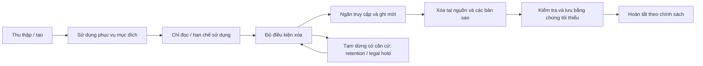
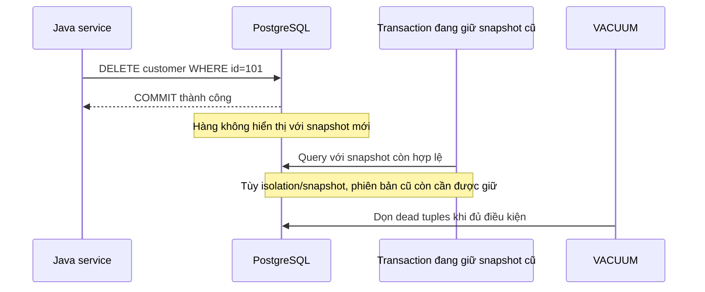
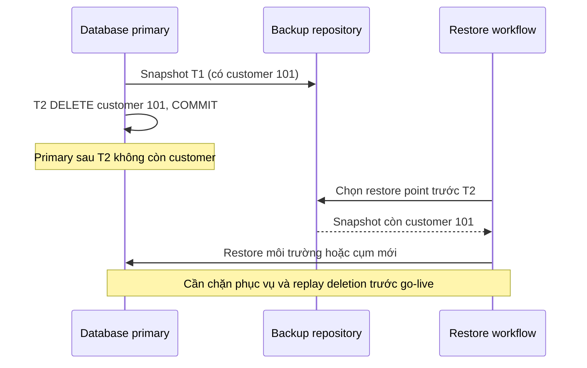
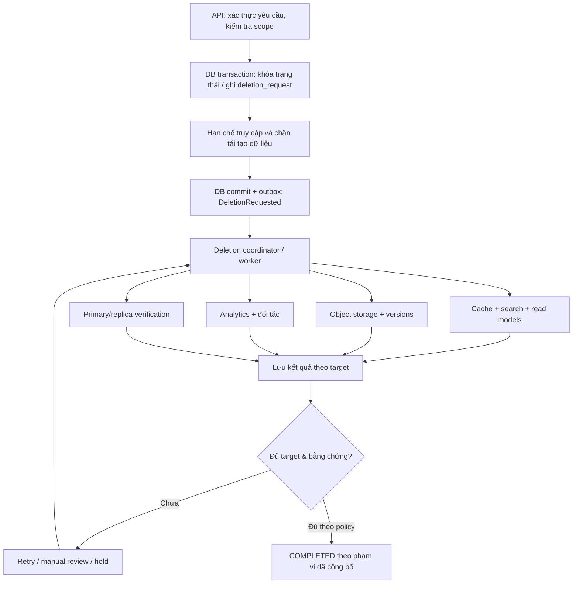

# Xóa dữ liệu theo vòng đời và kiểm tra các bản sao liên quan

Trong chương **An toàn dữ liệu** của module **DATA_PERSISTENCE_FUNDAMENTALS**, việc xóa dữ liệu không kết thúc ở câu lệnh `DELETE FROM ...`. Một hồ sơ khách hàng có thể không còn xuất hiện trong kết quả SQL, nhưng dữ liệu tương ứng vẫn nằm trong bản sao đọc, cache, chỉ mục tìm kiếm, dữ liệu phân tích, message queue, object storage, log, snapshot hoặc các bản sao lưu phục vụ khôi phục sự cố. Nếu không biết những bản sao đó tồn tại ở đâu và khi nào chúng được xử lý, ứng dụng Java rất khó đưa ra một tuyên bố xóa có thể kiểm chứng.

Bài học này trình bày cách thiết kế **vòng đời dữ liệu, chính sách lưu giữ, quy trình xóa trên nhiều hệ thống và bằng chứng kiểm tra kết quả**. Trọng tâm là xây dựng ranh giới persistence rõ ràng cho Java: DB nào là nguồn có thẩm quyền, transaction nào bảo vệ trạng thái yêu cầu xóa, bản sao nào cần được cập nhật hoặc loại bỏ, và cách tránh dữ liệu đã xóa xuất hiện trở lại sau retry, replay hay restore.

> **Nguyên tắc cốt lõi:** “Không còn nhìn thấy qua API”, “đã xóa bản ghi logic”, “đã được các hệ thống phụ trợ xử lý” và “không còn bit dữ liệu có thể phục hồi từ mọi bản sao” là **những mức bảo đảm khác nhau**. Chỉ tuyên bố mức mà kiến trúc, quy trình vận hành và bằng chứng thực tế hỗ trợ.

## 1. Xóa dữ liệu là một phần của vòng đời, không phải nút bấm đơn lẻ

Một đối tượng dữ liệu thường trải qua các trạng thái hoặc pha sau:



Sơ đồ là **một mô hình minh họa**. Hệ thống thực tế có thể có thời hạn lưu giữ khác nhau cho từng loại dữ liệu, cơ chế tạm dừng xóa hợp lệ hoặc quy trình ẩn danh thay cho xóa, tùy mục đích và nghĩa vụ cụ thể.

### 1.1. Phân biệt các hành động thường bị gọi chung là “xóa”

| Hành động | Điều thay đổi | Điều **chưa** được bảo đảm |
| --- | --- | --- |
| **Ẩn khỏi giao diện** | API/UI không hiển thị đối tượng | Dữ liệu vẫn có thể nằm đầy đủ trong database và downstream |
| **Soft delete** | Đánh dấu `deleted_at`, `status=DELETED` | Nội dung nhạy cảm chưa biến mất khỏi hàng, index, backup |
| **Hard delete ở DB** | Xóa hàng logic khỏi các truy vấn thông thường | Bit cũ có thể còn trong MVCC pages, WAL, backup, snapshot |
| **Anonymization** | Thay đổi dữ liệu để không còn liên hệ đến cá nhân theo phương pháp phù hợp | Không tự đạt nếu còn bảng ánh xạ, khóa giải mã hoặc khả năng liên kết lại |
| **Pseudonymization** | Thay định danh trực tiếp bằng mã thay thế | Vẫn có thể tái định danh, thường vẫn cần bảo vệ như dữ liệu cá nhân |
| **TTL/expiration** | Quy định khi nào bản sao hết hạn hoặc được dọn | Không mặc định xóa tức thời; nhiều hệ thống dọn bất đồng bộ |
| **Crypto-erasure** | Làm mất khả năng giải mã bằng hủy khóa được quản lý đúng | Không xóa bản rõ trong cache/log/export hoặc những bản sao dùng khóa khác |
| **Sanitization media** | Xử lý lớp lưu trữ vật lý theo quy trình chuyên biệt | Không tương đương một lệnh SQL DELETE; cần kiểm chứng theo thiết bị/dịch vụ |

**Xóa logic** là điều kiện quan trọng để ứng dụng ngừng phục vụ dữ liệu, nhưng một cam kết **xóa khỏi tất cả các bản sao** đòi hỏi nhiều hơn. Nếu một chính sách chỉ yêu cầu ngừng sử dụng dữ liệu sau một mốc cụ thể, cần công bố chính xác điều đó; nếu yêu cầu loại bỏ mọi bản sao có thể tiếp tục phục vụ, phải theo dõi từng đường lan truyền.

### 1.2. Ví dụ xuyên suốt: xóa hồ sơ khách hàng

Giả sử `customer_id=101` đã được hệ thống bán hàng lưu tại:

```text
Java API
  ├── PostgreSQL primary: customers, addresses, contact_preferences
  ├── PostgreSQL read replica
  ├── Redis: customer:101, account_sessions:101
  ├── Search index: customer document 101
  ├── Event broker: CustomerUpdated / OrderCreated
  ├── Analytics warehouse: bảng customer dimension
  ├── Object storage: avatar, hóa đơn, tệp người dùng
  ├── Application logs, traces, audit events
  └── Backup/PITR snapshot của nhiều hệ thống
```

Một `DELETE FROM customers WHERE id=101` **không tự xóa** mọi mục trong sơ đồ. Hơn nữa, một đơn hàng có thể cần giữ lại dữ liệu giao dịch hoặc thông tin tối thiểu trong một thời hạn riêng, còn địa chỉ liên hệ không còn mục đích sử dụng cần được xóa. Vì thế đối tượng xóa phải được định nghĩa theo **phạm vi dữ liệu và mục đích**, không suy rằng toàn bộ bảng liên quan phải bị xóa vô điều kiện.

## 2. Xác định phạm vi xóa và nguồn dữ liệu có thẩm quyền

Trước khi lập trình, cần trả lời: **xóa cái gì, thuộc ai, theo căn cứ nào, trong bao lâu và ai xác nhận đã hoàn tất?**

| Câu hỏi | Ví dụ câu trả lời có thể kiểm tra |
| --- | --- |
| Đối tượng yêu cầu | Hồ sơ định danh của customer 101 trong tenant X |
| Phạm vi | Địa chỉ, email liên hệ, avatar, session, search document; dữ liệu giao dịch được xem xét riêng |
| Nguồn authoritative | PostgreSQL customer service; object metadata trong DB, file thực ở object storage |
| Hệ thống phụ trợ | Redis, search, warehouse, broker, đối tác gửi email |
| Căn cứ giữ lại | Mỗi loại dữ liệu có lịch retention hoặc hold được phê duyệt |
| Deadline | Mốc bắt đầu chặn sử dụng và mốc hoàn tất theo chính sách |
| Định danh điều phối | `deletion_request_id` duy nhất, ổn định qua retry |
| Kiểm chứng | Trạng thái ở nguồn, ACK từ consumer, reconciliation theo manifest mục tiêu |
| Thất bại | Retry có hạn, đưa vào hàng lỗi vận hành, không đánh dấu hoàn tất giả |

Không nên sử dụng mỗi `customer_id` làm khóa điều phối nếu ID có thể tái sử dụng sau xóa hoặc một đối tượng được tạo mới với ID tương tự. Có thể cần **tenant ID, loại đối tượng, generation/version và deletion request ID** để phân biệt đời sống dữ liệu.

### 2.1. Data inventory và sơ đồ lineage

**Data inventory** ghi lại loại dữ liệu, nơi lưu, người sở hữu và retention. **Data lineage** trả lời dữ liệu được sao chép/biến đổi tới đâu, chẳng hạn từ một sự kiện `CustomerUpdated` sang search index rồi sang data warehouse.

Một manifest nội bộ có thể lưu:

| Nhóm | Tài nguyên đích | Phương thức xử lý | Bằng chứng mong đợi |
| --- | --- | --- | --- |
| Primary DB | `customers`, `addresses` | Hard delete hoặc loại bỏ trường theo chính sách | Transaction commit + truy vấn xác minh theo khóa |
| Search index | Document theo khóa ổn định | Delete/tombstone + xác minh sau refresh | ACK + truy vấn đã nhất quán theo API |
| Cache | Key theo tenant/customer | Evict + TTL/version barrier | Không trả bản cũ, có repair khi miss event |
| Analytics | Dữ liệu chi tiết, dimension, materialized view | Delete/transform/rebuild | Job hoàn tất + kiểm tra số bản ghi/định danh |
| Object storage | File, version, thumbnail | Xóa theo object/version + policy | Liệt kê phiên bản hoặc xác nhận theo API |
| Backup | Snapshot, WAL, bản sao lưu ngoài vùng | Hết hạn theo lịch, restore controls | Inventory/retention policy + kiểm tra restore |

Không dùng manifest như một danh sách cố định mãi mãi. Mỗi pipeline mới tạo **bản sao dữ liệu** cần đăng ký owner, thời hạn lưu, cách xóa và test phục hồi. Nếu không, hệ thống sẽ “xóa thành công” trên những kho đã biết nhưng bỏ sót một sink mới.

### 2.2. Phân biệt dữ liệu thuộc cá nhân với dữ liệu liên quan

Không phải cứ JOIN từ `customer_id` là mọi hàng đều cần xóa:

- Một đơn hàng có thể có nghĩa vụ lưu giữ hóa đơn/chứng từ; trường liên lạc không cần thiết có thể được giảm thiểu hoặc ẩn danh.
- Một bản ghi thống kê tổng hợp có thể không còn nhận diện cá nhân, **nếu không còn khả năng tái định danh hợp lý** theo ngữ cảnh.
- Một sự kiện audit về việc đã xóa có thể cần giữ trạng thái tối thiểu để chứng minh quy trình, nhưng **không nên giữ lại toàn bộ payload đã yêu cầu xóa**.
- Dữ liệu liên quan một cá nhân nhưng cùng mô tả người khác (ví dụ đơn hàng chung) cần phạm vi và chính sách riêng, không tự động xóa hết.

Đây là quyết định liên quan sản phẩm, bảo mật và nghĩa vụ áp dụng. Bài học đưa ra **nguyên tắc kỹ thuật**, không thay thế việc xác định căn cứ pháp lý và lịch lưu giữ của tổ chức.

## 3. Chính sách retention, legal hold và thời điểm đủ điều kiện xóa

Một cơ chế xóa tốt thường đặt luật **trước khi dữ liệu được thu thập**:

1. **Data class:** dữ liệu định danh, thông tin liên lạc, giao dịch, telemetry, audit, tệp đính kèm.
2. **Purpose:** cần dùng để làm gì, ai được truy cập, có chia sẻ với hệ thống nào?
3. **Retention trigger:** từ lúc tạo, hoàn tất giao dịch, đóng tài khoản hay kết thúc hợp đồng?
4. **Retention duration:** thời gian giữ theo chính sách được phê duyệt, không mặc định “vĩnh viễn”.
5. **Deletion action:** hard delete, anonymize, revoke access, archive được kiểm soát hoặc kết hợp.
6. **Exceptions/holds:** ai có thẩm quyền đặt, gia hạn và gỡ tạm dừng? Làm sao tránh xóa khi hold còn hiệu lực?
7. **Verification/attestation:** bằng chứng nào đủ để đánh dấu hoàn tất?

Ví dụ một mô hình metadata:

```text
data_class           = CUSTOMER_CONTACT
retention_start      = account_closed_at
retention_duration   = policy-defined
eligible_at          = computed retention deadline
legal_hold           = true/false + approved reason reference
deletion_action      = REMOVE_DIRECT_IDENTIFIERS
verification_policy  = PRIMARY_AND_DERIVED_STORES
```

Thời gian giữ ở đây **không có con số mặc định**. Mỗi lĩnh vực/quy trình có thể cần khoảng giữ khác nhau; không bịa một TTL chuẩn để áp cho mọi loại dữ liệu.

### 3.1. Tách trạng thái “không được sử dụng” khỏi trạng thái “đã xóa”

Một hồ sơ có thể đủ điều kiện **ngừng phục vụ qua API ngay lập tức** nhưng một bản backup bất biến vẫn tồn tại đến hết chu kỳ lưu. Hợp đồng ứng dụng nên tách các trạng thái:

```text
ACTIVE
  ↓ yêu cầu được xác thực và chấp nhận
RESTRICTED            (không phục vụ dữ liệu nhạy cảm cho đường thông thường)
  ↓ đánh giá phạm vi/retention/hold
ELIGIBLE_FOR_ERASURE
  ↓ xóa tại nguồn và phát intent
PROPAGATING_DELETION  (đang dọn các bản sao)
  ↓ đủ bằng chứng theo policy
COMPLETED

Ngoại lệ:
ON_HOLD / PARTIALLY_RETAINED / NEEDS_REVIEW / FAILED_RETRYABLE
```

Không được ghi `COMPLETED` chỉ vì một DELETE trả `1 row affected` nếu contract còn yêu cầu xác minh search, analytics và object storage.

### 3.2. Thời gian và chủ sở hữu phải nhất quán

Trong hệ thống nhiều vùng múi giờ, nên lưu thời điểm bằng kiểu có ý nghĩa tuyệt đối, ví dụ `TIMESTAMPTZ` trong PostgreSQL, và dùng một clock được quản lý thích hợp để xác định eligibility. Tránh tính deadline bằng ngày của máy client không đáng tin; tránh thay đổi retention dựa trên trường do người dùng tùy ý gửi.

Giữa lúc quét “đủ điều kiện xóa” và lúc `DELETE`, một legal hold có thể được đặt mới. Cần **kiểm tra điều kiện giữ lại tại thời điểm commit hoặc dùng cơ chế khóa/điều phối phù hợp**, không chỉ đọc danh sách từ nhiều giờ trước rồi xóa mù quáng.

## 4. Soft delete, hard delete và giảm thiểu dữ liệu có mục tiêu

### 4.1. Soft delete hữu ích cho trạng thái nghiệp vụ

Một bảng có thể có:

```sql
CREATE TABLE customers (
    tenant_id   BIGINT NOT NULL,
    id          BIGINT NOT NULL,
    email       TEXT,
    name        TEXT,
    status      TEXT NOT NULL DEFAULT 'ACTIVE',
    deleted_at  TIMESTAMPTZ,
    version     BIGINT NOT NULL DEFAULT 0,
    PRIMARY KEY (tenant_id, id)
);
```

Khi tài khoản bị đóng, ứng dụng có thể đánh dấu:

```sql
UPDATE customers
SET status = 'DELETION_PENDING',
    deleted_at = now(),
    version = version + 1
WHERE tenant_id = :tenant_id
  AND id = :customer_id
  AND status = 'ACTIVE';
```

Đây là SQL minh họa với **named parameters** thường dùng ở Spring JDBC; JDBC thuần dùng `?`. Lời gọi cập nhật phải kiểm tra affected rows; `0` có thể có nghĩa bản ghi không tồn tại, đã được xóa hoặc có transaction khác vừa đổi trạng thái. Ứng dụng không được suy từ `0` hàng rằng không cần xử lý mọi bản sao phụ trợ.

Soft delete có các ưu điểm: chặn truy cập sớm, bảo toàn một số workflow, hỗ trợ ngăn task cũ ghi tiếp và ghi nhận tiến độ. Nhưng cột `email`/`name` **vẫn có giá trị nguyên bản**. Nếu mục tiêu là xóa dữ liệu nhận diện, soft delete chỉ nên là **trạng thái trung gian** hoặc đi cùng loại bỏ/anonymize nội dung theo chính sách.

### 4.2. Rủi ro khi chỉ thêm `WHERE deleted_at IS NULL`

- Một truy vấn JDBC mới có thể quên predicate.
- Các join, report, export, stored procedure hoặc analytics job có thể tiếp tục đọc hàng.
- Các unique index có thể tiếp tục ngăn tái sử dụng email dù tài khoản đã được “xóa”.
- Cache có thể giữ bản `ACTIVE` dù DB đã `DELETION_PENDING`.
- Các worker async cũ có thể đọc queue rồi gửi email hoặc tạo bản sao mới.
- Query theo tenant cần **cả** ràng buộc tenant/authorization lẫn trạng thái xóa; chỉ lọc `deleted_at` chưa đủ bảo vệ dữ liệu.

Đối với truy vấn quan trọng, có thể đặt ranh giới repository và kiểm thử bắt buộc. View hoặc row-level security có thể hỗ trợ một số trường hợp, nhưng **không thay thế được kiểm soát quyền và giới hạn của các tài khoản DB đặc quyền**. Đừng coi soft delete là an toàn chỉ vì ORM có annotation lọc mặc định.

### 4.3. Hard delete và foreign key

```sql
BEGIN;

DELETE FROM customer_addresses
WHERE tenant_id = :tenant_id
  AND customer_id = :customer_id;

DELETE FROM customer_preferences
WHERE tenant_id = :tenant_id
  AND customer_id = :customer_id;

DELETE FROM customers
WHERE tenant_id = :tenant_id
  AND id = :customer_id;

COMMIT;
```

Các bảng trong ví dụ có thể có foreign key, trigger hoặc ràng buộc riêng; danh sách câu lệnh cần được xây từ schema thật, không chạy nguyên xi khi chưa biết phụ thuộc. Nếu một bảng con còn tham chiếu khách hàng, câu xóa parent có thể bị từ chối bởi `RESTRICT`/`NO ACTION`; một số quan hệ cho phép `ON DELETE CASCADE`. **Cascade là một quyết định có tác động thật**, không nên bật hàng loạt chỉ để tránh lỗi FK: nó có thể xóa nhầm chứng từ, lịch sử giao dịch hoặc thông tin cần giữ.

Nên có **deletion dependency graph** thể hiện: hàng nào phải xóa, hàng nào cần gỡ FK và giữ tối thiểu, hàng nào ẩn danh, hàng nào cần tách khỏi tài khoản. Ví dụ, đơn hàng có thể giữ một mã tham chiếu không trực tiếp nhận diện sau khi phần contact đã được loại bỏ, tùy mục đích và luật lưu giữ.

### 4.4. Anonymization khác xóa định danh ở một cột

Thay `email` thành `deleted@example.invalid` không tự tạo anonymous data nếu bảng còn `phone`, địa chỉ, IP, lịch sử hành vi hoặc join key cho phép nhận diện lại. Cần đánh giá **khả năng liên kết giữa các bảng, tập dữ liệu ngoài và những người có quyền truy cập**.

Một mã HMAC với khóa bí mật có thể giúp giảm lộ định danh trực tiếp trong một số pipeline, nhưng nếu còn khả năng tính lại từ email hoặc nối với danh tính người dùng thì nó vẫn có thể là dữ liệu cá nhân/pseudonymous theo bối cảnh. Không được gọi mọi giá trị đã hash là “vô danh” mà không kiểm chứng rủi ro tái định danh.

### 4.5. Xóa theo đợt tránh giữ transaction quá lâu

Xóa hàng triệu bản ghi một lần có thể làm tăng WAL, lock duration, replication lag, bloat và thời gian phục hồi. Trên PostgreSQL có thể chọn batch nhỏ bằng CTE và `FOR UPDATE SKIP LOCKED` để nhiều worker không tranh giành cùng hàng:

```sql
WITH batch AS (
    SELECT id
    FROM expired_events
    WHERE expires_at <= now()
      AND hold_flag = false
    ORDER BY expires_at, id
    FOR UPDATE SKIP LOCKED
    LIMIT 500
)
DELETE FROM expired_events AS e
USING batch
WHERE e.id = batch.id
  AND e.expires_at <= now()
  AND e.hold_flag = false
RETURNING e.id;
```

Giả định `expired_events.id` là khóa chính. Đây là ví dụ dọn retention định kỳ, **không phải** mẫu xóa dữ liệu cá nhân hoàn chỉnh; cần điều phối các bảng con và chính sách hold tương ứng. `SKIP LOCKED` giúp giảm tranh chấp giữa các worker nhưng cho ra một tập hàng không nhất thiết đầy đủ ở một lượt quét; phải lặp đến khi không còn đối tượng đủ điều kiện và xử lý những hàng bị khóa quá lâu. Đặt giới hạn batch theo đo đạc và commit giữa các batch.

Với dữ liệu được tổ chức hợp lý theo thời gian, **drop/detach partition** có thể rẻ hơn xóa từng hàng; nhưng chỉ dùng khi **toàn bộ partition** đã đủ điều kiện xóa, không chứa bản ghi đang hold và không phá constraint/retention riêng. Thao tác DDL có loại lock, yêu cầu phiên bản và ảnh hưởng tới bản sao lưu cần kiểm chứng.

## 5. PostgreSQL MVCC: vì sao `DELETE` không đồng nghĩa xóa vật lý ngay?

PostgreSQL sử dụng **Multi-Version Concurrency Control (MVCC)** để cho phép các transaction nhìn thấy phiên bản dữ liệu phù hợp với snapshot/isolation. Một lệnh `DELETE` được commit sẽ khiến hàng trở nên **không còn hiển thị với các snapshot mới theo quy tắc MVCC**, nhưng phiên bản tuple cũ có thể vẫn tồn tại trong storage cho tới khi đủ điều kiện dọn.



Điều cần phân biệt:

- **Visibility:** bản ghi không còn hiện với truy vấn mới tuân theo quy tắc DB.
- **Storage reclamation:** dead tuple/index entry được vacuum và có thể tái sử dụng không gian.
- **Physical sanitization:** các byte từng chứa dữ liệu nhạy cảm không còn có thể phục hồi từ mọi trang, file, snapshot và phương tiện lưu trữ.

**`VACUUM` không phải lệnh “secure erase” dữ liệu cá nhân.** Nó dọn dead tuples và duy trì khả năng sử dụng không gian, không hứa ghi đè toàn bộ vị trí vật lý từng chứa giá trị nhạy cảm. Các trang cũ, file đã xóa, bản sao ở filesystem/storage và bản sao lưu có thể tồn tại ngoài tầm kiểm soát của một VACUUM thông thường.

### 5.1. `VACUUM FULL` cũng không phải bảo đảm xóa mọi dấu vết

`VACUUM FULL` viết lại bảng để thu hồi không gian, thường cần khóa mạnh và có chi phí vận hành; việc viết lại/recreate file không tự chứng minh byte cũ đã biến mất khỏi storage, snapshot hoặc backup. Không chạy `VACUUM FULL` trên production chỉ để “chắc chắn xóa PII”, khi chưa hiểu tác động downtime, I/O và yêu cầu sanitization thực sự.

### 5.2. WAL và PITR

**Write-Ahead Log (WAL)** dùng cho recovery và replication có thể chứa thông tin phục vụ tái tạo thay đổi, và một số chế độ/logical decoding có thể truyền giá trị hàng. Dù hàng đã bị xóa ở bảng chính, WAL còn được giữ vì replication slot, archive retention hoặc backup phục vụ **Point-in-Time Recovery (PITR)**.

Xóa hoặc ép dọn WAL bừa bãi để giảm dấu vết có thể làm **mất khả năng phục hồi** và phá luồng replication. Chính sách cần làm rõ:

1. WAL được giữ ở đâu và bao lâu?
2. Có archive sang object storage hoặc bên thứ ba không?
3. Replica/CDC consumer nào còn giữ checkpoint hoặc replication slot?
4. Nếu restore tới thời điểm **trước khi xóa**, quy trình nào bảo đảm yêu cầu xóa được **áp dụng lại** trước khi dữ liệu được phục vụ?

Không thể coi `DELETE ... COMMIT` là bằng chứng dữ liệu không thể tái xuất từ một PITR restore cũ.

### 5.3. Index, TOAST, materialized view và read replica

Với giá trị lớn, PostgreSQL có thể dùng **TOAST** để lưu dữ liệu tách khỏi heap chính. Index cũng có cấu trúc riêng và cần thời gian để cleanup. **Materialized views** hoặc bảng tổng hợp có thể tiếp tục chứa nội dung được trích từ hàng đã xóa cho tới khi được refresh/rebuild.

Read replica bất đồng bộ có thể áp dụng WAL chậm hơn primary, vì vậy có một khoảng thời gian mà primary đã không trả hàng nhưng replica vẫn có khả năng trả nó. Đối với yêu cầu xóa nhạy cảm, không nên định tuyến request sang replica chưa đạt mốc cần thiết rồi tuyên bố dữ liệu đã không thể truy cập.

**Không dùng read replica như nguồn kiểm tra duy nhất** ngay sau lệnh xóa nếu replica có thể lag. Khi cần xác nhận, ưu tiên nguồn authoritative và một cơ chế quan sát replication lag/LSN phù hợp với triển khai.

## 6. Backup, snapshot và khôi phục: bản sao đã xóa vẫn có thể quay lại

Backup là công cụ bảo vệ dữ liệu trước lỗi phần cứng và sự cố vận hành. Tuy nhiên, một backup ở T1 có thể chứa hồ sơ chưa bị xóa; nếu xóa hồ sơ ở T2 rồi restore về T1 ở T3, hồ sơ có thể xuất hiện trở lại.



Do vậy một hệ thống muốn xóa theo chính sách cần **hai quy trình song song**:

1. **Xóa dữ liệu đang phục vụ** tại primary, các bản sao hoạt động và sink.
2. **Quản lý dữ liệu lưu giữ phục hồi** theo lịch retention đã được phê duyệt, quyền truy cập hạn chế và **cơ chế chống tái xuất sau restore**.

### 6.1. Tại sao không sửa trực tiếp mọi backup?

Nhiều backup là snapshot nén/khử trùng lặp, incremental chain, bản sao bất biến hoặc archive được bảo vệ chống ransomware. Xóa một bản ghi tùy ý trong từng backup có thể không khả thi hoặc làm hỏng khả năng restore. Với một số quy trình, giải pháp khả thi là:

- Ngừng tạo bản sao mới chứa dữ liệu đã đủ điều kiện xóa.
- Bảo vệ chặt quyền truy cập vào backup hiện có, mã hóa và giới hạn thời gian lưu.
- Có chính sách xóa/expire backup, snapshot, replica backup và bản sao offsite theo lịch có thể kiểm chứng.
- Duy trì **deletion ledger/tombstone** đủ bền vững và độc lập với restore point để biết các đối tượng cần xóa lại.
- Bắt buộc restore vào môi trường cô lập, chạy lại các yêu cầu xóa tương ứng, tái tạo hoặc invalidate cache/search/analytics rồi mới mở đường phục vụ.

Điều này **không phải lời khẳng định rằng giữ dữ liệu trong backup luôn được phép**. Chính sách và nghĩa vụ áp dụng có thể yêu cầu xử lý khác hoặc thời hạn cụ thể. Kỹ thuật phải thực hiện đúng cam kết và giới hạn đã được xác định, đồng thời nói rõ những bản sao **chưa thể xóa vật lý ngay**.

### 6.2. Đặt deletion ledger ở đâu?

Một bảng `deletion_requests` cùng DB cần xóa rất tiện cho transaction, nhưng **nếu restore cả DB về trước thời điểm nhận request**, chính bảng này cũng có thể mất lịch sử. Vì vậy, với yêu cầu chống tái xuất sau restore, phải có một **nguồn yêu cầu xóa bền vững nằm ngoài điểm khôi phục**, hoặc một quy trình replay từ hệ thống điều phối không bị rollback cùng snapshot.

Ledger này chỉ cần giữ các định danh đủ để thực hiện xóa/đối chiếu theo chính sách, không nên giữ lại toàn bộ tên, email hoặc payload nhạy cảm mà yêu cầu xóa muốn loại bỏ. Có thể dùng định danh nội bộ ổn định, phạm vi tenant, version/generation và trạng thái có chữ ký/kiểm soát sửa đổi tùy hệ thống.

### 6.3. Kiểm tra chu kỳ backup thực tế

Một tuyên bố “backup giữ 30 ngày” chưa đủ nếu còn:

- Snapshot của volume/storage ngoài lịch backup chính.
- Image clone dùng cho test/staging.
- Bản xuất CSV thủ công.
- Backup của read replica, search cluster, data warehouse hoặc object storage.
- Archive WAL ngoài chu kỳ retention của base backup.
- Bản copy phục vụ ứng cứu sự cố hoặc nhà cung cấp dịch vụ khác.

Mỗi loại phải có owner, quyền truy cập, retention và bằng chứng dọn. **Không đưa bản backup production chứa dữ liệu thật sang môi trường phát triển kém bảo vệ**, kể cả khi có mục đích kiểm thử restore.

## 7. Cryptographic erasure: hữu ích nếu khóa được phân vùng đúng

**Crypto-erasure** là một chiến lược làm cho dữ liệu đã mã hóa **không còn giải mã được** bằng cách hủy khả năng truy cập khóa cần thiết. Nó có thể hỗ trợ xử lý dữ liệu trên phương tiện không thể xóa từng byte ngay hoặc trên bản sao lưu bất biến. Nhưng hiệu lực phụ thuộc mô hình khóa và nơi dữ liệu xuất hiện.

Ví dụ:

```text
Customer 101 plaintext
       |
   encrypt with DEK-101
       |
 DB / object storage / backup: ciphertext
       |
DEK-101 wrapped by KMS key
```

Nếu có **Data Encryption Key (DEK)** riêng cho đối tượng hoặc nhóm đối tượng với phạm vi phù hợp, việc hủy mọi bản sao có thể phục hồi của DEK có thể làm các ciphertext tương ứng không sử dụng được. Nhưng:

- Hủy một **master key dùng chung** có thể khiến dữ liệu của nhiều khách hàng khác không thể phục hồi.
- Nếu DEK đã bị xuất ra log, file, cache, memory dump hoặc backup khác, hủy một bản ghi KMS không đủ.
- Nếu plaintext từng xuất hiện trong search index, report, message queue hoặc log, crypto-erasure của bản DB **không xử lý các bản plaintext đó**.
- Key rotation thông thường **không đồng nghĩa key destruction**; old key có thể được giữ để giải mã dữ liệu cũ.
- Cloud KMS có thời gian chờ hủy, recovery window, các giới hạn provider và cơ chế audit riêng; cần xác minh **khi nào khóa thật sự không thể khôi phục**.
- Mã hóa ở mức disk/volume bằng cùng một khóa cho nhiều tenant không tự hỗ trợ xóa riêng một khách hàng.

**Chỉ coi crypto-erasure là đáp ứng mục tiêu khi đã chứng minh không còn đường giải mã hợp lệ và không có bản rõ khác nằm ngoài miền khóa đó.**

### 7.1. Dữ liệu có nhiều bản mã khác khóa

Một file có thể được upload rồi:

1. Lưu bản gốc bằng khóa bucket.
2. Tạo thumbnail với khóa khác.
3. Được CDN cache dưới dạng bản rõ.
4. Được đưa vào công cụ OCR/indexing hoặc analytics.
5. Được download về máy của người dùng/đối tác.

Hủy khóa của bản gốc **không xử lý** các bản phái sinh. Cần inventory theo **định danh nội dung, object key, version và quan hệ với đối tượng gốc**.

## 8. Replica, CDC và sự kiện: dữ liệu có thể bị tái tạo

Trong hệ thống phân tán, bản sao được tạo không chỉ bằng `SELECT` hoặc backup. Các pipeline **Change Data Capture (CDC)**, stream processing và event-sourcing có thể phát lại dữ liệu cũ cho một read model mới.

### 8.1. Dấu xóa và xử lý sự kiện đến sai thứ tự

Ví dụ một consumer search nhận các event:

```text
CustomerUpdated(id=101, version=7, payload có email)
CustomerDeleted(id=101, version=8)
```

Nếu `CustomerDeleted(v8)` được xử lý trước, nhưng do retry hoặc replay mà `CustomerUpdated(v7)` đến sau, một consumer đơn giản dùng `UPSERT` vô điều kiện có thể **hồi sinh bản ghi đã xóa**.

Quy tắc an toàn cần:

1. Event chứa **định danh ổn định và version/generation** phù hợp với dữ liệu.
2. Consumer ghi nhận **phiên bản tối thiểu đã áp dụng** hoặc tombstone xóa.
3. Một event có version thấp hơn tombstone không được tạo lại bản ghi.
4. Retry với **cùng event ID** phải idempotent; không ghi nội dung cũ lần hai.
5. Không xóa tombstone quá sớm nếu vẫn có sự kiện cũ đang chờ trong broker, archive hay pipeline replay.

```text
Consumer state: customer 101 deleted_at_version=8

Receive Update(v7) → bỏ qua
Receive Delete(v8) → idempotent
Receive Create(v9) → chỉ chấp nhận nếu nghiệp vụ cho phép
                      tái tạo một generation mới, không phải hồi sinh hồ sơ cũ
```

Nếu ID có thể được tái sử dụng, cần thêm **generation/epoch** để phân biệt đối tượng mới và đối tượng đã bị xóa. Không dùng timestamp từ nhiều máy như một phiên bản tuyệt đối mà không có quy tắc đồng hồ và thứ tự đáng tin.

### 8.2. Database replication và CDC có mốc riêng

Primary có thể commit xóa ở thời điểm T, nhưng:

- Read replica chưa replay tới LSN chứa delete.
- CDC connector chưa chuyển event sang broker.
- Consumer đã nhận event nhưng chưa commit xử lý.
- Search index đã nhận lệnh delete nhưng chưa refresh để truy vấn phản ánh nó.
- Analytics job đang chạy với snapshot đầu vào từ trước T.

**ACK ở một tầng không tự là ACK của tầng kế tiếp.** Một workflow cần lưu `status` theo hệ thống và mốc xử lý đã được xác minh, thay vì một boolean toàn cục `deleted=true`.

### 8.3. Các nền tảng kiểu Dynamo cần tombstone đủ lâu

Với những store được sao chép bất đồng bộ và cơ chế anti-entropy, việc xóa một key thường cần **tombstone** để replica offline biết có một thao tác delete mới. Nếu dọn tombstone trước khi các bản cũ bị loại hoặc hết hiệu lực, bản cũ từ replica hồi phục có thể xuất hiện trở lại (*deleted-data resurrection*).

Một số hệ thống có TTL và tham số garbage collection cho tombstone. **Không tự giảm thời gian giữ tombstone** để tiết kiệm disk mà không tính khoảng offline tối đa của replica, thời gian repair và cách phục hồi node mất đồng bộ.

### 8.4. Event sourcing và log không thể sửa

Trong mô hình event sourcing, trạng thái hiện tại có thể được dựng lại từ một event log dài hạn. Thêm sự kiện `CustomerDeleted` có thể khiến **projection hiện tại** không còn hiện khách hàng, nhưng các event trước đó vẫn chứa dữ liệu cá nhân. Nếu yêu cầu thực sự là loại bỏ payload nhạy cảm, cần một thiết kế riêng:

- Không lưu PII trực tiếp trong event bất biến nếu có thể tránh.
- Dùng token/reference hoặc payload được mã hóa theo miền khóa xóa phù hợp.
- Xác định chính sách purge/redact, snapshot rebuild và khả năng replay.
- Kiểm tra downstream subscriber hoặc export đã nhận bản rõ trước đó.

**Tombstone phục vụ semantics xóa logic không tự xóa nội dung event lịch sử.**

## 9. Cache và search index: bản sao phục vụ truy vấn dễ bị bỏ sót

### 9.1. Cache-aside có cuộc đua xóa rồi nạp lại

Giả sử `GET customer` dùng Redis:

```text
1. Reader A: cache miss, SELECT customer 101 → nhận dữ liệu cũ.
2. Deletion worker: DELETE customer 101, COMMIT.
3. Deletion worker: Redis DEL customer:101.
4. Reader A: cache PUT customer:101 với dữ liệu đã đọc ở bước 1.
5. Reader B: GET customer:101 từ cache → thấy dữ liệu đã bị xóa.
```

Ngay cả khi `DEL` thực hiện **sau commit**, một reader nạp cache chậm vẫn có thể ghi đè lại bằng bản cũ. Chỉ một lần evict không tạo bảo đảm “không bao giờ thấy lại”.

Các phương án tùy yêu cầu:

- **Chặn phục vụ ở nguồn có thẩm quyền** sau khi request được chấp nhận, trước khi lan truyền xóa.
- Gắn **version/generation** với bản cache; reader chỉ được `PUT` nếu phiên bản không thấp hơn ngưỡng.
- Giữ **tombstone/barrier** theo key đủ lâu để từ chối dữ liệu đọc trước yêu cầu xóa.
- Cấu hình TTL/repair cho trường hợp một instance mất event invalidation.
- Nếu nội dung cực kỳ nhạy cảm và yêu cầu ngừng phục vụ ngay, **bỏ qua cache và kiểm tra trạng thái xóa authoritative** trong đường đọc có rủi ro cao.

Ví dụ một consumer nhận `CustomerDeleted(version=8)` nên cập nhật trạng thái cache theo một phép so sánh nguyên tử:

```text
atomic applyDelete(customerKey, version=8):
    if currentDeletionVersion < 8:
        mark minimumAcceptedVersion = 8
        remove cached profile payload

atomic cachePut(customerKey, snapshot):
    if snapshot.generation/version <= deletion boundary:
        reject
    else:
        store snapshot
```

Đây là **mã giả**: phép so sánh và cập nhật phải thực sự atomic trong cache implementation; nếu `GET` rồi `SET` riêng biệt giữa các instance, race vẫn tồn tại. Quy tắc tái tạo hồ sơ mới phải xử lý generation mới một cách có chủ đích, không dựa chỉ vào giá trị version trùng.

### 9.2. Cache nhiều tầng và CDN

Một hệ thống có thể có cache L1 trong JVM, Redis L2, cache API gateway và CDN. Xóa Redis chưa xóa `ConcurrentHashMap` trong instance B hoặc response đang cache ở edge. Cần kiểm kê:

- Key namespace theo `tenant_id`, `customer_id` và generation.
- TTL tại **từng** tầng, không chỉ TTL Redis.
- Invalidation broadcast, quyền nhận sự kiện và cách bù nếu instance offline.
- Response HTTP có `Cache-Control` phù hợp; không để dữ liệu riêng tư bị lưu trong shared cache trái chính sách.
- Quy trình purge CDN, static export, thumbnail và các URL đã phân phối.

Một cache entry có TTL tối đa 5 phút ở Redis không chứng minh dữ liệu biến mất sau 5 phút nếu một tầng khác vẫn giữ nó hoặc có pipeline tiếp tục nạp lại bản cũ.

### 9.3. Search index thường có tính nhất quán cuối cùng

Trong công cụ tìm kiếm, lệnh delete có thể được ACK nhưng kết quả query/search vẫn chưa phản ánh ngay, tùy mô hình refresh, segment và snapshot. Cũng có thể có một ingestion worker cũ tiếp tục index document sau khi delete.

Một chiến lược xác minh:

1. Ghi tombstone/version tại nguồn và outbox event xóa.
2. Consumer xóa tài liệu theo document ID/tenant scope phù hợp.
3. Chờ mức refresh/visibility mà search engine hỗ trợ.
4. Thực hiện truy vấn xác minh bằng **đường search thật**, với quyền/tenant hợp lệ.
5. Khi reindex/rebuild từ snapshot cũ, áp dụng deletion ledger trước khi mở index mới phục vụ.

Một search query không tìm thấy document **không chứng minh bit dữ liệu đã được xóa vật lý khỏi segment/snapshot**. Nó chỉ cung cấp bằng chứng ở tầng **search visibility**, cần được ghi đúng phạm vi.

## 10. Object storage, file versions và dữ liệu phái sinh

Dữ liệu khách hàng có thể được lưu trong bucket dưới các object key khác nhau:

```text
uploads/tenant-1/customer-101/avatar-original.jpg
thumbnails/tenant-1/customer-101/avatar-128.jpg
exports/2026-11/customer-101.zip
ocr-results/documents/customer-101.json
```

Một lệnh xóa object key có thể có semantics khác nhau tùy provider và cấu hình:

- Có **object versioning**: xóa có thể chỉ tạo delete marker, còn các phiên bản cũ vẫn truy cập được bằng version ID với quyền phù hợp.
- Có **object lock/legal hold**: bản ghi có thể bị ngăn xóa tới khi điều kiện giữ lại kết thúc.
- Có **replication** giữa bucket/region: cần xác minh trạng thái và giới hạn replication.
- Có lifecycle transition sang tầng archive/cold storage: bản sao vẫn có thể tồn tại ở nơi khác.
- Có **derived objects**: thumbnail, OCR, transcript, preview và export không nhất thiết liên kết tự động với file gốc.
- Có CDN cache hoặc signed URL: cần xử lý hiệu lực URL, quyền phục vụ và cache purge theo chính sách.

### 10.1. Lưu object reference có kiểm soát

Nếu DB chỉ lưu `avatar_url`, việc tìm mọi bản sao liên quan có thể khó khăn. Một mô hình metadata tốt hơn lưu:

```text
object_id
owner_type / owner_id / tenant_id
storage_provider / bucket / object_key
version_id (nếu có)
derivation_of (nếu là thumbnail/OCR/export)
retention_class / hold_status
deletion_status / last_checked_at
```

Các giá trị trong bảng metadata cũng có thể là nhạy cảm; phải phân quyền và có quy tắc xóa metadata sau khi hoàn thành. Không lưu credential hoặc token truy cập object storage trong manifest.

### 10.2. Xóa file không đồng nghĩa xóa lịch sử đã tải xuống

Một user hoặc bên thứ ba có thể đã download bản sao trước đó. Hệ thống chỉ có thể cam kết xóa ở **những nơi thuộc quyền kiểm soát hoặc hợp đồng xử lý của mình**; với dữ liệu đã trao cho đối tác, cần quy trình thông báo/yêu cầu xóa và bằng chứng đối tác xác nhận khi hợp đồng yêu cầu.

Không nên trả `COMPLETED_ALL_COPIES` nếu thực tế chỉ xóa được bucket nội bộ mà không biết bản sao ở đối tác đã được xử lý hay chưa.

## 11. Data warehouse, analytics, log, trace và xuất dữ liệu

### 11.1. Analytics thường nhân bản hoặc biến đổi dữ liệu

Hồ sơ ở PostgreSQL có thể được đẩy vào data warehouse, bảng dimension, bảng fact, materialized view, data lake hoặc model feature store. Một lệnh delete ở bảng nguồn **không tự lan tới tất cả các bản sao và sản phẩm phái sinh**.

Những câu hỏi quan trọng:

- Pipeline nhận **delete event** hay chỉ nhận insert/update?
- Sink có hỗ trợ xóa theo định danh không, hay cần rewrite partition/file?
- Một dataset được build lại từ **snapshot cũ** có áp dụng danh sách đã xóa không?
- Các báo cáo tổng hợp đã thực sự vô danh theo tiêu chí phù hợp hay còn khả năng join/re-identify?
- Data scientist có export notebook, CSV hoặc training dataset riêng không?
- Bảng fact giữ dữ liệu giao dịch vì retention khác cần loại bỏ trường nào thay vì xóa toàn bộ bản ghi?

Một pipeline chỉ chạy append có thể tiếp tục lưu bản cũ dù primary đã xóa. Cần **deletion-aware ingestion** và **reconciliation** từ một nguồn yêu cầu xóa bền vững.

### 11.2. Log và tracing là một nguồn dữ liệu phụ có thể chứa PII

Ví dụ log có hại:

```java
log.info("Creating customer: {}", customer);  // toString() có thể chứa PII.
log.error("SQL insert failed: {}", ex.getMessage()); // Có thể chứa bind values.
```

Nếu customer bị xóa khỏi DB, nội dung đã ghi vào log vẫn tồn tại cho tới khi log được dọn theo chính sách riêng. Thiết kế an toàn hơn là **không ghi dữ liệu nhạy cảm không cần thiết từ đầu**:

```java
log.info("customer_operation op={} requestId={} outcome={}",
         "close_account", safeRequestId, "accepted");
```

Mã ví dụ chỉ log operation và request ID đã kiểm soát; không nhét raw email, token, tên khách hàng, SQL parameter hay cả entity vào message. Nếu cần điều tra, giữ metadata tối thiểu có giới hạn quyền và thời gian lưu. Lưu ý **request ID có thể trở thành định danh liên kết** nếu mọi hệ thống chia sẻ nó; vẫn phải quản lý phạm vi truy cập.

### 11.3. Audit trail sau khi xóa

Một hệ thống có thể cần chứng minh rằng:

- Yêu cầu xóa được tiếp nhận sau khi xác thực đúng thẩm quyền.
- Phạm vi và căn cứ xử lý đã được quyết định.
- Các hệ thống trong manifest hoàn thành hoặc có ngoại lệ được phê duyệt.
- Kết quả được xác minh theo mốc thời gian cụ thể.

**Audit trail không nên giữ nguyên dữ liệu nhạy cảm đã yêu cầu xóa** chỉ để chứng minh việc xóa. Có thể lưu `deletion_request_id`, loại đối tượng, tenant scope, policy version, trạng thái và mốc thời gian; giá trị định danh nên được giảm thiểu, bảo vệ truy cập và xóa theo lịch riêng.

### 11.4. Dữ liệu trong mô hình ML và feature store

Nếu thông tin cá nhân đã đi vào feature store, training set hoặc model artifact, việc xóa một hàng DB không tự cập nhật model. Cần xác định loại mô hình, cách dữ liệu đóng góp vào huấn luyện, chính sách training dataset/artifact retention và khả năng **retrain, loại trừ, hoặc áp dụng kỹ thuật unlearning được chứng minh phù hợp**.

Không mặc định mọi model có thể “unlearn” một cá nhân chỉ bằng một lệnh delete; cũng không khẳng định model chứa nguyên dữ liệu người dùng nếu chưa có bằng chứng. Những yêu cầu ở phạm vi ML phải được xử lý với owner của pipeline và tiêu chuẩn đánh giá riêng.

### 11.5. Hệ thống đối tác và subprocessor

Email/SMS provider, CRM, payment provider, dịch vụ hỗ trợ khách hàng hoặc nền tảng analytics bên ngoài có thể có chính sách lưu giữ riêng. Manifest cần nêu rõ nơi nào là **hệ thống dưới quyền kiểm soát trực tiếp**, nơi nào cần **gửi yêu cầu xử lý**, nơi nào tồn tại ngoại lệ hợp lệ và bằng chứng đã nhận.

Một HTTP `200 OK` từ API “request deletion” có thể chỉ xác nhận **đã nhận yêu cầu**, không chứng minh dữ liệu đã xóa vật lý. Cần kiểm tra trạng thái/receipt theo hợp đồng provider và lưu bằng chứng đúng mức.

## 12. Thiết kế workflow xóa bền vững trên nhiều hệ thống

Một workflow xóa cần xử lý được sự cố xảy ra **sau DB commit nhưng trước khi xóa Redis/search**, hoặc **sau khi xóa object nhưng trước khi nhận ACK**. Không thể gộp các hệ thống ấy vào một local JDBC transaction, vì vậy nên dùng một **state machine có bản ghi điều phối bền vững** và các bước idempotent.



### 12.1. Tại sao phải ghi trạng thái riêng cho từng target?

Một boolean `deleted=true` không phân biệt được các trạng thái:

```text
Primary DB: completed
Redis: completed
Search index: pending refresh
Object storage: version 3 còn tồn tại
Analytics: worker bị lỗi quyền truy cập
Backup: retention window chưa kết thúc
Partner CRM: received, waiting for confirmation
```

Nếu đánh dấu `COMPLETED` ngay sau khi primary DB trả success, những việc còn lại sẽ **không có trạng thái có thể khôi phục**. Nên lưu kết quả theo từng target (tối thiểu `PENDING`, `PROCESSING`, `VERIFIED`, `RETRYABLE_ERROR`, `MANUAL_REVIEW`, `EXCEPTION_APPROVED`), theo scope và policy version.

### 12.2. Mô hình bảng điều phối tham khảo

Ví dụ PostgreSQL:

```sql
CREATE TABLE deletion_requests (
    request_id       UUID PRIMARY KEY,
    tenant_id        BIGINT NOT NULL,
    subject_type     TEXT NOT NULL,
    subject_id       TEXT NOT NULL,
    subject_generation BIGINT NOT NULL,
    policy_version   TEXT NOT NULL,
    request_fingerprint TEXT NOT NULL,
    state            TEXT NOT NULL
                     CHECK (state IN (
                         'ACCEPTED', 'ON_HOLD', 'RESTRICTED',
                         'PROPAGATING', 'VERIFYING',
                         'COMPLETED', 'NEEDS_REVIEW'
                     )),
    accepted_at      TIMESTAMPTZ NOT NULL DEFAULT now(),
    completed_at     TIMESTAMPTZ
);

CREATE TABLE deletion_targets (
    request_id UUID NOT NULL
               REFERENCES deletion_requests(request_id),
    target_name TEXT NOT NULL,
    target_state TEXT NOT NULL
                 CHECK (target_state IN (
                     'PENDING', 'PROCESSING', 'VERIFIED',
                     'RETRYABLE_ERROR', 'NEEDS_REVIEW',
                     'EXCEPTION_APPROVED'
                 )),
    attempt_count INTEGER NOT NULL DEFAULT 0,
    next_attempt_at TIMESTAMPTZ,
    last_verified_at TIMESTAMPTZ,
    verification_scope TEXT,
    PRIMARY KEY (request_id, target_name)
);
```

`subject_id` ở đây có thể là một mã liên kết tới đối tượng cần xóa; **nếu bản thân nó là dữ liệu nhận diện**, cần xác định thời gian giữ và cách bảo vệ ledger. `request_fingerprint` không được lưu raw PII để đối chiếu, và phải dùng thuật toán/khóa bảo vệ phù hợp với mục đích chống dùng lại ID sai nội dung.

Schema minh họa này chưa có đầy đủ lease/claim, foreign key tùy miền dữ liệu, retention, RLS hay audit. Các target thực tế có thể là *mỗi loại hệ thống* hoặc *mỗi đối tượng con*, tùy kích thước và khả năng xác minh. Không nên tạo hàng triệu target records nếu có một batch API đã cung cấp bằng chứng đáng tin ở cấp dataset.

### 12.3. Ghi trạng thái và ý định xử lý cùng transaction

```text
BEGIN
  validate authority and current retention/hold decision
  lock/conditional update subject state → RESTRICTED
  INSERT deletion_requests(...) / verify request_id reuse
  INSERT deletion_targets(...) cho scope được chấp nhận
  INSERT outbox_events(type='DeletionRequested', request_id, version)
COMMIT
```

Khi transaction rollback, cả trạng thái hạn chế và **ý định phát sự kiện** cùng rollback. Khi commit thành công, outbox giúp worker tìm lại việc sau khi ứng dụng crash, không phụ thuộc duy nhất vào callback `afterCommit` của Spring.

**Lưu ý trình tự:** có hệ thống cần giữ dữ liệu nguồn trong giai đoạn chờ xóa các bản sao phái sinh, vì phải tra cứu danh sách object/file, document ID hoặc đối tác đã nhận dữ liệu gì. Hãy **snapshot manifest tối thiểu cần thiết** trong transaction hoặc một giai đoạn chuẩn bị có kiểm soát trước khi hủy các khóa tham chiếu; không xóa source quá sớm rồi mất khả năng tìm các bản sao cần xóa.

### 12.4. Quy trình thay đổi theo chính sách thực tế

Một thứ tự an toàn cho nhiều hệ thống:

1. **Nhận và xác thực yêu cầu**; đánh giá phạm vi, loại trừ thông tin không thuộc quyền xóa và legal holds.
2. **Chặn sử dụng mới** bằng trạng thái `RESTRICTED` hoặc chính sách truy cập tương đương; ngăn job cũ phát sinh bản sao mới.
3. **Chụp manifest tham chiếu** tới những file, search document, downstream sink cần xử lý (chỉ giữ metadata tối thiểu).
4. **Ghi trạng thái điều phối và outbox trong transaction** để không mất tác vụ khi tiến trình dừng.
5. **Xóa/ẩn danh dữ liệu nguồn theo policy**, phát các deletion/tombstone events có version.
6. **Xử lý target bất đồng bộ**, dùng retry idempotent và giới hạn số lần; tiếp tục phát hiện target mới trong thời gian workflow còn mở.
7. **Xác minh từng target** theo độ mạnh và thời điểm có thể quan sát được.
8. **Đánh dấu hoàn tất theo phạm vi**, hoặc `NEEDS_REVIEW` khi chưa có bằng chứng; áp dụng riêng chính sách backup hết hạn và restore.

Không có một thứ tự cứng áp dụng cho mọi miền dữ liệu. Ví dụ, trước khi hủy một khóa mã hóa riêng của đối tượng, phải bảo đảm không còn cần khóa để xác định/giải quyết những bản mã và metadata còn tồn tại. Ngược lại, nếu yêu cầu ngừng truy cập ngay, cần **fence đường phục vụ** trước khi xử lý các batch vật lý.

## 13. Ví dụ Java/Spring: ranh giới transaction cho yêu cầu xóa

Ví dụ sau minh họa **ý định**: một method service ghi yêu cầu xóa và chặn tiếp tục dùng hồ sơ, còn worker thực hiện việc loại bỏ các bản sao sau đó. Các repository, DTO và exception là abstraction do ứng dụng định nghĩa.

```java
public record DeleteCustomerCommand(
    UUID requestId,
    long tenantId,
    long customerId,
    long customerGeneration
) {}

public record DeletionReceipt(
    UUID requestId,
    String state
) {}
```

```java
@Service
public class CustomerDeletionService {
    private final CustomerRepository customers;
    private final DeletionRequestRepository requests;
    private final OutboxRepository outbox;
    private final RetentionPolicyService policy;

    public CustomerDeletionService(
            CustomerRepository customers,
            DeletionRequestRepository requests,
            OutboxRepository outbox,
            RetentionPolicyService policy) {
        this.customers = customers;
        this.requests = requests;
        this.outbox = outbox;
        this.policy = policy;
    }

    @Transactional
    public DeletionReceipt accept(DeleteCustomerCommand command) {
        // 1. Authorization phải được thực hiện ở ranh giới tin cậy
        //    với caller identity, tenant và phạm vi yêu cầu.
        var existing = requests.findByRequestId(command.requestId());
        if (existing.isPresent()) {
            // Phải so cả scope và fingerprint trước khi trả receipt cũ.
            return requests.receiptIfSameCommand(existing.get(), command);
        }

        // 2. Check retention/hold cùng cơ chế đồng bộ bảo vệ race
        //    với một hold mới trong lúc transaction thực thi.
        var target = customers.lockForDeletion(
            command.tenantId(),
            command.customerId(),
            command.customerGeneration()
        );
        policy.requireDeletionAllowed(target);

        // 3. Ngăn phục vụ/ghi thêm vào hồ sơ đời cũ.
        customers.markRestricted(target);

        // 4. Lưu intent, manifest và outbox trong transaction hiện tại.
        requests.insertAccepted(command, target);
        requests.insertRequiredTargets(command.requestId(), target);
        outbox.insertDeletionRequested(
            command.requestId(),
            command.tenantId(),
            command.customerId(),
            command.customerGeneration()
        );
        return new DeletionReceipt(command.requestId(), "ACCEPTED");
    }
}
```

Các method như `lockForDeletion`, `requireDeletionAllowed`, `insertRequiredTargets` và `receiptIfSameCommand` **chưa được triển khai** trong ví dụ; chúng phải được thiết kế sao cho các bước dùng cùng transaction và kiểm tra concurrency đúng cách. Nếu chính sách hold nằm ở một hệ thống ngoài DB, một row lock cục bộ **không tự bảo vệ** khỏi việc hold được đặt ở nguồn khác; cần một ranh giới quyết định có thẩm quyền hoặc protocol phù hợp.

### 13.1. Vì sao `@Transactional` chưa bao trùm Redis, search, object storage?

`@Transactional` trong Spring thông thường quản lý các resource được transaction manager tương ứng điều phối. Nếu gọi:

```java
@Transactional
public void deleteEverywhere(long customerId) {
    customerRepository.delete(customerId);
    redisClient.del("customer:" + customerId);
    searchClient.deleteDocument(customerId);
    objectStore.deleteObject(...);
}
```

thì một lỗi DB commit xảy ra **sau khi Redis/search/object đã xóa** không tự hoàn tác các thao tác ngoài DB; và một crash sau commit trước khi xóa search vẫn làm bỏ sót bản sao. Thậm chí `DELETE` thành công ở object storage nhưng API ACK mất có thể cần retry. **Không gộp lời gọi mạng bên ngoài vào DB transaction chỉ vì chúng xuất hiện cùng phương thức.**

### 13.2. Dấu xóa trong API phải có trạng thái rõ ràng

Một HTTP `DELETE` có thể trả `202 Accepted` kèm mã tra cứu khi workflow **thật sự đã ghi bền vững ý định xử lý**, còn các bản sao đang được dọn. Nếu yêu cầu đã hoàn tất đồng bộ theo hợp đồng thì có thể dùng response khác, chẳng hạn `204 No Content`. **Không trả `204` như thể đã xóa mọi bản sao khi các worker chưa thực hiện hoặc chưa xác minh.**

Ví dụ payload trả về một tác vụ đang thực thi:

```json
{
  "deletionRequestId": "6d2c2e6b-19e8-4d42-9a16-5e7a8128a0da",
  "state": "PROPAGATING",
  "message": "Yêu cầu đã được tiếp nhận và đang xử lý."
}
```

Response public không nên lộ SQL, tên bucket nội bộ, ID của người khác hoặc lý do hold nhạy cảm. Endpoint tra cứu trạng thái phải xác thực **quyền đối với chính yêu cầu xóa**, không cho bất kỳ người biết request ID nào xem tiến độ hoặc danh tính đối tượng.

## 14. Worker xóa bản sao: idempotency, retry và tránh đánh dấu nhầm

Một worker thực hiện deletion có thể chết ở bất kỳ bước nào:

```text
1. Worker gọi search DELETE document 101.
2. Search engine đã nhận và thực hiện delete.
3. Worker mất mạng trước khi nhận ACK.
4. Worker khởi động lại, thấy target vẫn PENDING.
```

Không thể kết luận tác vụ chưa chạy. Hướng an toàn là biến thao tác xóa trở thành **idempotent theo object/version** khi hệ thống đích cho phép, rồi kiểm tra kết quả:

- Xóa một object đã không còn tồn tại thường có thể được coi là đạt **điều kiện không hiện diện** nếu provider và scope phù hợp, nhưng cần kiểm tra version/object lock/replication.
- Xóa search document theo ID với deletion barrier giúp event cũ không thêm lại document.
- Xóa cache key có thể gọi nhiều lần; cần giải quyết stale-fill race, không chỉ retry `DEL`.
- Xóa dữ liệu warehouse theo manifest cần idempotency để một retry không xóa nhầm dữ liệu mới được tạo hợp lệ cùng ID khác generation.
- Một lệnh xóa đã được chấp nhận nhưng chạy bất đồng bộ phải có **trạng thái hoàn tất thật**, không đánh dấu verified khi mới nhận HTTP 202.

### 14.1. Claim công việc và lease cho nhiều worker

Nếu dùng bảng `deletion_targets` trên PostgreSQL, nhiều worker có thể claim các target khác nhau bằng một transaction ngắn, theo nguyên tắc `FOR UPDATE SKIP LOCKED`. Đối với hệ thống thực tế, nên bổ sung trường `claim_token`, `locked_until`, `attempt_count`, `last_error_category` và `next_attempt_at`.

Một thuật toán ở mức khái niệm:

```text
BEGIN
  SELECT target PENDING/RETRYABLE_ERROR đủ hạn
  FOR UPDATE SKIP LOCKED LIMIT batchSize
  UPDATE target → PROCESSING, token mới, lease hết hạn có hạn
COMMIT

Gọi hệ thống ngoài (KHÔNG giữ DB transaction trong lúc HTTP/Redis)

Nếu xác minh thành công:
  BEGIN
    UPDATE target → VERIFIED
    WHERE request_id/target_name/claim_token vẫn thuộc worker này
  COMMIT

Nếu lỗi tạm thời:
  BEGIN
    UPDATE target → RETRYABLE_ERROR, next_attempt_at = backoff
    WHERE token vẫn hợp lệ
  COMMIT
```

Cần thêm quy tắc **reclaim lease quá hạn** khi worker crash. Nếu một lời gọi xóa kéo dài hơn lease, worker thứ hai có thể xử lý lại cùng target; đây là lý do idempotency và token/fencing rất quan trọng. Ghi nhận status chỉ khi điều kiện owner đúng, tránh worker cũ ghi đè `VERIFIED` của worker mới.

### 14.2. Retry có giới hạn và loại lỗi

| Nhóm lỗi | Ví dụ | Hướng xử lý |
| --- | --- | --- |
| Tạm thời | Timeout mạng, throttling, search temporarily unavailable | Backoff có jitter, giữ target pending và đo retry |
| ACK không chắc | Gọi delete đã được provider xử lý nhưng response mất | Tra cứu trạng thái, retry bằng cùng ID/semantics idempotent |
| Lỗi cấu hình | Credentials sai, thiếu quyền, endpoint thay đổi | Cảnh báo và sửa cấu hình; không spam retry vô hạn |
| Trạng thái hold | Object lock hoặc legal hold hợp lệ | Đưa vào trạng thái chờ/xem xét, không cố phá hold |
| Không tìm thấy đối tượng | Object đã được xóa ở lần trước | Xác nhận scope/version, có thể coi là absent đúng mục tiêu |
| Dữ liệu định danh mơ hồ | Nhiều đối tượng trùng external ID hoặc thiếu tenant | Không xóa mù quáng; yêu cầu xác minh phạm vi |

Khi hệ thống ngoài trả lỗi, không đẩy nguyên error body có token, URL signed hoặc dữ liệu cá nhân vào log hoặc HTTP response. Ghi **mã hệ thống đích**, nhóm lỗi, số lần thử và correlation ID đã kiểm soát.

### 14.3. Deletion outbox và duplicate event

Nếu `DeletionRequested` được publish qua transactional outbox, publisher có thể gửi **trùng** khi crash sau broker ACK nhưng trước khi đánh dấu event đã gửi. Consumer phải sử dụng `request_id`, target, subject generation và event version để deduplication.

Đối với những bước ghi dữ liệu trong một database khác, có thể dùng **inbox marker** cùng transaction với cập nhật/deletion nếu backend hỗ trợ. Khi bước là API ngoài, phải kiểm tra API có nhận idempotency key không; nếu không, vận hành theo quy tắc “retry delete an toàn + verify”, không tuyên bố exactly-once.

## 15. Kiểm chứng kết quả xóa: điều gì là bằng chứng đủ mạnh?

Một bằng chứng xóa cần ghi **phạm vi, thời gian, nguồn kiểm tra, chính sách và điều nó chứng minh**, thay vì chỉ có cờ `success=true`.

### 15.1. Các mức bằng chứng

| Mức | Cách kiểm tra | Có thể kết luận | Không thể kết luận |
| --- | --- | --- | --- |
| **Ứng dụng** | API đã từ chối truy cập và ghi mới | Đường phục vụ này không lộ dữ liệu | Mọi DB/cache/backups đã xóa |
| **Database logic** | Truy vấn authoritative không còn hàng/trường nhạy cảm phù hợp | Dữ liệu không còn nhìn thấy theo snapshot/query được kiểm tra | Không còn byte trong WAL, page, backup |
| **Replica/read path** | Kiểm tra replica đã qua mốc xóa, đường GET không còn trả dữ liệu | Những read path được kiểm tra đã nhận thay đổi | Mọi replica trong tương lai hoặc các bản lưu ngoài phạm vi |
| **Search/cache** | Verify delete với refresh/version barrier; truy vấn thử | Các entry đã xác minh không thể phục vụ theo hợp đồng | Byte trong segment hoặc bản cache đã phân phối ra ngoài |
| **Object storage** | Query/list version ID và metadata dưới quyền phù hợp | Object/versions trong scope không còn theo API provider | Bản copy ngoài bucket hoặc media snapshot không liệt kê |
| **Analytics/partner** | Receipt, batch job completion, query verification | Target đã hoàn thành theo hợp đồng/đường kiểm tra | Các export không được kiểm kê |
| **Backup lifecycle** | Inventory/retention records và restore drill | Backup được quản lý theo chính sách, yêu cầu xóa được reapply sau restore | Tất cả media đã được sanitize khi vẫn còn snapshot chưa expire |
| **Physical erasure** | Bằng chứng sanitization/crypto-erasure được kiểm soát | Phạm vi phần cứng/khóa được xác minh theo quy trình | Mọi bản rõ bên ngoài phạm vi đó |

Phải tránh thay một kiểm tra yếu bằng tuyên bố quá mạnh. Chẳng hạn `SELECT COUNT(*)=0` trong PostgreSQL không chứng minh dữ liệu đã biến mất khỏi WAL. Một HTTP `404` từ search không chứng minh một replica offline sẽ không đưa bản ghi cũ trở lại sau khi phục hồi.

### 15.2. Manifest đối chiếu sau xóa

Một `deletion_request` có thể lưu tập target dự kiến theo **policy version** tại thời điểm tiếp nhận:

```text
request_id: 6d2c...
scope: CUSTOMER_CONTACT / tenant=1 / generation=3
policy_version: data-retention-v5

targets:
  PRIMARY_DB        VERIFIED at T1 by primary-read check
  REDIS_CACHE       VERIFIED at T2 by key+barrier check
  SEARCH            VERIFIED at T3 after refresh
  OBJECT_AVATAR     VERIFIED at T4 for versions [v1,v2]
  ANALYTICS         PENDING at T5
  CRM_PARTNER       RECEIVED, not yet confirmed
  BACKUP_ARCHIVE    RETAINED_UNTIL approved policy date

overall_state: PROPAGATING
```

Đây là bản minh họa; hệ thống thực có thể giữ `BACKUP_ARCHIVE` ở nhánh chính sách riêng thay vì một target cần xác minh ngay. Điều quan trọng là **phân biệt “đã xóa”, “đã gửi yêu cầu”, “đang giữ có căn cứ” và “không thể xác minh”**. Chỉ dùng `COMPLETED` theo định nghĩa được sản phẩm/bảo mật chấp thuận; không che giấu target pending.

### 15.3. Truy vấn xác minh ở DB

Một truy vấn logic:

```sql
SELECT EXISTS (
    SELECT 1
    FROM customers
    WHERE tenant_id = :tenant_id
      AND id = :customer_id
) AS still_exists;
```

Trả `false` có nghĩa hàng không tồn tại **trong snapshot của truy vấn, theo nguồn và quyền truy cập đã dùng**. Nó chưa tự chứng minh mọi bảng con đã dọn hoặc không còn bản sao. Nếu quy trình giữ một record anonymized theo policy, cần kiểm tra **những trường phải được loại bỏ** thay vì yêu cầu hàng biến mất hoàn toàn.

Nếu dùng quyền DB bị row-level security lọc dữ liệu, `false` có thể chỉ phản ánh hàng không hiển thị với principal kiểm tra. Verification job phải có **quyền xác minh được quản lý đúng**, kiểm tra tenant và tránh nhầm “không có quyền thấy” với “đã được xóa”.

### 15.4. Bằng chứng từ job không đồng nghĩa bằng chứng dữ liệu

`worker_state=SUCCESS` có thể chỉ cho thấy function không ném exception. Cần xem nó đã:

- Dùng đúng customer/tenant/generation chưa?
- Liệt kê hết object versions và derived artifacts chưa?
- Chờ search refresh hoặc replication cursor đủ mới chưa?
- Đối chiếu được số item dự kiến và số đã xử lý chưa?
- Ghi nhận những phần không thể truy cập hoặc đang hold chưa?
- Phát hiện bản ghi được tạo lại do replay sau khi job thành công chưa?

Đối với hệ thống lớn, không nhất thiết kiểm tra vật lý từng byte sau mỗi request; có thể kết hợp **target-level proof, reconciliation định kỳ và restore drills** theo chính sách. Nhưng phải công bố rõ mức độ kiểm chứng nào đã đạt và điều gì vẫn chưa được xác minh.

## 16. Các cuộc đua nguy hiểm: ghi mới trong khi đang xóa

### 16.1. Request cũ tiếp tục ghi sau khi trạng thái bị hạn chế

Giả sử thread A đã đọc `Customer(status=ACTIVE)`, rồi bị tạm dừng. Thread B nhận yêu cầu xóa và đặt `status=RESTRICTED`. Sau đó A tiếp tục gọi `UPDATE addresses` hoặc publish `CustomerUpdated` bằng dữ liệu cũ.

```mermaid
sequenceDiagram
    participant A as Request A
    participant B as Delete request B
    participant DB as Database
    participant Sink as Downstream sink
    A->>DB: SELECT customer 101 → ACTIVE
    B->>DB: UPDATE status=RESTRICTED; COMMIT
    B->>Sink: Emit CustomerDeleted(v8)
    A->>DB: UPDATE address từ snapshot cũ
    A->>Sink: Emit CustomerUpdated(v7)
    Note over Sink: Nguy cơ tái tạo dữ liệu sau khi xóa
```

Muốn ngăn hồi sinh dữ liệu cần **fence theo trạng thái/version ở nguồn ghi**:

```sql
UPDATE customer_addresses AS a
SET city = :new_city
WHERE a.tenant_id = :tenant_id
  AND a.customer_id = :customer_id
  AND EXISTS (
      SELECT 1
      FROM customers AS c
      WHERE c.tenant_id = a.tenant_id
        AND c.id = a.customer_id
        AND c.status = 'ACTIVE'
        AND c.version = :expected_customer_version
  );
```

Query này là **minh họa một ràng buộc tại thời điểm thực thi statement**, không phải phép chứng minh hoàn chỉnh rằng mọi cạnh tranh đã được xử lý. Tùy isolation và cách các transaction khóa hàng, một transaction khác vẫn có thể thay đổi trạng thái sau khi phần kiểm tra được thực hiện. Với yêu cầu nghiêm ngặt, phải thiết kế **đồng bộ điều kiện ghi với transition xóa** bằng khóa thích hợp, optimistic version/serializable protocol hoặc một authority quyết định chung, rồi kiểm chứng bằng integration test ở database thực.

Hàng con còn phải có foreign key hợp lý; không cho phép thêm địa chỉ vào một hồ sơ đã thực sự bị xóa, đồng thời không đánh đồng mọi lỗi FK với thông báo bảo mật công khai.

### 16.2. Đừng quên async jobs và các request đã vào queue

Các worker có thể đang giữ một snapshot đã đọc trước thời điểm xóa:

- Email sender chuẩn bị gửi địa chỉ cũ.
- Batch export đang gom dữ liệu trong RAM.
- Search indexer chuẩn bị UPSERT từ event cũ.
- ETL job tiếp tục nhân bản dữ liệu qua data lake.
- Notification processor có message với payload PII đang chờ.

Một mô hình tốt là có **deletion fence** tại các sink nhạy cảm: trước khi công bố nội dung, consumer kiểm tra version/generation hoặc một trạng thái hạn chế tin cậy. Không phải consumer nào cũng cần gọi DB trên mọi message, nhưng phải có giao thức đảm bảo các tombstone không bị bỏ qua khi replay hoặc restart.

### 16.3. Trùng request và idempotency

Client có thể gửi cùng yêu cầu xóa nhiều lần do timeout. Hai request đồng thời dùng cùng `request_id` có thể đều không thấy bản ghi rồi cùng cố `INSERT`. Ràng buộc `PRIMARY KEY(request_id)` sẽ chặn tạo hai request trùng, nhưng service phải **bắt trường hợp conflict và đọc lại** để so scope/fingerprint; không mặc nhiên xem mọi lỗi unique là thành công.

Nếu một khách hàng có thể đóng tài khoản rồi tạo tài khoản mới, việc xóa của generation cũ **không được xóa nhầm generation mới** vì trùng email hoặc reuse ID. Tất cả deletion events và target operations phải mang đúng scope/generation, đặc biệt trong search index hoặc cache dùng key không có version.

### 16.4. Legal hold và quyết định xóa có thể thay đổi

Một workflow xóa có thể kéo dài nhiều giờ. Trong thời gian đó:

- Một hold hợp lệ có thể được đặt trước khi target chưa xóa.
- Một hold có thể được gỡ, khiến dữ liệu tiếp tục đủ điều kiện xóa.
- Chính sách retention có thể đổi phiên bản.

Cần một **nguồn quyết định có thẩm quyền** và quy tắc về thời điểm áp dụng policy. Không được để worker dùng một snapshot điều kiện cũ rồi xóa khi đã có hold mới phải được tôn trọng. Nhưng cũng không thể tùy ý “khôi phục” một hàng đã hard delete chỉ vì hold đặt muộn; các điều kiện cần được điều phối từ trước và những trường hợp bất khả thi phải được ghi nhận trung thực.

### 16.5. Backup restore là một cuộc đua quy mô lớn

Nếu môi trường được phục hồi từ T1 trong khi deletion ledger chứa yêu cầu ở T2, restore job phải:

1. **Cô lập đường truy cập công khai** của môi trường mới phục hồi.
2. Xác định tất cả yêu cầu xóa/giữ lại sau T1 từ nguồn ledger bên ngoài restore.
3. Reapply các thay đổi xóa/hạn chế cùng policy đã xác minh.
4. Làm sạch hoặc rebuild cache, search index, analytics/projections tương ứng.
5. Kiểm tra tài khoản, dữ liệu nhạy cảm và phiên bản/generation không bị hồi sinh.
6. Chỉ mở traffic sau khi đạt **restore acceptance criteria** đã được phê duyệt.

Quy trình restore phải kiểm thử định kỳ. Một tài liệu ghi “sẽ replay deletion” nhưng chưa từng chạy thử không phải bằng chứng hệ thống sẽ chống được hồi sinh dữ liệu trong sự cố thật.

## 17. Kiểm thử toàn bộ vòng đời xóa

Một test đơn lẻ xác nhận `DELETE ... RETURNING` là chưa đủ. Nên kết hợp unit test policy, integration test DB, consumer/contract test, chaos/fault injection và restore drill.

### 17.1. Ma trận test tối thiểu

| Kịch bản | Cách chuẩn bị | Điều cần xác nhận |
| --- | --- | --- |
| Xóa đúng tenant | Hai tenant có cùng local ID | Chỉ dữ liệu của tenant được phép bị ảnh hưởng |
| Soft delete | Tạo khách hàng, đánh dấu restricted | Đường API không phục vụ; PII còn thì không tuyên bố physical erase |
| FK/retention | Có orders, invoices, addresses | Xóa/ẩn danh đúng từng loại, không phá dữ liệu phải giữ |
| Legal hold mới | Đặt hold giữa lúc worker chuẩn bị và lúc commit | Worker không xóa trái quyết định authoritative |
| DB transaction rollback | Cố tình gây lỗi sau ghi deletion intent | Không có trạng thái nửa commit không được điều phối |
| App crash sau DB commit | Dừng service trước callback publish | Outbox vẫn chứa yêu cầu; worker khôi phục xử lý |
| Search delete ACK mất | Cho search xử lý nhưng cắt response | Retry idempotent, không báo thất bại vĩnh viễn |
| Update event đến sau delete | Giao `Deleted(v8)` trước `Updated(v7)` | Consumer không hồi sinh document |
| Cache stale fill | Reader cũ nạp sau khi cache đã evict | Version/tombstone ngăn tái tạo hoặc test ghi nhận giới hạn stale |
| Object versioning | Tạo nhiều version và thumbnail | Kiểm tra đủ version/derived objects theo manifest |
| Analytics replay | Rebuild từ snapshot trước khi xóa | Deletion ledger lọc/reapply trước khi dataset phục vụ |
| Replica lag | Đọc từ replica chưa bắt kịp delete | Đường đọc nhạy cảm không trả bản chưa được xóa |
| Duplicate deletion request | Gửi cùng request ID nhiều lần, đồng thời | Một workflow, cùng receipt nếu fingerprint đúng; khác scope bị từ chối |
| Mất ACK ở commit | Giả lập network failure sau commit | Không tạo yêu cầu xóa mâu thuẫn; tra cứu request ID |
| Restore từ trước thời điểm xóa | Khôi phục snapshot cũ vào môi trường cô lập | Reapply deletion trước khi mở traffic |
| Quyền quan sát | Dùng principal chỉ có quyền read bị hạn chế | Test không nhầm `not visible` với `not present` |

### 17.2. Tạo test data giả có khả năng phát hiện rò rỉ

Trong môi trường test, có thể tạo một định danh *canary* giả:

```text
tenant=1001
customer_id=101
email=sample-delete-case-101@example.invalid
object_key=test-assets/customer-101/avatar.png
request_id=UUID riêng cho bài test
```

Sau workflow xóa, kiểm tra có hệ thống nào trong phạm vi test vẫn phục vụ email canary hoặc object cũ. **Không dùng PII production hoặc secret thật** trong fault injection. Việc quét một chuỗi canary chỉ hỗ trợ phát hiện lỗi; nó **không chứng minh** không có thông tin nhạy cảm khác trong những bản sao chưa kiểm kê.

### 17.3. Kiểm thử với PostgreSQL thật

Mock repository hoặc DB in-memory có thể không tái hiện MVCC, FK, isolation, WAL, replication lag và lock semantics giống PostgreSQL. Những rủi ro transaction cần test trên môi trường tương đồng production:

- Transaction A giữ snapshot, transaction B xóa và commit, kiểm tra visibility phù hợp isolation.
- Một worker giữ row lock, worker khác quét bằng `SKIP LOCKED`, xác nhận không kết luận “không còn việc” khi chỉ đang bị khóa.
- Một worker đặt hold trong lúc retention job chọn batch, xác nhận chính sách chống race.
- Cắt kết nối sau commit trong một luồng thử nghiệm có **request ID** để xác minh retry.
- Kiểm tra transaction đang mở lâu khiến VACUUM không thể reclaim dead tuples như dự đoán.

Không chạy `VACUUM FULL`, thao tác drop partition hoặc phá replication trên môi trường người dùng thật chỉ để minh họa bài học. Các test recovery/corruption phải được cô lập, có giới hạn thời gian và kế hoạch khôi phục.

### 17.4. Định nghĩa PASS/FAIL rõ ràng

Mỗi test cần ghi:

```text
Scenario: search upsert cũ đến sau delete
Input: customer version 7, deletion version 8
Expected: document 101 vẫn không phục vụ sau khi replay v7
Evidence: query search theo tenant/id + consumer offset/version
Failure: document xuất hiện lại, hoặc request bị báo completed giả
```

Kiểm thử nên xác nhận **bất biến nghiệp vụ/bảo mật** và **trạng thái cuối cùng**, không chỉ kiểm tra exception không bị ném. Trong một hệ thống bất đồng bộ, cần deadline và điều kiện “cuối cùng đạt trạng thái” có kiểm soát, tránh `Thread.sleep` tùy ý rồi kết luận sai vì lịch chạy.

## 18. Vận hành và quan sát tiến độ xóa

Một quy trình xóa có nhiều target không thể chỉ dựa vào log dòng chữ `"deleted successfully"`. Cần biết **bao nhiêu yêu cầu đã được nhận**, bao nhiêu đang chờ, bao nhiêu bị hold, bao nhiêu target lỗi và bao lâu thì hoàn tất theo từng chính sách.

| Chỉ số | Điều muốn phát hiện | Phản ứng |
| --- | --- | --- |
| Số yêu cầu `ACCEPTED/RESTRICTED/PROPAGATING` | Backlog đang tăng hay không | Kiểm tra worker, rate limit, scope và dependencies |
| Tuổi yêu cầu lâu nhất chưa hoàn tất | Có nguy cơ vượt deadline theo policy | Ưu tiên điều tra, escalate đúng owner |
| Số target `RETRYABLE_ERROR` | Sink nào thường xuyên lỗi | Backoff, sửa kết nối/quyền, tăng khả năng phục hồi |
| Số target `NEEDS_REVIEW` | Lỗi không thể tự giải quyết | Quy trình review có lưu quyết định và trách nhiệm |
| Tỷ lệ search/cache resurrection | Event cũ nạp lại dữ liệu sau tombstone | Kiểm tra version/consumer/replay |
| CDC/replica lag | Delete chưa đi tới bản sao | Theo dõi mốc offset/LSN và đường đọc đang phục vụ |
| Object versions chưa xử lý | File gốc đã xóa nhưng version/thumbnail còn | Kiểm tra inventory/derived object lineage |
| Backup quá hạn retention | Snapshot/archive chưa expire | Kiểm tra chính sách và quyền xóa tương ứng |
| Restore drill pass rate | Quy trình tái áp dụng deletion có thực hiện đúng? | Chặn go-live nếu không đáp ứng tiêu chí |
| Số yêu cầu bị dùng lại ID sai scope | Trùng hoặc cố ý lạm dụng idempotency key | Từ chối, cảnh báo bảo mật và kiểm tra caller |

### 18.1. Dữ liệu log cần giữ tối thiểu

Một event vận hành được chuẩn hóa:

```json
{
  "event": "deletion_target_verified",
  "requestId": "6d2c2e6b-19e8-4d42-9a16-5e7a8128a0da",
  "targetType": "SEARCH_INDEX",
  "policyVersion": "data-retention-v5",
  "verification": "query_after_refresh",
  "attempt": 2
}
```

Không đưa `customer.email`, địa chỉ, nội dung file, raw SQL parameters hoặc access token vào event log. Nếu `requestId` có thể liên kết lại với cá nhân, giới hạn retention, quyền truy cập và khả năng join dữ liệu. Metric label nên dùng **target type, outcome, policy**, không dùng định danh riêng từng khách hàng gây cardinality lớn.

### 18.2. Khi quá thời hạn mà chưa hoàn tất

Không âm thầm đặt `COMPLETED` để giảm backlog. Workflow cần:

1. Ghi lại target đang chặn, loại lỗi và số lần thử.
2. Phân biệt **tạm lỗi**, **hold hợp lệ**, **cần xử lý thủ công** và **target không thể truy cập**.
3. Escalate cho owner theo deadline, ưu tiên ngăn dữ liệu tiếp tục phục vụ nếu chính sách yêu cầu.
4. Giữ bằng chứng tối thiểu của quyết định ngoại lệ/phê duyệt.
5. Thử lại/đối chiếu sau khi nguyên nhân đã được sửa và cập nhật trạng thái trung thực.

Một dashboard “99% deletion completed” phải xác định mẫu số: số yêu cầu, số target, số object hay số bytes; mỗi cách đo có ý nghĩa khác nhau. Một target chưa hoàn tất chứa dữ liệu đặc biệt nhạy cảm có thể quan trọng hơn hàng nghìn cache key đã được xóa.

### 18.3. Quy trình kiểm chứng định kỳ

Ngoài verification ngay sau từng request, cần **reconciliation job** phát hiện dữ liệu bị tái tạo:

```text
Định kỳ:
  lấy mẫu/tập deletion requests đã COMPLETED
  → kiểm tra lại target có rủi ro resurrection
  → kiểm tra event lag, cache/search state, object versions
  → so sánh với ledger + policy version
  → mở incident/repair nếu phát hiện sai lệch
```

Không nên lưu lại mọi trường PII chỉ để giúp reconciliation; dùng định danh/generation tối thiểu hoặc khóa tra cứu được bảo vệ. Với backup, nên thực hiện **restore drill cô lập** theo lịch, kiểm tra reapply deletion trước khi môi trường phục hồi được đưa lên phục vụ.

## 19. Checklist thiết kế một quy trình xóa có thể kiểm chứng

Khi bổ sung chức năng đóng tài khoản, dọn dữ liệu cũ hoặc xóa bản sao, có thể review theo trình tự:

1. **Có định nghĩa đối tượng và phạm vi rõ không?** Tenant, subject type, subject ID, generation, loại dữ liệu và quyền của requester.
2. **Đã có inventory/lineage chưa?** Primary, child tables, cache, search, object versions, analytics, queue, log, backup, đối tác và các bản phái sinh.
3. **Retention/hold được quyết định ở đâu?** Có policy version, chủ sở hữu và cơ chế chống race khi hold thay đổi?
4. **Soft delete có bị nhầm với hard delete không?** PII còn trong cột bị ẩn hay không; query nào có thể bỏ qua filter?
5. **Foreign key/cascade có đúng chính sách?** Có dữ liệu bắt buộc giữ hoặc cần anonymize thay vì xóa toàn bộ không?
6. **Các bước cần commit nguyên tử là gì?** Trạng thái hạn chế, deletion request, target manifest và outbox có được lưu cùng transaction?
7. **Có ngăn ghi tiếp vào đối tượng đã xóa không?** Request đang chạy, worker async, version/generation và cache stale fill.
8. **Worker có idempotent không?** Retry sau timeout/ACK mất có xóa đúng scope, không phá dữ liệu đời mới?
9. **Có theo dõi trạng thái từng sink không?** `PENDING`, `VERIFIED`, `NEEDS_REVIEW`, ngoại lệ đã phê duyệt và thời gian xác minh.
10. **Xóa logic có bị trình bày thành xóa vật lý không?** MVCC/WAL/TOAST/index/snapshot/backup đã được giải thích đúng?
11. **Search/cache/replica có thể hồi sinh dữ liệu không?** Event ordering, tombstone, read replica lag và TTL được xét chưa?
12. **Object storage có nhiều version không?** Thumbnail, OCR, export, CDN và derived objects có nằm trong manifest không?
13. **Có dữ liệu ở đối tác hay ML pipeline không?** Ai chịu trách nhiệm xử lý và bằng chứng xác minh được lấy bằng cách nào?
14. **Backup retention và restore có đáp ứng không?** Deletion ledger có tồn tại ngoài restore point, có replay trước go-live?
15. **Verification claim chính xác đến đâu?** DB visibility, search query, provider receipt, crypto-erasure hay physical sanitization?
16. **Có tránh log PII trong chính quy trình xóa không?** Audit trail giữ metadata tối thiểu và quyền truy cập phù hợp.
17. **Có SLO/deadline và escalation không?** Không đánh dấu completed giả khi target lỗi hoặc đang chờ.
18. **Đã thử failure/concurrency/restore chưa?** Bao gồm stale-fill, replay event, legal hold race, double request và crash sau commit.

## 20. Câu hỏi tự kiểm tra

**Câu 1.** `DELETE FROM customers WHERE id=101` đã `COMMIT`. Có thể khẳng định dữ liệu của customer 101 không thể phục hồi từ bất kỳ đâu không?

**Gợi ý:** Không. Hàng đã không còn hiển thị theo quy tắc DB nhưng có thể còn WAL, MVCC pages, backup, replica, cache, search, object storage và bản sao phụ trợ khác.

**Câu 2.** Một bản ghi có `deleted_at` khác NULL đã được xóa đúng nghĩa chưa?

**Gợi ý:** Chỉ chắc rằng ứng dụng có trạng thái soft delete; các trường nhận diện vẫn có thể nằm trong hàng. Cần biết mục tiêu là ẩn, hạn chế sử dụng, ẩn danh hay loại bỏ dữ liệu.

**Câu 3.** Vì sao một transaction vẫn giữ snapshot cũ có thể ảnh hưởng thời điểm PostgreSQL thu hồi dead tuples?

**Gợi ý:** MVCC phải bảo vệ những phiên bản còn cần cho các transaction/snapshot hợp lệ. Cleanup vật lý có thể trì hoãn; `VACUUM` không đồng nghĩa secure erase.

**Câu 4.** Xóa Redis key sau commit có bảo đảm không ai nạp lại hồ sơ đã xóa vào cache không?

**Gợi ý:** Không. Reader có thể đã đọc hồ sơ từ trước commit rồi `PUT` sau invalidation. Cần version/generation barrier hoặc đường kiểm tra authoritative theo hợp đồng.

**Câu 5.** Search index đã trả HTTP 200 cho lệnh delete. Có thể ghi `VERIFIED_PHYSICAL_ERASE` ngay không?

**Gợi ý:** Không. Phải phân biệt ACK xử lý, refresh/query visibility, segment/snapshot và phiên bản cũ có thể replay. Chỉ ghi trạng thái đã được chứng minh.

**Câu 6.** Vì sao outbox event `CustomerDeleted` có thể được gửi hai lần?

**Gợi ý:** Publisher có thể crash sau broker ACK trước khi đánh dấu đã gửi. Consumer phải idempotent theo event ID/subject generation và xử lý event cũ sau tombstone.

**Câu 7.** Backup tại T1 còn khách hàng, T2 đã xóa, T3 restore từ T1. Cần làm gì trước khi mở API phục vụ?

**Gợi ý:** Cô lập môi trường restore, lấy deletion ledger nằm ngoài restore point, áp dụng lại các yêu cầu xóa và đồng bộ/xác minh read paths phụ trợ trước go-live.

**Câu 8.** Hủy một master key mã hóa cả database có phải phương án phù hợp để xóa riêng một khách hàng không?

**Gợi ý:** Không nếu nhiều khách hàng dùng chung khóa. Crypto-erasure cần miền khóa phù hợp, kiểm tra mọi bản sao key và dữ liệu bản rõ ngoài miền mã hóa.

**Câu 9.** Một đối tác trả `"deletion request accepted"`; có thể kết luận họ đã xóa dữ liệu không?

**Gợi ý:** Chưa. Đó có thể chỉ là receipt tiếp nhận. Cần status/attestation hoàn thành đúng hợp đồng và phạm vi.

**Câu 10.** Cùng `request_id` được gửi lại nhưng tenant/subject khác. Có nên trả kết quả của yêu cầu cũ để giữ idempotency không?

**Gợi ý:** Không. Phải đối chiếu scope/fingerprint; reuse ID với nội dung khác cần bị từ chối, tránh xóa nhầm dữ liệu.

**Câu 11.** Một report tổng hợp không còn cột email có chắc đã vô danh không?

**Gợi ý:** Không. Nó vẫn có thể tái định danh qua ID, nhóm quá nhỏ, dữ liệu liên kết hoặc nguồn ngoài; cần đánh giá theo bối cảnh.

**Câu 12.** Vì sao một yêu cầu có thể đang ở `PROPAGATING` dù PostgreSQL primary đã xóa thành công?

**Gợi ý:** Search, cache, analytics, object versions, đối tác và các bản sao khác có thể chưa xử lý hoặc chưa được xác minh. Trạng thái hoàn tất phải phản ánh **toàn bộ phạm vi đã cam kết**.

**Điểm cần ghi nhớ:** **Xóa dữ liệu an toàn là một workflow có phạm vi, retention, ranh giới transaction, idempotency và bằng chứng kiểm tra — không chỉ là một lệnh `DELETE`.** Hãy kiểm kê các bản sao, ngăn đường ghi và phát tán nội dung cũ, xử lý downstream theo trạng thái bền vững, quản lý backup/restore chống hồi sinh dữ liệu, và chỉ tuyên bố hoàn tất đúng mức độ đã xác minh.


