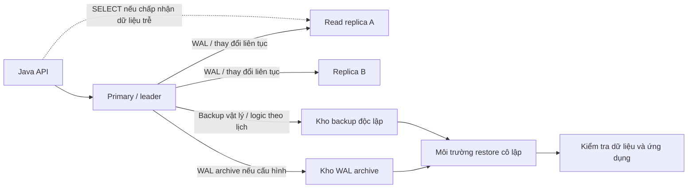
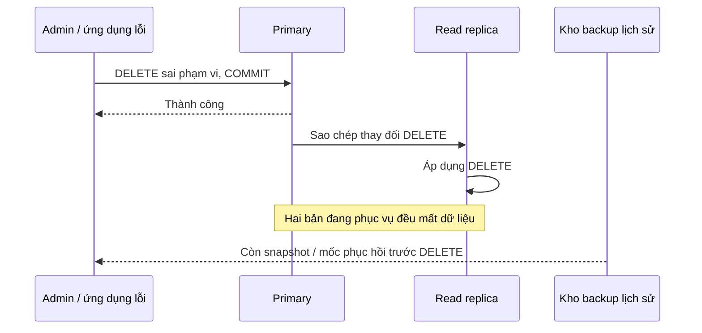
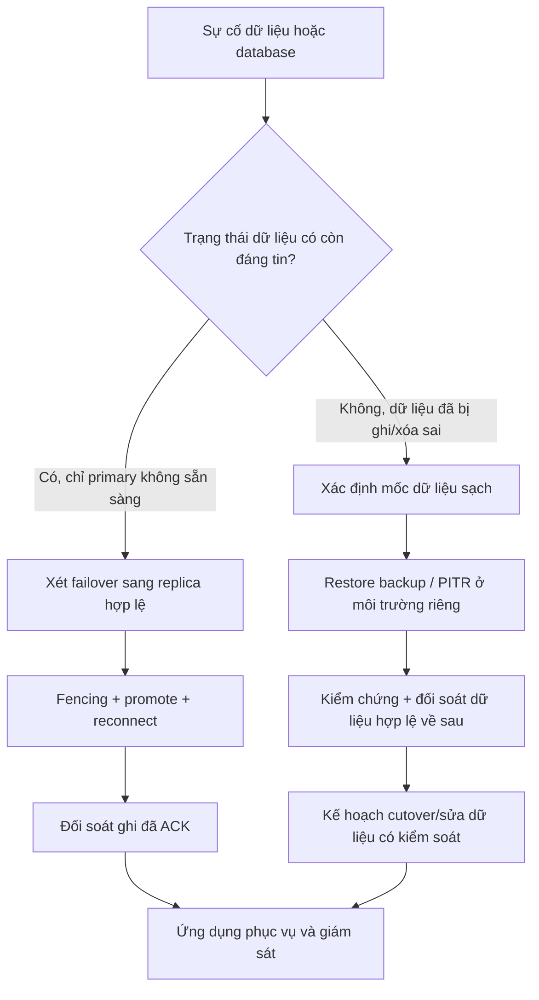

# Phân biệt bản sao lưu với bản sao đang phục vụ truy cập

## 1. Có ba bản dữ liệu nhưng vì sao vẫn không khôi phục được đơn hàng bị xóa?

Một cửa hàng trực tuyến lưu đơn hàng trong PostgreSQL. Để ứng dụng phản hồi nhanh và chịu lỗi máy chủ, nhóm vận hành cấu hình một **primary** nhận ghi và hai **read replica** phục vụ truy vấn. Khi primary gặp sự cố, một replica có thể được chọn thay thế. Có vẻ dữ liệu đã được bảo vệ nhờ “ba bản sao”.

Nhưng lúc 10:00, một bản triển khai chứa lỗi chạy nhầm:

```sql
-- Minh họa lệnh nguy hiểm, KHÔNG thực thi trên môi trường thật:
DELETE FROM orders WHERE created_at < CURRENT_DATE;
```

Lệnh được commit hợp lệ trên primary. Hai replica cũng nhận và thực hiện thay đổi. Đến 10:05, cả ba nút đều **không còn những đơn hàng bị xóa**. Promote một replica khác không thể làm đơn quay trở lại vì các replica đã sao chép chính thao tác xóa đó.

Nếu hệ thống có một **bản sao lưu được giữ độc lập** từ trước 10:00 và đủ nhật ký giao dịch để phục hồi đến thời điểm mong muốn, nhóm có thể dựng lại dữ liệu trong một môi trường tách biệt, xác minh, rồi khôi phục theo quy trình. Nếu chỉ có replica đang phục vụ, khả năng khôi phục về trạng thái quá khứ thường rất hạn chế.

Đó là khác biệt cốt lõi của bài học **“Phân biệt bản sao lưu với bản sao đang phục vụ truy cập”**, thuộc chương **Sao lưu và khôi phục** trong module **DATA_PERSISTENCE_FUNDAMENTALS**:

> **Replica chủ yếu giúp tiếp tục phục vụ và phân phối tải với trạng thái dữ liệu đang tiến về hiện tại. Backup chủ yếu giúp quay lại một trạng thái dữ liệu đã được bảo tồn và kiểm chứng khi trạng thái hiện tại không còn đáng tin.**

Hai cơ chế bổ sung cho nhau; không cơ chế nào tự thay thế cơ chế còn lại. Khi thiết kế persistence boundary cho Java, cần hiểu nơi transaction được commit, nơi client đọc dữ liệu, mức độ trễ của bản sao, điều gì được backup và cách phục hồi sau lỗi phần cứng, lỗi ứng dụng hoặc tấn công.

## 2. Định nghĩa: backup, replica và những tên gọi dễ nhầm

### Bản sao lưu (backup)

**Backup** là một tập dữ liệu và metadata được giữ để **phục hồi** một trạng thái trong quá khứ hoặc một phạm vi dữ liệu được xác định. Nó có thể là bản dump logic, bản sao vật lý của database, một chuỗi snapshot gia tăng hoặc bản base backup kết hợp các WAL/transaction log cần thiết.

Một backup hữu ích cần có:

- **Phạm vi:** database, schema, bảng, tập đối tượng, cấu hình và dữ liệu ngoài DB nào được bao gồm.
- **Điểm nhất quán:** có thể phục hồi thành trạng thái hợp lệ về transaction, không chỉ là tập tệp được copy ngẫu nhiên.
- **Mốc thời gian:** biết dữ liệu thuộc snapshot nào và có thể khôi phục tới điểm nào.
- **Khả năng tồn tại độc lập:** còn truy cập được dù cụm đang phục vụ bị phá hủy hoặc tài khoản vận hành bị lỗi.
- **Khả năng khôi phục đã kiểm chứng:** có công cụ, phiên bản, quyền truy cập, khóa giải mã và runbook để dùng bản lưu.

Một bản dump đã tạo nhưng chưa từng thử `restore` chỉ chứng minh việc **xuất dữ liệu có vẻ hoàn tất**, chưa chứng minh hệ thống có thể hoạt động từ dữ liệu ấy.

### Bản sao đang phục vụ (serving replica)

**Replica** là một bản dữ liệu được đồng bộ, thường xuyên hoặc gần thời gian thực, với nguồn dữ liệu chính để:

1. **Phục vụ đọc**, giảm tải cho primary hoặc đặt dữ liệu gần người dùng.
2. **Tăng tính sẵn sàng**, có thể được promote khi primary không còn sử dụng được.
3. **Phân phối dữ liệu**, ví dụ cho ứng dụng báo cáo hoặc một hệ downstream.

Replica có thể chỉ nhận dữ liệu mà chưa phục vụ truy vấn; một **read replica** là replica được cấu hình/cho phép phục vụ đọc. Không phải mọi replica có thể nhận ghi hoặc tự động được promote. Đặc tính cụ thể tùy kiến trúc và DBMS.

### Snapshot, clone và standby có phải backup không?

| Tên gọi | Ý nghĩa thường gặp | Có tự đủ làm backup? |
| --- | --- | --- |
| **Snapshot lưu trữ** | Ảnh chụp block/volume tại một thời điểm | **Chưa chắc**; cần xét crash/transaction consistency, WAL, phạm vi volume và khả năng phục hồi |
| **Database clone** | Bản sao để test, phân tích hoặc chạy ứng dụng khác | **Chưa chắc**; có thể chia sẻ storage/quyền/xóa đồng bộ hoặc không có chính sách giữ lịch sử |
| **Hot standby/read replica** | Nút tiếp tục nhận WAL/log và có thể nhận truy vấn | **Không thay thế** bản lưu lịch sử độc lập |
| **Delayed replica** | Replica cố ý áp dụng thay đổi muộn | Có thể tạo thêm thời gian phát hiện thao tác sai, nhưng **không bảo đảm** giữ được mốc mong muốn hay chống mất đồng thời |
| **Logical dump** | Dữ liệu và cấu trúc logic được xuất theo một snapshot | **Có thể là một loại backup** nếu lưu/kiểm tra/khôi phục đúng phạm vi |
| **Base backup + WAL archive** | Bản vật lý nền cộng nhật ký liên tục | **Có thể hỗ trợ PITR** khi chuỗi cần thiết đầy đủ và phục hồi được |

Đừng đặt tên thư mục là `backup` rồi suy ra tính bền vững. Phải nhìn vào **cơ chế tạo, giữ, bảo vệ và kiểm thử khôi phục**.

## 3. Bảng so sánh trực tiếp: backup và replica

| Tiêu chí | Backup | Replica đang phục vụ |
| --- | --- | --- |
| Mục tiêu chính | Khôi phục dữ liệu khi mất/hỏng/sửa sai; giữ lịch sử trong thời gian định trước | Tăng khả năng sẵn sàng, mở rộng đọc, đôi khi giảm khoảng mất dữ liệu khi failover |
| Dữ liệu theo thời gian | Giữ snapshot hoặc các điểm phục hồi có chủ đích | Thường liên tục tiến về trạng thái mới nhất của nguồn |
| Lỗi xóa nhầm đã commit | Có thể quay về mốc trước lỗi, nếu còn bản lưu và log | Xóa nhầm thường được sao chép sang replica |
| Lỗi primary mất hoàn toàn | Phục hồi được nhưng cần thời gian dựng lại | Có thể promote nhanh nếu replica phù hợp và failover an toàn |
| Truy cập trực tiếp cho API | Thường **không** phục vụ truy vấn ứng dụng | Có thể phục vụ SELECT, theo điều kiện và mức trễ |
| Đồng nhất với primary | Bản lưu thuộc một thời điểm quá khứ | Có thể bắt kịp, chậm hoặc khác trạng thái sau failover |
| Giao dịch/ACK | Backup không phải cơ chế ACK của giao dịch đang ghi | Chính sách sync/async có thể tham gia điều kiện ACK |
| RPO/RTO | Phụ thuộc lịch backup, log lưu, tốc độ restore | Phụ thuộc replication lag, dữ liệu đã ACK và thời gian promote |
| Khả năng chống ransomware | Có thể nếu độc lập, bất biến và tách quyền | Thường không, vì dữ liệu sai/xóa có thể lan nhanh |
| Cách kiểm chứng | Thử restore, kiểm tra nhất quán và chạy ứng dụng | Thử promotion, failover/fencing, đọc/ghi và đối chiếu commit |

**Ví dụ:** một replica đồng bộ tốt có thể bảo vệ các commit đã ACK khi một node chết, nhưng vẫn sao chép một lệnh `DELETE` sai được commit hoàn toàn hợp lệ. Backup độc lập có thể cứu lịch sử trước `DELETE`, nhưng khôi phục toàn database từ backup có thể tốn nhiều giờ và cần xử lý các giao dịch hợp lệ đã phát sinh sau đó.

## 4. Hình dung kiến trúc có cả hai tuyến bảo vệ



Đường **primary → replica** phục vụ trạng thái dữ liệu **đang được cập nhật**. Đường **primary → kho backup/nhật ký** phục vụ **khả năng phục hồi**. Kho backup thường cần chính sách bảo mật, thời gian giữ, vị trí địa lý và tài khoản truy cập riêng, tránh sự cố chung với hệ phục vụ.

Không nên hiểu sơ đồ là mọi backup đều phải lấy trực tiếp từ primary. Một số nền tảng cho phép tạo backup nhất quán từ standby, snapshot lưu trữ hoặc dịch vụ quản lý. Tuy nhiên phải xác minh cơ chế chụp, quyền đọc, WAL cần đi kèm, độ trễ replica và mức nhất quán theo hướng dẫn của sản phẩm cụ thể.

## 5. Những kịch bản sự cố làm lộ khác biệt

### Kịch bản A — primary mất điện, replica có đủ dữ liệu

```text
09:00  Primary P đang ghi và phục vụ đơn hàng
09:01  Replica R có đủ log của các giao dịch đã ACK
09:02  P hỏng hoàn toàn
09:03  Bộ điều phối ngăn P cũ ghi và promote R
09:04  Java client kết nối lại, tiếp tục xử lý
```

Đây là tình huống **replica có giá trị cao**: phục hồi khả năng phục vụ có thể nhanh hơn dựng database từ backup. Nhưng mốc 09:03–09:04 chỉ là ví dụ; RTO thực tế tùy cơ chế phát hiện lỗi, election/promotion, router, pool và kiểm tra an toàn.

Điều kiện “R có đủ log của các giao dịch đã ACK” **không tự đúng** nếu replication bất đồng bộ. Nếu không đủ, có thể mất các giao dịch mới nhất so với những ACK mà client đã nhận. Cần xác định RPO của kiến trúc.

### Kịch bản B — xóa nhầm và replica bắt kịp



Promote R **không giúp đảo ngược DELETE**, vì R có cùng dữ liệu sai. Nếu backup và WAL archive đủ, hệ thống có thể dựng lại trạng thái trước thao tác sai rồi chọn cách khôi phục phù hợp với nghiệp vụ.

### Kịch bản C — lỗi ứng dụng ghi giá trị sai trong nhiều giờ

Một bản phát hành tính giá sai từ 13:00 đến 16:00. Replica áp dụng toàn bộ các giá sai, nên phục hồi từ replica không khôi phục logic đúng. Backup tại 12:00 có thể cung cấp trạng thái sạch, nhưng phục hồi toàn hệ thống về 12:00 sẽ làm mất **các giao dịch hợp lệ sau 12:00** nếu không có kế hoạch giữ lại/đối soát.

Chiến lược đúng có thể là dựng bản restore ở môi trường riêng, trích xuất dữ liệu đúng, phát triển script sửa có kiểm soát, đối chiếu theo operation ID và khôi phục **có chọn lọc**. Không mặc định cứ có backup là nên thay toàn bộ production bằng dữ liệu cũ.

### Kịch bản D — mã độc hoặc tài khoản đặc quyền xóa dữ liệu

Nếu cùng một credential có quyền xóa primary, replica và mọi file backup, một sự cố bảo mật có thể phá cả hai tuyến. **Tách quyền, giữ bản sao bất biến, mã hóa, bảo vệ khóa và đặt bản sao ngoài miền lỗi** mới giúp backup phát huy vai trò chống các sự cố có chủ đích.

### Kịch bản E — hệ thống đọc được nhưng dữ liệu không còn đáng tin

Replica vẫn trả `SELECT` rất nhanh, health check vẫn xanh, nhưng mọi bản đều chứa trạng thái sai do một migration lỗi. **Availability** không đồng nghĩa **correctness**. Một kế hoạch backup tốt cung cấp lịch sử để kiểm tra và sửa sai; test failover đơn thuần không phát hiện được vấn đề này.

## 6. Backup cần nhất quán về transaction, không chỉ copy đủ file

Một database đang hoạt động có thể vừa ghi data page vừa ghi write-ahead log (WAL). Nếu sao chép trực tiếp các file dữ liệu đang thay đổi bằng công cụ copy thông thường mà không dùng giao thức backup phù hợp, bản sao có thể là một tập file **không nhất quán với nhau**, không khởi động được hoặc khôi phục thiếu giao dịch.

**Backup nhất quán** cần đáp ứng mô hình phục hồi của DBMS:

- Với **logical backup**, công cụ xuất dữ liệu theo snapshot giao dịch phù hợp để có một ảnh logic nhất quán trong phạm vi được hỗ trợ.
- Với **physical backup**, phải lấy các file/tệp liên quan theo một quy trình nhất quán và giữ WAL/log cần thiết để recovery từ trạng thái được chụp.
- Với **storage snapshot**, cần đánh giá atomicity của snapshot trên các volume, mối quan hệ với WAL, hệ thống file, cơ chế quiesce và phương thức phục hồi.

Một snapshot **crash-consistent** có thể phục hồi tương tự sau một lần mất điện nếu DBMS và WAL/storage hoạt động đúng. Nó khác với snapshot **application-consistent** được phối hợp với ứng dụng/DB để bảo đảm các điều kiện rộng hơn. Hai thuật ngữ không nên được sử dụng thay thế cho nhau mà không nói rõ điều kiện.

### Thời điểm backup không nhất thiết là một mốc duy nhất cho mọi hệ

Một lần `pg_dump` một database PostgreSQL thông thường dùng snapshot nhất quán cho dữ liệu của database đó. Nhưng nhiều database độc lập, một object store chứa file đính kèm và một hàng đợi message **không tự có cùng một transaction toàn hệ** chỉ vì ta chạy các lệnh backup gần nhau.

Nếu một đơn hàng tham chiếu tới file hóa đơn nằm trong object storage, kế hoạch backup phải xác định file nào thuộc phạm vi phục hồi, thứ tự cập nhật và cách tái dựng sự nhất quán chéo hệ sau khi restore.

## 7. Các loại backup và điều chúng cho phép khôi phục

| Loại / kỹ thuật | Nội dung lưu | Điểm mạnh | Giới hạn |
| --- | --- | --- | --- |
| **Full backup** | Toàn bộ dữ liệu trong phạm vi đã chọn tại một mốc | Nền khôi phục dễ hiểu | Có thể lớn, tốn I/O, thời gian và không nêu mọi thời điểm giữa các bản |
| **Incremental backup** | Phần thay đổi kể từ một mốc backup trước theo định nghĩa sản phẩm | Giảm lượng dữ liệu lưu/chuyển | Restore cần chuỗi bản phụ thuộc và kiểm soát tính đầy đủ |
| **Differential backup** | Phần thay đổi kể từ bản full theo định nghĩa sản phẩm | Có thể giảm số mắt xích restore | Dung lượng tăng theo khoảng cách từ full |
| **Logical backup** | Schema, dữ liệu và một số object database dưới dạng logic | Di chuyển/khôi phục có chọn lọc, đọc được cấu trúc | Không phải base backup vật lý cho WAL PITR; chưa chắc gồm roles, cluster globals |
| **Physical/base backup** | Dữ liệu vật lý và metadata phù hợp engine | Phục hồi cụm cùng nền tảng/phiên bản tương thích | Phụ thuộc engine, phiên bản và WAL cần thiết |
| **Continuous log archiving** | WAL/transaction log liên tục | Cùng base backup có thể hỗ trợ PITR | Đòi chuỗi log không đứt và quy trình restore phù hợp |
| **Storage snapshot** | Trạng thái block/volume ở một mốc | Có thể chụp nhanh ở tầng lưu trữ | Phải chứng minh tính nhất quán và khả năng gắn lại/khôi phục |

Chữ **full/incremental/differential** là mô hình phổ biến; PostgreSQL và từng dịch vụ quản lý có tập tính năng, định dạng và quy tắc phục hồi khác nhau theo phiên bản. Không suy từ tên gọi mà kết luận một file có thể restore độc lập.

Điều quan trọng nhất là **chuỗi phục hồi được kiểm thử**: bản nào cần trước, bản nào cần sau, log liên quan nằm ở đâu và các bản có tương thích với nhau hay không.

## 8. RPO và RTO: backup và replica thường tối ưu những mục tiêu khác nhau

**RPO (Recovery Point Objective)** là lượng dữ liệu tối đa doanh nghiệp chấp nhận mất khi phục hồi, thường diễn đạt theo khoảng thời gian hoặc số giao dịch. **RTO (Recovery Time Objective)** là thời gian tối đa doanh nghiệp chấp nhận để dịch vụ hoạt động trở lại.

Ví dụ minh họa:

| Phương án | RPO mục tiêu cần xét | RTO có thể bị chi phối bởi |
| --- | --- | --- |
| Backup logic mỗi ngày, không có log phục hồi xen giữa | Có thể mất các thay đổi kể từ bản gần nhất | Tạo DB, import dữ liệu, dựng index/constraint, kiểm tra ứng dụng |
| Base backup + WAL archive liên tục | Có thể nhắm tới một mốc gần sự cố hoặc trước lỗi logic | Dựng base, replay WAL, xác minh và chuyển lưu lượng |
| Replica bất đồng bộ | Có thể mất những commit chưa kịp đến replica được promote | Phát hiện lỗi, chọn replica, promotion và reconnect |
| Replica đồng bộ với failover được thiết kế phù hợp | Có thể nhắm tới không mất các commit đã ACK trong miền lỗi định nghĩa | Chờ quorum/standby, election/fencing, chuyển router |
| Kết hợp replica + backup/PITR | Hai đường xử lý các loại lỗi khác nhau | Chọn failover nhanh hoặc restore sạch tùy sự cố |

**RPO mục tiêu khác RPO thực đo.** Backup mỗi giờ không mặc nhiên bảo đảm mất tối đa đúng 60 phút trong mọi sự cố: job có thể thất bại, bản mới có thể hỏng, kho có thể mất quyền truy cập, log có thể ngừng archive. Tương tự, sao chép đồng bộ không tự bảo đảm RPO=0 nếu promote sai replica hoặc một sự cố phá hủy cả miền lỗi.

### Ví dụ timeline khôi phục có PITR

```text
08:00  Base backup B0 hoàn tất theo quy trình phù hợp
09:00  Các WAL đoạn tiếp theo được archive đầy đủ
09:55  Đơn hàng O100 được commit
10:00  DELETE sai được commit
10:03  Phát hiện dữ liệu thiếu; các replica đã apply DELETE

Mục tiêu phục hồi: trạng thái trước DELETE lúc 10:00.
Nguồn có thể dùng: B0 + WAL hợp lệ tới recovery target.
```

Nếu backup vật lý và WAL đầy đủ để replay tới mốc đích, hệ thống có thể **point-in-time recovery (PITR)** tới một thời điểm/trạng thái phù hợp trước lệnh sai. Nhưng mọi thay đổi hợp lệ **sau** recovery target sẽ không tự xuất hiện trong database đã phục hồi. Cần đối soát và có thể phát lại/chuyển một phần giao dịch hợp lệ sau mốc đó.

Mục tiêu PITR phải được chọn cẩn thận: timestamp gần một transaction không phải lúc nào cũng là cách xác định duy nhất, nhất là khi có nhiều hệ, đồng hồ lệch hoặc transaction kéo dài. Cần dùng timeline, marker, transaction log và bằng chứng nghiệp vụ phù hợp.

## 9. PostgreSQL: logical backup với `pg_dump`

`pg_dump` xuất nội dung **một database** PostgreSQL ở dạng logic. Dạng `custom` (`-Fc`) hỗ trợ `pg_restore` chọn object và kiểm soát trình tự khôi phục. Đây là lựa chọn hữu ích khi cần di chuyển schema/dữ liệu, lưu một bản logic định kỳ hoặc khôi phục một phần object theo điều kiện phù hợp.

Ví dụ chạy **trong môi trường thử nghiệm hoặc quy trình đã được phê duyệt**, với user có quyền backup và đích lưu an toàn:

```bash
pg_dump \
  --host=db.example.internal \
  --username=backup_reader \
  --dbname=orders_db \
  --format=custom \
  --file=/secure/backups/orders_db_2026-11-22.dump
```

Mật khẩu không được viết ngay trong lệnh, script, URL hoặc log. Dùng cơ chế xác thực và secret management phù hợp, quyền đọc tối thiểu, TLS và quyền truy cập file backup đã được hạn chế.

Kiểm tra cấu trúc archive:

```bash
pg_restore --list /secure/backups/orders_db_2026-11-22.dump
```

Lệnh liệt kê nội dung archive **không thay thế một lần restore thành công**. Để thực hành, trước tiên dựng một database riêng, trống và đúng quyền trong môi trường cách ly, sau đó:

```bash
pg_restore \
  --dbname=orders_restore_test \
  --verbose \
  /secure/backups/orders_db_2026-11-22.dump
```

Trong môi trường khác quyền owner/ACL, có thể cần tùy chọn như `--no-owner` và `--no-acl` theo kế hoạch phân quyền; **không bỏ qua lỗi khôi phục hoặc cấp quyền superuser tùy tiện**. Ví dụ giả định database `orders_restore_test` đã được tạo và phiên bản PostgreSQL tương thích.

### Logical backup bao gồm gì và thiếu gì?

- `pg_dump` bình thường xuất schema, dữ liệu và nhiều database object thuộc database đó theo khả năng/option công cụ.
- Nó **không phải** bản sao toàn bộ PostgreSQL cluster: roles, tablespaces và các đối tượng dùng chung cần quy trình riêng, ví dụ xuất cluster globals bằng `pg_dumpall --globals-only` khi phù hợp.
- Các extension, môi trường thực thi, biến cấu hình, secret, quyền kết nối, job ngoài DB và file object storage có thể cần được phục hồi hoặc cấu hình riêng.
- Logical dump **không thể dùng như một base backup vật lý để phát WAL và PITR theo cách của physical recovery**. Muốn khôi phục đến một thời điểm tùy ý dựa trên WAL, cần chuỗi backup/log vật lý thích hợp.
- Khôi phục database lớn có thể mất nhiều thời gian để load dữ liệu, dựng index và kiểm tra constraint. Phải đo trên kích thước gần thực tế.

`pg_dump` là công cụ rất hữu ích, nhưng lựa chọn backup logic hay vật lý phụ thuộc **RPO/RTO, quy mô, phạm vi restore và yêu cầu PITR**.

## 10. PostgreSQL: physical base backup và WAL archiving

Với PostgreSQL, một phương án phục hồi vật lý thường dựa trên:

1. **Base backup** hợp lệ của cluster/data directory.
2. **WAL** đủ để phục hồi từ mốc base backup tới recovery target.
3. **Cấu hình restore** và quyền truy cập vào các file cần thiết.
4. **Khóa mã hóa, phiên bản công cụ, extension/tablespace** và các thành phần vận hành khác cần thiết để khởi chạy.

Ví dụ minh họa tạo base backup bằng `pg_basebackup`:

```bash
pg_basebackup \
  --host=primary.example.internal \
  --username=replication_backup \
  --pgdata=/secure/backups/base_2026_11_22 \
  --format=plain \
  --wal-method=stream \
  --progress
```

Các tham số đường dẫn/tài khoản là ví dụ. Không ghi vào data directory của PostgreSQL đang chạy, không dùng `pg_basebackup` như một lệnh “copy đè production”, và không dùng tài khoản không có quyền replication/backup phù hợp.

`--wal-method=stream` yêu cầu công cụ thu thập WAL cần cho quá trình base backup theo cơ chế của nó. Điều này **không tự cấu hình một kho WAL archive liên tục** để phục hồi đến một thời điểm bất kỳ nhiều giờ sau khi backup hoàn tất.

### WAL archiving và PITR

Để phục hồi tới một mốc sau base backup, phải thiết kế archive WAL liên tục, đảm bảo chuỗi WAL cần thiết không bị thiếu và retention phù hợp. Trong PostgreSQL, những khái niệm liên quan gồm:

- `archive_mode`: cho phép cơ chế lưu WAL archive theo cấu hình.
- `archive_command` hoặc thư viện archive phù hợp: chuyển những WAL segment cần thiết sang nơi lưu an toàn.
- `restore_command`: trong môi trường recovery, lấy WAL đã archive khi cần.
- `recovery_target_time` hoặc mục tiêu recovery khác: giới hạn điểm replay theo kế hoạch.
- `recovery.signal` (với PostgreSQL hiện đại): một trong những dấu hiệu kích hoạt cơ chế archive recovery trong đúng môi trường đã dựng để phục hồi.

Đây là **thành phần thiết kế**, không phải một file cấu hình hoàn chỉnh sẵn sàng áp dụng cho mọi phiên bản. Nếu archive command thất bại, base backup có thể vẫn tồn tại nhưng **PITR tới mốc mong muốn không còn được bảo đảm**. Việc lưu WAL phải có giám sát, cảnh báo và thử restore định kỳ.

Một thao tác xóa nhầm cũng sẽ có trong WAL. Khôi phục trước thao tác sai đòi **dừng replay đúng mục tiêu**, chứ không phải “phục hồi toàn bộ WAL đến hiện tại” rồi hy vọng lệnh xóa biến mất.

### Tại sao không tự copy `PGDATA` khi database đang chạy?

`PGDATA` có nhiều file được cập nhật theo thời gian. Sao chép tuần tự tệp đang sống có thể bắt các trang dữ liệu ở những thời điểm khác nhau, thiếu WAL hoặc metadata cần để phục hồi. Dùng giao thức **base backup hoặc snapshot nhất quán được DBMS hỗ trợ**. Một bản copy thô không qua quy trình đó không phải chứng cứ về khả năng phục hồi.

## 11. Replica PostgreSQL: nhận và áp dụng WAL để phục vụ truy cập

Một read replica PostgreSQL vật lý (*hot standby*) có thể liên tục nhận WAL từ primary, ghi và replay để phục vụ `SELECT`. Các mốc cần phân biệt:

| Mốc trên standby | Diễn giải | Điều chưa được chứng minh |
| --- | --- | --- |
| Nhận WAL | Dữ liệu thay đổi đã tới standby | Đã flush bền vững hoặc apply |
| Write WAL | Đã ghi vào tầng I/O/bộ đệm theo cơ chế DB | Đã hoàn toàn bền vững trước lỗi OS/thiết bị |
| Flush WAL | WAL đạt mốc bền vững theo giao diện lưu trữ | Đã apply để truy vấn thấy bản ghi |
| Replay/apply WAL | Trạng thái truy vấn standby đã phản ánh WAL đến mốc đó | Mọi replica khác cũng bắt kịp |
| Được promote | Standby trở thành nút nhận ghi mới theo quy trình | Đã giữ mọi commit ACK cũ nếu failover selection sai |

Quan sát tại primary:

```sql
SELECT application_name,
       state,
       sync_state,
       sent_lsn,
       write_lsn,
       flush_lsn,
       replay_lsn
FROM pg_stat_replication;
```

Quan sát tại standby:

```sql
SELECT pg_is_in_recovery(),
       pg_last_wal_receive_lsn(),
       pg_last_wal_replay_lsn(),
       pg_last_xact_replay_timestamp();
```

Các số liệu giúp chẩn đoán độ trễ và tình trạng replication, không biến standby thành backup. `pg_last_xact_replay_timestamp()` có thể là một timestamp cũ khi primary ít ghi, nên **không diễn giải máy móc** như “replica bị trễ đúng từng ấy thời gian” mà không so sánh mốc WAL và hoạt động nguồn.

Khi primary mất hoàn toàn, một standby chỉ có thể giữ các commit đã ACK nếu cấu hình replication/ACK, độ bền lưu trữ và **quy trình chọn/promote node** thực sự đáp ứng cam kết đó. Replica **bất đồng bộ** có thể thiếu transaction gần nhất; replica đồng bộ cũng cần cơ chế failover tránh promote sai node hoặc split-brain.

## 12. Vì sao một delayed replica vẫn không phải phương án backup đầy đủ?

Một số hệ thống cố tình để follower **chậm áp dụng** thao tác một khoảng, ví dụ 30 phút, nhằm tạo cơ hội dừng trước khi lệnh xóa nhầm lan tới bản đọc. Cách này có thể giảm thời gian phản ứng trong một số sự cố nhưng vẫn có rủi ro:

- **Phát hiện chậm hơn độ trễ đã cấu hình:** lệnh sai cuối cùng vẫn được apply.
- **Mất cả cụm, region hoặc thiết bị lưu trữ:** delayed replica có thể cùng mất với primary.
- **Lỗi bảo mật:** cùng credential/automation có thể xóa hoặc reconfigure delayed replica.
- **Lỗi logic kéo dài:** một thay đổi sai rải rác trong nhiều giờ không được sửa chỉ bằng lag cố định.
- **Không có lịch sử nhiều mốc:** một replica thường chỉ giữ **một trạng thái đang tiến lên**, không phải tập điểm phục hồi có thể chọn tùy ý.
- **Khi dừng apply để cứu dữ liệu, quy trình phục hồi vẫn phức tạp:** phải ngăn replay log sai, chọn mốc, kiểm tra toàn vẹn và chuyển dữ liệu/traffic đúng cách.

Delayed replica có thể là **một lớp phòng vệ bổ sung** khi có runbook/giám sát phù hợp; không thay thế các bản lưu lịch sử độc lập, chính sách retention và restore drill.

## 13. Bốn cách nhầm lẫn thường làm hỏng kế hoạch phục hồi

### 13.1. “Replica là backup vì luôn chứa cùng dữ liệu”

Chính việc **luôn bám sát** primary làm replica sao chép cả lỗi xóa nhầm, sai logic và một số hư hỏng dữ liệu ở mức ứng dụng. Khi cần một phiên bản **trước lỗi**, sự đồng bộ liên tục là bất lợi.

### 13.2. “Có backup nên không cần replica”

Backup cho phép khôi phục nhưng không nhất thiết phục vụ được lưu lượng ngay. Dựng lại database lớn, replay log, kiểm tra consistency, tạo endpoint và chuyển application traffic có thể lâu hơn RTO sản phẩm cho phép. Replica giúp **high availability** nếu lỗi thuộc phạm vi mà nó chịu được.

### 13.3. “Replica đồng bộ nên khỏi phải backup”

Replication đồng bộ mạnh có thể giảm mất commit đã ACK qua một số lỗi hạ tầng, nhưng **không khôi phục được lịch sử đã bị ghi sai**. Nó cũng không tự bảo vệ trước quyền quản trị bị lạm dụng hoặc sự cố chung của cả cụm.

### 13.4. “Bản backup mới nhất chắc chắn restore được”

Backup job thành công chưa đủ. File có thể lỗi, thiếu WAL, thiếu extension/role, khóa giải mã không còn, quy trình phục hồi chưa được diễn tập hoặc dữ liệu liên quan nằm ở hệ khác. **Khả năng restore được đo bằng một lần restore và kiểm tra thực tế**, không phải số lượng file trong bucket.

## 14. Java persistence: chọn đường đọc/ghi cho đúng nghĩa

Trong Java, tầng persistence có thể có một `DataSource` cho primary và một `DataSource` cho read replica. Tuy nhiên, **đặt `Connection.setReadOnly(true)` không tự chuyển kết nối từ primary sang replica**; định tuyến phụ thuộc cấu hình DataSource, driver, proxy hoặc router của ứng dụng.

Một thiết kế hợp lý phân biệt:

- **Write path:** gửi INSERT/UPDATE/DELETE đến primary/leader có thẩm quyền, nằm trong transaction và chỉ trả xác nhận sau commit theo hợp đồng.
- **Eventual read path:** những màn hình chấp nhận cũ có thể đọc replica để giảm tải.
- **Read-your-writes path:** ngay sau khi người dùng ghi, đọc primary hoặc dùng commit watermark/session token để bảo đảm replica đã bắt kịp.
- **Recovery path:** backup/restore là quy trình vận hành riêng; API không truy vấn file backup trực tiếp như một read replica.

### Ví dụ repository với hai DataSource

```java
import java.sql.Connection;
import java.sql.PreparedStatement;
import java.sql.ResultSet;
import java.sql.SQLException;
import java.util.UUID;
import javax.sql.DataSource;

public final class OrderReadRepository {
    private final DataSource primary;
    private final DataSource readReplica;

    public OrderReadRepository(DataSource primary, DataSource readReplica) {
        this.primary = primary;
        this.readReplica = readReplica;
    }

    public String findStatus(UUID authenticatedTenantId, UUID orderId,
                             boolean requireFreshRead) throws SQLException {
        if (authenticatedTenantId == null || orderId == null) {
            throw new IllegalArgumentException("Invalid order lookup");
        }
        // Đường đọc cần bảo đảm ngay sau ghi: chọn nguồn có thẩm quyền.
        DataSource source = requireFreshRead ? primary : readReplica;
        try (Connection connection = source.getConnection()) {
            connection.setReadOnly(true); // gợi ý JDBC, KHÔNG phải router.
            try (PreparedStatement statement = connection.prepareStatement(
                    """
                    SELECT status FROM orders
                    WHERE tenant_id = ? AND id = ?
                    """)) {
                statement.setObject(1, authenticatedTenantId);
                statement.setObject(2, orderId);
                try (ResultSet rows = statement.executeQuery()) {
                    return rows.next() ? rows.getString("status") : null;
                }
            }
        }
    }
}
```

Đây là ví dụ **định tuyến đọc**, không phải mã quản lý replication. Giả định `primary` và `readReplica` đã được cấu hình và bảo vệ đúng; xử lý lỗi, kết quả không tìm thấy, fallback, transaction và metric phải được bổ sung theo ứng dụng.

Đặc biệt:

- Không nhận giá trị `requireFreshRead` trực tiếp từ client rồi tin đó là ranh giới bảo mật; ứng dụng quyết định dựa trên ngữ nghĩa use case.
- `SELECT` từ replica trả không thấy đơn **không chứng minh** transaction ghi trước đó thất bại; nó có thể chỉ bị lag.
- Sau failover, router/connection pool phải loại bỏ connection cũ và kết nối đúng primary mới; ứng dụng không tự an toàn chỉ vì có hai URL.
- Khi cần một transaction đọc nhất quán qua nhiều câu SQL, **đọc từ cùng node/snapshot phù hợp**. Đổi qua lại primary và replica giữa transaction có thể tạo ảnh dữ liệu không thống nhất.

### Nếu lỗi xảy ra trong `commit()` thì sao?

Giả sử Java gửi `COMMIT` đến primary, server đã commit nhưng mạng đứt trước khi ACK tới caller. Đúng lúc đó xảy ra failover. **Từ phía caller, kết quả thao tác có thể chưa rõ**; không nên tạo operation ID mới và lặp ghi mù quáng.

Một thiết kế an toàn hơn dùng **operation ID ổn định + ràng buộc duy nhất** trong database có thẩm quyền, tra cứu hoặc retry idempotent với cùng payload. Tuy nhiên nếu hệ thống dùng replica bất đồng bộ và **mất commit đã ACK qua failover**, bản ghi idempotency cũng có thể mất; không thể lấy khóa idempotency thay cho chính sách durability và đối soát với tác động bên ngoài.

## 15. Khả năng phục hồi của ứng dụng vượt xa database

Một lần restore PostgreSQL thành công chưa đủ để ứng dụng Java chạy lại đúng:

| Thành phần | Có cần đưa vào kế hoạch phục hồi? | Vì sao |
| --- | --- | --- |
| Database data và schema | Có | Phục hồi bản ghi, constraint, index và cấu trúc |
| WAL/archive liên quan | Có nếu dùng PITR | Phục hồi tới recovery target sau base backup |
| Roles, quyền, cấu hình DB | Có | Ứng dụng có thể không kết nối hoặc quyền bị sai sau restore |
| Extension, phiên bản, collation, encoding | Cần kiểm tra | Khác biệt có thể gây lỗi hoặc thay đổi cách so sánh/sắp xếp |
| File/object storage | Có nếu nghiệp vụ lưu ngoài DB | Đơn hàng có thể tham chiếu hóa đơn/tệp không tồn tại |
| Khóa mã hóa và secret | Cần bảo tồn an toàn | Không có khóa có thể không giải mã/khởi động được |
| Queue/outbox/event offset | Cần thiết kế | Sau restore có thể gửi trùng, bỏ sót hoặc replay event sai |
| Search index, cache, projection | Thường có thể dựng lại, nhưng cần kế hoạch | Dữ liệu dẫn xuất có thể không khớp DB vừa phục hồi |
| Job scheduler, cron, cấu hình ứng dụng | Có | Tránh worker cũ tác động lên database vừa restore |
| DNS/proxy, routing, TLS | Có | Dịch vụ có dữ liệu đúng nhưng client không kết nối được |

Ví dụ: khôi phục database về 09:59 nhưng consumer đã gửi email xác nhận đơn lúc 10:01. Nếu đơn ở 10:01 không còn trong DB mới, hệ thống cần **reconciliation**; không thể “rollback” email đã gửi bằng `pg_restore`.

Để tránh xử lý side effect lặp sau recovery, thiết kế outbox, inbox/idempotency và khóa nghiệp vụ rõ ràng. Bản backup phục hồi **trạng thái DB**, không phục hồi nguyên tử toàn bộ thế giới bên ngoài.

## 16. Backup phải được bảo vệ khỏi cùng miền lỗi với production

Một chiến lược backup tốt phân tách **miền lỗi**:

1. **Vị trí:** đừng giữ bản duy nhất trên cùng volume/host với database đang chạy.
2. **Tài khoản:** đừng cho mọi service account có quyền xóa hoặc thay đổi bản lưu.
3. **Retention:** giữ các điểm phục hồi phù hợp với thời gian phát hiện lỗi, nghĩa vụ pháp lý và chi phí lưu trữ.
4. **Bất biến:** cân nhắc object lock/WORM hoặc cơ chế immutable retention phù hợp để giảm nguy cơ xóa/sửa độc hại.
5. **Mã hóa:** bảo vệ dữ liệu khi truyền và khi lưu; quản lý khóa giải mã tách biệt với bản backup nhưng phải khôi phục được khi có sự cố.
6. **Nhiều miền lỗi:** có thể dùng bản lưu ngoài site hoặc vùng địa lý, tùy rủi ro mất cả khu vực.
7. **Kiểm toán:** theo dõi ai tạo, truy cập, restore, thay đổi retention và xóa backup.

Quy tắc **3-2-1** thường được dùng như một điểm bắt đầu: có nhiều bản dữ liệu, trên hơn một loại/vị trí lưu trữ và ít nhất một bản tách khỏi nơi chính. Nhưng đây **không phải thuật toán chứng minh độ an toàn**; chất lượng độc lập quyền, tính bất biến, khóa mã hóa và restore test còn quan trọng hơn việc chỉ đếm số bản.

Một bản backup bị mã hóa bằng khóa đã mất là bản không thể dùng. Tương tự, một bản backup “offline” mà chưa bao giờ được thử restore vào môi trường thật có thể gặp lỗi ở thời điểm cần nhất.

## 17. Kiểm thử khôi phục: backup được đánh giá bằng restore

Một lần kiểm tra tốt nên thực hiện trong **môi trường cô lập**, không ghi đè database production. Có thể tổ chức thành các giai đoạn:

### Bước 1 — Chọn một điểm phục hồi và phạm vi rõ ràng

Chọn backup snapshot/base backup, khoảng WAL/log, mốc recovery target và DBMS/phiên bản sẽ restore. Kiểm tra file/manifest, lịch backup, catalog và mã hóa. Không chọn nhầm bản sao mới nhất nếu mục tiêu là **trước một lỗi logic**.

### Bước 2 — Dựng môi trường riêng

Tách network, credential, endpoint, storage và tên database. Chặn job gửi email/thanh toán thật, consumer ngoài và webhook phát sinh từ môi trường restore. Không cho ứng dụng cũ kết nối nhầm rồi ghi vào dữ liệu vừa khôi phục.

### Bước 3 — Restore đầy đủ theo phương thức đã chọn

- Logical backup: tạo database đích rồi `pg_restore` hoặc công cụ tương ứng.
- Physical backup: dựng data directory hợp lệ và replay WAL cần thiết theo runbook.
- PITR: đặt recovery target, xác nhận hệ thống dừng đúng mốc và tạo timeline mới theo cơ chế của DBMS.

**Không restore trực tiếp lên cụm phục vụ** khi chưa đánh giá phương án bảo toàn các giao dịch hợp lệ phát sinh sau mốc phục hồi.

### Bước 4 — Kiểm tra cả kỹ thuật lẫn nghiệp vụ

| Kiểm tra | Ví dụ | Ý nghĩa |
| --- | --- | --- |
| DB khởi động và recovery kết thúc đúng | Connection vào DB restore, trạng thái recovery/timeline | Các file/log có đủ để engine phục hồi |
| Schema và quyền | Bảng, view, index, constraint, extension, role | Ứng dụng có thể chạy và phân quyền đúng |
| Bất biến dữ liệu | `available >= 0`, FK, tổng tiền không âm | Dữ liệu hợp lệ về ràng buộc |
| Bản ghi mốc | Operation ID đã ACK trước target có mặt | Kiểm tra điểm khôi phục |
| Bản ghi sau target | Thao tác xóa sai không được áp dụng | Chứng minh dừng đúng thời điểm |
| Tham chiếu ngoài DB | File hóa đơn/object storage tồn tại | Tránh bản ghi trỏ đến dữ liệu mất |
| Ứng dụng Java | Smoke test đăng nhập, đọc, ghi thử trên bản restore | Khôi phục được dịch vụ, không chỉ database |
| Thời gian phục hồi | Từ lúc phát hiện tới lúc test pass | So RTO thực tế với mục tiêu |

Không nên coi `SELECT COUNT(*)` bằng nhau là đủ. Hai tập bản ghi có thể cùng số lượng nhưng khác nội dung; nên đối chiếu khóa nghiệp vụ, hash/giá trị tổng hợp, dữ liệu mẫu quan trọng và các invariant riêng của hệ thống.

### Bước 5 — Diễn tập chuyển lưu lượng

Xác minh proxy/DNS, pool, quyền ghi, leader/replica mới và khả năng quay lại theo runbook. Tổ chức diễn tập với giới hạn an toàn rõ ràng; không cần thật sự chuyển traffic production nếu chưa được phê duyệt. Ghi lại lỗi, thao tác thủ công, phụ thuộc con người và thời gian.

## 18. Runbook: nên failover hay restore khi hệ thống gặp sự cố?



Runbook nên phân biệt **sự cố hạ tầng** với **sự cố tính đúng đắn dữ liệu**:

1. Xác định dấu hiệu: primary không trả lời, disk hỏng, dữ liệu bị xóa nhầm hay payload nghiệp vụ sai.
2. Bảo vệ bằng chứng: logs, WAL cần thiết, operation ID đã ACK, sự kiện ứng dụng và trạng thái replica.
3. Tránh thao tác làm mất cơ hội phục hồi: không xóa vội log, không promote tùy tiện hay cho worker chạy trên bản dữ liệu chưa được xác minh.
4. Chọn chiến lược: **failover** để tiếp tục với dữ liệu hợp lệ; **restore/PITR** khi cần trạng thái lịch sử sạch.
5. Nếu restore trước mốc hiện tại, có kế hoạch giữ/đối soát các giao dịch hợp lệ sau recovery target; tránh làm mất thêm dữ liệu.
6. Kiểm thử ở môi trường tách biệt, xác minh dữ liệu, quyền, dependency và hành vi ứng dụng.
7. Chuyển lưu lượng theo quyết định có thẩm quyền; cập nhật connection pool, router và các worker.
8. Đo RPO/RTO quan sát được, ghi nhận tác động và diễn tập lại điểm yếu đã phát hiện.

Đối với failover, **fencing** ngăn primary cũ tiếp tục nhận ghi khi node khác đã được promote. Đối với restore, **cô lập môi trường** ngăn các consumer hoặc job ghi nhầm vào bản đang cứu. Hai biện pháp bảo vệ những rủi ro khác nhau nhưng đều quan trọng.

## 19. Các chỉ số cần theo dõi định kỳ

| Chỉ số | Áp dụng cho | Câu hỏi cần trả lời |
| --- | --- | --- |
| Backup job success/failure và thời điểm bản lưu hợp lệ gần nhất | Backup | Có bản phục hồi đủ mới không? |
| Dung lượng, manifest/checksum và khả năng truy cập kho | Backup | File đã đủ, còn đọc được và chưa bị sửa trái phép không? |
| WAL archive lag, chuỗi WAL đầy đủ | Backup/PITR | Có thể replay tới mốc mục tiêu không? |
| Backup retention, expiry và immutability | Backup | Có giữ được lịch sử đủ lâu và chống xóa nhầm không? |
| Restore test success rate | Recovery | Bản backup thực sự dựng lại được DB/ứng dụng không? |
| Restore duration và application readiness | Recovery | RTO đo được có phù hợp mục tiêu không? |
| Replica receive/write/flush/replay lag | Replica | Bản phục vụ đọc và ứng viên promote còn thiếu bao nhiêu? |
| Failover duration, fencing và old-primary writes | Replica/HA | Có thể chuyển vai nhanh mà không split-brain không? |
| Số operation ID đã ACK nhưng mất sau sự cố | Durability/RPO | Có vi phạm cam kết với client không? |
| Dữ liệu phải reconciliation sau restore | Nghiệp vụ | Có giao dịch hợp lệ/side effect ngoài DB bị lệch không? |

Một cụm có **replication lag gần bằng 0** chưa chứng minh có thể restore dữ liệu từ ba ngày trước. Một hệ có **backup retention 90 ngày** cũng chưa chứng minh sẽ khôi phục trong RTO 15 phút. Hai nhóm metric đo những thuộc tính khác nhau.

## 20. Các sai lầm thường gặp

1. **“Có ba replica nên không cần backup.”** Lỗi logic hợp lệ, xóa nhầm hoặc mã độc có thể tác động lên mọi replica.
2. **“Backup ngày nào cũng chạy xanh thì chắc restore được.”** Phải thử restore, kiểm tra dữ liệu và khởi động ứng dụng.
3. **“Read replica trả dữ liệu cũ là lỗi database.”** Replica async có thể lag theo thiết kế; phải công bố hợp đồng độ mới.
4. **“Replica đồng bộ nghĩa là có nhiều điểm khôi phục lịch sử.”** Đồng bộ thường bảo vệ trạng thái hiện hành, không tự giữ snapshot quá khứ.
5. **“Snapshot volume là backup nhất quán ở mọi tình huống.”** Phải xét WAL, nhiều volume, tính nhất quán và cơ chế restore.
6. **“`pg_dump` + vài WAL là đủ PITR.”** WAL PITR PostgreSQL cần chuỗi backup vật lý và log thích hợp, không áp trực tiếp lên logical dump.
7. **“Có base backup là có WAL của mọi thời điểm.”** Phải cấu hình lưu WAL liên tục và kiểm tra retention/chuỗi.
8. **“RPO=0 vì replica theo sát primary.”** ACK, flush, lag, lựa chọn failover và miền lỗi đều quan trọng.
9. **“Restore tới trước lệnh xóa rồi mọi dữ liệu sau đó tự quay lại.”** Phải đối soát/phát lại các giao dịch hợp lệ đã xảy ra sau target.
10. **“Bật `setReadOnly(true)` trên JDBC tự động đưa SELECT sang read replica.”** Điều đó phụ thuộc routing/DataSource, không phải flag JDBC.
11. **“Bản lưu ở cùng host với DB vẫn là dự phòng hoàn chỉnh.”** Một sự cố host/volume có thể làm mất cả nguồn và bản lưu.
12. **“Có file backup nhưng mất khóa giải mã vẫn ổn.”** Dữ liệu mã hóa không có khóa thường không thể khôi phục.
13. **“Cache/search index đương nhiên khớp sau restore.”** Các dữ liệu dẫn xuất và event offset có thể cần rebuild/reconciliation.
14. **“Làm `pg_restore` đè production để thử nghiệm cho nhanh.”** Có thể phá dữ liệu thật, quyền và giao dịch mới; phải dùng môi trường cô lập.
15. **“Replication là backup, backup là replication.”** Hai cơ chế phục vụ các mục tiêu khác nhau và bổ sung cho nhau.

## 21. Bài tập tự kiểm tra

**Câu 1.** Primary và hai read replica đều đã apply một lệnh `DELETE` sai. Có thể chỉ promote replica còn lại để khôi phục các hàng đã xóa không? Vì sao?

**Câu 2.** Primary mất đột ngột; một replica đã có và flush đủ các commit ACK. Khi failover, loại cơ chế nào thường giúp phục vụ lại nhanh hơn: promote replica hay dựng database mới từ một bản logical dump?

**Câu 3.** Backup logic mỗi đêm lúc 00:00; ứng dụng ghi liên tục, không có bản log phục hồi xen giữa. Sự cố lúc 18:00. Những ghi nào có nguy cơ không khôi phục được nếu chỉ còn bản dump gần nhất?

**Câu 4.** Có một base backup PostgreSQL lúc 08:00 nhưng `archive_command` đã lỗi từ 09:00. Một lệnh xóa nhầm xảy ra 13:00. Có thể tự khẳng định PITR tới 12:59 không?

**Câu 5.** `pg_dump` một database đã hoàn thành. Có chắc roles toàn cluster, object storage chứa hóa đơn và cấu hình ứng dụng đã được backup cùng snapshot đó không?

**Câu 6.** Ứng dụng Java ghi đơn thành công rồi đọc ngay từ replica bất đồng bộ và nhận 404. Điều này chứng minh transaction chưa commit không?

**Câu 7.** Một delayed replica được cấu hình áp dụng log chậm 15 phút. Nhóm phát hiện lỗi xóa nhầm sau 2 giờ. Vì sao nó không thay thế backup lịch sử?

**Câu 8.** Có bản backup còn tồn tại nhưng secret/khóa giải mã đã bị mất. Rủi ro thực tế là gì?

**Câu 9.** Sau PITR về 11:59 để loại một lệnh sai lúc 12:00, các thanh toán hợp lệ lúc 12:10 đã được đối tác xác nhận nhưng không còn trong DB mới. Cần làm gì?

**Câu 10.** Một backup job liên tục báo success nhưng chưa ai từng chạy restore test. Có thể công bố RTO 30 phút là đã được chứng minh không?

**Câu 11.** Một snapshot lưu trữ chụp data volume của PostgreSQL nhưng bỏ qua volume chứa WAL. Vì sao bản đó có thể không restore được?

**Câu 12.** Một hệ thống chỉ dùng replica đồng bộ trong cùng một khu vực và backup cũng đặt trên cùng hạ tầng/tài khoản quản trị. Đâu là các miền lỗi chưa được tách?

**Câu 13.** Có một truy vấn báo cáo có thể chấp nhận dữ liệu cũ vài giây, còn màn hình đơn vừa được tạo phải hiển thị ngay. Nên định tuyến hai đường đọc thế nào?

**Câu 14.** Sau khôi phục, số lượng hàng đơn hàng bằng trước sự cố nhưng tổng tiền và một số operation ID khác. Có thể tuyên bố restore đúng chỉ dựa vào `COUNT(*)` không?

**Gợi ý trả lời:**

1. **Không.** Replica đã nhận thao tác xóa nên cùng thiếu dữ liệu. Cần backup/PITR hoặc phương án phục hồi lịch sử đáng tin cậy.
2. **Promote replica** thường nhanh hơn vì dữ liệu đã được nạp sẵn, nhưng phải bảo đảm fencing và lựa chọn replica đúng.
3. Các ghi sau mốc dump gần nhất có nguy cơ mất nếu chỉ restore từ dump đó; phải đối chiếu phạm vi và snapshot thực tế.
4. **Không.** PITR cần WAL liên tục đến recovery target; thiếu log có thể làm điểm đích không đạt được.
5. **Không.** `pg_dump` tập trung vào một database; cần backup globals/roles, file ngoài DB và cấu hình riêng theo kế hoạch.
6. **Không.** Replica có thể chưa replay thay đổi; dùng primary hoặc chờ watermark/session consistency khi cần read-your-writes.
7. Khi phát hiện sau khoảng trễ, lệnh xóa có thể đã được apply; replica cũng không giữ nhiều mốc lịch sử độc lập.
8. Có thể **không giải mã và không phục hồi được** dữ liệu dù file còn nguyên.
9. Cần đối soát và khôi phục/chuyển các giao dịch hợp lệ sau mốc PITR, tránh thực hiện lại thanh toán gây trùng.
10. **Không.** RTO phải được đo qua diễn tập restore đầy đủ, gồm dữ liệu, quyền, ứng dụng và routing.
11. Dữ liệu vật lý có thể không nhất quán và thiếu WAL phục hồi; cần snapshot hoặc base backup được DBMS hỗ trợ.
12. Mất cả khu vực, lỗi/tấn công cùng tài khoản, xóa nhầm bản lưu, mất khóa hoặc lỗi vận hành chung vẫn có thể ảnh hưởng toàn bộ.
13. Báo cáo có thể dùng replica nếu SLA cho phép stale; màn hình vừa ghi nên đọc primary có thẩm quyền hoặc replica đạt commit token phù hợp.
14. **Không.** Cần kiểm tra ID, nội dung, invariant và đối soát nghiệp vụ; cùng số hàng không đồng nghĩa cùng dữ liệu.

## Kết luận

**Replica đang phục vụ** và **bản sao lưu** đều là những cách giữ nhiều biểu diễn của dữ liệu nhưng có **mục tiêu và đặc tính thời gian hoàn toàn khác nhau**. Replica giúp tăng availability, mở rộng đọc và có thể rút ngắn failover; nó thường sao chép cả những thao tác sai đã commit. Backup giữ trạng thái quá khứ và cung cấp con đường restore/PITR, nhưng không tự thay thế một replica luôn sẵn sàng phục vụ lưu lượng.

Trong **DATA_PERSISTENCE_FUNDAMENTALS**, kiến trúc persistence đáng tin cần **cả chính sách replication/failover lẫn backup/restore** phù hợp RPO/RTO. Hãy kiểm soát điểm nhất quán của backup, giữ đủ WAL, tách miền lỗi và quyền truy cập, đo replication lag, diễn tập restore trong môi trường riêng và đối soát dữ liệu cùng các side effect bên ngoài. Chỉ khi **khôi phục được dữ liệu đúng** và **phục vụ lại ứng dụng đúng** sau một sự cố đã kiểm thử, hai tuyến bảo vệ này mới thực sự hoàn thành nhiệm vụ.
