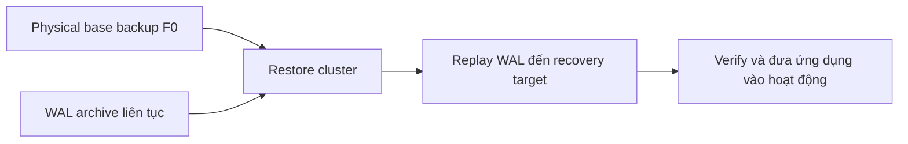
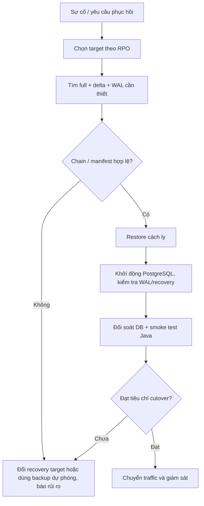

# Sao lưu toàn bộ và các hình thức sao lưu phần thay đổi

> **Chương:** Sao lưu và khôi phục  
> **Phạm vi:** `DATA_PERSISTENCE_FUNDAMENTALS` — hiểu lưu trữ dữ liệu bền vững, schema, truy vấn, giao dịch, kiểm soát đồng thời và ranh giới persistence cho Java; xử lý lỗi kết nối, tiến hóa dữ liệu, bảo mật, backup/restore và vận hành hiệu quả.

## Mục tiêu học tập

Sau bài này, người học có thể:

1. Phân biệt **full backup**, **incremental backup** và **differential backup** theo mốc so sánh, chuỗi khôi phục và chi phí lưu trữ.
2. Phân biệt backup **physical** với **logical**, và giải thích vai trò riêng của **WAL/continuous archiving** cùng **point-in-time recovery (PITR)** trong PostgreSQL.
3. Lập một lịch sao lưu theo **RPO**, **RTO**, dung lượng thay đổi và thời hạn lưu trữ; nhận ra rủi ro khi thiếu một mắt xích trong backup chain.
4. Mô tả cách tạo/khôi phục base backup và hình thức incremental phù hợp phiên bản PostgreSQL, không nhầm copy file hoặc replication với bản sao lưu nhất quán.
5. Thiết kế quy trình **kiểm tra tệp backup, khôi phục thử, đối soát dữ liệu, bảo vệ khóa mã hóa** và kiểm thử ứng dụng Java sau khôi phục.

## 1. Tại sao không chỉ sao chép dữ liệu một lần mỗi ngày?

Giả sử một ứng dụng Java quản lý đơn hàng dùng PostgreSQL. Database có hàng triệu đơn, thanh toán và bút toán tồn kho. Mỗi giờ chỉ một phần dữ liệu thay đổi, nhưng các giao dịch phát sinh liên tục.

Nếu hằng đêm tạo một **bản full backup**, việc khôi phục sau sự cố có thể đơn giản vì chỉ cần một bản sao tương ứng. Tuy nhiên, full backup lớn tốn thời gian, I/O và dung lượng. Nếu chỉ có backup lúc 00:00, sự cố lúc 16:00 hôm sau có thể làm mất những thay đổi sau thời điểm backup, trừ khi có thêm cơ chế ghi nhận thay đổi phục vụ khôi phục.

Các hình thức sao lưu phần thay đổi giải quyết bài toán **không phải chép lại toàn bộ dữ liệu ở mỗi lần chạy**. Đổi lại, chúng tạo phụ thuộc vào những bản sao trước đó và yêu cầu quy trình restore chính xác.

**Định nghĩa cốt lõi:** Backup là dữ liệu được lưu bền vững đủ để **khôi phục một trạng thái nhất quán theo mục tiêu đã định**. Một thư mục chứa vài tệp data hoặc bản sao một replica đang chạy chưa chắc đáp ứng điều kiện ấy.

## 2. Full, incremental và differential khác nhau thế nào?

Ba tên gọi mô tả **phạm vi dữ liệu mỗi lần sao lưu**; cách xác định “dữ liệu thay đổi” phụ thuộc công nghệ và công cụ.

| Loại | Sao lưu gì? | Cần gì để khôi phục? | Đánh đổi chính |
| --- | --- | --- | --- |
| **Full** | Toàn bộ dữ liệu thuộc phạm vi sao lưu tại mốc nhất quán. | Một bản full phù hợp, cộng log nếu muốn tiến xa hơn mốc backup. | Lớn, tốn thời gian tạo nhưng độc lập hơn. |
| **Incremental** | Phần thay đổi kể từ **lần backup gần nhất trong chuỗi**, có thể là full hoặc incremental. | Bản full gốc và **tất cả** incremental liên tiếp đến mốc đích. | Backup nhỏ/nhanh hơn khi thay đổi ít, restore phụ thuộc nhiều mắt xích. |
| **Differential** | Phần thay đổi kể từ **bản full gần nhất**. | Bản full gốc và bản differential mới nhất phù hợp. | Mỗi lần differential có xu hướng lớn dần đến full mới; restore thường ít mắt xích hơn incremental. |

Ví dụ:

```text
Thứ Hai:     F0 = full backup
Thứ Ba:      I1 = thay đổi từ F0 đến Thứ Ba
Thứ Tư:     I2 = thay đổi từ I1 đến Thứ Tư
Thứ Năm:     I3 = thay đổi từ I2 đến Thứ Năm

Khôi phục đến mốc Thứ Năm bằng incremental:
    F0 -> I1 -> I2 -> I3

Nếu dùng differential:
Thứ Hai:     F0 = full backup
Thứ Ba:      D1 = thay đổi kể từ F0
Thứ Tư:     D2 = thay đổi kể từ F0
Thứ Năm:     D3 = thay đổi kể từ F0

Khôi phục đến mốc Thứ Năm bằng differential:
    F0 -> D3
```

Đây là **mô hình khái niệm**. Một công cụ cụ thể có thể dùng block-level change tracking, WAL summaries, checksum, snapshot hoặc cơ chế riêng để nhận diện phần thay đổi. Không suy ra mọi hệ quản trị đều có lệnh native tên `DIFFERENTIAL BACKUP`.

### 2.1. “Phần thay đổi” nghĩa là byte, block hay bản ghi?

Một hàng database được sửa từ `status='NEW'` sang `'PAID'` không có nghĩa backup chỉ chứa vài byte chữ `PAID`. Ở cấp physical, công cụ có thể phải sao lưu **block/page đã thay đổi**. Ở cấp logical, công cụ phải biết chính xác thay đổi ở từng hàng hoặc sự kiện để tái dựng trạng thái; `pg_dump` mặc định không tự theo dõi những delta này.

Phạm vi backup còn bao gồm metadata: thông tin chain, version, checksum/manifest, cấu hình liên quan, log cần thiết. Nếu chỉ giữ phần dữ liệu changed-block mà mất manifest hoặc backup gốc, bản incremental có thể không còn khả năng sử dụng.

## 3. Một full backup có thật sự “đầy đủ” không?

Từ **full** chỉ có ý nghĩa khi xác định rõ **đối tượng được sao lưu**:

| Phạm vi | Có thể chứa | Có thể không chứa |
| --- | --- | --- |
| Full physical backup của PostgreSQL cluster | Data files và các phần cần thiết để phục hồi cluster ở mức physical, khi được tạo bằng công cụ hợp lệ. | Secrets ngoài DB, object storage, hệ thống payment, một số cấu hình/khóa nằm ngoài phạm vi backup. |
| Full logical backup của **một database** (`pg_dump`) | Schema và dữ liệu của database đó theo tùy chọn dump. | Toàn bộ cluster, users/roles ở phạm vi global, database khác, log WAL phục vụ PITR. |
| Backup một bảng | Dữ liệu bảng theo phương pháp đã chọn. | FK/sequence/trigger/role/quan hệ khác cần cho ứng dụng đầy đủ. |
| Snapshot ổ đĩa | Các byte trên volume tại thời điểm snapshot theo cơ chế của nền tảng. | Nhất quán transaction nếu snapshot không được phối hợp với DB/WAL; những volume khác. |

Với Java, restore xong database nhưng thiếu file đính kèm trên object storage vẫn có thể làm đơn hàng không dùng được. Cần liệt kê **toàn bộ thành phần tạo ra tính nhất quán nghiệp vụ**: DB, cấu hình/schema migration, blob, khóa mã hóa, sự kiện outbox và các hệ thống có dữ liệu độc lập.

## 4. PostgreSQL: physical backup, logical backup và WAL

### 4.1. Physical base backup

**Physical backup** lưu dữ liệu ở cấu trúc storage của PostgreSQL. `pg_basebackup` là công cụ tạo **base backup nhất quán** khi server đang hoạt động (với quyền và cấu hình replication phù hợp).

Ví dụ minh họa chạy từ máy backup đã được cấp quyền, vào nơi lưu trữ **khác volume database đang chạy**:

```bash
# Chạy trong môi trường vận hành được cấu hình quyền/đường dẫn phù hợp.
# Tạo physical base backup ở định dạng plain.
pg_basebackup \
  --host=db-primary.example.internal \
  --username=backup_user \
  --pgdata=/backups/pg/full-2026-11-22 \
  --format=plain \
  --wal-method=stream \
  --progress
```

Tùy chọn `--wal-method=stream` giúp thu nhận WAL cần thiết cho tính nhất quán của base backup trong quá trình tạo. Đây không có nghĩa hệ thống đã **tự động có toàn bộ WAL của nhiều ngày tiếp theo** để phục vụ PITR. Muốn tiến đến thời điểm sau backup, còn phải quản lý liên tục phần WAL cần thiết và mục tiêu recovery.

Không sao chép tùy tiện thư mục dữ liệu (`PGDATA`) bằng lệnh copy file trên một cluster đang ghi rồi gọi đó là full backup. Copy không phối hợp có thể đọc các file ở những thời điểm khác nhau; cluster không nhất thiết khôi phục được từ một tập file như vậy.

### 4.2. Logical backup

**Logical backup** chứa cấu trúc đối tượng và dữ liệu ở mức logic, phù hợp chuyển dữ liệu giữa môi trường, chọn bảng/database hoặc xử lý migration có kiểm soát.

```bash
# Backup logic một database dưới định dạng custom.
pg_dump \
  --host=db-primary.example.internal \
  --username=backup_user \
  --format=custom \
  --file=/backups/pg/app-2026-11-22.dump \
  appdb

# Kiểm tra danh sách đối tượng có trong bản dump.
pg_restore --list /backups/pg/app-2026-11-22.dump

# Trích globals (ví dụ roles), nếu phạm vi phục hồi cần chúng.
pg_dumpall \
  --host=db-primary.example.internal \
  --username=backup_user \
  --globals-only \
  --file=/backups/pg/globals-2026-11-22.sql
```

`pg_dump` thông thường tạo snapshot logic nhất quán đối với database nó đọc trong phạm vi hỗ trợ; tuy nhiên dump một database **không tự sao lưu roles, tablespace configuration, mọi database khác hay WAL**. Logical dump không phải chuỗi WAL có thể replay tùy thời điểm. Dùng `pg_restore` theo đúng định dạng backup, quyền role và kế hoạch tạo target database.

**Không hiểu lầm:** `pg_dump -t some_table` không phải incremental backup chỉ vì nó nhỏ. Đó là backup **một phần phạm vi dữ liệu**; nó không có cơ chế tự nhận diện hàng thay đổi kể từ full. Việc tự dump các hàng có `updated_at > last_backup` cũng không trở thành incremental đúng đắn nếu bỏ qua delete, thay đổi khóa, transaction đang diễn ra hoặc đồng hồ khác nhau.

### 4.3. WAL và continuous archiving

PostgreSQL ghi **write-ahead log (WAL)** cho những thay đổi cần thiết trước khi các data page liên quan được ghi bền vững. Trong chiến lược backup/restore, có thể lưu trữ các **WAL segment** liên tục để kết hợp với base backup và phục hồi tới một điểm sau base backup.



WAL archive **khác** incremental snapshot theo nghĩa F0 + I1 + I2. WAL chứa lịch sử cần cho redo/recovery, không chỉ danh sách các block cuối cùng đã thay đổi. Các phần WAL yêu cầu phải **liên tục**, tương thích timeline và được giữ theo mốc recovery; thiếu một đoạn có thể khiến recovery không đến được target.

Đối với `PITR` (*point-in-time recovery*), cần base backup phù hợp, WAL cần thiết từ mốc backup đến target và cấu hình recovery đúng phiên bản PostgreSQL. Không thể suy ra chỉ có `pg_dump` là đã PITR được, cũng không phải tăng tần suất full backup là thay thế hoàn toàn việc lưu WAL.

## 5. Incremental base backup trong PostgreSQL: phụ thuộc phiên bản

**PostgreSQL 17 trở đi** giới thiệu cơ chế **native incremental base backup** dựa trên WAL summaries, phối hợp các công cụ `pg_basebackup` và `pg_combinebackup`. Đây là chức năng khác với việc chỉ archive WAL.

Các điểm thiết kế cần biết:

1. Server cần cấu hình và vận hành **WAL summarization** (ví dụ `summarize_wal = on`) phù hợp, và phải giữ đủ thông tin summary cho khoảng cần incremental.
2. Lần incremental tham chiếu tới **backup manifest** của một base backup trước đó trong chuỗi, để xác định phần block thay đổi cần ghi.
3. Giữ **full backup gốc, các incremental liên quan và metadata/manifest** đến khi chúng không còn cần cho bất kỳ điểm restore còn trong retention.
4. Khi cần phục hồi, dùng `pg_combinebackup` để dựng một base backup vật lý đầy đủ từ chuỗi phù hợp, sau đó khởi động/khôi phục cluster theo quy trình đúng phiên bản, WAL và target.
5. Chỉ khi thử ghép chuỗi và **thực sự khởi động database, kiểm tra ứng dụng** thành công mới có bằng chứng kế hoạch backup hoạt động.

Ví dụ **khung lệnh minh họa** cho phiên bản hỗ trợ:

```bash
# Bước 1: Full physical backup (sau khi cấu hình WAL summarizer).
pg_basebackup -D /backups/full -Fp -Xs -P

# Bước 2: Incremental dựa vào manifest của full backup.
pg_basebackup \
  --incremental=/backups/full/backup_manifest \
  -D /backups/inc-1 -Fp -Xs -P

# Bước 3: Incremental tiếp theo dựa vào manifest của inc-1.
pg_basebackup \
  --incremental=/backups/inc-1/backup_manifest \
  -D /backups/inc-2 -Fp -Xs -P

# Bước 4: Dựng lại một physical base backup hoàn chỉnh.
pg_combinebackup \
  /backups/full /backups/inc-1 /backups/inc-2 \
  -o /restore/combined
```

Đây không phải script triển khai một nút bấm: phải cấu hình endpoint kết nối/ủy quyền, chọn đường dẫn không tồn tại hoặc đủ điều kiện, phiên bản binary, WAL retention, vùng lưu trữ độc lập và điều kiện restore trên máy được cách ly. Kiểm tra help/manual của **đúng phiên bản PostgreSQL đang dùng** trước khi chạy; với các phiên bản trước PostgreSQL 17, không mặc định `pg_basebackup` hỗ trợ các tham số incremental nêu trên.

Một số công cụ backup chuyên dụng như **pgBackRest** hoặc **Barman** cũng có chính sách full/incremental/differential hay chiến lược lưu trữ delta riêng, tùy công cụ và phiên bản. Đừng trộn lẫn định dạng/manifest của những công cụ khác nhau và giả định có thể ghép thành một chain chỉ vì cùng gọi là “incremental”.

## 6. Chuỗi khôi phục là điểm yếu cần quản trị

### 6.1. Sự phụ thuộc giữa các bản sao

Giả sử có `F0` và ba incremental `I1, I2, I3`:

```text
F0 ---> I1 ---> I2 ---> I3
       ^       ^       ^
       |       |       |
   Cần đủ toàn bộ chuỗi để dựng mốc I3
```

Nếu mất `I2` hoặc manifest không tương thích, việc có `I3` vẫn không tự bảo đảm dựng được mốc cuối. Với differential `D3`, restore thường cần `F0 + D3`, nhưng `D3` có thể lớn hơn `I3` vì chứa phần thay đổi tích lũy từ `F0`.

| Rủi ro | Incremental | Differential | Full |
| --- | --- | --- | --- |
| Mất một bản giữa chuỗi | Có thể làm mất khả năng phục hồi các mốc phụ thuộc sau nó | Ít phụ thuộc hơn nếu vẫn còn full và differential đích | Mỗi bản full thường độc lập hơn |
| Số bước xử lý khi restore | Có thể nhiều | Thường ít hơn | Thường ít nhất |
| Kích thước mỗi backup khi thay đổi ít | Thường nhỏ | Có thể lớn dần đến lần full mới | Lớn |
| Khả năng đạt RTO | Phụ thuộc số mắt xích và tốc độ combine/replay | Thường thuận lợi hơn nếu full + một diff | Đơn giản về chuỗi, nhưng khối lượng full vẫn lớn |

Không có lựa chọn nào luôn tối ưu. Full backup thường xuyên hơn giảm độ dài chain nhưng tốn I/O; incremental giảm khối lượng truyền hằng ngày nhưng tăng phụ thuộc; differential cân bằng theo mục tiêu restore. Khi dùng block-level incremental, tỷ lệ block đã chạm cũng quan trọng: workload ghi một ít dữ liệu nhưng chạm vào nhiều page có thể tạo backup lớn hơn ước tính từ số hàng thay đổi.

### 6.2. Quy tắc retention theo dependency, không chỉ theo ngày tạo file

Một quy tắc sai là “xóa tất cả tệp backup quá 7 ngày” mà không xét chuỗi. Nếu giữ incremental `I8` nhưng xóa full `F0` hoặc một `I3` mà `I8` phụ thuộc, bản cuối có thể không restore được.

Hệ thống retention cần:

- Xác định **restore point** cần bảo vệ và toàn bộ dependency của mỗi restore point.
- Giữ full cùng các incremental/differential, manifest, WAL, metadata cần thiết cho các mốc còn hiệu lực.
- Chỉ xóa dependency khi chắc chắn không còn restore point nào cần chúng.
- Không áp chính sách lifecycle object storage một cách độc lập với metadata backup chain.
- Giữ bản sao ngoài máy/ngoài vùng lỗi và cân nhắc immutable/WORM object storage khi phù hợp với mối đe dọa ransomware.

## 7. RPO và RTO quyết định lịch backup

**RPO (Recovery Point Objective)** là mức mất dữ liệu tối đa có thể chấp nhận xét theo thời điểm khôi phục. **RTO (Recovery Time Objective)** là thời gian phục hồi dịch vụ mục tiêu sau gián đoạn.

Ví dụ hệ thống chỉ giữ full backup mỗi đêm:

```text
Ngày 1, 00:00  Full backup thành công
Ngày 1, 12:00  Hệ thống vẫn ghi đơn hàng bình thường
Ngày 1, 16:00  Server/storage gặp sự cố không thể cứu dữ liệu hiện tại

Nếu không có WAL archive hoặc backup cập nhật hơn:
    Có thể chỉ phục hồi về mốc full 00:00
    => Những giao dịch sau mốc ấy có nguy cơ bị mất.
```

Nếu có một chuỗi backup phù hợp và WAL archive liên tục, có thể giảm khoảng cách giữa điểm phục hồi và sự cố, tùy WAL thực tế đã được lưu bền vững, timeline và loại sự cố. Đừng hứa “mất không quá 1 phút” chỉ vì có cấu hình archive: phải giám sát **archive lag**, kiểm tra điểm WAL cuối thật sự an toàn và thử restore.

| Mục tiêu | Tác động lên thiết kế |
| --- | --- |
| RPO nghiêm ngặt | Cần WAL/replication/backup với độ trễ đã đo và cơ chế xác nhận bền vững tương xứng. |
| RTO ngắn | Cần giới hạn thời gian tải full, ghép incremental, replay WAL, verify và chuyển traffic. |
| Database rất lớn | Cân nhắc full thưa hơn + incremental/differential, bandwidth, dedup, restore staging. |
| Tải ghi cao | Đo I/O/WAL, thời gian backup và ảnh hưởng replication; cân nhắc backup từ standby theo khả năng công cụ. |
| Yêu cầu lưu dữ liệu nhiều năm | Retention, archive, khả năng đọc bản backup cũ, metadata và khóa mã hóa lâu dài. |

**Đừng dùng tần suất sao lưu làm đại diện duy nhất cho độ an toàn.** Một bản mỗi 5 phút nhưng cùng đặt trên ổ hỏng với primary có thể bị mất toàn bộ. Một chuỗi backup có checksum hợp lệ nhưng không bao giờ được khôi phục thử cũng chưa chứng minh đạt RTO.

## 8. Tính nhất quán của backup và ranh giới transaction

### 8.1. Online backup phải phục hồi về trạng thái nhất quán

Trong khi `pg_basebackup` chạy, PostgreSQL vẫn có thể nhận nhiều transaction. Một physical backup hợp lệ dựa vào cơ chế checkpoint/WAL/recovery để dựng trạng thái nhất quán. Đây không phải bản copy “chụp cùng lúc mọi file bằng mắt thường”.

Khi khôi phục, các transaction chưa commit ở điểm recovery không được biến thành thay đổi đã commit; những thay đổi đã commit và còn trong phạm vi mốc phục hồi cần được tái dựng theo bảo đảm của DB và dữ liệu WAL có sẵn.

Không thể dùng chỉ bản sao của bảng `orders` để khẳng định đã phục hồi giao dịch nguyên tử với `payments` và `order_lines`. Cần xét **cùng mốc nhất quán** hoặc cơ chế tái dựng/đối soát được thiết kế rõ.

### 8.2. Multi-database và hệ thống ngoài PostgreSQL

Backup PostgreSQL không tự tạo snapshot nguyên tử với:

- Object storage chứa hóa đơn PDF, ảnh, file upload.
- Message broker đang có sự kiện chưa consume hoặc đã phát.
- Dữ liệu thanh toán ở nhà cung cấp ngoài.
- Một database khác mà ứng dụng Java cũng cập nhật.

Thiết kế khôi phục toàn hệ thống cần chỉ rõ **nguồn chuẩn cho từng loại dữ liệu**, cách tái dựng read model/cache, đối soát sự kiện và xử lý request đã commit DB nhưng phản hồi HTTP bị mất. Có thể dùng transactional outbox và idempotency để hỗ trợ xử lý lại mà không nhân đôi tác động; backup DB tự nó không giải quyết mọi trường hợp distributed consistency.

## 9. Kiểm tra backup: tồn tại tệp chưa đủ

Việc backup job trả exit code 0 là tín hiệu cần thiết nhưng chưa đủ. Một quy trình kiểm tra nên có nhiều mức:

| Mức kiểm tra | Đảm bảo được gì? | Chưa đảm bảo điều gì? |
| --- | --- | --- |
| Kiểm tra job, kích thước, thời gian, vị trí lưu | Có artifact và lịch thực hiện phù hợp | Artifact chắc chắn khôi phục được hay dữ liệu nghiệp vụ đúng |
| Kiểm tra checksum/manifest | Phát hiện nhiều dạng thiếu/hỏng byte trong phạm vi được bảo vệ | Không thay thế khởi động DB và chạy truy vấn nghiệp vụ |
| Xác minh backup chain và WAL dependency | Phát hiện mắt xích/manifest/WAL thiếu hoặc không phù hợp | Không bảo đảm ứng dụng Java hoạt động sau restore |
| Restore vào môi trường cách ly | Kiểm chứng có thể dựng và khởi động DB | Chưa chắc dữ liệu/phiên bản schema phù hợp ứng dụng |
| SQL integrity, đối soát nghiệp vụ và smoke test Java | Kiểm chứng dữ liệu cùng luồng nghiệp vụ được kỳ vọng | Chưa thay thế đo RTO/RPO và thử tình huống disaster thực tế |

Với một physical base backup có manifest hợp lệ, có thể dùng công cụ PostgreSQL tương ứng:

```bash
# Kiểm tra physical base backup qua manifest (theo phiên bản phù hợp).
pg_verifybackup /backups/pg/full-2026-11-22
```

`pg_verifybackup` kiểm tra các file/manifest theo chức năng công cụ; nó không bảo đảm mọi dữ liệu logic đều đúng. Phải kiểm tra cả khả năng khôi phục, WAL cần thiết, extension, roles và schema migration.

Khi dùng incremental native, cần kiểm tra **từng bản và quá trình combine** theo quy trình của đúng phiên bản; đừng chỉ verify một incremental đơn lẻ rồi suy ra cả chain có thể khởi động được.

### 9.1. Kiểm tra ứng dụng Java sau khôi phục

Một database đã mở cổng và trả `SELECT 1` vẫn có thể thiếu schema, tài khoản hoặc bản ghi nghiệp vụ. Ví dụ smoke test JDBC tối thiểu:

```java
import java.sql.Connection;
import java.sql.PreparedStatement;
import java.sql.ResultSet;
import javax.sql.DataSource;

public final class RestoreSmokeCheck {
    private final DataSource restoredDatabase;

    public RestoreSmokeCheck(DataSource restoredDatabase) {
        this.restoredDatabase = restoredDatabase;
    }

    public long countPaidOrders(long tenantId) throws Exception {
        try (Connection connection = restoredDatabase.getConnection()) {
            connection.setReadOnly(true);

            try (PreparedStatement statement = connection.prepareStatement("""
                    SELECT COUNT(*)
                    FROM purchase_order
                    WHERE tenant_id = ? AND status = 'PAID'
                    """)) {
                statement.setLong(1, tenantId);
                try (ResultSet rows = statement.executeQuery()) {
                    rows.next();
                    return rows.getLong(1);
                }
            }
        }
    }
}
```

Đây chỉ là **một phép đo** trên môi trường phục hồi được cách ly, không phải kết luận toàn vẹn. Kết quả phải được đối chiếu với mốc PITR/backup và nguồn tham chiếu thích hợp; count một bảng không bảo đảm không mất hoặc nhân đôi một đơn hàng cụ thể. Cần kiểm tra foreign key, unique constraint, version schema, số dư/bút toán, trạng thái outbox và các thao tác chính của service.

Không chạy smoke test ghi lên database production mới restore trước khi đã chụp bằng chứng và phê duyệt cutover; những kiểm thử có ghi nên dùng **bản sao thử nghiệm có thể hủy**, không làm thay đổi dữ liệu điều tra.

## 10. Quy trình phục hồi khi sự cố thật

Một runbook thực tế cần có:

1. **Xác định phạm vi sự cố**: mất máy, hỏng storage, xóa nhầm dữ liệu, ransomware, deploy schema sai hay failover. Không restore đè lên hiện trường trước khi thu thập bằng chứng cần thiết.
2. **Chọn recovery target**: mốc thời gian/transaction và phạm vi dữ liệu cần khôi phục; tính đến RPO, lịch giao dịch và timeline PostgreSQL.
3. **Chọn artifact**: full gốc + incremental liên tiếp hoặc full + differential phù hợp; bổ sung WAL để PITR nếu cần và công cụ hỗ trợ.
4. **Xác nhận integrity của chuỗi**: checksum, manifest, version, khóa mã hóa, WAL liên tục và có đủ dung lượng máy đích.
5. **Restore vào nơi cách ly**: ghép chain/khôi phục physical hoặc logical theo đúng công cụ; dùng connection/credentials riêng cho môi trường thử.
6. **Khởi động và quan sát recovery**: kiểm tra log PostgreSQL, vai trò primary/standby, mốc dữ liệu và khả năng truy cập.
7. **Kiểm tra dữ liệu**: schema, constraints, số lượng đối tượng, đối soát ID giao dịch/bút toán và ranh giới thời gian khôi phục.
8. **Kiểm thử ứng dụng Java**: phiên bản migration, kết nối/pool, giao dịch đọc, các luồng quan trọng, phân quyền và xử lý lỗi.
9. **Quyết định cutover**: chỉ chuyển traffic sau khi nhóm chịu trách nhiệm chấp nhận RPO/RTO thực tế và các bất thường đã biết.
10. **Hậu kiểm**: ghi incident timeline, số mất dữ liệu nếu có, khoảng thời gian restore, vấn đề backup chain, cập nhật lịch backup và runbook.



**Một lỗi cần tránh:** cố khôi phục bằng bản incremental mới nhất khi không còn đủ full hoặc chain, rồi tuyên bố đã khôi phục được vì một số file xuất hiện trên đĩa. Đầu ra cần là **một database khởi động được và dữ liệu nghiệp vụ được kiểm chứng**.

## 11. Bảo mật và khả năng sống sót của backup

Backup thường chứa dữ liệu thật và có thể nhạy cảm hơn DB production vì nhiều người/đội có quyền truy cập file lưu trữ. Cần:

- **Mã hóa tại nơi lưu và khi truyền**; quản lý khóa giải mã tách biệt, có cách khôi phục khóa đã kiểm thử. Mất khóa mã hóa có thể tương đương mất backup.
- **Nguyên tắc quyền tối thiểu** cho backup operator, restore operator, tài khoản PostgreSQL và kho lưu trữ; có audit log cho thao tác đọc/xóa/restore.
- **Nhiều bản sao ở miền lỗi độc lập**, ví dụ bản ngoại vùng hoặc ngoại tài khoản theo yêu cầu; cân nhắc mô hình 3-2-1 và immutable storage khi phù hợp.
- **Retention và xóa có kiểm soát**, tuân thủ thời hạn lưu trữ dữ liệu, pháp lý và nhu cầu giữ đầy đủ backup dependency.
- **Không dùng dữ liệu production trong môi trường test không an toàn**; khi restore drill cần cô lập mạng và masking theo chính sách.
- **Không lưu mật khẩu DB trong script, log hoặc command history**; dùng secret manager/credential mechanism phù hợp.
- **Giám sát backup lag, dung lượng, lỗi archive WAL, checksum failure và RTO test**, không chỉ giám sát lịch cron.

Replication/standby giúp tăng khả năng sẵn sàng nhưng **không tự là backup độc lập**: lệnh xóa nhầm, update sai hoặc ransomware có thể lan sang standby. Một cluster HA chỉ được xem là bảo vệ khả năng truy cập, chưa phải chiến lược khôi phục lịch sử có retention.

## 12. Chọn lịch full, differential hay incremental

Một chiến lược ví dụ cho hệ thống có ghi liên tục và dữ liệu lớn:

| Thành phần | Lịch tham khảo | Lý do và điều kiện |
| --- | --- | --- |
| Full physical backup | Theo tuần hoặc chu kỳ được đo | Giảm độ dài chain, tạo điểm tựa khôi phục. |
| Incremental backup | Hằng ngày hoặc thường xuyên hơn | Giảm lượng sao chép giữa các lần full, giữ đủ chain. |
| Differential backup | Thay thế một số incremental khi công cụ hỗ trợ | Cân bằng độ dài chain và dung lượng theo tỷ lệ thay đổi. |
| WAL archiving liên tục | Theo khả năng và cấu hình hệ thống | Cho phép PITR tới mốc giữa các bản backup khi WAL đầy đủ. |
| Restore drill | Định kỳ, sau thay đổi lớn, trước mốc rủi ro | Xác minh khôi phục thực tế và thời gian đạt RTO. |

Đây là **ví dụ về cách lập kế hoạch**, không phải SLA chung cho mọi sản phẩm. Một ứng dụng có RPO vài phút không thể chỉ trông vào incremental hằng ngày; một hệ thống lưu trữ phân tích có thể có mục tiêu khác. Quyết định phải dựa trên **thay đổi dữ liệu, backup window, chi phí restore, WAL retention và RPO/RTO thực đo**.

Một câu hỏi quan trọng khi chọn lịch: **Nếu full gần nhất bị hỏng, còn bản full độc lập khác không?** Lưu nhiều incremental dựa trên cùng một full không tạo ra nhiều điểm dự phòng độc lập trước sự cố hỏng full.

## 13. Những nhầm lẫn thường gặp

| Nhầm lẫn | Điều đúng cần nhớ |
| --- | --- |
| “Incremental là backup tất cả thay đổi kể từ full.” | Đó thường là **differential**; incremental thông thường so với lần backup trước trong chain. |
| “WAL archive chính là incremental backup.” | WAL là log phục vụ redo/PITR; không tương đương changed-block snapshot ở mọi công cụ. |
| “`pg_dump` toàn bộ appdb là full backup của cluster.” | Nó là logical backup của **database được chọn**, không tự gồm globals và mọi DB khác. |
| “Copy thư mục data đang chạy là đủ.” | Copy không phối hợp có thể không nhất quán; cần công cụ/snapshot theo giao thức DB. |
| “Chỉ cần bản incremental cuối cùng.” | Restore có thể cần cả full và mọi incremental trước nó. |
| “Xóa backup cũ theo ngày tạo file là an toàn.” | Có thể xóa dependency của restore point còn đang được giữ. |
| “Có một read replica tức đã có backup.” | Replica có thể nhận cả thao tác xóa/sửa sai và không cho phép quay về mốc lịch sử. |
| “Backup job xanh nghĩa là hệ thống khôi phục được.” | Cần kiểm tra manifest/chain, khởi động DB và smoke test nghiệp vụ. |
| “RPO bằng tần suất full backup.” | RPO phụ thuộc mốc dữ liệu an toàn thực tế, WAL/archive lag và các cơ chế khôi phục đã thử. |
| “Tăng số lần incremental luôn giảm RTO.” | Có thể tăng số mắt xích và thời gian combine/replay, phải đo restore. |
| “Backup DB đã bảo vệ mọi file của ứng dụng.” | Object storage, roles/config, khóa mã hóa và hệ thống ngoài có phạm vi riêng. |

## 14. Bài thực hành: thiết kế backup và chứng minh restore

**Bối cảnh:** một ứng dụng Java dùng PostgreSQL chứa đơn hàng, số dư bút toán và dữ liệu đối soát. Database lớn nên không muốn chạy full backup nhiều lần mỗi ngày. Nhóm vận hành cần phục hồi sau xóa nhầm hoặc lỗi máy chủ, kể cả khi ứng dụng vẫn sinh giao dịch liên tục.

**Nhiệm vụ:**

1. Xác định phạm vi dữ liệu phải backup: PostgreSQL cluster, roles/permissions, schema migration, file ngoài DB, khóa và cấu hình phục hồi.
2. Đề xuất một lịch `full + incremental` và một lịch `full + differential`. Vẽ dependency graph của mỗi lịch và xác định những file phải giữ để phục hồi vào ngày cuối.
3. Bổ sung một chiến lược WAL archiving/PITR; giải thích mốc dữ liệu có thể đạt khi archive bị trễ hoặc mất một WAL segment.
4. Chỉ dùng lệnh native incremental của PostgreSQL **khi phiên bản và cấu hình WAL summarization hỗ trợ**; nếu không, chọn công cụ/phương pháp phù hợp và ghi rõ giới hạn.
5. Viết kiểm tra backup manifest/checksum và thực hành restore từ một bản full. Sau đó thực hành restore bằng chuỗi incremental hoặc differential đã chọn trong môi trường cách ly.
6. Xác minh rằng những đơn hàng đã commit trước recovery target có mặt và những thao tác sau target được xử lý theo đúng chính sách; kiểm tra tính nhất quán bảng con, unique/FK và số dư.
7. Chạy smoke test Java chỉ đọc và một số test ghi trên **bản sao thử nghiệm**, xác minh schema, vai trò tài khoản và transaction.
8. Cố tình bỏ một incremental giữa chuỗi, hoặc một WAL segment cần thiết, rồi ghi nhận điểm failure; không sửa bằng cách chắp vá file tùy tiện.
9. Đo thời gian phục hồi thực tế và mốc dữ liệu cuối, so với RTO/RPO mục tiêu; điều chỉnh retention, lịch full và lưu trữ độc lập.
10. Viết runbook ngắn: người chịu trách nhiệm, điều kiện cutover, phương án khi full bị hỏng, tài khoản được phép restore và các bước báo cáo sau sự cố.

**Bảng kiểm chứng**

| Tình huống | Kết quả mong đợi |
| --- | --- |
| Full backup đơn lẻ hợp lệ | Dựng được database tới mốc full, có thể chạy kiểm tra ứng dụng. |
| Full + incremental đủ chain | Ghép/khôi phục được tới mốc tương ứng, không mất đối tượng cần thiết. |
| Thiếu một incremental bắt buộc | Hệ thống phát hiện chain không đủ; không báo restore thành công giả. |
| Full + differential phù hợp | Không cần từng incremental trung gian của chuỗi khác. |
| WAL đầy đủ đến target PITR | Có thể phục hồi tới recovery target phù hợp; transaction ngoài target được xử lý đúng. |
| WAL bị đứt chuỗi | Không hứa khôi phục quá đoạn WAL có thể replay an toàn. |
| Backup hợp lệ nhưng thiếu quyền/schema phụ trợ | Kiểm thử restore phát hiện và yêu cầu hoàn thiện phạm vi backup. |
| Bản thử có nhiều khóa ngoài/unique | Đối soát không phát hiện dữ liệu nửa transaction hoặc sai mối quan hệ. |

**Câu hỏi tự kiểm tra**

1. Incremental khác differential theo **mốc so sánh** và **số mắt xích cần restore** thế nào?
2. Vì sao bản incremental cuối cùng thường không thể khôi phục độc lập nếu không còn full và các incremental trước?
3. `pg_dump` và `pg_basebackup` khác nhau ra sao về physical/logical và phạm vi dữ liệu?
4. Tại sao WAL archiving cần thiết cho PITR nhưng không nên đồng nhất nó với mọi hình thức incremental backup?
5. PostgreSQL 17+ hỗ trợ native incremental base backup như thế nào, và vai trò của WAL summaries/manifest là gì?
6. Khi backup job thành công nhưng chưa chạy restore drill, điều gì vẫn chưa được chứng minh?
7. Một cache hoặc read replica có thể thay thế bản backup có retention và rollback lịch sử không? Vì sao?
8. Trong retention, vì sao không được xóa full backup chỉ vì nó quá số ngày quy định nếu một restore point còn phụ thuộc vào nó?
9. Sự khác nhau giữa RPO và RTO ảnh hưởng việc chọn tần suất full, WAL archiving và độ dài chain ra sao?
10. Sau khi phục hồi PostgreSQL, ứng dụng Java cần kiểm tra thêm điều gì ngoài `SELECT 1`?

## Ghi nhớ

**Full backup** là điểm tựa độc lập hơn; **incremental** giữ phần thay đổi kể từ backup trước và cần đủ chuỗi; **differential** giữ thay đổi kể từ full nên thường khôi phục với ít mắt xích hơn. Trong PostgreSQL, cần phân biệt physical backup, logical dump, WAL archive và PITR; native incremental của PostgreSQL chỉ dùng được trên phiên bản và cấu hình có hỗ trợ.

Hãy thiết kế backup từ **RPO/RTO và phạm vi dữ liệu nghiệp vụ**, không chỉ từ dung lượng tệp. Bảo vệ full, delta, manifest, WAL, khóa mã hóa và backup ngoài miền lỗi; giám sát retention theo dependency. Giá trị thực của backup được chứng minh khi **khôi phục được vào môi trường cách ly, đối soát dữ liệu đúng và ứng dụng Java hoạt động theo mục tiêu**, chứ không chỉ khi lịch sao lưu báo thành công.
