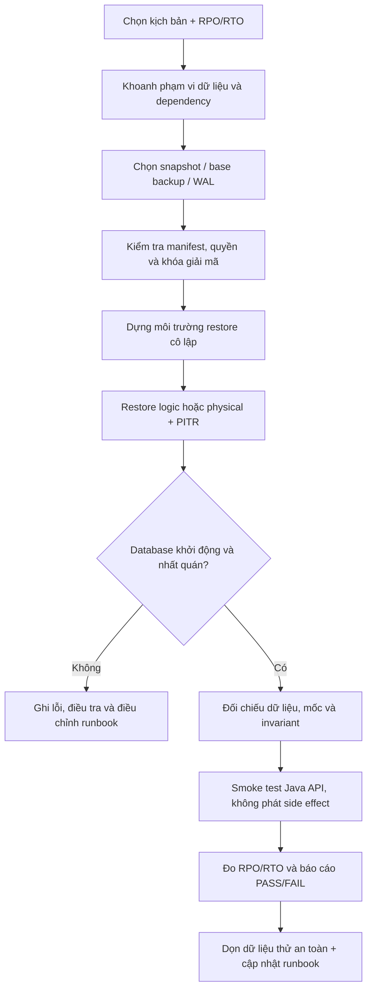

# Thực hành khôi phục thay vì chỉ kiểm tra tác vụ sao lưu thành công

## 1. Một tác vụ backup màu xanh chưa chứng minh hệ thống khôi phục được

Giả sử dịch vụ đặt hàng Java chạy trên PostgreSQL. Dashboard báo tác vụ backup đêm qua **SUCCESS**, một file dump được lưu trong object storage và hai read replica đều đang hoạt động. Sáng hôm sau, một câu lệnh `DELETE` sai được commit; các replica nhanh chóng sao chép thay đổi đó. Nhóm vận hành tải file backup về và phát hiện:

- File vẫn tồn tại nhưng không có tài khoản đủ quyền để restore các đối tượng cần thiết.
- Bản dump chứa đơn hàng, nhưng thiếu roles, extension và file hóa đơn nằm ở object storage.
- Một bản backup vật lý được dùng để thử PITR, nhưng kho WAL thiếu đoạn log giữa hai mốc.
- Restore chạy được nhưng mất nhiều giờ, vượt xa RTO đã cam kết.
- Ứng dụng kết nối được, nhưng job gửi email và consumer xử lý thanh toán vô tình khởi động trên dữ liệu phục hồi.

Ở thời điểm đó, thông báo **backup thành công** chỉ nói rằng một phần của quy trình tạo bản sao đã hoàn tất. Nó **không chứng minh** bản sao đủ dữ liệu, giải mã được, nhất quán, phục hồi đúng mốc và vận hành được trong thời gian yêu cầu.

Đây là lý do cần **thực hành khôi phục (restore drill)** — diễn tập định kỳ toàn bộ đường đi từ bản backup tới hệ thống có dữ liệu đúng và ứng dụng sẵn sàng. Bài học thuộc chương **Sao lưu và khôi phục** của module **DATA_PERSISTENCE_FUNDAMENTALS**, nối kiến thức lưu trữ bền vững với Java/JDBC, schema, giao dịch, replica, vận hành, bảo mật và quản lý lỗi.

> **Tiêu chí thành công không phải “đã tạo file backup”, mà là “đã chứng minh có thể khôi phục đúng dữ liệu, chạy đúng ứng dụng và đạt mục tiêu RPO/RTO trong kịch bản sự cố được chọn”.**

## 2. Backup, verify, restore và recovery là bốn giai đoạn khác nhau

| Giai đoạn | Câu hỏi | Bằng chứng ví dụ |
| --- | --- | --- |
| **Backup** | Dữ liệu đã được xuất/chụp và lưu bền vững chưa? | Log job, manifest, kích thước và vị trí bản lưu |
| **Verify backup artifact** | File có còn đọc được và phù hợp định dạng không? | Checksum, manifest, `pg_restore --list`, `pg_verifybackup` với bản phù hợp |
| **Restore** | Có dựng lại được database hoặc dữ liệu từ các artifact không? | Database thử nghiệm khởi động, import/replay hoàn tất |
| **Recovery validation** | Trạng thái sau restore có đúng nghiệp vụ và ứng dụng có hoạt động không? | Kiểm tra ràng buộc, operation ID, API smoke test, thời gian phục hồi |

Một thao tác `pg_restore --list` thành công chỉ cho thấy công cụ đọc được danh mục của một archive logic. Nó **không** bảo đảm rằng khi restore sẽ không gặp lỗi phân quyền, thiếu extension, lỗi constraint hoặc thiếu không gian đĩa. Tương tự, checksum hợp lệ chứng minh một số byte không thay đổi so với mốc kiểm tra, **không chứng minh** dữ liệu nguồn được backup nhất quán hay đầy đủ.

### Restore drill khác một lần thử backup thủ công

Một buổi diễn tập có kế hoạch phải quy định:

1. **Kịch bản lỗi**: mất primary, xóa nhầm, database hỏng, mất cả vùng, tài khoản backup bị vô hiệu hóa, hoặc khóa giải mã không còn khả dụng.
2. **Điểm khôi phục mong muốn**: bản snapshot nào, WAL nào, dấu mốc nào thuộc về trạng thái cần lấy lại.
3. **RPO/RTO cần đạt**: chấp nhận mất tối đa bao nhiêu dữ liệu và downtime tối đa bao lâu.
4. **Môi trường cô lập**: không đè dữ liệu production, không gửi thanh toán/email/webhook thật.
5. **Bằng chứng chấp nhận**: trạng thái DB, kiểm tra nghiệp vụ, hoạt động của API, thời gian và báo cáo sai lệch.
6. **Người chịu trách nhiệm và quyền thao tác**: ai khởi tạo, ai kiểm chứng, ai quyết định cutover, ai có quyền lấy khóa backup.

Không cần chủ động phá hỏng production để diễn tập. Có thể mô phỏng lỗi bằng dữ liệu giả, khôi phục trong một mạng tách biệt và chỉ thực hiện chuyển lưu lượng thật khi có một quy trình được phê duyệt riêng.

## 3. Xác định RPO và RTO trước khi chọn cách diễn tập

**RPO (Recovery Point Objective)** là mức mất dữ liệu tối đa có thể chấp nhận sau sự cố, thường tính từ mốc dữ liệu còn phục hồi được tới thời điểm gián đoạn. **RTO (Recovery Time Objective)** là thời gian tối đa mong muốn để dịch vụ trở lại trạng thái đủ đáp ứng nghiệp vụ.

Ví dụ:

```text
02:00  Full backup hoàn tất
09:30  WAL archiving đang hoạt động
10:00  Đơn A được commit và API đã trả thành công
10:10  Đơn B được commit và API đã trả thành công
10:15  Lệnh xóa nhầm được commit
10:18  Phát hiện lỗi, cô lập đường ghi
10:40  Database restore có thể đọc
10:55  API smoke test, kiểm tra và chuyển tuyến thử nghiệm xong
```

Nếu chỉ có bản full lúc 02:00, phục hồi tới đó có thể mất nhiều giao dịch hợp lệ. Nếu có **base backup và chuỗi WAL đầy đủ**, có thể nhắm tới một mốc trước lệnh xóa lúc 10:15, bảo toàn nhiều giao dịch hơn. Nhưng việc phục hồi tới mốc đó vẫn phải đối soát các thay đổi hợp lệ về sau, nhất là tác động ngoài DB.

Nếu tính RTO từ lúc **phát hiện lỗi** 10:18 tới khi API **đáp ứng được kiểm tra cuối** 10:55, thời gian quan sát là 37 phút. Thời điểm tính cần được hợp đồng vận hành định nghĩa rõ: có hệ đo từ lúc sự cố bắt đầu thay vì lúc phát hiện.

| Mục tiêu | Điều cần đo trong drill | Sai lầm thường gặp |
| --- | --- | --- |
| RPO | Các giao dịch đã ACK nào còn trong bản restore; mốc WAL/snapshot nào đạt | Chỉ xem timestamp tên file backup |
| RTO | Phát hiện → lấy quyền/tệp/khóa → restore/replay → kiểm chứng → sẵn sàng kết nối | Chỉ tính thời gian `pg_restore` |
| Tính đầy đủ | Tables, schema, roles, extensions, object storage, event state | Chỉ kiểm tra một bảng quan trọng |
| Độ đúng | Bất biến, dữ liệu nghiệp vụ, transaction markers, external effects | Chỉ so `COUNT(*)` tổng |
| Khả năng lặp lại | Runbook, automation, quyền và nguồn dữ liệu độc lập | Một kỹ sư duy nhất “biết cách làm” |

**RPO/RTO là mục tiêu và kết quả đo**, không phải tính chất tự sinh ra từ việc “bật backup” hoặc “có replica”. Diễn tập cần ghi cả trường hợp **không đạt**.

## 4. Xác định rõ backup dùng để phục hồi điều gì

Không có một file duy nhất nào mặc nhiên chứa toàn bộ hệ thống Java.

| Thành phần | Khả năng nằm trong backup DB | Việc phải xác nhận |
| --- | --- | --- |
| Bảng và dữ liệu một database | Thường có trong logical dump hoặc physical backup phù hợp | Đã chọn đúng database/schema/bảng chưa? |
| Index, constraint, view, function | Thường có trong logical dump phù hợp | Có dựng lại thành công và đúng phiên bản không? |
| Roles, login, quyền toàn cluster | `pg_dump` một DB không phải backup toàn cluster | Có xuất/cấp lại globals và secrets cần thiết không? |
| Extension và cấu hình DBMS | Một phần metadata có thể được lưu | Máy đích có extension, phiên bản và quyền phù hợp không? |
| WAL/transaction log | Chỉ có nếu cơ chế backup/archive tương ứng | Có đủ chuỗi log cho PITR không? |
| File hóa đơn, ảnh, tài liệu trong object storage | Thông thường **không** | Có snapshot/version/backup riêng cùng mốc logic không? |
| Kafka/queue offset, event outbox đã tiêu thụ | Có thể thuộc hệ khác | Replay/đối soát ra sao sau restore? |
| Redis cache, search index | Thường là dữ liệu dẫn xuất | Có thể rebuild và tránh ghi giá trị stale không? |
| Khóa mã hóa, TLS, secret runtime | Không nên phụ thuộc vào một bản DB | Có cách lấy khóa an toàn trong khủng hoảng không? |
| DNS/proxy, cấu hình DataSource Java | Thường nằm ngoài DB | Ứng dụng sẽ kết nối tới endpoint phục hồi nào? |

**Phạm vi bản lưu** phải được ghi trong tài liệu khôi phục. Nếu có giao dịch đa hệ (DB + object storage + thanh toán), restore của một database **không** đảo ngược email đã gửi, tiền đã thu hay webhook đối tác đã nhận.

### Backup và read replica không thay thế nhau

Replica thường sao chép thay đổi liên tục, nên **xóa nhầm được commit sẽ lan sang replica**. Replica có thể giúp failover nhanh khi primary lỗi mà dữ liệu còn đúng, nhưng không giữ nhiều mốc lịch sử độc lập như một chính sách backup/PITR.

Diễn tập **failover** hỏi: “Ứng viên mới có đủ log của các commit đã ACK và không split-brain không?”. Diễn tập **restore** hỏi: “Có khôi phục được một phiên bản dữ liệu đúng trong quá khứ không?”. Hai bài kiểm tra có mục tiêu riêng.

## 5. Thiết kế một restore drill an toàn



Các hàng rào an toàn tối thiểu:

- Restore vào **database/cluster và storage riêng**, không trỏ vào thư mục dữ liệu của instance production.
- Dùng **network isolation**, credentials và DNS riêng; không cho service thật vô tình truy cập endpoint test.
- Tắt hoặc chặn **worker gửi email, thanh toán, webhook, message producer và scheduler** của ứng dụng phục hồi; chỉ cho phép các endpoint test được xác định.
- Nếu backup chứa dữ liệu cá nhân, giới hạn quyền, mã hóa và xóa dữ liệu thử theo chính sách; không phát tán dump trong chat/log.
- Không chạy `DROP DATABASE`, `pg_restore --clean` hay copy đè data directory vào production theo ví dụ trong tài liệu.
- Lưu bằng chứng thử nghiệm riêng: ID drill, mốc thời gian, bản backup, mốc WAL, phiên bản DB, checksum, kết quả truy vấn, lỗi và người xác minh.

Một restore drill tốt được **thực thi đủ cụ thể để quan sát**, nhưng mọi tác động phá hủy đều nằm trong môi trường test có kiểm soát.

## 6. Bộ dữ liệu thử nghiệm có mốc kiểm chứng

Để biết bản restore chứa dữ liệu ở **đúng thời điểm**, không chỉ xem bảng có tồn tại hay không. Ta tạo **recovery marker** và một tập invariant trên một database thử nghiệm riêng.

```sql
-- Chỉ chạy trên database thực hành được tạo riêng.
CREATE TABLE recovery_probe (
    marker_id TEXT PRIMARY KEY,
    amount NUMERIC(18, 2) NOT NULL CHECK (amount >= 0),
    created_at TIMESTAMPTZ NOT NULL DEFAULT CURRENT_TIMESTAMP
);

CREATE TABLE recovery_probe_items (
    item_id BIGINT GENERATED ALWAYS AS IDENTITY PRIMARY KEY,
    marker_id TEXT NOT NULL REFERENCES recovery_probe(marker_id),
    quantity INTEGER NOT NULL CHECK (quantity > 0)
);

BEGIN;
INSERT INTO recovery_probe(marker_id, amount)
VALUES ('BEFORE_BACKUP', 100.00);
INSERT INTO recovery_probe_items(marker_id, quantity)
VALUES ('BEFORE_BACKUP', 2);
COMMIT;
```

Sau khi backup được tạo, có thể chèn mốc `AFTER_BACKUP`, rồi trong **kịch bản PITR thực hành** tạo một thao tác sai sau một khoảng thời gian đã ghi nhận:

```sql
-- Trên database THỬ NGHIỆM, ở các thời điểm được điều phối rõ.
BEGIN;
INSERT INTO recovery_probe(marker_id, amount)
VALUES ('AFTER_BACKUP', 200.00);
COMMIT;

-- Sau khi xác nhận WAL archive đã bao phủ mốc cần phục hồi:
BEGIN;
DELETE FROM recovery_probe WHERE marker_id = 'BEFORE_BACKUP';
COMMIT;
```

Kết quả kỳ vọng phụ thuộc **loại restore**:

- **Logical dump** tạo trước `AFTER_BACKUP`: sau restore thường chỉ có `BEFORE_BACKUP`.
- **PITR về mốc trước DELETE, sau INSERT**: cần có cả `BEFORE_BACKUP` và `AFTER_BACKUP`.
- **Replay đến sau DELETE**: `BEFORE_BACKUP` đã mất, dù phục hồi về mặt vật lý có thể hoàn toàn hợp lệ.

Trong dữ liệu thật, dùng thêm **operation ID đã được client ACK** lưu ở một hệ thống kiểm chứng độc lập, mốc sự kiện đáng tin và các phép đối soát nghiệp vụ. Chỉ dùng một marker không đủ chứng minh mọi transaction đã được phục hồi.

## 7. Diễn tập A — logical backup PostgreSQL bằng `pg_dump`/`pg_restore`

Đây là bước thực hành cơ bản cho một database PostgreSQL. `pg_dump` tạo bản sao logic theo snapshot nhất quán trong phạm vi của nó; `pg_restore` dùng để nhập archive ở định dạng phù hợp. Diễn tập được thực hiện trên hệ **cô lập**, với database nguồn giả lập hoặc dữ liệu được cho phép.

### 7.1. Tạo backup với thông tin có thể truy vết

```bash
# Chạy trên máy có công cụ PostgreSQL tương thích.
# Ví dụ tên host/tệp minh họa, không phải địa chỉ thật.
pg_dump \
  --host=source-db.internal \
  --username=backup_reader \
  --dbname=orders_drill_source \
  --format=custom \
  --file=/secure/backups/orders_drill_2026-11-22.dump
```

Không đặt mật khẩu vào dòng lệnh hoặc biến môi trường được log không kiểm soát. Dùng cơ chế secret management/`pgpass` phù hợp với quyền truy cập hạn chế và TLS theo chính sách.

Lưu metadata đi kèm bản lưu ở hệ thống inventory riêng: mốc bắt đầu/kết thúc job, PostgreSQL version, database, backup format, kích thước, checksum, nguồn, vị trí lưu, loại mã hóa, thời hạn giữ và người/automation có quyền restore.

### 7.2. Kiểm tra archive mà chưa restore

```bash
pg_restore --list /secure/backups/orders_drill_2026-11-22.dump
```

Kiểm tra archive có object quan trọng như bảng, sequence, constraint, function hay không. **Đây chỉ là kiểm tra sơ bộ**, chưa phải bước đánh giá cuối.

### 7.3. Chuẩn bị database đích tách biệt

Ví dụ trong một **PostgreSQL test instance mới**, admin đã cấp đủ quyền và tạo database trống:

```bash
createdb \
  --host=restore-lab.internal \
  --username=restore_operator \
  orders_drill_restored
```

Môi trường đích cần có phiên bản PostgreSQL và các extension tương thích, dung lượng đĩa đủ, quyền tạo đối tượng theo yêu cầu và đường mạng bị hạn chế. Không dùng database thật hoặc tên database đang được ứng dụng production trỏ tới.

### 7.4. Restore có kiểm soát lỗi

```bash
pg_restore \
  --host=restore-lab.internal \
  --username=restore_operator \
  --dbname=orders_drill_restored \
  --no-owner \
  --no-privileges \
  --single-transaction \
  --exit-on-error \
  --verbose \
  /secure/backups/orders_drill_2026-11-22.dump
```

Ở đây `--no-owner` và `--no-privileges` giúp chạy thử trong một hệ khác mà không cần toàn bộ role nguồn; **điều đó không chứng minh phân quyền production đã được phục hồi đúng**. Với một bài diễn tập full-system, phải có bước dựng hoặc kiểm tra roles/ACL riêng. `--single-transaction` là lựa chọn cho một bản restore logic có quy mô phù hợp; với cơ sở dữ liệu rất lớn, một transaction dài có thể gây áp lực tài nguyên. Không kết hợp nó với `--jobs` theo cách mà `pg_restore` không hỗ trợ.

Nếu restore lỗi, **không đánh dấu PASS** chỉ vì vài bảng đã xuất hiện. Ghi lại lỗi đầu tiên, đối chiếu version, extension, roles, dung lượng, constraint và thông tin kết nối. Sau khi sửa nguyên nhân, dựng lại môi trường test sạch theo runbook rồi chạy lại thay vì nối tiếp tùy tiện trên trạng thái partial.

### 7.5. Kiểm chứng database sau restore

```sql
-- Chạy trong orders_drill_restored.
SELECT marker_id, amount
FROM recovery_probe
ORDER BY marker_id;

SELECT COUNT(*) AS orphan_items
FROM recovery_probe_items AS i
LEFT JOIN recovery_probe AS p ON p.marker_id = i.marker_id
WHERE p.marker_id IS NULL;

SELECT COUNT(*) AS invalid_amounts
FROM recovery_probe
WHERE amount IS NULL OR amount < 0;
```

Khi dump được lấy sau khi chèn `BEFORE_BACKUP` và trước `AFTER_BACKUP`, điều kiện kỳ vọng là **có `BEFORE_BACKUP`, không có `AFTER_BACKUP`**, không orphan và không amount sai. Với dữ liệu production, cần thêm đối soát nhiều bảng, business key, số dư, version và những invariant gắn với hoạt động thật.

**Lưu ý:** logical dump một database không phải ảnh của toàn PostgreSQL cluster. Roles, tablespaces và một số global object cần kế hoạch riêng, chẳng hạn `pg_dumpall --globals-only` khi phù hợp. `pg_dump` cũng không phải physical base backup để phát WAL trực tiếp cho PITR.

## 8. Diễn tập B — base backup và khả năng phục hồi vật lý

Khi mục tiêu là phục hồi toàn bộ PostgreSQL cluster nhanh hơn hoặc hỗ trợ **point-in-time recovery (PITR)**, cần backup vật lý phù hợp và các WAL liên quan.

Ví dụ tạo một **plain base backup** trên nguồn thử nghiệm, dùng một vị trí lưu trữ riêng:

```bash
pg_basebackup \
  --host=source-db.internal \
  --username=replication_backup \
  --pgdata=/secure/backups/base_drill_2026_11_22 \
  --format=plain \
  --wal-method=stream \
  --progress
```

Đường đích phải là thư mục backup phù hợp, **không** phải data directory của PostgreSQL đang chạy. Tài khoản cần quyền backup/replication theo quy định của phiên bản PostgreSQL.

Với bản backup có `backup_manifest` trong định dạng phù hợp, công cụ `pg_verifybackup` có thể kiểm tra nhiều khía cạnh của base backup:

```bash
pg_verifybackup /secure/backups/base_drill_2026_11_22
```

`pg_verifybackup` không thay thế **khởi động server trên bản restore thực tế**. Khả năng kiểm tra WAL, định dạng archive, tablespace và phụ thuộc môi trường tùy bản backup/phiên bản công cụ. Bản backup có thể qua kiểm tra manifest nhưng thất bại do cấu hình restore, quyền, thiếu extension hoặc thiếu WAL cho mốc PITR sau này.

### Cần xác minh điều gì ở physical restore?

1. Có base backup hoàn chỉnh, đúng PostgreSQL major version và kiểu hệ thống/kiến trúc tương thích.
2. Đường dẫn tablespace và quyền file phù hợp với môi trường mới.
3. WAL cần để hoàn tất recovery của base backup không bị thiếu.
4. Có thể khởi động **một instance PostgreSQL thử nghiệm** từ bản lưu bằng quy trình hỗ trợ.
5. Các bảng, marker, constraint và dữ liệu được đọc đúng sau recovery.
6. Nếu mục tiêu là PITR, các WAL segment **sau thời điểm backup** có sẵn tới mốc cần thiết; `--wal-method=stream` cho base backup không tự triển khai archive WAL liên tục cho các giờ tiếp theo.

Đừng xem việc giải nén/copy các file `PGDATA` là bước phục hồi đầy đủ. Trạng thái DB có thể cần crash recovery hoặc archive recovery; tất cả phải đi qua cơ chế được DBMS hỗ trợ.

## 9. Diễn tập C — PITR trước một thay đổi bị commit sai

Đây là kịch bản mà việc chỉ kiểm tra tác vụ backup thành công **không thể thay thế**. Nếu lệnh xóa sai đã được commit và replica cũng replay, phục hồi phải chọn một **mốc trước lệnh sai** từ base backup cùng chuỗi WAL đủ.

### 9.1. Chuẩn bị tình huống

Trên một cụm PostgreSQL thử nghiệm có WAL archive:

1. Hoàn thành base backup B0 theo quy trình an toàn.
2. Chèn marker `AFTER_BACKUP` vào `recovery_probe`, commit và xác nhận WAL có thể phục hồi.
3. Ghi một mốc đáng tin **ngay trước** khi tạo thao tác xóa thử; lưu ID và timestamp/timeline.
4. Thực thi lệnh xóa thử được cho phép ở môi trường test, commit và ghi nhận mốc sau lệnh.
5. Chuẩn bị bản restore **riêng** từ B0, với WAL archive được lưu độc lập.

### 9.2. Khai báo mục tiêu khôi phục

Trong một data directory **mới dựng để phục hồi**, cấu hình archive recovery theo runbook của phiên bản PostgreSQL. Ví dụ minh họa ý tưởng:

```conf
# Chỉ áp dụng cho instance restore cô lập, KHÔNG áp lên production.
restore_command = 'cp /isolated/wal_archive/%f %p'
recovery_target_time = '2026-11-22 09:59:59+07'
recovery_target_action = 'pause'
```

Với PostgreSQL hiện đại, việc tạo file `recovery.signal` trong data directory thử nghiệm là một phần kích hoạt archive recovery theo cách cấu hình tương ứng. Nội dung trên **không phải runbook khởi tạo server hoàn chỉnh**; còn cần đặt đúng data directory, cấu hình quyền, cổng mạng riêng, đường tablespace và chuỗi WAL.

Mốc giờ trong ví dụ chỉ hợp lệ nếu nó được xác nhận **sau commit của `AFTER_BACKUP` và trước commit của DELETE thử**. Không thể chọn giờ tùy ý bằng cảm giác hoặc dựa vào đồng hồ client không được đồng bộ. Trong hệ thống thật, dùng timeline/LSN, restore point, marker nghiệp vụ và log đáng tin để xác định recovery target.

Không cấu hình `recovery_target_action = 'promote'` và cho ứng dụng ghi ngay khi chưa kiểm chứng dữ liệu. Một đợt diễn tập nên **pause hoặc giữ instance cô lập**, xác nhận mục tiêu, rồi mới quyết định có phục vụ test hay không.

### 9.3. Tiêu chí kiểm chứng PITR

Sau khi recovery tới mốc đã chọn, cần xác nhận:

- `BEFORE_BACKUP` và `AFTER_BACKUP` đều tồn tại.
- `DELETE` sai chưa được áp dụng: `BEFORE_BACKUP` vẫn có mặt.
- Các constraint và quan hệ dữ liệu đạt điều kiện.
- PostgreSQL khởi động/đọc dữ liệu đúng theo trạng thái recovery đã định; kiểm tra timeline và mốc recovery, không chỉ đọc bảng.
- Tập các operation ID đáng lẽ đã ACK **trước recovery target** đã được phục hồi trong phạm vi cam kết.
- Các giao dịch hợp lệ **sau recovery target** được đưa vào danh sách đối soát; không tự mặc định chúng sẽ có trong database phục hồi.

**PITR về quá khứ không phải nút “undo” cho một thay đổi duy nhất.** Nó có thể loại cả những thay đổi hợp lệ cùng khoảng thời gian sau mốc. Với lỗi chỉ ảnh hưởng một bảng, đôi khi phù hợp hơn là dựng bản PITR ở nơi riêng, trích các dòng cần sửa và áp dụng một transaction sửa có kiểm soát lên hệ thống hiện tại, thay vì thay toàn bộ database production.

## 10. Restore test cần kiểm tra dữ liệu, không chỉ kết nối được

`SELECT 1` thành công chỉ cho biết PostgreSQL nhận một câu truy vấn. Một phục hồi đúng còn phải bảo toàn invariant nghiệp vụ, danh tính, số liệu tài chính và ranh giới phân quyền.

| Lớp kiểm tra | Ví dụ | Vì sao cần |
| --- | --- | --- |
| **Hình dạng schema** | Bảng, sequence, index, constraint, migration version, extension | Mã Java mới có thể không chạy trên schema thiếu |
| **Khóa tham chiếu** | Không có order item trỏ tới order không tồn tại | Tránh dữ liệu mồ côi |
| **Bất biến dữ liệu** | Số lượng dương, số dư không âm theo quy tắc, tổng tiền hợp lệ | Restore vật lý đúng không đồng nghĩa mọi bug nghiệp vụ đã biến mất |
| **Mốc giao dịch** | Có operation ID trước target, không có thao tác sai sau target | Chứng minh điểm phục hồi |
| **Checksum/tổng hợp** | Tổng doanh thu theo ngày, số đơn theo trạng thái, hash tập khóa | Tìm sai lệch mà `COUNT(*)` không phát hiện |
| **Quyền truy cập** | Role ứng dụng chỉ đọc/ghi bảng cần thiết; tenant scope | Tránh restore hoạt động bằng superuser nhưng production thất bại |
| **Khả năng ghi thử** | INSERT/UPDATE/ROLLBACK trên dữ liệu giả trong instance restore | Xác minh transaction, sequence, constraint và quyền |
| **Tích hợp Java** | API đọc/ghi kiểm soát, mapping JDBC/JPA, transaction | DB phục hồi được nhưng ứng dụng có thể vẫn lỗi |
| **Dữ liệu ngoài DB** | File hóa đơn, object key, outbox/offset | Khôi phục ranh giới nghiệp vụ xuyên hệ thống |

### Ví dụ SQL kiểm tra invariant

```sql
-- Chỉ chạy trên database phục hồi thử nghiệm.
SELECT COUNT(*) AS orphan_items
FROM recovery_probe_items i
LEFT JOIN recovery_probe p ON p.marker_id = i.marker_id
WHERE p.marker_id IS NULL;

SELECT COUNT(*) AS invalid_probes
FROM recovery_probe
WHERE amount IS NULL OR amount < 0;

SELECT marker_id, amount
FROM recovery_probe
WHERE marker_id IN ('BEFORE_BACKUP', 'AFTER_BACKUP')
ORDER BY marker_id;
```

Đối với dữ liệu lớn, không nên chạy các truy vấn kiểm tra nặng trên primary production ngoài cửa sổ cho phép. Ở môi trường restore cô lập, có thể đánh đổi nhiều tài nguyên hơn để xác minh kỹ. Các kết quả mong đợi phải được ghi trước khi chạy thử để tránh việc “thấy gì cũng coi là đạt”.

## 11. Java/JDBC: tự động hóa smoke test sau restore

Tầng persistence Java không có trách nhiệm tự tạo WAL archive, nhưng có thể tự động hóa **kiểm tra khôi phục ở mức ứng dụng**: kết nối đúng môi trường, đọc marker, kiểm tra invariant và báo lỗi rõ khi kết quả không đúng.

Ví dụ Java 17 sử dụng `DataSource` chỉ tới **database restore thử nghiệm**:

```java
import java.sql.Connection;
import java.sql.PreparedStatement;
import java.sql.ResultSet;
import java.sql.SQLException;
import java.util.Set;
import javax.sql.DataSource;

public final class RestoreSmokeCheck {
    private final DataSource restoreOnlyDataSource;

    public RestoreSmokeCheck(DataSource restoreOnlyDataSource) {
        this.restoreOnlyDataSource = restoreOnlyDataSource;
    }

    public void verifyMarkersAndInvariants(Set<String> expectedMarkers)
            throws SQLException {
        if (expectedMarkers == null || expectedMarkers.isEmpty()) {
            throw new IllegalArgumentException("Missing expected markers");
        }
        try (Connection connection = restoreOnlyDataSource.getConnection()) {
            connection.setReadOnly(true); // Không phải cơ chế cách ly mạng.
            for (String marker : expectedMarkers) {
                try (PreparedStatement statement = connection.prepareStatement(
                        "SELECT amount FROM recovery_probe WHERE marker_id = ?")) {
                    statement.setString(1, marker);
                    try (ResultSet rows = statement.executeQuery()) {
                        if (!rows.next()) {
                            throw new IllegalStateException(
                                    "Missing restored marker: " + marker);
                        }
                        if (rows.getBigDecimal(1) == null
                                || rows.getBigDecimal(1).signum() < 0) {
                            throw new IllegalStateException(
                                    "Invalid amount for " + marker);
                        }
                    }
                }
            }

            String orphanSql = """
                    SELECT COUNT(*)
                    FROM recovery_probe_items i
                    LEFT JOIN recovery_probe p ON p.marker_id = i.marker_id
                    WHERE p.marker_id IS NULL
                    """;
            try (PreparedStatement statement =
                         connection.prepareStatement(orphanSql);
                 ResultSet rows = statement.executeQuery()) {
                if (!rows.next() || rows.getLong(1) != 0L) {
                    throw new IllegalStateException("Orphan items after restore");
                }
            }
        }
    }
}
```

Lớp này là **smoke test minh họa**, chưa phải bộ kiểm chứng khôi phục đầy đủ. Cần kiểm tra cả những marker **không được xuất hiện** sau recovery target, quyền DB, thời điểm snapshot, schema, ngoại hệ và các endpoint/transaction thật.

**Quan trọng:** `setReadOnly(true)` chỉ là hint/thiết lập JDBC tùy driver và transaction; nó **không** thay cho dùng role chỉ đọc, mạng tách biệt hoặc không định tuyến tới production. `DataSource` dùng trong thử nghiệm phải được tạo riêng và xác nhận endpoint trước khi mở kết nối.

### Vì sao phải khởi động đúng phiên bản ứng dụng?

Một archive có thể khôi phục schema thành công nhưng phiên bản Java hiện tại lại đòi cột mới hoặc một enum mà bản backup cũ chưa có. Khi diễn tập:

- Ghi nhận **migration version** của dữ liệu được restore.
- Dùng phiên bản Java/JPA/MyBatis/JDBC driver tương thích với schema ở recovery target, hoặc chạy migration tiến lên **trên bản test** theo quy trình xác minh.
- Không chạy một migration phá dữ liệu tự động ngay lúc mở bản phục hồi mà chưa đánh giá.
- Kiểm tra role và scope đa tenant; một service chạy bằng tài khoản superuser trong test có thể che lỗi production.
- Chặn mọi side effect ra ngoài như charge, email, webhook và consumer trước khi chạy ứng dụng với dữ liệu lịch sử.

## 12. Khôi phục application consistency xuyên nhiều hệ

Một đơn hàng có thể đồng thời được ghi vào:

```text
PostgreSQL.orders
  -> PostgreSQL.outbox
  -> message broker
  -> payment provider
  -> object storage: invoice.pdf
  -> search index và cache
```

Restore PostgreSQL về 09:59 **không** làm payment provider hoàn tiền giao dịch 10:03, cũng không xóa email đã gửi hoặc điều chỉnh consumer offset. Một số hệ thống đã nhận sự kiện sau mốc đó và không thể rollback theo transaction của database.

Phải lập bảng đối soát:

| Tình huống sau restore | Rủi ro | Biện pháp |
| --- | --- | --- |
| Payment đã thu nhưng order bị mất khỏi DB hồi phục | Thu tiền không có đơn tương ứng | Tra cứu theo payment/operation ID, tái dựng đúng nghiệp vụ hoặc hoàn tiền qua quy trình được phê duyệt |
| Outbox quay về trạng thái “chưa gửi” | Gửi lại event, email hoặc webhook | Consumer idempotent, inbox dedup, so trạng thái bên nhận |
| Offset broker đã tiến xa hơn dữ liệu restore | DB thiếu kết quả mà consumer nghĩ đã xử lý | Reconciliation và replay có kiểm soát |
| Object storage có file mới nhưng row DB mất | File mồ côi | Đối chiếu metadata, quyết định giữ/xóa theo retention |
| Row DB trỏ tới file không còn | Ứng dụng lỗi khi tải hóa đơn | Restore object version tương ứng hoặc sửa tham chiếu |
| Cache/search index chứa dữ liệu mới hơn bản restore | API trả trạng thái không đồng bộ | Invalidate hoặc rebuild projection từ nguồn có thẩm quyền |

Khi chạy drill, **đừng thực sự phát lại toàn bộ sự kiện ra hệ ngoài**. Dùng sandbox/mocks hoặc chế độ kiểm tra chỉ đọc, tạo báo cáo sự khác biệt và kế hoạch thực thi khi có sự cố thật.

## 13. Kiểm chứng quyền, mã hóa và tính độc lập của bản lưu

Một backup có thể tồn tại nhưng **không phục hồi được vì không còn khóa giải mã**. Ngược lại, nếu cùng một service account có quyền xóa dữ liệu đang chạy và tất cả backup, lỗi quản trị hoặc ransomware có thể làm mất cả hai.

Kiểm tra các lớp sau:

1. **Khóa mã hóa:** có thể lấy khóa giải mã trong tình huống mất hạ tầng chính không; quyền truy cập và quy trình cấp quyền khẩn cấp rõ ràng.
2. **Tách tài khoản:** job tạo backup không mặc nhiên có quyền xóa retention bất biến; tài khoản runtime Java không có quyền thao tác kho lưu lịch sử.
3. **Bản lưu ngoài miền lỗi:** ít nhất một bản không nằm cùng host/volume/tài khoản/vùng sự cố với nguồn, tùy mục tiêu doanh nghiệp.
4. **Retention/immutability:** giữ đủ điểm phục hồi để phát hiện lỗi chậm; backup cũ không bị tự động xóa trước khi có bản mới được kiểm chứng.
5. **Checksum và manifest:** theo dõi tính nguyên vẹn tệp, lịch backup, phiên bản và quan hệ phụ thuộc giữa full/incremental/WAL.
6. **Dữ liệu cá nhân:** nếu restore để kiểm thử, sử dụng quyền hạn chế, mạng kín, thời gian giữ ngắn và làm sạch dữ liệu theo chính sách, không đưa file dump lên hệ công cộng.
7. **Thao tác xóa sau drill:** ghi nhận môi trường nào được phép xóa; không dùng wildcard hoặc script cleanup thiếu kiểm tra đích.

Một diễn tập nên thử cả tình huống **người làm không có quyền root hay superuser trên hệ production**. Nếu quy trình chỉ hoạt động với đặc quyền quá rộng, đó là rủi ro vận hành và bảo mật cần xử lý.

## 14. Khi nào chọn failover, logical restore, PITR hay sửa dữ liệu có chọn lọc?

| Sự cố | Hướng xử lý thường hợp lý | Cần xác minh |
| --- | --- | --- |
| Primary mất nhưng dữ liệu còn đúng | **Failover** sang replica đủ điều kiện | Fencing, commit đã ACK, routing, RPO |
| Xóa nhầm đã lan sang replica | **PITR ở bản tách biệt**, sau đó quyết định cutover/repair | Recovery target và các giao dịch hợp lệ sau mốc |
| Một bảng bị sửa sai, các bảng khác tiếp tục ghi | Restore riêng rồi **sửa có chọn lọc** | Quan hệ FK, dữ liệu mới và audit |
| Chỉ cần di chuyển object giữa DB tương thích | **Logical backup/restore** hoặc export riêng | Ownership, schema, extension, không gian |
| Mất toàn cụm, không còn replica phù hợp | **Physical restore** từ base + WAL hoặc công cụ tương đương | Đủ artifact, RTO, quyền và hạ tầng đích |
| Data corruption hoặc mã độc nghiêm trọng | **Restore từ điểm sạch** trong môi trường cách ly | Nguồn backup tin cậy, khóa, phạm vi ảnh hưởng |

Đừng chạy một quy trình restore phá hủy lên production ngay chỉ vì backup có sẵn. Có thể **dựng bản phục hồi ở nơi riêng, trích dữ liệu đúng rồi triển khai một transaction sửa** để tránh xóa bỏ giao dịch hợp lệ của những người dùng khác.

## 15. Một checklist có tiêu chí PASS/FAIL

Một buổi drill nên có **tiêu chí khách quan**, được định nghĩa **trước khi chạy**:

| Mục kiểm tra | PASS khi | FAIL khi |
| --- | --- | --- |
| Nhận dạng nguồn | Biết rõ backup ID, source cluster, format, thời điểm, version | Không xác định được bản nào tương ứng |
| Khả năng truy cập | Lấy đủ file, WAL và khóa bằng quyền quy định | Cần credential không có hoặc file thiếu |
| Tính nguyên vẹn | Checksum/manifest hợp lệ theo cơ chế công cụ | File hỏng hoặc chuỗi phụ thuộc đứt |
| Restore database | Process hoàn tất và server khởi động theo runbook | Restore lỗi, DB không mở được |
| Mốc dữ liệu | Marker/operation ID đúng recovery target | Thiếu dữ liệu trước target hoặc có sai lệch không giải thích được |
| Invariant | Không có vi phạm được định nghĩa | Orphan, sai số dư hoặc constraint lệch |
| Tương thích ứng dụng | Java smoke test và transaction test trong sandbox pass | App lỗi schema, quyền hoặc cấu hình |
| External dependency | Có kế hoạch đối soát object/event/payment | Không biết xử lý sai lệch chéo hệ |
| Bảo mật | Không có ghi ra hệ thật, credential và dữ liệu được giữ an toàn | Worker/send side effect ngoài sandbox |
| RPO/RTO | Số liệu đo nằm trong mục tiêu đã cam kết | Vượt ngưỡng hoặc không đo được |
| Lặp lại | Runbook có thể thực hiện bởi người/on-call khác | Phụ thuộc thao tác bí mật không được ghi lại |

Không dùng một dòng `SUCCESS` chung che giấu việc một số hạng mục chỉ **PARTIAL**. Báo cáo cần ghi **điều kiện chưa đạt và tác động nghiệp vụ**. Nếu không có dữ liệu ngoài hệ để xác minh, đánh dấu `NOT VERIFIED`, không tự suy ra PASS.

### Mẫu báo cáo drill

```text
Drill ID: RESTORE-2026-11-22-01
Scenario: logical restore sau lỗi dữ liệu (môi trường cô lập)
Source: orders_drill_source, PostgreSQL version [...]
Backup ID: orders_drill_2026-11-22.dump
Target: restore-lab.internal / orders_drill_restored
Recovery point: snapshot của file dump
Start: [...]
DB restore completed: [...]
Business + API checks completed: [...]
RPO observed: [...] / RPO target: [...]
RTO observed: [...] / RTO target: [...]
Integrity checks: PASS / FAIL
Schema/permissions checks: PASS / FAIL
Java smoke tests: PASS / FAIL
External reconciliation: PASS / NOT VERIFIED / FAIL
Security isolation: PASS / FAIL
Issues and follow-up owner: [...]
Overall: PASS / PARTIAL / FAIL
```

Đây là **mẫu tài liệu**, không phải kết quả đã đo. Không điền mốc giả và không tuyên bố đã đạt RTO khi chưa chạy toàn bộ quy trình.

## 16. Lập lịch diễn tập và tránh “chỉ một lần rồi thôi”

Một restore drill có giá trị khi được lặp lại sau thay đổi quan trọng: tăng kích thước DB, nâng phiên bản PostgreSQL, đổi object storage, thay secret/KMS, chuyển cloud region, sửa schema hoặc bổ sung hệ downstream.

Một chương trình phù hợp quy mô có thể gồm:

- **Kiểm tra hằng ngày/tự động:** job backup có chạy, manifest/checksum có hợp lệ, WAL archive có bị ngừng, retention còn đủ không.
- **Restore định kỳ vào sandbox:** dựng một bản logical hoặc physical, chạy bộ kiểm tra tối thiểu và ghi thời gian thực tế.
- **PITR/failover drill theo kế hoạch:** thử lỗi xóa nhầm, WAL thiếu, replica trễ, cutover giả lập và phương án phục hồi.
- **Đối soát quy trình khẩn cấp:** thay người vận hành, giả lập khóa truy cập bị mất, xác minh runbook và quyền hạn có thể cấp đúng.
- **Sau mỗi schema/infra change lớn:** kiểm tra phiên bản hiện hành còn restore được từ các bản backup được giữ không.

Không có một tần suất chung đúng cho mọi công ty. Chọn lịch dựa trên mức độ quan trọng dữ liệu, tốc độ thay đổi, ngưỡng phát hiện lỗi và quy định. **Chỉ kiểm tra metadata** có thể chạy thường xuyên hơn **restore đầy đủ**, nhưng không được dùng kiểm tra metadata để thay thế restore drill.

### Đưa khôi phục vào pipeline CI/CD như thế nào?

Có thể tạo một công việc độc lập:

```text
1. Lấy backup test có thể công bố trong CI.
2. Dựng PostgreSQL sandbox.
3. Restore archive.
4. Chạy kiểm tra marker, schema, FK và business invariant.
5. Khởi động ứng dụng Java với email/payment/queue bị vô hiệu hóa.
6. Chạy smoke test API và repository.
7. Thu duration/log, xuất báo cáo, xóa môi trường test theo chính sách.
```

Không nên kéo một backup production chứa PII trực tiếp vào môi trường CI công cộng hoặc cho mọi nhánh pull request truy cập. Một pipeline test có thể dùng dữ liệu giả; **drill bảo mật cao** với bản lưu thật nên chạy trong môi trường riêng và có quyền hạn kiểm soát.

## 17. Lỗi thường gặp và cách chẩn đoán khi restore thất bại

| Triệu chứng | Nguyên nhân có thể | Hướng điều tra |
| --- | --- | --- |
| `pg_restore --list` được nhưng restore lỗi | Role, extension, object dependency, data/constraint, quyền, dung lượng | Xem lỗi đầu, thử trên DB đích sạch, kiểm tra version |
| Bản logical restore thiếu user/role | `pg_dump` một DB không gồm globals toàn cluster | Khôi phục/cấp roles có kiểm soát và test quyền |
| Physical restore thiếu WAL | Chuỗi archive đứt, retention ngắn, restore command sai | Đối chiếu backup manifest, archive, timeline và recovery target |
| Khôi phục chậm bất thường | Dữ liệu lớn, I/O thấp, index build, WAL replay, thiếu tài nguyên | Đo từng giai đoạn và bottleneck, không chỉ tổng thời gian |
| Database lên nhưng API Java lỗi | Sai schema/migration version, driver, enum, config, secret | Dùng đúng app version, kiểm tra JDBC và log đã làm sạch |
| Có bảng nhưng số liệu kinh doanh sai | Chọn sai recovery target, dữ liệu nguồn đã lỗi, logic sau restore khác | So markers, operation IDs, business totals, audit |
| Mất dữ liệu mới sau PITR | Restore về một điểm quá khứ, chưa replay/đối soát giao dịch hợp lệ | Tách danh sách thay đổi sau target, lập kế hoạch reconciliation |
| Test gửi email/thanh toán thật | Chưa cô lập external dependencies | Ngừng test, cô lập network/credentials, điều tra side effect |
| Khôi phục không giải mã được | Khóa KMS/secret không còn hoặc không được cấp | Kiểm thử truy cập khóa và quy trình cấp quyền khẩn |
| Drill luôn pass trên DB nhỏ nhưng production không đạt RTO | Khác biệt kích thước, thiết bị và workload | Thử quy mô gần thực tế, đo restore throughput và time-to-ready |

**Không retry mù việc restore trên một database đã import một phần**. Một lần chạy lại có thể gây trùng bảng/dữ liệu hoặc làm trạng thái khó điều tra. Tùy cơ chế backup, hãy dùng transaction restore hợp lý hoặc dựng lại môi trường test sạch rồi thực hiện lại sau khi sửa nguyên nhân.

## 18. Những ngộ nhận nguy hiểm

1. **“Backup job báo SUCCESS tức là restore chắc chắn thành công.”** Chưa kiểm chứng file, quyền, môi trường và ứng dụng.
2. **“Có read replica thì không cần restore drill.”** Replica có thể sao chép cả lỗi xóa nhầm.
3. **“Đọc được header/manifest là đủ.”** Metadata đúng không chứng minh dữ liệu hoặc app dùng được.
4. **“Có `pg_dump` thì PITR được đến mọi mốc bằng cách replay WAL.”** Logical dump không phải physical base backup cho PostgreSQL WAL recovery.
5. **“Có base backup nghĩa là có WAL sau đó.”** Phải archive đủ log liên tục cho điểm phục hồi mong muốn.
6. **“Restore chạy được tức là roles/ACL đã đúng.”** Có thể dùng superuser hoặc bỏ owner/privileges trong test, che mất cấu hình quyền.
7. **“`COUNT(*)` bằng nhau nghĩa là dữ liệu đúng.”** Các hàng có thể đổi giá trị hoặc mất/sinh trùng mà số đếm không đổi.
8. **“PITR trước lệnh xóa chỉ loại đúng lệnh xóa.”** Các giao dịch hợp lệ sau target cũng không tự xuất hiện.
9. **“RTO là thời gian chạy một câu lệnh restore.”** Còn phát hiện, lấy khóa, hạ tầng, kiểm chứng, application readiness và routing.
10. **“Khởi động ứng dụng phục hồi như production là cách test tốt nhất.”** Có thể vô tình phát email, thanh toán hoặc sự kiện ra hệ thật.
11. **“Đã mã hóa thì không cần kiểm tra khả năng lấy khóa.”** Thiếu khóa giải mã có thể khiến bản lưu vô dụng.
12. **“Test một lần là đủ mãi mãi.”** Phiên bản DB, dung lượng, schema, topology và quyền thay đổi theo thời gian.
13. **“Chỉ cần restore database, các hệ khác tự đồng bộ.”** Queue, object storage, payment và cache cần đối soát riêng.
14. **“Một kỹ sư restore được bằng tay là đã có runbook.”** Phải thử tính lặp lại và quyền thực thi bởi người khác.
15. **“Không có lỗi SQL nghĩa là dữ liệu đã đúng nghiệp vụ.”** Khôi phục tới một bản có bug vẫn có thể tạo database hợp lệ về mặt cấu trúc.

## 19. Bài tập tự kiểm tra

**Câu 1.** Backup mỗi đêm báo thành công nhưng chưa từng có bài test import dữ liệu. Có thể tuyên bố hệ thống đáp ứng RTO 30 phút không?

**Câu 2.** Một `pg_dump -Fc` được tạo trên PostgreSQL. `pg_restore --list` chạy được, nhưng khi restore thật báo thiếu extension. Kiểm tra ban đầu đã chứng minh điều gì và còn thiếu bước nào?

**Câu 3.** Base backup lúc 02:00, archive WAL liên tục đến 09:00 rồi bị ngắt. Lệnh xóa nhầm commit lúc 10:30. Có thể tự khẳng định phục hồi tới 10:29 không?

**Câu 4.** Primary và hai replica đều đã apply một câu `DELETE` sai. Nên promote replica để lấy lại dữ liệu vừa bị xóa hay tìm một recovery point trước lệnh sai?

**Câu 5.** PITR về 09:59 để bỏ lệnh sai lúc 10:00, nhưng lúc 10:05 một khoản thanh toán hợp lệ đã được đối tác xử lý. Có thể chỉ chuyển tất cả ứng dụng sang DB 09:59 và bỏ qua thanh toán không?

**Câu 6.** Một restore thử nghiệm chạy bằng superuser và bỏ hết quyền đối tượng, sau đó API production dùng service role báo lỗi `permission denied`. Drill thiếu tiêu chí nào?

**Câu 7.** Một bản backup có checksum đúng nhưng thiếu khóa KMS để giải mã. Có thể đánh dấu PASS vì artifact còn nguyên không?

**Câu 8.** Hai bảng sau restore đều có cùng `COUNT(*)` so với bản nguồn, nhưng tổng tiền thanh toán lệch. Có nên coi phục hồi thành công không?

**Câu 9.** Một bản restore được mở ở mạng production với cấu hình consumer và webhook thật. Nguy cơ nào xuất hiện và cần thay đổi gì?

**Câu 10.** Ứng dụng Java vừa tạo đơn trên primary rồi đọc từ replica chưa bắt kịp, nhận 404. Tình trạng này có chứng minh backup bị sai không?

**Câu 11.** Một đội đo RTO chỉ bằng thời gian `pg_restore` chạy, không tính tạo VM, cấp quyền, kiểm tra API và đổi DNS. Vì sao số liệu đó gây hiểu lầm?

**Câu 12.** Trong bài thực hành, marker `BEFORE_BACKUP` có mặt nhưng `AFTER_BACKUP` vắng mặt ở bản PITR dự kiến phục hồi tới sau mốc `AFTER_BACKUP`. Nên xử lý thế nào?

**Câu 13.** Một hệ thống có backup logic hằng ngày, WAL archiving và backup vật lý định kỳ. Vì sao vẫn cần chạy restore cả logical lẫn PITR trong các lần diễn tập khác nhau?

**Câu 14.** Backup được lưu cùng tài khoản quản trị và cùng vùng với primary. Nó có bảo vệ chắc chắn trước ransomware hoặc mất cả vùng không?

**Câu 15.** Sau restore, queue offset cho biết event E đã xử lý, nhưng hàng kết quả của E không còn trong DB. Có nên tự động xử lý lại E không cần kiểm tra gì?

**Gợi ý trả lời:**

1. **Không.** Chỉ có bằng chứng job backup đã chạy, chưa đo toàn bộ quy trình đến application readiness.
2. `--list` chỉ đọc được metadata archive; cần restore thực tế, kiểm tra extension/role/schema và chạy app.
3. **Không.** PITR tới mốc đó cần WAL đầy đủ; phải điều tra khoảng log thiếu hoặc chọn kế hoạch khác.
4. Cần **backup/PITR hoặc bản dữ liệu lịch sử đáng tin**, vì replica đã sao chép thao tác xóa.
5. **Không.** Phải đối soát và giữ/tái dựng đúng các giao dịch hợp lệ sau target, tránh charge trùng.
6. Thiếu kiểm tra **roles, ACL và service account** thực tế, cũng như các thành phần cấu hình bảo mật.
7. **Không.** Không giải mã được thì artifact không đáp ứng mục đích phục hồi.
8. **Không.** Số lượng hàng không bảo đảm giá trị và bất biến nghiệp vụ đúng.
9. Có thể gửi side effect ra hệ thật, làm sai dữ liệu và gây trùng; phải cô lập mạng/credential/worker.
10. **Không.** Đây có thể là replication lag và read-your-writes không được đảm bảo; khác với backup.
11. RTO phải tính cả phát hiện, chuẩn bị hạ tầng, restore, xác minh, kết nối và sẵn sàng phục vụ.
12. Chưa PASS: kiểm tra recovery target, WAL archive, timeline, mốc commit marker và quy trình replay.
13. Hai đường phục hồi có artifact, rủi ro và giới hạn khác nhau; logical restore không chứng minh PITR và ngược lại.
14. **Không.** Chưa tách miền lỗi và quyền thao tác; cần chính sách độc lập/immutable/phân vùng theo rủi ro.
15. **Không.** Đối soát idempotency, trạng thái bên nhận và dữ liệu nghiệp vụ trước khi replay, tránh side effect lặp.

## Kết luận

**Tác vụ sao lưu thành công là điều kiện cần, không phải bằng chứng cuối cùng về khả năng phục hồi.** Chỉ khi thực sự dựng lại database, khôi phục đúng điểm giao dịch, kiểm tra schema/quyền/bất biến, chạy ứng dụng Java trong môi trường cô lập và đo thời gian từ sự cố đến sẵn sàng, ta mới biết thiết kế backup có đáp ứng nhu cầu hay không.

Trong **DATA_PERSISTENCE_FUNDAMENTALS**, một chương trình khôi phục đáng tin phải kết hợp **logical/physical backup, WAL/PITR, retention và tách miền lỗi, runbook có thể lặp lại, kết quả RPO/RTO được đo, kiểm thử tính đúng đắn dữ liệu và đối soát side effect ngoài DB**. Bài thực hành cần được chạy định kỳ và sau các thay đổi quan trọng; mục tiêu không phải tích lũy thật nhiều file backup, mà là **giữ được khả năng đưa hệ thống về một trạng thái đúng và phục vụ được khi có sự cố thực tế**.
