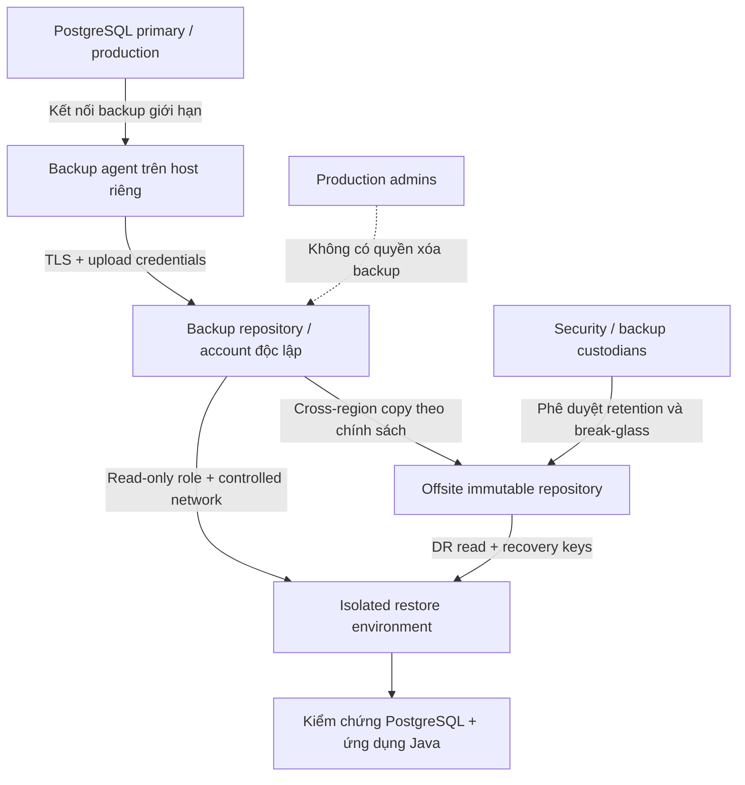
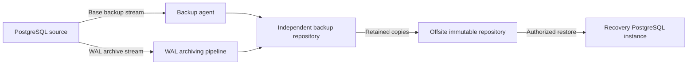
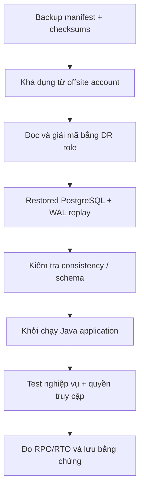

# Tách vị trí và quyền truy cập của bản sao dự phòng

Một hệ thống PostgreSQL có thể chạy ổn định nhiều năm nhưng vẫn mất dữ liệu sau sự cố rất đơn giản: toàn bộ database và bản sao lưu đều nằm trên cùng volume, hoặc tài khoản bị chiếm quyền điều khiển production cũng có quyền xóa toàn bộ lịch sử backup. Trong hai tình huống đó, việc tự động sao lưu hằng ngày **không tạo ra khả năng phục hồi độc lập**. Khi host hỏng, volume lỗi, tài khoản bị chiếm đoạt hoặc mã độc mã hóa/xóa dữ liệu, bản sao có thể mất cùng nguồn dữ liệu chính.

**Tách vị trí (*location separation*)** nghĩa là bố trí bản sao ngoài phạm vi sự cố có thể ảnh hưởng đồng thời đến nguồn dữ liệu. **Tách quyền truy cập (*access separation*)** nghĩa là chủ thể có quyền vận hành hoặc ghi vào hệ thống chính **không tự động có quyền sửa, ghi đè, rút ngắn thời hạn giữ hoặc xóa** những bản sao cần cho khôi phục. Hai lớp này bổ sung cho nhau, không thay thế nhau: sao lưu khác vùng địa lý nhưng vẫn dùng cùng quyền quản trị có thể bị xóa đồng loạt; bản sao có quyền rất chặt nhưng nằm trên cùng ổ đĩa vẫn không chống được hỏng phần cứng.

Bài học thuộc chương **Sao lưu và khôi phục** trong mô-đun **DATA_PERSISTENCE_FUNDAMENTALS**. Mô-đun hướng tới hiểu mô hình dữ liệu, lược đồ, truy vấn, chỉ mục, transaction, cô lập, kiểm soát đồng thời và thiết kế ranh giới persistence cho Java; đồng thời xử lý lỗi kết nối, tiến hóa schema, bảo mật, backup và hiệu năng. Trọng tâm ở đây là thiết kế **kiến trúc lưu trữ bản sao, phân quyền và khả năng phục hồi có thể kiểm chứng** chứ không chỉ học một lệnh tạo backup.

Ví dụ tham chiếu PostgreSQL và môi trường có object storage. Tên công cụ, quyền, tính bất biến và khả năng cross-region/cross-account thay đổi theo sản phẩm; cần xác minh hợp đồng thực tế, yêu cầu pháp lý và kết quả diễn tập trước khi sử dụng trên production.

## 1. Backup, replica và khả năng phục hồi là ba khái niệm khác nhau

| Cơ chế | Vai trò chính | Giới hạn quan trọng |
|---|---|---|
| **Replica** | Sao chép thay đổi để đọc, sẵn sàng cao và failover | Có thể sao chép cả lệnh `DELETE`, ghi sai hoặc mã hóa dữ liệu; bản sao có thể bị lag |
| **Backup có lịch sử phiên bản** | Giữ dữ liệu tại những mốc trước đó để khôi phục lỗi logic, mất dữ liệu hoặc sự cố lớn | Chỉ hữu ích nếu còn truy cập được, đầy đủ, không bị sửa trái phép và restore được |
| **PITR (point-in-time recovery)** | Khôi phục đến một mốc thời gian/LSN phù hợp từ base backup và chuỗi WAL cần thiết | Cần chuỗi WAL đầy đủ, timeline/phần mềm tương thích và backup đã kiểm chứng |
| **Disaster recovery plan** | Quy trình tái lập dịch vụ gồm hạ tầng, quyền, khóa mã hóa, định tuyến, dữ liệu và kiểm tra nghiệp vụ | Có backup không có nghĩa tự đạt RTO/RPO hoặc tự đưa hệ thống lên lại |

Replica có thể được dùng làm **nguồn lấy backup** để giảm tải primary theo khả năng của DBMS, nhưng việc backup được tạo từ replica **không biến replica thành nơi lưu trữ backup độc lập**. Bản sao lưu phải có lịch sử, chính sách giữ và quyền riêng. Nếu nguồn dữ liệu chứa sai sót nghiệp vụ, replica thường sẽ nhận sai sót đó; phải có điểm phục hồi **trước** khi sai sót lan rộng.

## 2. Bắt đầu bằng mô hình đe dọa và failure domain

**Failure domain** là phạm vi mà một sự cố có thể làm mất đồng thời nhiều thành phần. Phải xác định backup có thật sự thoát khỏi các phạm vi quan trọng không:

| Sự cố hoặc tác nhân | Nếu backup không tách biệt | Biện pháp phân tách phù hợp |
|---|---|---|
| Hỏng đĩa/volume của DB | Backup cùng volume mất theo | Volume/storage khác; ưu tiên thiết bị hoặc dịch vụ độc lập |
| Host bị xâm nhập hoặc ransomware | Mã độc xóa hoặc mã hóa cả database và thư mục backup | Repository bên ngoài host, credential giới hạn, bản bất biến/offline |
| Mất một availability zone / trung tâm dữ liệu | Replica và backup trong cùng nơi không còn truy cập | Bản sao ở failure domain khác đáp ứng RPO/RTO |
| Mất cả region hoặc đường mạng đến region | Backup cùng region không giúp vận hành tại vùng khác | Có bản offsite khác region và phương án mạng/khóa/khởi động ở nơi dự phòng |
| Tài khoản cloud/tenant bị chiếm | Attacker có quyền quản trị xóa cả production và backup cùng tài khoản | Tài khoản/tenant backup độc lập, quản trị tách biệt, immutable retention |
| Khóa mã hóa/KMS bị mất hoặc bị vô hiệu hóa | Backup còn nguyên byte nhưng không giải mã được | Quy trình escrow/DR key hợp pháp, quyền và vòng đời khóa riêng |
| Nhân viên vận hành xóa nhầm | Một lệnh có quyền rộng loại bỏ nhiều thế hệ backup | Phân vai upload/restore/delete, approval và retention không thể sửa tùy ý |
| Lỗi logic trong ứng dụng hoặc migration | Dữ liệu sai được ghi vào DB và nhân bản | Giữ nhiều recovery points, đối soát và chọn mốc phục hồi phù hợp |

Không thể kết luận "đã tách" chỉ vì đường dẫn khác nhau như `/var/lib/postgresql` và `/var/backups`. Nếu cùng filesystem, cùng host, cùng người quản trị hoặc cùng credential có quyền xóa, **vùng ảnh hưởng thực tế vẫn chồng lên nhau**.

### 2.1. Tách vật lý, logic và quản trị

Ba chiều tách biệt nên được đánh giá riêng:

1. **Vật lý/hạ tầng:** backup không nằm trong cùng thiết bị, node, AZ hoặc region bị coi là một failure domain theo mục tiêu RPO/RTO.
2. **Logic và mạng:** storage endpoint, đường kết nối, môi trường khôi phục và DNS/routing có thể sử dụng khi nguồn chính không còn hoạt động; hạn chế đường truy cập vào repository.
3. **Quản trị và danh tính:** identity có quyền thay DB, deploy code hoặc xóa tài nguyên production **không tự sở hữu** quyền gỡ retention, xóa repository hoặc hủy khóa dùng để giải mã mọi backup.

Tách khác region **nhưng cùng tài khoản cloud với quyền quản trị tuyệt đối** có thể chống sự cố điện/dữ liệu của một region, nhưng kém chống tấn công chiếm tài khoản. Ngược lại, backup ở tài khoản độc lập nhưng cùng trung tâm dữ liệu có thể chịu chung sự cố hạ tầng. Kiến trúc tốt cần lựa chọn nhiều lớp theo mối đe dọa thật và chi phí được chấp nhận.

## 3. Quy tắc 3-2-1-1-0 như một cách tự kiểm tra

Quy tắc **3-2-1** thường được diễn giải là: giữ **3 bản dữ liệu** (tính cả dữ liệu đang dùng), trên **2 loại media/hệ lưu trữ khác nhau** và **ít nhất 1 bản ở ngoài địa điểm chính**. Một biến thể là **3-2-1-1-0**, bổ sung **1 bản offline hoặc bất biến** và **0 lỗi chưa được phát hiện trong kiểm tra backup/restore**.

Đây là **nguyên tắc thiết kế**, không phải bằng chứng tự động rằng đã an toàn hoặc một tiêu chuẩn tuân thủ áp dụng máy móc cho mọi hệ thống:

- Hai bucket trên cùng tài khoản và cùng key có thể vẫn là **một failure domain quản trị**.
- Hai bản trên cùng storage appliance không nhất thiết là **hai nền tảng lưu trữ độc lập** dù tên thư mục khác nhau.
- Một bản backup có Object Lock nhưng khóa giải mã bị hủy vẫn có thể **không phục hồi được**.
- Một bản offline nhiều tháng tuổi có thể không đạt RPO, dù chống tấn công mạng rất tốt.
- Con số **0 lỗi** phải dựa trên kiểm tra integrity **và diễn tập restore thực tế**; checksum đơn thuần không chứng minh ứng dụng khởi động được.

Trong một hệ có dữ liệu ít thay đổi, bản offline định kỳ có thể phù hợp. Với hệ có giao dịch liên tục và RPO vài phút, cần kết hợp **base backup, WAL archive/replication phù hợp và các bản phục hồi bất biến**, vì chỉ sao chép toàn bộ database mỗi tuần không thể đáp ứng RPO đó.

## 4. Kiến trúc mẫu tách nguồn, repository và môi trường restore



Sơ đồ chỉ mô tả **ranh giới quyền và vị trí**. Các mũi tên cần cấu hình cụ thể về danh tính, private networking, encryption, phiên bản backup và chính sách sao chép. Nếu repository A và B phụ thuộc cùng hệ thống khóa KMS hoặc cùng quyền quản trị có khả năng hủy cả hai, phải ghi nhận **điểm phụ thuộc chung** đó trong thiết kế DR.

Một phương án triển khai thực tế có thể gồm:

- **Production zone:** PostgreSQL và các ứng dụng Java; app chỉ có quyền SQL cần thiết, **không có credential quản lý kho backup**.
- **Backup execution zone:** agent hoặc job riêng, kết nối tới database bằng tài khoản backup có quyền cần thiết, tạo/stream backup và upload tới repository.
- **Primary backup repository:** storage ngoài host và theo chính sách khác failure domain; backup writer không được đọc/xóa tuỳ tiện lịch sử.
- **Offsite/immutable repository:** bản thứ hai thuộc tài khoản/vùng độc lập với chính sách lưu bất biến hoặc offline.
- **Restore sandbox:** môi trường được tạo khi diễn tập hoặc xử lý sự cố; chỉ restore role được phép đọc bản backup và dùng khóa giải mã theo kiểm soát riêng.

**Không tự coi việc object storage bật versioning là bảo vệ đầy đủ khỏi xóa.** Versioning cho phép giữ lịch sử khi cấu hình đúng, nhưng tài khoản có quyền xóa version hoặc thay policy có thể loại bỏ cả lịch sử. Tính bất biến/WORM và sự tách quyền giữ bản là cơ chế khác cần đánh giá.

## 5. Phân quyền theo vai trò, không theo người có quyền root production

Một lỗi phổ biến là job tạo backup và người quản trị DB đều dùng cùng một tài khoản cloud có quyền `List/Get/Put/Delete` mọi object. Khi credential đó bị lộ, attacker có thể xóa dữ liệu và backup trong cùng hành động. Nên phân **quyền tạo, đọc, phục hồi, xóa và quản lý chính sách giữ** thành những vai trò riêng:

| Vai trò | Cần được phép | Nên bị ngăn hoặc có phê duyệt |
|---|---|---|
| **Database backup source** | Đọc/stream dữ liệu cần thiết theo cơ chế backup, kèm metadata/WAL phù hợp | Thay nghiệp vụ DB, tạo superuser mới, quản lý repository từ phía DB |
| **Backup uploader/agent** | Ghi **bản mới** vào namespace được cấp, nhận xác nhận hoàn tất | Xóa, thay thế bản đã chốt, rút ngắn retention, đọc mọi backup không cần thiết |
| **Verifier** | Đọc manifest/checksum và bản copy dùng cho thử nghiệm | Xóa/chỉnh sửa backup, làm yếu retention |
| **Restore operator** | Liệt kê, đọc bản được duyệt, khởi tạo restore ở môi trường mục tiêu | Xóa các bản gốc, vô hiệu hóa audit hoặc cấp quyền cho chính mình |
| **Retention/security custodian** | Quản trị chính sách giữ theo quy trình hai người/approval, xem audit | Truy cập dữ liệu business không cần thiết hoặc tự khôi phục trái phép |
| **Production application** | SQL theo principle of least privilege | Credential backup, quyền quản lý bucket/khóa, xóa nhiều thế hệ backup |
| **Break-glass DR team** | Truy cập khẩn cấp được kiểm soát khi mất control plane | Quyền tồn tại vĩnh viễn, không có log, không hết hạn hoặc không cần đối soát sau sử dụng |

Điểm quan trọng là **backup uploader có thể tạo bản mới nhưng không thể phá hủy bản cũ**. Một số storage yêu cầu uploader có quyền đọc hoặc ghi metadata để xác nhận upload; phải kiểm tra từng API và quyền cụ thể. Cơ chế "write-only" cũng không tự cấm `PUT` với cùng object key gây ghi đè, nếu nơi lưu trữ không thực thi **create-only, versioning + immutability hoặc retention**. Quyền IAM chỉ hiệu quả khi storage policy, bucket policy, ownership và key policy phối hợp đúng.

### 5.1. Quyền trên database cũng cần giới hạn

Với PostgreSQL, backup vật lý qua streaming protocol sử dụng role có thuộc tính **`REPLICATION`** hoặc quyền tương đương theo cấu hình, và điều kiện kết nối `pg_hba.conf`, TLS/driver phù hợp. Đây là một quyền đặc biệt, **không đồng nghĩa tài khoản chỉ-đọc SQL thông thường có thể tạo mọi loại base backup**. Các công cụ backup logic (`pg_dump`) lại dùng quyền đọc đối tượng/schema cần dump và có những yêu cầu riêng. Không cấp superuser hoặc quyền replication cho ứng dụng Java vì tiện cấu hình backup.

Trong môi trường production, nguồn backup nên kết nối qua identity tách biệt, thông tin xác thực được luân chuyển, truy cập mạng chỉ từ backup agent và quyền được kiểm tra định kỳ. Nếu backup tool cần quyền cao để lấy WAL, tạo slot hoặc đọc cấu trúc, ghi rõ **quyền nào thực sự cần** và theo dõi sự thay đổi qua nâng cấp công cụ. Credentials không được nhúng vào image, repository mã nguồn hoặc câu lệnh dễ xuất hiện trong process listing/log.

## 6. Bất biến, offline và khả năng chống xóa hàng loạt

**Immutable backup** là bản sao không thể bị sửa/xóa trong thời hạn bảo vệ đã thiết lập, theo hợp đồng của hệ thống lưu trữ. **Offline/air-gapped backup** là bản sao được tách kết nối ở mức đủ để các credential và mạng production không thể tác động trực tiếp tới nó trong thời gian ngoại tuyến. Hai cách có thể bổ sung nhau, nhưng có giả định và chi phí khác nhau.

| Biện pháp | Chống được | Vẫn cần kiểm tra |
|---|---|---|
| Bucket versioning | Ghi đè/xóa nhầm phiên bản hiện hành nếu các version cũ còn | Người có quyền xóa version cũ, lifecycle policy, key dùng để giải mã |
| Object Lock / WORM retention | Sửa/xóa object version trong thời hạn retention theo mode/hợp đồng | Bật đúng lúc ghi object, thời hạn, quyền thay policy, vendor semantics |
| Legal hold | Hạn chế xóa bản đang bị giữ theo quy trình | Ai được đặt/gỡ hold, tương tác với retention và yêu cầu pháp lý |
| Offline tape hoặc storage air gap | Xâm nhập qua mạng từ production trong thời gian offline | Chậm restore, rủi ro thất lạc/đĩa hỏng, kiểm kê media, khả năng đọc và giải mã |
| Cross-account copy | Giảm phạm vi tài khoản production bị chiếm | Quyền cấp chéo có thể xóa hoặc thay policy ở tài khoản đích không? |
| Cross-region copy | Giảm rủi ro sự cố theo khu vực | Cùng tài khoản, cùng admin, cùng KMS hoặc mạng có còn là điểm lỗi chung? |

Ví dụ một dịch vụ object storage hỗ trợ **WORM/Object Lock** có thể phân biệt mode cho phép quản trị được quyền bỏ qua retention trong điều kiện nhất định và mode ngăn cả quản trị cấp cao xóa object version khi retention còn hiệu lực. **Không suy ra tất cả nhà cung cấp có cùng mode hay đặc tính.** Cần thử trực tiếp với chính sách dự kiến: tài khoản backup writer có xóa/sửa được không, production admin có hạ thời hạn giữ không, root/organization admin có thay chính sách/khóa được không, lifecycle có bỏ qua bản đang bị khóa không?

### 6.1. Bất biến phải được bật ngay trong quy trình ghi

Một bản sao được upload **trước** khi cấu hình retention phù hợp có thể không được bảo vệ như những bản được tạo sau. Nên định nghĩa một bước **finalize/commit backup**: ghi đủ các object, manifest và WAL cần thiết; xác minh checksum và trạng thái lưu; áp retention/immutability theo hợp đồng; chỉ sau đó đánh dấu recovery point "usable". Với các công cụ tự động hỗ trợ retention tại thời điểm object được tạo, phải xác minh rằng không có cửa sổ bản sao chưa được bảo vệ.

Không cho uploader tự chọn thời hạn giữ tùy ý ngắn hơn chuẩn. Nếu uploader bị chiếm quyền, kẻ tấn công có thể tạo "backup" sai hoặc không đầy đủ để che các bản tốt; vì vậy chính sách giữ, kiểm chứng bản sao và quyền sửa metadata phải được bảo vệ khỏi chính uploader.

### 6.2. Không thể dựa vào xóa bản cũ để giải phóng dung lượng tùy ý

Retention có chi phí. Khi thời hạn WORM chưa kết thúc, những bản sao được giữ có thể **không xóa được dù storage gần đầy**. Phải dự trù vòng đời, dung lượng phiên bản, WAL growth, chi phí cross-region transfer và số bản cần giữ trước khi bật retention. Đặt retention quá ngắn làm mất recovery window; đặt quá dài có thể tăng chi phí và xung đột chính sách dữ liệu nhạy cảm. Nếu nhu cầu giữ dữ liệu và yêu cầu xóa có thể mâu thuẫn, cần quy trình pháp lý/bảo mật rõ ràng.

## 7. Tách quyền giải mã và vòng đời khóa khỏi quyền xóa backup

Một bản sao đã được giữ ở tài khoản độc lập và WORM vẫn **không hữu dụng nếu không thể giải mã**. Ngược lại, repository chứa dữ liệu chưa mã hóa có thể trở thành nguồn lộ dữ liệu diện rộng nếu tài khoản restore bị xâm nhập.

Nguyên tắc cần bảo đảm:

1. **Mã hóa khi truyền:** dùng kênh bảo mật từ PostgreSQL/backup host tới repository và từ repository tới môi trường restore. Kiểm chứng certificate/endpoint, tránh gửi backup qua mạng công khai không bảo vệ.
2. **Mã hóa khi lưu:** sử dụng cơ chế mã hóa có quản lý khóa, xác định rõ **ai có thể giải mã** và ở môi trường nào. Không coi quyền tải xuống object đồng nghĩa mặc nhiên có quyền đọc plaintext.
3. **Tách khóa:** role upload không tự có quyền giải mã mọi bản backup hoặc hủy khóa; role restore chỉ nhận quyền decrypt theo phạm vi và thời hạn được phê duyệt.
4. **Khả dụng khi thảm họa:** khóa/secret cần thiết để phục hồi **không được chỉ tồn tại trên DB host hoặc control plane đang bị mất**; có quy trình DR hợp lệ để lấy khóa.
5. **Rotation và retention:** giữ phiên bản khóa cần để giải mã những backup còn hạn; không xóa/hủy khóa trước khi các bản phụ thuộc hết vòng đời.
6. **Kiểm toán:** ghi nhận truy cập decrypt, thay đổi key policy, disabled/deleted key và lần sử dụng break-glass; log ở failure domain khác.

### 7.1. Bài toán mất khóa đồng thời với mất nguồn dữ liệu

```text
Backup object: nguyên vẹn, đủ WAL, ở offsite repository
KMS key: chỉ quản trị qua cùng tài khoản production bị khóa/mất
                       |
                       v
           Không thể giải mã => không thể restore
```

Do đó, một cuộc diễn tập tốt phải thử **khôi phục khi tài khoản production không có sẵn**. Nếu key management nằm trong một tài khoản khác, cần xác minh policy cho phép đội DR sử dụng đúng key dù production account đang mất quyền; đồng thời không mở quyền decrypt công khai hoặc cấp vĩnh viễn cho mọi kỹ sư.

Tách quyền không có nghĩa một người không bao giờ có thể tham gia nhiều vai trò: quy trình **break-glass có thời hạn**, xác thực mạnh, phê duyệt kép và audit là cách cân bằng nhu cầu cứu hệ thống với nguyên tắc đặc quyền tối thiểu. Phải kiểm tra cách thu hồi quyền sau diễn tập.

## 8. PostgreSQL: base backup, WAL và vị trí lưu trữ thực tế

Đối với PostgreSQL, một chiến lược phục hồi đến thời điểm thường kết hợp **physical base backup** với chuỗi **WAL (write-ahead log)** cần thiết, được lưu đủ và có thể đọc lại. Một bản base backup chỉ cho phép phục hồi đến trạng thái tương ứng với dữ liệu/WAL mà nó chứa; nó không tự bảo đảm có thể quay tới bất kỳ phút nào sau đó nếu WAL cần thiết bị thiếu.



### 8.1. Ví dụ lấy base backup qua streaming protocol

Giả sử backup agent chạy trên **máy riêng**, đã có kết nối được bảo vệ và tài khoản PostgreSQL có quyền replication cần thiết. Ví dụ lệnh sau **chỉ minh họa cách tạo bản vật lý tại staging của backup host**:

```bash
# Chạy trên backup host riêng, không chạy tùy tiện trên production.
# Credential được cấp ngoài command line theo cơ chế an toàn của môi trường.
pg_basebackup \
  -h db-primary.internal \
  -U backup_agent \
  -D /secure/staging/base_2026_11_22 \
  -Fp -X stream -P

# Kiểm tra manifest/độ nhất quán của bản base backup theo phiên bản hỗ trợ.
pg_verifybackup /secure/staging/base_2026_11_22
```

`-X stream` yêu cầu stream WAL cần cho base backup trong quá trình tạo, **không có nghĩa toàn bộ WAL của các ngày sau được tự lưu trữ cho PITR**. Đường dẫn staging phải được bảo vệ, có đủ dung lượng, quyền và cơ chế dọn sau khi bản sao được upload xác nhận. Nếu backup được thực hiện bằng công cụ khác như pgBackRest hoặc Barman, cần tuân thủ quy trình manifest, checksum, WAL archiving và retention của chính công cụ ấy.

**Không coi `pg_verifybackup` thành công là bằng chứng DR đã đạt**: công cụ chủ yếu xác minh một số đặc tính và nội dung của base backup/manifest theo khả năng của phiên bản; nó không kiểm thử quyền giải mã offsite, tính đầy đủ của WAL archive ở mốc mong muốn, khả năng khởi động database, ứng dụng Java hoặc thời gian restore thật.

### 8.2. WAL phải đi tới repository độc lập

Một chiến lược PITR thường cần giữ **chuỗi WAL liên tục** từ mốc phù hợp với base backup tới recovery target. Nếu archive chỉ nằm trên cùng host PostgreSQL, hỏng host có thể làm mất các WAL vừa cần để khôi phục. Nếu archiver thất bại, WAL có thể tích lũy, làm đầy disk và tạo rủi ro cho production.

Các nguyên tắc thiết kế cho pipeline:

- Không báo **archive thành công** trước khi hệ thống bảo đảm WAL đã được lưu bền vững tại đích theo hợp đồng. Trả success quá sớm có thể khiến PostgreSQL coi segment đã archive dù bản ở xa chưa tồn tại an toàn.
- Có **retry/backoff, backpressure và cảnh báo** khi archiver chậm; đo last successful archive, failure count, WAL backlog và dung lượng trống.
- Sao chép đến **repository ngoài failure domain**, dùng quyền upload giới hạn, checksum/manifest và retention phù hợp.
- Giữ **timeline history** và thông tin backup cần thiết khi có promote/failover; không assume các WAL ở mọi timeline tự có mặt.
- Phân biệt tính liên tục của chuỗi WAL và mức bảo vệ của từng segment; lưu trữ offsite trễ có thể làm RPO xấu hơn lịch tạo base backup.

Nếu dùng standby làm nguồn backup, cần theo dõi khả năng nguồn đó có dữ liệu cần thiết, tương thích phiên bản và hành vi khi failover. Không gắn khả năng khôi phục vào **một replica duy nhất** rồi gọi đó là storage độc lập.

### 8.3. Backup logic có chỗ đứng nhưng không thay thế mọi nhu cầu PITR

`pg_dump` tạo **logical backup** các đối tượng/dữ liệu theo phạm vi được yêu cầu; nó hữu ích cho chuyển hệ, khôi phục có chọn lọc và một số nhu cầu schema/table. Nhưng một file dump **không tương đương** với physical base backup có WAL archive để PITR tới từng thời điểm. Logical restore có thể tốn nhiều thời gian để tạo bảng, index, constraint và nhập dữ liệu, đồng thời yêu cầu quản lý roles, extensions và các global objects phù hợp. Trong một chiến lược thực tế có thể dùng **cả physical/PITR và logical exports có chọn lọc**, với mục tiêu và quyền khác nhau.

## 9. RPO, RTO và độ trễ sao chép ngoài địa điểm

**RPO (Recovery Point Objective)** là mức độ mất dữ liệu tối đa doanh nghiệp chấp nhận, thường biểu diễn bằng thời gian tính từ điểm mất dữ liệu đến recovery point mới nhất dùng được. **RTO (Recovery Time Objective)** là thời gian mục tiêu để phục hồi chức năng theo phạm vi đã định nghĩa. Hai con số là **mục tiêu nghiệp vụ**, không phải thuộc tính tự động có được khi bật một loại backup.

| Yếu tố | Liên quan tới RPO | Liên quan tới RTO |
|---|---|---|
| Lịch tạo base backup | Nếu không có WAL, giới hạn độ mới có thể chỉ là thời điểm backup | Backup lớn có thể cần thời gian tải và restore dài |
| WAL archiving/offsite lag | Recovery point mới nhất có đủ WAL để đạt mốc mong muốn hay không | Thời gian tìm, tải và replay WAL |
| Nơi lưu bản sao | Bản gần nhất có thể mất cùng region/tài khoản chính | Độ trễ mạng, băng thông, thời gian cấp storage và quyền truy cập |
| Encryption/key access | Bản dùng được nếu giải mã được khi có sự cố | Chờ cấp quyền/decrypt hoặc phục hồi KMS key có thể trì hoãn |
| Backup integrity | Bản mới nhất lỗi có thể buộc lùi tới bản cũ hơn | Phải thử nhiều recovery points, kiểm tra dữ liệu và DB consistency |
| IaC/restore automation | Không trực tiếp tạo recovery point mới hơn | Rút ngắn bước tạo host, cấu hình DB, ứng dụng và routing |

### 9.1. Một ví dụ RPO yêu cầu 5 phút

Giả sử ứng dụng có yêu cầu **RPO tối đa 5 phút**. Hệ thống có base backup hằng đêm và WAL archive đến repository ngoài region; một số WAL segment mới nhất có thể chưa được lưu đến đích khi region chính mất. Nếu dữ liệu commit gần đây nhất tại offsite mới ở **11:52** và sự cố xảy ra **12:00**, điểm khôi phục dùng được có thể cũ 8 phút, **vi phạm RPO** dù base backup vẫn có và lịch archive được cấu hình.

```text
11:50  base backup trước đó đã ở offsite
11:52  WAL cuối cùng có mặt đầy đủ ở offsite
11:55  RPO=5 phút bắt đầu bị vượt nếu chưa có WAL mới
12:00  Region chính mất
        -> recovery point offsite mới nhất ở 11:52
        -> mất tới 8 phút thay đổi hợp lệ theo kịch bản
```

Số liệu này minh họa mối quan hệ thời gian, không có nghĩa một WAL segment hoàn tất ở phút 11:52 luôn khôi phục chính xác tới timestamp 11:52. Mốc có thể dùng còn phụ thuộc **WAL sequence liên tục, timeline và recovery target được xác minh**. Cần đo thực tế *last restorable point* chứ không chỉ thời gian lần cuối agent khởi chạy.

### 9.2. RTO phải tính cả tải dữ liệu và khôi phục ứng dụng

Giả sử một base backup có dung lượng **1 TiB**, băng thông tải về thực tế giữ được **250 MiB/s**. Chỉ riêng thời gian truyền lý thuyết đã khoảng:

\[
\frac{1\times 1024\times 1024\ \mathrm{MiB}}{250\ \mathrm{MiB/s}}
\approx 4194\ \mathrm{s}\approx 70\ \mathrm{phút}
\]

Chưa tính thời gian xác thực danh tính/khóa, giải mã, ghi dữ liệu xuống volume, replay WAL, startup PostgreSQL, rebuild service, cache warm-up, đối soát dữ liệu và đổi DNS/routing. Nếu mục tiêu RTO là 45 phút, phương án cần download 1 TiB trên đường truyền đó **không đạt** ngay cả trước các bước khác. Có thể cần warm standby, snapshot có thể mount nhanh, pre-provisioned recovery infrastructure hoặc tăng tốc độ truyền; phải kiểm chứng trade-off bảo mật và chi phí.

Trong quá trình đo RTO, thống nhất chính xác **mốc bắt đầu** (thời điểm hệ thống mất dịch vụ hay phát hiện) và **mốc hoàn tất** (DB mở port hay nghiệp vụ quan trọng đã hoạt động đúng). Một database chấp nhận connection nhưng chưa phục hồi đủ quyền, schema, event processing hoặc endpoint thanh toán chưa đáp ứng thì chưa chắc đã đạt **RTO nghiệp vụ**.

## 10. Đọc lại được chưa đủ: diễn tập restore cô lập

Một repository nên được kiểm chứng theo nhiều tầng, từ file tới chức năng nghiệp vụ:



### 10.1. Các bước của một buổi diễn tập

1. **Chọn recovery point** từ offsite repository, lý tưởng có cả bản mới và bản lịch sử để kiểm tra retention. Ghi ID, mốc backup, checksum/manifest và WAL cần thiết.
2. **Mô phỏng mất production:** thử thao tác từ môi trường không phụ thuộc trực tiếp vào tài khoản hay host DB đang phục vụ; kiểm tra ai có quyền mở DR và ai có quyền decrypt.
3. **Khởi tạo môi trường cách ly:** mạng, volume, PostgreSQL version/extensions, cấu hình TLS và service account được tạo theo runbook; không trỏ ngầm về production.
4. **Đọc bản sao từ offsite**, giải mã và áp dụng base backup + WAL theo target; kiểm tra không có đoạn WAL thiếu, mismatch timeline hoặc tham số recovery sai.
5. **Khởi động PostgreSQL** và xác nhận database mở được theo mục tiêu, dữ liệu/schema tồn tại, các role cần thiết hoạt động; kiểm tra log khôi phục.
6. **Kiểm tra dữ liệu có ý nghĩa:** row count theo bảng trọng yếu, constraint, FK, điểm số dư hoặc sổ cái nếu có, checksum theo tập dữ liệu phù hợp và các bản ghi ở gần mốc phục hồi.
7. **Chạy smoke/integration test Java:** đọc/ghi một nghiệp vụ test được phép trong môi trường phục hồi, truy cập bằng ứng dụng đúng cấu hình, kiểm tra migration và secret đã được cấp đúng.
8. **Đo thời gian thật:** từ bước kích hoạt DR đến khi nghiệp vụ trọng yếu đạt SLO tối thiểu; đo lượng dữ liệu không phục hồi được so với mốc sự cố.
9. **Thu hồi quyền và dọn môi trường:** xóa dữ liệu test theo chính sách, thu hồi break-glass role, lưu audit và cập nhật runbook.

**Không restore một bản production chứa thông tin nhạy cảm sang môi trường thử không được phép.** DR sandbox phải có mức bảo vệ tương xứng: network isolation, encryption, quyền hạn, logging và quy trình hủy dữ liệu sau diễn tập.

### 10.2. Kiểm tra cơ sở dữ liệu và kiểm tra nghiệp vụ không thay thế nhau

Một backup có thể vượt qua checksum nhưng bị thiếu **application secrets, extensions, roles, timezone settings, schema migration hoặc event offsets**. Ngược lại, một endpoint trả `200` sau restore không chứng minh mọi transaction quan trọng đã được khôi phục đến recovery point cam kết.

Ví dụ với ứng dụng Java sử dụng JPA, cần kiểm tra phiên bản entity mapping/driver tương thích với schema đã restore; chạy migration nếu quy trình đã cho phép, nhưng tránh cho Spring/Hibernate tự động sửa schema hoặc ghi dữ liệu trước khi đã chụp bằng chứng phục hồi. Với hệ có message broker, phải có chính sách **replay, deduplication/idempotency và đối soát**: việc restore database về mốc cũ trong khi broker còn sự kiện mới có thể làm phát lại tác dụng ngoài hệ thống nếu không kiểm soát.

## 11. Kiểm thử phân quyền bằng hành động được phép và bị từ chối

Phân quyền không nên chỉ được mô tả trong sơ đồ. Cần có test đánh giá **effective permissions** theo từng vai trò trong một môi trường thử không chứa dữ liệu người dùng thật:

| Vai trò được thử | Hành động dự kiến thành công | Hành động bắt buộc bị từ chối |
|---|---|---|
| Production application | SQL theo nghiệp vụ | Đọc bucket backup, xóa recovery points, quản lý key |
| Backup uploader | Tạo object mới trong prefix được duyệt | Xóa object cũ, overwrite bản đã bảo vệ, rút retention |
| Restore operator | Đọc bản được duyệt, restore vào sandbox | Xóa object gốc, thay policy hoặc tạo quyền vĩnh viễn |
| Production administrator | Bảo trì DB theo quyền | Thay/disable policy giữ backup ở tài khoản khác |
| Security custodian | Phê duyệt thay đổi policy đúng quy trình | Tự xuất dữ liệu business nếu không có quyền đọc/decrypt |
| Break-glass team | Nhận quyền tạm và tạo bản khôi phục được kiểm toán | Duy trì quyền sau hết hạn hoặc vô hiệu hóa audit độc lập |

Test cần chạy với **credential thực tế của vai trò** chứ không chạy bằng tài khoản quản trị rồi xem response; sử dụng test bucket/object với retention ngắn được chọn hợp pháp và không bao giờ thử xóa backup production quan trọng. Khi có cấu hình IAM đa tầng, quyền thực tế thường là giao của principal policy, resource policy, organization policy, key policy và session restrictions. Thử lần lượt các API **delete object, delete version, change retention, change lifecycle, disable key, change bucket policy** theo khả năng sản phẩm; một API bị từ chối không chứng minh các đường vòng khác cũng bị từ chối.

### 11.1. Kiểm toán độc lập với tài khoản production

Log sự kiện backup cần lưu ở **nơi mà tài khoản production bị chiếm không thể xóa hoặc sửa**. Cần theo dõi ít nhất:

- Lần tạo backup, archive WAL, copy cross-region, verify, restore, delete hợp lệ và hết hạn retention.
- Thay đổi policy, quyền IAM, KMS key, object retention, lifecycle và legal hold.
- Các lần truy cập backup bất thường, tải xuống khối lượng lớn hoặc decrypt ngoài lịch DR.
- Nhiều lần xóa/sửa bất thành, credential sai hoặc truy cập từ địa điểm/mạng không được phép.
- Việc sử dụng break-glass, phê duyệt kép, thời hạn và xác nhận thu hồi quyền.

Log cần có dấu thời gian, identity, target object/backup ID và kết quả, đồng thời bảo vệ nội dung nhạy cảm. Không đưa plaintext của database backup, secret hoặc dữ liệu cá nhân vào log chỉ để tiện tra cứu. Audit hữu ích nhất khi được **kiểm tra bằng cảnh báo và diễn tập**, không chỉ lưu rồi không có người xem.

## 12. Runbook khi production không còn đáng tin cậy

Giả sử một quản trị viên phát hiện database production bị xóa dữ liệu bất thường hoặc tài khoản cloud bị chiếm. Phương án restore phải tránh **tái sử dụng credential hoặc hạ tầng đã bị xâm nhập** và tránh ghi đè những nguồn bằng chứng cần điều tra.

### 12.1. Quy trình khôi phục theo thứ tự an toàn

1. **Kích hoạt incident response:** xác nhận mức độ ảnh hưởng, tách tài khoản/host nghi bị chiếm theo runbook bảo mật, ghi mốc phát hiện và dữ liệu cần giữ phục vụ điều tra. Không tự xóa log hoặc bằng chứng.
2. **Dừng đường ghi không an toàn:** cô lập primary cũ và fencing những chủ thể có thể tiếp tục ghi; bảo đảm không có hai primary cùng nhận traffic khi failover. Bật cơ chế trả lỗi/tạm dừng chức năng ghi cho ứng dụng nếu cần.
3. **Bảo vệ repository:** xác minh các recovery point bất biến còn tồn tại, quyền production đã bị vô hiệu/thu hồi nếu bị chiếm và hệ thống backup offsite không nằm trong vùng xâm nhập.
4. **Chọn recovery point:** dựa trên mốc tác động đầu tiên được xác minh, tính liên tục của WAL, mục tiêu RPO và các bản phù hợp; không mặc định bản mới nhất luôn sạch nếu lỗi logic/mã độc đã tồn tại trước đó.
5. **Khởi tạo hạ tầng sạch:** tạo PostgreSQL/volume/secret/network tại môi trường DR độc lập, chỉ cấp quyền cần thiết cho đội phục hồi.
6. **Restore và đối soát:** lấy bản backup, giải mã, apply WAL đến target, kiểm tra log/constraint và nghiệm thu dữ liệu nghiệp vụ. Không kết nối job tự động hoặc consumer phát tác dụng ra ngoài trước khi có quyết định.
7. **Khôi phục Java services:** chạy với cấu hình và schema tương thích, thay credential bị lộ, kiểm tra read/write, quyền và idempotency; các tác vụ ghi ngoài DB cần đánh giá riêng.
8. **Chuyển traffic có kiểm soát:** xác minh fencing với nguồn cũ, routing, DNS, pool và khả năng thực thi giao dịch đúng; giới hạn tải ban đầu để quan sát.
9. **Đối soát phần chênh lệch:** nghiệp vụ đã xác nhận commit sau recovery point có thể thiếu tại DB restore; dùng log/ledger/event nguồn có thẩm quyền để xử lý, không tự tái phát mọi request như thể chắc chắn chưa xử lý.
10. **Kết thúc sự cố có kiểm soát:** đo RTO/RPO thực tế, lưu bằng chứng phục hồi, thu hồi quyền khẩn cấp, xác định nguyên nhân gốc và cập nhật cơ chế backup/quyền.

### 12.2. Những quyết định cần người có thẩm quyền

| Quyết định | Nếu làm sai | Cách kiểm soát |
|---|---|---|
| Chọn recovery point trước hay sau mốc dữ liệu bị sai | Khôi phục lại dữ liệu đã bị sửa/xóa sai hoặc mất thêm giao dịch hợp lệ | DBA, data owner và incident commander phê duyệt dựa trên bằng chứng |
| Có chuyển traffic sang DB mới ngay không | Có thể hai primary ghi song song hoặc ứng dụng mở với schema/credential sai | Fencing, smoke test và kiểm tra routing trước cutover |
| Có replay lại event/HTTP request không | Có thể thanh toán hoặc gửi thông báo trùng | Idempotency key, operation ID và đối soát tác dụng ngoài DB |
| Có restore toàn DB đè lên hệ hiện tại không | Có thể mất bằng chứng và commit mới sau recovery point | Ưu tiên restore cô lập; đối chiếu trước khi thay thế |
| Có cấp quyền đọc toàn bộ backup cho đội ứng cứu không | Tăng rủi ro lộ dữ liệu khi tài khoản đang bị xâm nhập | Quyền tạm, phạm vi bản backup, phê duyệt và audit |

**Tách quyền cũng bảo vệ khỏi sai sót trong lúc khẩn cấp.** Đội ứng cứu cần khả năng phục hồi đủ nhanh, nhưng không nên có công tắc xóa mọi recovery point trong cùng tài khoản đang bị điều tra.

## 13. Tình huống tổng hợp: ransomware chiếm tài khoản production

Một nhóm phát triển vận hành ứng dụng Spring Boot với PostgreSQL trên cloud. Ban đầu, cron job mỗi đêm tạo `pg_dump` trong `/var/backups` của cùng VM. Một script khác gửi dump lên bucket trong **cùng tài khoản** bằng credential của VM có cả quyền upload và delete. Tài khoản quản trị production cũng có quyền disable khóa KMS của bucket.

Khi credential VM bị lộ, attacker có thể xóa dữ liệu DB, xóa dump tại VM, xoá object version hoặc thay retention nếu quyền cho phép. Đội vận hành báo "backup job chạy thành công mỗi ngày", nhưng không còn recovery point sử dụng được. Lỗi không nằm ở cú pháp `pg_dump`: **vị trí, quyền và vòng đời khóa cùng thuộc một phạm vi bị chiếm**.

### 13.1. Thiết kế lại có phân tách

```text
Production account                       Independent backup account
------------------                       --------------------------
Java services                              Immutable backup vault
  | - SQL credentials                       | - base backups + WAL
PostgreSQL + WAL --TLS--> Backup agent ---->| - versioned manifests
  |                           |              | - restricted retention
  |                           | Upload only  |
  |                        no delete        |
  |                                         v
  +-- production IAM cannot delete --> (DENIED)

Separate DR identity + decryption approval
  -> isolated recovery environment -> PostgreSQL -> Java smoke tests
```

Các điểm thay đổi quan trọng:

- Bản sao không còn phụ thuộc vào một volume của VM production.
- Tài khoản production không có quyền xóa hoặc làm yếu chính sách giữ ở kho offsite; quyền ghi của agent được giới hạn và kiểm tra.
- Kho backup có phiên bản/retention bất biến theo hợp đồng; bản bị lỗi/giả mạo mới không làm mất bản tốt cũ.
- Quyền đọc/decrypt chỉ cấp cho nhóm phục hồi với audit, và khóa có phương án khả dụng khi tài khoản production bị khóa.
- Có base backup + chuỗi WAL được kiểm chứng, không chỉ dump hằng đêm, nếu RPO yêu cầu tới mức phút.
- Tạo và chạy thử restore ở môi trường cô lập để chứng minh RTO/RPO cùng tương thích ứng dụng Java.

### 13.2. Thử tấn công giả lập trong môi trường kiểm soát

Không thử xóa backup production thật. Hãy tạo đối tượng thử và dùng các role thực tế để mô phỏng quyền:

1. Với **production role**, thử liệt kê/đọc/xóa object thử trong kho backup: tất cả quyền ngoài hợp đồng phải bị từ chối.
2. Với **backup uploader**, tạo object mới hợp lệ rồi thử ghi đè/xóa object đã được bảo vệ và thay thời hạn giữ: phải bị từ chối theo chính sách.
3. Với **restore role**, đọc đúng bản thử nhưng không thể xóa, giảm retention hoặc tự cấp quyền lâu dài.
4. Với **DR role khi production account bị vô hiệu giả lập**, truy cập kho offsite, lấy khóa phù hợp và restore vào sandbox: phải chứng minh khả năng độc lập.
5. Với **security audit**, xác minh mọi lần thử trái quyền và mọi thao tác break-glass được lưu ở log không thể bị tài khoản production xóa.

Kết quả thử cần được lưu như **bằng chứng thiết kế**, không chỉ ghi "PASS". Nêu role identifier, policy version, loại đối tượng, API được thử, kết quả mong muốn/thực tế, thời gian và người phê duyệt. Khi quyền IAM, lifecycle, storage tier hoặc hệ thống khóa được thay đổi, kiểm tra lại các bất biến này.

## 14. Retention, chi phí và nghĩa vụ bảo vệ dữ liệu

Kho backup càng tách biệt và bất biến, việc xóa nhầm càng khó; nhưng cũng dễ phát sinh **chi phí, thời gian phục hồi và nghĩa vụ lưu giữ**. Chính sách retention nên có lý do nghiệp vụ và được kiểm chứng trên dữ liệu thực tế:

| Nhóm bản sao minh họa | Mục tiêu | Hạn giữ ví dụ | Cần đánh giá thêm |
|---|---|---|---|
| Recovery points gần đây | Lỗi thao tác vài giờ/ngày trước | Nhiều ngày, kèm WAL phù hợp | RPO, WAL retention, tính liên tục chuỗi |
| Bản lịch sử tuần/tháng | Phát hiện lỗi logic muộn | Nhiều tuần/tháng | Dung lượng, giới hạn version và quyền truy cập |
| Bản offsite bất biến | Mất region, ransomware hoặc bị chiếm admin | Theo cửa sổ phục hồi/tuân thủ đã duyệt | WORM mode, thời gian giữ, khả năng giải mã |
| Bản offline lưu dài hạn | Tình huống phá hủy diện rộng hoặc yêu cầu lưu trữ | Theo yêu cầu cụ thể | Khả năng đọc media, kiểm kê và thử restore định kỳ |

**Thời hạn trong bảng chỉ để minh họa, không phải khuyến nghị mặc định.** Phải cân bằng thời gian phát hiện sai sót (có khi nhiều tuần), RPO, RTO, ngân sách, luật/lĩnh vực áp dụng và dữ liệu chứa trong bản sao. Một chính sách lưu 30 ngày không đủ cho lỗi logic chỉ được phát hiện sau 90 ngày, trong khi giữ vĩnh viễn dữ liệu cá nhân cũng có thể trái yêu cầu xóa/giới hạn thời hạn lưu.

### 14.1. Khi có yêu cầu xóa dữ liệu hoặc quyền riêng tư

Một backup bất biến có thể còn chứa dữ liệu của người dùng sau khi hồ sơ hiện hành đã bị xóa đúng quy trình. Cần thiết kế chính sách hợp pháp về thời hạn lưu bản, giới hạn quyền truy cập, xử lý yêu cầu xóa và **quy tắc áp dụng lại các lệnh xóa khi restore bản cũ**. Không phục hồi một backup lịch sử vào production rồi vô tình tái kích hoạt hồ sơ đã phải xóa.

Khi dữ liệu bị ràng buộc bởi yêu cầu cư trú theo quốc gia/vùng, copy cross-region/cross-cloud phải được phê duyệt trước; mô hình offsite không cho phép tùy ý đưa dữ liệu nhạy cảm ra ngoài khu vực hợp pháp. Backup staging, log và restore sandbox phải được xem là **các nơi chứa dữ liệu cần bảo vệ tương đương** chứ không phải môi trường tự do để debug.

### 14.2. Retention của WAL và manifest phải tương thích

Giữ base backup 30 ngày nhưng chỉ giữ WAL 3 ngày có thể không cho phép PITR đến mọi mốc dự kiến giữa các bản; ngược lại giữ WAL rất lâu mà thiếu base backup hợp lệ cũng không đủ để phục hồi. Chính sách xóa tự động phải **hiểu mối phụ thuộc giữa recovery point, base backup, timeline và WAL archive**. Các công cụ backup thường có cơ chế quản lý retention; phải kiểm chứng công cụ không xóa mất chuỗi đang cần, đặc biệt trong quá trình backup bị lỗi hoặc khi copy offsite chưa hoàn tất.

Nếu đã bật retention bất biến, sửa policy ở ngày mai có thể không giảm được thời hạn các object đã khóa. Vì vậy hãy thử trên phạm vi nhỏ trước, ước tính **storage growth, chi phí transfer, thời gian chuyển tier lạnh sang có thể restore** và quyền phục hồi từ tier đó. Một bản backup lưu ở cold archive rất rẻ nhưng mất nhiều giờ mới truy xuất được có thể không đáp ứng RTO 30 phút.

## 15. Giám sát và những nhầm lẫn cần tránh

Một pipeline backup có thể hoạt động nhiều tuần mà không tạo ra bản phục hồi hợp lệ. Dashboard chỉ có trạng thái scheduler `SUCCESS` **không trả lời được** repository còn bản hoàn chỉnh, còn quyền đọc/decrypt hay còn WAL liên tục hay không.

| Chỉ số/cảnh báo | Ý nghĩa | Hành động khi bất thường |
|---|---|---|
| **Tuổi bản backup có thể restore mới nhất** | Backup gần đây nhất đã qua verify và có đủ phụ thuộc | Điều tra agent, manifest, upload và chính sách giữ |
| **Mốc PITR mới nhất đã kiểm chứng** | Chênh lệch giữa thời điểm hiện tại và recovery point có thể dùng | Kiểm tra WAL archive lag, timeline và chuỗi WAL |
| **Backup job failure / duration** | Phát hiện job lỗi hoặc chậm bất thường | Xem dung lượng, I/O, network, timeout, quyền và tài nguyên DB |
| **WAL archive failures/backlog** | Nguy cơ RPO tăng, đầy disk hoặc mất chuỗi WAL | Khôi phục archiver, xem đường mạng, credential, storage quota |
| **Replication lag** | Thông tin hỗ trợ đánh giá replica/failover | Không dùng thay thế cho trạng thái backup offsite |
| **Retention/immutability coverage** | Có bản nào chưa được khóa hoặc hết retention sớm | Dừng quy trình contract/cleanup nếu khả năng phục hồi bị đe dọa |
| **KMS key health** | Khả năng giải mã khi nguồn chính bị mất | Kiểm tra trạng thái key, policy, rotation và DR role |
| **Restore drill age và RTO thực tế** | Lần cuối chứng minh dữ liệu dùng được và thời gian khôi phục | Lên lịch diễn tập, sửa runbook và kiểm tra thay đổi gần đây |
| **Unauthorized delete/policy changes** | Tín hiệu quyền bị lạm dụng hoặc bị chiếm | Cảnh báo bảo mật, cô lập credential và bảo vệ evidence |
| **Object count/bytes theo storage tier** | Dung lượng và chi phí retention | Kiểm tra lifecycle có giữ đủ các phụ thuộc PITR không |

### 15.1. Ví dụ kiểm tra WAL archiver trong PostgreSQL

PostgreSQL cung cấp `pg_stat_archiver` để xem một số thống kê archiving (tùy phiên bản/cấu hình và quyền):

```sql
SELECT archived_count, last_archived_wal, last_archived_time,
       failed_count, last_failed_wal, last_failed_time,
       stats_reset
FROM pg_stat_archiver;
```

`archived_count` và `failed_count` là **counter tích lũy**, muốn có tốc độ cần lấy chênh lệch giữa hai mẫu cùng khoảng thời gian và chú ý `stats_reset`. `last_archived_time` cho biết mốc một file được archiver báo thành công theo semantics của cấu hình, **không chứng minh độc lập** file đó đã được giữ an toàn tại offsite immutable vault hoặc rằng có đủ WAL để PITR. Đối chiếu manifest/repository inventory và thực hiện restore test. Nếu archive bị đứt chuỗi hoặc job báo thành công giả, chỉ tăng tần suất backup không sửa được nguyên nhân.

### 15.2. Các nhầm lẫn phổ biến

- **“Cùng máy, khác thư mục là offsite.”** Không đúng: chung host, disk, quyền root hoặc vị trí hạ tầng vẫn có failure domain chung.
- **“Cross-region đồng nghĩa chống mọi loại ransomware.”** Không nếu quyền production có thể xóa hoặc disable key của bản copy ở region khác.
- **“Versioning tương đương WORM.”** Không: principal đủ quyền có thể xóa version hoặc sửa lifecycle nếu không có bảo vệ khác.
- **“Read replica là backup lịch sử.”** Không: lỗi logic hoặc xóa nhầm có thể được nhân bản và replica có thể thiếu lịch sử cần thiết.
- **“Upload thành công là restore thành công.”** Không: backup có thể thiếu WAL, không giải mã được hoặc sai schema/DB version.
- **“Checksum tốt chứng minh RTO.”** Không: checksum không đo tốc độ tải, replay WAL, khởi chạy ứng dụng hoặc chuyển traffic.
- **“Cho backup writer quyền xóa để dễ dọn lịch sử.”** Rủi ro: credential bị lộ có thể xóa toàn bộ recovery points; nên tách retention/cleanup role và dùng lifecycle đã phê duyệt.
- **“KMS cùng tài khoản production không sao vì backup ở tài khoản khác.”** Phải thử kịch bản production account không khả dụng; thiếu key thì bản sao không dùng được.
- **“RPO 5 phút vì archive job chạy mỗi 5 phút.”** Chưa đủ: phải chứng minh WAL đã tới nơi độc lập, liên tục và dùng được khi restore.
- **“Backup immutable nên dữ liệu đã xóa theo yêu cầu có thể lưu mãi.”** Không mặc nhiên: retention và restore phải đáp ứng yêu cầu pháp lý/bảo mật áp dụng.
- **“Một lần restore thành công là đủ vĩnh viễn.”** Không: schema, extension, encryption, key policy, storage tier và quy trình vận hành tiếp tục thay đổi.

## 16. Checklist tách vị trí và quyền truy cập trước khi đưa vào production

1. **Đã xác định các failure domain cần chống chưa?** Host, disk, AZ, region, cloud account, identity và KMS có được đánh giá riêng không?
2. **Có bản backup ngoài host/database chính không?** Repository có thuộc cùng thiết bị hoặc quyền quản trị với nguồn dữ liệu không?
3. **Có ít nhất một bản offsite/immutable hoặc offline phù hợp không?** Retention được áp ngay khi ghi và không thể rút ngắn tùy tiện không?
4. **Đã kiểm tra effective permissions chưa?** Production admin, application role và backup uploader có thật sự không thể xóa, ghi đè hoặc vô hiệu hóa bản phục hồi không?
5. **Quyền restore có tách với quyền delete/retention không?** Có approval, giới hạn thời gian và audit đối với break-glass không?
6. **Khóa mã hóa có độc lập và còn dùng được khi disaster không?** DR role có thể decrypt hợp pháp nếu production account/control plane bị mất không?
7. **Backup vật lý và WAL archive có đủ cho mục tiêu RPO không?** Có manifest, timeline, chuỗi WAL liên tục và bản copy đã kiểm chứng không?
8. **RTO đã được đo từ mất dịch vụ đến nghiệp vụ hoạt động chưa?** Có tính thời gian cấp hạ tầng, tải, giải mã, replay, startup Java và chuyển traffic không?
9. **Đã diễn tập restore ở môi trường cô lập chưa?** Có test cơ sở dữ liệu, constraint, ứng dụng, credential và dữ liệu ở gần recovery target không?
10. **Có giám sát tuổi recovery point và WAL archive lag không?** Cảnh báo có tính trạng thái offsite, không chỉ trạng thái cron/replica không?
11. **Có kiểm thử thao tác bị từ chối không?** Các quyền delete version, change policy, change retention và disable key có được kiểm chứng bằng object thử không?
12. **Runbook xử lý tài khoản production bị chiếm đã sẵn sàng chưa?** Có fencing primary cũ, identity DR, mạng và bước đối soát giao dịch sau restore không?
13. **Đã quản trị retention và quyền riêng tư chưa?** Storage tier, chi phí, cư trú dữ liệu, yêu cầu xóa và việc tránh phục hồi lại dữ liệu đã xóa có quy tắc không?
14. **Có người chịu trách nhiệm và bằng chứng kiểm tra định kỳ không?** RPO/RTO, kết quả restore, policy version, quyền và cảnh báo đã được review sau thay đổi hệ thống chưa?

**Kết luận:** Một bản sao dự phòng đáng tin cậy phải **tồn tại khi dữ liệu chính bị phá hủy, không bị xóa bởi cùng danh tính bị chiếm và thực sự giải mã/khôi phục được**. Vì vậy, hãy tách **vị trí vật lý, failure domain quản trị, quyền tạo–đọc–xóa và quyền quản lý khóa**; kết hợp retention bất biến hoặc offline, backup có lịch sử với WAL/PITR phù hợp, rồi diễn tập restore từ kho độc lập. Đối với ứng dụng Java dùng PostgreSQL, khả năng phục hồi không được đánh giá bằng việc job backup báo thành công, mà bằng **bằng chứng hệ thống có thể trở lại phục vụ đúng dữ liệu và nghiệp vụ trong RPO/RTO đã cam kết**.


