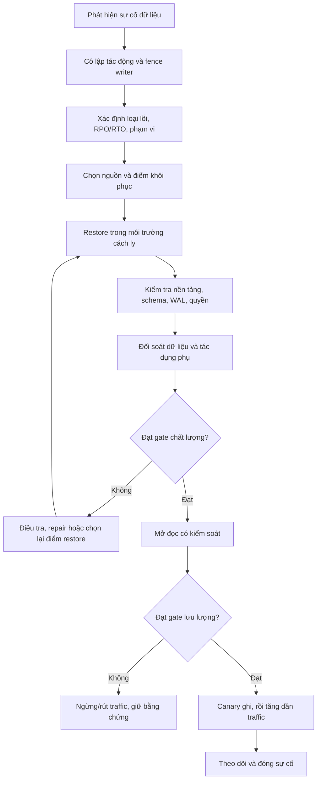
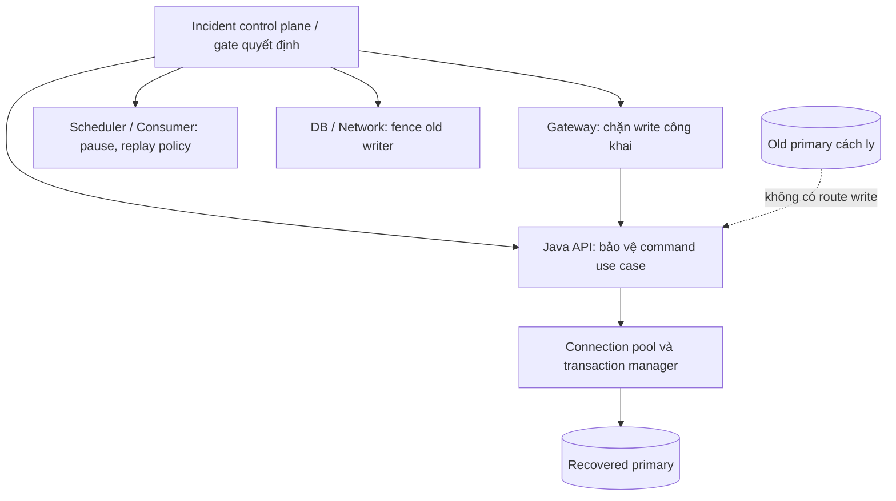

# Lập quy trình khôi phục, đối soát và mở lại lưu lượng

## Mục tiêu học tập

Sau bài học, người học có thể:

- Thiết kế **runbook khôi phục** cho ứng dụng Java có PostgreSQL, phân biệt phục hồi dữ liệu, xác nhận tính nhất quán và phục hồi khả năng phục vụ người dùng.
- Chuyển **RPO**, **RTO**, yêu cầu tính toàn vẹn và thứ tự ưu tiên nghiệp vụ thành những tiêu chí chấp nhận trước khi mở lại lưu lượng.
- Lựa chọn điểm khôi phục phù hợp từ backup, WAL/PITR hoặc một replica đã được xác minh mà không nhầm “server chạy được” với “dữ liệu đúng”.
- Ngăn **hai writer độc lập**, xử lý connection pool/DNS và quyền ghi để không khiến quá trình chuyển đổi làm dữ liệu phân kỳ.
- Lập kế hoạch đối soát các bất biến nghiệp vụ, giao dịch chưa rõ kết quả, outbox/inbox, cache, search index và tác dụng phụ ở hệ thống ngoài database.
- Tổ chức mở lại lưu lượng theo các **gate** có owner, bằng chứng, stop condition và kế hoạch khắc phục nếu phát hiện sai lệch.
- Luyện tập và đo lường một quy trình khôi phục bằng dữ liệu giả lập, có bằng chứng về độ mới, độ đúng và khả năng tái diễn.

## 1. Khôi phục dữ liệu chưa đồng nghĩa khôi phục dịch vụ

Giả sử dịch vụ đặt hàng Java dùng PostgreSQL gặp lỗi thao tác nhầm: một job đã xóa hàng nghìn đơn hàng. Nhóm vận hành tìm được bản backup và khởi động lại database. API `/health` trả `200` và `SELECT 1` thành công. Có nên lập tức mở lại việc đặt hàng?

**Chưa.** Database có thể còn thiếu một số đơn tạo sau điểm backup, bảng thanh toán có thể không khớp với hệ thống thu tiền, các worker có thể đang gửi lại sự kiện outbox, cache có thể giữ số dư/tồn kho cũ, và các JVM còn kết nối tới database cũ. Nếu mở traffic ghi ngay, hệ thống có thể tạo thêm trạng thái khó đối soát hoặc khiến cùng một yêu cầu được thực hiện hai lần.

Một quy trình khôi phục thực sự cần đi qua **ba thành quả độc lập**:

| Thành quả | Câu hỏi phải trả lời | Bằng chứng |
| --- | --- | --- |
| **Khôi phục nền tảng** | PostgreSQL và các phụ thuộc đã khởi động trong topology đúng chưa? | Process/role/connection, WAL/timeline, replica, cấu hình và quyền |
| **Khôi phục dữ liệu đúng mức cam kết** | Bản dữ liệu có đủ, nhất quán, nằm trong RPO, khớp các hệ thống bên ngoài chưa? | Điểm phục hồi, đối soát nghiệp vụ, kiểm tra constraint, ledger và tác vụ đang dở |
| **Khôi phục phục vụ an toàn** | Có thể nhận đọc/ghi mới mà không tạo dữ liệu phân kỳ, lặp tác dụng phụ hoặc làm quá tải? | Fencing writer, readiness, canary, SLO, giám sát, rollback/stop plan |

Bài học thuộc chương **Sao lưu và khôi phục** của `DATA_PERSISTENCE_FUNDAMENTALS`: sự hiểu biết về WAL, giao dịch, isolation, schema, connection pool, bảo mật, durability và thiết kế ranh giới persistence trong Java đều phải cùng được áp dụng. **Backup** là nguyên liệu; **runbook, kiểm chứng và kỷ luật mở traffic** mới biến nguyên liệu đó thành khả năng phục hồi đáng tin.

### Luồng quyết định tổng quát



**Không có một lệnh `pg_restore` hoặc `pg_ctl` nào tự thực hiện toàn bộ sơ đồ.** Phần khởi động database và phần quyết định nghiệp vụ thuộc những chủ sở hữu khác nhau, nên runbook cần cả bước kỹ thuật lẫn điểm phê duyệt.

## 2. RPO, RTO và những cam kết phải thống nhất trước sự cố

### 2.1. RPO: cho phép mất tối đa bao nhiêu dữ liệu?

**Recovery Point Objective (RPO)** mô tả khoảng dữ liệu tối đa có thể mất hoặc độ lùi điểm phục hồi so với trước sự cố mà nghiệp vụ chấp nhận.

Ví dụ giả định: sự cố xảy ra lúc **14:00**, RPO **5 phút**. Điểm phục hồi dự kiến phải đủ mới theo định nghĩa của nghiệp vụ, không tự động chấp nhận một backup lúc **13:30** chỉ vì restore được nhanh. Nếu WAL còn đầy đủ tới 13:58 và có thể PITR, dữ liệu mất có thể ít hơn, nhưng **mốc commit và thời điểm phục hồi phải được chứng minh**.

RPO đo mức mất dữ liệu **so với nguồn đúng**; không phải “backup chạy 5 phút một lần” trong mọi trường hợp. Một backup thường xuyên nhưng không kiểm tra restore được hoặc thiếu WAL cần thiết **không bảo đảm RPO**.

### 2.2. RTO: mất bao lâu để dịch vụ hoạt động trở lại?

**Recovery Time Objective (RTO)** là mục tiêu thời gian đưa dịch vụ hoặc chức năng được quy định trở lại trạng thái chấp nhận được, tính từ mốc bắt đầu theo hợp đồng. Nếu RTO 60 phút, khởi động xong PostgreSQL ở phút 40 nhưng chưa đối soát, chưa khôi phục API ghi và chưa có khả năng xử lý đơn **không tự nghĩa đạt RTO**.

Nên định nghĩa nhiều mức:

- **RTO đọc:** khi nào người dùng có thể tra cứu an toàn?
- **RTO ghi:** khi nào hệ thống lại nhận giao dịch tạo/sửa?
- **RTO xử lý nền:** khi nào outbox, queue consumer, đối soát và batch được bật?
- **RTO hoàn chỉnh:** khi nào không còn chế độ degraded, các tác vụ tồn đọng đã về mức cho phép?

Các chỉ tiêu này có thể khác nhau, miễn là công bố cho nghiệp vụ. Ví dụ, được mở **đọc-only** trong khi chưa đủ điều kiện chốt tiền, nhưng không được gọi đó là “đã khôi phục hoàn toàn”.

### 2.3. Các mức độ ưu tiên

| Loại dữ liệu / tác vụ | Rủi ro nếu mất hoặc sai | Gate khôi phục cần ưu tiên |
| --- | --- | --- |
| Ledger, đơn thanh toán, số dư | Tiền lệch, giao dịch lặp, nghĩa vụ pháp lý | Đối soát chặt với nguồn thanh toán và ledger |
| Quyền truy cập, khóa API, thông tin xác thực | Mở quyền trái phép hoặc vô hiệu hóa người dùng sai | Xác thực trạng thái thu hồi/quyền mới nhất; fail closed |
| Tồn kho và giữ hàng | Bán vượt hoặc mất reservation | Khôi phục trạng thái reservation và atomic update |
| Hồ sơ khách hàng | Bản ghi cập nhật sau backup có thể mất | Kiểm tra source of truth và các cập nhật có bằng chứng |
| Search index, cache, dashboard | Có thể stale hoặc thiếu dữ liệu | Rebuild/invalidations sau khi nguồn đã đúng |
| Email thông báo và analytics | Có thể gửi trùng hoặc đếm sai | Dedup/idempotency, replay/đối soát theo event ID |

Một nhóm kỹ thuật không tự quyết định chấp nhận mất giao dịch tiền chỉ vì RTO đang bị áp lực. **RPO/RTO là ràng buộc nghiệp vụ được thỏa thuận** và phải có quy trình escalation khi không thể đáp ứng.

## 3. Xây dựng danh mục phụ thuộc trước khi chạy runbook

Runbook cần ghi rõ **phạm vi tài nguyên và thứ tự khởi động**. Với ứng dụng Java:

```text
Clients / Gateway
  -> Java API instances
      -> HikariCP / DataSource
          -> DB endpoint / proxy
              -> PostgreSQL primary + replicas
      -> Redis / cache
      -> message broker / outbox worker
      -> search index / object storage
      -> payment / email / external services
```

Một bản restore PostgreSQL đúng dữ liệu vẫn có thể bị app ghi hỏng ngay nếu:

- Các instance Java cũ tiếp tục gửi write tới **primary cũ**;
- Batch, CDC, queue consumer và cron job vẫn chạy lại các lệnh không idempotent;
- Connection pool giữ connection tới endpoint cũ trong khi DNS đã đổi;
- Search index/cache giữ nội dung quá hạn và được dùng như nguồn quyết định;
- Schema từ backup không tương thích với phiên bản code Java đang được triển khai.

### 3.1. Hồ sơ bắt buộc của một lần khôi phục

| Trường runbook | Ví dụ nội dung cần xác định |
| --- | --- |
| Sự cố và thời điểm phát hiện | Incident ID, mốc phát hiện và mốc dự kiến lỗi bắt đầu |
| Chủ sở hữu quyết định | Incident commander, DBA, ứng dụng, bảo mật, nghiệp vụ |
| Phạm vi hệ thống | DB cluster/shard, tenant, bảng, API, consumer và external side effects |
| RPO / RTO | Mục tiêu đã thỏa thuận, cách tính và người phê duyệt ngoại lệ |
| Nguồn phục hồi | Backup ID, snapshot manifest, WAL range, checksum, encryption key |
| Điểm khôi phục | Timestamp hoặc transaction/commit position có ý nghĩa và cách xác minh |
| Topology mục tiêu | Host/cluster/region, phiên bản PostgreSQL, extension, locale, timezone |
| Trạng thái traffic | API/read/write, CDC, queue, scheduler, job và phương án fencing |
| Kịch bản recovery | Restore, promote replica, PITR, logical reimport hoặc repair có kiểm soát |
| Bộ đối soát | Query kỹ thuật, bất biến nghiệp vụ, hệ thống bên ngoài, ngưỡng chấp nhận |
| Stop condition | Tiêu chí dừng canary, ngừng ghi, điều tra hoặc restore lại |
| Bằng chứng | Log quyết định, thời gian, kết quả kiểm tra, người ký duyệt |

Không lưu password, private key, connection string chứa bí mật hoặc dữ liệu cá nhân chi tiết **trực tiếp trong runbook**. Tài liệu nên chứa đường dẫn tới kho bí mật và quy trình cấp quyền tạm thời; nhật ký sự cố vẫn cần phân quyền và retention phù hợp.

### 3.2. Chuẩn bị các quyền và tài nguyên dự phòng

Trước sự cố, cần xác nhận ai có quyền đọc backup và WAL, ai có quyền tạo cụm PostgreSQL cách ly, ai có quyền chuyển traffic, ai có quyền dừng worker, và ai phê duyệt mở lại giao dịch quan trọng. Tài khoản khôi phục phải tuân thủ least privilege và có đường cấp quyền emergency được kiểm toán.

Runbook cũng cần năng lực **đĩa, IOPS, mạng và CPU** để giải mã/giải nén backup, replay WAL, chạy kiểm tra và rebuild index. Một backup 2 TB không thể dùng để hứa RTO 30 phút nếu throughput restore thực tế chỉ 100 MB/s, chưa kể WAL replay và đối soát. Hãy đo thời gian phục hồi từ các lần diễn tập, không dựa vào tên tính năng “automatic backup”.

## 4. Pha 0 — Cô lập sự cố và bảo toàn khả năng phục hồi

Ưu tiên đầu tiên là **không làm tình trạng tệ hơn**. Không chạy một lệnh restore đè lên cluster production trước khi xác định được sự cố và trạng thái dữ liệu.

1. **Tuyên bố incident và người chỉ huy:** thống nhất một đầu mối ra quyết định, mốc thời gian, kênh liên lạc và phạm vi thông báo.
2. **Tạm dừng write có thể gây hại:** đặt API ghi ở chế độ maintenance/read-only theo phạm vi, dừng scheduler, batch, consumer và migration nếu cần.
3. **Fencing writer cũ:** bảo đảm chỉ topology được chỉ định mới có quyền nhận ghi; không chỉ dựa vào “đã gửi thông báo cho worker”.
4. **Giữ nguyên bằng chứng:** snapshot/log manifest, WAL archive, tình trạng replication, danh sách prepared transactions, outbox backlog, transaction đang dở và log hệ thống theo quyền truy cập.
5. **Cô lập bản restore:** dùng cụm thử nghiệm riêng, credential/network policy riêng và không để nó gửi email, thu tiền hoặc phát event thật.
6. **Đánh giá sự cố đang lan hay đã dừng:** ransomware, bug ứng dụng, thao tác DDL/DELETE nhầm, lỗi ổ đĩa, corruption, compromised credential hay mất region có phương án khác nhau.

### 4.1. Fencing: ngăn hai nguồn ghi cùng lúc

Một split-brain xảy ra khi primary cũ và primary mới đều được app/worker xem là nơi ghi hợp lệ. Hai hệ có thể nhận các transaction khác nhau rồi phân kỳ dù cả hai đều trả `COMMIT` thành công.

Biện pháp fencing có thể gồm:

- Loại primary cũ khỏi đường định tuyến ghi và **thu hồi khả năng ghi** ở lớp mạng, credential hoặc database;
- Dừng/đóng băng queue consumer, scheduler, CDC producer có tác dụng phụ;
- Dùng **leader epoch/lease/fencing token** hoặc cơ chế hỗ trợ của HA controller để từ chối writer cũ;
- Xác nhận mọi ứng dụng/proxy dùng cùng topology, không để một JVM cũ bypass gateway bằng địa chỉ cố định.

Chỉ đổi DNS hoặc config của một ứng dụng **không đủ chứng minh** primary cũ đã bị fence, vì DNS cache, connection pool và các client khác có thể tiếp tục dùng kết nối cũ. Fencing phải được **kiểm chứng độc lập** bằng kiểm tra quyền/route và trạng thái các writer.

### 4.2. Khi nào phải giữ cả cụm cũ để điều tra?

Nếu có dấu hiệu dữ liệu sai do ứng dụng hoặc đã xảy ra ghi ngoài luồng, cụm cũ có thể là nguồn bằng chứng phục vụ đối soát. Giữ bản sao/cụm cũ ở **chế độ cách ly, không nhận ghi**, với thời hạn và quyền kiểm soát rõ ràng. Không cho hai cụm cùng phục vụ dữ liệu sản xuất chỉ vì cần so sánh.

Nếu nghi bị xâm nhập, phải xử lý khả năng backup chứa dữ liệu bị sửa, secret bị lộ và tác nhân gây hại còn hoạt động. Khôi phục vào cụm sạch nhưng dùng lại credential bị đánh cắp có thể tái tạo sự cố.

## 5. Pha 1 — Xác định nguồn dữ liệu và điểm khôi phục

Chọn phương án **dựa trên loại sự cố**, không dựa vào công cụ đang quen dùng:

| Kịch bản | Ứng viên xử lý | Điều cần xác minh trước khi chọn |
| --- | --- | --- |
| Primary hỏng phần cứng, replica khỏe và đủ mới | Failover/promote replica theo HA runbook | Replica có áp dụng tới điểm commit cần thiết? Primary cũ đã bị fence? Có mất dữ liệu chưa replicate? |
| Job xóa/sửa nhầm đã commit | PITR về **trước giao dịch gây hại** hoặc repair có kiểm soát | Có physical base backup + WAL liên tục tới điểm phục hồi? Tác dụng phụ sau mốc phải đối soát |
| Bảng bị hỏng logic hoặc một số bản ghi bị mất | Restore bản sao cô lập để trích dữ liệu, rồi repair có audit | Repair có phá bất biến/foreign key hay ghi đè cập nhật hợp lệ sau lỗi không? |
| Toàn region không còn hoạt động | Restore sang region dự phòng hoặc failover DR | RPO/RTO, replication/WAL và secret/extension/network tại region mới |
| Lỗi schema migration | Roll-forward hoặc rollback được thiết kế, có thể cần phục hồi dữ liệu | Schema code/app tương thích với thời điểm khôi phục không? |
| Ransomware/credential compromise | Restore từ bản sạch đã được kiểm chứng trong môi trường cách ly | Backup có bất biến/không bị sửa? Phải rotate credential, loại bỏ persistence của kẻ tấn công |
| Chỉ cache/search index sai | Rebuild read model từ nguồn đúng | Không cần PITR database nếu source of truth vẫn nhất quán |

### 5.1. Phân biệt backup vật lý và logical backup trong PostgreSQL

- **Physical backup** (ví dụ qua công cụ được PostgreSQL hỗ trợ hoặc snapshot được phối hợp đúng cách) tạo nền để **physical recovery**. Với WAL archive đầy đủ theo timeline và cấu hình phù hợp, nó có thể hỗ trợ **Point-in-Time Recovery (PITR)**.
- **Logical backup** (ví dụ `pg_dump`) xuất schema/dữ liệu dưới dạng có thể restore logic, hữu ích để di chuyển/khôi phục database hoặc đối tượng. **Một `pg_dump` đơn lẻ không kết hợp trực tiếp với WAL archive thành PITR vật lý.**
- **Storage snapshot** có thể là ứng viên nhanh nhưng phải kiểm tra snapshot nhất quán giữa data, tablespace và WAL theo yêu cầu PostgreSQL/storage; snapshot đơn giản từ một volume không mặc nhiên an toàn nếu dữ liệu trải nhiều volume.
- **Read replica** là một bản sao đang được đồng bộ, không tự thay thế backup: lỗi xóa nhầm, DDL nhầm hoặc dữ liệu mã hóa độc hại có thể được replicate nhanh sang replica.

Không dùng một bản backup **chưa từng được test restore** làm bằng chứng chắc chắn sẽ đạt RTO. File backup tồn tại, manifest hợp lệ hoặc upload thành công mới là điều kiện đầu, không phải kết quả khôi phục thực sự.

### 5.2. Manifest và chain để biết có restore được không

Runbook cần lưu tối thiểu:

| Metadata | Mục đích |
| --- | --- |
| Backup ID, thời gian bắt đầu/kết thúc, loại backup | Tránh nhầm bản và xác định cửa sổ dữ liệu |
| PostgreSQL major version, extension và data directory context | Tránh dùng công cụ/định dạng không tương thích |
| Cluster system identifier, timeline và WAL range | Xác định WAL thuộc đúng chuỗi lịch sử |
| File manifest, checksum, kích thước, trạng thái mã hóa | Phát hiện thiếu/sai file và quản lý khóa |
| Tablespace và đường dẫn đích | Đảm bảo dữ liệu không bị bỏ sót trong restore |
| WAL archive liên tục đến target | Điều kiện cần của PITR vật lý |
| Secrets, certificates, ownership và role dependencies | Đảm bảo ứng dụng có thể truy cập sau restore mà không mở quyền quá mức |
| Last restore drill result | Bằng chứng từng khôi phục thành công và thời gian thực tế |

Với PostgreSQL, `pg_verifybackup` có thể kiểm tra nhiều thuộc tính của backup có manifest trong những phiên bản phù hợp. **Nó không thay thế việc khởi động một cụm đã restore, replay WAL, chạy kiểm tra dữ liệu và thử workload ứng dụng**; cũng không chứng minh mọi tình huống lỗi phần cứng sẽ được xử lý.

### 5.3. Chọn mốc PITR đúng theo nghiệp vụ

Ví dụ:

```text
13:50:00  Backup base đã có và WAL liên tục.
13:57:30  Đơn #A thanh toán hợp lệ (commit).
13:58:40  Job lỗi bắt đầu xóa nhiều đơn.
13:58:42  Transaction DELETE gây hại COMMIT.
14:00:00  Hệ thống phát hiện sự cố.
14:01:00  API ghi được ngừng.
```

Nếu chọn PITR **trước commit lúc 13:58:42**, có thể giữ các transaction được commit hợp lệ trước mốc đó, nhưng **mọi transaction hợp lệ sau mốc** cũng có thể vắng mặt trong bản restore. Đây là quyết định đánh đổi RPO và tính toàn vẹn, không phải thao tác “undo một lệnh DELETE” chính xác trên bản production đã tiếp tục hoạt động.

Cần xác định:

1. **Thời điểm gây hại thực sự**, ưu tiên bằng chứng transaction/commit và WAL thay vì thời điểm nhận alert;
2. Tính chính xác timezone và clock giữa DB, ứng dụng, log collector và hệ thống bên ngoài;
3. WAL còn đầy đủ, đúng timeline để replay đến mục tiêu;
4. Có giao dịch hợp lệ đồng thời với giao dịch gây hại mà PITR sẽ loại bỏ hay không;
5. Cách **replay/merge có kiểm soát** những thay đổi hợp lệ sau điểm phục hồi, tránh ghi đè hoặc lặp nghiệp vụ.

Một timestamp lấy từ application log **không đương nhiên trùng commit timestamp**. Khi ranh giới rất sát, cần dùng kỹ thuật phù hợp của PostgreSQL và kiểm tra trực tiếp bản restore có/không có giao dịch gây hại trước khi tuyên bố đúng target. Có thể cần thử nhiều điểm restore cô lập.

### 5.4. Khi nào cần chấp nhận không đạt RPO?

Nếu WAL archive bị thiếu từ 13:55 đến 13:59, không thể tuyên bố đã phục hồi đến 13:58 từ base backup bằng cách bỏ qua khoảng WAL đó. Cần:

- Xác minh có nguồn WAL hợp lệ khác, không sửa thủ công một chuỗi WAL bị thiếu;
- Đánh giá replica/backup khác, phạm vi dữ liệu mất và tác động nghiệp vụ;
- Ghi nhận RPO thực tế và xin quyết định chấp nhận ngoại lệ từ owner có thẩm quyền;
- Giữ bằng chứng và danh sách giao dịch cần đối soát khi không còn khả năng đạt mốc như kế hoạch.

**Không được tự hạ RPO hoặc bịa mốc restore** để báo kết quả đẹp hơn. Với dữ liệu tiền và quyền truy cập, sự thiếu chắc chắn phải được trình bày rõ, kể cả khi việc đó kéo dài RTO.

## 6. Pha 2 — Restore trong môi trường cách ly

Trước khi dùng bản restore cho người dùng thật, tạo một **recovery cluster** độc lập:

- Network policy mặc định không nhận traffic production, không kết nối tuỳ ý tới payment/email/broker;
- User/role phục hồi và secret riêng, không dùng credential production nếu không cần thiết;
- Storage và phiên bản PostgreSQL đủ tương thích, đường tablespace đúng;
- Tách định danh cluster, DNS/endpoint và cơ chế HA để tránh controller nhầm nó là primary hiện hữu;
- Bật logging/metrics phục vụ xác minh nhưng không dump raw PII/SQL vào kênh rộng.

### 6.1. Trình tự khôi phục PostgreSQL vật lý bằng PITR

Các bước sau là **runbook khái niệm**, không phải script chạy nguyên khối trên production. Tên lệnh, tham số, cách cung cấp WAL và đường dẫn phụ thuộc PostgreSQL version, backup tool, OS và dịch vụ quản lý.

1. **Cấp storage sạch:** data directory/tablespace mới, đủ dung lượng, đúng owner và permission; không ghi đè cluster đang chạy.
2. **Lấy đúng physical base backup:** xác minh manifest, checksum và mã hóa; giải nén/restore theo cách công cụ tạo backup hỗ trợ.
3. **Gắn WAL archive hợp lệ:** cấu hình `restore_command` hoặc cơ chế của backup tool để truy xuất các WAL segment đúng cluster/timeline.
4. **Chọn recovery target:** xác định timestamp/transaction target và ý nghĩa inclusive/exclusive với điểm commit gây hại.
5. **Khởi động recovery mode:** PostgreSQL replay WAL theo cấu hình, thu thập log về tiến trình và điểm dừng.
6. **Dừng để kiểm chứng target:** xác minh dữ liệu của giao dịch hợp lệ gần target còn tồn tại, dữ liệu gây hại chưa xuất hiện.
7. **Sau khi được phê duyệt:** mới quyết định promote/nhận write, tạo timeline mới theo quy trình DR; không promote trong lúc còn nghi ngờ về target.

Ví dụ một số **setting minh họa**, không phải file cấu hình đầy đủ:

```conf
# Cú pháp/cơ chế khôi phục áp dụng cho PostgreSQL version phù hợp
# và backup tool đang dùng; placeholder phải được thay chính xác.
restore_command = '<FETCH_VERIFIED_WAL_SEGMENT_FOR_%f_TO_%p>'
recovery_target_time = '2026-11-22 13:58:41+07'
recovery_target_inclusive = 'false'
recovery_target_action = 'pause'
```

Ở các phiên bản PostgreSQL hiện đại, cơ chế recovery có thể yêu cầu tệp tín hiệu `recovery.signal` theo tài liệu tương ứng. Ví dụ trên chỉ mô tả **ngữ nghĩa target**, không cho phép suy rằng mốc `13:58:41` luôn nằm trước commit xấu nếu chưa kiểm chứng. Lựa chọn `recovery_target_inclusive` tác động đến việc áp dụng transaction tại ranh giới theo loại target; cần xác nhận bằng dữ liệu trên cụm đã khôi phục.

**Tuyệt đối không chạy ví dụ cấu hình giả trên một data directory sản xuất**. Sử dụng đúng runbook của nhà cung cấp/DBA cho môi trường quản lý (self-hosted, managed PostgreSQL, Kubernetes operator hoặc dịch vụ cloud); có nơi không cho trực tiếp thao tác `recovery.signal` hay WAL.

### 6.2. Khôi phục logical backup là một đường khác

Nếu chỉ có `pg_dump`, thông thường phải dựng database phù hợp rồi restore schema/dữ liệu bằng công cụ như `pg_restore` hoặc chạy SQL dump theo đúng định dạng. Cần kiểm tra:

- Role, owner, grants, tablespace và các **global object** mà bản dump database đơn lẻ có thể không chứa;
- Extension, collation, encoding, timezone và PostgreSQL version;
- Constraint, trigger, sequence, index và thứ tự restore;
- Mức nhất quán của logical snapshot đối với application đang ghi, và dữ liệu đã thay đổi sau thời điểm dump;
- Lỗi từng object và tình trạng restore một phần nếu công cụ chạy theo chế độ tiếp tục khi lỗi.

Không ghép các WAL segment physical vào một restore `pg_dump` rồi gọi là PITR. Với dữ liệu rất lớn, thời gian xây lại index/constraint sau logical restore cũng có thể làm vượt RTO.

### 6.3. Kiểm tra nền tảng sau restore trước khi đối soát nghiệp vụ

| Kiểm tra | Ví dụ / kết quả mong đợi |
| --- | --- |
| Database start/recovery | PostgreSQL start/replay không còn lỗi thiếu WAL ở target đã chọn |
| Đúng cluster và timeline | Metadata backup/WAL khớp; không dùng nhầm WAL từ cluster khác |
| PostgreSQL version/extension | Schema và application có thể chạy đúng với version khôi phục |
| Role và connection | App role chỉ có quyền cần thiết, TLS/cert/secret hoạt động |
| Schema/migration version | Bảng/cột/constraint đúng với artifact Java dự kiến triển khai |
| Disk và I/O | Không thiếu storage; đủ headroom để replay, rebuild và nhận traffic |
| Replication/HA | Kế hoạch dựng replica mới, không tự join replica sai timeline |
| Quản lý secret | Credential đã được rotate nếu có khả năng compromise |

**`SELECT 1` thành công chỉ chứng minh có thể chạy một câu SQL đơn giản.** Nó không chứng minh các bảng nghiệp vụ đúng, WAL replay đủ, DB không lệch schema, cache nhất quán, hoặc write path an toàn.

## 7. Pha 3 — Đối soát dữ liệu ở nhiều mức

Đối soát (**reconciliation**) nhằm trả lời: **dữ liệu đã phục hồi có đúng với trạng thái nghiệp vụ được chấp nhận không, và còn những tác vụ nào cần xử lý tiếp?**

Một lần restore có thể tạo **snapshot nhất quán theo ACID của PostgreSQL** tại target, nhưng chưa chắc khớp với:

- Giao dịch được xác nhận sau target và đã gửi email, thu tiền hoặc xuất hàng;
- Message broker đã acknowledge event trước sự cố;
- Data warehouse, search index, cache hoặc object storage không cùng thời điểm snapshot;
- Dịch vụ ngoài đã thực hiện tác dụng phụ dù application chưa nhận response;
- Một hệ thống khác đang nắm trạng thái mới hơn bản backup.

Do đó, phải đối soát **nhiều tầng**, với owner, thời điểm nguồn tham chiếu và kết quả được ký xác nhận.

### 7.1. Ma trận đối soát

| Mức | Nội dung kiểm tra | Bằng chứng và hành động |
| --- | --- | --- |
| **Vật lý/khả dụng** | Restore có thiếu file/WAL, lỗi đọc page, extension không? | Log restore, integrity tools, truy vấn thử trên dữ liệu giả |
| **Schema** | Bảng/cột/index/constraint/function/sequence/migration version đúng? | Diff với version đã phê duyệt, kiểm tra ứng dụng tương thích |
| **Dữ liệu tổng quan** | Row counts, số lượng theo ngày/tenant/status, min/max ID/time? | Snapshot thống kê theo phân đoạn, so với mốc dữ liệu có ý nghĩa |
| **Khóa và quan hệ** | Duplicates, orphan rows, FK/unique/check constraint? | Query invariant, kiểm tra constraint; lập danh sách sai lệch |
| **Nghiệp vụ** | Đơn đã thanh toán có payment/ledger đúng? Tồn kho có âm? | Đối chiếu hệ thống nguồn đáng tin cho mỗi loại quyết định |
| **Giao dịch chưa rõ kết quả** | Client timeout ở commit, payment API timeout, transfer `PENDING`? | Idempotency key, ledger/event ID, lịch sử giao dịch nguồn ngoài |
| **Dữ liệu phụ trợ** | Outbox/inbox, cache, search, audit, file và object storage? | Watermark, replay/rebuild/refresh theo version, không nhân đôi side effect |
| **Phạm vi RPO** | Mất các commit hợp lệ nào trong cửa sổ lùi? | Danh sách theo thời điểm/ID, quyết định repair hoặc chấp nhận ngoại lệ |

**Không cần yêu cầu mọi hệ thống có cùng timestamp tuyệt đối** nếu nghiệp vụ cho phép eventual consistency, nhưng phải định nghĩa **độ lệch nào được chấp nhận, trong bao lâu và được giải quyết bằng cơ chế gì**. Với sổ cái tiền, ngưỡng sai lệch trước khi mở write có thể là **0**; với analytics, một backlog tạm thời có thể được chấp nhận nếu được hiển thị rõ.

### 7.2. Dùng một snapshot đọc nhất quán cho nhiều query kiểm tra

Trong PostgreSQL, khi kiểm tra nhiều bảng trên cụm restore **đang được giữ không có writer**, các `SELECT` riêng có thể đủ vì dữ liệu không thay đổi. Nếu cần một snapshot ổn định ngay cả khi có tác vụ nội bộ khác, có thể đọc trong một transaction `REPEATABLE READ READ ONLY`:

```sql
BEGIN TRANSACTION ISOLATION LEVEL REPEATABLE READ READ ONLY;

SELECT status, count(*) AS total_orders
FROM purchase_order
GROUP BY status
ORDER BY status;

SELECT count(*) AS negative_inventory_rows
FROM inventory
WHERE available < 0;

COMMIT;
```

Đây là ví dụ trên **schema giả định** `purchase_order` và `inventory` để minh họa cách kiểm tra; không có bảo đảm hai bảng này tồn tại trong mọi ứng dụng. Một transaction đọc lâu có thể giữ snapshot, ảnh hưởng dọn dẹp dữ liệu trên cụm đang có writer. Không chạy kiểm tra toàn bảng nặng trên primary production đang chịu tải nếu chưa đánh giá chi phí và quyền.

### 7.3. Row count chỉ là bước đầu, không đủ để khẳng định đúng

```sql
-- Ví dụ: đối soát khối lượng theo tenant và trạng thái
SELECT tenant_id, status, count(*) AS order_count
FROM purchase_order
GROUP BY tenant_id, status
ORDER BY tenant_id, status;

-- Số bản ghi thanh toán theo ngày nghiệp vụ trong timezone đã thống nhất
SELECT date_trunc('day', paid_at) AS paid_bucket,
       count(*) AS paid_orders
FROM purchase_order
WHERE status = 'PAID'
GROUP BY date_trunc('day', paid_at)
ORDER BY paid_bucket;
```

**Không gửi kết quả chứa `tenant_id` hoặc metadata cá nhân đến dashboard/ticket không được phép.** Có thể đối soát theo mã nội bộ hoặc checksum trong kênh hạn chế quyền.

Hai database có **cùng row count** vẫn có thể chứa **các bản ghi khác nhau** hoặc số tiền khác nhau. Đối chiếu theo khóa ổn định (order ID, transfer ID), version và những trường quan trọng. Với dữ liệu lớn, chia thành bucket theo khóa/thời gian, tính hash tổng hợp có canonical encoding được định nghĩa rõ và drill-down khi mismatch.

Checksum tập hợp không tự chứng minh tính đúng nếu **cùng nguồn đã hỏng** hoặc hai tập dữ liệu được canonicalize khác nhau. Nó là công cụ phát hiện khác biệt giữa **hai tập có điểm tham chiếu đáng tin**, không thay kiểm tra nghiệp vụ.

### 7.4. Ràng buộc dữ liệu: ví dụ cụ thể

Giả sử có:

```sql
-- purchase_order(id, tenant_id, customer_id, status, total_amount, ...)
-- order_item(order_id, tenant_id, product_id, quantity, ...)
-- customer(id, tenant_id, ...)
-- inventory(tenant_id, product_id, available)

-- Hàng tồn kho không âm
SELECT tenant_id, product_id, available
FROM inventory
WHERE available < 0
LIMIT 100;

-- Chi tiết đơn không có header cùng tenant
SELECT i.tenant_id, i.order_id
FROM order_item AS i
LEFT JOIN purchase_order AS o
  ON o.id = i.order_id AND o.tenant_id = i.tenant_id
WHERE o.id IS NULL
LIMIT 100;

-- Đơn có tổng âm (nếu nghiệp vụ cấm)
SELECT id, tenant_id, total_amount
FROM purchase_order
WHERE total_amount < 0
LIMIT 100;
```

Các query trả **mẫu các bản ghi sai lệch** để điều tra trong môi trường có quyền. Không công bố hàng thực trong tài liệu/ticket. Các quy tắc này còn phải được chọn đúng với miền thực: một giá trị âm có thể hợp lệ cho bảng điều chỉnh tín dụng, nhưng không hợp lệ với tồn kho nếu hệ thống không cho phép bán âm.

Nếu database đang có constraint `FOREIGN KEY` và `CHECK` hợp lệ, điều đó hỗ trợ xác minh, nhưng không phải bằng chứng về các **invariant xuyên hệ thống**. Với logical restore có tắt constraint/trigger trong một giai đoạn, phải **re-enable và validate** đúng theo công cụ và schema trước khi mở write.

### 7.5. Đối soát tiền và sổ cái (ledger)

Với hệ thống thanh toán, cần phân biệt:

- **Đơn hàng**: đã đặt, đang thanh toán, đã thanh toán, hủy;
- **Payment provider**: authorization/capture/refund thực tế với transaction ID;
- **Ledger nội bộ**: các bút toán debit/credit và khóa idempotency;
- **Thông điệp**: payment succeeded/failed được gửi hoặc xử lý;
- **Tác vụ bù**: hoàn tiền, giải phóng reservation, điều chỉnh công nợ.

Ví dụ một bảng `ledger_entry(transfer_id, account_id, amount_minor_units, ...)` có hai bút toán đối ứng cho mỗi giao dịch:

```sql
-- Giả định amount_minor_units mang dấu (+/-) theo quy ước kế toán
-- và ledger của từng transfer phải có tổng bằng 0.
SELECT transfer_id,
       count(*) AS posting_count,
       sum(amount_minor_units) AS net_minor_units
FROM ledger_entry
GROUP BY transfer_id
HAVING sum(amount_minor_units) <> 0
    OR count(*) <> 2
ORDER BY transfer_id
LIMIT 100;
```

Đây là **quy tắc ví dụ**, không phải chuẩn cho mọi sổ cái: transfer có phí, nhiều tài khoản hoặc nhiều currency có thể có hơn hai bút toán và cần cân bằng **theo tiền tệ, loại nghiệp vụ và tập ledger account**. Phải tham chiếu quy tắc kế toán của hệ thống thật. Một `SUM=0` đơn lẻ cũng không chứng minh external payment thực sự được capture đúng một lần.

**Không tự sửa số dư để “khớp tổng”** nếu chưa biết transaction nào đã xảy ra. Với nghiệp vụ tiền, repair thường phải là **bút toán điều chỉnh có kiểm toán và phê duyệt**, không ghi đè âm thầm lịch sử.

### 7.6. Đối soát dữ liệu ở ranh giới PITR

Lập danh sách các lệnh được client/bên ngoài **xác nhận thành công** sau target dự kiến:

| ID nghiệp vụ | Bằng chứng ngoài database | Có trong restore? | Quyết định |
| --- | --- | --- | --- |
| Order T1 | API đã trả success trước target | Có | Kiểm tra status/amount |
| Order T2 | Payment captured sau target | Không | Reconcile và phục hồi trạng thái có kiểm soát |
| Order T3 | Client timeout khi commit | Chưa rõ | Tra nguồn thanh toán/ledger, không tự replay mù |
| Message E1 | Broker đã ACK publish | Event outbox bản restore không có | Chặn double-send, xử lý bằng event ID |
| File F1 | Object đã upload thành công | Metadata DB bị lùi | Đối soát object, tạo lại metadata nếu hợp lệ |

Các ID ở trên là **minh họa**. Danh sách thực tế phải được xây từ nguồn có thẩm quyền và log được phân quyền, có đánh dấu mức chắc chắn. Nếu external system còn khả dụng nhưng không hỗ trợ tra cứu theo idempotency key, cần quy trình manual review thay vì giả định timeout nghĩa là thất bại.

## 8. Dữ liệu ngoài database và nguy cơ replay sau restore

Backup của PostgreSQL **không tự đồng bộ** với vị trí tiêu thụ message broker, dữ liệu Redis, tệp trong filesystem hay giao dịch của payment provider.

### 8.1. Outbox/inbox và message offset

Xét chuỗi:

```text
13:59  Shard DB commit order #T4 + outbox event E4.
14:00  Event E4 đã publish; consumer thực hiện email/payment side effect.
14:01  PITR DB về 13:58.
14:02  Outbox E4 không còn trong bản restore; broker/payment vẫn biết E4.
```

Nếu tạo lại đơn #T4 bằng một ID mới hoặc replay event mà không biết E4 đã được xử lý, có thể phát sinh **email trùng, charge trùng hoặc ghi nhận sai trạng thái**.

Để xử lý:

1. **Tạm ngừng producer/consumer** có side effect trong lúc đối soát.
2. Ghi lại **offset/watermark**, event ID, idempotency key và trạng thái consumer ở từng nơi.
3. So dữ liệu restore với ledger, inbox/dedup và event thực tế đã đi qua broker.
4. Đảm bảo các consumer có **idempotency bền vững** ở đúng nơi thực hiện side effect; không chỉ kiểm tra một cờ tại bộ nhớ JVM.
5. Chỉ replay phần thiếu khi có bằng chứng; giữ `NEEDS_RECONCILIATION` cho kết quả chưa rõ.
6. Mở lại worker theo thứ tự có kiểm soát, tránh cùng lúc phát sinh storm khi tất cả queue hồi phục.

**Outbox giúp atomic commit bản ghi nghiệp vụ và event trong cùng DB transaction**, nhưng không tạo exactly-once end-to-end với payment, email hay broker. Sau PITR, bảng outbox và inbox có thể lùi thời gian **khác** hệ thống message bên ngoài; dedup/reconcile càng quan trọng.

### 8.2. Cache, search index và materialized read model

Cache có thể chứa dữ liệu từ **trước hoặc sau** điểm restore. Không mặc định cache chỉ “cũ hơn DB”: nếu DB đã PITR về một điểm trước đó, cache có thể giữ **phiên bản tương lai** so với DB restore. Điều này có thể làm ứng dụng bỏ qua trạng thái đã được khôi phục hoặc ghi dữ liệu sai.

Chiến lược:

- Đánh dấu toàn bộ cache namespace/epoch không còn phù hợp, hoặc dùng generation mới để không phục vụ bản cũ;
- Rebuild search index từ source of truth sau khi đối soát;
- Với cache đa tenant, giữ isolation đúng tenant và quyền truy cập;
- Không dùng read model chưa rebuild để chốt tiền/quyền/tồn kho;
- Kiểm chứng invalidation/rebuild lag nằm trong hợp đồng freshness trước khi mở lưu lượng đọc rộng.

Khi `cache.clear()` có thể gây cache stampede, lên kế hoạch warm-up dần, request throttling và giới hạn refresh.

### 8.3. Object storage và file ngoài DB

Nếu file PDF/ảnh nằm ở object storage còn metadata nằm ở PostgreSQL, PITR có thể làm mất tham chiếu tới file mới hoặc khôi phục metadata tới file đã bị xóa ở bên ngoài. Đối soát:

- Tập object ID và version/ETag/hash với bản ghi metadata;
- Trạng thái `PENDING/READY`, file mồ côi và metadata không có file;
- Quyền truy cập object và retention/legal hold;
- Đường khôi phục từ backup/versioned storage riêng nếu object bị xóa.

Không xóa hàng loạt “file mồ côi” ngay sau restore: chúng có thể là dữ liệu hợp lệ được tạo sau mốc PITR và cần ghép lại metadata.

### 8.4. Schema migration và phiên bản Java

Nếu backup ở schema version `V42` nhưng ứng dụng mới đang chạy chỉ hiểu `V47`, khởi động app mới vào restore `V42` có thể:

- Thất bại vì thiếu cột/bảng;
- Chạy migration tự động ngoài ý muốn;
- Ghi vào cấu trúc cũ làm dữ liệu khó nâng cấp;
- Bỏ qua những record của schema trước do mapper không tương thích.

Vì vậy, **gate version** phải xác nhận cặp **database schema ↔ Java artifact** hợp lệ. Nếu migration là một phần của recovery, chạy nó **trên cụm restore cách ly** với backup/snapshot trước bước thay đổi và kế hoạch kiểm chứng riêng. Không cho instance Java cũ và mới cùng tự chạy migration cạnh tranh khi recovery.

## 9. Pha 4 — Định nghĩa các gate trước khi mở lại lưu lượng

Thay vì một công tắc “đã xong”, chia quá trình thành những **gate có bằng chứng**. Mỗi gate phải nêu rõ: owner, tiêu chí PASS, thời điểm xác nhận, phạm vi traffic được mở, điều kiện dừng và đường lui.

| Gate | Phải đạt trước khi qua | Owner gợi ý | Khi FAIL |
| --- | --- | --- | --- |
| **G0 — Incident contained** | Writer cũ bị fence, job/queue tác dụng phụ dừng, bằng chứng được giữ | Incident commander + SRE | Tiếp tục cô lập, không đổi route |
| **G1 — Restore valid** | Backup/WAL/target đúng, PostgreSQL mở được, topology tách biệt, không thiếu dữ liệu hệ thống | DBA | Chọn lại nguồn/target hoặc sửa restore |
| **G2 — Data reconciled** | Bất biến chính, ledger/payment/outbox/file và phần RPO bị ảnh hưởng được kiểm tra | Data owner + nghiệp vụ | Giữ maintenance, repair hoặc xin quyết định ngoại lệ |
| **G3 — Application ready** | Java/schema tương thích, DataSource vào đúng DB, secret/TLS/role đúng, cache và worker được kiểm soát | App owner + SRE | Không đưa app vào target group |
| **G4 — Read traffic safe** | Query đọc đúng, latency/error ổn, quyền truy cập đúng, không dùng cache sai epoch | App owner | Dừng hoặc hạn chế read |
| **G5 — Canary write safe** | Test ghi idempotent an toàn, dữ liệu đọc lại đúng, không tác dụng phụ ngoài ý muốn | App + DBA + nghiệp vụ | Ngừng write, điều tra và đối soát canary |
| **G6 — Ramp-up accepted** | SLO giữ ổn, không xuất hiện chênh lệch, queue drain có kiểm soát | Incident commander | Giảm traffic/giữ gate, không rollback dữ liệu mù |

**Không tự đặt G2 = PASS chỉ vì một vài query không báo lỗi.** Gate nghiệp vụ phải dựa vào **tập invariant đã định nghĩa trước** và bằng chứng đủ đại diện cho các phân đoạn dữ liệu quan trọng. Nếu RPO không đạt hoặc có giao dịch chưa rõ kết quả, phải ghi rõ kết quả là **chấp nhận ngoại lệ, chờ xử lý hoặc BLOCKED**, không đánh tráo thành “không có lỗi”.

### 9.1. Mẫu biên bản quyết định gate

```text
Incident ID: INC-XXXX
Gate: G2 - Data reconciled
Recovery cluster: dr-orders-2026xxxx
Recovery target: timestamp / LSN / version (đã kiểm chứng)
RPO thực tế: ...
Kết quả kiểm tra:
  - Schema/version: PASS
  - Order counts theo bucket: PASS/FAIL + mã báo cáo
  - Ledger/payment mismatch: 0 lỗi không giải quyết / N chờ đối soát
  - Outbox/inbox: watermark và kế hoạch replay
  - Cache/file/search: trạng thái và owner
Ngoại lệ được chấp nhận: ...
Owner xác nhận: ...
Thời điểm quyết định: ...
Next traffic stage: READ_ONLY
Stop condition: ...
```

Không ghi raw số thẻ, token, thông tin cá nhân, JDBC password hoặc SQL chứa literal vào biên bản. Đính kèm báo cáo được phân quyền bằng mã tham chiếu.

## 10. Chuẩn bị ứng dụng Java để nhận database đã khôi phục

### 10.1. Phân biệt liveness và readiness

- **Liveness**: process Java còn đang hoạt động; dùng để quyết định có cần khởi động lại process hay không.
- **Readiness**: instance có đủ điều kiện nhận **loại traffic được cho phép** trong giai đoạn recovery hay không.
- **Data safety gate**: bằng chứng business/data/topology đã được owner duyệt; đây là một **quyết định vận hành**, không thể thay bằng `SELECT 1`.

Trong Spring Boot/Kubernetes có thể dùng readiness probe/Actuator kết hợp control plane, nhưng bản thân một endpoint HTTP thành công không chứng minh write safe. Trường hợp API đọc đã an toàn nhưng API ghi chưa, có thể vẫn báo readiness cho **route chỉ đọc**, trong khi write bị chặn bằng policy ở gateway/application **và** rào chắn ở DB.

### 10.2. Model gate đơn giản trong Java

Ví dụ thuần Java để thể hiện chính sách **không cho write trước khi đạt gate**:

```java
import java.util.Objects;
import java.util.concurrent.atomic.AtomicReference;

enum RecoveryMode {
    BLOCKED, READ_ONLY, CANARY_WRITE, OPEN
}

final class RecoveryTrafficGate {
    private final AtomicReference<RecoveryMode> current =
            new AtomicReference<>(RecoveryMode.BLOCKED);

    public RecoveryMode mode() {
        return current.get();
    }

    // Chỉ control plane được ủy quyền gọi sau khi có biên bản gate.
    public void setMode(RecoveryMode approvedMode) {
        current.set(Objects.requireNonNull(approvedMode));
    }

    public boolean allowRead() {
        return current.get() != RecoveryMode.BLOCKED;
    }

    public boolean allowWrite(boolean approvedSyntheticCanary) {
        return switch (current.get()) {
            case BLOCKED, READ_ONLY -> false;
            case CANARY_WRITE -> approvedSyntheticCanary;
            case OPEN -> true;
        };
    }
}
```

Mẫu trên chỉ diễn giải state machine, **không phải hệ thống gate production**:

- `AtomicReference` là **trạng thái nội bộ của một JVM**; nó không đồng bộ giữa các instance, không tự phục hồi sau restart, không ghi audit và không chống một instance cũ tiếp tục ghi.
- Một tham số boolean `approvedSyntheticCanary` không phải cơ chế xác thực; client không được tự đặt `true`. Canary phải được xác định bằng **danh tính/tuyến được phê duyệt ở server/gateway** và policy khó vượt qua.
- Gate phải được điều khiển từ nguồn cấu hình/HA controller có xác thực, version/epoch, audit và được áp dụng nhất quán; giữ nguyên tắc mặc định **BLOCKED** khi không rõ trạng thái.
- Kiểm soát traffic ở application là một lớp. **Fencing writer tại DB/network** mới là lớp quan trọng để ngăn các worker hoặc client đi vòng qua gate.

Với các endpoint Java, áp chính sách ở **đường ghi thực sự**, không chỉ dựa vào HTTP method: một endpoint `GET` có thể vô tình tạo side effect; consumer, scheduler và admin job cũng không đi qua HTTP gateway. Mọi đường ghi cần được kiểm kê.

### 10.3. Kiểm tra đúng endpoint và vai trò PostgreSQL

Một số truy vấn chỉ đọc giúp phân biệt nơi kết nối đang trỏ tới:

```sql
SELECT
    current_database() AS db_name,
    current_user AS db_role,
    pg_is_in_recovery() AS in_recovery,
    current_setting('transaction_read_only') AS session_read_only,
    pg_postmaster_start_time() AS server_started;
```

`pg_is_in_recovery()` hỗ trợ xác định server là standby/in recovery tại thời điểm hỏi. Nó **không** chứng minh dữ liệu đạt RPO, không cho biết traffic đã fence mọi writer cũ hay không. Cũng không nên dùng một query chạy trên một connection để suy mọi connection trong pool đều trỏ tới cùng endpoint.

Kiểm tra cấu hình:

- Driver/secret/TLS certificate/hostname và connection URL thực sự được sử dụng bởi **mọi instance**;
- Pool active/idle; connection cũ đã bị đóng hoặc thay bằng connection mới sau chuyển route;
- Connection proxy/DNS, session affinity và load balancing không trộn write/read nhầm node;
- Transaction manager, isolation, quyền ghi và schema migration có dùng đúng database mục tiêu;
- ID database/cluster được quan sát bằng kênh an toàn, tránh đưa connection string chứa mật khẩu vào log.

Trong HikariCP, một connection vật lý đã mở có thể tiếp tục tồn tại dù DNS đổi. Không kỳ vọng chỉ chỉnh DNS sẽ tự đưa mọi request sang primary mới ngay lập tức. Có thể cần **drain request, làm mới pool/rolling restart** theo runbook, sau đó xác minh lại kết nối và việc fence old primary. Không gọi `close()` lên toàn bộ DataSource giữa request đang commit nếu chưa có quy trình drain.

### 10.4. Gating ở nhiều tầng



Nếu một lớp bỏ sót, các lớp còn lại giảm khả năng thao tác nguy hiểm xảy ra. Nhưng lớp gate nào cũng phải có **đường cập nhật trạng thái đáng tin**; một instance chạy config cũ vẫn có thể gây sự cố nếu DB không có fencing.

## 11. Pha 5 — Mở lại lưu lượng đọc rồi lưu lượng ghi theo đợt

Một chiến lược **progressive traffic reintroduction** có thể chia thành các pha sau. Các tỷ lệ là **ví dụ điều hành**, không phải ngưỡng mặc định bắt buộc:

**Pha A — Chỉ kiểm tra nội bộ (0% traffic công khai):**

1. Chạy smoke test từ một instance Java riêng vào cụm recovered.
2. Đọc các record giả/dữ liệu đã được phép sử dụng; xác nhận tenant isolation và quyền.
3. Kiểm tra API không phát event, email, charge hoặc thay đổi trạng thái ngoài ý muốn.
4. Quan sát error, connection pool, SQL latency, PostgreSQL role/schema/timeline.

**Pha B — Read-only có kiểm soát:**

1. Đưa một lượng nhỏ request **đọc an toàn** vào recovered cluster.
2. Kiểm tra cache epoch, search index, trả response theo phiên bản được phép, không dùng dữ liệu từ primary cũ.
3. So số hàng/field quan trọng và lỗi với kỳ vọng; đo p50/p95/p99, error rate, DB CPU/IO.
4. Khi đủ bằng chứng mới tăng traffic đọc. Endpoint đọc không được ẩn một thao tác ghi chưa qua gate.

**Pha C — Canary ghi với tenant/tài nguyên thử nghiệm:**

1. Dùng một tập canary **được cấp riêng**, không có tác dụng phụ thanh toán thật.
2. Thực hiện transaction nhỏ, commit, đọc lại từ write leader và kiểm tra idempotency.
3. Thử rollback, unique constraint và một lỗi được dự kiến; theo dõi WAL, lock, connection, outbox.
4. Xác nhận worker/broker không tự động phát hành canary ra hệ thống bên ngoài.

**Pha D — Ramp-up ghi thật:**

1. Bắt đầu với phạm vi write nhỏ đã được phê duyệt (ví dụ 1% → 5% → 25% → 100% theo các khoảng quan sát phù hợp).
2. Tăng concurrency theo năng lực thực đo, không đồng thời mở hết queue backlog.
3. Theo dõi số request đến/hoàn tất, error/timeout, transaction age, deadlock, replica lag, outbox backlog và invariant reconciliation.
4. Nếu stop condition xuất hiện, **ngừng tăng**, đóng write gate hoặc hạ traffic theo kế hoạch, giữ dữ liệu phát sinh để đối soát.

**Pha E — Mở lại tác vụ nền:**

1. Khởi động từng nhóm scheduler/consumer theo thứ tự phụ thuộc và mức rủi ro side effect.
2. Xác minh offset, event ID, dedup/inbox và backlog trước khi replay.
3. Giới hạn concurrency/rate để tránh stampede vào DB vừa phục hồi.
4. Duy trì reconciliation job cho giao dịch `PENDING` và các tác vụ chưa rõ kết quả.

**Thứ tự Pha D và E cần được điều chỉnh theo nghiệp vụ**: nếu đơn hàng mới phụ thuộc một worker xác nhận tồn kho hoặc outbox đang chạy, nhóm đó phải được bật với cơ chế an toàn **trước** khi nhận write thật. Không mặc định luôn bật toàn bộ worker sau API.

### 11.1. Những điều kiện dừng ngay

Ví dụ stop condition:

- Có dấu hiệu **split-brain** hoặc một ứng dụng vẫn ghi vào primary cũ;
- Giao dịch tiền/hàng bị lặp, số dư lệch, tồn kho âm hoặc hệ thống thu tiền báo mismatch;
- Write canary trả thành công nhưng dữ liệu đọc lại không đúng hoặc commit outcome không xác định;
- Độ trễ/timeout, connection pool pending, lock wait, WAL/storage hoặc replica lag vượt ngưỡng được phê duyệt;
- Cache/search index chưa an toàn nhưng đang được dùng cho quyết định nghiệp vụ;
- Credential compromise chưa xử lý, audit/permission không khớp, lộ dữ liệu giữa tenant;
- Sự kiện được replay sai thứ tự, dedup không hoạt động hoặc queue backlog tăng không kiểm soát.

Không dùng một ngưỡng CPU hoặc một thời gian quan sát cố định làm bằng chứng đủ cho mọi khối lượng công việc. Cần **baseline và SLO của hệ thống thực**, so với cửa sổ tải đại diện và số lượng request đủ để phát hiện lỗi.

### 11.2. Canary ghi phải kiểm tra cả điều kiện đúng đắn

Một canary tốt không chỉ là `INSERT` được:

- Ghi có **operation ID ổn định**, có unique/dedup constraint;
- Đọc lại cùng dữ liệu đã commit ở nguồn có thẩm quyền;
- Thử retry cùng operation ID và xác nhận không tạo thêm tác dụng phụ;
- Kiểm tra một lỗi validation/constraint được xử lý an toàn;
- Kiểm tra outbox/event của canary không vô tình chạm external production service;
- Xác nhận dữ liệu canary được cô lập và có quy trình thu gom rõ ràng.

Với PostgreSQL, có thể dùng một bảng/tenant canary đã được chuẩn bị trước. **Không tạo bảng thử mới hoặc chạy `DELETE` tùy tiện trên dữ liệu sản xuất đang khôi phục** để chứng minh write path. Dữ liệu canary có thể để lại dấu vết audit hoặc trigger: phải định nghĩa trước những ảnh hưởng được phép.

## 12. Pha 6 — Quan sát, đối soát tiếp và đóng sự cố

Sau khi chuyển traffic, quá trình khôi phục **vẫn đang diễn ra**. Cần quan sát ít nhất một cửa sổ đủ đại diện cho peak traffic và những workflow có độ trễ dài (retry payment, batch đêm, đồng bộ kho, đối soát cuối ngày).

### 12.1. Dashboard theo rủi ro, không chỉ theo số request

| Lớp | Chỉ số / tín hiệu | Khi bất thường cần làm gì |
| --- | --- | --- |
| HTTP/API | Request/s đến và hoàn tất, p50/p95/p99, timeout, 4xx/5xx theo use case | Giảm traffic, kiểm tra mapping lỗi/khả năng xử lý |
| Java/HikariCP | Active/idle/pending, acquire/usage time, connection creation failure | Xác minh endpoint, transaction dài, stale connection |
| PostgreSQL | Role, CPU/IO, lock wait, deadlock, commit rate, WAL write/flush, free disk | Đánh giá headroom, khóa và durability |
| Replication | Replica apply lag, timeline/LSN, node read routing | Tránh đọc replica chưa bắt kịp khi cam kết read-your-writes |
| Nghiệp vụ | Đơn `PENDING` quá hạn, tồn kho âm, ledger mismatch, payment reconciliation | Đóng write gate nếu invariant sai |
| Messaging | Outbox backlog, inbox dedup, event retry, consumer lag, dead-letter | Điều tiết replay, kiểm tra side effects |
| Cache/search | Rebuild progress, cache miss/refresh surge, stale read sau restore | Hạn chế read, warm-up theo ngân sách |
| Bảo mật | Role/secret, failed authorization, truy cập cross-tenant, audit gaps | Không mở rộng quyền để “sửa nhanh”; kiểm tra root cause |

Quan sát trên **cùng cửa sổ thời gian** để biết latency tăng do pool, lock, I/O hay queue. Một số metric bắt đầu lại sau khi restore/restart, nên không lấy delta âm của counter làm “throughput âm”. Ghi rõ mốc reset và thay đổi instance/cluster trong dashboard.

### 12.2. Các trạng thái chưa hoàn tất không được biến mất khỏi báo cáo

Ngay cả khi API đã phục vụ bình thường, có thể còn:

- Giao dịch payment với kết quả **UNKNOWN** đang chờ tra cứu nhà cung cấp;
- Đơn thiếu event outbox do điểm PITR bị lùi;
- Một số file mới hơn metadata khôi phục;
- Các worker đang xử lý backlog quá hạn;
- Những khách hàng cần thông báo về giao dịch không thể khôi phục tự động;
- Một hoặc nhiều báo cáo liên hệ thống vẫn chênh lệch nhưng có SLA xử lý rõ.

Đóng incident kỹ thuật chỉ khi các hạng mục này đã được **giải quyết hoặc chuyển giao thành công việc có owner, hạn hoàn thành, cơ chế theo dõi và quyết định nghiệp vụ rõ**. Không xóa dấu vết sai lệch chỉ để dashboard về 0.

### 12.3. Đối soát định kỳ sau mở traffic

Khi traffic ghi trở lại, dùng những truy vấn kiểm tra theo **read-only snapshot** hoặc nguồn đọc được kiểm soát. Ví dụ, mỗi 5 phút đối soát số transfer `PENDING` quá hạn, số outbox chưa publish, các khoản payment đã capture nhưng không có order ở DB. Khoảng thời gian phụ thuộc SLA nghiệp vụ.

Các phép so sánh phải có **mốc/watermark rõ ràng**: không so “tất cả transfer tính đến bây giờ” của PostgreSQL với một báo cáo payment provider mới cập nhật tới 5 phút trước, rồi kết luận có sai lệch. Dùng cùng phạm vi thời gian/ID và chính sách cho event đến muộn.

## 13. Rollback hoặc failback sau khi đã mở ghi: tránh tạo thêm mất dữ liệu

### 13.1. “Quay lại primary cũ” không phải nút Undo

Giả sử phục hồi thành công ở cluster B và đã nhận 10.000 đơn hàng mới. Cluster A cũ vẫn giữ dữ liệu tại thời điểm trước cutover. Nếu chỉ đổi DNS về A:

- 10.000 đơn hàng mới có thể **không có** trong A;
- Một số request có thể gửi cùng idempotency key vào A và bị xử lý lần nữa;
- Outbox, inbox và consumer offset có thể lệch;
- Replica hoặc HA controller có thể nối nhầm timeline gây hỏng chuỗi replication.

Sau promote hoặc PITR, PostgreSQL có thể bắt đầu **timeline mới**. Không được giả định data directory cũ có thể đơn giản join vào primary mới như một replica thông thường; cần quy trình reinitialize hoặc resynchronization được PostgreSQL/HA tool hỗ trợ và đã kiểm chứng.

### 13.2. Khi canary/ramp-up thất bại

Quy trình an toàn thường là:

1. **Đóng write gate và dừng traffic mới**, nhưng cho các transaction in-flight kết thúc hoặc hủy có kiểm soát theo chính sách.
2. **Fencing** mọi writer không thuộc topology được phê duyệt.
3. **Đánh dấu trạng thái sự cố và điểm thời gian**: yêu cầu nào đã nhận, commit outcome nào chưa rõ.
4. **Bảo toàn dữ liệu mới phát sinh**, outbox, ledger, audit và sự kiện bên ngoài.
5. Phân tích xem có thể **repair/roll-forward tại chỗ** hay phải dựng một recovery candidate mới.
6. Nếu thật sự cần chuyển sang cluster khác, thực hiện **một lần cutover mới** có kế hoạch đồng bộ/replay/đối soát từ nguồn đã nhận ghi, không làm “rollback DNS” vô điều kiện.

Với lỗi hiệu năng thuần túy, có thể giảm concurrency hoặc dùng read-only để ổn định hệ thống. Với lỗi **bất biến nghiệp vụ**, phải ưu tiên tính đúng đắn và ngăn phát sinh giao dịch không kiểm soát, dù RTO bị kéo dài.

### 13.3. Failback có kế hoạch

Khi muốn quay về region/cluster ban đầu sau khi incident kết thúc:

- Đảm bảo cụm cũ đã **được xây lại đồng bộ** từ primary hiện đang có thẩm quyền theo quy trình được hỗ trợ;
- Dựng replication mới, kiểm tra timeline/LSN, lag và quyền;
- Dùng canary đọc trước, xác minh dữ liệu cùng watermark;
- Freeze/quiesce write ngắn theo kế hoạch cutover hoặc dùng giao thức chuyển leader có fencing;
- Chuyển route, làm mới pool, xác nhận chỉ còn **một writer có thẩm quyền**;
- Tiếp tục canary, ramp-up và đối soát như một đợt chuyển đổi production mới.

**Không tự động failback chỉ vì site cũ đã “xanh”**: nó có thể không có các commit mới đã nhận ở site phục hồi.

## 14. Lập lịch diễn tập khôi phục và đo khả năng thực tế

Runbook chưa từng diễn tập dễ thất bại đúng lúc khẩn cấp: secret không truy cập được, backup thiếu WAL, restore chậm, quyền thiếu, thao tác cache làm quá tải hoặc đội ứng dụng không biết lúc nào được mở write.

### 14.1. Các loại bài diễn tập

| Loại | Cách thực hiện | Mục tiêu |
| --- | --- | --- |
| **Tabletop** | Diễn tập quyết định theo tình huống giả, không thay production | Làm rõ owner, gate, RPO/RTO và truyền thông |
| **Backup verification** | Kiểm tra manifest/checksum, tính sẵn sàng của backup/WAL | Phát hiện thiếu hoặc hỏng đầu vào |
| **Isolated restore drill** | Dựng cụm PostgreSQL riêng từ backup thực tế nhưng dữ liệu được bảo vệ | Đo thời gian restore, WAL replay và xác minh schema |
| **PITR drill** | Phục hồi tới mốc trước một giao dịch lỗi giả | Kiểm tra lựa chọn target và việc loại commit gây hại |
| **Application DR drill** | Java kết nối tới restore, canary trong môi trường an toàn | Kiểm tra DataSource, schema, role, cache và readiness |
| **Replay/reconciliation drill** | Mô phỏng event gửi trùng, mất ACK, metadata lệch | Chứng minh idempotency và đối soát |
| **Controlled failover exercise** | Thử topology HA có rollback/fencing rõ trong môi trường được phép | Xác minh chuyển leader, route và tránh split-brain |

Không dùng dữ liệu production nhạy cảm trong một môi trường test không có mức bảo vệ tương đương. Nếu phải sử dụng backup production, cần xử lý mã hóa, quyền truy cập, network isolation, retention và xóa môi trường test sau diễn tập theo chính sách.

### 14.2. Đo RTO thành từng giai đoạn

Ví dụ timeline **giả định** cho mục tiêu RTO ghi 90 phút:

| Giai đoạn | Thời lượng pha (phút) | Phút cộng dồn từ lúc phát hiện |
| --- | ---: | ---: |
| Tuyên bố incident, fence writer | 8 | 8 |
| Xác định nguồn/điểm PITR | 12 | 20 |
| Dựng cluster và restore base | 28 | 48 |
| Replay WAL / verify target | 12 | 60 |
| Kiểm tra schema và đối soát chủ chốt | 15 | 75 |
| Read-only/canary ghi/ramp-up đủ mục tiêu | 12 | 87 |

Đây chỉ là phép phân bổ thời gian minh họa; không có gì bảo đảm một hệ thống cụ thể hoàn tất các pha trong những phút nêu trên. Một số giai đoạn có thể song song, nhưng **không được bỏ gate vì đang trễ**. Nếu đối soát giao dịch tiền cần thêm 40 phút, phải báo RTO dự kiến không đạt hoặc điều chỉnh phạm vi phục vụ được phép theo quyết định nghiệp vụ.

### 14.3. Báo cáo sau diễn tập

Một báo cáo nên ghi:

- Phiên bản backup tool/PostgreSQL/Java, thông tin topology và kích thước dữ liệu;
- Điểm PITR dự kiến và **điểm thực tế đã chứng minh**;
- RPO và RTO thực tế, phân tách từng pha và nguyên nhân chậm;
- Checksum/manifest/schema, lỗi restore, dữ liệu mismatch;
- Kết quả kiểm tra quyền, routing, connection pool và split-brain prevention;
- Tỷ lệ pass/fail của bài test idempotency, event replay và canary;
- Những thao tác thủ công, quyền khó lấy, điểm phụ thuộc cá nhân;
- Action items có owner và ngày phải hoàn tất.

Định kỳ **thử khôi phục** mới đánh giá được backup có dùng được hay không. Backup thành công hằng ngày mà không có diễn tập restore/reconciliation chỉ chứng minh hệ thống tạo được file hoặc snapshot, chưa chứng minh khả năng phục hồi dịch vụ.

## 15. Tình huống xuyên suốt: job xóa nhầm đơn đã thanh toán

### 15.1. Bối cảnh

Một hệ thống Java có:

- PostgreSQL primary và một read replica;
- Base backup đã kiểm tra từ **12:00**, WAL archive đến **14:05**;
- Một service thanh toán bên ngoài giữ lịch sử capture riêng;
- Outbox publisher và consumer gửi email thông báo;
- Cache danh mục và search index chạy ngoài database;
- Mục tiêu giả định **RPO 5 phút**, **RTO mở write 90 phút**.

Diễn biến:

```text
13:58:20  Đơn A thanh toán, nhận xác nhận thành công.
13:59:10  Job lỗi chạy DELETE theo điều kiện sai.
13:59:12  DELETE commit; một phần dữ liệu đơn bị mất.
13:59:20  Payment provider capture giao dịch B.
14:00:00  Alert phát hiện số đơn giảm đột ngột.
14:02:00  Incident commander đóng write và dừng consumer.
14:05:00  WAL archive còn liên tục tới thời điểm này.
```

**Sai lầm dễ mắc:** restore tới 13:59:09, mở API ghi ngay rồi nói “đã khôi phục trước lệnh xóa”. Nếu giao dịch B hoặc outbox event đã xảy ra sau mốc đó, chúng có thể **không có trong DB**, nhưng payment provider hoặc broker đã ghi nhận.

### 15.2. Quy trình xử lý đề xuất

1. **Khoanh vùng.** Chặn tất cả writer cũ, cron job gây lỗi, worker email/payment, CDC nếu gây side effect; giữ log/timeline và danh sách người dùng bị ảnh hưởng.
2. **Chọn target.** Xác định commit gây hại từ bằng chứng DB/WAL, thử PITR về điểm trước đó trên cluster cách ly. Không dùng giờ alert 14:00 làm target nếu DELETE đã commit 13:59:12.
3. **Xác minh tính toàn vẹn tại target.** Đơn A phải tồn tại và đã thanh toán theo dữ liệu đáng tin; các hàng bị DELETE có thể đã xuất hiện lại; schema khớp artifact Java.
4. **Đối soát các giao dịch sau target.** Giao dịch B ở provider phải được nhận diện bằng payment ID/idempotency key. Nếu DB không có B, tạo nhiệm vụ repair có audit; không gọi capture lần nữa chỉ để “tạo lại đơn”.
5. **Đối soát outbox/cache/search.** Nhận diện event đã publish dù outbox tại target chưa có; chặn replay trùng; bỏ cache epoch cũ và rebuild các read model cần thiết.
6. **Phê duyệt RPO.** Liệt kê commit hợp lệ trong khoảng bị lùi và kết quả repair. Nếu vẫn thiếu giao dịch chưa xác minh, nghiệp vụ quyết định có thể mở **read-only** hoặc phải tiếp tục maintenance.
7. **Mở canary.** Khi đã fence nguồn cũ và cấu hình Java tới cụm mới, thử đọc/ghi bằng operation ID giả lập, đo lock, pool, WAL, error và invariant.
8. **Mở tăng dần.** Cho phép write thật theo phân đoạn/tỷ lệ đã duyệt, rồi bật consumer có dedup và giới hạn rate; theo dõi các mục đối soát đang mở.

Lưu ý: trong tài liệu Markdown thông thường, các bước trên có thể được triển khai thành checklist thao tác với người phụ trách và thời hạn. Trong incident thật, **điều kiện đạt** quan trọng hơn tốc độ bấm qua từng bước.

### 15.3. Kết quả của tình huống có thể như thế nào?

| Kết luận | Có thể mở traffic? | Lý do |
| --- | --- | --- |
| Restore thành công nhưng payment B chưa đối soát | Chỉ đọc hoặc hạn chế theo chính sách | Mở write có nguy cơ lặp/ghi đè giao dịch |
| Đã xác minh payment B; repair bằng ID gốc, ledger cân | Có thể tiến tới canary ghi | Giảm rủi ro tác dụng phụ lặp |
| WAL archive thiếu đúng vùng trước DELETE | Không thể khẳng định target PITR | Phải chọn nguồn khác hoặc báo không đạt RPO |
| Cache chưa đổi epoch nhưng đã cho UI đọc | Cần kiểm tra/gating | Cache có thể phản ánh trạng thái khác timeline mới |
| Cụm cũ vẫn nhận write từ một scheduler | **Không mở** | Có nguy cơ split-brain và dữ liệu phân kỳ |
| Canary ghi tốt nhưng ledger mismatch tăng | Dừng write, điều tra | SLO nghiệp vụ thất bại dù API latency tốt |

## 16. Mẫu runbook một trang để đội vận hành sử dụng

Một runbook hoàn chỉnh có thể dài, nhưng trong sự cố cần trang đầu có trạng thái **ai đang làm gì và vì sao**. Mẫu sau là khung để tùy biến:

```text
RUNBOOK: PostgreSQL recovery -> reconciliation -> traffic reintroduction

INCIDENT:
  ID: ...
  Severity / impact: ...
  Start / detected at / timezone: ...
  Incident commander: ...
  DBA owner: ...
  App owner: ...
  Business data approver: ...

SERVICE CONTRACT:
  RPO objective: ...
  RTO read/write objective: ...
  Critical invariants: ...
  Allowed degraded mode: ...

CONTAINMENT:
  [ ] Disable/block harmful writers (API, scheduler, consumer)
  [ ] Fence old primary, verify network/role and route
  [ ] Preserve evidence, backups, WAL, event offsets
  [ ] Protect secret and lock down recovery environment

RESTORE CANDIDATE:
  Backup ID / manifest: ...
  WAL chain / timeline: ...
  Recovery target + rationale: ...
  Restored endpoint / version: ...
  Recovery / schema validation result: ...

RECONCILIATION:
  [ ] Counts and key-set/version checks
  [ ] Constraints and domain invariants
  [ ] Ledger / payment / inventory / auth
  [ ] Unknown commit outcomes and idempotency
  [ ] Outbox / inbox / broker offsets
  [ ] Cache / search / files / object storage
  RPO actual + exceptions: ...
  Open discrepancies + owner + deadline: ...

TRAFFIC GATES:
  G0 containment: PASS/FAIL - signed by ...
  G1 restored platform: PASS/FAIL - signed by ...
  G2 data reconciled: PASS/FAIL - signed by ...
  G3 app ready: PASS/FAIL - signed by ...
  G4 read-only traffic: PASS/FAIL - signed by ...
  G5 synthetic write canary: PASS/FAIL - signed by ...
  G6 controlled ramp-up: PASS/FAIL - signed by ...
  Active mode: BLOCKED / READ_ONLY / CANARY_WRITE / OPEN
  Stop conditions: ...
  Owner of traffic routing: ...

AFTERCARE:
  [ ] Replication and backup pipeline re-established
  [ ] Data reconciliation backlog tracked
  [ ] User/business communication completed
  [ ] New backup after recovery verified
  [ ] Action items, timeline, evidence and drill updates recorded
```

Trước khi dùng, thay mọi dấu `...` và placeholder bằng dữ liệu **không nhạy cảm** có tham chiếu tới nơi quản lý bảo mật. Lưu phiên bản runbook, kiểm soát quyền và tổ chức diễn tập định kỳ. Không nhúng câu lệnh phá hủy dữ liệu trực tiếp vào “one-click runbook” nếu thiếu gate và xác minh đường dẫn/cluster đích.

## 17. Câu hỏi tự kiểm tra và bài tập

**Câu 1.** Một backup PostgreSQL từ 13:00 có thể restore thành công. Sự cố lúc 14:00, RPO 5 phút. Có đủ cơ sở tuyên bố đạt RPO chỉ vì restore được bản 13:00 không?

**Câu 2.** Một replica có latency dưới 50 ms nhưng đã replay cả lệnh `DELETE` sai. Promote replica này có giải quyết lỗi mất dữ liệu logic không?

**Câu 3.** Vì sao `SELECT 1` thành công trên recovered cluster vẫn chưa đủ để mở API tạo đơn?

**Câu 4.** Bạn có thể có một SQL transaction snapshot nhất quán tại thời điểm PITR nhưng chưa có nhất quán với payment provider không? Nêu ví dụ.

**Câu 5.** Sau PITR, số hàng `purchase_order` bằng đúng backup gốc. Điều đó có chứng minh không mất đơn hợp lệ nào không? Cần so thêm gì?

**Câu 6.** Primary cũ đã không còn nằm trong DNS nhưng vẫn có một batch job giữ JDBC connection cũ. Fencing đã hoàn tất chưa?

**Câu 7.** Một outbox event đã gửi email trước sự cố nhưng hàng outbox bị lùi mất sau PITR. Có nên tạo event mới với ID mới và gửi lại ngay?

**Câu 8.** DB restore ở schema `V42`, Java version đang chạy cần `V47`. Các gate cần kiểm tra điều gì?

**Câu 9.** Gateway chỉ mở GET, còn một GET endpoint thực hiện cập nhật `last_viewed_at` vào database. Hệ thống có thật sự read-only không?

**Câu 10.** Một canary ghi vào bảng tạm thành công. Có đủ để khẳng định payment, outbox, transaction idempotency và quyền tenant đều đúng không?

**Câu 11.** Cụm B đã nhận 1.000 đơn mới sau failover. Cụm A cũ đã sửa xong. Có thể đổi DNS trở lại A ngay không?

**Câu 12.** Vì sao cần kiểm tra **RTO thực tế đến khi mở traffic an toàn**, thay vì chỉ đo thời gian restore file PostgreSQL?

**Câu 13.** Một người dùng nhận timeout trong lúc API tạo đơn gọi `commit()`; application restore từ trước thời điểm yêu cầu, nhưng payment provider đã capture. Retry thế nào?

**Câu 14.** WAL archive bị thiếu một đoạn giữa base backup và recovery target. Có thể “bỏ qua” đoạn đó để chọn một thời điểm PITR bất kỳ sau đoạn thiếu không?

**Câu 15.** Tại sao cần kiểm tra backup/WAL manifest, RPO và xác nhận phục hồi nghiệp vụ **trước** khi bật worker xử lý backlog?

### Gợi ý đáp án

1. **Không.** Bản 13:00 có thể lùi tới 60 phút. RPO 5 phút đòi hỏi nguồn phục hồi đủ mới (thường bằng WAL/replica đã kiểm chứng) và bằng chứng commit tương ứng.
2. **Không.** Replica có thể sao chép cả thao tác xóa nhầm. Cần PITR về trước commit gây hại hoặc repair có kiểm soát.
3. Nó chỉ chứng minh một kết nối/query đơn giản, chưa chứng minh schema, dữ liệu nghiệp vụ, transaction, endpoint, quyền ghi, cache/outbox và fencing.
4. **Có.** DB trở lại 13:58 nhưng provider đã thu tiền lúc 13:59. Ledger/đơn hàng có thể thiếu giao dịch đã xảy ra bên ngoài.
5. **Không.** Hai tập có cùng số hàng vẫn có thể khác khóa, version, tổng tiền. Cần đối soát theo ID, bucket, hash, invariant và nguồn ngoài.
6. **Chưa.** DNS không cắt connection đang mở; phải ngăn writer cũ tại DB/network/HA và xác minh batch đã drain hoặc bị chặn.
7. **Không.** Có nguy cơ gửi trùng. Đối chiếu event ID, broker offset, inbox/dedup và trạng thái external side effect trước khi replay.
8. Xác nhận artifact/schema tương thích; migration được thực hiện có kiểm soát trong recovery, extension/role/constraint đúng, không để nhiều instance tự migrate cạnh tranh.
9. **Không.** “Read-only” phải dựa vào **tác dụng phụ thực tế**, không dựa vào HTTP method. Endpoint đó phải được chặn/sửa hoặc đi qua cơ chế kiểm soát write.
10. **Không.** Canary cần đại diện use case quan trọng và kiểm tra kết quả commit, idempotency, side effects, quyền; không được dùng giao dịch thật nguy hiểm để thử.
11. **Không.** A có thể thiếu 1.000 commit; cần xây lại/catch-up A, kiểm chứng dữ liệu, fencing và cutover mới theo timeline đúng.
12. RTO của dịch vụ bao gồm cô lập, chọn target, restore, WAL replay, đối soát, app readiness, canary và mở traffic đúng điều kiện.
13. Không retry bằng operation ID mới. Kiểm tra bằng idempotency/payment ID; đánh dấu `NEEDS_RECONCILIATION`, repair hoặc hoàn trả theo quy tắc nghiệp vụ đã được phê duyệt.
14. **Không.** PITR vật lý cần chuỗi WAL hợp lệ liên tục theo timeline; thiếu đoạn WAL phải tìm nguồn hợp lệ khác, thay phương án hoặc báo không đạt RPO.
15. Worker có thể phát email/charge mới, xử lý lại event cũ hoặc làm tăng chênh lệch khi database còn thiếu dữ liệu. Backup/WAL và đối soát xác định nguồn sự thật trước khi bật replay có kiểm soát.

## 18. Checklist chấp nhận trước khi mở lại traffic

- [ ] Incident được phân loại, phạm vi ảnh hưởng/RPO/RTO và owner quyết định được ghi nhận.
- [ ] Các writer cũ, cron, consumer và đường ghi ngoài HTTP đã **fence hoặc pause** phù hợp.
- [ ] Backup/manifest/WAL chain, version, timeline, target và nguồn restore được xác minh.
- [ ] Restore được thực hiện trên môi trường cách ly, không kích hoạt side effect thật.
- [ ] PostgreSQL có thể khởi động đúng recovery target; role, tablespace, extension, TLS và schema hợp lệ.
- [ ] Không nhầm `pg_dump` logical restore với PITR physical WAL; không chấp nhận WAL thiếu mà không báo cáo.
- [ ] Row count, key/version, constraint, tenant và **invariant nghiệp vụ** được đối soát theo phạm vi quan trọng.
- [ ] Ledger, payment, tồn kho, quyền truy cập và kết quả commit chưa rõ được kiểm tra với nguồn có thẩm quyền.
- [ ] Outbox/inbox, broker offset, CDC, file/object storage, cache/search có kế hoạch đối soát hoặc rebuild.
- [ ] Các bản ghi `PENDING` hoặc mismatch chưa giải quyết có owner và quyết định rõ trước mở ghi.
- [ ] Cặp database schema và phiên bản Java tương thích, không có migration tự chạy ngoài kế hoạch.
- [ ] Tất cả instance Java kết nối đúng recovered primary/replica, stale pool và route cũ được xử lý.
- [ ] Gate G0–G6 có tiêu chí PASS/FAIL, biên bản phê duyệt và stop condition.
- [ ] Read-only có nghĩa **không có side effect**, không chỉ là HTTP GET hoặc feature flag.
- [ ] Canary ghi bằng tài nguyên an toàn đã commit/đọc lại, xử lý retry và idempotency chính xác.
- [ ] Traffic được tăng dần theo SLO và đúng tải thực; consumer/backlog được mở có giới hạn.
- [ ] Có phương án dừng write và bảo toàn commit mới; không failback mù về primary cũ.
- [ ] Dashboard theo dõi latency, error, pool, WAL, replica lag, outbox, ledger và số trường hợp cần đối soát.
- [ ] Secret/backup/log được phân quyền; bằng chứng incident không chứa dữ liệu nhạy cảm không cần thiết.
- [ ] Có báo cáo RPO/RTO thực tế, bài học diễn tập, backup mới và kế hoạch xử lý hạng mục sau sự cố.

**Ghi nhớ:** Phục hồi không kết thúc khi database bật lên. Một hệ thống persistence chỉ thực sự được mở lại an toàn khi **nguồn dữ liệu đã được phục hồi tới điểm đúng, các bất biến và tác dụng phụ đã được đối soát, chỉ có một writer có thẩm quyền, và ứng dụng Java được đưa vào phục vụ qua những gate được kiểm chứng**. RPO/RTO phải đo bằng kết quả nghiệp vụ thực tế; với giao dịch chưa rõ, event gửi trùng hoặc dữ liệu bị lùi sau PITR, luôn ưu tiên idempotency, reconciliation và minh bạch rủi ro trước tốc độ mở traffic.
