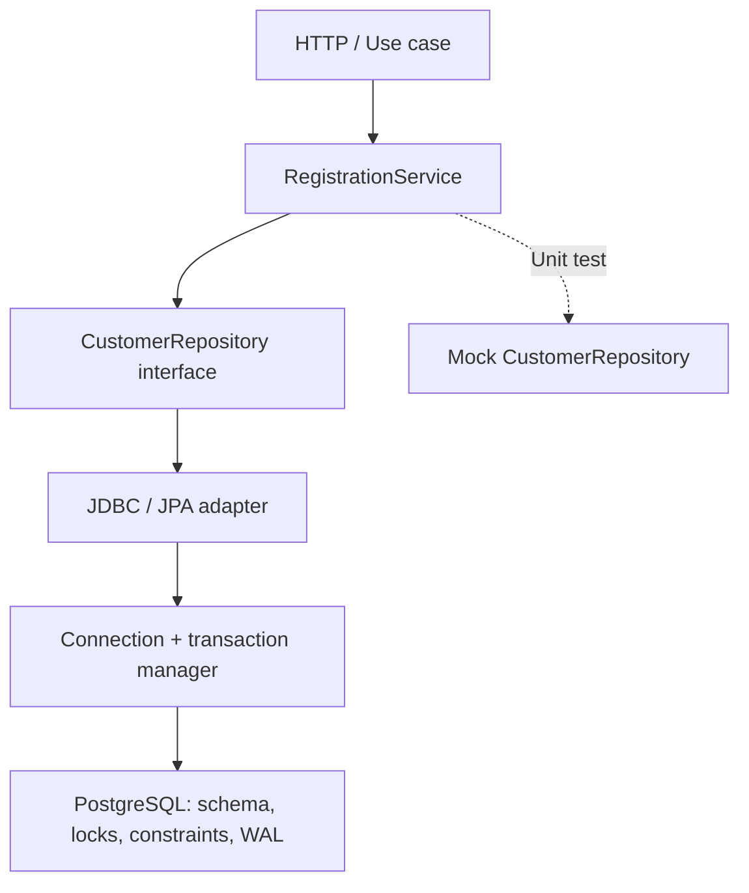
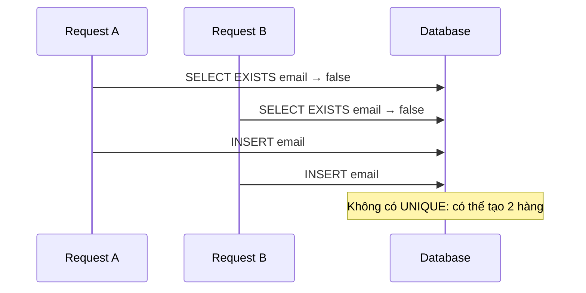
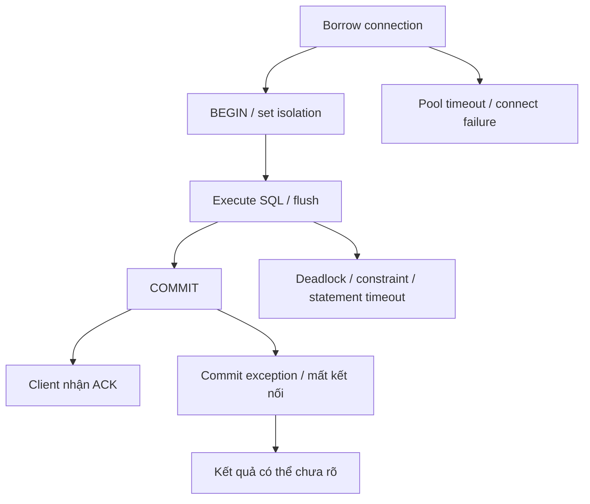

# Giới hạn của mock Repository trong chứng minh tính đúng đắn dữ liệu

Trong chương **Kiểm thử lưu trữ** của module **DATA_PERSISTENCE_FUNDAMENTALS**, một sai lầm dễ mắc phải là viết một unit test sử dụng `mock(Repository.class)`, thấy test xanh và kết luận rằng thao tác lưu dữ liệu đã **đúng, nguyên tử và an toàn khi nhiều người cùng sử dụng**. Mock là công cụ hữu ích, nhưng những kết luận ấy vượt quá phạm vi điều mà mock đã thực sự kiểm chứng.

Một repository Java nằm giữa **logic ứng dụng** và **cơ chế lưu trữ có trạng thái**: constraint, transaction, isolation, khóa, thứ tự thực thi, SQL dialect, JDBC driver, ORM mapping và lỗi ở các ranh giới mạng. Khi thay repository bằng một đối tượng trả về dữ liệu do test định sẵn, nhiều cơ chế quan trọng trong danh sách đó **không còn được chạy**. Test vẫn có giá trị để kiểm tra quyết định của service, nhưng không thể dùng riêng nó làm bằng chứng tính đúng đắn của persistence.

Bài học này hướng dẫn xác định **ranh giới bằng chứng** của mock, xây dựng các phép thử bổ sung với database thực, thiết kế tình huống cạnh tranh và sự cố có kiểm soát, rồi kết hợp chúng thành chiến lược kiểm thử cho ứng dụng Java. Ví dụ chủ yếu dùng JDBC, Spring, JPA/Hibernate và PostgreSQL; các yêu cầu phiên bản cụ thể cần được đối chiếu với stack đang sử dụng.

> **Nguyên tắc:** Test chỉ chứng minh một thuộc tính trong **mô hình và điều kiện mà test thực thi**. Nếu database không tham gia test, không được suy ra từ kết quả ấy rằng database đã thực thi đúng constraint, transaction hoặc isolation.

## 1. Repository là ranh giới abstraction, không phải bản sao database

Xét một ứng dụng đăng ký khách hàng:



Ở production, `CustomerRepository` có thể chạy một câu `INSERT`, dịch exception từ JDBC, tham gia một transaction và nhận lỗi unique constraint. Trong unit test, Mockito có thể trả một `Customer` giả lập ngay khi `save()` được gọi, **không kết nối tới DB và không biết một email nào đã tồn tại**.

### 1.1. Bốn cấp độ kiểm tra khác nhau

| Loại test | Tài nguyên thực sự được chạy | Có thể kiểm tra tốt | Điều không tự chứng minh |
| --- | --- | --- | --- |
| **Unit test với mock Repository** | Service, domain logic, mock | Rẽ nhánh, validate đầu vào, hợp đồng gọi repository, mapping lỗi đã mô phỏng | SQL, constraint, transaction, isolation, JDBC/ORM, dữ liệu bền vững |
| **Unit test với in-memory fake Repository** | Service và một store mô phỏng | Các luồng CRUD cơ bản, state machine đơn giản, một số invariant do fake cài đặt | Database thật có cùng MVCC, locking, unique/FK, concurrency và failure semantics |
| **Integration test với database thật** | Adapter, driver, DB, migration và transaction | DDL, SQL, constraints, commit/rollback, query mapping, khóa/isolation trong trường hợp thử | Toàn bộ topology production, outage dài, cache/broker/replica, mọi lịch chạy đồng thời |
| **System/fault/recovery test** | Nhiều thành phần thực hoặc mô phỏng lỗi có kiểm soát | Hành vi xuyên dịch vụ, retry, crash window, failover, restore, phân phối sự kiện | Một chứng minh hình thức cho mọi trạng thái có thể xảy ra |

Không có yêu cầu rằng mọi test phải dùng database: **dùng đúng cấp độ cho đúng câu hỏi** giúp test vừa nhanh vừa có bằng chứng phù hợp. Sai lầm là lấy kết quả của cấp độ đầu tiên để kết luận các thuộc tính vốn chỉ được thực thi ở cấp độ sau.

### 1.2. Mock, stub, fake và spy không giống nhau

- **Stub:** cung cấp câu trả lời dựng sẵn cho một lời gọi, chẳng hạn `findByEmail()` trả `Optional.empty()`.
- **Mock:** cho phép cấu hình phản hồi và xác minh tương tác, ví dụ `verify(repository).save(...)`.
- **Fake:** cài đặt repository đơn giản, có thể lưu trong `Map` để dùng ở test, nhưng vẫn là **một mô hình riêng** của persistence.
- **Spy:** bọc đối tượng thật hoặc fake để quan sát/điều chỉnh một số lời gọi; điều này không tự thêm bảo đảm database.

Trong thực tế, thư viện Mockito cho phép dùng cùng một mock để stub và verify. Việc phân biệt thuật ngữ quan trọng ở **nội dung bằng chứng**, không phải tên hàm khởi tạo của thư viện.

## 2. Mock kiểm tra chính xác điều gì?

Một service đơn giản:

```java
public final class RegistrationService {
    private final CustomerRepository customers;

    public RegistrationService(CustomerRepository customers) {
        this.customers = customers;
    }

    public Customer register(String email) {
        if (email == null || email.isBlank()) {
            throw new IllegalArgumentException("Email is required");
        }
        if (customers.existsByEmail(email)) {
            throw new EmailAlreadyUsedException();
        }
        return customers.save(new Customer(email));
    }
}
```

Với Mockito và JUnit 5, một unit test có thể minh họa:

```java
@Test
void rejectBlankEmailBeforeTouchingDatabase() {
    CustomerRepository repository = mock(CustomerRepository.class);
    RegistrationService service = new RegistrationService(repository);

    assertThrows(IllegalArgumentException.class,
                 () -> service.register(" "));
    verifyNoInteractions(repository);
}

@Test
void rejectEmailWhenRepositoryReportsItExists() {
    CustomerRepository repository = mock(CustomerRepository.class);
    when(repository.existsByEmail("a@example.invalid")).thenReturn(true);

    RegistrationService service = new RegistrationService(repository);
    assertThrows(EmailAlreadyUsedException.class,
                 () -> service.register("a@example.invalid"));
    verify(repository, never()).save(any());
}
```

Các kiểu `CustomerRepository`, `Customer`, `EmailAlreadyUsedException` là abstraction do bài học giả định; imports và setup dự án được lược bớt. Hai test chứng minh những điều hữu ích:

1. Service không gọi repository với đầu vào email trống.
2. **Nếu** repository báo email đã có, service từ chối và không gọi `save()`.

Nhưng hai test **không chứng minh** rằng query `existsByEmail` hoạt động, bảng có unique constraint, hai request đồng thời không tạo trùng hay `save()` commit thành công. Tất cả những thứ ấy thuộc phần **không được chạy** trong unit test.

### 2.1. `verify(save)` không phải bằng chứng đã ghi bền vững

```java
verify(repository).save(any(Customer.class));
```

Lệnh trên chỉ kiểm tra có một tương tác với đối tượng mock. Nó không xác nhận:

- Câu SQL được gửi tới DB;
- Transaction đã commit;
- Các cột bắt buộc có giá trị hợp lệ;
- FK/unique/check constraints được tôn trọng;
- Giá trị đọc lại sau commit bằng giá trị đã ghi;
- Dữ liệu vẫn tồn tại sau khi ứng dụng hoặc database khởi động lại.

**Interaction correctness** (gọi đúng collaborator) và **data correctness** (dữ liệu giữ đúng bất biến qua commit, rollback và concurrency) có liên quan nhưng không thay thế nhau.

## 3. Phản ví dụ: kiểm tra rồi chèn không ngăn được đăng ký trùng

Giả sử yêu cầu nghiệp vụ là: **mỗi email chuẩn hóa chỉ thuộc tối đa một tài khoản**. Service ở trên dùng:

```text
if repository.existsByEmail(email) == false:
    repository.save(new Customer(email))
```

Mock có thể cho tất cả các test tuần tự đi qua. Nhưng trong production, hai request cạnh tranh:



Vì hai bước `SELECT` và `INSERT` **không nguyên tử**, kết quả kiểm tra của A đã cũ khi B chèn. `synchronized` trong một instance Java cũng không nhất thiết bảo vệ được nhiều instance hoặc một batch job ghi trực tiếp.

### 3.1. Database constraint là rào bảo vệ cuối cùng

Ví dụ PostgreSQL:

```sql
CREATE TABLE customers (
    id BIGINT GENERATED ALWAYS AS IDENTITY PRIMARY KEY,
    email_normalized TEXT NOT NULL UNIQUE,
    display_name TEXT NOT NULL
);
```

Ràng buộc `UNIQUE` thực thi ở DB trong các lịch chạy đồng thời mà ứng dụng phải hỗ trợ. Khi hai transaction cạnh tranh insert cùng giá trị, một lần insert có thể thành công còn lần kia gặp xung đột unique (trong PostgreSQL thường là SQLSTATE `23505`) sau khi những điều kiện chờ/commit liên quan được giải quyết.

Lưu ý: ví dụ sử dụng `email_normalized` do ứng dụng chuẩn hóa; **không tự giả định chuyển lowercase là chuẩn email đúng cho mọi sản phẩm**. Quy tắc chuẩn hóa, collation, ký tự Unicode, case sensitivity và NULL semantics cần được xác định rõ cùng schema, không chỉ viết test bằng một email ASCII.

### 3.2. Bắt unique violation là một phần của nghiệp vụ

Service có thể giữ `existsByEmail` để trả lỗi sớm, nhưng vẫn phải xử lý **lỗi unique từ DB** như tình huống cạnh tranh hợp lệ, thay vì coi đó là lỗi nội bộ không thể xảy ra. Khi dùng adapter, hãy ánh xạ **constraint đã biết trong ngữ cảnh thao tác** sang một mã lỗi nghiệp vụ phù hợp; không chuyển mọi `DataIntegrityViolationException` thành `"Email đã tồn tại"`.

Đôi khi chính sách bảo mật không cho phép API tiết lộ email đã đăng ký. Một lỗi DB unique vẫn cần được xử lý, nhưng **thông báo công khai** có thể phải dùng cách diễn đạt không giúp dò tài khoản.

### 3.3. Bằng chứng cần chia thành hai test

| Phép thử | Kết luận hợp lệ |
| --- | --- |
| Mockito stub `existsByEmail=true` rồi kiểm tra exception | Service xử lý kết quả “đã tồn tại” đúng theo nhánh dự kiến |
| Hai kết nối DB thật cùng insert email, xác minh constraint và số hàng | Schema/DB đang ngăn trùng trong kịch bản cạnh tranh đã thử |

Không cần bỏ test đầu. **Giữ cả hai**, vì một test bảo vệ policy service còn test kia bảo vệ invariant ở tầng lưu trữ.

## 4. Những bất biến do schema bảo vệ mà mock không chạy

Một `Map` fake có thể được viết để từ chối khóa trùng, nhưng nó không tự thực hiện đầy đủ semantics của PostgreSQL. Những điểm khác biệt thường xuất hiện ở:

| Cơ chế database | Ví dụ bất biến | Mock có thể bỏ sót điều gì? |
| --- | --- | --- |
| **Primary key / unique** | Không có hai đơn với cùng mã | Cạnh tranh ghi, NULL/collation/case normalization, constraint được áp dụng ở thời điểm nào |
| **Foreign key** | Không có địa chỉ tham chiếu customer không tồn tại | Thứ tự insert/delete, `ON DELETE` rule, transaction đồng thời với parent |
| **NOT NULL / CHECK** | `quantity > 0`, `balance >= 0` | Dữ liệu mapper gửi sai, biểu thức SQL, cách xử lý NULL theo SQL |
| **Data type / range** | Số tiền, timestamp và UUID đúng miền giá trị | Overflow, precision/scale, timezone, mã hóa ký tự |
| **Unique partial/expression index** | Chỉ một mã đang hoạt động, email đã chuẩn hóa là duy nhất | Predicate của index, quy tắc expression/collation, index bị thiếu sau migration |
| **Trigger / generated column / default** | Giá trị do DB tự sinh hoặc audit được cập nhật | Fake lưu đúng object đầu vào nhưng không phản ánh DB-generated values |
| **Transaction-scoped constraint** | Một số constraint có thể kiểm tra ở commit | Test không trải qua `flush`/`commit`, sai timing khi bắt exception |
| **Row-level security / privileges** | Chỉ tenant được phép truy cập hàng | Fake không thực thi quyền của DB principal, policy, search path |

### 4.1. CHECK constraint có semantics của SQL

Trong PostgreSQL:

```sql
CREATE TABLE order_items (
    order_id BIGINT NOT NULL,
    product_id BIGINT NOT NULL,
    quantity INTEGER NOT NULL,
    unit_price NUMERIC(12, 2) NOT NULL,
    CONSTRAINT positive_quantity CHECK (quantity > 0),
    CONSTRAINT non_negative_price CHECK (unit_price >= 0)
);
```

Một fake `OrderItemRepository` lưu object vào map có thể chấp nhận `quantity=-1`, hoặc ngược lại từ chối một giá trị mà DB sẽ xử lý khác theo kiểu dữ liệu. Nếu test chỉ xác minh `save()` được gọi với `quantity=1`, nó chưa chứng minh schema thực tế đã có các ràng buộc trên.

**Chi tiết SQL đáng chú ý:** trong PostgreSQL, điều kiện `CHECK` được xem là thỏa nếu biểu thức trả `TRUE` **hoặc `NULL`/unknown**; muốn cấm `NULL` phải dùng `NOT NULL` riêng hoặc điều kiện thích hợp. Unit test trên Java boolean (chỉ true/false) rất dễ bỏ qua logic ba giá trị của SQL.

### 4.2. Foreign key và cascade

Giả sử `order_items.order_id` tham chiếu `orders.id`. Một fake có thể `save(item)` dù không có order tương ứng vì nó chỉ quản lý một collection. Trong DB, insert có thể nhận `23503` (foreign key violation), hoặc delete parent có thể kích hoạt `ON DELETE CASCADE`/bị từ chối theo schema.

Test cần:

1. Chạy schema/migration tương đương production.
2. Insert child thiếu parent, xác minh constraint.
3. Delete parent trong những trạng thái quan hệ khác nhau.
4. Xác minh hàng nào còn/đã xóa sau **commit**.
5. Kiểm tra kết quả có phù hợp policy giữ dữ liệu, không chỉ hợp lệ về FK.

Không tự bật cascade để làm test xanh: một cascade sai có thể xóa luôn dữ liệu giao dịch mà hệ thống cần giữ.

### 4.3. Dữ liệu do DB tạo và cách ánh xạ ngược

Database có thể gán ID, `created_at`, `version` hoặc `generated column`. Mock `save()` thường trả chính object đầu vào:

```java
when(repository.save(any(Customer.class)))
    .thenAnswer(invocation -> invocation.getArgument(0));
```

Test service có thể xanh mặc dù adapter thật không lấy generated key, không map đúng kiểu `NUMERIC`, hoặc dùng `Instant`/`LocalDateTime` sai ngữ nghĩa timezone. Để kiểm tra adapter, cần **write → commit → read lại** từ một đơn vị công việc mới và so sánh **giá trị bền vững**, không chỉ object Java vừa được tạo.

### 4.4. Migrations cũng là một phần hợp đồng

Nếu test tạo schema thủ công khác production, test vẫn có thể “chứng minh” nhầm những constraint/index không tồn tại sau migration, hoặc bỏ sót tên cột đã đổi. Do đó integration tests nên sử dụng **migration scripts thực tế của ứng dụng** với database tương thích.

Không nhất thiết mọi integration test phải chạy migration từ đầu, nhưng môi trường test phải có cách bảo đảm schema được tạo từ **cùng nguồn thay đổi lược đồ** và kiểm tra phiên bản/khả năng tương thích.

## 5. Transaction: gọi repository thành công khác commit thành công

Một nghiệp vụ chuyển tiền cần thực hiện **trừ A và cộng B nguyên tử**. Mock có thể xác minh hai lời gọi:

```java
verify(accounts).debit(fromAccount, amount);
verify(accounts).credit(toAccount, amount);
```

Nhưng hai phương thức có thể dùng **hai connection khác nhau, mỗi phương thức tự commit**, khiến `debit` được lưu rồi `credit` lỗi. Mock không quan sát được connection ownership, `autoCommit`, `TransactionManager` hay kết quả rollback.

### 5.1. Transaction boundary cần là một phần của phép thử

Ví dụ với Spring imperative transaction:

```java
@Service
public class TransferService {
    private final AccountRepository accounts;

    public TransferService(AccountRepository accounts) {
        this.accounts = accounts;
    }

    @Transactional
    public void transfer(long fromId, long toId, long amount) {
        if (amount <= 0) {
            throw new IllegalArgumentException("amount");
        }
        int debited = accounts.debitIfEnough(fromId, amount);
        if (debited != 1) {
            throw new InsufficientFundsException();
        }
        accounts.credit(toId, amount);
    }
}
```

Đây là API minh họa: `debitIfEnough` phải là một thao tác DB nguyên tử theo điều kiện, `credit` phải tham gia **cùng transaction**, và `InsufficientFundsException` được giả định là runtime exception. `@Transactional` chỉ có hiệu lực khi lời gọi đi qua cơ chế proxy/transaction manager thích hợp và repository sử dụng resource được điều phối.

Một unit test có thể xác nhận nhánh `amount <= 0` hoặc `debited != 1`. Nhưng một integration test cần:

- Ghi trạng thái hai tài khoản ban đầu bằng DB thật.
- Gây lỗi **sau khi trừ A nhưng trước khi cộng B hoàn tất**.
- Để transaction service **thực sự kết thúc bằng rollback**.
- Đọc lại A và B từ một connection/transaction mới.
- Xác nhận **cả hai số dư giữ nguyên** và không có side effect đã commit nửa chừng.

Nếu hai repository tự commit riêng, test thật sẽ lộ ra sự lệch mà Mockito không phát hiện.

### 5.2. `flush()` không phải `commit()`

Trong JPA:

```java
@Transactional
public void createOrder(Order order) {
    entityManager.persist(order);
    entityManager.flush();
    // DB có thể đã nhận INSERT.
    // Transaction vẫn có thể rollback sau bước này.
}
```

`flush()` đưa thay đổi tới DB trong transaction hiện tại; nó có thể làm xuất hiện một số lỗi constraint sớm hơn, nhưng **không bảo đảm giao dịch đã commit**. Còn các constraint cấu hình deferrable hoặc lỗi chỉ xảy ra khi hoàn tất transaction có thể xuất hiện muộn hơn.

Unit test `verify(entityManager).flush()` chỉ xác minh phương thức được gọi; test persistence thật cần quan sát **thời điểm lỗi** và **dữ liệu sau commit/rollback**.

### 5.3. Bắt exception sai có thể khiến transaction commit ngoài ý muốn

Ví dụ nguy hiểm:

```java
@Transactional
public TransferResult transfer(...) {
    accounts.debit(...);
    try {
        accounts.credit(...);
    } catch (DataAccessException ex) {
        return TransferResult.failed();
    }
    return TransferResult.success();
}
```

Nếu exception bị nuốt và transaction vẫn được xem là hoàn tất bình thường, transaction manager có thể thử commit, trừ khi resource đã đánh dấu rollback-only hoặc transaction thất bại theo cơ chế khác. Hành vi thực tế phụ thuộc database và framework. Mock cho `credit` ném exception rồi kiểm tra method trả `failed()` **không chứng minh rằng debit đã rollback**.

Để test, cần mở transaction thật, gây lỗi thích hợp và kiểm tra trạng thái sau khi ranh giới transaction đã kết thúc; khi muốn rollback, hãy thiết kế propagation/rule (`rollbackFor` nếu cần) hoặc rollback-only rõ ràng.

### 5.4. Vì sao test có `@Transactional` đôi khi che mất bug?

Trong Spring test, một phương thức test chạy với `@Transactional` có thể tự rollback khi kết thúc. Một test:

```java
@Test
@Transactional
void savesOrder() {
    orderRepository.save(new Order(...));
    assertEquals(1, orderRepository.count());
}
```

có thể đọc thấy hàng từ **chính transaction test** dù dữ liệu chưa bao giờ commit. Nó không kiểm tra listener `AFTER_COMMIT`, constraint kiểm tra ở commit, event sau commit hay read visibility với transaction khác.

Nếu mục tiêu là kiểm tra commit thật, cần thiết kế test để **transaction thật sự commit**, rồi đọc qua **một transaction/connection mới**. Với Spring test, có thể dùng các cơ chế như `TestTransaction` phù hợp hoặc tách bước chuẩn bị/thực thi/xác minh khỏi transaction của test; phải hiểu cách mỗi cấu hình test quản lý rollback mặc định.

**Test rollback tự động là tính năng hữu ích để cô lập dữ liệu**, nhưng không được coi đó là bằng chứng transaction production đã commit đúng.

## 6. Concurrency: bộ sưu tập trong RAM không mô phỏng isolation

Repository fake thường dùng `HashMap`, `ConcurrentHashMap` hoặc list:

```java
final class InMemoryInventoryRepository {
    private final Map<Long, Integer> available = new ConcurrentHashMap<>();

    int getAvailable(long productId) {
        return available.getOrDefault(productId, 0);
    }

    void putAvailable(long productId, int quantity) {
        available.put(productId, quantity);
    }
}
```

`ConcurrentHashMap` có tính an toàn đồng thời cho các operation phù hợp của map, nhưng chuỗi:

```java
if (getAvailable(id) >= requested) {
    putAvailable(id, getAvailable(id) - requested);
}
```

**không nguyên tử**. Ngay cả khi fake được thêm `synchronized`, nó vẫn có thể khác PostgreSQL: DB điều phối theo transaction/row lock, còn `synchronized` trong một JVM không bảo vệ nhiều service instance hoặc thao tác ngoài JVM.

### 6.1. Lost update

Giả sử tồn kho là `10`, mỗi request đặt `6` đơn vị:

```text
A đọc available=10
B đọc available=10
A tính available=4
B tính available=4
A UPDATE available=4; COMMIT
B UPDATE available=4; COMMIT
```

Nếu hệ thống dùng cách ghi giá trị tuyệt đối không có điều kiện/khóa, cả hai thao tác có thể nhận thành công dù đã nhận đặt tổng cộng 12 đơn vị, nhưng DB còn báo 4. Đây là một dạng **lost update/check-then-act race**.

Một câu SQL kiểu:

```sql
UPDATE inventory
   SET available = available - :quantity
 WHERE product_id = :product_id
   AND available >= :quantity;
```

kết hợp kiểm tra affected rows giúp đảm bảo điều kiện và cập nhật được DB thực hiện như **một statement nguyên tử** trên hàng liên quan, theo transaction/isolation tương ứng. Hai request muốn trừ 6 từ số 10 không thể cả hai cùng thành công nếu tất cả đường ghi tuân thủ cùng ràng buộc. Mock chỉ trả `1` cho `updateIfEnough` **không chứng minh SQL thật có điều kiện `available >= ?`**.

### 6.2. Write skew

Một số bất biến không nằm trên cùng một hàng:

```text
Bảng on_call:
doctor A: on_call=true
doctor B: on_call=true
Quy tắc: luôn phải có ít nhất một bác sĩ trực.
```

Trong một lịch chạy với isolation cho phép hiện tượng write skew, transaction A đọc “B còn trực” rồi bỏ trực cho A; transaction B đồng thời đọc “A còn trực” rồi bỏ trực cho B. Cả hai ghi **hai hàng khác nhau** và có thể commit, khiến không còn ai trực.

Một fake chạy test tuần tự sẽ không tạo đúng snapshot/isolation và lịch ghi cạnh tranh này. Muốn bảo vệ invariant, có thể cần serializable isolation với retry, khóa bổ sung hoặc mô hình dữ liệu khiến các thao tác tranh chấp trên một tài nguyên chung. **Không suy rằng unique/FK constraint đơn giản đã bảo vệ mọi invariant nhiều hàng**.

### 6.3. Deadlock, lock timeout và serialization failure

Trong PostgreSQL, hai transaction giữ khóa theo thứ tự ngược nhau có thể deadlock. Database có thể hủy một transaction và trả SQLSTATE như `40P01`; serialization anomaly dưới `SERIALIZABLE` có thể dẫn tới `40001`.

Mock có thể được cấu hình:

```java
when(repository.update(...))
    .thenThrow(new RetryablePersistenceException());
```

Điều này kiểm tra **chính sách retry của service khi nhận exception đã mô phỏng**. Nó không tạo lock graph, chứng minh DB thực sự ném lỗi đúng lúc, rằng transaction cũ đã rollback hay lần retry sử dụng **transaction mới và dữ liệu đọc mới**.

Để chứng minh phần đó cần integration/concurrency test có nhiều connection, ranh giới transaction và kiểm soát lịch chạy.

## 7. Isolation là hành vi của database, không phải kiểu collection

Một fake có thể trả dữ liệu theo thứ tự mà test viết:

```text
save(A)
find(A) → A
```

Trong database thực, **transaction đang mở**, snapshot đọc và isolation level quyết định những gì một transaction nhìn thấy. Cùng một lịch gọi repository Java có thể tạo kết quả khác nhau ở `READ COMMITTED`, `REPEATABLE READ` hoặc `SERIALIZABLE`, tùy implementation cụ thể.

### 7.1. Những tình huống phải thử trực tiếp với DB

| Tình huống | Câu hỏi cần kiểm chứng | Vì sao fake dễ sai? |
| --- | --- | --- |
| Uncommitted write | Transaction B có thấy dữ liệu transaction A chưa commit không? | Fake dùng map chung có thể “đọc bẩn” hoặc thấy ngay mọi thay đổi |
| Non-repeatable read | Hai lần SELECT trong cùng transaction có thể nhận giá trị khác không? | Fake không có MVCC snapshot và isolation |
| Phantom/predicate changes | Kết quả của truy vấn điều kiện có đổi trong transaction không? | Fake không mô phỏng predicate locking/SSI |
| Lost update | Hai writer đồng thời cùng sửa một giá trị có mất cập nhật không? | Test tuần tự không tạo cạnh tranh |
| Write skew | Hai transaction sửa hai hàng riêng có thể phá invariant không? | Fake không có snapshot isolation đúng |
| Lock wait / deadlock | Giao dịch nào đợi/hủy, khi nào timeout? | `synchronized` và DB lock manager khác nhau |
| Serialization retry | Khi transaction hủy, lần retry có được đọc lại dữ liệu không? | Fake không tạo rollback/transaction state thật |
| Read replica lag | Đọc sau ghi qua replica có thể trả bản cũ không? | Fake thường chỉ có một map luôn mới |

Không được dùng bảng lý thuyết về isolation để tuyên bố rằng mọi database có hành vi đồng nhất. Ví dụ PostgreSQL có những đặc điểm riêng của MVCC/SSI; một mức tên giống nhau ở DB khác có thể có sự khác biệt. **Test trên database thực tế của hệ thống** là cách kiểm tra hợp đồng cụ thể.

### 7.2. Bối cảnh kết nối phải được quan sát

Một integration test nên biết:

- `autoCommit` đang bật hay tắt.
- Connection nào thực hiện thao tác; có chung transaction không.
- Isolation level và read-only mode hiện tại.
- Transaction đã thực sự `commit()`/`rollback()` ở đâu.
- Connection có bị trả về pool khi vẫn còn trạng thái transaction lỗi hay không.
- Lời gọi retry có dùng lại đối tượng trong persistence context từ transaction cũ hay không.

Một mock `DataSource` trả `Connection` giả có thể giúp xác minh `commit()` được gọi, nhưng **không chứng minh commit tác động lên hàng nào hoặc database xử lý lỗi gì**.

### 7.3. Kiểm thử cạnh tranh cần điều khiển điểm đồng bộ

Chạy:

```java
IntStream.range(0, 100).parallel().forEach(i -> service.reserve(...));
```

có thể tạo tải, nhưng **không bảo đảm** tạo đúng lịch chạy gây race. Một test có điều khiển nên đặt barrier:

```text
Transaction A:
    đọc predicate/row
    báo đã sẵn sàng → chờ barrier

Transaction B:
    đọc cùng dữ liệu
    báo đã sẵn sàng → chờ barrier

Barrier mở:
    A và B cùng thực hiện ghi
    cho phép DB giải quyết cạnh tranh
    quan sát commit/rollback thật
```

Dùng `CountDownLatch`, `CyclicBarrier` hoặc một test hook tương đương; luôn có timeout và cleanup để test không treo nếu một bên lỗi sớm. Với test transaction, barrier phải đặt **trước thời điểm bắt đầu chờ lock** nếu không hai phía có thể deadlock ở chính barrier của test.

## 8. JPA/Hibernate còn có hành vi không nhìn thấy trong mock

Spring Data JPA tạo cảm giác `repository.save(entity)` rất gần với một thao tác trong collection. Nhưng JPA quản lý trạng thái entity và đồng bộ theo **persistence context**:

### 8.1. Managed, detached và dirty checking

Một entity được quản lý có thể được update mà không gọi `save()` lần nữa:

```java
@Transactional
public void confirmOrder(Long id) {
    Order order = entityManager.find(Order.class, id);
    order.setStatus(OrderStatus.CONFIRMED);
    // Dirty checking / flush có thể ghi thay đổi lúc kết thúc transaction.
}
```

Một unit test dựa vào `verify(repository).save(order)` có thể thất bại dù implementation JPA đúng; ngược lại, một mock `findById()` trả đối tượng Java có thể khiến test xanh ngay cả khi production entity bị detached và thay đổi không được flush như dự kiến.

Test adapter cần quan sát **DB state sau transaction**, không áp đặt việc phải gọi `save()` nếu đó không phải hợp đồng nghiệp vụ.

### 8.2. First-level cache và identity map

Trong cùng `EntityManager`, `find()` có thể trả lại cùng instance đã quản lý; một transaction khác vừa commit cập nhật không có nghĩa entity đó tự refresh. Mock trả một object mới mỗi lần có thể **giấu** vấn đề stale entity; mock trả cùng object mãi có thể tạo một semantics khác database.

Khi kiểm tra read-your-writes, refresh và stale read, hãy phân biệt rõ:

- Đọc cùng persistence context.
- Đọc bằng `EntityManager`/transaction mới.
- Đọc trên primary hay read replica.
- Cache cấp hai hoặc query cache có được bật không.

### 8.3. Lazy loading và N+1

Nếu entity có quan hệ `LAZY`, việc truy cập field sau khi session đóng có thể gây `LazyInitializationException` hoặc hành vi framework tương ứng. Mock trả `Customer` đã chứa đầy đủ `orders` và `addresses` không làm lộ điều đó.

Một lặp:

```java
List<Order> orders = orderRepository.findRecent();
for (Order order : orders) {
    renderCustomerName(order.getCustomer().getName());
}
```

có thể tạo **N+1 SELECT** hoặc lazy-loading ngoài transaction. Unit test chỉ xác minh output đúng không cho biết số SQL round trips. Integration test với SQL logging/statement counting được kiểm soát hoặc metric/query plan mới có thể phát hiện hành vi thực.

### 8.4. `@Version` phải được DB/ORM thực thi

```java
@Entity
public class Order {
    @Id
    private Long id;

    @Version
    private Long version;

    private String status;
}
```

`@Version` giúp provider kiểm tra xung đột khi ghi entity theo cơ chế optimistic locking. Mock `save()` trả entity mà không có version check **không chứng minh** hai transaction dùng version cũ bị từ chối.

Test thật nên:

1. Tải cùng một order/version trong hai persistence context độc lập.
2. Thay đổi và commit context thứ nhất.
3. Thử cập nhật từ context thứ hai.
4. Xác nhận optimistic locking conflict ở thời điểm provider phát hiện (flush/commit), rồi đọc lại DB để bảo đảm trạng thái đã commit không bị ghi đè.

Không dùng một `EntityManager` chung qua hai thread: nó thường **không được thiết kế để dùng đồng thời**. Mỗi luồng/test worker cần ranh giới transaction và persistence context riêng.

### 8.5. Tên bảng, tên cột và mapping

Các vấn đề khác mock không kiểm tra:

- Tên cột sai sau migration, query JPQL/native query sai.
- Enum mapping sai giữa Java và DB.
- `BigDecimal` precision/scale và rounding.
- `OffsetDateTime`/`Instant` và chính sách timezone.
- Cascade `PERSIST`, `MERGE`, `REMOVE`, orphan removal.
- `equals`/`hashCode` của entity với generated ID.
- Soft-delete filter và tenant scoping trong câu SQL thực.
- Lỗi permission hoặc schema search path trong môi trường thật.

Những vấn đề này cần được kiểm thử tại **adapter + schema + transaction** chứ không chỉ dựa trên một object trả về từ Mockito.

## 9. Database giả lập/in-memory DB cũng có giới hạn

Thay mock bằng một H2 in-memory database là bước tiến: có thể chạy SQL và một số constraint. Nhưng nó vẫn **không phải PostgreSQL** chỉ vì cùng hỗ trợ cú pháp SQL cơ bản.

Một số khác biệt cần kiểm chứng:

| Vấn đề | Nguy cơ khi test trên DB khác production |
| --- | --- |
| SQL dialect | `ON CONFLICT`, `RETURNING`, JSONB, array, partial index, window/locking syntax khác |
| Types | UUID, NUMERIC, JSON, timezone, collation và Unicode có thể khác |
| Locks/isolation | Row lock, MVCC snapshot, `FOR UPDATE SKIP LOCKED`, deadlock và serialization |
| Index/query plan | Cùng SQL có plan/hiệu năng khác, index support khác |
| Migration DDL | Default/generated column, expression/partial indexes, constraints khác |
| Transaction failures | SQLSTATE và thời điểm lỗi khác; commit/rollback semantics khác |
| Concurrency | Fake/in-memory thường quá nhanh hoặc đồng bộ khác, che giấu race |
| DB extensions | `pg_stat_statements`, `citext`, `pgcrypto` và extensions khác không có |

**H2 compatibility mode không phải PostgreSQL production thu nhỏ.** Nó có ích cho test nhanh ở phạm vi phù hợp, nhưng những thuộc tính cần dựa vào PostgreSQL phải được kiểm chứng trên PostgreSQL. SQLite cũng có mô hình ghi/khóa và kiểu dữ liệu riêng; không thay thế tự động cho một DB khác.

### 9.1. Khi nào fake vẫn là lựa chọn tốt?

Fake có giá trị khi:

- Muốn chạy nhanh hàng nghìn trường hợp domain logic.
- Mô phỏng kết quả đọc/ghi ở một interface đã ổn định.
- Kiểm tra state machine, validation, mapping error ở service.
- Tạo ví dụ giảng dạy cho trường hợp không phụ thuộc đặc tính DB.

Điều kiện là **không mở rộng kết luận** sang constraint/isolation/driver mà fake không mô phỏng. Nếu ứng dụng phụ thuộc heavily vào SQL dialect, một fake càng “giống DB” nhưng không đầy đủ có thể tạo cảm giác an toàn giả.

## 10. Kiểm thử trên PostgreSQL thật với Testcontainers

**Testcontainers** cho phép khởi tạo database trong container cho integration test Java. Mục đích không phải làm mỗi unit test trở nên chậm, mà là chạy những phép thử **phải phụ thuộc vào semantics của database** trên một backend tương đương production.

Ví dụ bên dưới dùng JUnit 5, Testcontainers và JDBC PostgreSQL driver (import được lược bớt). Test tạo bảng tối giản để minh họa; **trong dự án thật nên chạy migration scripts mà production sử dụng** thay vì âm thầm tạo một schema test khác.

```java
@Testcontainers
class CustomerConstraintIntegrationTest {
    @Container
    static PostgreSQLContainer<?> postgres =
        new PostgreSQLContainer<>("postgres:16-alpine");

    private Connection open() throws SQLException {
        return DriverManager.getConnection(
            postgres.getJdbcUrl(),
            postgres.getUsername(),
            postgres.getPassword()
        );
    }

    @BeforeEach
    void recreateSchema() throws SQLException {
        // Ví dụ dạy học; không chạy DDL reset kiểu này trên production.
        try (Connection connection = open();
             Statement sql = connection.createStatement()) {
            sql.execute("DROP TABLE IF EXISTS customers");
            sql.execute("""
                CREATE TABLE customers (
                    id BIGINT GENERATED ALWAYS AS IDENTITY PRIMARY KEY,
                    email_normalized TEXT NOT NULL UNIQUE
                )
                """);
        }
    }

    private void insertEmail(String email) throws SQLException {
        try (Connection connection = open();
             PreparedStatement ps = connection.prepareStatement(
                 "INSERT INTO customers(email_normalized) VALUES (?)")) {
            ps.setString(1, email);
            ps.executeUpdate();
        }
    }

    private long countEmail(String email) throws SQLException {
        try (Connection connection = open();
             PreparedStatement ps = connection.prepareStatement(
                 "SELECT count(*) FROM customers WHERE email_normalized = ?")) {
            ps.setString(1, email);
            try (ResultSet rows = ps.executeQuery()) {
                rows.next();
                return rows.getLong(1);
            }
        }
    }

    @Test
    void cannotCommitTwoCustomersWithSameEmail() throws SQLException {
        String email = "one@example.invalid";
        insertEmail(email); // autocommit của kết nối mới theo mặc định.

        SQLException failure = assertThrows(SQLException.class,
            () -> insertEmail(email));

        assertEquals("23505", failure.getSQLState());
        assertEquals(1L, countEmail(email));
    }
}
```

Các dependencies, import và cấu hình container runtime phải được cung cấp bởi dự án; version của Testcontainers/JUnit/driver cần tương thích. Ví dụ chỉ nhắm vào **behavior của unique constraint** trên PostgreSQL, không phải test đầy đủ registration service hoặc bảo đảm email normalization ở production.

Những thứ test thật **đã chạy**, khác mock:

1. Tạo schema với unique constraint.
2. Gửi hai câu SQL `INSERT` qua JDBC driver.
3. Nhận lỗi `23505` từ PostgreSQL khi có unique violation.
4. Đọc lại database qua connection mới, xác nhận chỉ có một hàng.

### 10.1. Thêm bài thử hai writer cạnh tranh

Một ví dụ có điều khiển điểm bắt đầu:

```java
@Test
void concurrentInsertOfSameEmailDoesNotCreateDuplicates()
        throws Exception {
    String email = "race@example.invalid";
    CyclicBarrier startTogether = new CyclicBarrier(2);
    ExecutorService executor = Executors.newFixedThreadPool(2);

    Callable<String> worker = () -> {
        try (Connection connection = open();
             PreparedStatement ps = connection.prepareStatement(
                 "INSERT INTO customers(email_normalized) VALUES (?)")) {
            ps.setString(1, email);
            startTogether.await(5, TimeUnit.SECONDS);
            try {
                ps.executeUpdate();
                return "INSERTED";
            } catch (SQLException conflict) {
                if ("23505".equals(conflict.getSQLState())) {
                    return "DUPLICATE";
                }
                throw conflict;
            }
        }
    };

    try {
        Future<String> first = executor.submit(worker);
        Future<String> second = executor.submit(worker);

        Set<String> outcomes = Set.of(
            first.get(10, TimeUnit.SECONDS),
            second.get(10, TimeUnit.SECONDS)
        );
        assertEquals(Set.of("INSERTED", "DUPLICATE"), outcomes);
        assertEquals(1L, countEmail(email));
    } finally {
        executor.shutdownNow();
    }
}
```

Hai worker tạo hai connection riêng và cố insert cùng email gần như đồng thời. DB phải phân xử constraint; vì mỗi connection ở autocommit mặc định, một insert thành công và một insert bị từ chối khi không có thao tác bất thường khác. `Set.of(...)` cũng sẽ ném exception nếu hai kết quả trùng, khiến test thất bại — đúng với kỳ vọng có **một thành công, một xung đột**.

Để dùng trong dự án lớn, tránh chia sẻ/truncate cùng một bảng khi các test class chạy song song; cô lập schema/database theo test suite hoặc cấu hình non-parallel phù hợp. Thêm timeout để không giữ CI bị treo khi connection lỗi. Nếu mục tiêu là kiểm tra **service thật**, thay việc gọi `INSERT` trực tiếp bằng lời gọi service/repository implementation thật, nhưng vẫn giữ DB thật và xác minh trạng thái cuối.

### 10.2. Vì sao không chỉ dùng một `@BeforeEach` insert rồi SELECT?

Một integration test tuần tự xác nhận cú pháp SQL và constraint cơ bản rất có giá trị, nhưng **không tự chứng minh** xử lý cạnh tranh. Khi mục tiêu là concurrency:

- Mỗi worker phải có **transaction/connection riêng**.
- Lịch chạy phải có điểm đồng bộ phù hợp để tạo cạnh tranh.
- Phải quan sát kết quả **sau commit/rollback**, không chỉ số hàng trả trong transaction đang mở.
- Cần kiểm tra invariant cuối cùng, ví dụ `COUNT=1` hoặc tổng số dư không đổi.
- Nên lặp với nhiều lịch chạy/seed khi tìm race khó tái hiện.

**Database thật là điều kiện cần cho test concurrency của persistence, nhưng không tự đủ** nếu test chưa tạo được lịch chạy gây vấn đề.

### 10.3. Test schema phải đại diện production

Môi trường test gần production nên khớp các điểm:

- Database engine và phiên bản chính quan trọng.
- Extensions, collation, encoding, timezone và transaction isolation.
- Schema migration (Flyway/Liquibase hoặc quy trình tương đương).
- Index, FK, CHECK, unique, partition và trigger có ảnh hưởng nghiệp vụ.
- Driver/JPA dialect, pool configuration và transaction manager.
- Kiểu dữ liệu đại diện, kể cả độ lớn, tương quan và phân bố giá trị.

Không có nghĩa integration test nhỏ phải có kích thước database production. Các bài test về **tính đúng đắn** cần schema/semantics phù hợp; các bài benchmark cần **khối lượng và phân bố tải** riêng để tránh kết luận hiệu năng từ một bảng vài hàng.

## 11. Đừng dùng một happy-path test làm bằng chứng toàn bộ tính đúng đắn

Một test:

```text
given account A=100, B=50
when transfer(A, B, 20)
then A=80, B=70
```

chỉ kiểm tra **một trường hợp**. Để đánh giá persistence cần một tập bất biến và kịch bản:

| Bất biến / đặc tính | Dữ liệu test | Sự cố hoặc tình huống đối kháng |
| --- | --- | --- |
| Không âm tồn kho | Tồn `0`, `1`, `N`, yêu cầu `0`, `1`, `N+1` | Hai buyer đồng thời, timeout và retry |
| Một email duy nhất | Email bình thường, case/Unicode theo policy, NULL | Hai request cùng lúc, race trên `exists` |
| FK đúng | Parent/child tồn tại hoặc không | Delete parent khi child còn, concurrent insert child |
| Transaction nguyên tử | Hai cập nhật phải cùng thành công | Lỗi sau bước thứ nhất, rollback, commit failure |
| Optimistic version | Hai entity cùng `version` cũ | Commit một bên trước, bên kia flush/commit |
| Idempotency | Cùng request ID + cùng/different payload | ACK mất, retry đồng thời, restart |
| Isolation | Nhiều transaction đọc/ghi cùng predicate | Lost update, write skew, phantom |
| Dữ liệu bền vững | Giá trị đã commit | Đọc qua connection mới và bài phục hồi DB thích hợp |
| Phân quyền/tenant | Hai tenant có cùng local ID | Query thiếu tenant predicate, sai principal DB |
| Cache/read replica | DB đã commit phiên bản mới | Stale fill, replica lag, read-your-writes |

### 11.1. Kiểm tra invariant thay vì chỉ mock response

Với chuyển tiền:

\[
\text{balance}_A + \text{balance}_B = \text{constant}
\]

trong phạm vi không có phí/giao dịch ngoài làm thay đổi tổng. Nếu 100 request chuyển tiền đồng thời, invariant tổng số dư và không âm (theo hợp đồng) nên đúng **sau khi tất cả transaction xác nhận kết thúc**.

Mock trả kết quả `TransferResult.success` không xác minh invariant đó. Test thật có thể đọc lại tất cả tài khoản liên quan sau khi các worker hoàn tất, đếm successful operations, so với transaction log và kiểm tra không có transfer bị mất/nhân đôi.

### 11.2. Test dựa trên property và sinh lịch sử

Ngoài các case có ví dụ cố định, có thể sinh tập lệnh:

```text
create account
deposit(amount)
withdraw(amount)
transfer(from, to, amount)
retry(operation_id)
restart service worker
```

Sau mỗi chuỗi, kiểm tra bất biến: tổng ledger, giới hạn số dư, unique operation ID, phiên bản state monotonic. Có thể dùng property-based testing hoặc state-machine/model-based testing để tăng độ bao phủ. Tuy nhiên **mô hình tham chiếu (oracle)** cũng phải đúng; nếu oracle dùng fake có cùng lỗi thiết kế với production, hai hệ thống có thể sai giống nhau và test vẫn xanh.

### 11.3. Kiểm tra lịch sử cần biết thao tác timeout có thể đã chạy

Trong các bài test concurrency/linearizability, một write bị timeout ở client không chắc đã rollback ở DB. Khi phân tích lịch sử thao tác, không được tự ghi “failed, không ảnh hưởng trạng thái” cho mọi timeout. Cần phân biệt:

- **Được xác nhận thành công.**
- **Được xác nhận từ chối/rollback.**
- **Kết quả chưa rõ** và phải đối chiếu bằng operation ID hoặc nguồn authoritative.

Ngược lại, một test mock “khi timeout thì ném exception” không mô tả được trường hợp DB đã commit nhưng response bị mất.

## 12. Kết nối, timeout và lỗi commit: nơi mock dễ cho kết luận giả

Lỗi persistence xảy ra ở nhiều pha:



### 12.1. Mock có thể kiểm tra nhánh xử lý lỗi

Ví dụ service được cài đặt để retry một transaction khi nhận `TransientTransactionConflict`:

```java
when(unitOfWork.execute())
    .thenThrow(new TransientTransactionConflict())
    .thenReturn(successResult);

var result = service.executeWithRetry(command);
assertEquals(successResult, result);
verify(unitOfWork, times(2)).execute();
```

Đây là test đúng mục đích nếu câu hỏi là **policy retry tối đa và backoff khi collaborator báo conflict**. Nhưng mock không kiểm tra:

- Lỗi PostgreSQL nào thực sự được ánh xạ thành `TransientTransactionConflict`.
- Transaction thứ nhất đã rollback hay chưa.
- Lần thứ hai dùng một connection/transaction mới.
- Các side effect bên ngoài của lần thứ nhất có bị lặp không.
- Trạng thái commit của lần trước có thật sự chắc chắn thất bại không.

### 12.2. Lỗi cần phân biệt theo giai đoạn

| Giai đoạn | Ví dụ | Điều cần thử thật |
| --- | --- | --- |
| Trước khi gửi SQL | Pool acquisition timeout | Không có thao tác DB từ lần gọi đó; response/queue phù hợp |
| Trong statement | Unique, FK, CHECK, syntax, lock wait | DB trả đúng error code, transaction rollback đúng |
| `flush()` trong ORM | Constraint hay optimistic conflict | Thời điểm lỗi, trạng thái persistence context |
| `commit()` | Mạng đứt sau khi DB có thể đã commit | Không tạo nghiệp vụ lần hai khi retry |
| Sau commit | Cache invalidation, broker publish, HTTP provider | DB không bị hiểu nhầm rollback; workflow/outbox tiếp tục |
| Read replica | Replica chưa replay mốc ghi | API cần freshness không phục vụ bản cũ |

Đặc biệt với `Connection.commit()` hoặc write ACK ở hệ thống phân tán, một exception/timeout **không tự chứng minh thay đổi chưa xảy ra**. Một hệ thống có thể cần lưu `request_id` trong cùng transaction, rồi tra cứu qua nguồn authoritative trước khi retry.

### 12.3. Fault injection phải có phạm vi và môi trường an toàn

Một số cách dùng trong integration/system test:

- Proxy mạng có thể cắt hoặc trì hoãn kết nối giữa service và DB.
- Test hook gây exception **sau một bước ghi nhưng trước commit**.
- Test container bị dừng/restart tại một mốc đã định.
- Artificial lock contention để kích hoạt `lock_timeout`.
- Broker trả ACK rồi cố tình làm worker mất kết nối trước khi ghi trạng thái publish.

Không làm các bài test phá mạng, dừng DB hoặc tạo deadlock có chủ đích trên production. Một test gây lỗi sau commit phải có **cơ chế quan sát kết quả cuối cùng**; nếu chỉ thấy exception, không thể kết luận failover/recovery đúng.

## 13. Repository mock không kiểm tra các tác dụng phụ ngoài DB

Một use case đặt hàng thường bao gồm:

```text
BEGIN DB transaction
  UPDATE inventory
  INSERT orders
COMMIT
PUBLISH OrderCreated
SEND confirmation email
```

Unit test với `mock(orderRepository)` và `mock(eventPublisher)` có thể xác minh **ý định gọi** hai collaborator. Nhưng nó không phát hiện được việc tiến trình Java chết **sau commit nhưng trước publish**, hay việc broker đã nhận message nhưng ACK mất.

### 13.1. Vì sao `verify(eventPublisher).publish(...)` chưa đủ?

```java
verify(orderRepository).save(any(Order.class));
verify(eventPublisher).publish(any(OrderCreated.class));
```

Những assertion này không kiểm chứng:

- Đơn hàng và thay đổi tồn kho đã commit nguyên tử.
- Event được phát **chỉ khi** DB commit thành công.
- Khi process crash sau commit, event vẫn được phát về sau.
- Event không bị gửi **hai lần** do retry.
- Consumer không chạy side effect hai lần khi broker giao trùng.
- Email không được gửi cho đơn hàng đã rollback.

Đó là thuộc tính **xuyên nhiều tài nguyên**. Một database transaction bình thường không tự bao trùm message broker, Redis hoặc HTTP provider, và mock không tạo các crash window cần quan sát.

### 13.2. Transactional outbox và test bền vững của intent

Một thiết kế thường dùng:

```text
BEGIN
  UPDATE inventory
  INSERT orders
  INSERT outbox_events(OrderCreated)
COMMIT

Worker đọc outbox → publish tới broker → đánh dấu SENT
```

Ở đây một integration test DB cần kiểm chứng:

1. Nếu tạo đơn thất bại, transaction rollback **cả order lẫn outbox**.
2. Nếu tạo đơn thành công, **cả hai hàng cùng tồn tại** khi đọc bằng transaction mới.
3. Worker crash sau DB commit vẫn có thể đọc và gửi outbox chưa xử lý.
4. Broker ACK mất sau publish không làm **mất** event, nhưng có thể tạo **gửi trùng**.
5. Consumer dùng event ID/idempotency để không gây thay đổi nghiệp vụ trùng ngoài ý muốn.

Mock `outboxRepository.insert(...)` chỉ giúp kiểm tra một lời gọi trong service; nó không phải bằng chứng **atomicity giữa outbox và aggregate**.

### 13.3. Test cache và replica không chỉ “GET trả đúng value”

Cache-aside có một cuộc đua:

```text
Reader A: cache miss; SELECT DB lấy version v10; tạm dừng
Writer B: UPDATE DB thành v11; COMMIT; invalidate cache
Reader A: PUT v10 vào cache sau invalidate
Reader C: GET cache → v10
```

Mock cache trả/nhận dữ liệu theo kịch bản viết sẵn rất dễ che mất thứ tự thực tế. Muốn kiểm tra quy tắc version hoặc invalidation cần test có barrier ở **sau DB SELECT nhưng trước cache PUT**, và một cache implementation/coordination gần với thực tế.

Tương tự, một fake read replica luôn đồng bộ ngay sẽ không thể phát hiện lỗi read-your-writes khi primary đã commit mà replica chưa bắt kịp. Mức test phù hợp phải có topology hoặc một fault model có khả năng tạo độ trễ replication.

### 13.4. Không lấy “exactly once” làm giả định vì mock gọi một lần

Trong hệ thống có retry, broker hoặc worker restart, cùng logical operation có thể chạy nhiều lần. Một test unit dùng `verify(..., times(1))` chỉ kiểm tra số lời gọi trong **một execution path**; nó không chứng minh hệ thống luôn thực hiện tác dụng phụ đúng một lần trong mọi điều kiện lỗi.

Thay vì dựa vào số lần gọi, hãy kiểm tra invariant có ý nghĩa:

```text
Cùng request_id được gửi lại 3 lần.
Expected:
  - Tối đa 1 đơn cho một ý định đặt hàng.
  - Tối đa 1 charge business operation nếu provider hỗ trợ idempotency.
  - Event vật lý có thể được giao nhiều lần.
  - Projection và dữ liệu nghiệp vụ không bị cộng/trừ trùng.
```

**At-least-once delivery + idempotent effects** thường phù hợp hơn kỳ vọng rằng message chỉ được chuyển đúng một lần.

## 14. Thiết kế test suite theo giả thuyết và bằng chứng

Chiến lược tốt không phải “càng nhiều integration test càng tốt”, mà là **mỗi rủi ro có phép thử đúng tầng**, và kết quả của phép thử được diễn giải trong phạm vi của nó.

### 14.1. Ma trận từ bất biến đến phép thử

| Mục tiêu cần chứng minh | Unit/mock | DB integration | Multi-component/fault test |
| --- | --- | --- | --- |
| Service từ chối số lượng âm | **Chính** | Có thể bổ sung constraint | Không cần mặc định |
| Service ánh xạ lỗi nghiệp vụ đúng | **Chính** | Xác minh adapter tạo lỗi thực | Contract API nếu cần |
| SQL đúng schema và type | Không | **Chính** | Không cần mặc định |
| Unique/FK/CHECK có hiệu lực | Không | **Chính** | Thử cạnh tranh nếu có rủi ro |
| Rollback hai repository cùng transaction | Không | **Chính** | Thử crash nếu có yêu cầu recovery |
| Isolation/optimistic locking | Có thể thử policy retry | **Chính**, nhiều connection | Chaos với failover khi cần |
| Query plan / N+1 | Không | **Chính**, có metric/plan | Load test để đo p99 |
| Request retry không tạo đơn trùng | Thử quyết định idempotency | Kiểm tra unique + state | **Chính** với lost ACK/restart |
| Event không thất lạc sau commit | Không | Atomicity của outbox | **Chính** với worker/broker crash |
| Cache không trả snapshot cũ vượt SLA | Unit test version policy | Có thể kiểm tra read source | **Chính** với nhiều instance/lag |
| Backup/restore không hồi sinh dữ liệu đã xóa | Không | Kiểm tra deletion marker | **Chính** qua restore drill |

**“Chính”** nghĩa là test có mức quan sát phù hợp nhất, không phải duy nhất. Có thể bổ sung các phép thử ở cấp khác để tăng khả năng phát hiện lỗi sớm.

### 14.2. Một cấu trúc suite tham khảo

```text
Unit tests (nhiều, rất nhanh)
  - business validation / state machine
  - mapping kết quả từ repository abstraction
  - giới hạn số lần retry, deadline, error code

Repository integration tests (ít hơn, dùng DB thật)
  - SQL / JDBC / JPA mapping
  - migrations, constraints, generated values
  - commit, rollback, optimistic locking

Concurrency integration tests (có điều khiển)
  - lost update, unique race, write skew, deadlock
  - version check, retry transaction mới

System / fault / recovery tests (chọn theo rủi ro)
  - lost ACK, crash sau commit, outbox replay
  - replica lag, cache invalidation, failover
  - restore, dữ liệu bền vững và reconciliation
```

Một công ty có thể chạy unit test ở mọi commit, integration test ở mọi pull request và fault tests định kỳ hoặc trước những thay đổi rủi ro cao. Lịch này là **gợi ý vận hành**, không phải một quy tắc cố định. Điều quan trọng là một test không chạy thường xuyên **vẫn phải có owner, trigger và tiêu chí thất bại rõ**.

### 14.3. Contract testing cho repository abstraction

Nếu ứng dụng có nhiều adapter (PostgreSQL, in-memory fake, service remote), có thể định nghĩa một **bộ test hành vi chung**:

```text
save, then find → dữ liệu phù hợp hợp đồng
insert duplicate → báo conflict theo contract
delete missing → trả semantics đã công bố
update with wrong version → không ghi đè
list with pagination → thứ tự ổn định theo contract
```

Chạy chung các scenario trên adapter phù hợp giúp phát hiện fake/production khác behavior. Nhưng **không vì fake pass contract test mà suy ra mọi đặc tính transaction, lock và recovery giống DB**. Bộ contract phải công bố rõ các điều kiện quan sát; test còn cần những case **riêng cho backend**.

### 14.4. Đừng để in-memory fake trở thành nguồn chân lý của domain

Nếu domain cần invariant phức tạp, hãy xác định nó bằng **quy tắc nghiệp vụ và test độc lập**, rồi kiểm tra DB implementation giữ invariant. Không nên viết fake với cùng một đoạn SQL giả lập không chính xác rồi coi fake là oracle.

Ví dụ, fake kiểm tra `findByEmail()` rồi `put()` có thể tái hiện đúng bug TOCTOU của service; khi chạy hai test khác nhau dùng fake và production, cả hai cùng xanh theo lịch tuần tự, nhưng không bảo vệ unique. **Oracle đáng tin** có thể là constraint + invariant `count(email) <= 1`, không phải việc hai implementation trả cùng một object trong một lần gọi.

## 15. Test fixture, isolation và CI cũng quyết định chất lượng bằng chứng

Một integration test có DB thật vẫn có thể **không đáng tin** nếu môi trường test tạo kết quả khác nhau do dữ liệu còn sót, test chạy song song hoặc resource không được đóng.

### 15.1. Dữ liệu test độc lập

Những quy tắc thực dụng:

1. Mỗi test hoặc nhóm test nên có schema/database/tenant fixture **được cô lập** theo ranh giới của suite.
2. Dùng dữ liệu giả, ID riêng và thời điểm được kiểm soát; không tải PII production vào container test.
3. Nếu dùng cleanup qua `TRUNCATE` hoặc `DELETE`, hiểu FK, sequence và trạng thái transaction để không tạo khác biệt với mục tiêu test.
4. Nếu test kiểm tra commit/rollback, **đừng bọc toàn bộ test trong một transaction luôn rollback** rồi nhầm kết quả đó với semantics production.
5. Nếu test dùng `@Container` dùng chung và các test chạy parallel, phải kiểm soát xung đột dữ liệu. Một `@BeforeEach` `DROP TABLE` có thể xóa dữ liệu của test khác.
6. Không để test phụ thuộc thứ tự chạy của test khác.

Ví dụ test `transfer` đọc lại bằng connection mới:

```text
Setup: accounts A=100, B=50; COMMIT.

Act:
  gọi transfer service qua đúng transaction proxy.
  gây lỗi có chủ đích ở lần ghi B.
  chờ service thoát transaction bằng rollback.

Assert trên connection/transaction mới:
  A=100
  B=50
  không có transfer ledger entry đã commit
```

Nếu service có outbox, assertion còn cần xem outbox event **không tồn tại** sau rollback.

### 15.2. Test concurrency phải tránh tự gây deadlock

Các lỗi thường gặp trong chính test:

- Giữ một transaction setup chưa commit rồi khởi động worker; worker đợi khóa của setup mãi.
- Dùng cùng `Connection` hoặc `EntityManager` cho nhiều thread.
- Đặt barrier **sau** một câu SQL đang đợi lock, khiến một worker đợi DB còn worker kia đợi barrier.
- Dùng `Thread.sleep(100)` thay vì đồng bộ sự kiện rõ ràng, khiến test lúc đỏ lúc xanh.
- Không đặt timeout cho `Future.get()`, `barrier.await()` hoặc SQL statement.
- Không đóng `ResultSet`, `PreparedStatement`, `Connection` trong `finally`/`try-with-resources`.

Một test đánh giá tranh chấp nên có **schedule đã định nghĩa**, bộ đếm kết quả success/failure, thời gian chờ tối đa và kiểm tra dữ liệu cuối cùng.

### 15.3. Dùng transaction thật trong test mà vẫn giữ tốc độ

Không cần khởi động một PostgreSQL container **mỗi test method** nếu chi phí quá cao. Có thể:

- Tái sử dụng container trong phạm vi test class hoặc suite theo mức isolation phù hợp.
- Dùng schema riêng cho các test được chạy song song.
- Chạy migration once và reset dữ liệu theo cách phù hợp.
- Tách những test lock/concurrency chậm khỏi unit tests rất nhanh.
- Tận dụng fixture builder với dữ liệu tối thiểu để giảm setup/teardown.

Điểm cần cảnh giác: **tái sử dụng môi trường không được làm test ảnh hưởng lẫn nhau**. Một phép thử cần rollback thật không thể chỉ dựa vào cleanup của JUnit để che trạng thái sau commit.

### 15.4. Đo thời gian và tính ổn định của test

Với test concurrency, việc pass 100 lần có thể tăng độ tin tưởng nhưng **không chứng minh mọi lịch chạy**. Nên lưu:

```text
test_case
database_version
isolation_level
schema_migration_version
driver_version
seed
thread_count / connection_count
operation outcomes
timing/timeout
invariant checks
```

Khi test thất bại ngẫu nhiên, đừng chỉ tăng `sleep()` hoặc tắt test. Phải phân biệt:

- Lỗi logic thật bị kích hoạt theo lịch hiếm.
- Hạ tầng CI thiếu tài nguyên hoặc DB khởi động chậm.
- Test fixture bị chia sẻ không an toàn.
- Timeout đặt quá thấp so với môi trường.
- Bằng chứng thu thập chưa đủ để xác định nơi xảy ra lỗi.

Đưa lỗi race thành **lịch chạy có thể điều khiển** thường tốt hơn việc “stress nhiều lần để hy vọng bắt gặp”.

## 16. Kiểm thử bảo mật dữ liệu: mock rất dễ bỏ qua ranh giới tenant

Trong persistence, tính đúng đắn không chỉ là số dư và constraint. **Không trả dữ liệu của tenant khác** cũng là một invariant quan trọng.

Giả sử repository:

```java
Optional<Customer> findById(long customerId);
```

Nếu ứng dụng multi-tenant mà ID chỉ duy nhất trong từng tenant, API này có thể thiếu ngữ cảnh. Unit test với mock luôn trả khách hàng của tenant đang dùng sẽ không phát hiện một câu SQL thiếu predicate `tenant_id`.

Một interface an toàn hơn cho nhiều use case:

```java
Optional<Customer> findVisibleById(
    long tenantId,
    long customerId
);
```

Nhưng **chỉ đổi tên method không chứng minh SQL đúng**. Integration/security test nên tạo:

```text
Tenant A: customer_id=101, email=A@example.invalid
Tenant B: customer_id=101, email=B@example.invalid

Request dưới danh tính Tenant A:
  tìm customer_id=101 → chỉ thấy A
  không được cập nhật/xóa hàng của B

Request dưới danh tính Tenant B:
  tìm customer_id=101 → chỉ thấy B
```

Nếu DB sử dụng row-level security (RLS), test cần thực thi với role/session context phản ánh production, không chỉ với **superuser/bypass role** khiến policy không được đánh giá. Nếu ứng dụng dùng tenant scoping trong query thay vì RLS, cần xác minh SQL thực sự có predicate phù hợp, kể cả native queries và batch operations.

### 16.1. Dữ liệu nhạy cảm trong exception và log

Mock có thể ném `new DataAccessException("failure") {}`. Driver thật có thể trả thông điệp chứa tên constraint, bảng, giá trị trùng hoặc chuỗi SQL. Vì vậy contract/security test ở API boundary cần kiểm tra:

- Không trả raw `SQLException.getMessage()` hoặc stack trace cho client.
- Không tự serialize `Throwable`/`cause` trong JSON.
- Mã lỗi public ổn định, phân biệt validation, conflict và lỗi hệ thống theo chính sách.
- Log/traces đã lọc, không chứa password, token, bind parameter nhạy cảm.
- Cùng một lỗi vẫn không cho phép suy đoán dữ liệu của tenant khác.

Test dùng dữ liệu canary giả, ví dụ `sensitive-case-101@example.invalid`, rồi gây unique violation và xác minh response không chứa canary khi hợp đồng không cho phép tiết lộ. **Không dùng secret thật** làm fixture.

### 16.2. Repository behavior có thể phụ thuộc quyền và transaction context

Một method Spring Data JPA có thể trả kết quả khi chạy dưới quyền DB rộng trong test nhưng thất bại khi chạy với role production. Ngược lại, test luôn mock repository thành công sẽ che mất SQL permission và RLS policies. Cần có một số integration tests chạy với **credential/quyền tương đương thực tế**, đủ để phát hiện hành vi khác biệt mà không dùng dữ liệu người dùng thật.

## 17. Khi test xanh nhưng production vẫn sai: phân tích nguyên nhân

### 17.1. Test đã xác minh tương tác thay vì trạng thái cuối

```java
verify(accounts).credit(2L, 50L);
```

Trông có vẻ service đã “cộng tiền”. Nhưng DB adapter có thể `UPDATE accounts SET balance=50` thay vì `balance=balance+50`, hoặc update nhầm hàng do thiếu tenant scope. Test mock không nhìn SQL. **Sửa:** thêm adapter integration test và assertion trên trạng thái đã commit.

### 17.2. Test dùng một luồng, production có hai writer

Test tạo hai user liên tiếp thì thấy unique check hợp lệ. Production có hai request cùng lúc, cả hai đều thấy `exists=false`. **Sửa:** unique constraint tại DB và test insert cạnh tranh, rồi xác minh service ánh xạ lỗi unique đúng.

### 17.3. Test chỉ gọi `flush`, chưa bao giờ commit

Trong test transaction rollback mặc định, `saveAndFlush()` thành công nhưng bug xuất hiện lúc commit hoặc listener `AFTER_COMMIT` không chạy. **Sửa:** test commit thật, mở connection/transaction mới để xác minh và kiểm tra workflow sau commit.

### 17.4. Test dùng H2 nhưng production dùng PostgreSQL

Native query chạy được trong H2 compatibility mode nhưng PostgreSQL không chấp nhận cú pháp/index/hàm hoặc có isolation khác. **Sửa:** chạy migration và repository tests trên PostgreSQL phù hợp, giữ H2 chỉ nơi nó cung cấp đủ semantics.

### 17.5. Test mock return object đã được lưu

Mock `save()` trả một entity có ID, nhưng adapter thật không đọc generated key hoặc map enum sai. **Sửa:** write rồi read từ DB mới, xác minh generated fields và mapping.

### 17.6. Test retry nhưng không kiểm tra tác dụng phụ trùng

Mock ném conflict một lần rồi success, test pass vì service retry hai lần. Production timeout sau khi commit, retry tạo **hai đơn hoặc hai charge**. **Sửa:** operation ID, idempotent write và fault test với lost ACK/unknown outcome.

### 17.7. Test transaction dùng chung một connection giữa các worker

Hai thread không tạo hai transaction độc lập, khiến kết quả không đại diện cạnh tranh giữa hai client thật. **Sửa:** mỗi worker mượn connection và transaction riêng, kiểm tra cả kết quả lẫn log/metric khi cần.

### 17.8. Test chỉ quan sát dữ liệu qua cache hoặc persistence context cũ

Service trả entity đã sửa nên test thấy trạng thái mới, nhưng DB rollback hoặc primary vẫn giữ bản cũ. **Sửa:** kiểm tra source authoritative bằng một đơn vị công việc mới, không coi object vừa thay đổi là bằng chứng commit.

## 18. Checklist đánh giá bằng chứng từ một test dùng mock

Khi đọc một test có `mock(CustomerRepository.class)`, hãy hỏi:

1. **Đối tượng đang kiểm tra là gì?** Domain policy, service orchestration hay chính hợp đồng dữ liệu?
2. **Những method nào bị mock?** Nếu `save`, `findById`, `delete` đều bị mock, có cơ chế persistence thực nào còn chạy không?
3. **Assertion kiểm tra gì?** Trạng thái nghiệp vụ, lỗi công khai, lời gọi method hay dữ liệu đã commit?
4. **Có dùng câu chữ quá mạnh không?** Test tên `dataIsPersistedAtomically` nhưng chỉ `verify(save)` là dấu hiệu sai phạm vi.
5. **Constraint nào bảo vệ invariant?** UNIQUE, FK, CHECK, NOT NULL, version hoặc predicate SQL có được thử trên DB thật chưa?
6. **Có thử cạnh tranh không?** Ít nhất hai connection/transaction độc lập, lịch chạy có barrier?
7. **Có thực sự commit/rollback không?** Hay test đang nằm trong transaction tự rollback cuối cùng?
8. **Đã phân biệt flush và commit chưa?** Lỗi constraint/optimistic lock có thể xuất hiện muộn.
9. **Adapter SQL/JPA có được test không?** Mapping, generated columns, lazy loading, N+1, native query?
10. **DB test có đúng engine/schema không?** Migration, collation, version, isolation có đại diện production?
11. **Có kiểm tra sau lỗi không?** Đọc trạng thái cuối từ transaction mới, kiểm tra không có partial write?
12. **Retry có an toàn không?** Với unknown commit, có operation ID/idempotency?
13. **Có test ranh giới hệ thống khác không?** Outbox, cache, read replica, message duplicate, side effects?
14. **Có bảo vệ tenant và PII không?** RLS/predicate, quyền production, response/log không lộ dữ liệu?
15. **Test có đáng tin trong CI không?** Fixture độc lập, timeout, không chia sẻ connection sai, không phụ thuộc thứ tự?
16. **Kết luận được ghi đúng mức không?** “Service xử lý mock response” khác “database giữ invariant dưới mọi lịch chạy”.

### 18.1. Mẫu diễn giải kết quả test

Thay vì:

> “Đã test `save()` với Mockito nên việc đăng ký tài khoản không bao giờ trùng email.”

Hãy viết:

> “Unit test xác minh service từ chối đăng ký khi repository báo email tồn tại. Integration test trên PostgreSQL với unique constraint và hai connection cạnh tranh xác minh hai insert cùng email không tạo hai hàng trong các lịch chạy đã thử. Các trường hợp failover/replication/restore chưa được kiểm tra bởi hai test này.”

Diễn giải này **đúng giới hạn bằng chứng**, giúp người review thấy phần nào đã được chứng minh thực nghiệm và phần nào cần test tiếp.

## 19. Bài tập thực hành: thay nhận định chủ quan bằng phép thử đúng tầng

### 19.1. Bài tập A — đăng ký tài khoản

**Đề bài:** `RegistrationService.register(email)` kiểm tra `existsByEmail()` trước khi `save()`. Unit test Mockito đều xanh, nhưng đôi khi production có hai hồ sơ cùng email khác chữ hoa/chữ thường.

Hãy thiết kế phép thử theo trình tự:

1. Xác định **ngữ nghĩa email duy nhất** của sản phẩm: so sánh phân biệt hay không phân biệt chữ hoa/thường, chuẩn hóa ở đâu và collation nào.
2. Viết unit test cho validation và lỗi nghiệp vụ khi repository báo conflict.
3. Tạo schema có **constraint phù hợp với chính ngữ nghĩa đã chọn**, không chỉ `UNIQUE(email)` khi sản phẩm thực sự yêu cầu unique theo normalized email.
4. Chạy migration trên PostgreSQL test, thực hiện các cặp giá trị gần giống nhau theo quy tắc chuẩn hóa.
5. Tạo hai request đồng thời dùng hai connection/transaction, kiểm tra chỉ một insert thành công.
6. Kiểm tra API không lộ tên constraint/giá trị nhạy cảm ngoài hợp đồng công khai.

**Tiêu chí đạt:** Chỉ một account có thể được commit cho mỗi email theo quy tắc đã định; cạnh tranh được xử lý thành kết quả nghiệp vụ ổn định; test không phụ thuộc `sleep()` hoặc sự may mắn của lịch chạy.

### 19.2. Bài tập B — chuyển tiền

**Đề bài:** Một service gọi `debit(A, 30)` rồi `credit(B, 30)`. Unit test verify cả hai method được gọi đúng một lần.

Thêm các test:

1. **Transaction rollback:** Gây lỗi ở bước credit và xác minh không có debit đã commit.
2. **Concurrent transfer:** Hai tác vụ cùng muốn trừ A, kiểm tra số dư không âm và ledger/tổng số dư đúng.
3. **Optimistic/pessimistic strategy:** Nếu dùng version hoặc locking, gây conflict và xác minh retry toàn transaction.
4. **Commit uncertainty:** Cắt response sau commit và retry cùng operation ID, xác minh không chuyển tiền hai lần.
5. **Timeout budget:** Khi DB bị chậm, service trả kết quả hoặc trạng thái chưa rõ theo contract; không retry vô hạn.

**Tiêu chí đạt:** Các bất biến về số dư và idempotency giữ nguyên dưới các lịch chạy đã thử; những lần kết quả chưa xác định không bị ghi nhận là rollback chắc chắn.

### 19.3. Bài tập C — outbox và cache

**Đề bài:** Sau khi `UPDATE orders`, service trực tiếp `cache.evict()` và `eventPublisher.publish()`.

Tạo các ca:

```text
Case 1: DB UPDATE thành công, transaction rollback.
Case 2: DB COMMIT xong, process crash trước publish.
Case 3: Broker nhận event, ACK mất.
Case 4: Reader load DB bản cũ, dừng trước cache PUT;
        writer commit bản mới và invalidate;
        reader tiếp tục PUT bản cũ.
```

Đề xuất workflow phù hợp: ghi **outbox** trong cùng transaction với order khi sự kiện phải bền vững; consumer idempotent theo event ID; dùng version/repair cho cache khi cần tránh stale fill. Dùng mock cho policy retry/error mapping, nhưng test outbox atomicity với DB thật và fault/replay ở cấp thích hợp.

**Tiêu chí đạt:** Không phát event cho transaction rollback, không mất ý định phát sau commit, chấp nhận message vật lý trùng mà không gây tác dụng phụ nghiệp vụ trùng; cache giữ mức độ mới như hợp đồng công bố.

### 19.4. Bài tập D — review một pull request

Một pull request thêm test:

```java
@Test
void savesDataToDatabase() {
    CustomerRepository repository = mock(CustomerRepository.class);
    when(repository.save(any())).thenAnswer(i -> i.getArgument(0));

    RegistrationService service = new RegistrationService(repository);
    Customer created = service.register("unit@example.invalid");

    assertNotNull(created);
    verify(repository).save(any(Customer.class));
}
```

Hãy đặt bốn câu hỏi:

1. Test có chắc chạy tới `save()` không, khi `existsByEmail` đang mặc định trả `false` trên mock? 
2. Tên test **`savesDataToDatabase`** có phù hợp với điều được kiểm tra không?
3. Những test nào cần thêm để kiểm tra generated ID, unique constraint, commit và đọc lại?
4. Nếu `save()` thực tế được gọi nhưng SQL viết nhầm tên cột, test hiện tại có phát hiện không?

**Đáp án định hướng:** Mock có thể cho `existsByEmail` trả boolean mặc định `false` rồi đi qua `save()`. Test chỉ kiểm tra gọi repository và object được trả; nên đổi tên thể hiện **service interaction**, bổ sung integration tests chạy adapter/schema thật và đọc trạng thái từ connection/transaction mới. Nó không thể phát hiện tên cột SQL sai vì không có SQL nào được gửi.

## 20. Câu hỏi tự kiểm tra

**Câu 1.** `verify(repository).save(any())` chứng minh điều gì? Nó có chứng minh `COMMIT` thành công không?

**Gợi ý:** Nó chứng minh mock nhận lời gọi phù hợp. Không có database/transaction nào nhất thiết được thực thi, nên không chứng minh commit hoặc durability.

**Câu 2.** Vì sao unit test của `existsByEmail` rồi `save` vẫn có thể xanh khi hai user đăng ký cùng email?

**Gợi ý:** Test không tạo race giữa SELECT và INSERT. Cần unique constraint tại DB và kiểm thử với hai transaction/connection độc lập; service xử lý conflict.

**Câu 3.** Fake repository dùng `ConcurrentHashMap` có chứng minh được isolation của PostgreSQL không?

**Gợi ý:** Không. Thread-safety của map khác MVCC, lock, snapshot và transaction semantics. Chuỗi get–compute–put còn có thể không nguyên tử.

**Câu 4.** Tại sao `@Transactional` trên một phương thức Spring test có thể che mất lỗi chỉ xảy ra lúc commit?

**Gợi ý:** Test thường rollback tự động; nó có thể không commit và listener `AFTER_COMMIT` không chạy. Cần test commit thật khi mục tiêu phụ thuộc commit.

**Câu 5.** JPA `entityManager.flush()` đã đủ chứng minh dữ liệu bền vững chưa?

**Gợi ý:** Chưa. Flush chỉ gửi thay đổi trong transaction hiện tại; transaction vẫn có thể rollback hoặc lỗi ở commit.

**Câu 6.** H2 chạy được một native SQL query có chứng minh query tương thích PostgreSQL production không?

**Gợi ý:** Không. Dialect, constraint, type, isolation và các extension có thể khác; chạy integration test trên engine/schema tương thích khi cần.

**Câu 7.** Muốn kiểm tra lost update cần tối thiểu những thành phần nào?

**Gợi ý:** Nhiều transaction/connection độc lập, dữ liệu ban đầu xác định, lịch chạy có điều khiển để hai bên cùng đọc bản cũ, và assertion trên trạng thái đã commit cuối cùng.

**Câu 8.** Vì sao một mock được cấu hình ném `SerializationFailure` chưa chứng minh retry production đúng?

**Gợi ý:** Mock chỉ kiểm tra branch xử lý exception. Cần chứng minh DB thực ném lỗi trong hoàn cảnh tương ứng, transaction cũ rollback và lần retry dùng transaction/dữ liệu đọc mới.

**Câu 9.** `@Version` được khai báo trên entity. Test mock `save(entity)` pass có chứng minh optimistic locking hoạt động không?

**Gợi ý:** Không. Cần hai persistence context độc lập ghi cạnh tranh và kiểm tra lỗi version ở flush/commit cùng trạng thái DB cuối.

**Câu 10.** Khi một `Connection.commit()` ném timeout, có chắc DB chưa lưu nên client có thể retry lệnh trừ tiền không?

**Gợi ý:** Không. ACK có thể mất sau commit; cần operation ID bền vững và đối chiếu kết quả, không retry mù quáng.

**Câu 11.** Unit test mock cả `orderRepository` và `eventPublisher` gọi một lần có bảo đảm sự kiện không mất sau crash không?

**Gợi ý:** Không. Cần test transactional outbox hoặc workflow bền vững qua commit–crash–publish và idempotent consumer.

**Câu 12.** Integration test thật có đủ chứng minh mọi lần chạy production sẽ đúng không?

**Gợi ý:** Chưa. Nó tăng bằng chứng cho các điều kiện/schema/lịch chạy được thử. Failover, replication, hardware faults, workload và những lịch chạy chưa tạo vẫn có thể nằm ngoài phạm vi.

**Câu 13.** Vì sao đọc lại dữ liệu qua cùng `EntityManager` sau `save()` có thể làm test tưởng dữ liệu đã commit?

**Gợi ý:** First-level cache trả managed object đang giữ trạng thái RAM; cần kết thúc transaction và đọc từ context/connection mới khi mục tiêu là dữ liệu đã commit.

**Câu 14.** Cách nào tốt nhất để kết hợp unit tests nhanh và kiểm tra dữ liệu đúng?

**Gợi ý:** Dùng mock kiểm tra domain/service decisions; dùng DB integration cho schema, SQL, commit/rollback; concurrency tests cho race/isolation; system/fault tests cho crash, retry và hệ thống ngoài. Gắn mỗi invariant với loại test có đủ khả năng quan sát.

**Điểm cần ghi nhớ:** **Mock Repository là công cụ kiểm tra quyết định và tương tác ở ranh giới ứng dụng, không phải bằng chứng thay thế cho database thực.** Để đánh giá tính đúng đắn dữ liệu trong Java persistence, phải kiểm chứng những bất biến ở chính nơi chúng được thực thi: constraint, transaction, isolation, JDBC/JPA mapping và các cơ chế retry/khôi phục. Kết hợp nhiều cấp độ test, đọc trạng thái sau commit từ nguồn có thẩm quyền, tạo các lịch chạy cạnh tranh và **chỉ kết luận trong phạm vi mà test thật sự quan sát**.


