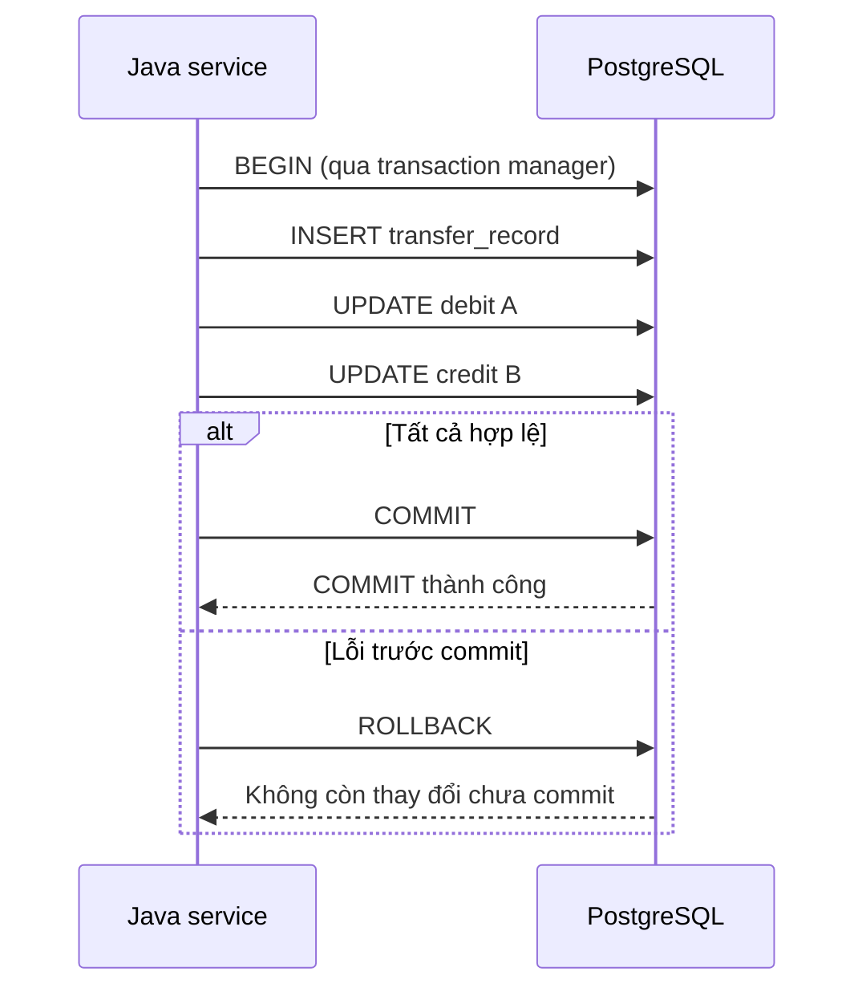
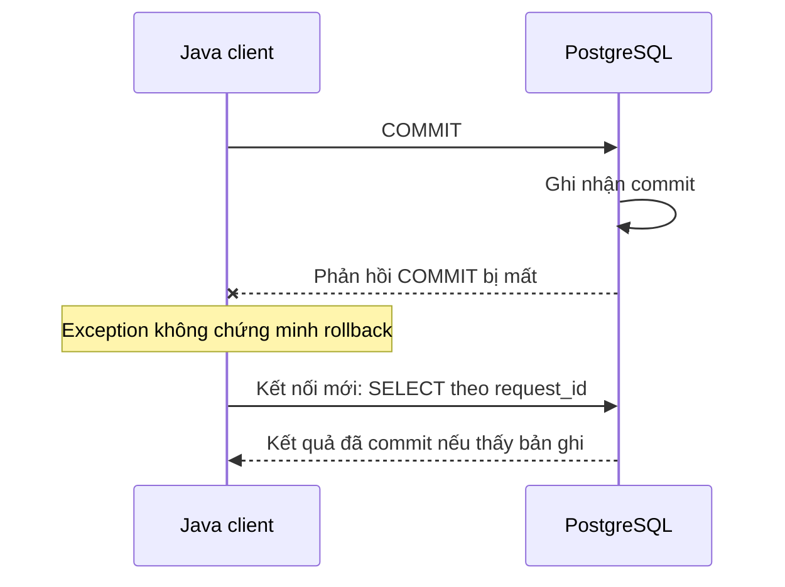

# Kiểm thử commit, rollback và các trường hợp lỗi giữa giao dịch

> **Chương:** Kiểm thử lưu trữ  
> **Phạm vi:** `DATA_PERSISTENCE_FUNDAMENTALS` — kiểm chứng tính bền vững và nhất quán của dữ liệu trong Java, từ lược đồ, câu lệnh SQL, giao dịch, cô lập và kiểm soát đồng thời đến lỗi kết nối, bảo mật, khôi phục và hiệu năng.

## Mục tiêu học tập

Sau bài này, người học có thể:

1. Thiết kế test chứng minh rằng nhiều câu SQL trong một nghiệp vụ **cùng commit hoặc cùng rollback**, thay vì chỉ kiểm tra giá trị trả về từ phương thức Java.
2. Phân biệt trạng thái giao dịch **chắc chắn thành công**, **chắc chắn rollback** và **chưa xác định** khi mất kết nối đúng thời điểm commit.
3. Chèn lỗi tại các điểm giữa transaction, sau thao tác JDBC, khi vi phạm constraint và khi commit; quan sát dữ liệu thực tế bằng kết nối/giao dịch độc lập.
4. Dùng JUnit 5, Spring `@Transactional`, Spring JDBC và PostgreSQL chạy trong Testcontainers để kiểm thử ngữ nghĩa database thật.
5. Kiểm tra concurrency, deadlock, serialization failure, retry, idempotency và tác động ra ngoài database mà không đưa ra kết luận sai từ test tự rollback hoặc mock.
6. Lập ma trận kiểm thử và tiêu chí nghiệm thu cho nghiệp vụ persistence trong môi trường CI và vận hành.

## 1. Vì sao kiểm thử một câu `INSERT` thành công là chưa đủ?

Giả sử hệ thống chuyển `30.00` từ ví A sang ví B. Nghiệp vụ gồm ba thay đổi:

1. Trừ số dư của A.
2. Cộng số dư của B.
3. Ghi một bản ghi chuyển tiền duy nhất theo `request_id` để đối soát và chống lặp yêu cầu.

Nếu chỉ kiểm tra câu `UPDATE` trừ tiền chạy được, ta chưa biết điều gì xảy ra khi câu cộng tiền hoặc ghi nhật ký thất bại. Một transaction đúng phải bảo vệ bất biến:

- **Atomicity:** không có trạng thái cuối cùng chỉ trừ ví A mà không cộng ví B.
- **Consistency:** số dư không âm, khóa ngoại và tính duy nhất của `request_id` còn được giữ; trong ví dụ không có phí, tổng hai ví không đổi.
- **Isolation:** các giao dịch đồng thời không được đọc/ghi theo cách làm hỏng bất biến đã định.
- **Durability:** sau commit được xác nhận và theo cam kết độ bền của database, dữ liệu phải tồn tại qua những dạng sự cố mà cấu hình bảo đảm.

ACID là **yêu cầu về hành vi**, không phải kết quả có thể chứng minh chỉ bằng mock repository. Test phải quan sát **trạng thái thật trong PostgreSQL**, đúng transaction boundary của ứng dụng Java.



Sơ đồ biểu diễn kết quả khi client còn kết nối và transaction manager nhận được câu trả lời. Nó **chưa bao quát** trường hợp DB đã commit nhưng kết nối mất trước khi Java nhận xác nhận; trường hợp này phải được kiểm thử riêng.

## 2. Các mức độ kiểm thử persistence

| Mức | Công cụ thường dùng | Chứng minh được | Chưa chứng minh được |
| --- | --- | --- | --- |
| Unit test | JUnit 5 + fake/mock | Nhánh nghiệp vụ, điều kiện đầu vào, gọi port/repository dự kiến | SQL thật, khóa hàng, rollback và commit thực. |
| Repository integration test | PostgreSQL thật qua Testcontainers | Mapping, SQL, constraint, kiểu dữ liệu, số hàng cập nhật | Toàn bộ ranh giới transaction của use case nếu chỉ gọi repository riêng lẻ. |
| Service transaction test | Spring context + PostgreSQL | Cùng commit/rollback trên nhiều câu SQL, propagation và lỗi trong transaction | Hành vi lúc mạng đứt đúng thời điểm COMMIT nếu không fault injection ở tầng kết nối. |
| Concurrency test | Nhiều kết nối/transaction thực, barrier điều phối | Khóa, deadlock, lost update, optimistic conflict, retry | Mọi lịch trình race có thể xảy ra nếu chỉ chạy vài lượt. |
| Recovery/chaos test | Network proxy, restart/failover có kiểm soát, DB riêng | Kết quả chưa xác định, phục hồi kết nối, đối soát theo khóa, độ bền theo cấu hình | Mọi lỗi phần cứng và mọi kịch bản production. |

**Nguyên tắc:** unit test kiểm tra logic nhanh; integration test kiểm tra sự thật của hệ quản trị dữ liệu. Không dùng H2 giả lập để kết luận về PostgreSQL `FOR UPDATE`, SQLSTATE, transaction isolation, `ON CONFLICT`, WAL hoặc ngữ nghĩa constraint nếu chức năng dựa vào hành vi đặc thù PostgreSQL.

## 3. Dựng ví dụ có các bất biến có thể đo

Lược đồ PostgreSQL:

```sql
CREATE TABLE wallet_account (
    id BIGINT PRIMARY KEY,
    balance NUMERIC(18, 2) NOT NULL CHECK (balance >= 0)
);

CREATE TABLE transfer_record (
    request_id UUID PRIMARY KEY,
    from_account_id BIGINT NOT NULL REFERENCES wallet_account(id),
    to_account_id BIGINT NOT NULL REFERENCES wallet_account(id),
    amount NUMERIC(18, 2) NOT NULL CHECK (amount > 0),
    status TEXT NOT NULL CHECK (status = 'SUCCEEDED'),
    created_at TIMESTAMPTZ NOT NULL DEFAULT now(),
    CHECK (from_account_id <> to_account_id)
);

INSERT INTO wallet_account(id, balance)
VALUES (1, 100.00), (2, 50.00);
```

Đây là **mô hình sư phạm** cho chuyển tiền nội bộ không có phí. Một hệ thống tiền tệ thật cần ledger bất biến, định danh tiền tệ, phân quyền, đối soát và quy định tài chính phù hợp; không nên dùng một bảng số dư và một transfer record làm thiết kế kế toán hoàn chỉnh.

**Trạng thái trước test:**

| Ví | Số dư |
| --- | ---: |
| A (`id = 1`) | 100.00 |
| B (`id = 2`) | 50.00 |
| **Tổng** | **150.00** |

Sau giao dịch `A → B`, số tiền `30.00`:

| Kết quả | A | B | Số dòng `transfer_record` mới |
| --- | ---: | ---: | ---: |
| Commit thành công | 70.00 | 80.00 | 1 |
| Rollback bất kỳ điểm nào trước commit | 100.00 | 50.00 | 0 |

Không chỉ assert tổng bằng `150.00`: lỗi “không cập nhật gì” vẫn giữ nguyên tổng. Cần assert **cả hai số dư, bản ghi transfer và kết quả transaction**.

## 4. Đặt transaction ở đúng ranh giới service

Ví dụ Spring JDBC với `JdbcTemplate`. Service nhận một hook dùng để chèn lỗi trong test; triển khai production của hook là no-op.

```java
public interface TransferFaultHook {
    void checkpoint(String point);
}
```

```java
import org.springframework.stereotype.Component;

@Component
public class NoopTransferFaultHook implements TransferFaultHook {
    @Override
    public void checkpoint(String point) {
        // Production không chèn lỗi.
    }
}
```

Nghiệp vụ:

```java
import java.math.BigDecimal;
import java.util.UUID;
import org.springframework.jdbc.core.JdbcTemplate;
import org.springframework.stereotype.Service;
import org.springframework.transaction.annotation.Transactional;

@Service
public class TransferService {
    private final JdbcTemplate jdbc;
    private final TransferFaultHook faultHook;

    public TransferService(JdbcTemplate jdbc, TransferFaultHook faultHook) {
        this.jdbc = jdbc;
        this.faultHook = faultHook;
    }

    @Transactional
    public void transfer(
            UUID requestId, long fromId, long toId, BigDecimal amount) {

        if (requestId == null || fromId <= 0 || toId <= 0
                || fromId == toId || amount == null
                || amount.signum() <= 0 || amount.scale() > 2) {
            throw new IllegalArgumentException("Invalid transfer");
        }

        // Bản ghi trạng thái cuối và thay đổi số dư cùng transaction.
        // Khóa UNIQUE/PK trên request_id chặn thực hiện lại cùng mã.
        jdbc.update("""
            INSERT INTO transfer_record
                (request_id, from_account_id, to_account_id, amount, status)
            VALUES (?, ?, ?, ?, 'SUCCEEDED')
            """, requestId, fromId, toId, amount);

        // Khóa hai hàng theo cùng thứ tự để giảm nguy cơ deadlock.
        long first = Math.min(fromId, toId);
        long second = Math.max(fromId, toId);
        lockAccount(first);
        lockAccount(second);

        int debited = jdbc.update("""
            UPDATE wallet_account
            SET balance = balance - ?
            WHERE id = ? AND balance >= ?
            """, amount, fromId, amount);

        if (debited != 1) {
            throw new IllegalStateException("Insufficient funds");
        }
        faultHook.checkpoint("AFTER_DEBIT");

        int credited = jdbc.update("""
            UPDATE wallet_account
            SET balance = balance + ?
            WHERE id = ?
            """, amount, toId);

        if (credited != 1) {
            throw new IllegalStateException("Destination not found");
        }
        faultHook.checkpoint("AFTER_CREDIT");
    }

    private void lockAccount(long id) {
        // Không có hàng sẽ phát lỗi và làm transaction rollback.
        jdbc.queryForObject(
            "SELECT id FROM wallet_account WHERE id = ? FOR UPDATE",
            Long.class,
            id
        );
    }
}
```

**Điều kiện để ví dụ đúng:**

- `@Transactional` phải được Spring áp dụng khi gọi **qua bean proxy**, có transaction manager phù hợp cùng `DataSource` mà `JdbcTemplate` sử dụng. Gọi `this.transfer(...)` bên trong chính bean có thể bỏ qua interceptor ở cấu hình proxy thông thường.
- Hai câu `UPDATE` và `INSERT` đều dùng **cùng transaction**. Đối với các exception unchecked không bị nuốt, cấu hình Spring thông thường đánh dấu rollback.
- `SELECT ... FOR UPDATE` khóa hai ví theo thứ tự ID ổn định để giảm khả năng hai transfer ngược chiều chờ nhau; không bảo đảm không có deadlock khi hệ thống còn các thứ tự khóa khác.
- `CHECK (balance >= 0)` và `UPDATE ... AND balance >= ?` tạo lớp bảo vệ ở database, không chỉ dựa vào kiểm tra ở Java.
- Mã này **từ chối request trùng bằng khóa chính**, nhưng chưa triển khai giao thức trả lại kết quả cũ. Phần retry/idempotency sẽ trình bày riêng.
- Hook chèn lỗi **chỉ do test kiểm soát**, tuyệt đối không lấy tên checkpoint từ client/API để cho người dùng làm lỗi transaction.

## 5. Một lỗi ở giữa transaction phải rollback toàn bộ

### 5.1. Lỗi ngay sau khi trừ số dư

Giả sử hook `AFTER_DEBIT` ném `RuntimeException`. Ở thời điểm ấy, trong transaction database đã thực hiện `INSERT transfer_record` và `UPDATE wallet_account` cho ví A. Nhưng Java chưa được phép báo thành công vì thao tác cộng B chưa hoàn tất.

```mermaid
sequenceDiagram
    participant T as Integration Test
    participant S as TransferService
    participant DB as PostgreSQL
    T->>S: transfer(requestId, A, B, 30.00)
    S->>DB: INSERT transfer_record (chưa commit)
    S->>DB: UPDATE A = A - 30.00 (chưa commit)
    S--xS: InjectedFault AFTER_DEBIT
    S->>DB: ROLLBACK
    S-->>T: Exception
    T->>DB: SELECT qua giao dịch/kết nối mới
    DB-->>T: A=100.00; B=50.00; transfer không tồn tại
```

**Đây là bằng chứng rollback thực**, vì câu SQL trừ tiền đã được database xử lý, nhưng sau exception trạng thái commit cuối cùng không chứa thay đổi nào.

### 5.2. Lỗi sau khi cộng B, trước commit

Chèn lỗi ở `AFTER_CREDIT` kiểm tra rằng cả ba thao tác SQL có thể đã chạy mà vẫn bị rollback. Kết quả mong đợi vẫn là `A=100.00`, `B=50.00` và không có `transfer_record`.

Đừng chỉ kiểm tra `assertThrows`. Phương thức cũng có thể ném exception **trước khi gửi SQL đầu tiên**; khi ấy test vẫn xanh nhưng không kiểm chứng được việc rollback những thay đổi đã thực thi. Phải chọn checkpoint sau thao tác SQL và assert dữ liệu của **toàn bộ bất biến**.

### 5.3. Lỗi do constraint

Ví dụ `request_id` đã tồn tại, `amount` không hợp lệ hoặc một khóa ngoại trỏ tới ví không có thật:

- PostgreSQL kiểm tra các constraint tương ứng và báo lỗi.
- Spring JDBC thường dịch lỗi integrity thành `DataIntegrityViolationException` hoặc subtype như `DuplicateKeyException`.
- Không được bắt exception rồi bỏ qua khi transaction vẫn đang ở trạng thái lỗi. Một số lỗi SQL khiến transaction PostgreSQL bị **aborted** cho tới rollback hoặc savepoint rollback.
- Ở service boundary, exception không được che giấu thành một kết quả “thành công một phần”.

Nếu một sự kiện ngoài database (gửi email, gọi HTTP, publish message) diễn ra **trước commit**, rollback không đảo ngược sự kiện ngoài ấy. Muốn “gửi thông báo sau khi transfer thực sự commit”, có thể dùng **transactional outbox**: ghi outbox row trong cùng transaction, sau commit một worker gửi và retry idempotent.

## 6. Test integration bằng PostgreSQL thật

Với Java 17+, JUnit 5, Spring Boot 3.x, Testcontainers và PostgreSQL, có thể dùng một instance DB riêng cho bài test. Các ví dụ giả định schema của phần 3 được áp bằng migration hoặc SQL initialization trong test profile.

Phụ thuộc cần có về mặt khái niệm: `spring-boot-starter-test`, `spring-boot-starter-jdbc`, driver PostgreSQL, Testcontainers PostgreSQL/JUnit Jupiter và transaction manager của Spring. Tên artifact/cấu hình cụ thể phụ thuộc bản Spring Boot/Testcontainers đang sử dụng; **không dùng database production làm môi trường thử nghiệm**.

### 6.1. Test container và môi trường độc lập

```java
import org.junit.jupiter.api.BeforeEach;
import org.junit.jupiter.api.Test;
import org.junit.jupiter.api.extension.ExtendWith;
import org.springframework.beans.factory.annotation.Autowired;
import org.springframework.boot.test.context.SpringBootTest;
import org.springframework.boot.test.context.TestConfiguration;
import org.springframework.context.annotation.Bean;
import org.springframework.context.annotation.Import;
import org.springframework.context.annotation.Primary;
import org.springframework.jdbc.core.JdbcTemplate;
import org.springframework.test.context.DynamicPropertyRegistry;
import org.springframework.test.context.DynamicPropertySource;
import org.testcontainers.containers.PostgreSQLContainer;
import org.testcontainers.junit.jupiter.Container;
import org.testcontainers.junit.jupiter.Testcontainers;

import java.math.BigDecimal;
import java.util.UUID;

import static org.junit.jupiter.api.Assertions.*;

@SpringBootTest
@Testcontainers
@Import(TransferIntegrationTest.FaultConfig.class)
class TransferIntegrationTest {
    @Container
    static final PostgreSQLContainer<?> postgres =
            new PostgreSQLContainer<>("postgres:16-alpine");

    @DynamicPropertySource
    static void configureDatabase(DynamicPropertyRegistry registry) {
        registry.add("spring.datasource.url", postgres::getJdbcUrl);
        registry.add("spring.datasource.username", postgres::getUsername);
        registry.add("spring.datasource.password", postgres::getPassword);
    }

    static final class InjectedFault extends RuntimeException {
        InjectedFault(String point) {
            super(point);
        }
    }

    static final class SwitchableFaultHook implements TransferFaultHook {
        volatile String failAt;

        @Override
        public void checkpoint(String point) {
            if (point.equals(failAt)) {
                throw new InjectedFault(point);
            }
        }
    }

    @TestConfiguration
    static class FaultConfig {
        @Bean
        @Primary
        SwitchableFaultHook testFaultHook() {
            return new SwitchableFaultHook();
        }
    }

    @Autowired TransferService transferService;
    @Autowired JdbcTemplate jdbc;
    @Autowired SwitchableFaultHook faultHook;

    @BeforeEach
    void resetData() {
        // Test không được chú thích @Transactional ở class/method.
        // Schema phải tồn tại từ migration/test initialization.
        faultHook.failAt = null;
        jdbc.update("DELETE FROM transfer_record");
        jdbc.update("DELETE FROM wallet_account");
        jdbc.update("""
            INSERT INTO wallet_account (id, balance)
            VALUES (1, 100.00), (2, 50.00)
            """);
    }

    BigDecimal balanceOf(long id) {
        return jdbc.queryForObject(
                "SELECT balance FROM wallet_account WHERE id = ?",
                BigDecimal.class, id);
    }

    int countTransfer(UUID requestId) {
        return jdbc.queryForObject("""
            SELECT COUNT(*) FROM transfer_record WHERE request_id = ?
            """, Integer.class, requestId);
    }

    // Các @Test được trình bày tiếp ở phần 6.2 và 6.3.
}
```

**Ghi chú để áp dụng code:**

- `@DynamicPropertySource` trỏ datasource vào container PostgreSQL, không phải DB developer hoặc production. `@Container` quản lý vòng đời container của test.
- `@TestConfiguration` cung cấp hook test với `@Primary` để thay thế hook no-op trong context. Reset biến fault trước mỗi test, không chạy các test dùng biến hook chung song song nếu chưa tách instance/test isolation.
- Không chú thích cả lớp test bằng `@Transactional`: trong Spring Test, transaction của test mặc định **rollback khi test kết thúc**; service với propagation `REQUIRED` có thể chỉ tham gia transaction test, khiến “commit test” không kiểm chứng commit thật.
- Dữ liệu test được reset trước mỗi ca; với suite lớn, cân nhắc schema/container tách riêng, transaction control rõ ràng và không phụ thuộc thứ tự test.
- `@SpringBootTest` yêu cầu có ứng dụng/cấu hình Spring Boot trong project; các lớp `TransferService`, `TransferFaultHook` và schema phải ở đúng package/context của bài test. Đoạn này là mẫu tích hợp, không phải một file Java đơn lẻ có thể chạy không cần dự án.

### 6.2. Test commit thành công

Thêm method sau vào `TransferIntegrationTest`:

```java
@Test
void commitsAllChangesTogether() {
    UUID requestId = UUID.randomUUID();

    transferService.transfer(
            requestId, 1L, 2L, new BigDecimal("30.00"));

    // Lời gọi service qua Spring proxy đã trả về sau commit.
    // Query ngoài test transaction quan sát trạng thái đã commit.
    assertEquals(new BigDecimal("70.00"), balanceOf(1L));
    assertEquals(new BigDecimal("80.00"), balanceOf(2L));
    assertEquals(1, countTransfer(requestId));
}
```

**Giá trị của test này:** nếu method `@Transactional` thực sự commit khi proxy trả về, những truy vấn sau đó qua `JdbcTemplate` không nằm trong transaction test bao ngoài sẽ quan sát được dữ liệu cuối cùng. Nếu query đọc trên cùng transaction chưa commit, nó có thể thấy thay đổi **chưa commit** và cho false positive.

Khi cần kiểm chứng rõ từ một connection độc lập, có thể mở giao dịch đọc mới thông qua `TransactionTemplate` hoặc một datasource/query client riêng; kiểm tra cả isolation và việc không có transaction test bao quanh.

### 6.3. Hai test rollback sau SQL

```java
@Test
void rollsBackWhenFailureOccursAfterDebit() {
    UUID requestId = UUID.randomUUID();
    faultHook.failAt = "AFTER_DEBIT";

    assertThrows(InjectedFault.class, () ->
        transferService.transfer(
            requestId, 1L, 2L, new BigDecimal("30.00")));

    assertEquals(new BigDecimal("100.00"), balanceOf(1L));
    assertEquals(new BigDecimal("50.00"), balanceOf(2L));
    assertEquals(0, countTransfer(requestId));
}

@Test
void rollsBackWhenFailureOccursAfterCredit() {
    UUID requestId = UUID.randomUUID();
    faultHook.failAt = "AFTER_CREDIT";

    assertThrows(InjectedFault.class, () ->
        transferService.transfer(
            requestId, 1L, 2L, new BigDecimal("30.00")));

    assertEquals(new BigDecimal("100.00"), balanceOf(1L));
    assertEquals(new BigDecimal("50.00"), balanceOf(2L));
    assertEquals(0, countTransfer(requestId));
}
```

Hai test này không phụ thuộc vào thời điểm JPA dirty checking vì dùng `JdbcTemplate`: SQL `UPDATE` được thực thi trước checkpoint; transaction vẫn chưa commit. Nếu triển khai bằng JPA, có thể cần `EntityManager.flush()` trước checkpoint để bảo đảm SQL/constraint được thử tại đúng điểm, nhưng **flush không phải commit** và vẫn có thể rollback.

### 6.4. Test constraint và trùng request

```java
import org.springframework.dao.DataIntegrityViolationException;

@Test
void duplicateRequestCannotDebitTwice() {
    UUID requestId = UUID.randomUUID();
    BigDecimal amount = new BigDecimal("30.00");

    transferService.transfer(requestId, 1L, 2L, amount);

    assertThrows(DataIntegrityViolationException.class, () ->
        transferService.transfer(requestId, 1L, 2L, amount));

    assertEquals(new BigDecimal("70.00"), balanceOf(1L));
    assertEquals(new BigDecimal("80.00"), balanceOf(2L));
    assertEquals(1, countTransfer(requestId));
}

@Test
void insufficientFundsRollsBackRecord() {
    UUID requestId = UUID.randomUUID();

    assertThrows(IllegalStateException.class, () ->
        transferService.transfer(
            requestId, 1L, 2L, new BigDecimal("200.00")));

    assertEquals(new BigDecimal("100.00"), balanceOf(1L));
    assertEquals(new BigDecimal("50.00"), balanceOf(2L));
    assertEquals(0, countTransfer(requestId));
}
```

Điểm quan trọng của test duplicate: DB từ chối request trùng trước khi trừ tiền lần hai; **nó chưa phải API idempotent hoàn chỉnh**, vì client đang nhận exception. Muốn trả lại kết quả thành công trước đó, tầng xử lý bên ngoài transaction lỗi cần mở một transaction mới để đọc `transfer_record` theo `request_id`, so sánh `fromId/toId/amount`, rồi trả đúng kết quả bền vững nếu payload khớp; cùng khóa với payload khác phải báo xung đột.

Nếu chỉ mock `repository.save(...)` để ném exception, test không chứng minh rằng unique constraint thật tồn tại, SQL thực tế không lỗi mapping, hoặc rollback được các `UPDATE` đã chạy.

## 7. Những bẫy của `@Transactional` trong kiểm thử

### 7.1. Test tự rollback có thể làm ta tưởng rollback của service hoạt động

```java
// CẨN THẬN: transaction của Spring Test mặc định rollback cuối test.
@Transactional
@Test
void misleadingCommitTest() {
    transferService.transfer(requestId, 1L, 2L, amount);
    assertEquals(new BigDecimal("70.00"), balanceOf(1L));
}
```

Ở đây test có thể nhìn thay đổi do service `@Transactional(propagation = REQUIRED)` tham gia cùng transaction của test. Nhưng cuối test transaction bị rollback; **chưa chứng minh commit thực**.

Cách đúng cho bài kiểm thử commit:

1. Không có transaction test bao ngoài, hoặc dùng cơ chế điều khiển transaction test rõ ràng như `TestTransaction` khi thật sự cần.
2. Gọi method service qua Spring bean proxy để transaction được mở/commit đúng cấu hình.
3. Sau khi service trả về, đọc từ giao dịch/kết nối khác.
4. Assert cả số dư và transfer record. Có thể khởi động lại DB trong một bài test độ bền riêng nếu cấu hình cho phép.

### 7.2. `@Transactional` không áp dụng vì self-invocation

Nếu một phương thức trong cùng bean gọi `this.transfer(...)`, interceptor proxy có thể không chạy. Khi đó repository có thể thực thi từng câu SQL trong transaction riêng/autocommit, tạo trạng thái cập nhật dở dang.

Test cần gọi đúng đường đi production (controller → application service → repository), không gọi một helper nội bộ rồi suy diễn rằng proxy được áp dụng. Khi có yêu cầu propagation đặc biệt (`REQUIRES_NEW`, `NESTED`), phải kiểm tra transaction manager và cách gọi thực tế; đừng mặc định mọi thiết lập đều hỗ trợ savepoint như nhau.

### 7.3. Catch exception rồi tiếp tục

```java
@Transactional
public void flawedOperation() {
    try {
        jdbc.update("INSERT INTO ..."); // Có thể ném lỗi.
    } catch (RuntimeException error) {
        // Sai: nuốt lỗi rồi tiếp tục trả về 'success'.
    }
}
```

Spring mặc định rollback cho unchecked exception **nếu exception thoát ra qua transaction interceptor**. Nếu bắt và nuốt lỗi, một số loại lỗi không tự đánh dấu rollback-only ở Spring, trong khi PostgreSQL có thể đã đưa transaction vào trạng thái aborted. Kết quả là commit lỗi muộn, rollback bất ngờ hoặc hành vi khác với dự kiến.

Với nested transaction, một nhánh đã đánh dấu **rollback-only** nhưng bên ngoài cố commit có thể gây `UnexpectedRollbackException`. Test phải assert trạng thái database cuối, không chỉ assert thông điệp lỗi.

### 7.4. Checked exception và chính sách rollback

Trong cấu hình Spring truyền thống, mặc định rollback với `RuntimeException` và `Error`; checked exception có thể **không** làm rollback trừ khi cấu hình `rollbackFor` hoặc chính sách tương ứng. Nếu phương thức ném một checked business exception sau khi thực thi SQL, hãy viết test chỉ ra kỳ vọng commit/rollback rõ ràng và cấu hình tương ứng.

Đừng suy ra “bất kỳ exception nào cũng rollback” khi chưa xem chính sách transaction của hệ thống và thời điểm exception được ném.

## 8. Lỗi trước commit khác lỗi mất kết nối lúc commit

### 8.1. Ba nhóm trạng thái kết quả

| Tình huống | Điều có thể kết luận | Hành động của ứng dụng |
| --- | --- | --- |
| Transaction manager nhận xác nhận `COMMIT` thành công từ DB | Giao dịch đã được commit theo cam kết DB và cấu hình durability. | Trả thành công, ghi metric, tiếp tục. |
| Lỗi trong transaction và rollback thành công được xác nhận | Những thay đổi chưa commit thuộc transaction đã bị rollback. | Trả lỗi, retry **theo ngữ nghĩa** khi phù hợp. |
| Mất kết nối/timeout quanh `COMMIT`, không nhận được kết quả cuối | **Chưa xác định**: DB có thể đã commit dù client nhận exception. | Đối soát bằng khóa yêu cầu bền vững trên kết nối mới; không tạo request ID mới để retry mù quáng. |

Một lỗi do server từ chối câu SQL trước commit có thể rõ nghĩa hơn timeout mạng; nhưng nếu kết nối bị mất mà không nhận được kết quả cuối, vẫn phải cân nhắc điều gì đã được DB thực hiện.



**Quan trọng:** ném `RuntimeException` tại `AFTER_CREDIT` trong phương thức Java chỉ mô phỏng **lỗi trước commit**, không mô phỏng được trường hợp **COMMIT đã thành công nhưng ACK bị mất**. Vì vậy test rollback ở phần 6 không thể thay thế test recovery của commit unknown.

### 8.2. Test commit unknown bằng fault injection ở đúng tầng

Một bài thử chuyên sâu có thể sử dụng network proxy (ví dụ Toxiproxy), fault injection trong driver hoặc môi trường database độc lập để:

1. Gửi một request cố định `request_id = K`.
2. Tạo tình huống phía client không nhận được kết quả commit cuối cùng; ghi lại sự kiện và loại lỗi.
3. **Không giả định đã rollback**; khi kết nối được phục hồi, mở một session mới và tra cứu `transfer_record WHERE request_id = K` trên authoritative primary.
4. Nếu bản ghi `K` tồn tại, kiểm tra payload và số dư/bút toán tương ứng; trả kết quả cũ, không trừ/cộng thêm lần nữa.
5. Nếu tạm thời không thể đọc DB, giữ trạng thái **UNKNOWN/PENDING_RECONCILIATION** theo hợp đồng ứng dụng; không tuyên bố thất bại dứt khoát.
6. Nếu không có bản ghi `K` và yêu cầu được phép thử lại, **chỉ retry với cùng khóa K**, để unique constraint chặn hai lần áp dụng khi lần trước thực sự đã commit hoặc đang còn xử lý.

**Không nhầm hai thí nghiệm:** kill PostgreSQL backend **trước khi commit** có thể chỉ kiểm tra rollback do mất session; nó không chứng minh đã tái hiện được ACK mất *sau* commit. Muốn kiểm tra đúng commit unknown cần kiểm soát/quan sát thời điểm gửi `COMMIT` và đường trả lời; hoặc viết test trạng thái recovery từ cả hai khả năng đã commit/chưa commit.

### 8.3. Giao thức đối soát với request ID

Một service đối soát sau lỗi nên làm việc với bản ghi DB bền vững:

```sql
SELECT request_id, from_account_id, to_account_id,
       amount, status
FROM transfer_record
WHERE request_id = :requestId;
```

| Kết quả đọc lại | Quyết định |
| --- | --- |
| Có `SUCCEEDED` và payload khớp | Trả thành công đã ghi nhận; không chạy transfer thêm lần nữa. |
| Có `SUCCEEDED` nhưng payload khác | Báo xung đột idempotency key, không tự đổi dữ liệu. |
| Chưa tìm thấy | Không khẳng định ngay “lần trước rollback”; kiểm tra khả năng request còn đang chạy và retry với **cùng khóa** theo chính sách. |
| Không truy cập được authoritative DB | Giữ trạng thái chưa xác định, retry đối soát có giới hạn và thông báo phù hợp. |

Đối soát chỉ đáng tin khi tra cứu đúng **nguồn dữ liệu authoritative**; replica đang lag có thể chưa thấy transfer đã commit. Nếu cần dùng read replica, phải có cơ chế xác nhận đã bắt kịp mốc cần thiết.

## 9. Kiểm thử lỗi từ PostgreSQL và quyết định retry

Một số mã SQLSTATE thường gặp với PostgreSQL:

| SQLSTATE / lỗi | Nghĩa thường gặp | Kỳ vọng test |
| --- | --- | --- |
| `23505` | Unique violation | Transaction bị từ chối/rollback, không sinh transfer trùng. |
| `23503` | Foreign key violation | Không ghi bản ghi tham chiếu ví không tồn tại. |
| `23514` | Check violation | Không cho phép số dư âm hoặc amount không hợp lệ. |
| `40001` | Serialization failure | Rollback và có thể retry **toàn bộ transaction** trên transaction mới. |
| `40P01` | Deadlock detected | Một transaction bị chọn làm nạn nhân; rollback, retry có backoff khi an toàn. |
| `55P03` | Lock not available (ví dụ NOWAIT) | Bỏ cuộc/chờ hoặc retry theo chính sách, không giả định mọi lỗi lock đều như deadlock. |
| `57014` | Query canceled, có thể do statement timeout | Xác định timeout ở đâu, rollback transaction nếu cần; không tự suy ra mọi trường hợp mất kết nối đều đã rollback. |
| Mất kết nối trong lúc `COMMIT` | Không nhận được outcome tin cậy | Đối soát theo khóa bền vững; không retry bằng request mới. |

Không nên dựa hoàn toàn vào text của exception để phân loại. JDBC có `SQLException.getSQLState()`; Spring có lớp exception dịch lỗi nhưng vẫn nên giữ operation ID, SQLSTATE và tên constraint ở log đã làm sạch dữ liệu nhạy cảm.

**Retry phải nằm ở đúng cấp độ:** với `40001`/`40P01`, một transaction đã thất bại thường phải được thực thi lại từ đầu bằng session/transaction mới, sau khi đọc lại trạng thái và kiểm tra bất biến. Retry riêng câu `UPDATE` lỗi bên trong transaction đã aborted thường không hoạt động như mong muốn.

### 9.1. Test deadlock hoặc xung đột đồng thời

Không tạo hai thread ngẫu nhiên rồi hy vọng sẽ có race. Dùng barrier/latch hoặc một test database có thể điều khiển thời điểm khóa:

```text
Transaction T1                     Transaction T2
BEGIN                              BEGIN
LOCK account 1                     LOCK account 2
barrier: cả hai giữ khóa           barrier: cả hai giữ khóa
thử LOCK account 2                 thử LOCK account 1
=> có vòng chờ; DB phát hiện deadlock và chọn nạn nhân
=> test kiểm tra ít nhất một transaction thất bại phù hợp,
   không đoán trước T1 hay T2 luôn bị rollback
```

Trong thực tế, thiết kế khóa theo thứ tự cố định có thể ngăn đúng lịch trình trên. Test phục vụ **phơi bày lỗi nếu hai đường nghiệp vụ khóa khác thứ tự**, và test sau sửa phải xác minh không còn vòng chờ ở lịch trình đã tái hiện.

Khi chạy concurrency test:

- Mỗi luồng dùng transaction/connection riêng; không chia sẻ `EntityManager` hoặc một `Connection` mutable giữa thread.
- Dùng timeout hữu hạn cho latch/future để CI không treo mãi.
- Khởi tạo dữ liệu sạch, quan sát số dư và tổng sau khi cả hai transaction kết thúc.
- Không suy ra một lần test xanh chứng minh không còn deadlock ở mọi lịch trình.

### 9.2. Kiểm thử isolation theo loại bất biến

Một test khác cho hai giao dịch cùng đọc rồi ghi ở `READ COMMITTED` có thể phát hiện lost update nếu code tính giá trị mới trên Java và chạy `UPDATE balance = ?` không điều kiện. Với ví dụ này, câu `UPDATE balance = balance - ? WHERE balance >= ?` cùng row lock giúp bảo vệ bất biến đơn giản trên một hàng.

Với bất biến liên quan **nhiều hàng**, cần xét thêm predicate locking, `SERIALIZABLE`, khóa guard row, unique/exclusion constraint hoặc mô hình ledger phù hợp. Chọn mức isolation là quyết định nghiệp vụ, không phải nhãn “an toàn hơn” mà không kiểm chứng throughput và lỗi retry.

## 10. Savepoint và transaction con không phải một lần commit độc lập

Trong PostgreSQL, `SAVEPOINT` giúp tạo một điểm có thể rollback **bên trong transaction hiện tại**:

```sql
BEGIN;

UPDATE wallet_account
SET balance = balance - 10
WHERE id = 1;

SAVEPOINT before_optional_step;

-- Giả sử bước phụ thất bại, có thể:
ROLLBACK TO SAVEPOINT before_optional_step;

UPDATE wallet_account
SET balance = balance + 10
WHERE id = 2;

COMMIT;
```

`ROLLBACK TO SAVEPOINT` không hoàn tác các thao tác **trước** savepoint, cũng không tạo commit riêng cho phần trước savepoint. Nếu transaction ngoài rollback, toàn bộ thay đổi chưa commit vẫn bị hủy.

Trong Spring, `Propagation.NESTED` có thể dựa vào savepoint khi transaction manager/tài nguyên hỗ trợ. `REQUIRES_NEW` khác: nó tạo transaction riêng có thể commit độc lập với transaction ngoài. Nếu một log nghiệp vụ hoặc outbox **bắt buộc rollback cùng giao dịch chính**, đặt nó vào `REQUIRES_NEW` thường là sai.

**Cần test propagation theo đúng cấu hình:** hai phương thức `@Transactional` có annotation khác nhau không chứng minh đã tạo hai transaction nếu gọi qua `this` hoặc transaction manager không hỗ trợ cách propagation mong đợi.

## 11. Lỗi sau commit và side effect ngoài database

Đoạn mã:

```java
@Transactional
public void transferThenEmail(...) {
    // Trừ A, cộng B, ghi transfer vào database.
    emailClient.sendConfirmation(...); // Không nằm trong transaction DB.
}
```

Nếu email đã gửi nhưng transaction rollback, người dùng nhận xác nhận sai. Nếu DB commit thành công nhưng ứng dụng chết trước khi gửi email, thông báo bị bỏ sót. Kiểm thử transaction DB **không đủ** để chứng minh hiệu quả cuối cùng của hai hệ thống.

Giải pháp thông dụng là **transactional outbox**:

```sql
CREATE TABLE transfer_outbox (
    event_id UUID PRIMARY KEY,
    request_id UUID NOT NULL REFERENCES transfer_record(request_id),
    event_type TEXT NOT NULL,
    delivered_at TIMESTAMPTZ
);
```

Khi chuyển tiền, ghi outbox row trong **cùng transaction** với chuyển số dư; worker sau đó gửi message/email và đánh dấu kết quả. Cần test rằng rollback không để lại outbox row và commit có transfer + outbox row. Vì worker có thể gửi lặp nếu mất ACK, consumer/provider phải idempotent theo event ID hoặc business key, không cam kết “exactly once” toàn hệ thống chỉ nhờ transaction DB.

## 12. Test crash và durability: kiểm chứng đúng phạm vi

**Commit thành công** và **durability** có liên hệ nhưng không trùng với việc một lời gọi Java đã return. Cần xác định PostgreSQL chạy với những cấu hình nào (`fsync`, `synchronous_commit`, WAL/storage, replication/failover).

Các bài thử nâng cao:

| Sự cố giả lập | Mục tiêu | Giới hạn kết luận |
| --- | --- | --- |
| Kill process Java sau khi DB commit | Đọc lại transfer bằng service mới | Kiểm tra dữ liệu ở DB vẫn tồn tại, không nhất thiết đã kiểm tra crash của DB. |
| Kill client connection trước khi gửi COMMIT | DB rollback session chưa commit trong trường hợp bình thường | Không chứng minh commit-ACK-loss. |
| Mất response sau khi COMMIT được DB xử lý | Đối soát request ID, không double-apply | Cần fault injection/quan sát chính xác thời điểm ở tầng mạng. |
| Restart PostgreSQL sau commit đã xác nhận | Khởi động lại, kiểm tra dữ liệu sau recovery | Chỉ chứng minh trong giới hạn kiểu restart và cấu hình đang kiểm tra. |
| Crash/failover database có kiểm soát | Kiểm tra RPO/RTO, timeline, dữ liệu đã ack | Không suy rộng sang mọi dạng mất đĩa hoặc hỏng storage. |
| Restore backup tới mốc thời gian | Đối soát transfer trước/sau target | Thuộc bài kiểm thử backup/PITR, không thay thế test rollback runtime. |

Không thực hiện kill process database, proxy packet fault hoặc thay đổi `fsync` trên production để “test nhanh”. Các kịch bản này cần **môi trường cách ly**, quota thời gian, snapshot và quy trình khôi phục.

## 13. Ma trận kiểm thử tối thiểu trước khi release

| ID | Điểm tiêm lỗi hoặc hành động | Kỳ vọng dữ liệu sau cùng |
| --- | --- | --- |
| T01 | Giao dịch hợp lệ, không lỗi | A giảm 30, B tăng 30, một transfer đã commit. |
| T02 | Exception ngay sau `INSERT transfer_record` | Không đổi số dư, không có transfer. |
| T03 | Exception sau `UPDATE` trừ A | A/B giữ nguyên, transfer rollback. |
| T04 | Exception sau `UPDATE` cộng B | A/B giữ nguyên, transfer rollback. |
| T05 | Không đủ số dư | Không có số dư âm, transfer không tồn tại. |
| T06 | Request ID trùng | Không trừ/cộng lần hai; API đối soát kết quả cũ khi payload khớp. |
| T07 | Request ID trùng nhưng payload khác | Không ghi dữ liệu mới; trả xung đột. |
| T08 | Vi phạm FK/`CHECK`/`UNIQUE` | Lỗi được phân loại, transaction rollback đúng. |
| T09 | Hai transfer chạy đồng thời cùng ví | Không mất cập nhật; tổng số dư và bất biến còn đúng. |
| T10 | Deadlock hoặc `40001` | Transaction lỗi rollback, retry toàn transaction có giới hạn. |
| T11 | Statement timeout trước commit | Không để lại giao dịch dở dang; đóng/rollback đúng trạng thái session. |
| T12 | Commit ACK mất, DB có record `K` | Reconcile trả kết quả đã commit; không double-apply. |
| T13 | Commit ACK mất, DB không có record `K` | Retry cùng khóa theo chính sách, không sinh khóa mới. |
| T14 | DB unavailable khi reconcile | `UNKNOWN`/pending; không tự suy ra rollback. |
| T15 | Outbox insert thất bại | Transfer cùng transaction rollback. |
| T16 | Commit thành công + worker gửi thông báo lặp | Consumer/provider idempotent, không nhân đôi tác động. |
| T17 | Test vô tình có transaction test bao ngoài | Phát hiện và sửa test; phải thực sự kiểm tra commit ngoài transaction test. |
| T18 | Restart/restore trên môi trường cách ly | Đối soát dữ liệu, schema, recovery target và RPO/RTO. |

**Mức kiểm tra nên có:** assert exception/SQLSTATE khi phù hợp, assert **cả trạng thái nguồn và đích**, số dòng transfer/outbox, tính duy nhất `request_id`, điều kiện số dư không âm và khả năng đọc bằng transaction mới. Không dựa vào một câu `SELECT COUNT(*)` duy nhất để kết luận mọi bất biến tài chính đã đúng.

## 14. Thiết kế kiểm thử ổn định trong CI

1. **Cách ly môi trường:** dùng Testcontainers PostgreSQL hoặc database test chỉ dành cho CI; user DB phải có quyền tối thiểu và không có secrets production.
2. **Schema có kiểm soát:** chạy migration như production (Flyway/Liquibase nếu dự án dùng); không thay lược đồ tùy tiện giữa các test.
3. **Dữ liệu xác định:** tạo fixture bằng SQL/transaction rõ ràng và reset giữa test; không phụ thuộc thứ tự chạy.
4. **Ranh giới test:** không bọc test commit trong `@Transactional` mặc định rollback; mở transaction mới khi kiểm tra committed state.
5. **Fault injection chính xác:** checkpoint sau SQL, hook có thể reset và không chịu điều khiển từ request HTTP.
6. **Không flaky concurrency:** barrier/latch, timeout hữu hạn, ghi nhận thứ tự sự kiện; chạy nhiều lịch trình nhưng vẫn chấp nhận tính nondeterministic khi DB chọn transaction bị deadlock.
7. **Retry không che lỗi:** giới hạn số lần và backoff; giữ nguyên request ID, log attempt/outcome và kiểm tra final invariant.
8. **Bằng chứng vận hành:** thu thập transaction latency, deadlock count, SQLSTATE, số rollback, số trạng thái commit unknown và tiến độ reconcile.
9. **Tách loại thử nghiệm:** unit/integration chạy thường xuyên; chaos/restart/failover chạy ở môi trường riêng khi có năng lực phục hồi phù hợp.
10. **Dọn dẹp an toàn:** dùng DB test riêng; không xóa dữ liệu thật hoặc retry một thao tác tài chính trên production để “kiểm tra”.

Một test pass có nghĩa hẹp: **nó kiểm chứng giả thuyết trong điều kiện và lịch trình được tạo ra**. Chất lượng persistence test đến từ tập kịch bản đúng, quan sát sau commit/rollback, fixture tin cậy và khả năng tái hiện lỗi.

## 15. Bài thực hành

**Bối cảnh:** ứng dụng Java cho phép chuyển tiền giữa hai ví. Database là PostgreSQL; tầng truy cập dùng Spring JDBC. Hai ví ban đầu lần lượt có `100.00` và `50.00`. Nghiệp vụ chuyển `30.00` và ghi `transfer_record`.

**Nhiệm vụ:**

1. Tạo schema `wallet_account` và `transfer_record` như phần 3, bảo đảm có `CHECK`/FK/PK và giá trị decimal.
2. Xây `TransferService` với ranh giới `@Transactional`, khóa hai ví theo thứ tự, debit có điều kiện và credit trong cùng transaction.
3. Thiết lập PostgreSQL Testcontainers; cho Spring Boot test kết nối qua `@DynamicPropertySource`. Đảm bảo migration được chạy trước test.
4. Viết test commit thành công rồi đọc từ transaction/kết nối mới; assert cả A, B và transfer record.
5. Tạo fault hook `AFTER_DEBIT` và `AFTER_CREDIT`, ném unchecked exception tại từng checkpoint và chứng minh rollback hoàn toàn.
6. Test vi phạm unique request ID, không đủ tiền, thiếu ví đích và amount không hợp lệ. Phân biệt input validation và database constraint.
7. Cố tình thêm `@Transactional` trên class test rồi quan sát sự khác biệt giữa “thấy dữ liệu chưa commit” và “đã commit thật”; sửa test để loại bỏ false positive.
8. Viết test đồng thời với hai transfer ngược chiều; đo thời gian chờ khóa, kiểm tra không có số dư âm và tổng không đổi. Thêm test deadlock bằng thứ tự khóa đối nghịch trên môi trường test nếu cần.
9. Thiết kế thử nghiệm mất ACK lúc commit; từ cả hai kết quả có/không có record, triển khai giao thức retry cùng `request_id` và kiểm tra không double-apply.
10. Nếu có outbox, test rollback kéo theo outbox rollback; test worker gửi lặp phải idempotent.

**Câu hỏi tự đánh giá**

1. Vì sao `assertThrows` sau một lỗi ngay đầu phương thức không chứng minh đã rollback các câu SQL?
2. Vì sao test commit có `@Transactional` trên method test có thể là false positive?
3. Lệnh `JdbcTemplate.update` đã trả số hàng cập nhật có đồng nghĩa transaction đã commit không?
4. Trong Spring, khác nhau giữa exception unchecked thoát ra khỏi proxy và checked exception không cấu hình rollback là gì?
5. Làm sao kiểm tra bản ghi transfer đã commit mà không chỉ đọc dữ liệu chưa commit trong cùng context?
6. Vì sao PostgreSQL unique constraint trên `request_id` cần đi kèm việc so sánh payload khi retry?
7. Deadlock và serialization failure thường nên retry ở cấp độ câu SQL hay toàn transaction?
8. Vì sao ném lỗi trước `COMMIT` không kiểm thử được trường hợp DB commit thành công nhưng ACK bị mất?
9. Nếu không tìm thấy `request_id` ngay sau timeout, có đủ cơ sở tuyên bố giao dịch trước đã rollback không?
10. Vì sao email gửi trước commit không thể được “rollback” cùng transaction DB?
11. `SAVEPOINT` khác `REQUIRES_NEW` về commit độc lập thế nào?
12. Những phép đo nào cần có để đánh giá test crash/restore đúng theo cấu hình durability và RPO/RTO?

## Ghi nhớ

Kiểm thử transaction phải đo **trạng thái bền vững cuối cùng** chứ không chỉ đường đi của code. Với nhiều thao tác ghi, hãy chứng minh cùng commit hoặc cùng rollback sau lỗi ở từng checkpoint, xác minh từ giao dịch độc lập và kiểm tra các bất biến bằng PostgreSQL thật.

Lỗi trước commit đã rollback được xác nhận khác hẳn mất kết nối quanh commit. Khi outcome **chưa xác định**, tra cứu trạng thái authoritative theo khóa yêu cầu bền vững, retry có giới hạn với **cùng request ID** và không lặp tác động ngoài database. Kết hợp test constraint, concurrency, transaction propagation, outbox và phục hồi cách ly để bảo vệ tính đúng đắn của persistence trong Java.
