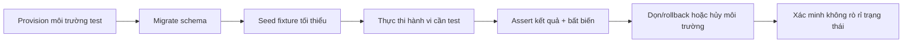
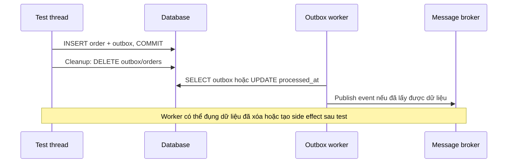

# Quản lý dữ liệu kiểm thử và dọn trạng thái giữa các lần chạy

## 1. Vì sao bài kiểm thử đúng hôm nay nhưng sai ở lần chạy tiếp theo?

Giả sử một ứng dụng Java quản lý đơn hàng và lưu dữ liệu vào PostgreSQL. Test `createOrder()` tạo một khách hàng với email `alice@example.test` rồi tạo đơn. Lần đầu test chạy thành công. Lần hai, database trả lỗi unique vì khách hàng cũ chưa bị xóa. Một bài test khác dự kiến có 0 đơn hàng lại nhận được 1 đơn của bài trước. Khi chạy song song, một bài test xóa toàn bộ bảng và làm bài còn lại thất bại ngẫu nhiên.

Đây là những ví dụ về **rò rỉ trạng thái giữa các lần kiểm thử (test state leakage)**. Lỗi không nhất thiết nằm trong nghiệp vụ tạo đơn; nguyên nhân có thể là cách tổ chức dữ liệu đầu vào, transaction, cleanup, connection pool, cache, message queue hoặc những tác vụ chạy bất đồng bộ.

Trong chương **Kiểm thử lưu trữ** của module **DATA_PERSISTENCE_FUNDAMENTALS**, bài học này tập trung vào câu hỏi: **mỗi bài kiểm thử cần sở hữu những dữ liệu nào, đưa hệ lưu trữ về trạng thái xác định bằng cách nào, và làm sao chứng minh các lần chạy không ảnh hưởng lẫn nhau?** Đây là kỹ năng nền tảng khi kiểm thử Java persistence boundary, constraint, transaction, cô lập, bảo mật đa tenant, schema migration và hiệu năng.

> **Một test đáng tin phải có đầu vào xác định và hậu điều kiện có thể kiểm chứng; chạy lại, đổi thứ tự hoặc chạy song song không được làm kết quả thay đổi ngoài những yếu tố mà test chủ động kiểm soát.**

Mục tiêu sau bài học: người học phân biệt các cách reset dữ liệu, chọn đúng mức cô lập cho từng loại test, tạo fixture dễ hiểu, tránh xóa nhầm dữ liệu, xử lý trạng thái ngoài transaction và lập tiêu chí kiểm tra sự sạch sẽ sau test.

## 2. Ba nguồn trạng thái phải được quản lý

Khi nói “dọn database”, nhiều nhóm chỉ nghĩ tới hàng trong bảng. Nhưng persistence test có thể để lại trạng thái ở nhiều nơi:

| Phạm vi | Ví dụ | Vì sao ảnh hưởng lần chạy sau? |
| --- | --- | --- |
| **Dữ liệu bền vững** | Customers, orders, outbox, unique keys, sequence, materialized view | Truy vấn và constraint nhìn thấy dữ liệu test cũ |
| **Trạng thái transaction/session** | Connection chưa rollback, isolation level, session variable, temporary table, advisory lock | Cùng connection pool có thể tái sử dụng session còn trạng thái bất ngờ nếu không reset đúng |
| **Trạng thái ngoài database** | Redis, search index, message broker, job scheduler, object storage, fake email server | Dọn SQL không xóa event, cache hoặc tác động bất đồng bộ |

Ngoài ra còn có **thời gian và môi trường**: hệ thống clock, random ID, timezone, locale, parallel test threads, schema migration version và cấu hình PostgreSQL. Một test phụ thuộc vào `CURRENT_TIMESTAMP`, trạng thái của một tài khoản chung hoặc thứ tự chạy các lớp khác rất dễ thiếu ổn định.

Đừng đánh đồng:

- **Isolation của transaction DB**: quy tắc các transaction thấy thay đổi của nhau.
- **Isolation của test**: các bài kiểm thử không chia sẻ trạng thái ngoài ý muốn.
- **Isolation của hạ tầng**: container, schema, database, tenant và tài nguyên ngoài DB được tách riêng.

Một transaction `SERIALIZABLE` không tự xóa dữ liệu test trước đó; một PostgreSQL container riêng cũng không tự chặn các request HTTP trỏ nhầm tới Redis hoặc queue dùng chung.

## 3. Vòng đời dữ liệu của một bài kiểm thử



Mỗi giai đoạn nên có trách nhiệm tường minh:

1. **Provision**: xác định DB/datasource test, chặn mọi endpoint production và tạo tài nguyên cô lập nếu cần.
2. **Migration**: tạo schema bằng cùng cơ chế tiến hóa schema mà ứng dụng sử dụng, thay vì tự dựng một lược đồ khác hẳn.
3. **Fixture**: chỉ tạo dữ liệu tối thiểu cần cho hành vi đang được test, với ID và trạng thái xác định.
4. **Execute**: gọi repository, service, API hoặc consumer theo đúng ranh giới cần kiểm chứng.
5. **Assert**: kiểm tra kết quả trực tiếp và trạng thái lưu trữ sau transaction, gồm trường hợp rollback/xung đột.
6. **Cleanup**: hoàn tác transaction, xóa theo phạm vi sở hữu hoặc hủy tài nguyên test.
7. **Verify**: nếu loại test yêu cầu, đo rằng không còn row/job/cache key thuộc bài test và không có connection/worker rò rỉ.

**Không chỉ dựa vào cleanup cuối bài**. Test có thể bị kill giữa chừng, JVM crash hoặc CI bị hủy. Với loại test có tác động ngoài transaction, tốt hơn là dùng môi trường disposable hoặc namespace riêng để lần chạy kế tiếp không bị phụ thuộc vào một `@AfterEach` trước đó đã được thực hiện thành công hay chưa.

## 4. Chọn chiến lược reset phù hợp với loại kiểm thử

| Chiến lược | Cách làm | Phù hợp | Giới hạn quan trọng |
| --- | --- | --- | --- |
| **Rollback transaction của test** | Mỗi test chạy trong transaction rồi rollback | Repository/JPA slice, hành vi đồng bộ dùng cùng transaction | Không rollback các ghi được commit ở transaction/connection/thread khác |
| **Xóa theo phạm vi test** | `DELETE` theo tenant/run ID và thứ tự FK | Integration test dùng một DB chia sẻ | Cleanup phải bao phủ mọi bảng, job, cache và thất bại giữa chừng |
| **`TRUNCATE` các bảng test** | Reset toàn bộ dữ liệu thuộc database/schema test | Suite tuần tự trên DB riêng, nhanh hơn hàng loạt DELETE | Phá dữ liệu test khác khi chạy song song; cần lock và xử lý FK |
| **Tạo schema/database cho từng test hoặc suite** | Provision namespace riêng rồi drop | Parallel tests, migration tests | Tốn thời gian/tài nguyên, phải định tuyến đúng schema |
| **Container/database disposable** | Dựng môi trường riêng rồi hủy | Integration/e2e, kiểm chứng DBMS thật | Startup/resource cost; container dùng chung cả class vẫn cần isolation |
| **Fixture bất biến dùng chung** | Chỉ đọc tập seed không bị sửa | Query/read-only tests | Mọi test ghi lên seed chung sẽ gây phụ thuộc thứ tự |
| **Unique key cho từng test** | ID/tenant/namespace riêng | Tránh xung đột unique khi song song | Không thay thế cleanup hoặc isolation của thao tác đọc toàn bảng |

Không có một chiến lược tốt nhất cho mọi test. **Rollback** thường nhanh cho repository test; **database disposable** thường dễ chứng minh độc lập cho bài test HTTP/async; **DELETE theo tenant** có thể giảm chi phí khi nhiều test dùng chung PostgreSQL nhưng đòi kiểm soát phạm vi chặt.

Điều phải ghi trong quy ước dự án: **test nào sở hữu dữ liệu nào**, ai được quyền dọn, và kết quả được đo ở thời điểm nào.

## 5. Ví dụ cơ sở dữ liệu thử nghiệm có quan hệ và outbox

Để thực hành, xét hệ thống đa tenant lưu khách hàng, đơn hàng và thông điệp outbox. Các câu SQL sau **chỉ dành cho database thử nghiệm được cấp riêng**:

```sql
CREATE TABLE test_customers (
    tenant_id UUID NOT NULL,
    id UUID NOT NULL,
    email TEXT NOT NULL,
    PRIMARY KEY (tenant_id, id),
    UNIQUE (tenant_id, email)
);

CREATE TABLE test_orders (
    tenant_id UUID NOT NULL,
    id UUID NOT NULL,
    customer_id UUID NOT NULL,
    status TEXT NOT NULL
        CHECK (status IN ('NEW', 'PAID', 'CANCELLED')),
    total NUMERIC(18, 2) NOT NULL CHECK (total >= 0),
    created_at TIMESTAMPTZ NOT NULL,
    PRIMARY KEY (tenant_id, id),
    FOREIGN KEY (tenant_id, customer_id)
        REFERENCES test_customers(tenant_id, id)
);

CREATE TABLE test_order_outbox (
    tenant_id UUID NOT NULL,
    event_id UUID NOT NULL,
    order_id UUID NOT NULL,
    event_type TEXT NOT NULL,
    processed_at TIMESTAMPTZ,
    PRIMARY KEY (tenant_id, event_id),
    FOREIGN KEY (tenant_id, order_id)
        REFERENCES test_orders(tenant_id, id)
);
```

Ràng buộc ngoại khóa ghép (`tenant_id`, `customer_id`) bảo vệ việc đơn hàng không được trỏ sang khách thuộc tenant khác. Đây là một cách tăng bảo vệ ở database ngoài việc filter tenant trong repository. Các tên bảng `test_*` chỉ nhằm nhận diện dữ liệu thực hành; trong kiểm thử ứng dụng thật, schema nên được tạo từ migration production tương thích hoặc migration test có chủ đích.

### Những trạng thái đáng đưa vào fixture

- **Đơn trống:** khách có mặt nhưng chưa có đơn.
- **Đơn hợp lệ:** trạng thái `NEW`, tổng tiền không âm, có outbox event chưa xử lý.
- **Đơn đã thanh toán:** trạng thái `PAID`, phục vụ các luồng kiểm tra chuyển trạng thái.
- **Dữ liệu của tenant khác:** xác minh API và SQL không đọc/ghi lẫn.
- **Dữ liệu cạnh tranh:** hai transaction cùng cố chuyển cùng một đơn hoặc dùng cùng unique business key.

Đừng nạp hàng nghìn dòng “cho giống production” trong mọi unit/integration test. Chỉ những test đo truy vấn, phân trang, hiệu năng hoặc xử lý dữ liệu lớn mới cần fixture đủ lớn và được quản lý riêng.

## 6. Thiết kế fixture: tối thiểu, rõ tên, có chủ sở hữu

**Fixture** là dữ liệu ban đầu và điều kiện môi trường giúp test thể hiện một tình huống cụ thể. Nó có thể được tạo bằng SQL, factory/builder Java, seed migration hoặc API; nhưng kết quả nên dễ dự đoán.

Một SQL fixture đơn giản:

```sql
-- Chỉ chạy trong database thử nghiệm.
INSERT INTO test_customers(tenant_id, id, email)
VALUES (
    '11111111-1111-1111-1111-111111111111',
    '22222222-2222-2222-2222-222222222222',
    'alice+test1@example.test'
);

INSERT INTO test_orders(
    tenant_id, id, customer_id, status, total, created_at
) VALUES (
    '11111111-1111-1111-1111-111111111111',
    '33333333-3333-3333-3333-333333333333',
    '22222222-2222-2222-2222-222222222222',
    'NEW', 125000.00,
    '2026-01-02T03:04:05Z'::timestamptz
);
```

Đặc điểm tốt:

- **ID rõ và nhất quán** giữa khóa chính/khóa ngoại giúp test dễ đọc.
- **Timestamp cố định** giúp assert chính xác thứ tự, tránh phụ thuộc giờ máy CI.
- **Email thử nghiệm** tránh chạm email thật và rõ ràng thuộc về môi trường test.
- **Số tiền xác định** được biểu diễn bằng `NUMERIC`/`BigDecimal`, không dùng float để tính số tiền.

Nhược điểm: các UUID cố định **không thể cùng được INSERT ở nhiều test song song trong cùng database** nếu không có rollback/schema/tenant tách biệt. Với test chia sẻ DB và chạy song song, dùng ID riêng cho mỗi test rồi lưu ID đó trong context của fixture; không hardcode một khóa toàn suite.

### Fixture không nên mang kiến thức của mọi bài test

Nếu một factory luôn tạo thêm 20 sản phẩm, 5 đơn và 3 sự kiện dù test chỉ cần một khách hàng, việc đổi factory có thể khiến hàng chục test sai theo cách khó đoán. Hãy dùng phương thức rõ nghĩa như `aCustomer()`, `aNewOrder(customerId)`, `aPaidOrder()`; thêm dữ liệu tùy từng test và kiểm tra fixture tạo được trạng thái hợp lệ.

## 7. Quản lý định danh, thời gian, ngẫu nhiên và seed

Các nguồn không xác định thường gặp:

| Nguồn | Rủi ro | Cách kiểm soát |
| --- | --- | --- |
| `UUID.randomUUID()` | Không thể so ID cố định giữa các lần chạy | Lưu ID trả về trong fixture và assert theo ID đó; dùng ID cố định trong DB cô lập |
| `Instant.now()` / `CURRENT_TIMESTAMP` | Test thất bại ở ranh giới ngày, timezone, DST | Inject `Clock.fixed(...)` cho quy tắc ứng dụng; cố định timestamp fixture |
| Random data | Test lúc có collision, lúc không | Seed generator và lưu seed khi lỗi; vẫn bảo đảm uniqueness |
| Sequence/identity | ID phụ thuộc test trước | Không assert ID tuyệt đối nếu không sở hữu sequence; reset trong DB riêng nếu cần |
| Sort thiếu khóa phụ | Danh sách trả thứ tự khác nhau | `ORDER BY created_at, id` và assert theo hợp đồng |
| Locale/timezone | Format/compare khác giữa dev và CI | Cấu hình explicit trong test và database |
| Hệ ngoài | Event đến sớm/muộn khác nhau | Fake/isolated service, điều kiện chờ có timeout, correlation ID |

Một `Clock.fixed` giúp ứng dụng sinh timestamp có thể lặp lại, nhưng nó **không thay đổi đồng hồ của PostgreSQL**. Nếu DB sử dụng default `CURRENT_TIMESTAMP`, test cần kiểm tra hợp đồng nhận thời gian từ đâu: application, DB hay cả hai.

**Tính xác định không đồng nghĩa mọi ID phải cố định**. Điều quan trọng là test biết nó đã tạo ID nào, không trông chờ vào số ngẫu nhiên cụ thể và không bị dữ liệu ngoài phạm vi làm đổi kết quả.

## 8. Dọn đúng thứ tự khóa ngoại bằng `DELETE`

Trong schema mẫu, bảng outbox tham chiếu orders và orders tham chiếu customers. Nếu dọn riêng một tenant khi không cấu hình cascade, thứ tự hợp lý là **con trước, cha sau**:

```sql
-- Các lệnh minh họa được thực hiện trong transaction cleanup của test.
BEGIN;

DELETE FROM test_order_outbox
WHERE tenant_id = '11111111-1111-1111-1111-111111111111';

DELETE FROM test_orders
WHERE tenant_id = '11111111-1111-1111-1111-111111111111';

DELETE FROM test_customers
WHERE tenant_id = '11111111-1111-1111-1111-111111111111';

COMMIT;
```

Phép dọn có scope theo tenant làm giảm nguy cơ xóa dữ liệu của test khác. Nhưng chỉ an toàn khi **mỗi test thực sự sở hữu tenant riêng**; nếu nhiều test dùng cùng tenant, một test có thể xóa dữ liệu của test kia.

Một transaction cleanup giúp tránh trạng thái xóa được nửa chừng nếu một lệnh `DELETE` bị từ chối. Nó **không** tự thu hồi thông điệp đã phát lên broker hoặc xóa cache đã cập nhật ở Redis.

### Lưu ý khi dùng `ON DELETE CASCADE`

Cascade có thể hỗ trợ dọn quan hệ, nhưng không nên bổ sung cascade chỉ để làm test dễ hơn nếu production không cần hành vi đó. Một cascade sai có thể che lỗi ownership hoặc xóa dữ liệu ngoài ý muốn.

Với nhiều bảng có quan hệ phức tạp, nên để cleanup logic phát biểu rõ **phạm vi sở hữu của test**. Đừng cho một script dọn `DELETE FROM orders` không có `WHERE` chạy trên một datasource mà danh tính môi trường chưa được xác minh.

## 9. `TRUNCATE`, `RESTART IDENTITY` và `CASCADE` — nhanh nhưng nguy hiểm

Khi toàn bộ database là **disposable test database** và không có test khác dùng đồng thời, có thể reset các bảng bằng `TRUNCATE`:

```sql
-- CHỈ áp dụng trên database/schema test độc quyền của suite.
TRUNCATE TABLE
    test_order_outbox,
    test_orders,
    test_customers
RESTART IDENTITY;
```

Ý nghĩa:

- `TRUNCATE` loại bỏ toàn bộ hàng trong những bảng được nêu, thường hiệu quả hơn `DELETE` từng hàng khi reset lớn.
- `RESTART IDENTITY` reset các sequence thuộc những cột identity/serial liên quan theo cơ chế PostgreSQL. Schema ví dụ dùng UUID nên không có identity cần reset.
- Nếu còn bảng khác tham chiếu các bảng này, PostgreSQL có thể từ chối `TRUNCATE` cho tới khi thêm các bảng liên quan vào danh sách hoặc dùng `CASCADE`.
- `TRUNCATE ... CASCADE` có thể mở rộng tác động sang **các bảng không được liệt kê ban đầu**; không dùng tùy tiện trong schema chia sẻ.

PostgreSQL `TRUNCATE` yêu cầu khóa mạnh đối với bảng và có semantics khác `DELETE` (ví dụ không kích hoạt trigger `ON DELETE` hàng thông thường). Nó thường transactional khi chạy trong transaction PostgreSQL, nhưng vẫn không phù hợp khi một test khác đang dùng cùng bảng. Nếu cần kiểm tra trigger/cascade xóa nghiệp vụ, **dùng DELETE thật** trong test hành vi, không đánh đồng hai thao tác.

**Không nên dùng `TRUNCATE` trên production chỉ vì nó “nhanh dọn dữ liệu”.** Test harness phải xác minh environment, endpoint, schema và quyền ngay từ bước khởi tạo.

## 10. Rollback transaction: rất hữu ích nhưng có ranh giới

Với repository integration test, một cách tổ chức phổ biến là mở transaction trước test, chạy thao tác ghi rồi rollback khi test kết thúc. Trong Spring Test, `@Transactional` trên test có thể cung cấp transaction được quản lý và rollback mặc định cho những thay đổi tham gia cùng transaction đó.

```java
import static org.assertj.core.api.Assertions.assertThat;
import java.math.BigDecimal;
import org.junit.jupiter.api.Test;
import org.springframework.beans.factory.annotation.Autowired;
import org.springframework.boot.test.autoconfigure.orm.jpa.DataJpaTest;
import org.springframework.jdbc.core.JdbcTemplate;

@DataJpaTest
class OrderRepositorySliceTest {
    @Autowired JdbcTemplate jdbc;

    @Test
    void newOrderCanBeReadInsideTestTransaction() {
        // Đây là ví dụ rút gọn: fixture khách hàng cần có trước theo
        // schema test và phải dùng đúng datasource/transaction.
        Integer count = jdbc.queryForObject(
                "SELECT COUNT(*) FROM test_orders WHERE status = ?",
                Integer.class, "NEW");
        assertThat(count).isNotNull();
    }
}
```

Đoạn mã minh họa **phạm vi test slice**, không phải test hoàn chỉnh của nghiệp vụ tạo đơn. `@DataJpaTest` thường chạy test trong transaction rollback; nhưng database có thể được thay bằng embedded database nếu không cấu hình dùng PostgreSQL thật. Khi kiểm thử constraint, SQL và isolation đặc thù PostgreSQL, phải chọn DBMS mục tiêu rõ ràng.

### Khi rollback test không dọn được mọi thay đổi

Giả sử test gọi một HTTP API thật:

```java
@org.springframework.transaction.annotation.Transactional
@org.junit.jupiter.api.Test
void callingHttpEndpointIsNotAutomaticallyRolledBack() {
    // Client chạy trong test thread.
    // Server thực thi request trên thread/connection khác.
    // REST call có thể COMMIT trước khi test rollback.
    // Cần cleanup dữ liệu server đã commit hoặc môi trường disposable.
}
```

Những trường hợp rollback không bao phủ:

- Server HTTP chạy trên thread riêng với transaction riêng.
- Service dùng `REQUIRES_NEW` và commit một transaction độc lập.
- Consumer/message handler hoặc job chạy sau test và tự commit.
- Ứng dụng ghi vào datasource khác, Redis, queue hoặc object storage.
- Sequence và một số hiệu ứng không transactional theo DBMS có thể vẫn tiến lên.
- Code đã phát side effect bên ngoài trước khi test rollback.

Vì vậy, **“test có `@Transactional`” không phải bằng chứng mọi dữ liệu do test gây ra đều được dọn**. Phải kiểm tra cùng connection/transaction manager/propagation và những hiệu ứng ra ngoài DB.

## 11. Testcontainers: tạo PostgreSQL thật để kiểm thử persistence

Để giảm khác biệt giữa H2/in-memory và PostgreSQL, có thể dùng **Testcontainers** tạo một PostgreSQL container cho integration test. Ví dụ Spring Boot + JUnit 5:

```java
import org.junit.jupiter.api.Test;
import org.springframework.boot.test.context.SpringBootTest;
import org.springframework.test.context.DynamicPropertyRegistry;
import org.springframework.test.context.DynamicPropertySource;
import org.testcontainers.containers.PostgreSQLContainer;
import org.testcontainers.junit.jupiter.Container;
import org.testcontainers.junit.jupiter.Testcontainers;

@Testcontainers
@SpringBootTest
class OrderPersistenceIntegrationTest {
    @Container
    static PostgreSQLContainer<?> postgres =
            new PostgreSQLContainer<>("postgres:16")
                    .withDatabaseName("order_test")
                    .withUsername("order_test")
                    .withPassword("local_test_only");

    @DynamicPropertySource
    static void datasourceProperties(DynamicPropertyRegistry registry) {
        registry.add("spring.datasource.url", postgres::getJdbcUrl);
        registry.add("spring.datasource.username", postgres::getUsername);
        registry.add("spring.datasource.password", postgres::getPassword);
    }

    @Test
    void applicationContextStartsWithPostgres() {
        // Thêm assertion repository/API cụ thể ở các test thực tế.
    }
}
```

Đoạn mã cần các thư viện Spring Boot Test, JUnit Jupiter và module Testcontainers PostgreSQL/JUnit tương thích; nó **chỉ minh họa setup**, không phải một test nghiệp vụ hoàn chỉnh. Trong CI cần runtime hỗ trợ container. Credential ví dụ chỉ dùng cho database disposable, không dùng trong production.

### Container riêng cho class chưa chắc là dữ liệu riêng cho từng test

`@Container static` thường tạo **một container dùng chung cho các test method trong class**, không phải một database mới cho từng phương thức. Nếu method A insert rồi method B chạy trên cùng container, B có thể thấy dữ liệu của A trừ khi có rollback/cleanup hoặc namespace riêng.

Các lựa chọn:

- **Container/DB per test method**: cô lập mạnh nhưng startup tốn kém.
- **Container per class + rollback/DELETE**: cân bằng tốc độ và mức kiểm soát.
- **Container dùng chung nhiều class**: nhanh hơn nhưng đòi quy ước isolation nghiêm ngặt; các context/pool có thể giữ connection tới một container đã dừng nếu lifecycle quản lý sai.
- **Schema/tenant per test**: giảm va chạm nếu mọi truy vấn, migration và cleanup thực sự scope đúng.

Không bật **container reuse** vô điều kiện nếu bài test kỳ vọng cơ sở dữ liệu sạch. Đặc biệt CI có thể tái sử dụng process/container khác với kỳ vọng của lập trình viên nếu không quản lý rõ vòng đời.

## 12. Migration và seed phải được phân biệt

**Schema migration** diễn tả cấu trúc và những thay đổi bền vững theo phiên bản; **test seed** tạo dữ liệu kịch bản. Hai thứ liên quan nhưng không nên trộn lẫn không kiểm soát:

```text
Provision PostgreSQL test
  -> Flyway/Liquibase migrate schema phiên bản ứng dụng
  -> Test fixture tạo customer/order/outbox cần thiết
  -> Chạy test
  -> Rollback/cleanup hoặc hủy DB
```

Nếu test tự tạo một bảng khác schema production, nó có thể bỏ qua unique constraint, foreign key, index hoặc kiểu cột gây lỗi ở production. Integration test quan trọng nên chạy trên schema **gần với migration thực**.

Một số bài test migration lại cần cố tình tạo **schema phiên bản cũ** rồi chạy migration tiến lên. Với loại test này, rollback transaction thông thường không thể thay thế việc tạo database/schema mới ở trạng thái phiên bản cũ; phải chuẩn bị đúng mốc migration và xác minh kết quả sau nâng cấp.

### Seed SQL trong Spring Test

Spring hỗ trợ chạy script `@Sql` theo thời điểm test. Ví dụ cú pháp minh họa:

```java
@org.springframework.test.context.jdbc.Sql(
    scripts = "/sql/order-fixture.sql",
    executionPhase =
        org.springframework.test.context.jdbc.Sql.ExecutionPhase.BEFORE_TEST_METHOD)
@org.springframework.test.context.jdbc.Sql(
    scripts = "/sql/order-cleanup.sql",
    executionPhase =
        org.springframework.test.context.jdbc.Sql.ExecutionPhase.AFTER_TEST_METHOD)
@org.junit.jupiter.api.Test
void orderFlow() {
    // Gọi hành vi và assert trong cấu hình test phù hợp.
}
```

Hai đường dẫn SQL là **tên ví dụ**, không có file nào được tạo trong bài học này. `@Sql` có thể tham gia transaction hiện hành hoặc chạy theo cấu hình transaction của Spring Test; phải hiểu `SqlConfig` và thời điểm script chạy để tránh cleanup bị rollback hoặc seed được commit ngoài ý định. Các script dùng ID cố định chỉ an toàn khi test không va chạm scope với test khác.

## 13. Dọn theo tenant hoặc run ID khi phải chia sẻ một database

Khi test parallel dùng chung PostgreSQL, một phương án là cấp **tenant ID riêng cho từng test**. Mọi fixture và truy vấn đều scope theo tenant đó, và teardown xóa đúng tenant:

```java
import java.util.UUID;
import org.junit.jupiter.api.AfterEach;
import org.junit.jupiter.api.BeforeEach;
import org.springframework.beans.factory.annotation.Autowired;
import org.springframework.jdbc.core.JdbcTemplate;

class TenantScopedPersistenceTest {
    @Autowired JdbcTemplate jdbc;
    private UUID testTenantId;

    @BeforeEach
    void allocateTenant() {
        testTenantId = UUID.randomUUID();
        // Mọi fixture của method này dùng testTenantId.
    }

    @AfterEach
    void removeOnlyOwnedRows() {
        if (testTenantId == null) return;
        jdbc.update("DELETE FROM test_order_outbox WHERE tenant_id = ?",
                    testTenantId);
        jdbc.update("DELETE FROM test_orders WHERE tenant_id = ?",
                    testTenantId);
        jdbc.update("DELETE FROM test_customers WHERE tenant_id = ?",
                    testTenantId);
    }
}
```

Đây là **khung minh họa**, không tự chứng minh cleanup chạy trong một transaction. Trong trường hợp có rủi ro lỗi giữa các câu `DELETE`, nên chạy cleanup qua `TransactionTemplate` hoặc một phương thức service cleanup được quản lý transaction, kiểm tra số hàng bị xóa và kết thúc thật sự. Nếu test đang chạy trong transaction rollback, chú ý thời điểm `@AfterEach` và việc thực thi cleanup so với rollback do framework quản lý.

### Tenant riêng có đủ tránh phụ thuộc không?

Không hoàn toàn:

- Một truy vấn vô tình quên `WHERE tenant_id = ?` vẫn thấy dữ liệu của test khác.
- Một bảng dùng unique index **toàn cục** theo email có thể làm hai tenant va chạm, dù tenant ID khác.
- Sequence, trigger, job scheduler hoặc queue có thể là tài nguyên dùng chung.
- Một test chạy `TRUNCATE` hoặc `DELETE` thiếu `WHERE` có thể phá dữ liệu của tất cả test.
- Connection pool/session variable có thể còn trạng thái nếu thiết lập schema/tenant ở cấp session mà không reset.

Khi chạy song song trên cùng DB, **phải kiểm thử chính sự giới hạn phạm vi truy cập** và đặt cảnh báo khi một đường SQL không có tenant scope, thay vì chỉ dựa vào UUID ngẫu nhiên.

## 14. Fixture factory và quyền sở hữu dữ liệu trong Java

Để tránh SQL seed quá dài, có thể dùng một fixture helper chỉ tạo các thực thể được yêu cầu. Ví dụ dùng `JdbcTemplate`:

```java
import java.math.BigDecimal;
import java.time.Instant;
import java.util.UUID;
import org.springframework.jdbc.core.JdbcTemplate;

public final class OrderFixture {
    private final JdbcTemplate jdbc;
    private final UUID tenantId;

    public OrderFixture(JdbcTemplate jdbc, UUID tenantId) {
        this.jdbc = jdbc;
        this.tenantId = tenantId;
    }

    public UUID customer(String email) {
        UUID id = UUID.randomUUID();
        jdbc.update(
            "INSERT INTO test_customers(tenant_id, id, email) VALUES (?, ?, ?)",
            tenantId, id, email);
        return id;
    }

    public UUID newOrder(UUID customerId, BigDecimal total) {
        UUID id = UUID.randomUUID();
        jdbc.update(
            """
            INSERT INTO test_orders(
                tenant_id, id, customer_id, status, total, created_at
            ) VALUES (?, ?, ?, 'NEW', ?, ?)
            """,
            tenantId, id, customerId, total,
            java.sql.Timestamp.from(Instant.parse("2026-01-02T03:04:05Z")));
        return id;
    }
}
```

Sử dụng trong một test:

```java
UUID tenantId = UUID.randomUUID();
OrderFixture fixture = new OrderFixture(jdbc, tenantId);
UUID customerId = fixture.customer("test-" + tenantId + "@example.test");
UUID orderId = fixture.newOrder(customerId, new BigDecimal("125000.00"));

// Gọi repository/service để đọc orderId, assert kết quả và dọn đúng tenantId.
```

Factory giữ phần tạo dữ liệu hợp lệ rõ ràng, còn **test quyết định trạng thái nào cần có**. Với test kiểm tra constraint hoặc dữ liệu sai, hãy tạo input lỗi có chủ đích và assert SQLSTATE/exception; không bắt fixture luôn “sửa” dữ liệu khiến kịch bản vi phạm không thể xảy ra.

**Đừng để fixture helper âm thầm commit một transaction riêng** nếu test đang kỳ vọng rollback. Fixture và hành vi cần chung ranh giới transaction trong test kiểu rollback; nếu test kiểm tra HTTP/async hoặc commit thật, fixture nên được seed có chủ đích và cleanup theo scope.

## 15. Song song, chạy lại và kiểm tra tính độc lập

Một suite có thể pass khi chạy tuần tự nhưng fail khi JUnit chạy song song vì các test tranh chấp cùng bảng, key hoặc hệ ngoài. Các quy tắc:

1. **Tài nguyên riêng:** mỗi test có tenant/schema/database hoặc khóa nghiệp vụ độc lập; không dùng chung email/operation ID có unique constraint.
2. **Không xóa dữ liệu của test khác:** dọn theo owner, không `TRUNCATE` khi database đang dùng chung.
3. **Không dựa vào thứ tự:** test B không được đòi test A đã tạo customer trước.
4. **Không để cache chung làm mờ assertion:** key phải gắn tenant/run ID và có chính sách dọn.
5. **Không dùng static mutable fixture chia sẻ tùy tiện:** nó có thể bị ghi đồng thời, tạo kết quả khó lặp.
6. **Giới hạn tài nguyên:** số lượng container/DB connection phải phù hợp năng lực CI; tăng concurrency không luôn làm suite nhanh hơn.

### Một chuỗi kiểm tra flakiness hữu ích

```text
Chạy từng test một mình
  -> Chạy cả class nhiều lần
  -> Đảo thứ tự method/class
  -> Chạy song song có giới hạn
  -> Chạy lại với container/database sạch
  -> So số row/queue/cache key còn lại giữa các lần
```

Nếu test chỉ sai **khi chạy sau một test khác**, đó là dấu hiệu shared-state leak hoặc cấu hình môi trường bị giữ lại. Nếu chỉ sai **khi chạy song song**, hãy xét scope cleanup, transaction visibility, lock, pool và xử lý bất đồng bộ. Dù vậy, không vội kết luận mọi flaky test là lỗi cleanup; timeout, network và clock cũng cần được phân tích.

## 16. Tác vụ bất đồng bộ và outbox: cleanup SQL có thể chạy quá sớm

Giả sử test gọi service tạo đơn, transaction commit và một worker outbox bắt đầu phát sự kiện vài mili giây sau:



Thứ tự thực thi có thể khác nhau; đó là vấn đề. Khi test có worker chạy nền:

- Dùng queue/broker hoặc namespace **riêng cho test**, không dùng topic production.
- Xác định tiêu chí **completion** của việc xử lý (ví dụ event được ghi nhận/ack hoặc trạng thái processed).
- Chờ **điều kiện có timeout**, không chỉ `Thread.sleep(500)` vì máy CI và network có thể chậm khác nhau.
- Nếu có thể, **dừng/quiesce worker trước cleanup** rồi xóa trạng thái theo owner.
- Tách event đã gửi ra khỏi DB: xóa row outbox không thu hồi được một event đã publish.
- Khi retry, dùng operation ID/event ID ổn định để xác minh **idempotency** và tránh xử lý lặp.

Với framework chờ như Awaitility, một ý tưởng test:

```java
// Pseudocode với thư viện Awaitility, trong môi trường queue test cô lập.
await().atMost(java.time.Duration.ofSeconds(10))
       .untilAsserted(() ->
           assertThat(outboxRepository.isProcessed(eventId)).isTrue());

// Sau khi xác định worker không còn thao tác thuộc test,
// cleanup theo tenant/event ID hoặc hủy tài nguyên disposable.
```

Không coi việc sleep một khoảng thời gian cố định là bằng chứng event đã hoàn tất. Nếu worker có thể tiếp tục retry sau timeout, cần chặn worker/định tuyến tài nguyên trước khi dọn, hoặc hủy toàn bộ namespace/DB test.

## 17. Cache, search index và object storage cũng có vòng đời fixture

Một phép cập nhật đơn hàng có thể thay đổi nhiều hệ:

| Hệ | Fixture/trạng thái test | Cleanup phù hợp |
| --- | --- | --- |
| PostgreSQL | `test_orders`, outbox | Rollback, DELETE theo owner, hoặc hủy DB |
| Redis | Cache key `orders:{tenant}:{orderId}` | Xóa đúng namespace test, TTL fallback |
| Search engine | Document chỉ mục và refresh bất đồng bộ | Index riêng cho suite hoặc delete theo run ID, chờ hoàn tất |
| Object storage | File hóa đơn giả | Bucket/prefix test riêng, xóa theo owner sau khi worker dừng |
| Message broker | Topic/queue, consumer group, offsets | Topic/group riêng hoặc reset bằng cơ chế test được kiểm soát |
| Email/payment sandbox | Danh sách outbound messages/charges giả | Sandbox riêng, kiểm tra ID và reset state theo hỗ trợ của provider |

**Không dùng `FLUSHALL` Redis hoặc xóa toàn bucket** khi có người/test khác dùng chung. Namespace hóa key bằng run ID hoặc tenant và chỉ dọn tài nguyên thuộc mình. Nếu dùng một search index chung, refresh bất đồng bộ có thể khiến test đọc lại chưa thấy thay đổi dù SQL đã commit.

Đối với test nghiệp vụ quan trọng, có thể chạy **fake/stub** cho phụ thuộc ngoài và chỉ dùng môi trường tích hợp thật trong một nhóm end-to-end test được quản lý riêng. Mục tiêu không phải giả lập tất cả cơ chế, mà là tránh để một test repository vô tình gây tác động thật ra ngoài boundary cần kiểm tra.

## 18. Connection pool, session state và ranh giới transaction

DataSource pool tái sử dụng connection. Một test có thể thay `search_path`, timezone, isolation level hoặc session setting rồi không reset. Lần test sau lấy lại connection có thể đọc nhầm schema, tạo query plan khác hoặc nhận dữ liệu tenant khác.

Ví dụ PostgreSQL:

```sql
-- Trong một transaction thử nghiệm cụ thể:
BEGIN;
SET LOCAL search_path TO test_schema, public;
-- Các câu SQL test...
ROLLBACK;
```

`SET LOCAL` chỉ có hiệu lực theo transaction tương ứng; khác với `SET search_path` ở cấp session. Dùng `SET LOCAL` khi phù hợp có thể giảm rủi ro state leak, nhưng phải chắc connection và transaction có hiệu lực thực sự.

Các quy tắc:

- Không chia sẻ cùng `Connection` giữa thread; đóng bằng try-with-resources hoặc framework quản lý đúng.
- Nếu test tự đổi isolation/autocommit/read-only/schema ở mức session, **khôi phục cài đặt** hoặc để pool reset theo hợp đồng đã kiểm chứng.
- Không giữ transaction mở trong lúc chờ network/async lâu; nó có thể giữ lock và ảnh hưởng test khác.
- Với schema riêng, xác minh mọi migration/ORM/SQL dùng đúng schema; không mặc định `search_path` của một connection áp dụng cho mọi connection từ pool.
- Theo dõi active/idle/waiting connections và phát hiện connection leak khi suite chạy nhiều lần.

Một test pass nhờ dùng chung persistence context/cache cũ cũng có thể che lỗi SQL. Khi kiểm thử commit/rollback/visibility, nên tạo connection/transaction **độc lập có chủ đích** cho bên quan sát.

## 19. Kiểm thử constraint và dữ liệu sai mà không làm bẩn database

Một số test **cần cố ý gửi dữ liệu sai** để xác minh bảo vệ ở DB:

```sql
-- Chạy trong transaction riêng của test và rollback.
BEGIN;

-- Vi phạm CHECK total >= 0 của test_orders.
INSERT INTO test_orders(
    tenant_id, id, customer_id, status, total, created_at
) VALUES (
    '11111111-1111-1111-1111-111111111111',
    '44444444-4444-4444-4444-444444444444',
    '22222222-2222-2222-2222-222222222222',
    'NEW', -1.00, '2026-01-02T03:04:05Z'::timestamptz
);

-- PostgreSQL từ chối INSERT bằng lỗi CHECK (SQLSTATE 23514).
-- Transaction đang ở trạng thái lỗi; cần ROLLBACK từ client.
ROLLBACK;
```

Trong psql/script thông thường, sau câu lệnh `INSERT` lỗi, mức xử lý tiếp tục phụ thuộc cách client dừng script và quy tắc transaction. Về ngữ nghĩa DB, transaction PostgreSQL đã bị abort và cần rollback trước khi tiếp tục dùng connection cho transaction mới.

Một integration test JDBC nên assert:

- SQLSTATE `23514` cho `CHECK`, `23503` cho `FOREIGN KEY`, `23505` cho `UNIQUE` hoặc `23502` cho `NOT NULL` theo constraint đang test.
- Transaction lỗi **không commit** dữ liệu đã thực hiện trước đó.
- Connection được rollback/đóng hoặc được framework xử lý trước khi test tiếp theo chạy.
- Không có row sai còn sót lại sau test.

Đừng “dọn” bằng cách bỏ constraint hoặc vô hiệu hóa foreign key của DB chỉ để fixture sai đi qua; như vậy test không còn kiểm tra hành vi production thực tế.

## 20. Khi nào phải test commit thật thay vì dựa vào rollback?

Các tình huống cần quan sát kết quả **đã commit**:

1. Unique constraint và xung đột giữa hai transaction độc lập.
2. Serialization failure/deadlock và logic retry.
3. Outbox/event listener chạy `AFTER_COMMIT`.
4. Một reader trên connection khác nhìn dữ liệu theo isolation level cụ thể.
5. REST API/server và consumer chạy trong transaction riêng.
6. Migration có bước DDL không chạy trong transaction của test.
7. Test idempotency khi client gửi lại cùng operation ID sau một commit thành công.

Ví dụ lịch thực thi hai connection:

```text
Connection A: BEGIN
Connection B: BEGIN
A: INSERT cùng business key K
B: INSERT cùng business key K (có thể chờ khóa/constraint)
A: COMMIT
B: nhận lỗi UNIQUE hoặc kết quả conflict theo SQL được viết
=> Assert chỉ một thao tác được commit; cleanup K trong DB test.
```

Nếu chỉ tạo hai đối tượng trong **cùng transaction của test**, không thể suy ra DB xử lý đúng cạnh tranh giữa hai transaction. Cần barrier/latch để kiểm soát lịch, timeout để test không treo và transaction có rollback/cleanup riêng.

Khi test commit thật, **không mong `@Transactional` của test rollback mọi side effect**. Dùng tenant/database riêng, cleanup theo owner hoặc môi trường disposable để đảm bảo lần chạy sau sạch.

## 21. Chứng minh test không phụ thuộc nhau bằng hậu điều kiện

Một test chỉ assert “API trả 201” chưa chứng minh dữ liệu được dọn. Với bài test có owner ID, có thể assert số row còn lại:

```sql
SELECT COUNT(*) FROM test_order_outbox WHERE tenant_id = :tenant_id;
SELECT COUNT(*) FROM test_orders WHERE tenant_id = :tenant_id;
SELECT COUNT(*) FROM test_customers WHERE tenant_id = :tenant_id;
```

Ở đây `:tenant_id` biểu diễn named bind parameter của công cụ SQL; JDBC `PreparedStatement` dùng dấu `?`. Không nội suy chuỗi input thành SQL text. Các phép kiểm tra phải được thực hiện **sau khi transaction cleanup đã commit** và khi không còn worker được phép tạo dữ liệu mới cho test đó.

Nếu test rollback và fixture chỉ tồn tại trong transaction chưa commit, có thể kiểm tra trên connection khác rằng hàng test **không xuất hiện sau rollback**, thay vì tự kiểm tra trong transaction trước khi nó bị rollback.

Một tiêu chí tổng hợp cho suite:

```text
Mỗi method:
  - biết tenant/run ID của fixture
  - assert dữ liệu đúng sau hành vi
  - rollback/cleanup hoặc dispose môi trường
  - không để event/worker còn chạy trên namespace cũ

Cuối suite:
  - số connection/transaction leak = 0
  - không có resource test mồ côi trong phạm vi đang quản lý
  - chạy lại suite với cùng môi trường theo hợp đồng vẫn PASS
  - chạy đảo thứ tự/parallel trong cấu hình hỗ trợ vẫn PASS
```

Không nhất thiết phải quét mọi bảng toàn cluster sau từng method; lựa chọn mức kiểm chứng tương xứng với rủi ro. Nhưng những test có lịch sử flaky hoặc chạm nhiều hệ nên có bước hậu kiểm cụ thể.

## 22. Khi cleanup thất bại: fail rõ, không che lỗi của test

Một `@AfterEach` có thể ném ngoại lệ khi DB down hoặc outbox worker đang giữ khóa. Khi đó:

- **Không báo toàn test pass** rồi chỉ ghi log cleanup failed.
- Ghi nhận cả lỗi chính của assertion/hành vi và lỗi cleanup; tránh để lỗi dọn che mất nguyên nhân đầu tiên.
- Nếu cleanup là bắt buộc để an toàn, đánh dấu run có **tài nguyên mồ côi** và không cho suite sau tái sử dụng cùng namespace.
- Cơ chế tự động thu gom cần biết rõ **owner ID**, thời gian tạo và giới hạn TTL; không quét xóa theo wildcard quá rộng.
- Với môi trường disposable, hủy container/database/namespace sau run có thể an toàn hơn cố sửa một DB chung đã ở trạng thái không xác định.

Trường hợp JVM bị kill khiến teardown không chạy, tài nguyên test có thể còn lại. Vì vậy **run ID + TTL/quy trình garbage collection có kiểm soát** và tài nguyên có thể hủy là biện pháp phòng vệ, không phải chỉ thêm `finally`.

Không đưa credential hay dữ liệu khách hàng vào thông báo lỗi test. Cần giữ correlation ID, SQLSTATE, tên constraint, tên môi trường và thời điểm để điều tra.

## 23. Chọn hạ tầng và chi phí kiểm thử một cách có chủ đích

| Loại kiểm thử | Hạ tầng thường hợp lý | Mức cleanup/isolation |
| --- | --- | --- |
| Unit test domain thuần | Không DB | Tạo object mới cho từng test |
| Repository mapping/constraint | PostgreSQL Testcontainers hoặc DB test thật | Rollback per method hoặc DB riêng |
| Integration service transaction | PostgreSQL thật và service test | Transaction phù hợp, cleanup commit nếu có `REQUIRES_NEW` |
| HTTP/API end-to-end | App + DB + dependencies test | Namespace/container riêng, không dựa vào test rollback |
| Async/outbox/message | DB + broker sandbox | Correlation ID, wait, drain/stop worker và cleanup đa hệ |
| Migration/backup/restore | DB mới ở phiên bản/schema xác định | Disposable DB/cluster, không tái sử dụng trạng thái |
| Load/performance | Dữ liệu seed lớn, môi trường gần production | Seed có mốc, reset giữa các lượt benchmark, cô lập tải |

Một suite nhanh nhưng không ổn định có thể gây tốn kém hơn vài giây tạo PostgreSQL container. Ngược lại, container mới cho **từng unit test domain** thường là lãng phí. Hãy dùng tầng kiểm thử phù hợp, theo dõi thời gian setup/cleanup và chỉ tối ưu sau khi có số đo.

**Không sử dụng production DB làm database test** dù “chỉ INSERT dữ liệu có prefix test”. Lỗi cấu hình kết nối hoặc cleanup thiếu `WHERE` có thể phá dữ liệu thật. Bảo vệ bằng cấu hình, credentials quyền hạn chế, network isolation và kiểm tra môi trường trước khi thực thi.

## 24. Quy trình triển khai thực tế cho một nhóm Java

**Bước 1 — Phân loại test.** Đánh dấu test rollback-only, test cần commit thật, test HTTP, test async và test migration. Xác định tài nguyên nào test được phép sở hữu.

**Bước 2 — Chuẩn hóa provisioning.** Dùng Testcontainers hoặc DB test chuyên dụng, chạy migrations đúng phiên bản, cấu hình Java DataSource không thể trỏ production. Khi cần parallel, cấp schema/database/tenant riêng.

**Bước 3 — Chuẩn hóa fixture.** Dùng builders/SQL seed nhỏ, tên và ID có ý nghĩa, cố định Clock và các yếu tố thời gian cần thiết. Không phụ thuộc dữ liệu còn sót.

**Bước 4 — Chọn cleanup.** Rollback cho code trong một transaction test; DELETE theo owner cho các commit thật trong DB chia sẻ; TRUNCATE chỉ trong DB độc quyền; dispose môi trường khi cần cô lập mạnh.

**Bước 5 — Phủ trạng thái ngoài DB.** Redis, outbox, queue, object store và scheduler phải có namespace test và teardown/cơ chế hủy cụ thể.

**Bước 6 — Thêm hậu kiểm.** Assert dữ liệu, số row, tài nguyên còn lại và state không rò rỉ. Với concurrency test, kiểm tra số commit thực thay vì chỉ exception.

**Bước 7 — Kiểm tra độc lập.** Chạy cả suite nhiều lần, đảo thứ tự, bật parallel trong giới hạn, thực hiện lại trên môi trường sạch.

**Bước 8 — Quan sát và cải tiến.** Ghi thời gian setup/cleanup, số failed teardown, connection leak, flaky retries và các tài nguyên mồ côi. Ưu tiên sửa nguyên nhân hơn là tăng timeout tùy tiện.

## 25. Những sai lầm thường gặp

1. **“Đã có `@Transactional` ở test nên mọi thay đổi sẽ rollback.”** Sai với HTTP server thread, `REQUIRES_NEW`, consumer và hệ ngoài.
2. **“Mỗi class có một Testcontainer nên mỗi method có DB mới.”** `@Container static` thường chia sẻ container giữa methods của class.
3. **“`TRUNCATE ... CASCADE` là cách nhanh và an toàn trong DB chung.”** Có thể xóa bảng/row của test khác và dùng lock mạnh.
4. **“Dùng tenant ID riêng là đủ, không cần WHERE ở query.”** Một truy vấn quên scope vẫn có thể thấy dữ liệu khác tenant.
5. **“Dọn outbox row thì event chưa từng được gửi.”** Event có thể đã tới broker hoặc consumer.
6. **“Thêm sleep 1 giây để chắc worker chạy xong.”** Timing thay đổi theo máy và tải; cần điều kiện hoàn tất với timeout.
7. **“Test pass lần một là đủ.”** State leak thường lộ ở lần hai, khi đổi thứ tự hoặc chạy song song.
8. **“Reset sequence luôn là bắt buộc.”** Test nên tránh phụ thuộc ID tự sinh tuyệt đối; reset chỉ khi sở hữu DB.
9. **“Một file SQL seed thật lớn giúp test giống production.”** Seed không tối thiểu khiến test khó hiểu và gắn kết nhau.
10. **“Chạy H2 đã đủ xác minh PostgreSQL constraint/isolation.”** DBMS khác nhau về cú pháp, locking và transaction.
11. **“Dọn bằng `DELETE` không cần xem thứ tự.”** Foreign key có thể chặn việc xóa cha trước con.
12. **“Cleanup lỗi chỉ cần log cảnh báo.”** Có thể làm hỏng toàn bộ lần chạy sau; phải biểu thị trạng thái thất bại.
13. **“`setReadOnly(true)` bảo vệ chắc chắn DB production.”** JDBC read-only không thay thế network/credential/endpoint isolation.
14. **“Schema test chỉ cần gần giống schema thật.”** Khác migration/constraint/kiểu cột có thể che lỗi production.
15. **“Test sau restore phải chạy tất cả job thật.”** Có thể gây email/thanh toán trùng; phải vô hiệu hóa side effect.

## 26. Bài tập tự kiểm tra

**Câu 1.** Một repository test thêm khách hàng với email cố định. Lần thứ hai thất bại unique constraint. Nêu hai phương án giúp test lặp lại được.

**Câu 2.** Một Spring test có `@Transactional`, nhưng nó gọi endpoint qua HTTP chạy trên server thread khác và endpoint đã commit. Vì sao rollback test không xóa đơn?

**Câu 3.** Hai test chạy song song cùng database, mỗi test dùng tenant riêng. Một test thực hiện `TRUNCATE test_orders CASCADE`. Có an toàn không?

**Câu 4.** Vì sao cần dọn `test_order_outbox` trước `test_orders`, rồi `test_customers` nếu không dùng cascade?

**Câu 5.** Trong một integration test kiểm tra PostgreSQL `CHECK`, có nên bỏ constraint trong test fixture để insert hàng âm rồi kỳ vọng service phát hiện không?

**Câu 6.** `@Container static PostgreSQLContainer` được khai báo trong một class có 12 methods. Có chắc 12 database độc lập không?

**Câu 7.** Test tạo đơn rồi chờ event từ worker. Dùng `Thread.sleep(200)` làm test lúc pass lúc fail. Cần thay bằng cách nào?

**Câu 8.** Test fixture dùng `Instant.now()`, server và CI chạy múi giờ khác, assertion theo ngày thỉnh thoảng sai. Cần kiểm soát gì?

**Câu 9.** Một test tạo event và sau đó xóa các hàng SQL. Broker vẫn còn message. Đây là loại trạng thái nào và cleanup cần bổ sung gì?

**Câu 10.** Muốn kiểm tra hai transaction cạnh tranh cùng một unique key, việc chạy hai lệnh INSERT trong cùng transaction test có đủ không?

**Câu 11.** Khi chạy Testcontainers, một Spring Context được cache giữa các class còn giữ datasource trỏ tới container đã dừng. Đây là vấn đề gì?

**Câu 12.** Một test có tenant mới nhưng query `SELECT COUNT(*) FROM test_orders` không lọc tenant. Điều gì có thể khiến assertion dao động khi chạy parallel?

**Câu 13.** Suite test được rerun sau khi JVM crash ở lần trước; `@AfterEach` chưa chạy, các row cũ vẫn ở DB chung. Chiến lược nào giúp không phụ thuộc cleanup của process cũ?

**Câu 14.** Một fixture tạo thêm 50 order dù test chỉ cần kiểm tra không có order. Vì sao fixture “rộng” gây khó cho việc đọc test và tối ưu?

**Câu 15.** Dọn database bằng `TRUNCATE` thay cho `DELETE` trong một test kiểm tra `ON DELETE` trigger. Vì sao test không còn phản ánh hành vi cần kiểm tra?

**Câu 16.** Test báo PASS nhưng `@AfterEach` không xóa được outbox vì DB timeout. Có nên chấp nhận PASS và để test sau tự xử lý không?

**Gợi ý trả lời:**

1. Dùng rollback per test nếu mọi thao tác chung transaction; hoặc dùng tenant/ID unique và DELETE theo owner, hay database disposable.
2. HTTP handler commit transaction/connection riêng; test rollback không thể rollback giao dịch đã commit bên server.
3. **Không.** TRUNCATE có thể xóa dữ liệu của test khác, kể cả có tenant riêng; chỉ dùng ở DB độc quyền.
4. Vì khóa ngoại: outbox phụ thuộc orders, orders phụ thuộc customers; xóa cha trước con sẽ bị DB từ chối.
5. **Không.** Giữ constraint thật và assert lỗi DB/transaction, dùng dữ liệu sai có chủ đích trong môi trường test.
6. **Không.** Container static thường dùng chung cho methods của class; vẫn cần cleanup hoặc isolation riêng.
7. Chờ điều kiện thực tế (event processed/received) với timeout, đồng thời bảo đảm worker và broker nằm trong namespace test.
8. Inject Clock cố định và timezone explicit, thống nhất nguồn timestamp từ Java hay DB, không dựa vào thời gian máy.
9. Trạng thái ngoài database; dùng queue/topic/group riêng, xác nhận completion, quiesce và cleanup hoặc dispose.
10. **Chưa đủ.** Cần hai transaction/connection độc lập và lịch đồng thời kiểm soát được.
11. Lifecycle mismatch giữa Spring context/pool và container, cần cấu hình vòng đời phù hợp và tránh datasource stale.
12. Test sẽ đếm cả order của tenant khác; kết quả phụ thuộc test đang chạy và thời điểm commit.
13. Mỗi run có database/schema/container disposable, hoặc namespace/run ID riêng với TTL/garbage collection an toàn.
14. Tạo dữ liệu không liên quan khiến test phụ thuộc trạng thái ẩn, chậm và dễ sai khi factory thay đổi.
15. PostgreSQL TRUNCATE không kích hoạt row-level ON DELETE trigger như DELETE; phải thực hiện đúng thao tác nghiệp vụ cần kiểm chứng.
16. **Không.** Teardown là một phần hợp đồng isolation; báo lỗi và cách ly namespace/tài nguyên trước khi cho run tiếp.

## Kết luận

**Quản lý dữ liệu kiểm thử** không chỉ là tạo vài bản ghi trước test và xóa chúng sau test. Nó là thiết kế **vòng đời trạng thái**: provision môi trường đúng, seed fixture tối thiểu, định nghĩa ownership, chọn transaction/rollback hoặc cleanup phù hợp, kiểm soát tài nguyên ngoài database và chứng minh không có rò rỉ sau khi test hoàn tất.

Trong **DATA_PERSISTENCE_FUNDAMENTALS**, một suite Java đáng tin phải kiểm thử cùng cơ chế lưu trữ mà ứng dụng thật dựa vào — **constraint, isolation, commit, migration, khóa ngoại và truy vấn có tenant scope** — đồng thời tránh phụ thuộc vào dữ liệu lịch sử hay thứ tự test. Hãy dùng rollback khi hiệu lực được hiểu rõ, DELETE theo owner hoặc disposable database cho commit thật, Testcontainers khi cần PostgreSQL tương thích và bộ hậu kiểm cho state async/cache/queue. Chỉ khi test **chạy lại độc lập, chạy song song trong giới hạn đã thiết kế và dọn sạch phạm vi nó sở hữu**, kết quả xanh mới là bằng chứng đáng tin về chất lượng persistence.
