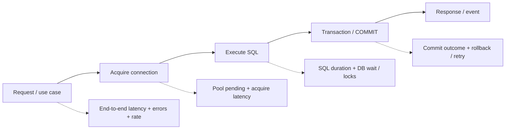
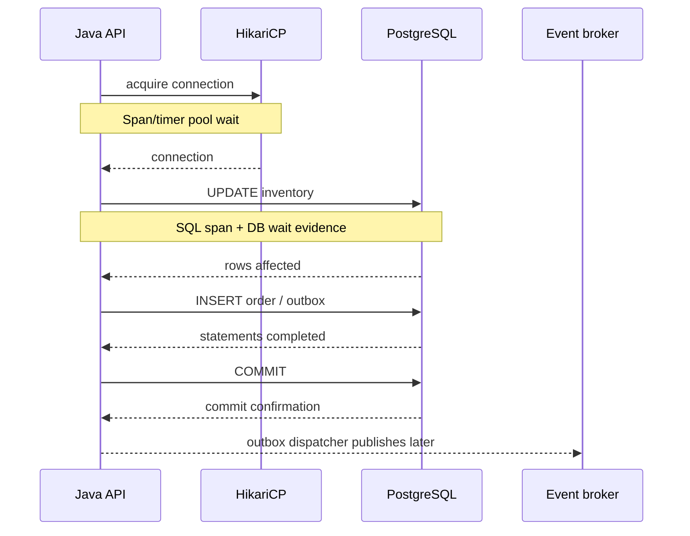
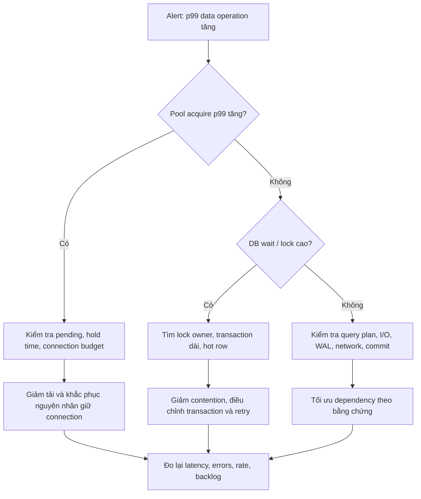

# Theo dõi độ trễ, lỗi và thông lượng thao tác dữ liệu

Một ứng dụng Java có thể báo rằng truy vấn SQL chỉ mất 8 ms, nhưng người dùng vẫn đợi 2 giây để tạo đơn hàng. Có thể request đã chờ connection pool 1,5 giây, một transaction khác đang giữ khóa, hoặc lỗi commit xuất hiện sau khi method repository trả về. Nếu chỉ ghi log câu SQL chậm, nhóm vận hành có thể tối ưu nhầm tầng, trong khi nguyên nhân là cạn connection, deadlock, tăng tải đột biến hoặc replica bị trễ.

**Quan sát thao tác dữ liệu (persistence observability)** là khả năng hiểu *điều gì xảy ra, ở đâu, khi nào và ảnh hưởng ra sao* thông qua **metrics, logs, traces** cùng ngữ cảnh nghiệp vụ đã được kiểm soát. Ba trục quan trọng là:

- **Độ trễ (*latency*):** mỗi thao tác mất bao lâu, gồm những giai đoạn chờ và xử lý nào?
- **Lỗi (*errors*):** bao nhiêu thao tác thất bại, thất bại loại gì, có được retry không và kết quả commit đã biết chắc chưa?
- **Thông lượng (*throughput*):** có bao nhiêu thao tác đến, được chấp nhận, hoàn tất và commit trong một đơn vị thời gian?

Bài học thuộc chương **Quan sát và vận hành** của mô-đun **DATA_PERSISTENCE_FUNDAMENTALS**. Mô-đun giúp hiểu lưu trữ bền vững từ mô hình dữ liệu, schema, truy vấn và chỉ mục đến giao dịch, cô lập, kiểm soát đồng thời; đồng thời thiết kế ranh giới persistence cho Java, xử lý lỗi kết nối, tiến hóa schema, bảo mật, sao lưu và hiệu năng. Trọng tâm ở đây là **định nghĩa và đo đúng các tín hiệu vận hành**, phân tích sự cố bằng bằng chứng, thiết lập SLO/cảnh báo và tránh làm rò rỉ dữ liệu nhạy cảm trong telemetry.

Ví dụ sử dụng Java 17+, Spring Boot/Micrometer, OpenTelemetry ở mức khái niệm và PostgreSQL. Tên metric, cấu hình và sự hiện diện của các view PostgreSQL phụ thuộc phiên bản, dependency và cách triển khai. Các ngưỡng trong bài là **giá trị minh họa**, phải hiệu chỉnh bằng yêu cầu của hệ thống và tải thực tế.

## 1. Chọn đơn vị đo trước khi vẽ biểu đồ

Một hệ thống có thể có nhiều đơn vị công việc khác nhau:

| Đơn vị | Một lần được tính khi nào? | Dùng để trả lời |
|---|---|---|
| **HTTP request** | API nhận và kết thúc một request | Người dùng cảm nhận latency/error thế nào? |
| **Use-case / business operation** | Một thao tác như `checkout` hoàn tất hoặc thất bại | Nghiệp vụ thành công, từ chối hay chưa xác định? |
| **Database transaction** | Một transaction bắt đầu, commit hoặc rollback | Chi phí và tỷ lệ kết thúc giao dịch ra sao? |
| **SQL statement/query attempt** | Gọi một lần thực thi SQL cụ thể | Truy vấn nào chậm, lỗi hoặc chạy quá nhiều lần? |
| **Connection acquisition** | Mượn connection từ pool | Có đang đợi connection trước khi gửi SQL không? |
| **Background job / batch** | Một batch đọc/ghi hoặc một lần chạy job | Năng suất, backlog, tiến độ và khả năng hồi phục? |

**Không được coi các mẫu số trên là như nhau.** Một HTTP request có thể gọi 12 câu SQL trong một transaction; một batch có thể ghi 1.000 hàng trong một statement; một thao tác nghiệp vụ retry ba lần có thể tạo ba SQL attempts nhưng chỉ một kết quả nghiệp vụ. Nếu tính lỗi SQL trên tổng request, hoặc dùng TPS của database làm số đơn hàng mỗi giây, biểu đồ sẽ sai ý nghĩa.

Trong vận hành, nên duy trì hai góc nhìn bổ sung: **góc nhìn người dùng** (request/use-case SLI) và **góc nhìn dependency** (pool, database, statement, lock, replication). Cả hai cần dùng định nghĩa ổn định qua các release.

### 1.1. RED kết hợp với dấu hiệu bão hòa

Mô hình **RED** thường được dùng cho service: **Rate** (tốc độ), **Errors** (lỗi) và **Duration** (thời gian). Với database, cần thêm góc nhìn **USE** của tài nguyên: **Utilization**, **Saturation** và **Errors**. Khi p99 tăng, việc biết CPU/IO có bão hòa hay connection pool đang chờ sẽ quan trọng hơn chỉ thấy "API chậm".



Sơ đồ biểu diễn các điểm đo logic. Một transaction có thể gồm nhiều SQL và nhiều lần lấy dữ liệu; **mốc thời gian của chúng có thể lồng nhau**, nên không cộng mọi timer thành tổng thời gian request một cách máy móc.

## 2. Định nghĩa độ trễ và đo đúng ranh giới

Với một request đồng bộ thường gặp, có thể tách các thành phần thời gian như sau:

```text
Client request
  ├── Chờ thread / queue / admission control
  ├── Chạy business validation
  ├── Chờ connection trong HikariCP
  ├── Gửi SQL, chờ network + database execute/lock/I/O
  ├── Đọc ResultSet, ánh xạ object hoặc entity
  ├── Flush/COMMIT/ROLLBACK nếu có transaction
  └── Trả response
```

Một công thức gần đúng, khi các giai đoạn **tuần tự và không trùng nhau**, là:

\[
T_{\mathrm{request}} = T_{\mathrm{queue}} + T_{\mathrm{app}} +
T_{\mathrm{acquire}} + T_{\mathrm{db}} + T_{\mathrm{commit}} +
T_{\mathrm{response}}
\]

Nếu có bước async, parallel fan-out, retry, nested transaction hoặc ORM tự phát SQL ở `flush`, các khoảng có thể chồng nhau hoặc xảy ra sau lời gọi đang đo. Khi ấy **distributed tracing và span timeline** thường đáng tin hơn việc cộng các đồng hồ từ nhiều layer.

### 2.1. Các timer cần phân biệt

| Timer | Bắt đầu → kết thúc | Điểm dễ đo sai |
|---|---|---|
| Request/use-case latency | Nhận yêu cầu → trả kết quả ở ranh giới xác định | Chỉ đo controller body và bỏ qua serialization/commit |
| Pool acquisition latency | Bắt đầu `getConnection` → mượn được hoặc timeout | Không phải query execution latency |
| Connection hold time | Khi pool cấp connection → trả connection | Bao gồm mapping, chờ lock hoặc thao tác vô tình giữ connection |
| SQL attempt duration | Bắt đầu thực thi statement → driver trả kết quả/lỗi theo phạm vi instrument | Có thể bao gồm network, fetch hoặc không bao toàn bộ đọc result set tùy instrumentation |
| Transaction duration | Bắt đầu transaction → commit/rollback xong | Dùng `@Timed` trên target method có thể **không** bao gồm commit của proxy |
| Lock wait | Khi chờ khóa → được cấp hoặc timeout | DB view có thể chỉ cho ảnh chụp trạng thái, không phải latency lịch sử |
| End-to-end data freshness | Data commit ở nguồn → đọc/tiêu thụ được ở đích | Không trùng với latency SQL hoặc HTTP request |

Ví dụ một API có p95 400 ms, trong khi SQL statement p95 chỉ 25 ms. Điều này **không chứng minh DB không liên quan**: request có thể chờ pool, ORM load quá nhiều bản ghi sau query, transaction chờ commit hoặc có N+1 với nhiều query đều nhanh riêng lẻ.

### 2.2. p50, p95, p99 và tail latency

**p95 = 200 ms** nghĩa là khoảng 95% quan sát nằm ở hoặc dưới 200 ms theo cách ước lượng phân vị của hệ đo; **không** có nghĩa mọi request đều không quá 200 ms. Khi p50 thấp nhưng p99 cao, một nhóm nhỏ user có thể gặp timeout dù biểu đồ average trông tốt.

| Thống kê | Hữu ích cho | Hạn chế |
|---|---|---|
| Mean / average | Tổng mức tiêu thụ thời gian và so sánh chung | Bị kéo lệch bởi vài trường hợp rất chậm; che phân bố |
| Median / p50 | Trải nghiệm điển hình | Không nói nhiều về tail latency |
| p95 / p99 | Phát hiện phần đuôi ảnh hưởng SLO | Cần đủ số mẫu, bucket/algorithm đúng và cửa sổ đo hợp lý |
| Max | Tìm sự kiện rất chậm để điều tra | Nhạy với ngoại lệ đơn lẻ và cách reset window |
| Histogram buckets | Tính phân vị qua nhiều instance và cửa sổ | Độ chính xác giới hạn bởi bucket đã cấu hình |

**Không lấy trung bình p95 của từng pod để thành p95 toàn hệ.** Phân vị không cộng gộp tuyến tính. Với Prometheus, nên thu thập **histogram buckets** của cùng metric/bucket cấu hình rồi `sum by (le, ...)` trước khi tính `histogram_quantile`; client-side percentile không thể tổng hợp đúng theo cách cộng thông thường.

## 3. Định nghĩa lỗi theo tính chất nghiệp vụ và kỹ thuật

Không phải mọi kết quả không thành công đều là lỗi hạ tầng. Một API đặt hàng có thể từ chối vì hàng không đủ: đây là **kết quả nghiệp vụ hợp lệ** nếu đã được thiết kế và trả về đúng. Trong khi đó, timeout lấy connection, deadlock hoặc lỗi xác thực với DB thường là lỗi kỹ thuật. Cần tách chúng để không đánh đồng "người dùng yêu cầu sai" với "persistence đang hỏng".

| Loại kết quả | Ví dụ | Cách quan sát |
|---|---|---|
| `success` | Transaction commit xong, trả `orderId` | Thao tác nghiệp vụ thành công; latency và throughput |
| `business_rejected` | Không đủ tồn kho, bản ghi không tồn tại, vi phạm quy tắc đã dự kiến | Counter riêng; không tự tính là DB outage |
| `technical_error` | Connection timeout, disk I/O, driver/DB lỗi | Tỷ lệ lỗi kỹ thuật, loại dependency và SQLSTATE ổn định |
| `retryable_failure` | Deadlock/serialization failure có khả năng thử lại | Số attempts, tỷ lệ thành công sau retry, retry budget |
| `commit_unknown` | Mất kết nối khi `COMMIT`, caller không biết DB đã commit chưa | Kênh đối soát theo operation ID; không đánh đồng với rollback |
| `cancelled` / `timed_out` | Request bị huỷ, deadline kết thúc | Ghi rõ phase nào, có còn transaction hoặc tác dụng DB không |

**Cách đếm lỗi phụ thuộc SLI đã định nghĩa**: nếu SLO của API yêu cầu tỷ lệ trả đúng kết quả nghiệp vụ, một `409` thiếu tồn có thể là phản hồi hợp lệ, trong khi HTTP 5xx, lỗi commit không rõ hoặc từ chối do quá tải làm giảm SLI. Không đưa toàn bộ HTTP 4xx vào numerator của lỗi kỹ thuật một cách vô điều kiện; cũng không loại bỏ tất cả timeout như thể chúng là lỗi người dùng.

### 3.1. SQLSTATE giúp phân loại ổn định hơn chuỗi exception

PostgreSQL báo lỗi qua **SQLSTATE** gồm năm ký tự. Trong Java/JDBC, thường có thể lấy qua `SQLException.getSQLState()` từ cause chain; Spring có hệ phân loại `DataAccessException`, nhưng **không mọi exception Spring đều giữ SQLSTATE ở cùng vị trí cause**. Không parse nội dung exception message tiếng Anh để làm logic retry.

| SQLSTATE / class | Ý nghĩa điển hình | Hành động gợi ý |
|---|---|---|
| `40001` | `serialization_failure` | Có thể retry **toàn transaction** với backoff/jitter nếu nghiệp vụ idempotent |
| `40P01` | `deadlock_detected` | Retry có giới hạn và điều tra thứ tự khóa/hotspot |
| `23505` | `unique_violation` | Xác minh trùng nghiệp vụ/idempotency; không retry vô điều kiện |
| `23503` | `foreign_key_violation` | Kiểm tra dữ liệu, quan hệ và thứ tự ghi |
| `57014` | `query_canceled` | Xác định nguyên nhân timeout, cancel thủ công hoặc DB policy |
| `53300` | `too_many_connections` | Kiểm tra DB connection budget, pool/autoscaling và admission control |
| Class `08` | Connection exception | Kiểm tra hạ tầng; nếu lỗi xảy ra lúc commit, **có thể không biết outcome** |
| `25P02` | Transaction hiện đã ở trạng thái aborted | Rollback transaction hỏng, không tiếp tục gửi SQL như vẫn bình thường |

Một lỗi SQLSTATE có thể là **triệu chứng**, không đủ để kết luận nguyên nhân. Ví dụ `57014` có thể do `statement_timeout` hoặc người vận hành hủy câu lệnh; cần thêm timeout settings, trace và log sự kiện. Cũng cần thống kê `retry_exhausted` và `recovered_after_retry` thay vì chỉ đếm exception từng attempt rồi kết luận tỷ lệ người dùng bị lỗi tương đương.

### 3.2. Commit outcome chưa biết là trạng thái cần theo dõi riêng

Khi mạng đứt trong lúc `COMMIT`, ứng dụng có thể nhận exception nhưng DB đã commit hoặc chưa commit. Đếm sự cố này chỉ là `rollback` rồi retry với một ID hoàn toàn mới có thể tạo bản ghi/thanh toán trùng. Với nghiệp vụ quan trọng, dùng **operation ID ổn định, unique constraint, tra cứu nguồn ghi có thẩm quyền và quy trình đối soát**, sau đó mới quyết định retry an toàn.

Metric `commit_unknown` nên đi kèm cảnh báo nếu backlog đối soát tăng. Không dùng một lượt `SELECT` trên read replica đang lag để kết luận commit không xảy ra. Cần đo cả **thời gian hoàn tất đối soát** vì khách hàng có thể nhận kết quả tạm thời, không chỉ lỗi ngay tại thời điểm disconnect.

## 4. Thông lượng: đo tốc độ đến và tốc độ hoàn tất

**Throughput** thường được biểu diễn bằng request/s, operation/s, transaction/s, query/s hoặc rows/s. Đơn vị nào cũng hợp lệ nếu diễn giải chính xác. Nhưng cần phân biệt:

- **Offered rate:** số yêu cầu **đến** trong một khoảng thời gian, kể cả yêu cầu đang đợi, bị từ chối hoặc timeout.
- **Accepted rate:** số yêu cầu hệ thống nhận để xử lý sau admission control.
- **Completed rate:** số yêu cầu kết thúc (có thể gồm success và failure); nếu chỉ đếm success phải nói rõ.
- **Committed transaction rate:** số transaction được xác nhận commit; không tương đương mặc định với số request thành công.
- **Write volume:** hàng/giây, byte/giây và WAL byte/giây; hai giao dịch có thể tạo lượng công việc rất khác nhau.

Tốc độ của một counter tăng dần được ước tính từ chênh lệch theo thời gian:

\[
\operatorname{rate}\approx\frac{\operatorname{counter}(t_2)-\operatorname{counter}(t_1)}{t_2-t_1}
\]

Giả sử counter `orders_completed_total` tăng từ 120.000 lên 129.000 trong 60 giây, tốc độ trung bình là **150 đơn hoàn tất/giây** trong khoảng đó. Nếu có thêm 3.000 đơn đang chờ xử lý, không thể kết luận hệ thống đang phục vụ tất cả tải đến chỉ từ con số 150.

### 4.1. Queue và áp lực khi throughput không theo kịp

```text
Yêu cầu đến:             800 operations/s
Hoàn tất:                650 operations/s
Tăng hàng đợi (xấp xỉ):  150 operations/s

Nếu kéo dài 120 giây và không có cơ chế từ chối:
Backlog tăng khoảng 18.000 operations.
```

Ở hệ thống có retry, drop, cancellation, batch và nhiều hàng đợi, cần đo từng luồng để công thức không bị cộng sai; với một queue đơn giản, **dòng vào − dòng ra** là tín hiệu nguy cơ tích backlog. Nếu hàng đợi tăng liên tục, độ trễ cuối cùng cũng tăng dù SQL latency riêng lẻ chưa đổi.

### 4.2. Định luật Little và số tác vụ đang hoạt động

Trong hệ ổn định, với một định nghĩa công việc nhất quán:

\[
L=\lambda W
\]

Trong đó `L` là số công việc trung bình ở trong hệ, `λ` là throughput trung bình và `W` là thời gian trung bình mỗi công việc ở trong cùng ranh giới đó. Nếu 200 giao dịch DB/giây giữ connection trung bình 50 ms (`0,05` giây), trung bình khoảng `200 × 0,05 = 10` connection được mượn để xử lý. **Không suy ra pool size tối ưu từ con số trung bình này**, vì burst, p99 duration và contention có thể đòi hỏi nhiều concurrency hơn; đồng thời tăng pool quá mức có thể gây bão hòa DB.

Một dashboard hiệu quả cần đặt **rate cạnh latency, errors và saturation**. Khi throughput giữ nguyên nhưng pool pending và p99 tăng, hệ có thể đang gần giới hạn. Khi throughput giảm cùng lúc lỗi và offered load tăng, đó có thể là dấu hiệu admission control hoặc backend không theo kịp, không phải nhu cầu tự nhiên giảm.

## 5. Xác lập SLI, SLO và error budget cho persistence

**SLI (Service Level Indicator)** là phép đo định nghĩa rõ kết quả mong muốn; **SLO (Service Level Objective)** là mục tiêu theo cửa sổ thời gian. Có thể đặt SLO cho cả API nghiệp vụ và dependency DB, nhưng không nên thay thế SLO người dùng bằng một dashboard CPU.

| SLI minh họa | Cách tính / ngưỡng | Cảnh báo về cách hiểu |
|---|---|---|
| Tỷ lệ hoàn tất nghiệp vụ đúng | Số nghiệp vụ hợp lệ hoàn tất đúng / tổng nghiệp vụ hợp lệ theo hợp đồng | Cần loại trừ yêu cầu không hợp lệ theo chính sách nhất quán |
| Availability của thao tác ghi | Số ghi hợp lệ được xác nhận thành công / số lần ghi hợp lệ được yêu cầu | Commit outcome chưa rõ phải có quy tắc đối soát |
| Latency p95 của `create_order` | p95 trên các operation attempts theo ranh giới đã chọn | Không đồng nghĩa p95 trên mỗi SQL statement |
| DB acquisition latency | p95/p99 thời gian chờ lấy connection | Không phản ánh toàn bộ thời gian transaction |
| Replica data freshness | Độ trễ từ commit nguồn tới dữ liệu được áp dụng/đọc tại replica | Cần đo bằng mốc log/version đáng tin, không chỉ thời gian hệ thống im lặng |
| Batch completion lag | Tuổi công việc chưa xử lý lâu nhất hoặc backlog age | Throughput cao chưa chắc backlog đang giảm |

Ví dụ một SLO yêu cầu **99,9%** thao tác ghi hợp lệ có kết quả thành công trong cửa sổ 30 ngày. Với **1.000.000** thao tác thuộc mẫu số đã thống nhất, error budget minh họa là:

\[
(1-0{,}999)\times 1.000.000=1.000\ \text{lần không đạt mục tiêu}
\]

**Không chuyển 99,9% request success thành "database được phép downtime 43,2 phút" nếu hệ có nhiều loại hoạt động và tải không đều**; tỷ lệ theo request và tỷ lệ theo thời gian là hai mẫu số khác nhau. SLO độ trễ cũng cần xác định rõ trường hợp timeout, cancellation và exception không có kết quả timer bình thường có được tính vào numerator hay denominator.

### 5.1. SLI ở hai ranh giới khác nhau có thể cho kết luận khác

Giả sử một request tạo đơn retry tối đa hai lần. Attempt đầu gặp deadlock và rollback; attempt thứ hai commit thành công trong deadline. Khi đó:

- **SQL attempt error rate** ghi nhận một lần deadlock trong hai attempts.
- **Business operation success rate** ghi nhận **một thao tác thành công** nếu caller nhận xác nhận hợp lệ.
- **Business latency** bao gồm cả attempt đầu, backoff và attempt hai; có thể vượt SLO dù kết quả cuối thành công.

Đừng loại bỏ metrics của retry chỉ vì API thành công; số retries tăng có thể báo sớm lock contention. Nhưng cũng đừng cộng các retry exception vào số người dùng thất bại rồi tạo báo động sai.

## 6. Thu thập metrics từ Java bằng Micrometer

Trong Spring Boot, **Micrometer** thường được sử dụng để quản lý meter/registry và xuất metrics thông qua hệ giám sát phù hợp (ví dụ Prometheus qua Actuator khi dependency và endpoint được cấu hình). Tên metric/label phải **ổn định, có số giá trị hữu hạn và bám vào loại thao tác**, không dựa trên ID của từng user hoặc từng câu SQL có tham số.

### 6.1. Instrument timer ở ngoài proxy transaction

Ví dụ giản lược, trong đó `OrderWorkflow` gọi bean `TransactionalOrderWriter` **qua Spring proxy**, nên khi method ghi tự mở transaction mới, lời gọi bên ngoài chỉ hoàn thành sau khi transaction interceptor đã commit/rollback:

```java
import io.micrometer.core.instrument.MeterRegistry;
import io.micrometer.core.instrument.Timer;
import org.springframework.stereotype.Service;

@Service
public class OrderWorkflow {
    private final TransactionalOrderWriter writer;
    private final MeterRegistry registry;

    public OrderWorkflow(TransactionalOrderWriter writer, MeterRegistry registry) {
        this.writer = writer;
        this.registry = registry;
    }

    // Không gắn @Transactional ở đây: đo bên ngoài transaction proxy của writer.
    public void createOrder(long orderId) {
        Timer.Sample sample = Timer.start(registry);
        String outcome = "success";
        try {
            writer.persist(orderId); // Commit/rollback trước khi proxy trả về.
        } catch (RuntimeException | Error failure) {
            outcome = "failure";
            throw failure;
        } finally {
            sample.stop(Timer.builder("persistence.workflow.duration")
                    .description("End-to-end DB write workflow duration")
                    .tag("operation", "create_order")
                    .tag("outcome", outcome)
                    .publishPercentileHistogram()
                    .register(registry));
        }
    }
}
```

```java
import org.springframework.jdbc.core.JdbcTemplate;
import org.springframework.stereotype.Service;
import org.springframework.transaction.annotation.Transactional;

@Service
public class TransactionalOrderWriter {
    private final JdbcTemplate jdbc;

    public TransactionalOrderWriter(JdbcTemplate jdbc) {
        this.jdbc = jdbc;
    }

    @Transactional
    public void persist(long orderId) {
        jdbc.update("INSERT INTO orders(id, status) VALUES (?, 'PENDING')", orderId);
    }
}
```

Các đoạn code là **hai file Java khác nhau** trong package của dự án, với bảng minh họa `orders(id BIGINT PRIMARY KEY, status TEXT NOT NULL)`. Cần cấu hình transaction manager đúng `DataSource` và bảo đảm lời gọi vào `TransactionalOrderWriter` thực sự đi qua bean/proxy của Spring. Nếu caller bên ngoài **đã mở transaction lớn hơn**, `persist` có thể chỉ tham gia transaction đó; timer của `OrderWorkflow` **không** bao gồm commit ở ranh giới ngoài. Vì vậy metric được đặt tên là **workflow duration**, không khẳng định luôn đo toàn bộ physical transaction duration.

Khối `catch (RuntimeException | Error)` chỉ phân loại coarse outcome `failure`; production nên phân biệt `business_rejected`, `technical_error`, `commit_unknown` ở ranh giới có thông tin đủ tin cậy. Nếu method trả status trung gian `PENDING_RECONCILIATION` thay vì ném exception, timer này coi method bình thường là success **theo code**, còn SLI nghiệp vụ phải xem trạng thái cuối; không lấy tag `success` làm bằng chứng thanh toán chắc chắn hoàn tất.

**Vì sao đo ở phía ngoài?** Với proxy-based `@Transactional` thông thường, thân method target có thể đã trả về nhưng DB chưa commit xong. `@Timed` hoặc timer đặt **bên trong** thân method có thể bỏ sót lỗi unique/deferred constraint ở flush/commit và thời gian commit. Nếu cần đo đúng transaction boundary, đặt instrumentation ở layer bao ngoài transaction interceptor hoặc dùng transaction instrumentation có hợp đồng rõ, và kiểm chứng thứ tự AOP advice trong ứng dụng thật.

### 6.2. Timer đã có count; đừng đếm trùng vô ý

Trong Micrometer, `Timer` thường ghi **số lần** (`count`) và tổng thời gian (`totalTime`) cùng distribution khi được cấu hình. Nếu lại tăng một `Counter` cho cùng nghĩa "operation attempts", cần tài liệu định nghĩa để không nhầm hai nguồn là hai workload. Counter riêng hữu ích cho các sự kiện **không mang duration**, như retry scheduled, reconciliation pending hoặc queue rejected, nếu tag low-cardinality.

Tránh tags như `order_id`, `customer_id`, email, toàn bộ SQL text, URL chứa token hoặc exception message. Một metric có hàng triệu tag values tạo **cardinality explosion**, tăng chi phí bộ nhớ, lưu trữ và thời gian truy vấn; thông tin nhận diện chi tiết nên ở log/trace được bảo vệ thay vì metrics series.

## 7. Prometheus: biểu diễn tốc độ, tỷ lệ lỗi và p95 đúng cách

Khi Micrometer xuất timer qua một registry tương thích Prometheus, metric minh họa `persistence.workflow.duration` có thể được chuẩn hóa thành các series như `persistence_workflow_duration_seconds_count`, `_sum` và các `_bucket` **nếu histogram được phát hành**. Tên thực tế còn phụ thuộc Micrometer version, naming convention và cấu hình export; cần xem `/actuator/prometheus` trong môi trường thử trước khi viết dashboard.

Ví dụ các truy vấn **PromQL với classic histogram** trên metric minh họa:

```promql
# Số operations hoàn tất mỗi giây, gộp qua các instance.
sum(rate(persistence_workflow_duration_seconds_count{
  operation="create_order"
}[5m]))

# Tỷ lệ outcome=failure trong cùng ranh giới workflow.
sum(rate(persistence_workflow_duration_seconds_count{
  operation="create_order", outcome="failure"
}[5m]))
/
sum(rate(persistence_workflow_duration_seconds_count{
  operation="create_order"
}[5m]))

# p95 workflow latency từ classic histogram buckets.
histogram_quantile(
  0.95,
  sum by (le) (
    rate(persistence_workflow_duration_seconds_bucket{
      operation="create_order"
    }[5m])
  )
)
```

Chú ý:

1. Các dòng comment `#` được hỗ trợ trong ví dụ PromQL trình bày riêng từng biểu thức; khi tạo một panel thật, **đưa từng truy vấn vào panel/series riêng**, không sao chép cả ba biểu thức nối tiếp như một truy vấn duy nhất.
2. `histogram_quantile` trên classic histogram cần giữ nhãn bucket `le` khi tổng hợp. Với **native histogram** hoặc hệ backend khác, cú pháp có thể khác.
3. Kết quả p95 là **ước lượng theo bucket**, cần chọn buckets đủ mịn quanh SLO. Histogram không được bật sẽ không có các series `_bucket` tương ứng.
4. Nếu mẫu số tỷ lệ lỗi bằng 0 vì **không có traffic**, kết quả tỷ lệ không có nghĩa là "hệ thống khỏe 100%". Dashboard nên hiển thị `no data` và cân nhắc metric liveness riêng.
5. Nếu các instance dùng định nghĩa labels/buckets khác nhau, biểu đồ gộp có thể sai. Cần quản trị metric contract như quản trị API schema.

### 7.1. Rate và percentile phải có cửa sổ thích hợp

Một cửa sổ quá ngắn, ví dụ 10 giây với chỉ một vài request, khiến p99 thiếu ý nghĩa thống kê và dễ báo động giả. Cửa sổ quá dài có thể che sự cố mới phát sinh. Thường kết hợp **cửa sổ ngắn để phát hiện nhanh** và **cửa sổ dài để xác nhận bền vững**, kèm traffic tối thiểu và phân tách operation quan trọng.

**Lưu ý counters có thể reset** khi process restart. `rate()` trong Prometheus có cơ chế xử lý counter reset theo mô hình của nó; không tự tính `(new - old)/delta` rồi kết luận throughput âm khi counter đặt lại. Cần có metric process uptime/restart để giải thích những đoạn dữ liệu bị gián đoạn.

## 8. Quan sát connection pool và timeout ở Java

HikariCP thường cung cấp các metrics như active/idle/pending connections, thời gian chờ mượn connection và thời gian sử dụng connection khi được tích hợp Micrometer. Tên series phụ thuộc phiên bản và cấu hình binder; với Spring Boot/Actuator cần xác minh binder đã được bật và metric thật có mặt.

| Số đo | Dấu hiệu cần chú ý | Không nên kết luận vội |
|---|---|---|
| Active connections | Tiệm cận max pool liên tục | Không có nghĩa DB đang dùng hết CPU; có thể chờ lock/network |
| Idle connections | Thường xuyên bằng 0 cùng lúc pending tăng | Không tự chứng minh phải tăng pool nếu DB đã bão hòa |
| Pending threads / acquire queue | Người gọi chờ connection, timeout tăng | Cần xác định transaction hold time và instance count |
| Acquire p95/p99 | Pool trở thành phần đáng kể của request latency | Không phải SQL latency; không nhầm với commit time |
| Connection usage/hold duration | Giữ connection lâu, có thể do N+1, stream chưa đóng hoặc HTTP trong transaction | Phải xem ngữ cảnh thread/transaction, không chỉ kích thước pool |
| Connection creation/failure | Reconnect storm, mạng không ổn, failover | Thêm connection có thể làm DB trầm trọng hơn |

Ví dụ một cụm có **12 instance Java**, mỗi instance cấu hình `maximumPoolSize = 20`. Tổng **tối đa lý thuyết 240 DB connections** từ nhóm ứng dụng này, chưa kể worker, migration, admin và các phiên bản đang rolling deploy. PostgreSQL `max_connections` có thể thấp hơn tổng đó; ngay cả khi cao hơn, 240 backend đồng thời vẫn có thể làm latency xấu đi do CPU/memory/context switching. Vì vậy, **ngân sách connection phải được tính trên toàn cụm**, không chỉ mỗi pod.

### 8.1. Những timeout khác nhau phải có metric riêng

| Timeout | Nó giới hạn điều gì? | Biểu hiện cần theo dõi |
|---|---|---|
| Pool `connectionTimeout` | Thời gian tối đa đợi mượn connection | Pool acquisition timeout, pending tăng |
| JDBC `setQueryTimeout` | Thời gian statement được driver/DB thực thi theo hỗ trợ | Query cancel/timeout; không giới hạn toàn bộ HTTP request |
| PostgreSQL `statement_timeout` | Thời gian statement theo chính sách DB | SQLSTATE `57014` có thể xuất hiện |
| PostgreSQL `lock_timeout` | Thời gian chờ lấy lock của statement | Lỗi lock timeout, có thể SQLSTATE `55P03` tùy trường hợp |
| Application/request deadline | Thời gian xử lý từ góc nhìn request/use-case | Request có thể đã timeout trước khi DB hủy xong |
| Transaction timeout | Thời gian transaction theo manager/provider | Không tự áp dụng giống nhau lên mọi thao tác mạng ngoài DB |

Khi một request bị timeout, không nên ghi chung `timeout=true` rồi mặc định nguyên nhân là SQL chậm. Cần ít nhất **phase**, loại exception và ngữ cảnh trace. Thay đổi timeout chỉ để che lỗi có thể kéo dài thời gian giữ connection và khiến pool bão hòa nhanh hơn.

## 9. PostgreSQL: tìm bằng chứng từ thống kê database

Các view `pg_stat_*` cung cấp số liệu thực thi và trạng thái, nhưng **không tự lưu đầy đủ lịch sử p95 SQL**. Nên scrape thống kê thành time series, kết hợp tracing ứng dụng và dashboard của OS/cloud để có CPU, disk latency, IOPS và network.

### 9.1. Đếm transaction, rollback và deadlock

```sql
SELECT datname,
       xact_commit,
       xact_rollback,
       deadlocks,
       blks_read,
       blks_hit,
       temp_bytes,
       stats_reset
FROM pg_stat_database
WHERE datname = current_database();
```

`xact_commit`, `xact_rollback` và `deadlocks` là **counter tích lũy kể từ `stats_reset`**. Muốn biết số commit/s cần lấy chênh lệch giữa hai lần đo hoặc dùng rate trên hệ metrics. `xact_commit` là **database transaction count**, không phải số order hay HTTP request. Cache hit `blks_hit / (blks_hit + blks_read)` có ích nhưng không chứng minh mọi truy vấn nhanh; buffer hit không loại trừ tranh khóa, CPU quá tải hoặc disk WAL chậm.

### 9.2. Session hiện tại, chờ khóa và transaction dài

```sql
SELECT state,
       wait_event_type,
       wait_event,
       count(*) AS sessions
FROM pg_stat_activity
WHERE datname = current_database()
GROUP BY state, wait_event_type, wait_event
ORDER BY sessions DESC;
```

Nếu nhiều session có `wait_event_type = 'Lock'`, có thể có contention hoặc một transaction giữ khóa lâu. Nếu nhiều session `idle in transaction`, ứng dụng có thể giữ connection/snapshot không cần thiết, ảnh hưởng lock hoặc vacuum. Để tìm transaction lâu theo mốc DB đang biết:

```sql
SELECT pid,
       application_name,
       state,
       now() - xact_start AS transaction_age,
       wait_event_type,
       wait_event
FROM pg_stat_activity
WHERE datname = current_database()
  AND xact_start IS NOT NULL
ORDER BY xact_start
LIMIT 20;
```

Đây là **ảnh chụp hiện tại**, không cho biết mọi lock wait từng xảy ra. Đừng chạy `pg_terminate_backend` chỉ vì transaction age lớn: có thể đó là migration, backup hoặc một công việc quan trọng. Trước khi hủy session cần quy trình điều tra, đánh giá hậu quả rollback và người có quyền ra quyết định.

### 9.3. Truy vấn gây tổng chi phí lớn với `pg_stat_statements`

Khi extension đã được cài và cấu hình `shared_preload_libraries` phù hợp (đồng thời có quyền đọc), một truy vấn ví dụ:

```sql
SELECT queryid,
       calls,
       total_exec_time,
       mean_exec_time,
       rows,
       query
FROM pg_stat_statements
ORDER BY total_exec_time DESC
LIMIT 20;
```

Kết quả giúp nhận diện các **query shapes** có tổng thời gian thực thi cao. Nó **không đo thời gian chờ connection trong HikariCP** hoặc toàn bộ thời gian render API. Các trường có thể thay đổi theo phiên bản PostgreSQL/extension và quyền; `query` có thể chứa thông tin nhạy cảm hoặc literal trong một số trường hợp nên phải hạn chế quyền và cách xuất log/metrics.

Xem `EXPLAIN (ANALYZE, BUFFERS)` với dữ liệu đại diện để hiểu kế hoạch, index scan, row estimates và block reads. **`EXPLAIN ANALYZE` thực thi SQL thật**; không chạy vô ý trên câu `UPDATE/DELETE` hoặc truy vấn lớn ở production. Sử dụng transaction rollback khi phù hợp cũng không loại bỏ mọi tác dụng phụ ngoài DB hay mọi chi phí của câu lệnh.

### 9.4. Replication lag và WAL cũng là tín hiệu chất lượng dữ liệu

```sql
SELECT application_name, state, sync_state,
       sent_lsn, write_lsn, flush_lsn, replay_lsn,
       write_lag, flush_lag, replay_lag
FROM pg_stat_replication;
```

Các trường trên xuất hiện theo điều kiện replica/replication phù hợp; độ trễ thời gian có semantics riêng và có thể `NULL` khi không có tín hiệu gần đây. Không suy ra "replica mới nhất" chỉ vì `replay_lag` ngắn hoặc bằng `NULL`. Nếu ứng dụng cần *read-your-writes*, phải thiết kế routing đọc primary hoặc so sánh vị trí WAL/version theo cơ chế được hỗ trợ; **SQL response latency tốt nhưng dữ liệu stale vẫn là sự cố chất lượng**.

Ngoài PostgreSQL views, theo dõi disk/WAL occupancy, I/O queue, CPU, network, replication slot retention, archive backlog và backup restore readiness. Nhiều lỗi hiệu năng xuất hiện ở storage hoặc hạ tầng chứ không nằm trong thời gian CPU của SQL statement.

## 10. Kết hợp distributed tracing và structured logging

**Metrics** cho biết phạm vi và xu hướng của sự cố, **traces** cho biết đường đi và các khoảng chờ của một yêu cầu cụ thể, còn **logs** lưu dấu sự kiện và thông tin lỗi để điều tra. Ba loại dữ liệu không thay thế nhau; một hệ thống đầy đủ cần liên kết được chúng mà vẫn giữ giới hạn bảo mật và chi phí.



**Không xem bước publish ở dispatcher là phần đồng bộ của request** nếu nó xảy ra sau commit, trong một worker riêng. Cần liên kết thông qua một operation/correlation ID có phạm vi và quyền truy cập phù hợp, nhưng trạng thái giao message và consumer là **giao dịch/thời điểm khác**. `trace_id` có thể kết nối log/traces của các service khi propagation được thiết lập; không được tự suy ra mọi batch/queue đều sẽ nối được thành một trace duy nhất.

### 10.1. Span và attributes có ranh giới rõ

Trong OpenTelemetry hoặc một hệ tracing tương tự, có thể tổ chức:

```text
HTTP POST /orders [server span]
  ├── checkout.validate [internal span]
  └── checkout.persist [internal span]
       ├── db.connection.acquire [client/internal span]
       ├── db.sql UPDATE inventory [client span]
       ├── db.sql INSERT orders [client span]
       └── transaction.commit [internal/client span nếu đo được]
```

Đây là mô hình minh họa, **không hứa mọi driver/instrumentation tự tạo đủ các span**. Kiểm tra cơ chế instrumentation cụ thể; không tạo span commit giả nếu không có hook hoặc chứng cứ đáng tin. Một số auto-instrumentation ghi thời gian `executeQuery` nhưng không ghi toàn bộ thời gian deserialize, mapping hoặc flush ORM, nên tránh suy đoán từ tên span.

Attributes nên **low-cardinality** khi dùng để nhóm metrics: `service`, `environment`, `db.system`, `operation` (`create_order`, `load_customer`), `outcome`, `error.category`. Chỉ đưa tên bảng hoặc normalized query shape nếu chính sách cho phép và số lượng có kiểm soát. Với tracing, một operation ID hoặc tenant ID có thể hữu ích cho điều tra nhưng phải được bảo vệ, giới hạn retention/truy cập và **không tự sao chép thành Prometheus label**.

### 10.2. Structured logs: bám vào sự kiện, không dump toàn bộ SQL

Ví dụ một sự kiện lỗi phù hợp với JSON structured logging:

```json
{
  "timestamp": "2026-11-22T09:15:30Z",
  "level": "WARN",
  "service": "checkout-service",
  "operation": "create_order",
  "phase": "db_statement",
  "error_category": "serialization_failure",
  "sqlstate": "40001",
  "attempt": 2,
  "trace_id": "<opaque-trace-id>",
  "duration_ms": 184
}
```

Giá trị trên là **dữ liệu giả** minh họa. Không lưu mật khẩu kết nối, session cookie, raw token, thông tin thẻ, email hay payload đầy đủ trong log/trace. Tránh log SQL với tham số chứa thông tin cá nhân; nếu bật log slow query, ưu tiên prepared-statement template hoặc fingerprint được kiểm soát, kèm cơ chế che dữ liệu. Cần hạn chế quyền xem log, thời hạn lưu, quyền xóa và tuyến truyền log như mọi dữ liệu có thể nhạy cảm khác.

### 10.3. Sampling và tình huống mất span

Thu thập mọi trace ở tốc độ rất cao có thể tốn storage/network lớn. Có thể dùng sampling phù hợp, ưu tiên lưu các trace có lỗi/độ trễ cao theo khả năng hệ thống. Nhưng **không dùng tỷ lệ lỗi từ số trace được sample** để đại diện traffic nếu sampling lệch theo lỗi, hoặc chưa có hiệu chỉnh trọng số. **SLI/SLO nên dựa vào counters/histograms có cơ chế thu thập ổn định**, traces hỗ trợ chẩn đoán nguyên nhân.

Nếu request đi qua `@Async`, queue, executor hoặc thread khác, kiểm tra context propagation; trace bị đứt không nhất thiết do dependency không được gọi. Với R2DBC/reactive, context có thể được truyền theo reactive execution model thay vì ThreadLocal JDBC; không áp dụng giả định truyền MDC/transaction context trên mọi publisher.

## 11. Dashboard vận hành: nối triệu chứng với nguyên nhân

Dashboard nên có thứ tự từ **triệu chứng người dùng** tới **dependency** và **tài nguyên**, thay vì tạo một trang gồm nhiều đồ thị mà không biết phải hành động thế nào.

| Nhóm dashboard | Panel quan trọng | Câu hỏi vận hành |
|---|---|---|
| **Business/API** | Offered/completed rate, success/error rate, p95/p99 theo operation | Người dùng đang gặp lỗi hay chậm ở tính năng nào? |
| **Database workflow** | Transaction duration, retry, commit unknown, rollback counts | Lỗi nằm ở thực thi, commit hay đối soát? |
| **JDBC pool** | Active/idle/pending, acquire p95/p99, connection timeout | Có đang đợi lấy connection hoặc giữ connection quá lâu? |
| **SQL/database** | Top query fingerprints, wait events, locks, deadlocks, active sessions | Câu SQL hay loại contention nào đang giới hạn xử lý? |
| **Infrastructure** | CPU, I/O latency, disk queue, WAL bytes, memory, network | DB bị giới hạn bởi tài nguyên vật lý nào? |
| **Replication/async** | Replica lag, outbox backlog age, consumer failure/retry | Dữ liệu đã commit có được nhìn thấy/xử lý đúng hạn không? |
| **Change annotations** | Deploy, migration, index build, failover, feature flag | Mốc sự cố có trùng thay đổi hệ thống không? |

Với hệ multi-tenant hoặc sharding, dashboard cần lọc theo **shard/cluster/region** ở mức số lượng series có kiểm soát. Không gắn từng `tenant_id` vào tất cả metrics nếu có hàng trăm nghìn tenant; có thể đo riêng một số nhóm tổng hợp hoặc dùng log/traces có truy cập kiểm soát cho điều tra tenant cụ thể. Cần định nghĩa rõ chỉ số trung bình toàn cụm để không che một shard đang bị nóng.

### 11.1. Một dấu hiệu điển hình: p99 tăng nhưng SQL mean không tăng

Giả sử:

```text
create_order p99:             120 ms -> 1.800 ms
SQL mean execution:            18 ms ->    20 ms
Hikari pending:                 0    ->    60
Hikari acquire p99:              5 ms -> 1.500 ms
DB active sessions:             12   ->    12
```

Kết quả gợi ý **bottleneck trước khi SQL chạy**, ví dụ số request tăng, connection giữ quá lâu ở một code path khác hoặc pool size không khớp concurrency. Chưa thể kết luận DB không liên quan: cần kiểm tra connection usage, transaction dài, N+1, code giữ connection trong lúc gọi HTTP và tình trạng DB wait. **Tăng pool ngay** có thể chuyển hàng chờ xuống PostgreSQL và làm hệ chậm hơn nếu DB đã bão hòa.

## 12. Cảnh báo theo SLO, burn rate và khả năng hành động

Một cảnh báo tốt phải trả lời được: **điều gì ảnh hưởng người dùng, mức độ nghiêm trọng, nguồn bằng chứng nào và người trực cần làm gì**. Không nên chỉ đặt hàng trăm cảnh báo `CPU > 80%` không có ngữ cảnh workload; CPU cao nhưng SLO vẫn tốt có thể là sử dụng tài nguyên bình thường, còn pool pending tăng với CPU thấp có thể là sự cố nghiêm trọng.

### 12.1. Error-budget burn rate

Với SLO thành công `99,9%`, tỷ lệ lỗi được phép về mặt số lượng là `0,1% = 0,001`. Một cách định nghĩa **burn rate** là:

\[
\text{burn rate}=\frac{\text{tỷ lệ lỗi quan sát được}}{1-\text{mục tiêu thành công}}
\]

Nếu tỷ lệ lỗi kỹ thuật trên nhóm yêu cầu hợp lệ là **2%** trong cửa sổ đo, burn rate minh họa là `0,02 / 0,001 = 20`. Với cùng traffic mix, error budget đang bị tiêu thụ **nhanh hơn 20 lần** tốc độ tương ứng với mục tiêu. Đây là cách đánh giá mức độ khẩn cấp; không thay thế việc kiểm tra sample size, traffic biến động và cửa sổ SLO thật.

Nên cân nhắc **multi-window alerts**: cửa sổ ngắn để thấy sự cố cấp tính, cửa sổ dài để xác nhận xu hướng, cùng ngưỡng tỷ lệ lỗi và lượng traffic tối thiểu. Một spike 2 lỗi trên 3 request ở một endpoint ít dùng không nên có cùng mức pager với hàng nghìn giao dịch ghi bị lỗi, dù tỷ lệ phần trăm có thể cao hơn.

### 12.2. Cảnh báo nguyên nhân nên bổ trợ cảnh báo triệu chứng

| Cảnh báo | Khi nào hữu ích | Hướng hành động |
|---|---|---|
| Use-case success SLO burn cao | Có khách hàng bị ảnh hưởng | Xác định operation, phiên bản và dependency gây lỗi |
| p99 của thao tác ghi vượt mục tiêu kéo dài | Chậm gây timeout dù chưa có 5xx | Xem pool acquire, SQL spans, lock wait, commit latency |
| Pool acquisition timeout tăng | Không mượn được connection | Kiểm tra transaction hold time, max pool, tổng session và DB pressure |
| Deadlock/serialization retry tăng | Tranh chấp dữ liệu cao | Tìm hot keys, thứ tự khóa, transaction duration, retry budget |
| `commit_unknown` tồn đọng | Rủi ro ghi trùng/thiếu khi xử lý lại | Kích hoạt đối soát theo operation ID, không retry mù |
| Outbox backlog age vượt SLO | Dữ liệu đã commit nhưng downstream chưa cập nhật | Kiểm tra dispatcher, broker và dedup consumer |
| Replica lag ảnh hưởng read SLO | API có thể trả dữ liệu stale | Route đọc primary khi cần, xử lý nguyên nhân lag |
| WAL/disk time-to-full ngắn | Nguy cơ DB ngừng ghi, RPO/RTO bị ảnh hưởng | Kiểm tra WAL archiver, slot và storage; không xóa WAL bằng tay |

Ngưỡng cần được đo từ baseline và mức tải thiết kế: ví dụ alarm acquisition p99 trên 200 ms chỉ có ý nghĩa nếu endpoint SLO và pool policy cho thấy 200 ms là ngưỡng xấu. Kèm link dashboard, sample trace, runbook và đầu mối chịu trách nhiệm; tránh một cảnh báo không có người nhận hoặc chỉ dẫn.

## 13. Runbook điều tra khi latency hoặc error rate tăng

Khi nhận cảnh báo persistence, cần phân biệt **triệu chứng, vị trí nghẽn và tác động đến tính đúng đắn dữ liệu**. Một quy trình tối thiểu:

1. **Xác minh ảnh hưởng người dùng:** operation nào lỗi/chậm, bắt đầu lúc nào, bao nhiêu request, có mất xác nhận commit hoặc backlog đối soát không? Tránh coi dashboard metric no-data là tỷ lệ lỗi bằng 0.
2. **So sánh offered load và completed throughput:** request tăng đột biến, retries khuếch đại tải hay số hoàn tất giảm vì dependency không theo kịp?
3. **Xem timeline ở ranh giới Java:** request p95/p99, pool acquisition, connection usage, SQL spans, transaction completion. Tìm dấu hiệu phần thời gian nào thực sự tăng.
4. **Xem PostgreSQL và hạ tầng:** active sessions, `wait_event_type`, lock owners, `pg_stat_statements`, deadlock/rollback rate, CPU/IO, WAL, replica lag và disk.
5. **Đối chiếu thời điểm thay đổi:** deploy, migration, index build, feature flag, autoscale, failover, backup, batch job hoặc lưu lượng không bình thường.
6. **Giảm tải có kiểm soát khi cần:** dừng/tạm giới hạn báo cáo nặng, đặt queue hữu hạn, hạn chế retry storm và ưu tiên nghiệp vụ quan trọng. Không bỏ constraint, tắt durable commit hoặc tăng pool mù quáng.
7. **Xử lý dữ liệu chưa rõ kết quả:** trường hợp mất kết nối lúc commit cần dùng operation ID, đối soát nguồn ghi, bảo đảm idempotency; không tái gửi một lệnh thanh toán hay ghi không idempotent chỉ vì API báo timeout.
8. **Kiểm tra phục hồi thật:** sau khi rollback code/tối ưu query, quan sát p95/p99, error rate, pool pending, lock wait, retry và backlog **trở về mức ổn định**, không chỉ thấy CPU giảm.
9. **Lưu bằng chứng và bài học:** trace IDs, mốc sự cố, dashboard links, thay đổi đã thử, mức ảnh hưởng và cải tiến metric/runbook cần thêm.



### 13.1. Không để thao tác cứu hệ thống tạo sự cố dữ liệu

- Dừng một session PostgreSQL có thể làm rollback transaction đang chạy; không tự `pg_terminate_backend` theo tuổi transaction nếu chưa có quyền và đánh giá tác động.
- Tăng `max_connections`/pool có thể nâng concurrency trên một backend đã bão hòa, khiến lock wait hoặc IO queue tăng thêm.
- Retry lỗi serialization/deadlock phải bắt đầu **transaction mới**, giới hạn attempts/backoff, và nghiệp vụ ngoài DB phải được thiết kế idempotent.
- Failover trong lúc lỗi kết nối phải dùng fencing và routing đúng primary; không để hai node cùng nhận ghi.
- Đọc kết quả từ replica có lag không đủ để kết luận transaction chưa commit hay đơn hàng chưa tồn tại.

Runbook tốt là runbook có thể thực hiện trong điều kiện căng thẳng mà **không đánh đổi tính nhất quán hoặc khả năng phục hồi dữ liệu** lấy vài mili giây latency tạm thời.

## 14. Kiểm thử hệ thống quan sát như một phần của tính năng

Metrics và traces cũng có bug: một timer dừng trước commit, counter tăng hai lần, tag chứa ID tạo hàng triệu series, hoặc trường SQLSTATE biến mất sau khi nâng JDBC driver. Vì vậy nên có **integration tests cho telemetry contract** bên cạnh test nghiệp vụ.

| Kịch bản thử | Thao tác | Kỳ vọng về telemetry |
|---|---|---|
| Thành công | Gọi service tạo order và commit | Một workflow sample success, duration không âm, trace tương ứng nếu được sample |
| Constraint violation | Tạo order trùng ID | Failure được phân loại, không log tham số nhạy cảm, SLI dựa trên policy |
| Deadlock/serialization | Gây tranh chấp có điều khiển trên DB test | SQLSTATE thích hợp được ghi nhận, retries và kết quả cuối được đếm tách |
| Connection pool cạn | Mượn hết connection, yêu cầu mới đợi/timeout | Acquire latency/pending tăng và lỗi nằm ở pool, không giả thành slow SQL |
| Transaction bị đánh dấu rollback-only | Inner `REQUIRED` lỗi, outer vẫn cố commit | Kết quả rollback/`UnexpectedRollbackException` không bị gắn nhầm success |
| Commit mất kết nối | Mô phỏng lỗi kết nối ở thời điểm commit phù hợp | Outcome được đánh dấu **chưa rõ**, kích hoạt tra cứu/đối soát |
| SQL chậm/khóa chờ | Giữ lock bằng connection khác | Request latency và DB wait tăng, trace không bị cắt sai mốc |
| Tăng tải với retry | Cho offered rate vượt completed capacity | Queue/backlog/pending và retry metrics cho thấy saturation |
| Replica bị lag | Tạm giảm apply/replay trong môi trường test | Freshness SLI tăng dù query duration có thể vẫn thấp |
| Process restart | Khởi động lại instance giữa hai lần scrape | Dashboard xử lý counter reset, không sinh throughput âm giả |
| Truyền trace qua queue | Worker nhận message với context được phép | Có tương quan phù hợp, không suy diễn mất connection DB giữa threads |
| Thông tin nhạy cảm | Gửi dữ liệu có token/email/ID trong payload test | Metric labels/log mặc định không phơi lộ secrets hoặc SQL parameters |

### 14.1. Tránh test chỉ bằng mock repository

Mock có thể xác nhận method Java được gọi nhưng không chứng minh pool pending, khóa DB hay transaction commit được đo đúng. Với các trường hợp SQLSTATE, rollback và latency commit, cần **PostgreSQL thật trong integration environment** và transaction manager/driver tương tự production. Tránh dùng test bao ngoài bằng `@Transactional` rồi rollback ở cuối khiến lỗi chỉ xuất hiện khi commit thực tế bị che khuất.

Đối với race condition, dùng barrier/latch để kiểm soát lịch tác vụ; không dựa vào `Thread.sleep` tùy ý. Khi thử failover, kill connection hoặc làm chậm database, **không chạy fault injection phá hoại trên production**. Đo tác động trên dữ liệu thử và giới hạn số request, duration và concurrent connections của test.

### 14.2. Kiểm tra khả năng dùng dashboard khi metrics bị thiếu

Một hệ giám sát phải cho biết khi **không thu thập được metrics**: exporter hỏng, target ngừng scrape, Prometheus quá tải hoặc thiếu quyền. Dashboard không nên hiển thị giá trị 0 thay cho mẫu không được thu thập; 0 lỗi/giây có thể nghĩa là không có traffic, hệ ngừng hoạt động hoặc exporter biến mất.

Kiểm thử cả cảnh báo **missing telemetry** và health của pipeline, nhưng tránh cho cùng một incident sinh hàng nghìn pager từ mọi panel. Lưu logs/metrics/traces trong failure domain phù hợp để còn điều tra khi database chính bị mất.

## 15. Tình huống tổng hợp: API đặt hàng đột ngột chậm

Một service Spring Boot nhận yêu cầu đặt hàng qua HTTP, dùng HikariCP và PostgreSQL. Sau một release, nhóm vận hành thấy p99 tăng từ 180 ms lên 2 giây. Thống kê minh họa trong 5 phút:

| Tín hiệu | Trước release | Sau release | Gợi ý |
|---|---:|---:|---|
| Offered request rate | 300 req/s | 310 req/s | Tải đến gần như không đổi |
| Completed success rate | 298 req/s | 245 req/s | Hệ bắt đầu xử lý không kịp, có lỗi/backlog |
| Workflow p99 | 180 ms | 2.000 ms | Người dùng gặp tail latency lớn |
| Hikari acquisition p99 | 8 ms | 1.400 ms | Chờ connection là phần lớn của độ trễ |
| SQL statement p95 | 22 ms | 26 ms | Từng statement không chậm nhiều theo số đo này |
| Active connections | 10/20 | 20/20 | Pool chạm giới hạn |
| Pending acquisition | 0 | 48 | Có hàng đợi mượn connection |
| `idle in transaction` | 0 | 12 | Nghi ngờ transaction giữ kết nối khi không chạy SQL |

**Đọc dữ liệu theo thứ tự hợp lý:**

1. 310 req/s đến nhưng chỉ 245 req/s success không tự cho biết 65 req/s đang đợi: một phần có thể error/rejected. Đo thêm completed failures, cancel và queue depth để đối chiếu.
2. `acquisition p99 = 1.400 ms` giải thích phần lớn workflow p99 2 giây, nhưng **không được trừ hai p99 để suy ra p99 SQL** vì phân vị ở hai tập quan sát khác nhau không cộng/trừ theo từng request.
3. Active pool 20/20 và pending 48 cho thấy pool bị nghẽn. `idle in transaction` tăng khiến cần xem transaction nào giữ connection và vì sao, thay vì tăng pool ngay.
4. Trace của một số request cho thấy phiên bản mới bọc `checkout` trong `@Transactional` rồi gọi HTTP inventory service mất 1,2 giây **trong khi transaction vẫn mở**. Đây là một giả thuyết đã được hỗ trợ bởi spans/transaction timing, không suy ra chắc chắn chỉ từ `idle in transaction`.
5. Nhóm phát triển sửa ranh giới nghiệp vụ: giữ local DB transaction ngắn; tách HTTP call, dùng trạng thái trung gian, idempotency và outbox nếu cần phối hợp nhất quán. Không bỏ atomicity giữa cập nhật tồn kho, đơn hàng và outbox chỉ để nhanh hơn.
6. Sau fix, lặp lại load test và xem workflow p99, acquisition, transaction duration, errors, WAL và backlog. **Kết luận sự cố chỉ khi chỉ số người dùng và dữ liệu trở lại ổn định**, không phải chỉ khi SQL mean giảm.

### 15.1. Nếu thay vào đó DB chờ khóa thì sao?

Một tín hiệu khác có thể là pool acquire bình thường nhưng `wait_event_type = 'Lock'` và SQL attempt duration tăng; trace cho thấy nhiều transaction cùng cập nhật một hàng "tồn kho tổng". Khi đó sửa pool không giải quyết được hotspot. Cần đánh giá atomic conditional update, thứ tự khóa, transaction ngắn hơn, thiết kế phân phối tranh chấp và retry `40001`/`40P01` có giới hạn. **Hai sự cố cùng tạo p99 cao nhưng có cách khắc phục khác nhau**; đó chính là giá trị của quan sát nhiều lớp.

## 16. Checklist đưa telemetry persistence vào vận hành

1. **Đã thống nhất đơn vị đo chưa?** Request, use-case, SQL attempt, transaction và batch có tên/denominator riêng không?
2. **Latency được đo ở đúng ranh giới chưa?** Pool wait, SQL, fetch, transaction commit và request end-to-end có được phân biệt?
3. **Có xem p95/p99 bằng histogram gộp đúng không?** Không lấy trung bình p95 từ các instance hoặc che tail latency bằng average?
4. **Lỗi đã được phân loại chưa?** Business reject, technical error, retry success, rollback-only và commit unknown có tách biệt?
5. **Có tính throughput đến/hoàn tất và backlog không?** Một biểu đồ QPS thành công có đủ để phát hiện hệ không theo kịp offered load không?
6. **SLI/SLO đã rõ đối tượng, mẫu số và cửa sổ chưa?** Có chính sách với timeout, retry và thiếu telemetry không?
7. **Java metrics có low-cardinality tags chưa?** Không đưa customer ID, email, raw SQL hoặc exception message vào series?
8. **HikariCP và DB được quan sát đồng thời chưa?** Pool pending/acquisition, `pg_stat_activity`, lock wait, top query shapes, IO/WAL và replica lag có thể nối nguyên nhân không?
9. **Tracing/log correlation có thật sự hoạt động không?** Qua service/queue/async; chính sách sampling và quyền xem dữ liệu có phù hợp?
10. **Cảnh báo có actionable không?** Có error budget, traffic tối thiểu, runbook, owner và dấu hiệu missing metrics?
11. **Khi commit chưa rõ có đường đối soát không?** Có operation ID, nguồn authoritative, unique constraint và retry an toàn?
12. **Đã thử sự cố thực tế chưa?** Pool starvation, lock contention, SQLSTATE, process restart, commit failure, replication lag, outbox backlog và failover trong test?
13. **Telemetry có bảo vệ dữ liệu và vận hành được không?** TLS, quyền truy cập, retention, redaction, chi phí lưu metrics/logs/traces và khả năng quan sát khi production bị lỗi?
14. **Có kiểm chứng sau thay đổi không?** Khi deploy, đổi index, migration hoặc pool sizing, dashboard và SLO có so sánh lại với baseline cùng workload?

**Kết luận:** Theo dõi persistence hiệu quả là **đo đúng độ trễ, lỗi và thông lượng theo từng ranh giới**, rồi liên hệ chúng với connection pool, SQL, transaction, lock, WAL, replication và nhu cầu nghiệp vụ. Metrics giúp thấy xu hướng và cảnh báo; traces/logs giúp tìm chuỗi sự kiện; SQLSTATE và bằng chứng DB giúp phân loại nguyên nhân. Với Java và PostgreSQL, điều quan trọng không phải tạo thật nhiều biểu đồ mà là có **SLI/SLO rõ ràng, telemetry an toàn, cảnh báo có hành động, runbook được thử nghiệm và khả năng đối soát dữ liệu khi kết quả commit chưa xác định**.


