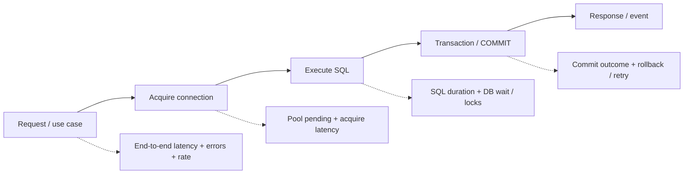

# Theo dõi độ trễ, lỗi và thông lượng thao tác dữ liệu

Một ứng dụng Java có thể báo rằng truy vấn SQL chỉ mất 8 ms, nhưng người dùng vẫn đợi 2 giây để tạo đơn hàng. Có thể request đã chờ connection pool 1,5 giây, một transaction khác đang giữ khóa, hoặc lỗi commit xuất hiện sau khi method repository trả về. Nếu chỉ ghi log câu SQL chậm, nhóm vận hành có thể tối ưu nhầm tầng, trong khi nguyên nhân là cạn connection, deadlock, tăng tải đột biến hoặc replica bị trễ.

**Quan sát thao tác dữ liệu (persistence observability)** là khả năng hiểu *điều gì xảy ra, ở đâu, khi nào và ảnh hưởng ra sao* thông qua **metrics, logs, traces** cùng ngữ cảnh nghiệp vụ đã được kiểm soát. Ba trục quan trọng là:

- **Độ trễ (*latency*):** mỗi thao tác mất bao lâu, gồm những giai đoạn chờ và xử lý nào?
- **Lỗi (*errors*):** bao nhiêu thao tác thất bại, thất bại loại gì, có được retry không và kết quả commit đã biết chắc chưa?
- **Thông lượng (*throughput*):** có bao nhiêu thao tác đến, được chấp nhận, hoàn tất và commit trong một đơn vị thời gian?

Bài học thuộc chương **Quan sát và vận hành** của mô-đun **DATA_PERSISTENCE_FUNDAMENTALS**. Mô-đun giúp hiểu lưu trữ bền vững từ mô hình dữ liệu, schema, truy vấn và chỉ mục đến giao dịch, cô lập, kiểm soát đồng thời; đồng thời thiết kế ranh giới persistence cho Java, xử lý lỗi kết nối, tiến hóa schema, bảo mật, sao lưu và hiệu năng. Trọng tâm ở đây là **định nghĩa và đo đúng các tín hiệu vận hành**, phân tích sự cố bằng bằng chứng, thiết lập SLO/cảnh báo và tránh làm rò rỉ dữ liệu nhạy cảm trong telemetry.

Ví dụ sử dụng Java 17+, Spring Boot/Micrometer, OpenTelemetry ở mức khái niệm và PostgreSQL. Tên metric, cấu hình và sự hiện diện của các view PostgreSQL phụ thuộc phiên bản, dependency và cách triển khai. Các ngưỡng trong bài là **giá trị minh họa**, phải hiệu chỉnh bằng yêu cầu của hệ thống và tải thực tế.

## 1. Chọn đơn vị đo trước khi vẽ biểu đồ

Một hệ thống có thể có nhiều đơn vị công việc khác nhau:

| Đơn vị | Một lần được tính khi nào? | Dùng để trả lời |
|---|---|---|
| **HTTP request** | API nhận và kết thúc một request | Người dùng cảm nhận latency/error thế nào? |
| **Use-case / business operation** | Một thao tác như `checkout` hoàn tất hoặc thất bại | Nghiệp vụ thành công, từ chối hay chưa xác định? |
| **Database transaction** | Một transaction bắt đầu, commit hoặc rollback | Chi phí và tỷ lệ kết thúc giao dịch ra sao? |
| **SQL statement/query attempt** | Gọi một lần thực thi SQL cụ thể | Truy vấn nào chậm, lỗi hoặc chạy quá nhiều lần? |
| **Connection acquisition** | Mượn connection từ pool | Có đang đợi connection trước khi gửi SQL không? |
| **Background job / batch** | Một batch đọc/ghi hoặc một lần chạy job | Năng suất, backlog, tiến độ và khả năng hồi phục? |

**Không được coi các mẫu số trên là như nhau.** Một HTTP request có thể gọi 12 câu SQL trong một transaction; một batch có thể ghi 1.000 hàng trong một statement; một thao tác nghiệp vụ retry ba lần có thể tạo ba SQL attempts nhưng chỉ một kết quả nghiệp vụ. Nếu tính lỗi SQL trên tổng request, hoặc dùng TPS của database làm số đơn hàng mỗi giây, biểu đồ sẽ sai ý nghĩa.

Trong vận hành, nên duy trì hai góc nhìn bổ sung: **góc nhìn người dùng** (request/use-case SLI) và **góc nhìn dependency** (pool, database, statement, lock, replication). Cả hai cần dùng định nghĩa ổn định qua các release.

### 1.1. RED kết hợp với dấu hiệu bão hòa

Mô hình **RED** thường được dùng cho service: **Rate** (tốc độ), **Errors** (lỗi) và **Duration** (thời gian). Với database, cần thêm góc nhìn **USE** của tài nguyên: **Utilization**, **Saturation** và **Errors**. Khi p99 tăng, việc biết CPU/IO có bão hòa hay connection pool đang chờ sẽ quan trọng hơn chỉ thấy "API chậm".



Sơ đồ biểu diễn các điểm đo logic. Một transaction có thể gồm nhiều SQL và nhiều lần lấy dữ liệu; **mốc thời gian của chúng có thể lồng nhau**, nên không cộng mọi timer thành tổng thời gian request một cách máy móc.

## 2. Định nghĩa độ trễ và đo đúng ranh giới

Với một request đồng bộ thường gặp, có thể tách các thành phần thời gian như sau:

```text
Client request
  ├── Chờ thread / queue / admission control
  ├── Chạy business validation
  ├── Chờ connection trong HikariCP
  ├── Gửi SQL, chờ network + database execute/lock/I/O
  ├── Đọc ResultSet, ánh xạ object hoặc entity
  ├── Flush/COMMIT/ROLLBACK nếu có transaction
  └── Trả response
```

Một công thức gần đúng, khi các giai đoạn **tuần tự và không trùng nhau**, là:

\[
T_{\mathrm{request}} = T_{\mathrm{queue}} + T_{\mathrm{app}} +
T_{\mathrm{acquire}} + T_{\mathrm{db}} + T_{\mathrm{commit}} +
T_{\mathrm{response}}
\]

Nếu có bước async, parallel fan-out, retry, nested transaction hoặc ORM tự phát SQL ở `flush`, các khoảng có thể chồng nhau hoặc xảy ra sau lời gọi đang đo. Khi ấy **distributed tracing và span timeline** thường đáng tin hơn việc cộng các đồng hồ từ nhiều layer.

### 2.1. Các timer cần phân biệt

| Timer | Bắt đầu → kết thúc | Điểm dễ đo sai |
|---|---|---|
| Request/use-case latency | Nhận yêu cầu → trả kết quả ở ranh giới xác định | Chỉ đo controller body và bỏ qua serialization/commit |
| Pool acquisition latency | Bắt đầu `getConnection` → mượn được hoặc timeout | Không phải query execution latency |
| Connection hold time | Khi pool cấp connection → trả connection | Bao gồm mapping, chờ lock hoặc thao tác vô tình giữ connection |
| SQL attempt duration | Bắt đầu thực thi statement → driver trả kết quả/lỗi theo phạm vi instrument | Có thể bao gồm network, fetch hoặc không bao toàn bộ đọc result set tùy instrumentation |
| Transaction duration | Bắt đầu transaction → commit/rollback xong | Dùng `@Timed` trên target method có thể **không** bao gồm commit của proxy |
| Lock wait | Khi chờ khóa → được cấp hoặc timeout | DB view có thể chỉ cho ảnh chụp trạng thái, không phải latency lịch sử |
| End-to-end data freshness | Data commit ở nguồn → đọc/tiêu thụ được ở đích | Không trùng với latency SQL hoặc HTTP request |

Ví dụ một API có p95 400 ms, trong khi SQL statement p95 chỉ 25 ms. Điều này **không chứng minh DB không liên quan**: request có thể chờ pool, ORM load quá nhiều bản ghi sau query, transaction chờ commit hoặc có N+1 với nhiều query đều nhanh riêng lẻ.

### 2.2. p50, p95, p99 và tail latency

**p95 = 200 ms** nghĩa là khoảng 95% quan sát nằm ở hoặc dưới 200 ms theo cách ước lượng phân vị của hệ đo; **không** có nghĩa mọi request đều không quá 200 ms. Khi p50 thấp nhưng p99 cao, một nhóm nhỏ user có thể gặp timeout dù biểu đồ average trông tốt.

| Thống kê | Hữu ích cho | Hạn chế |
|---|---|---|
| Mean / average | Tổng mức tiêu thụ thời gian và so sánh chung | Bị kéo lệch bởi vài trường hợp rất chậm; che phân bố |
| Median / p50 | Trải nghiệm điển hình | Không nói nhiều về tail latency |
| p95 / p99 | Phát hiện phần đuôi ảnh hưởng SLO | Cần đủ số mẫu, bucket/algorithm đúng và cửa sổ đo hợp lý |
| Max | Tìm sự kiện rất chậm để điều tra | Nhạy với ngoại lệ đơn lẻ và cách reset window |
| Histogram buckets | Tính phân vị qua nhiều instance và cửa sổ | Độ chính xác giới hạn bởi bucket đã cấu hình |

**Không lấy trung bình p95 của từng pod để thành p95 toàn hệ.** Phân vị không cộng gộp tuyến tính. Với Prometheus, nên thu thập **histogram buckets** của cùng metric/bucket cấu hình rồi `sum by (le, ...)` trước khi tính `histogram_quantile`; client-side percentile không thể tổng hợp đúng theo cách cộng thông thường.

## 3. Định nghĩa lỗi theo tính chất nghiệp vụ và kỹ thuật

Không phải mọi kết quả không thành công đều là lỗi hạ tầng. Một API đặt hàng có thể từ chối vì hàng không đủ: đây là **kết quả nghiệp vụ hợp lệ** nếu đã được thiết kế và trả về đúng. Trong khi đó, timeout lấy connection, deadlock hoặc lỗi xác thực với DB thường là lỗi kỹ thuật. Cần tách chúng để không đánh đồng "người dùng yêu cầu sai" với "persistence đang hỏng".

| Loại kết quả | Ví dụ | Cách quan sát |
|---|---|---|
| `success` | Transaction commit xong, trả `orderId` | Thao tác nghiệp vụ thành công; latency và throughput |
| `business_rejected` | Không đủ tồn kho, bản ghi không tồn tại, vi phạm quy tắc đã dự kiến | Counter riêng; không tự tính là DB outage |
| `technical_error` | Connection timeout, disk I/O, driver/DB lỗi | Tỷ lệ lỗi kỹ thuật, loại dependency và SQLSTATE ổn định |
| `retryable_failure` | Deadlock/serialization failure có khả năng thử lại | Số attempts, tỷ lệ thành công sau retry, retry budget |
| `commit_unknown` | Mất kết nối khi `COMMIT`, caller không biết DB đã commit chưa | Kênh đối soát theo operation ID; không đánh đồng với rollback |
| `cancelled` / `timed_out` | Request bị huỷ, deadline kết thúc | Ghi rõ phase nào, có còn transaction hoặc tác dụng DB không |

**Cách đếm lỗi phụ thuộc SLI đã định nghĩa**: nếu SLO của API yêu cầu tỷ lệ trả đúng kết quả nghiệp vụ, một `409` thiếu tồn có thể là phản hồi hợp lệ, trong khi HTTP 5xx, lỗi commit không rõ hoặc từ chối do quá tải làm giảm SLI. Không đưa toàn bộ HTTP 4xx vào numerator của lỗi kỹ thuật một cách vô điều kiện; cũng không loại bỏ tất cả timeout như thể chúng là lỗi người dùng.

### 3.1. SQLSTATE giúp phân loại ổn định hơn chuỗi exception

PostgreSQL báo lỗi qua **SQLSTATE** gồm năm ký tự. Trong Java/JDBC, thường có thể lấy qua `SQLException.getSQLState()` từ cause chain; Spring có hệ phân loại `DataAccessException`, nhưng **không mọi exception Spring đều giữ SQLSTATE ở cùng vị trí cause**. Không parse nội dung exception message tiếng Anh để làm logic retry.

| SQLSTATE / class | Ý nghĩa điển hình | Hành động gợi ý |
|---|---|---|
| `40001` | `serialization_failure` | Có thể retry **toàn transaction** với backoff/jitter nếu nghiệp vụ idempotent |
| `40P01` | `deadlock_detected` | Retry có giới hạn và điều tra thứ tự khóa/hotspot |
| `23505` | `unique_violation` | Xác minh trùng nghiệp vụ/idempotency; không retry vô điều kiện |
| `23503` | `foreign_key_violation` | Kiểm tra dữ liệu, quan hệ và thứ tự ghi |
| `57014` | `query_canceled` | Xác định nguyên nhân timeout, cancel thủ công hoặc DB policy |
| `53300` | `too_many_connections` | Kiểm tra DB connection budget, pool/autoscaling và admission control |
| Class `08` | Connection exception | Kiểm tra hạ tầng; nếu lỗi xảy ra lúc commit, **có thể không biết outcome** |
| `25P02` | Transaction hiện đã ở trạng thái aborted | Rollback transaction hỏng, không tiếp tục gửi SQL như vẫn bình thường |

Một lỗi SQLSTATE có thể là **triệu chứng**, không đủ để kết luận nguyên nhân. Ví dụ `57014` có thể do `statement_timeout` hoặc người vận hành hủy câu lệnh; cần thêm timeout settings, trace và log sự kiện. Cũng cần thống kê `retry_exhausted` và `recovered_after_retry` thay vì chỉ đếm exception từng attempt rồi kết luận tỷ lệ người dùng bị lỗi tương đương.

### 3.2. Commit outcome chưa biết là trạng thái cần theo dõi riêng

Khi mạng đứt trong lúc `COMMIT`, ứng dụng có thể nhận exception nhưng DB đã commit hoặc chưa commit. Đếm sự cố này chỉ là `rollback` rồi retry với một ID hoàn toàn mới có thể tạo bản ghi/thanh toán trùng. Với nghiệp vụ quan trọng, dùng **operation ID ổn định, unique constraint, tra cứu nguồn ghi có thẩm quyền và quy trình đối soát**, sau đó mới quyết định retry an toàn.

Metric `commit_unknown` nên đi kèm cảnh báo nếu backlog đối soát tăng. Không dùng một lượt `SELECT` trên read replica đang lag để kết luận commit không xảy ra. Cần đo cả **thời gian hoàn tất đối soát** vì khách hàng có thể nhận kết quả tạm thời, không chỉ lỗi ngay tại thời điểm disconnect.

## 4. Thông lượng: đo tốc độ đến và tốc độ hoàn tất

**Throughput** thường được biểu diễn bằng request/s, operation/s, transaction/s, query/s hoặc rows/s. Đơn vị nào cũng hợp lệ nếu diễn giải chính xác. Nhưng cần phân biệt:

- **Offered rate:** số yêu cầu **đến** trong một khoảng thời gian, kể cả yêu cầu đang đợi, bị từ chối hoặc timeout.
- **Accepted rate:** số yêu cầu hệ thống nhận để xử lý sau admission control.
- **Completed rate:** số yêu cầu kết thúc (có thể gồm success và failure); nếu chỉ đếm success phải nói rõ.
- **Committed transaction rate:** số transaction được xác nhận commit; không tương đương mặc định với số request thành công.
- **Write volume:** hàng/giây, byte/giây và WAL byte/giây; hai giao dịch có thể tạo lượng công việc rất khác nhau.

Tốc độ của một counter tăng dần được ước tính từ chênh lệch theo thời gian:

\[
\operatorname{rate}\approx\frac{\operatorname{counter}(t_2)-\operatorname{counter}(t_1)}{t_2-t_1}
\]

Giả sử counter `orders_completed_total` tăng từ 120.000 lên 129.000 trong 60 giây, tốc độ trung bình là **150 đơn hoàn tất/giây** trong khoảng đó. Nếu có thêm 3.000 đơn đang chờ xử lý, không thể kết luận hệ thống đang phục vụ tất cả tải đến chỉ từ con số 150.

### 4.1. Queue và áp lực khi throughput không theo kịp

```text
Yêu cầu đến:             800 operations/s
Hoàn tất:                650 operations/s
Tăng hàng đợi (xấp xỉ):  150 operations/s

Nếu kéo dài 120 giây và không có cơ chế từ chối:
Backlog tăng khoảng 18.000 operations.
```

Ở hệ thống có retry, drop, cancellation, batch và nhiều hàng đợi, cần đo từng luồng để công thức không bị cộng sai; với một queue đơn giản, **dòng vào − dòng ra** là tín hiệu nguy cơ tích backlog. Nếu hàng đợi tăng liên tục, độ trễ cuối cùng cũng tăng dù SQL latency riêng lẻ chưa đổi.

### 4.2. Định luật Little và số tác vụ đang hoạt động

Trong hệ ổn định, với một định nghĩa công việc nhất quán:

\[
L=\lambda W
\]

Trong đó `L` là số công việc trung bình ở trong hệ, `λ` là throughput trung bình và `W` là thời gian trung bình mỗi công việc ở trong cùng ranh giới đó. Nếu 200 giao dịch DB/giây giữ connection trung bình 50 ms (`0,05` giây), trung bình khoảng `200 × 0,05 = 10` connection được mượn để xử lý. **Không suy ra pool size tối ưu từ con số trung bình này**, vì burst, p99 duration và contention có thể đòi hỏi nhiều concurrency hơn; đồng thời tăng pool quá mức có thể gây bão hòa DB.

Một dashboard hiệu quả cần đặt **rate cạnh latency, errors và saturation**. Khi throughput giữ nguyên nhưng pool pending và p99 tăng, hệ có thể đang gần giới hạn. Khi throughput giảm cùng lúc lỗi và offered load tăng, đó có thể là dấu hiệu admission control hoặc backend không theo kịp, không phải nhu cầu tự nhiên giảm.

## 5. Xác lập SLI, SLO và error budget cho persistence

**SLI (Service Level Indicator)** là phép đo định nghĩa rõ kết quả mong muốn; **SLO (Service Level Objective)** là mục tiêu theo cửa sổ thời gian. Có thể đặt SLO cho cả API nghiệp vụ và dependency DB, nhưng không nên thay thế SLO người dùng bằng một dashboard CPU.

| SLI minh họa | Cách tính / ngưỡng | Cảnh báo về cách hiểu |
|---|---|---|
| Tỷ lệ hoàn tất nghiệp vụ đúng | Số nghiệp vụ hợp lệ hoàn tất đúng / tổng nghiệp vụ hợp lệ theo hợp đồng | Cần loại trừ yêu cầu không hợp lệ theo chính sách nhất quán |
| Availability của thao tác ghi | Số ghi hợp lệ được xác nhận thành công / số lần ghi hợp lệ được yêu cầu | Commit outcome chưa rõ phải có quy tắc đối soát |
| Latency p95 của `create_order` | p95 trên các operation attempts theo ranh giới đã chọn | Không đồng nghĩa p95 trên mỗi SQL statement |
| DB acquisition latency | p95/p99 thời gian chờ lấy connection | Không phản ánh toàn bộ thời gian transaction |
| Replica data freshness | Độ trễ từ commit nguồn tới dữ liệu được áp dụng/đọc tại replica | Cần đo bằng mốc log/version đáng tin, không chỉ thời gian hệ thống im lặng |
| Batch completion lag | Tuổi công việc chưa xử lý lâu nhất hoặc backlog age | Throughput cao chưa chắc backlog đang giảm |

Ví dụ một SLO yêu cầu **99,9%** thao tác ghi hợp lệ có kết quả thành công trong cửa sổ 30 ngày. Với **1.000.000** thao tác thuộc mẫu số đã thống nhất, error budget minh họa là:

\[
(1-0{,}999)\times 1.000.000=1.000\ \text{lần không đạt mục tiêu}
\]

**Không chuyển 99,9% request success thành "database được phép downtime 43,2 phút" nếu hệ có nhiều loại hoạt động và tải không đều**; tỷ lệ theo request và tỷ lệ theo thời gian là hai mẫu số khác nhau. SLO độ trễ cũng cần xác định rõ trường hợp timeout, cancellation và exception không có kết quả timer bình thường có được tính vào numerator hay denominator.

### 5.1. SLI ở hai ranh giới khác nhau có thể cho kết luận khác

Giả sử một request tạo đơn retry tối đa hai lần. Attempt đầu gặp deadlock và rollback; attempt thứ hai commit thành công trong deadline. Khi đó:

- **SQL attempt error rate** ghi nhận một lần deadlock trong hai attempts.
- **Business operation success rate** ghi nhận **một thao tác thành công** nếu caller nhận xác nhận hợp lệ.
- **Business latency** bao gồm cả attempt đầu, backoff và attempt hai; có thể vượt SLO dù kết quả cuối thành công.

Đừng loại bỏ metrics của retry chỉ vì API thành công; số retries tăng có thể báo sớm lock contention. Nhưng cũng đừng cộng các retry exception vào số người dùng thất bại rồi tạo báo động sai.

## 6. Thu thập metrics từ Java bằng Micrometer

Trong Spring Boot, **Micrometer** thường được sử dụng để quản lý meter/registry và xuất metrics thông qua hệ giám sát phù hợp (ví dụ Prometheus qua Actuator khi dependency và endpoint được cấu hình). Tên metric/label phải **ổn định, có số giá trị hữu hạn và bám vào loại thao tác**, không dựa trên ID của từng user hoặc từng câu SQL có tham số.

### 6.1. Instrument timer ở ngoài proxy transaction

Ví dụ giản lược, trong đó `OrderWorkflow` gọi bean `TransactionalOrderWriter` **qua Spring proxy**, nên khi method ghi tự mở transaction mới, lời gọi bên ngoài chỉ hoàn thành sau khi transaction interceptor đã commit/rollback:

```java
import io.micrometer.core.instrument.MeterRegistry;
import io.micrometer.core.instrument.Timer;
import org.springframework.stereotype.Service;

@Service
public class OrderWorkflow {
    private final TransactionalOrderWriter writer;
    private final MeterRegistry registry;

    public OrderWorkflow(TransactionalOrderWriter writer, MeterRegistry registry) {
        this.writer = writer;
        this.registry = registry;
    }

    // Không gắn @Transactional ở đây: đo bên ngoài transaction proxy của writer.
    public void createOrder(long orderId) {
        Timer.Sample sample = Timer.start(registry);
        String outcome = "success";
        try {
            writer.persist(orderId); // Commit/rollback trước khi proxy trả về.
        } catch (RuntimeException failure) {
            outcome = "failure";
            throw failure;
        } finally {
            sample.stop(Timer.builder("persistence.workflow.duration")
                    .description("End-to-end DB write workflow duration")
                    .tag("operation", "create_order")
                    .tag("outcome", outcome)
                    .publishPercentileHistogram()
                    .register(registry));
        }
    }
}
```

```java
import org.springframework.jdbc.core.JdbcTemplate;
import org.springframework.stereotype.Service;
import org.springframework.transaction.annotation.Transactional;

@Service
public class TransactionalOrderWriter {
    private final JdbcTemplate jdbc;

    public TransactionalOrderWriter(JdbcTemplate jdbc) {
        this.jdbc = jdbc;
    }

    @Transactional
    public void persist(long orderId) {
        jdbc.update("INSERT INTO orders(id, status) VALUES (?, 'PENDING')", orderId);
    }
}
```

Các đoạn code là **hai file Java khác nhau** trong package của dự án, với bảng minh họa `orders(id BIGINT PRIMARY KEY, status TEXT NOT NULL)`. Cần cấu hình transaction manager đúng `DataSource` và bảo đảm lời gọi vào `TransactionalOrderWriter` thực sự đi qua bean/proxy của Spring. Nếu caller bên ngoài **đã mở transaction lớn hơn**, `persist` có thể chỉ tham gia transaction đó; timer của `OrderWorkflow` **không** bao gồm commit ở ranh giới ngoài. Vì vậy metric được đặt tên là **workflow duration**, không khẳng định luôn đo toàn bộ physical transaction duration.

`catch (RuntimeException)` chỉ phân loại coarse outcome `failure`; production nên phân biệt `business_rejected`, `technical_error`, `commit_unknown` ở ranh giới có thông tin đủ tin cậy. Nếu method trả status trung gian `PENDING_RECONCILIATION` thay vì ném exception, timer này coi method bình thường là success **theo code**, còn SLI nghiệp vụ phải xem trạng thái cuối; không lấy tag `success` làm bằng chứng thanh toán chắc chắn hoàn tất.

**Vì sao đo ở phía ngoài?** Với proxy-based `@Transactional` thông thường, thân method target có thể đã trả về nhưng DB chưa commit xong. `@Timed` hoặc timer đặt **bên trong** thân method có thể bỏ sót lỗi unique/deferred constraint ở flush/commit và thời gian commit. Nếu cần đo đúng transaction boundary, đặt instrumentation ở layer bao ngoài transaction interceptor hoặc dùng transaction instrumentation có hợp đồng rõ, và kiểm chứng thứ tự AOP advice trong ứng dụng thật.

### 6.2. Timer đã có count; đừng đếm trùng vô ý

Trong Micrometer, `Timer` thường ghi **số lần** (`count`) và tổng thời gian (`totalTime`) cùng distribution khi được cấu hình. Nếu lại tăng một `Counter` cho cùng nghĩa "operation attempts", cần tài liệu định nghĩa để không nhầm hai nguồn là hai workload. Counter riêng hữu ích cho các sự kiện **không mang duration**, như retry scheduled, reconciliation pending hoặc queue rejected, nếu tag low-cardinality.

Tránh tags như `order_id`, `customer_id`, email, toàn bộ SQL text, URL chứa token hoặc exception message. Một metric có hàng triệu tag values tạo **cardinality explosion**, tăng chi phí bộ nhớ, lưu trữ và thời gian truy vấn; thông tin nhận diện chi tiết nên ở log/trace được bảo vệ thay vì metrics series.


