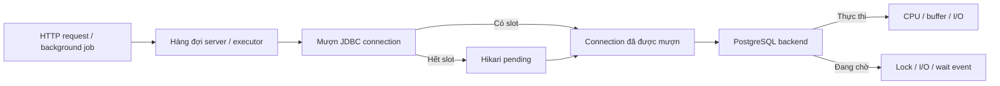
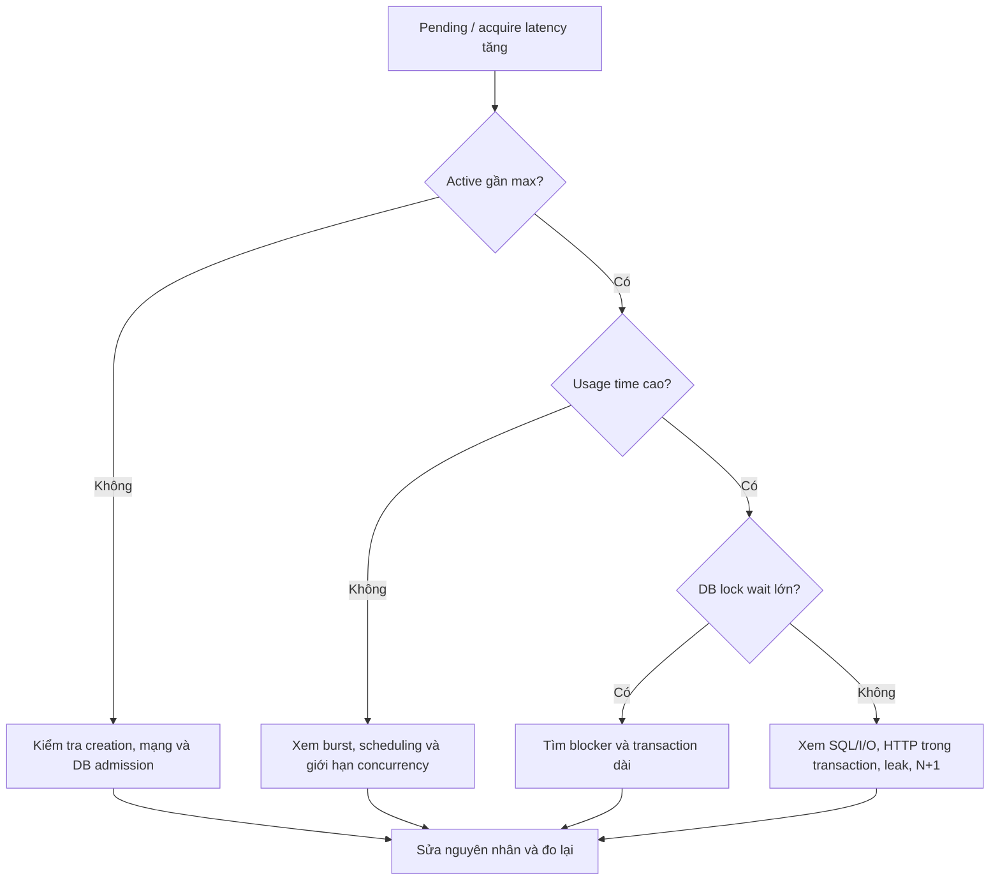

# Quan sát kết nối đang dùng, thời gian chờ và độ dài hàng đợi

> **Chương:** Quan sát và vận hành  
> **Phạm vi:** `DATA_PERSISTENCE_FUNDAMENTALS` — hiểu lưu trữ dữ liệu bền vững trong Java, từ mô hình, lược đồ, truy vấn, chỉ mục, giao dịch, cô lập và kiểm soát đồng thời đến xử lý lỗi kết nối, bảo mật, sao lưu và tối ưu hiệu năng.

## Mục tiêu học tập

Sau bài này, người học có thể:

1. Phân biệt số connection **đang được mượn**, **nhàn rỗi**, **chờ được cấp** trong pool và số PostgreSQL backend đang chạy hoặc chờ một tài nguyên.
2. Đọc metric HikariCP `active`, `idle`, `total`, `pending`, thời gian `acquire`, thời gian `usage` và connection timeout; hiểu giới hạn của từng metric.
3. Sử dụng `pg_stat_activity`, `pg_blocking_pids` và các chỉ số PostgreSQL để phát hiện transaction dài, khóa chờ, session `idle in transaction` và áp lực số kết nối.
4. Liên hệ độ dài hàng đợi với throughput và latency của ứng dụng Java, biết khi nào **không nên tăng pool** dù các request đang phải chờ.
5. Thiết kế dashboard, cảnh báo, test tải và runbook để phân biệt pool exhaustion, lock contention, truy vấn chậm và giữ connection quá lâu.

## 1. Một sự cố điển hình: đầy pool nhưng CPU database không cao

Ứng dụng đơn hàng Java dùng Spring Boot, HikariCP và PostgreSQL. Sau khi phát hành chức năng mới:

- `POST /orders` tăng p95 từ khoảng 100 ms lên 2 giây.
- Pool 20 kết nối có `active = 20` trong thời gian dài.
- `pending` tăng; một số yêu cầu bị lỗi khi mượn kết nối.
- CPU PostgreSQL chỉ ở mức vừa phải.

Chỉ nhìn CPU, người vận hành có thể tăng pool từ 20 lên 100. Nhưng nguyên nhân có thể là **các transaction cùng đợi một khóa hàng**, một phương thức `@Transactional` giữ connection khi gọi HTTP bên ngoài, hoặc `ResultSet`/stream không được đóng. Tăng pool khi ấy có thể làm thêm nhiều transaction cùng chờ tài nguyên, khiến tình hình tệ hơn.

Ba câu hỏi đầu tiên:

1. **Ai đang chờ?** HTTP request, worker thread, thread mượn connection hay backend PostgreSQL?
2. **Chờ điều gì?** Connection trong pool, row/table lock, I/O, query, network hay service bên ngoài?
3. **Ai đang giữ tài nguyên?** Transaction dài, SQL tốn thời gian, client không trả connection hoặc cấu hình pool và tải không tương xứng?

Số connection cao là một **tín hiệu điều tra**, không tự nó chứng minh thiếu CPU hay RAM.

## 2. Ba hàng đợi có ý nghĩa khác nhau



| Tầng | Số liệu chờ | Điều cần nhớ |
| --- | --- | --- |
| HTTP server/executor/message consumer | Request đang chờ được worker xử lý; executor queue | Request có thể **chưa chạm database**. |
| HikariCP connection pool | `pending`, thời gian mượn connection, timeout | Thread chưa mượn được connection; không có nghĩa đang chờ row lock. |
| PostgreSQL | `state`, `wait_event_type`, `pg_blocking_pids`, số backend | Backend đã có session, có thể thực thi SQL hoặc bị chặn. |

**Ví dụ:** một thread đang chờ trong `Hikari pending` chưa có connection được cấp. Nó thường không xuất hiện như một backend `active` đang thực hiện query. Ngược lại, một PostgreSQL backend `state = 'active'` và `wait_event_type = 'Lock'` đã có connection, nhưng SQL bị khóa chặn.

Không có một metric duy nhất mang tên “độ dài hàng đợi DB” bao quát ba tầng. Khi báo cáo, cần chỉ rõ **queue ở tầng nào và đơn vị đếm là gì**.

## 3. Connection pool: active, idle, total, pending

HikariCP quản lý các kết nối JDBC để ứng dụng không phải mở TCP/TLS/authentication connection cho mỗi request. Một pool có thể có các trạng thái sau:

| Metric | Ý nghĩa | Điều không nên suy ra |
| --- | --- | --- |
| `active` | Connection đang **được mượn** bởi code ứng dụng | Không đồng nghĩa tất cả đang chạy SQL hay tiêu thụ CPU. |
| `idle` | Connection đang ở pool, có thể được mượn | Không có nghĩa mọi lần mượn tiếp theo sẽ nhanh nếu connection cần kiểm tra/tái tạo. |
| `total` | Tổng connection pool đang giữ, thường bằng `active + idle` | Không phải tổng connection từ tất cả pod/service. |
| `max` | Trần cấu hình số connection trong pool | Không phải mục tiêu phải duy trì `active = max`. |
| `pending` | Thread đang đợi lấy connection từ pool | Không phải số backend PostgreSQL đang đợi khóa. |
| `acquire time` | Thời gian từ khi mượn đến khi được cấp connection | Không phải thời gian thực thi câu SQL. |
| `usage time` | Khoảng thời gian một connection được mượn rồi trả lại | Có thể gồm thời gian code Java làm việc không liên quan SQL. |
| `creation time` | Thời gian tạo connection mới | Tăng có thể do mạng, DB, TLS, authentication, admission. |
| `timeout count` | Lần chờ mượn connection vượt hạn | Không chứng minh transaction DB đã rollback. |

Ở một snapshot tương đối ổn định:

```text
total ≈ active + idle
total <= maximumPoolSize
pending >= 0
```

Các gauge được thu không đồng thời hoặc khi pool đang tái tạo connection có thể lệch nhau ít nhiều. Pool có thể còn dưới `max` nhưng `pending > 0` do tạo connection mới chậm; vì vậy không kết luận mọi waiting đều do cấu hình `max` quá thấp.

### 3.1. Chờ mượn và giữ lâu là hai nguyên nhân khác nhau

```text
Request A:
  Chờ Hikari cấp connection: 180 ms
  Query PostgreSQL:          12 ms
  Trả connection
  Serialize JSON:             8 ms

Request B:
  Chờ Hikari cấp connection:   2 ms
  Query PostgreSQL:          20 ms
  Gọi HTTP bên ngoài khi vẫn giữ connection: 900 ms
  Trả connection
```

Request A có **acquire time** lớn vì các connection khác bận. Request B có **usage time** rất lớn vì giữ connection qua một hoạt động HTTP. Chỉnh index để query B từ 20 ms xuống 10 ms không xử lý được 900 ms còn lại.

Với Spring `@Transactional`, connection có thể được mượn ở thời điểm truy cập DB đầu tiên và giữ đến lúc transaction kết thúc. Thời điểm thực tế phụ thuộc transaction manager, JDBC/ORM và datasource; phải quan sát bằng trace, không đồng nhất usage duration với toàn bộ thời gian method.

## 4. Spring Boot, HikariCP và Micrometer

Một cấu hình minh họa:

```yaml
spring:
  datasource:
    url: jdbc:postgresql://db.example.internal:5432/orders
    username: ${DB_USER}
    password: ${DB_PASSWORD}
    hikari:
      pool-name: orders-write
      maximum-pool-size: 20
      minimum-idle: 5
      connection-timeout: 3000
      # Chỉ bật ngắn hạn để điều tra:
      # leak-detection-threshold: 20000

management:
  endpoints:
    web:
      exposure:
        include: health,info,metrics,prometheus
  metrics:
    tags:
      service: orders-api
```

Ví dụ giả định dự án có Spring Boot Actuator, Micrometer, registry Prometheus thích hợp và một datasource Hikari do Spring quản lý. Các số `20`, `5`, `3000 ms` chỉ để minh họa; không phải khuyến nghị chung cho production. Cấp DB credentials qua secret manager/biến môi trường và hạn chế quyền truy cập endpoint metrics.

Những tên meter thường gặp ở HikariCP/Micrometer:

```text
hikaricp.connections.active
hikaricp.connections.idle
hikaricp.connections.pending
hikaricp.connections.max
hikaricp.connections.acquire
hikaricp.connections.usage
hikaricp.connections.creation
hikaricp.connections.timeout
```

Ở Prometheus, tên thường được chuyển sang gạch dưới và có hậu tố cho timer/counter, ví dụ `hikaricp_connections_active` hoặc `hikaricp_connections_acquire_seconds_count`. **Cần xem danh sách metric thực sự xuất ra trước khi viết dashboard** vì phiên bản và cấu hình exporter có thể khác.

Một dashboard pool tối thiểu nên giữ label **pool + instance/pod**. Nếu gộp cả cụm, một pod đầy pool có thể bị che bởi những pod còn rảnh. Ngược lại, không dùng `userId`, email, SQL nguyên văn hoặc request ID làm metric label có cardinality cao và rủi ro lộ dữ liệu.

## 5. Prometheus: độ dài hàng đợi, thời gian chờ, tỷ lệ lỗi

Ví dụ PromQL dưới đây chỉ dùng khi exporter có đúng tên series/label:

```promql
# Active connection và pending thread theo pool.
sum by (pool) (hikaricp_connections_active)
sum by (pool) (hikaricp_connections_pending)

# Tỷ lệ active / max cho nhiều pool; xem thêm theo pod.
sum by (pool) (hikaricp_connections_active)
/
clamp_min(sum by (pool) (hikaricp_connections_max), 1)
```

Ví dụ thời gian **trung bình** mượn connection trong 5 phút:

```promql
sum by (pool) (
  rate(hikaricp_connections_acquire_seconds_sum[5m])
)
/
clamp_min(
  sum by (pool) (
    rate(hikaricp_connections_acquire_seconds_count[5m])
  ),
  0.000001
)
```

Đó là **trung bình**, không phải p95. Nếu registry đã cấu hình histogram và exporter thật sự có series `_bucket`, mới có thể tính percentile:

```promql
histogram_quantile(
  0.95,
  sum by (le, pool) (
    rate(hikaricp_connections_acquire_seconds_bucket[5m])
  )
)
```

Một timer mặc định có thể chỉ có count/sum/max, không có buckets. Không dựng biểu đồ “p95” bằng `sum/count`. Khi cần SLO phân vị, phải bật histogram hoặc SLO buckets một cách có chủ đích và tính chi phí cardinality.

Ví dụ timeout rate nếu exporter có counter `hikaricp_connections_timeout_total`:

```promql
sum by (pool) (
  rate(hikaricp_connections_timeout_total[5m])
)
```

Counter có thể reset sau restart nên dùng `rate`/`increase` thay vì tự lấy hai giá trị thô không kiểm soát. Đọc **timeout rate cùng request throughput, latency và số lượt mượn** để hiểu tác động; một số timeout tuyệt đối không phải là phần trăm lỗi.

## 6. PostgreSQL: tìm backend đang chạy, chờ và mở transaction

`pg_stat_activity` là góc nhìn database về session/backend. Một tài khoản chỉ có thể thấy một phần thông tin của session khác nếu không có quyền phù hợp; vai trò giám sát được cấp `pg_read_all_stats` hoặc quyền tương ứng theo chính sách.

```sql
SELECT
    pid,
    application_name,
    usename,
    state,
    wait_event_type,
    wait_event,
    clock_timestamp() - backend_start AS connection_age,
    clock_timestamp() - xact_start AS transaction_age,
    clock_timestamp() - query_start AS query_age
FROM pg_stat_activity
WHERE datname = current_database()
  AND backend_type = 'client backend'
ORDER BY transaction_age DESC NULLS LAST, pid;
```

**Cách hiểu trạng thái:**

- `active`: backend đang thực hiện query; **vẫn có thể chờ** khi `wait_event_type` không null.
- `idle`: session chờ lệnh mới. Pool giữ connection idle là hành vi bình thường; tuổi session dài không tự chứng minh leak.
- `idle in transaction`: transaction đã mở nhưng session đang chờ lệnh tiếp. Có thể giữ row lock, snapshot hoặc cản vacuum.
- `wait_event_type = 'Lock'`: backend chờ một dạng khóa. Các loại `IO`, `Client`, `LWLock`, `Timeout` có ngữ nghĩa khác.
- `query_start` của session idle có thể chỉ là câu lệnh gần nhất; **không được coi `query_age` của mọi idle session là thời gian query vẫn đang chạy**.

Đếm trạng thái và wait event:

```sql
SELECT state, wait_event_type, COUNT(*) AS sessions
FROM pg_stat_activity
WHERE datname = current_database()
  AND backend_type = 'client backend'
GROUP BY state, wait_event_type
ORDER BY sessions DESC;
```

Đây là **snapshot nhất thời**, không phải histogram lịch sử. Cần lấy mẫu theo thời gian, tương quan với metrics của application, và không mở transaction giám sát lâu chỉ để đọc statistics.

### 6.1. Tổng connection khác connection ứng dụng

```sql
SELECT datname, numbackends, xact_commit, xact_rollback, deadlocks
FROM pg_stat_database
WHERE datname = current_database();

SHOW max_connections;
```

`numbackends` là số backend tại thời điểm xem; `xact_commit`, `xact_rollback` và `deadlocks` là counter tích lũy qua thời gian (có thể reset), nên khi đánh giá xu hướng phải tính mức tăng trong một cửa sổ.

Không so sánh số Hikari active của **một pod** với `max_connections` rồi kết luận còn thừa. Tổng số connection tiềm năng có thể xấp xỉ:

```text
Tổng capacity đã cấu hình từ ứng dụng
≈ Σ(số instance của nhóm i × maximumPoolSize của nhóm i)
  + connection của job/migration/admin/ứng dụng khác
```

PostgreSQL còn có những session/slot dành cho quản trị và cơ chế khác; phải dành headroom tương ứng và đo giới hạn tài nguyên thực tế. Tăng pool ở nhiều pod có thể đồng loạt đẩy DB đến ngưỡng không còn nhận connection mới.

## 7. Tìm ai đang chặn ai bằng `pg_blocking_pids`

Một backend có `wait_event_type = 'Lock'` có thể đang chờ transaction khác. Truy vấn chỉ đọc:

```sql
SELECT
    waiting.pid AS waiting_pid,
    waiting.application_name AS waiting_app,
    waiting.wait_event_type,
    waiting.wait_event,
    clock_timestamp() - waiting.query_start AS waiting_query_age,
    blocker.pid AS blocker_pid,
    blocker.application_name AS blocker_app,
    blocker.state AS blocker_state,
    clock_timestamp() - blocker.xact_start AS blocker_transaction_age
FROM pg_stat_activity AS waiting
JOIN LATERAL unnest(pg_blocking_pids(waiting.pid))
     AS bp(blocker_pid) ON TRUE
LEFT JOIN pg_stat_activity AS blocker
     ON blocker.pid = bp.blocker_pid
WHERE waiting.datname = current_database()
ORDER BY waiting_query_age DESC NULLS LAST;
```

Kết quả giúp dựng chuỗi **waiter → blocker**. Một blocker có thể `idle in transaction`, đang chạy query khác, hoặc không hiển thị đầy đủ với quyền hiện tại. Không mặc định blocker lâu nhất là một query “bị treo”; phải xem log, transaction ownership và mục đích nghiệp vụ.

**Quy trình điều tra:**

1. Tìm các waiter/lock lâu bất thường và xác định blocker.
2. Liên hệ `application_name`/trace ID với service, job hoặc giao dịch tương ứng.
3. Kiểm tra thời gian transaction, hành vi ORM/JDBC và ranh giới `@Transactional`.
4. Xác định vì sao transaction không kết thúc: chờ HTTP, xử lý file, câu SQL đắt, vòng lặp hoặc lỗi cleanup.
5. Ưu tiên giảm tải và sửa nguyên nhân; chỉ hủy query/session nếu có thẩm quyền, bằng chứng và kế hoạch xử lý rollback/retry.

Đếm backend có wait event `Lock` **không tạo ra hàng đợi FIFO chính xác**. PostgreSQL sử dụng nhiều cơ chế lock/wait; số waiter tại một snapshot chỉ là ước lượng mức tranh chấp tại thời điểm đó.

## 8. Phân biệt các timeout có cùng triệu chứng “request chậm”

| Timeout | Tầng chịu trách nhiệm | Ý nghĩa |
| --- | --- | --- |
| Hikari `connectionTimeout` | Pool | Thread chờ mượn connection quá lâu; **chưa chắc đã gửi SQL**. |
| Driver connection/login timeout | Driver/network | Không thiết lập được connection tới PostgreSQL trong thời hạn. |
| PostgreSQL `lock_timeout` | Database | Statement chờ lấy khóa vượt giới hạn. |
| PostgreSQL `statement_timeout` | Database | Statement chạy/chờ vượt thời gian quy định. |
| JDBC query/socket timeout | Driver/statement/socket | Driver hoặc network không hoàn thành hoạt động trong hạn. |
| `idle_in_transaction_session_timeout` | Database/session | Session mở transaction nhưng idle quá lâu. |
| HTTP/gateway timeout | Web/edge | Client/gateway hết thời gian chờ response; DB có thể vẫn đang xử lý. |

Ví dụ `connectionTimeout = 3000 ms` **không có nghĩa mọi query phải xong trong 3 giây**. Nó chỉ giới hạn thời gian chờ lấy connection từ pool. Ngược lại, một câu SQL chạy dưới `statement_timeout` vẫn có thể khiến request HTTP timeout nếu cộng thêm hàng đợi hoặc thời gian khác.

Trong các tác vụ ghi, timeout/mất kết nối **quanh `COMMIT`** có thể tạo trạng thái kết quả chưa xác định: DB có thể đã commit dù client không nhận xác nhận. Không lấy metric connection timeout hoặc network error làm bằng chứng rollback. Cần idempotency key, tra cứu kết quả ở nguồn chuẩn và retry có giới hạn theo đúng giao thức nghiệp vụ.

## 9. Dùng Little's Law để ước lượng, không để đoán pool size

Định luật Little cho hệ ở trạng thái ổn định:

\[
L = \lambda W
\]

Trong đó `L` là số đối tượng trung bình trong hệ, `λ` là tốc độ hoàn thành trung bình và `W` là thời gian trung bình đối tượng ở trong hệ.

Áp dụng vào **lượt mượn connection**, nếu workload tương đối ổn định:

```text
200 lượt mượn/giây × 0,030 giây giữ connection
    ≈ 6 connection đang được mượn trung bình.

200 lượt mượn/giây × 0,250 giây giữ connection
    ≈ 50 connection đang được mượn trung bình.
```

Với request mượn connection nhiều lần, `λ` phải đếm **lượt mượn/giây** thay vì tự thay bằng request/giây. Đây là số **trung bình**, không tính đầy đủ burst, tail latency, concurrency limit hay nguồn lực DB; không phải công thức chọn `maximumPoolSize` chính xác.

Điểm quan trọng: khi thời gian giữ connection tăng từ 30 lên 250 ms, nhu cầu connection đồng thời trung bình tăng hơn tám lần **dù throughput không đổi**. Vì thế rút ngắn transaction, giảm lock wait hoặc loại bỏ công việc HTTP bên trong transaction có thể hiệu quả hơn tăng pool.

### 9.1. Ma trận chẩn đoán

| Quan sát | Giả thuyết nên kiểm tra trước |
| --- | --- |
| Hikari `pending` cao, `active ≈ max`, usage time cao | Connection bị giữ lâu; xem transaction, trace, SQL và wait event. |
| `pending` cao, PostgreSQL `Lock` wait nhiều | Pool hết connection là **hậu quả** của lock contention. |
| `pending` cao, `active < max`, creation time cao | Connection establishment/validation chậm, DB không nhận connection, mạng/DNS/TLS. |
| Pool nhiều idle nhưng API vẫn chậm | Nghẽn ở HTTP executor, business logic, downstream hoặc một câu SQL khác. |
| DB CPU/I/O cao, SQL duration tăng | Query plan, index, số round-trip, N+1 hoặc concurrency gây bão hòa. |
| `idle in transaction` tăng kéo dài | Luồng giữ transaction mở hoặc không cleanup đúng. |
| `total` cao, `pending = 0`, timeout = 0 | Có thể chỉ là pool tái sử dụng connection bình thường. |

## 10. Đo end-to-end trong Java

Chỉ đo SQL bên trong JDBC không cho biết một request mất bao lâu trong hàng đợi, mapping, transaction commit hoặc service bên ngoài.

Với Micrometer, có thể đặt timer ở **caller khác bean** bao quanh lời gọi service đã được Spring `@Transactional` proxy. Khi lời gọi proxy trả về, commit/rollback thông thường đã được transaction interceptor xử lý:

```java
import io.micrometer.core.instrument.MeterRegistry;
import io.micrometer.core.instrument.Timer;
import org.springframework.stereotype.Component;

@Component
public class OrderUseCaseMetrics {
    private final OrderService service;
    private final MeterRegistry registry;

    public OrderUseCaseMetrics(OrderService service, MeterRegistry registry) {
        this.service = service;
        this.registry = registry;
    }

    public OrderResult create(CreateOrderCommand command) {
        Timer.Sample sample = Timer.start(registry);
        String outcome = "error";
        try {
            OrderResult result = service.create(command);
            outcome = "success";
            return result;
        } finally {
            sample.stop(Timer.builder("app.persistence.usecase")
                .tag("operation", "create-order")
                .tag("outcome", outcome)
                .register(registry));
        }
    }
}
```

`OrderService`, `OrderResult`, `CreateOrderCommand` là những thành phần của ứng dụng minh họa. Timer ở **bên trong thân method `@Transactional`** không nhất thiết bao gồm commit vì transaction interceptor có thể commit **sau khi method body return**.

Một trace có ích tách được:

- Thời gian request chờ ở HTTP/executor.
- Thời gian mượn Hikari connection.
- Thời gian SQL trên DB, kể cả chờ lock/I/O.
- Thời gian Java vẫn giữ connection nhưng không chạy SQL.
- Thời gian commit/rollback, mapping và downstream.

Không đưa `requestId`/`accountId`/email/câu SQL có dữ liệu nhạy cảm vào metric label. Các thông tin điều tra chi tiết nên nằm trong trace/log được kiểm soát quyền và thời hạn lưu.

## 11. Thiết kế dashboard và cảnh báo theo tác động

Một dashboard nên có, theo **pod + pool**:

1. Request rate, p50/p95/p99 và HTTP error/timeout rate.
2. Hikari `active`/`idle`/`total`/`max`/`pending`.
3. Acquire/usage/creation duration và connection timeout rate.
4. PostgreSQL session count, `idle in transaction`, active wait events và blocker/waiter.
5. SQL duration, số SQL/request, transaction age, lock wait, deadlock rate, CPU/I/O.
6. Deploy marker, số pod, autoscaling, connection limit và trạng thái failover.

Ví dụ **quy tắc cảnh báo cần hiệu chuẩn theo SLO**:

| Dấu hiệu kết hợp | Hành động |
| --- | --- |
| `pending > 0` kéo dài **và** acquire p95/timeout tăng | Điều tra pool hoặc connection creation ngay. |
| `active ≈ max` kéo dài **và** usage time tăng | Tìm transaction/SQL đang giữ connection. |
| Nhiều `idle in transaction` lâu, có lock blockers | Tìm owner và nguyên nhân transaction chưa kết thúc. |
| PostgreSQL sessions gần giới hạn, nhiều pod tăng pool cùng lúc | Xem ngân sách connection toàn cụm và bảo vệ headroom quản trị. |
| Latency tăng sau deploy, lock wait/usage duration tăng | So sánh ranh giới transaction và SQL trước/sau deploy. |

Một điểm spike `pending > 0` trong vài giây chưa đủ xác nhận sự cố. Ngược lại, `pending = 0` không có nghĩa hệ thống nhanh nếu request chưa đến pool hoặc SQL đã được mượn connection đang chờ khóa.

## 12. Runbook khi Hikari pending tăng

**Bước 1 — Xác nhận tác động.** Ghi thời điểm, service version, request rate, p95/p99, timeout, pool/pod cụ thể và việc có sự kiện deploy, chạy batch hoặc failover.

**Bước 2 — Xem ai giữ connection.** So sánh active/max và usage duration. Nếu usage cao nhưng SQL span ngắn, xem `@Transactional` bao HTTP/network/file processing, JDBC stream chưa đóng, thread treo, JVM GC hoặc vòng lặp quá dài trong transaction. Hikari leak detection chỉ là công cụ chẩn đoán: một transaction hợp lệ chạy lâu cũng có thể tạo cảnh báo, không phải bằng chứng rò rỉ.

**Bước 3 — Quan sát PostgreSQL.** Dùng các truy vấn chỉ đọc trong phần 6–7 để tìm lock waiter và blocker, session `idle in transaction`, query age và wait event. Nếu không có lock, xem I/O, CPU, SQL plan và tốc độ tạo connection.

**Bước 4 — Giảm tác động.** Có thể giới hạn request/job concurrency, ngăn retry storm và sửa transaction giữ khóa. Không tăng pool tùy tiện khi DB đã quá tải hoặc số backend gần giới hạn. Không hủy session chỉ vì tuổi transaction cao; cần xác định quyền thao tác, nghiệp vụ đang diễn ra và khả năng rollback/reconcile.

**Bước 5 — Kiểm chứng.** Đo lại cùng workload: pending, acquire/usage p95, timeout, DB lock wait, query latency, request throughput và tỷ lệ lỗi. Ghi nguyên nhân gốc, thay đổi code/config và bài test chống hồi quy.



## 13. Kiểm thử tải có thể tái hiện nguyên nhân

**Thử nghiệm A — pool exhaustion:** dùng pool nhỏ trong môi trường test (`maximumPoolSize = 2`), cho hai worker mượn rồi giữ connection với barrier có timeout. Worker thứ ba chờ. Quan sát `pending`, acquire duration và timeout; sau khi nhả connection, chờ giảm. Thread thứ ba chưa nhất thiết có backend PostgreSQL.

**Thử nghiệm B — lock contention:** trên DB test, mở session A, `BEGIN` và cập nhật một hàng; giữ transaction A bằng barrier. Session B cố cập nhật cùng hàng. Quan sát `wait_event_type = 'Lock'` và `pg_blocking_pids` từ session thứ ba. Sau đó commit/rollback A, giải phóng B và dọn cả hai transaction. Lúc B chờ khóa, Hikari `pending` vẫn có thể bằng 0 nếu pool còn slot.

```sql
-- Session A, CHỈ dùng trên PostgreSQL thử nghiệm.
BEGIN;
UPDATE wallet_account SET balance = balance - 1 WHERE id = 1;
-- Giữ transaction bằng barrier của bài test, không commit ngay.

-- Session B, connection độc lập.
BEGIN;
UPDATE wallet_account SET balance = balance + 1 WHERE id = 1;
-- Chờ khóa từ A. Dùng session C quan sát pg_stat_activity.
```

**Thử nghiệm C — giữ connection ngoài SQL:** service chạy một query ngắn trong transaction rồi chờ một barrier hữu hạn khi transaction còn mở. Usage duration tăng; SQL time có thể ngắn; PostgreSQL có thể hiển thị `idle in transaction`. Chuyển công việc không thuộc DB ra ngoài transaction và đo lại.

**Thử nghiệm D — tạo connection chậm:** trên môi trường cô lập, mô phỏng mạng/DB accept connection chậm. Quan sát creation duration, số active thấp hơn max, pending có thể dương, và lỗi establishing connection. Không thay đổi giới hạn PostgreSQL hoặc cố ý gây cạn connection ở production.

Để kiểm thử race/concurrency ổn định, dùng latch/barrier với timeout hữu hạn, mỗi worker có transaction/connection riêng, dọn tài nguyên bằng `try-with-resources` hoặc cơ chế Spring phù hợp; không dùng thời gian ngủ ngẫu nhiên rồi suy diễn đã tái hiện đúng lịch trình.

## 14. Bài thực hành: phân tích sự cố `POST /orders`

**Bối cảnh:** một hệ thống có 3 pod Java, mỗi pod dùng Hikari `maximumPoolSize = 20`. Sau deploy, API p95 tăng, cả ba pool đều có `active = 20`, pending cao và một số lần mượn connection timeout. CPU PostgreSQL không tăng tương ứng.

**Nhiệm vụ:**

1. Vẽ ba hàng đợi độc lập: HTTP/executor, Hikari pending và backend PostgreSQL chờ khóa/I/O; liệt kê metric cho từng tầng.
2. Bật Micrometer/Hikari metrics trong môi trường thử, đối chiếu tên meter thực tế với endpoint exporter.
3. Tạo biểu đồ active/max, pending, acquire/usage time, timeout rate theo pod và pool; tránh gộp che tình trạng một pod.
4. Dùng `pg_stat_activity` để đếm active/idle/idle-in-transaction; tìm `Lock` wait và blocker qua `pg_blocking_pids`.
5. Tái hiện pool exhaustion với pool chỉ có hai connection, xác nhận thứ tự diễn biến pending và timeout.
6. Tái hiện lock contention trong PostgreSQL; giải thích tại sao một backend active có thể chờ lock mà CPU thấp.
7. Dùng `L = λW` cho 200 lượt mượn/giây, thời gian giữ 30 ms và 250 ms. Giải thích giới hạn của phép ước lượng.
8. Đề xuất sửa transaction/query/concurrency trước khi tăng pool; nêu điều kiện cần chứng minh DB có đủ khả năng xử lý nhiều connection hơn.
9. Sau sửa, đo lại latency p95/p99, timeout, pending, usage, wait events, CPU/I/O và throughput ở cùng mức tải.
10. Viết runbook với trigger cảnh báo, SQL read-only được dùng để điều tra, người phê duyệt can thiệp session và tiêu chí xác nhận phục hồi.

**Bảng kiểm chứng**

| Kịch bản | Kỳ vọng |
| --- | --- |
| Pool hết connection, query khác vẫn nhanh | `pending` và acquire duration tăng trước khi request mới chạy SQL. |
| Row lock contention, pool còn slot | Backend chờ `Lock`; pending có thể vẫn bằng 0. |
| Transaction giữ connection qua HTTP | Usage duration cao hơn SQL duration, có thể có `idle in transaction`. |
| Hikari connection timeout | Pool timeout tăng; không tự coi DB statement đã timeout. |
| Tăng pool ở mọi pod | Tổng connection tiềm năng tăng; cần đo lại throughput và DB contention. |
| Transaction được rút ngắn | Usage time, active trung bình, pending và request latency có thể giảm tại cùng tải. |

**Câu hỏi tự đánh giá**

1. Vì sao một thread Hikari `pending` có thể chưa xuất hiện dưới dạng active backend trong PostgreSQL?
2. `active` của Hikari khác `active` trong `pg_stat_activity` như thế nào?
3. `idle` khác `idle in transaction` ở điểm nào có ý nghĩa với khóa và vacuum?
4. Phân biệt `acquire duration` và `usage duration` bằng hai ví dụ thực tế.
5. Vì sao `sum/count` của acquire timer là mean chứ không phải p95?
6. Cần cấu hình/metric nào để tính p95 bằng `histogram_quantile`?
7. 200 lượt mượn mỗi giây, giữ trung bình 250 ms gợi ý khoảng bao nhiêu connection đang mượn?
8. Vì sao tăng pool có thể làm tình trạng lock contention nghiêm trọng hơn?
9. `connectionTimeout` của Hikari và PostgreSQL `statement_timeout` khác nhau ra sao?
10. Nếu mất kết nối lúc commit, có thể dựa vào timeout metric để tuyên bố rollback không?
11. Tại sao tổng connection của ba pod không phải toàn bộ connection trong PostgreSQL?
12. Cần xác minh điều gì trước khi chủ động hủy một backend có transaction lâu?

## Ghi nhớ

**Quan sát connection là quan sát cả lúc chờ mượn, lúc đang giữ và lúc trả lại.** Hikari `active/idle/pending` và thời gian acquire/usage phản ánh trạng thái pool; PostgreSQL `pg_stat_activity` và `pg_blocking_pids` cho biết session đang chạy, chờ khóa hoặc giữ transaction lâu. Hàng đợi ứng dụng, hàng đợi pool và chờ tài nguyên trong database **không phải một loại hàng đợi**.

Trong ứng dụng Java, hãy liên kết metric với trace SQL, transaction boundary, số liệu khóa/I/O và SLO. **Sửa nguyên nhân giữ connection lâu hoặc làm database chờ trước khi tăng pool hay tài nguyên.** Kiểm thử dưới tải đại diện, giới hạn timeout/retry theo ngữ nghĩa nghiệp vụ và chỉ can thiệp session với quy trình an toàn, tránh biến một sự cố hiệu năng thành sự cố nhất quán dữ liệu.
