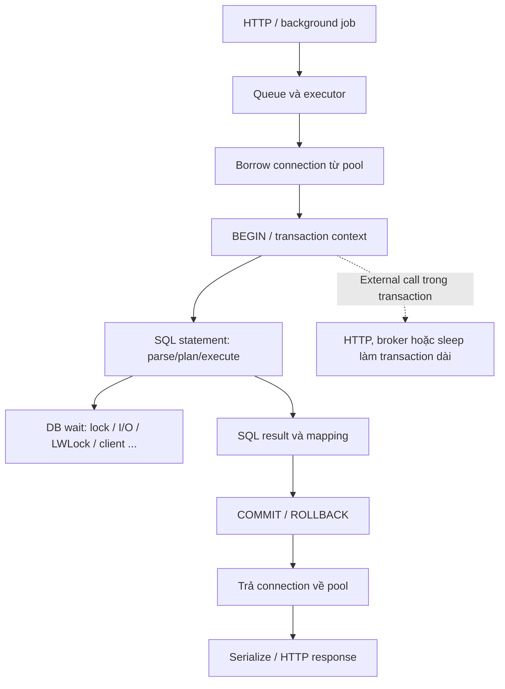

# Phát hiện truy vấn chậm, giao dịch dài và chờ khóa

Trong chương **Quan sát và vận hành** của module **DATA_PERSISTENCE_FUNDAMENTALS**, một truy vấn “chậm” không nhất thiết là câu SQL có thuật toán kém. Request Java có thể mất ba giây vì **đợi lấy kết nối từ pool**, trong khi SQL thực thi trong vài mili giây; câu `UPDATE` có thể nhanh khi chạy một mình nhưng phải chờ hàng khác nhả khóa; một giao dịch có thể đang **idle in transaction**, không chạy câu SQL nào nhưng vẫn giữ tài nguyên, ngăn các giao dịch khác tiến lên.

Muốn vận hành persistence có trách nhiệm, phải phân biệt **truy vấn tốn tài nguyên**, **giao dịch kéo dài** và **phiên đang chờ khóa**, rồi liên kết chúng với request, SQL, transaction, kết nối và tác động nghiệp vụ. Những tín hiệu này có thể xuất hiện đồng thời, nhưng mỗi loại đòi hỏi phép đo và cách xử lý khác nhau. Một biện pháp như tăng connection pool hay ép kết thúc session đang chặn chỉ có ý nghĩa khi đã xác định đúng nguyên nhân và hậu quả.

Bài học sử dụng Java/JDBC, Spring và PostgreSQL để minh họa cách thiết lập tín hiệu, truy vấn công cụ quan sát, xây dựng chuỗi chẩn đoán, chọn timeout, kiểm thử và phục hồi. Ví dụ SQL tập trung vào các view/hàm có sẵn của PostgreSQL; **tên cột, extension, quyền truy cập và hành vi đo đạc có thể phụ thuộc phiên bản và cấu hình**, nên cần kiểm tra trên hệ thống đang dùng trước khi áp dụng.

> **Nguyên tắc:** Không dùng một con số “SQL mất 2 giây” để kết luận nguyên nhân. Trước tiên hãy tìm ranh giới thời gian, trạng thái phiên và loại tài nguyên đang chờ; sau đó mới sửa query, transaction hoặc chính sách tải.

## 1. Ba hiện tượng cần phân biệt

| Hiện tượng | Định nghĩa làm việc | Tín hiệu gợi ý | Điều chưa thể kết luận |
| --- | --- | --- | --- |
| **Truy vấn chậm** (*slow query*) | Một câu SQL/request DB vượt thời gian mục tiêu trong bối cảnh cụ thể | SQL span dài, statement statistics, slow-query log | Query plan chắc chắn kém; độ trễ hoàn toàn do DB CPU |
| **Giao dịch dài** (*long-running transaction*) | Khoảng thời gian từ khi transaction bắt đầu đến lúc commit/rollback kéo dài | `xact_start` cũ, transaction duration metric, trạng thái `idle in transaction` | Toàn bộ thời gian transaction đều đang chạy SQL |
| **Chờ khóa** (*lock wait*) | Một tiến trình cần lock chưa được cấp vì có đối tượng chặn/xung đột | `wait_event_type='Lock'`, blocking PID, lock wait log | Blocker nhất thiết đang chạy một query “chậm” |

Một câu `SELECT` chạy chậm có thể không chờ lock mà đang đọc quá nhiều trang, sort hoặc gửi lượng dữ liệu lớn. Một câu `UPDATE` bị chờ khóa có thể dùng index rất tốt nhưng vẫn hoàn tất muộn. Một transaction dài có thể chỉ chờ client gửi lệnh tiếp theo; dù “idle”, nó vẫn có thể giữ lock và snapshot liên quan.

### 1.1. Ví dụ ba request nhìn bề ngoài giống nhau

```text
Request A / GET report:
  pool acquisition:     4 ms
  SQL execution:        2.4 s (scan/sort/I/O)
  map/serialize:        20 ms

Request B / POST reserve:
  pool acquisition:     6 ms
  SQL execution:        2.2 s (đợi row lock 2.1 s)
  map/serialize:        10 ms

Request C / GET customer:
  pool acquisition:     2.3 s (pool cạn)
  SQL execution:        5 ms
  map/serialize:        10 ms
```

Cả ba đều có độ trễ người dùng khoảng vài giây. Nhưng ưu tiên tương ứng có thể là: sửa kế hoạch truy vấn, giảm thời gian giữ khóa, hoặc tìm nguyên nhân connection pool bị chiếm quá lâu. Những con số ở ví dụ là **giả định để học cách phân tích**, không phải kết quả benchmark thực tế.

## 2. Sơ đồ thời gian từ HTTP request đến database



Sơ đồ chia nhỏ các phần cần đo; trong thực tế statement có thể thực thi nhiều lần, thực hiện network I/O, hoặc các phần thời gian chồng lấn nhau. Không được cộng mọi metric có phạm vi khác nhau thành một số tổng tuyệt đối nếu chưa xác định điểm đầu/cuối.

### 2.1. Những mốc nên quan sát

| Mốc | Đo ở đâu | Trả lời câu hỏi gì? |
| --- | --- | --- |
| Request duration | HTTP server, worker hoặc trace | Người dùng/job chịu độ trễ bao lâu? |
| Queue wait | Executor, rate limiter, job queue | Request có đợi trước khi vào code xử lý không? |
| Connection acquisition | HikariCP/driver pool instrumentation | Có phải DB chưa được gọi vì pool không cấp connection? |
| Statement duration | JDBC/ORM instrumentation, DB log | SQL round-trip dài bao nhiêu, có bao gồm lock wait không? |
| Transaction duration | Application transaction instrumentation và DB `xact_start` | Connection/transaction được giữ bao lâu? |
| Lock/wait type | DB wait events, blocking graph, log | Session đang chờ gì và ai có thể đang chặn? |
| DB execution plan | `EXPLAIN`, `pg_stat_statements` | SQL đang quét, join, sort, dùng index như thế nào? |
| Commit outcome | Driver, request ID, trạng thái DB | DB có xác nhận commit hay kết quả chưa rõ? |

**Độ trễ lấy connection ở phía Java thường không có trong thời gian `Execution Time` của PostgreSQL**, vì SQL chưa được gửi. Nếu chỉ đọc `EXPLAIN`, bạn có thể bỏ sót nguyên nhân chính của p99 ở API.

### 2.2. Phân biệt wall time và thời gian CPU

Một câu SQL mất 1,2 giây *elapsed time* không có nghĩa database sử dụng 1,2 giây CPU. Nó có thể gồm:

- Chờ row/table/advisory lock.
- Chờ I/O hoặc điều phối buffer, WAL, đồng bộ commit.
- Chờ truyền dữ liệu hoặc client đọc chậm.
- Lập kế hoạch và thực thi CPU thực.
- Đợi tài nguyên nội bộ hoặc các tiến trình khác.

Vì vậy, khi nhìn thấy một slow-query span, hãy đối chiếu **wait event và tài nguyên** thay vì kết luận chỉ từ thời gian.

## 3. Thiết lập định nghĩa “chậm” theo mục tiêu dịch vụ

Không có một ngưỡng toàn cục áp dụng cho mọi endpoint. Một truy vấn lookup dự kiến dưới vài chục mili giây và một batch report được phép chạy hàng phút không thể dùng chung alert threshold.

Một phân loại theo mục tiêu vận hành:

| Loại công việc | Điều cần định nghĩa | Ví dụ cảnh báo |
| --- | --- | --- |
| Interactive API | SLO độ trễ end-to-end, throughput, error budget | p95/p99 tăng vượt SLO và tỉ lệ timeout tăng |
| OLTP transaction | Kỳ vọng thời gian giữ transaction/lock | Có transaction giữ lock bất thường so với loại nghiệp vụ |
| Batch/ETL | Deadline công việc, checkpoint, progress | Job không tiến triển hoặc giữ transaction vượt giới hạn |
| Migration/DDL | Maintenance window và lock budget | ALTER đang chờ lock làm nghẽn traffic OLTP |
| Background cleanup | Tốc độ dọn/backlog, tác động tới replication | Cleanup quá chậm hoặc xóa batch giữ lock quá lâu |

### 3.1. Percentile và tổng tải đều cần thiết

Một truy vấn có **trung bình 3 ms nhưng gọi 1 triệu lần** có thể chiếm tổng thời gian và CPU nhiều hơn một truy vấn hiếm mất 2 giây. Ngược lại, một nhóm query chỉ chiếm 1% traffic nhưng p99 rất cao vẫn có thể phá trải nghiệm của khách hàng quan trọng.

Hãy theo dõi đồng thời:

- Số lần gọi, throughput và error rate.
- Tổng thời gian tích lũy theo query shape/operation.
- p50, p95, p99 *request/statement latency* từ histogram/tracing đủ tốt.
- Lock wait, connection acquisition time, transaction age.
- CPU, I/O, WAL, replication lag và thay đổi sau deploy.

**Không lấy percentile bằng cách trung bình các percentile của từng máy.** Cần tổng hợp từ phân phối/histogram có thể gộp hoặc một phương pháp xấp xỉ được định nghĩa. `mean_exec_time` từ database không phải p99.

### 3.2. Baseline và thời điểm đo

Trong cùng một hệ thống, độ trễ có thể khác theo giờ cao điểm, tenant lớn, maintenance, vacuum hoặc cache warm-up. Nếu báo “truy vấn hôm nay chậm hơn”, cần ghi **khoảng đo, tải, cấu hình, schema/index, phiên bản ứng dụng và query parameters thuộc nhóm nào** để so sánh hợp lệ.

Khi số sample quá nhỏ hoặc thống kê vừa reset, một thay đổi nhìn rất lớn có thể chỉ là nhiễu. Cần kết hợp baseline với trace cụ thể của request có vấn đề.

