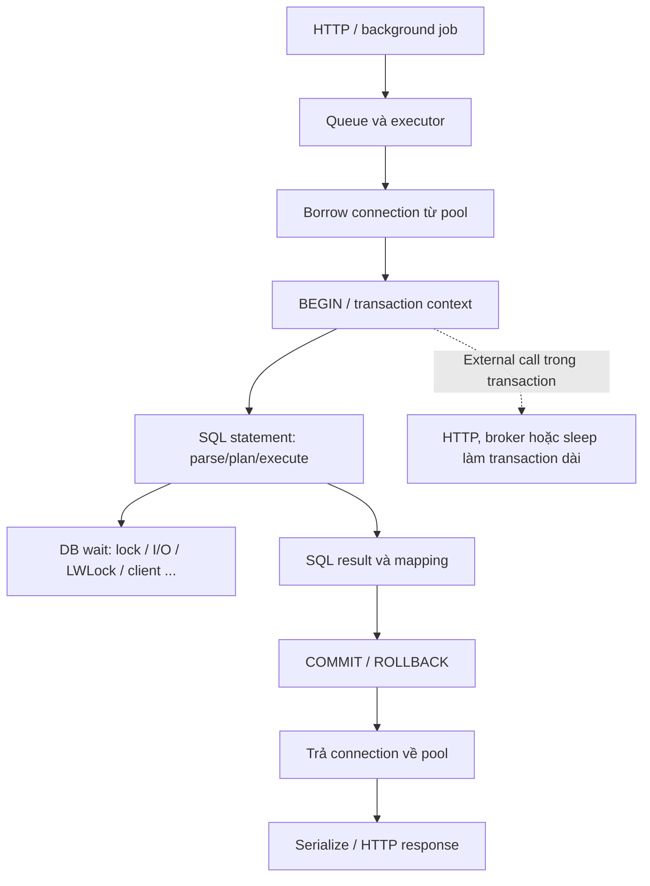
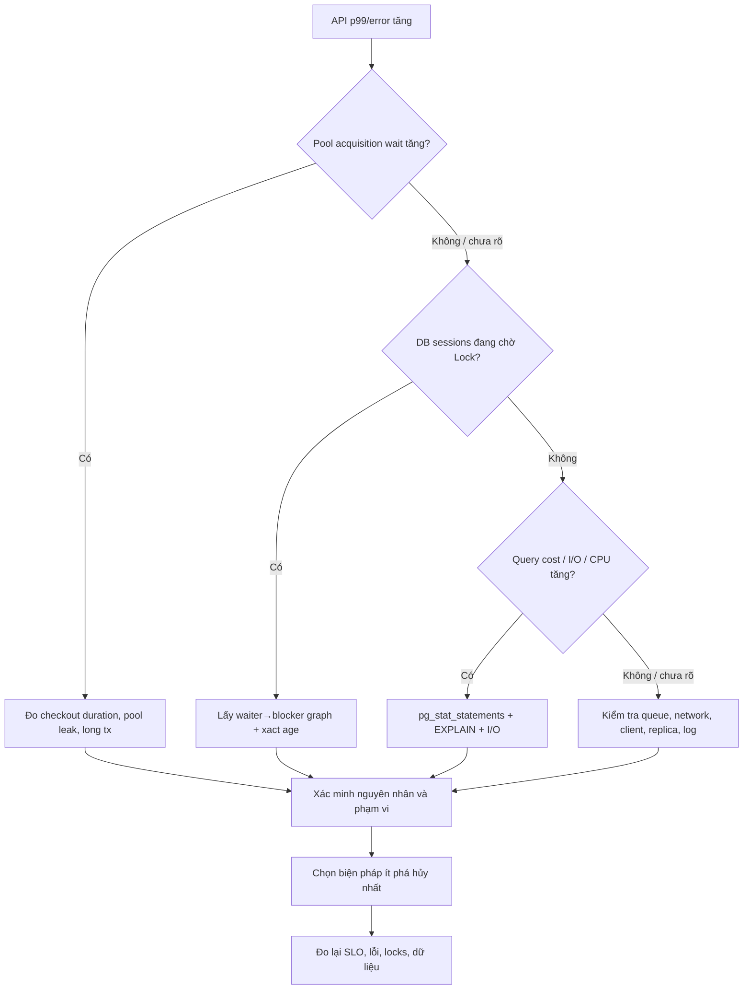

# Phát hiện truy vấn chậm, giao dịch dài và chờ khóa

Trong chương **Quan sát và vận hành** của module **DATA_PERSISTENCE_FUNDAMENTALS**, một truy vấn “chậm” không nhất thiết là câu SQL có thuật toán kém. Request Java có thể mất ba giây vì **đợi lấy kết nối từ pool**, trong khi SQL thực thi trong vài mili giây; câu `UPDATE` có thể nhanh khi chạy một mình nhưng phải chờ hàng khác nhả khóa; một giao dịch có thể đang **idle in transaction**, không chạy câu SQL nào nhưng vẫn giữ tài nguyên, ngăn các giao dịch khác tiến lên.

Muốn vận hành persistence có trách nhiệm, phải phân biệt **truy vấn tốn tài nguyên**, **giao dịch kéo dài** và **phiên đang chờ khóa**, rồi liên kết chúng với request, SQL, transaction, kết nối và tác động nghiệp vụ. Những tín hiệu này có thể xuất hiện đồng thời, nhưng mỗi loại đòi hỏi phép đo và cách xử lý khác nhau. Một biện pháp như tăng connection pool hay ép kết thúc session đang chặn chỉ có ý nghĩa khi đã xác định đúng nguyên nhân và hậu quả.

Bài học sử dụng Java/JDBC, Spring và PostgreSQL để minh họa cách thiết lập tín hiệu, truy vấn công cụ quan sát, xây dựng chuỗi chẩn đoán, chọn timeout, kiểm thử và phục hồi. Ví dụ SQL tập trung vào các view/hàm có sẵn của PostgreSQL; **tên cột, extension, quyền truy cập và hành vi đo đạc có thể phụ thuộc phiên bản và cấu hình**, nên cần kiểm tra trên hệ thống đang dùng trước khi áp dụng.

> **Nguyên tắc:** Không dùng một con số “SQL mất 2 giây” để kết luận nguyên nhân. Trước tiên hãy tìm ranh giới thời gian, trạng thái phiên và loại tài nguyên đang chờ; sau đó mới sửa query, transaction hoặc chính sách tải.

## 1. Ba hiện tượng cần phân biệt

| Hiện tượng | Định nghĩa làm việc | Tín hiệu gợi ý | Điều chưa thể kết luận |
| --- | --- | --- | --- |
| **Truy vấn chậm** (*slow query*) | Một câu SQL/request DB vượt thời gian mục tiêu trong bối cảnh cụ thể | SQL span dài, statement statistics, slow-query log | Query plan chắc chắn kém; độ trễ hoàn toàn do DB CPU |
| **Giao dịch dài** (*long-running transaction*) | Khoảng thời gian từ khi transaction bắt đầu đến lúc commit/rollback kéo dài | `xact_start` cũ, transaction duration metric, trạng thái `idle in transaction` | Toàn bộ thời gian transaction đều đang chạy SQL |
| **Chờ khóa** (*lock wait*) | Một tiến trình cần lock chưa được cấp vì có đối tượng chặn/xung đột | `wait_event_type='Lock'`, blocking PID, lock wait log | Blocker nhất thiết đang chạy một query “chậm” |

Một câu `SELECT` chạy chậm có thể không chờ lock mà đang đọc quá nhiều trang, sort hoặc gửi lượng dữ liệu lớn. Một câu `UPDATE` bị chờ khóa có thể dùng index rất tốt nhưng vẫn hoàn tất muộn. Một transaction dài có thể chỉ chờ client gửi lệnh tiếp theo; dù “idle”, nó vẫn có thể giữ lock và snapshot liên quan.

### 1.1. Ví dụ ba request nhìn bề ngoài giống nhau

```text
Request A / GET report:
  pool acquisition:     4 ms
  SQL execution:        2.4 s (scan/sort/I/O)
  map/serialize:        20 ms

Request B / POST reserve:
  pool acquisition:     6 ms
  SQL execution:        2.2 s (đợi row lock 2.1 s)
  map/serialize:        10 ms

Request C / GET customer:
  pool acquisition:     2.3 s (pool cạn)
  SQL execution:        5 ms
  map/serialize:        10 ms
```

Cả ba đều có độ trễ người dùng khoảng vài giây. Nhưng ưu tiên tương ứng có thể là: sửa kế hoạch truy vấn, giảm thời gian giữ khóa, hoặc tìm nguyên nhân connection pool bị chiếm quá lâu. Những con số ở ví dụ là **giả định để học cách phân tích**, không phải kết quả benchmark thực tế.

## 2. Sơ đồ thời gian từ HTTP request đến database



Sơ đồ chia nhỏ các phần cần đo; trong thực tế statement có thể thực thi nhiều lần, thực hiện network I/O, hoặc các phần thời gian chồng lấn nhau. Không được cộng mọi metric có phạm vi khác nhau thành một số tổng tuyệt đối nếu chưa xác định điểm đầu/cuối.

### 2.1. Những mốc nên quan sát

| Mốc | Đo ở đâu | Trả lời câu hỏi gì? |
| --- | --- | --- |
| Request duration | HTTP server, worker hoặc trace | Người dùng/job chịu độ trễ bao lâu? |
| Queue wait | Executor, rate limiter, job queue | Request có đợi trước khi vào code xử lý không? |
| Connection acquisition | HikariCP/driver pool instrumentation | Có phải DB chưa được gọi vì pool không cấp connection? |
| Statement duration | JDBC/ORM instrumentation, DB log | SQL round-trip dài bao nhiêu, có bao gồm lock wait không? |
| Transaction duration | Application transaction instrumentation và DB `xact_start` | Connection/transaction được giữ bao lâu? |
| Lock/wait type | DB wait events, blocking graph, log | Session đang chờ gì và ai có thể đang chặn? |
| DB execution plan | `EXPLAIN`, `pg_stat_statements` | SQL đang quét, join, sort, dùng index như thế nào? |
| Commit outcome | Driver, request ID, trạng thái DB | DB có xác nhận commit hay kết quả chưa rõ? |

**Độ trễ lấy connection ở phía Java thường không có trong thời gian `Execution Time` của PostgreSQL**, vì SQL chưa được gửi. Nếu chỉ đọc `EXPLAIN`, bạn có thể bỏ sót nguyên nhân chính của p99 ở API.

### 2.2. Phân biệt wall time và thời gian CPU

Một câu SQL mất 1,2 giây *elapsed time* không có nghĩa database sử dụng 1,2 giây CPU. Nó có thể gồm:

- Chờ row/table/advisory lock.
- Chờ I/O hoặc điều phối buffer, WAL, đồng bộ commit.
- Chờ truyền dữ liệu hoặc client đọc chậm.
- Lập kế hoạch và thực thi CPU thực.
- Đợi tài nguyên nội bộ hoặc các tiến trình khác.

Vì vậy, khi nhìn thấy một slow-query span, hãy đối chiếu **wait event và tài nguyên** thay vì kết luận chỉ từ thời gian.

## 3. Thiết lập định nghĩa “chậm” theo mục tiêu dịch vụ

Không có một ngưỡng toàn cục áp dụng cho mọi endpoint. Một truy vấn lookup dự kiến dưới vài chục mili giây và một batch report được phép chạy hàng phút không thể dùng chung alert threshold.

Một phân loại theo mục tiêu vận hành:

| Loại công việc | Điều cần định nghĩa | Ví dụ cảnh báo |
| --- | --- | --- |
| Interactive API | SLO độ trễ end-to-end, throughput, error budget | p95/p99 tăng vượt SLO và tỉ lệ timeout tăng |
| OLTP transaction | Kỳ vọng thời gian giữ transaction/lock | Có transaction giữ lock bất thường so với loại nghiệp vụ |
| Batch/ETL | Deadline công việc, checkpoint, progress | Job không tiến triển hoặc giữ transaction vượt giới hạn |
| Migration/DDL | Maintenance window và lock budget | ALTER đang chờ lock làm nghẽn traffic OLTP |
| Background cleanup | Tốc độ dọn/backlog, tác động tới replication | Cleanup quá chậm hoặc xóa batch giữ lock quá lâu |

### 3.1. Percentile và tổng tải đều cần thiết

Một truy vấn có **trung bình 3 ms nhưng gọi 1 triệu lần** có thể chiếm tổng thời gian và CPU nhiều hơn một truy vấn hiếm mất 2 giây. Ngược lại, một nhóm query chỉ chiếm 1% traffic nhưng p99 rất cao vẫn có thể phá trải nghiệm của khách hàng quan trọng.

Hãy theo dõi đồng thời:

- Số lần gọi, throughput và error rate.
- Tổng thời gian tích lũy theo query shape/operation.
- p50, p95, p99 *request/statement latency* từ histogram/tracing đủ tốt.
- Lock wait, connection acquisition time, transaction age.
- CPU, I/O, WAL, replication lag và thay đổi sau deploy.

**Không lấy percentile bằng cách trung bình các percentile của từng máy.** Cần tổng hợp từ phân phối/histogram có thể gộp hoặc một phương pháp xấp xỉ được định nghĩa. `mean_exec_time` từ database không phải p99.

### 3.2. Baseline và thời điểm đo

Trong cùng một hệ thống, độ trễ có thể khác theo giờ cao điểm, tenant lớn, maintenance, vacuum hoặc cache warm-up. Nếu báo “truy vấn hôm nay chậm hơn”, cần ghi **khoảng đo, tải, cấu hình, schema/index, phiên bản ứng dụng và query parameters thuộc nhóm nào** để so sánh hợp lệ.

Khi số sample quá nhỏ hoặc thống kê vừa reset, một thay đổi nhìn rất lớn có thể chỉ là nhiễu. Cần kết hợp baseline với trace cụ thể của request có vấn đề.

## 4. Quan sát các session đang chạy bằng `pg_stat_activity`

Với PostgreSQL, `pg_stat_activity` cho biết trạng thái hiện tại của các backend và nhiều thông tin quan trọng: PID, database, `application_name`, `state`, `xact_start`, `query_start`, `state_change`, `wait_event_type` và `wait_event`. Đây là **ảnh chụp tức thời**, không phải kho lịch sử truy vấn chậm.

Truy vấn thăm dò:

```sql
SELECT pid,
       usename,
       application_name,
       state,
       wait_event_type,
       wait_event,
       now() - xact_start AS transaction_age,
       CASE WHEN state = 'active'
            THEN now() - query_start
       END AS active_statement_age,
       CASE WHEN state LIKE 'idle in transaction%'
            THEN now() - state_change
       END AS idle_in_transaction_age,
       pg_blocking_pids(pid) AS blocking_pids
FROM pg_stat_activity
WHERE datname = current_database()
  AND pid <> pg_backend_pid()
ORDER BY xact_start NULLS LAST, pid;
```

**Ý nghĩa các mốc:**

- `xact_start`: thời điểm bắt đầu transaction hiện tại; `NULL` nếu backend không có transaction đang mở theo thông tin hiện có.
- `query_start`: lúc query đang chạy bắt đầu, **hoặc lúc query cuối cùng bắt đầu** khi session không active. Vì vậy ví dụ chỉ tính `active_statement_age` khi `state='active'`.
- `state_change`: thời điểm trạng thái session đổi gần nhất; dùng để ước lượng đã idle trong transaction bao lâu, **khác** với tổng tuổi transaction.
- `wait_event_type`, `wait_event`: mô tả backend hiện đang chờ một loại sự kiện nào, không phải một nhãn nguyên nhân gốc đã được chứng minh.
- `pg_blocking_pids(pid)`: trả danh sách PID có liên quan đến việc chặn backend theo lock manager, thích hợp hơn việc tự suy mọi quan hệ chặn chỉ bằng một self-join của `pg_locks`.

Quyền đọc thông tin session của người dùng khác có thể bị giới hạn; các role quan sát như `pg_read_all_stats` có đặc quyền đáng kể và phải được cấp theo chính sách. Không tùy tiện mở quyền truy cập toàn bộ query text, vì SQL có thể chứa literals hoặc dữ liệu nhạy cảm.

### 4.1. Phân biệt `state` với `wait_event_type`

| Tình huống | Điều có thể thấy | Giải thích cần kiểm tra |
| --- | --- | --- |
| `active`, `wait_event_type='Lock'` | Query đang đợi một lock | Tìm blockers và transaction đang giữ lock |
| `active`, `wait_event_type='IO'` | Có chờ thao tác I/O | Kiểm tra block access, storage latency, plan và tải |
| `active`, `wait_event_type='LWLock'` | Đợi tài nguyên đồng bộ nội bộ | Không tự coi là row lock; cần quan sát tần suất và ngữ cảnh |
| `idle in transaction`, thường chờ `Client` | Transaction còn mở, backend đợi client | Có thể giữ lock/snapshot dù không chạy SQL |
| `idle in transaction (aborted)` | Transaction lỗi nhưng chưa rollback/kết thúc | Ứng dụng cần rollback/close đúng ranh giới |
| `active`, `wait_event_type IS NULL` | Không có wait được báo tại thời điểm lấy mẫu | Có thể đang dùng CPU hoặc giữa các wait; chưa chứng minh “không có vấn đề” |
| `idle` | Không xử lý query và không có transaction đang mở | Có thể là connection pool; không nên kết luận nó giữ row lock từ một transaction đã hoàn tất |

Những sự kiện chờ có tên và cách phân loại phụ thuộc phiên bản PostgreSQL; **đừng xây dashboard giả định mọi delay đều có `wait_event_type='Lock'`**.

### 4.2. Đọc `xact_start` và `query_start` đúng ngữ cảnh

Giả sử session có:

```text
state:                 idle in transaction
transaction_age:       00:08:10
idle_in_transaction:   00:07:55
last query:            UPDATE inventory SET ...
```

Nó không có nghĩa câu `UPDATE` đã chạy hơn tám phút. Câu SQL có thể hoàn tất sau 15 giây, rồi ứng dụng giữ transaction mở thêm gần tám phút. **Tối ưu index cho UPDATE có thể không giải quyết** transaction dài nếu nguyên nhân là logic Java chậm hoặc client không gửi commit/rollback.

Trong trường hợp `state='active'` và `transaction_age` dài, vẫn phải phân biệt một query chạy lâu, nhiều query nối tiếp, hay một transaction đã chờ ngoài DB trước khi chạy câu hiện tại.

### 4.3. Tránh diễn giải một ảnh chụp thành sự thật tuyệt đối

`pg_stat_activity` là một điểm quan sát tại thời điểm truy vấn. Một wait có thể biến mất chỉ sau vài mili giây; một blocker đã commit khi nhân viên mở dashboard. Với sự cố chập chờn, cần:

- Lấy mẫu có giới hạn trong một khoảng ngắn, không query hệ thống liên tục vô hạn.
- Tương quan với slow-query log, pool metrics và trace.
- Ghi mốc thời gian, database, PID và `application_name` đã được kiểm soát.
- Kiểm tra **mẫu lặp lại** và tác động SLO, không chỉ một PID xuất hiện trong một lần chụp.

PID có thể được tái sử dụng sau khi backend kết thúc. Không coi PID là định danh nghiệp vụ vĩnh viễn; khi thao tác can thiệp phải **kiểm tra lại** đúng session, tuổi, application và phạm vi.

## 5. Chẩn đoán chờ khóa: ai đợi ai?

Một lệnh `UPDATE` có thể mất nhiều giây dù đã dùng index chính xác, vì nó đang chờ transaction khác nhả lock trên cùng hàng. PostgreSQL có nhiều loại khóa: relation-level, row-level, transaction ID, advisory locks và các cơ chế nội bộ khác. Đừng cố giải thích mọi sự cố bằng khái niệm “bảng bị khóa”.

### 5.1. Lấy cặp waiter–blocker

```sql
SELECT w.pid AS waiting_pid,
       w.application_name AS waiting_app,
       w.wait_event_type,
       w.wait_event,
       now() - w.query_start AS waiting_query_age,
       b.pid AS blocking_pid,
       b.application_name AS blocking_app,
       b.state AS blocking_state,
       now() - b.xact_start AS blocking_transaction_age,
       b.wait_event_type AS blocker_wait_type,
       b.wait_event AS blocker_wait_event
FROM pg_stat_activity AS w
CROSS JOIN LATERAL unnest(pg_blocking_pids(w.pid)) AS x(blocking_pid)
JOIN pg_stat_activity AS b ON b.pid = x.blocking_pid
WHERE w.datname = current_database()
ORDER BY waiting_query_age DESC, w.pid;
```

Truy vấn lấy các session đang bị chặn và backend có liên quan đến việc chặn tại thời điểm chạy. Nếu cần phân tích chi tiết, có thể xem thêm loại lock qua `pg_locks`, câu query đã che dữ liệu nhạy cảm, lịch sử tracing và transaction ID trong phạm vi quyền quan sát.

**Quan trọng:** người trực tiếp đang chặn chưa chắc là *root blocker*. Có thể hình thành **chuỗi chờ**:

```text
Session A: muốn lock X, đang đợi B
Session B: giữ X, lại đợi lock Y từ C
Session C: giữ Y, không chờ ai

A → B → C
```

Chỉ “tắt B vì B đang chặn A” có thể làm sai nghiệp vụ và không chạm nguyên nhân gốc C. Cần nhìn **toàn chuỗi chặn**, trạng thái mỗi transaction, thời gian và quyền can thiệp.

### 5.2. Tại sao có wait `transactionid` thay vì một row lock dễ thấy?

Trong PostgreSQL, khi hai transaction cùng cập nhật một hàng, một backend có thể chờ **transaction ID** của transaction kia kết thúc. `pg_stat_activity.wait_event` có thể là `transactionid`, không phải tên hàng/khóa nghiệp vụ.

Do đó:

- Không suy rằng “không có `tuple` lock trong `pg_locks`” nghĩa là không có tranh chấp hàng.
- `pg_locks` không hiển thị trực tiếp toàn bộ trạng thái khóa từng row như một bảng dễ JOIN tới business ID.
- Dùng `pg_blocking_pids` để xác định đối tượng chặn, rồi truy nguồn SQL/transaction ở ứng dụng để biết hàng nghiệp vụ liên quan.
- Có thể có nhiều blockers, và kết quả thay đổi khi lock được cấp hoặc session kết thúc.

### 5.3. `pg_locks` bổ sung thông tin gì?

Ví dụ thống kê các loại lock đang đợi:

```sql
SELECT locktype,
       mode,
       COUNT(*) AS waiting_count
FROM pg_locks
WHERE NOT granted
GROUP BY locktype, mode
ORDER BY waiting_count DESC, locktype, mode;
```

Nó hữu ích để nhận diện liệu nhiều backend đang đợi `relation`, `transactionid`, `advisory` hay một loại khác, nhưng **không thay thế blocking graph** và không giải thích tự động nguyên nhân nghiệp vụ.

Ví dụ một migration DDL cần lock mạnh trên bảng, bị một transaction cũ ngăn lại. Trong hàng đợi lock, những truy vấn mới bình thường có thể cũng bị chậm sau DDL. Đây là hiệu ứng **lock queue amplification**: câu lệnh vốn phục vụ nhanh bị ảnh hưởng bởi một thao tác chờ hoặc giữ lock mạnh.

### 5.4. Deadlock không phải lock wait thông thường

Một **deadlock** là vòng chờ không thể tự giải quyết chỉ bằng việc đợi tiếp:

```text
Tx A: giữ khóa hàng 1, cần khóa hàng 2
Tx B: giữ khóa hàng 2, cần khóa hàng 1
```

PostgreSQL có deadlock detector và có thể hủy một transaction, thường trả SQLSTATE `40P01`. Một ứng dụng cần rollback transaction đã lỗi và khi retry phải **chạy lại toàn bộ đơn vị nghiệp vụ trong transaction mới**, đọc lại dữ liệu hiện hành. Mock ném một exception `DeadlockException` không chứng minh lock ordering trong DB đã đúng.

Đừng nhầm `deadlock_timeout` với “hễ đợi lock lâu hơn ngưỡng thì tự hủy query”. Tham số đó liên quan thời điểm tiến hành kiểm tra deadlock (và log các lock waits khi bật); **`lock_timeout` mới là cấu hình giới hạn thời gian đợi lock** trong các tình huống được hỗ trợ.

## 6. Giao dịch dài: rủi ro ngay cả khi không có query chậm

Transaction bắt đầu khi ứng dụng/DB mở ranh giới phù hợp, và chỉ kết thúc khi commit hoặc rollback. Trong khoảng đó, database có thể giữ row/table locks, snapshot và những thông tin phục vụ MVCC, tùy loại thao tác và isolation.

### 6.1. `idle in transaction` là tín hiệu cần điều tra

Một tình huống phổ biến:

```java
@Transactional
public void reserveAndNotify(long productId, int quantity) {
    inventory.reserve(productId, quantity);
    externalPaymentClient.callRemoteService(); // Chờ mạng.
    orders.createOrder(productId, quantity);
}
```

Nếu lời gọi mạng mất 5 giây, **transaction DB và các lock từ `reserve` có thể bị giữ** trong thời gian đó. Thread hoặc virtual thread có thể đang đợi HTTP, nhưng PostgreSQL nhìn thấy backend **idle in transaction**, chờ client gửi lệnh tiếp.

Hậu quả:

- Các transaction cùng chỉnh tồn kho có thể bị chặn.
- Kết nối bị chiếm trong pool, làm tăng acquisition wait của request khác.
- Một transaction giữ snapshot lâu có thể cản một số hoạt động dọn tuple theo MVCC, góp phần làm tăng bloat.
- Tăng nguy cơ timeout, deadlock hoặc client mất kết nối trước khi kết thúc transaction.

**Không đồng nhất mọi transaction dài với lỗi:** một số batch hoặc migration được thiết kế để kéo dài. Nhưng chúng cần thời gian dự kiến, budget khóa, phương án dừng an toàn và không được che giấu dưới dashboard OLTP tổng hợp.

### 6.2. Mẫu query tìm transaction lâu

```sql
SELECT pid,
       application_name,
       state,
       wait_event_type,
       wait_event,
       now() - xact_start AS transaction_age,
       now() - state_change AS time_since_state_change
FROM pg_stat_activity
WHERE datname = current_database()
  AND xact_start IS NOT NULL
  AND now() - xact_start > interval '30 seconds'
ORDER BY xact_start;
```

`30 seconds` chỉ là **ngưỡng minh họa**, không phải mức mặc định an toàn của PostgreSQL. Với OLTP có transaction dự kiến dưới 100 ms, 30 giây là bất thường; với batch được phép chạy hàng phút, nó có thể là bình thường. Cần nhóm theo **application, operation và loại workload**.

### 6.3. Khi giao dịch dài làm vacuum bị ảnh hưởng

PostgreSQL MVCC cần giữ các phiên bản hàng còn có thể được snapshot hợp lệ nhìn thấy. Một transaction hoặc nguồn giữ mốc dữ liệu cũ lâu, trong những điều kiện tương ứng, có thể khiến VACUUM chưa thể loại bỏ dead tuples. Nhưng **không phải mọi session idle lâu đều giữ một snapshot đủ cũ để chặn dọn theo cùng cách**; còn phụ thuộc isolation, hoạt động trước đó, replication slots và các cơ chế giữ xmin.

Hãy kiểm tra dữ liệu và các nguồn giữ mốc liên quan trước khi kết luận vacuum bị chặn. Nếu hàng triệu bản ghi đã được `DELETE` nhưng kích thước bảng chưa giảm, cũng cần nhớ rằng VACUUM thường **tái sử dụng không gian bên trong bảng**, không mặc định trả ngay dung lượng file cho hệ điều hành.

### 6.4. Transaction dài do quá nhiều công việc trong một đơn vị commit

Một batch chạy `UPDATE` hàng triệu dòng trong một transaction có thể:

- Tạo nhiều WAL và tạo backlog replication.
- Giữ lock dài, tăng thời gian rollback nếu lỗi.
- Làm nhiều request OLTP bị chờ.
- Gây I/O burst và áp lực bộ nhớ.

Có thể chia batch có checkpoint và commit theo lô nếu nghiệp vụ cho phép. Tuy nhiên chia một transaction nguyên tử thành nhiều transaction **thay đổi bảo đảm atomicity**; cần thiết kế idempotency, dữ liệu trung gian và khả năng resume thay vì chỉ thêm `COMMIT` vào vòng lặp.

## 7. Tìm các dạng SQL tốn thời gian bằng `pg_stat_statements`

Trong khi `pg_stat_activity` chủ yếu là trạng thái **đang xảy ra**, extension `pg_stat_statements` có thể tổng hợp thống kê theo **dạng truy vấn (query shape)**, ví dụ số lần gọi, tổng thời gian thực thi, thời gian trung bình, rows và block counters.

Khi extension đã được cài và bật theo đúng phiên bản/cấu hình:

```sql
SELECT queryid,
       calls,
       ROUND(total_exec_time::numeric, 1) AS total_exec_ms,
       ROUND(mean_exec_time::numeric, 2) AS mean_exec_ms,
       rows,
       shared_blks_hit,
       shared_blks_read
FROM pg_stat_statements
ORDER BY total_exec_time DESC
LIMIT 20;
```

Extension và quyền quan sát **không mặc nhiên có sẵn** trên mọi PostgreSQL. Một số môi trường cần cấu hình `shared_preload_libraries`, extension SQL và restart có quản lý; đừng tự bật hoặc reset thống kê trên production mà không qua quy trình vận hành.

### 7.1. Top theo tổng thời gian và top theo thời gian trung bình là hai câu hỏi

| Mẫu query | Số lần gọi giả định | Trung bình | Tổng execution time | Điều gợi ý |
| --- | ---: | ---: | ---: | --- |
| `SELECT profile WHERE id=?` | 1.000.000 | 3 ms | 3.000 giây | Mỗi lần nhanh nhưng tổng chi phí lớn |
| `SELECT report ...` | 100 | 1.500 ms | 150 giây | Hiếm, nhưng mỗi request report chậm |
| `UPDATE inventory WHERE id=?` | 20.000 | 25 ms | 500 giây | Cần kiểm tra lock wait, write contention và SQL |

Các số chỉ minh họa cách ưu tiên. Nếu SLO của report cho phép chạy vài giây, nó có thể không phải incident. Nếu 3 ms lookup được gọi quá nhiều vì **N+1 query**, cách tối ưu có thể là giảm số round-trip thay vì cố tăng tốc thêm cho một query vốn đã nhanh.

Đừng xếp hạng chỉ bằng `mean_exec_time` vì có thể bị ảnh hưởng bởi số mẫu ít hoặc biến thiên lớn. Cũng không coi `total_exec_time` là thời gian CPU thực: tổng execution time có thể bao gồm thời gian chờ ở những giai đoạn có thể quan sát.

### 7.2. Các giới hạn của `pg_stat_statements`

- Thống kê được **gộp** theo định danh/dạng query và ngữ cảnh, không phải một log chứa từng execution.
- Các giá trị bind parameter thông thường không được giữ như một danh sách request riêng; query `WHERE tenant_id=$1` có thể gộp nhiều tenant rất khác nhau.
- `queryid` không nên được xem là ID ổn định tuyệt đối qua mọi phiên bản, thay đổi schema hoặc cấu hình.
- Số liệu phụ thuộc thời điểm reset, cấu hình track và kích thước kho statistics; query ít xuất hiện có thể bị loại khỏi bảng tổng hợp.
- Execution time từ PostgreSQL và thời gian JDBC round-trip ở Java không có cùng phạm vi đo; network, connection acquisition và mapping có thể nằm ngoài.
- Một query dạng chuẩn hóa có thể có **kế hoạch thực thi khác nhau** với các giá trị tham số khác nhau, đặc biệt khi dữ liệu lệch nhiều.

Nếu cần tìm **hot tenant/hot key**, hãy dùng application instrumentation có kiểm soát hoặc trace đã lọc; không bật log toàn bộ email, ID thanh toán hay SQL bind values chỉ để đo điểm nóng.

### 7.3. `shared_blks_hit` và `shared_blks_read` có nghĩa gì?

`shared_blks_hit` phản ánh số block được tìm thấy trong shared buffers của PostgreSQL, còn `shared_blks_read` phản ánh số block được đọc vào shared buffers. **`shared_blks_read` không nhất thiết tương đương số lần đọc vật lý từ đĩa** vì filesystem/OS cache cũng có thể đáp ứng.

Nếu cần đo I/O latency, có thể cân nhắc các thống kê timing với `track_io_timing` được bật theo chính sách và các view I/O theo phiên bản PostgreSQL. Việc bật instrumentation có thể có overhead; cần đo/đánh giá trước khi áp dụng rộng.

## 8. Từ “truy vấn chậm” đến kế hoạch thực thi: `EXPLAIN`

Sau khi tìm được query shape hoặc request cụ thể có độ trễ cao, bước tiếp là **giải thích công việc mà DB phải làm**. `EXPLAIN` cho biết kế hoạch dự kiến; `EXPLAIN (ANALYZE, BUFFERS)` thực thi SQL và cung cấp số liệu quan sát thực tế.

Ví dụ:

```sql
EXPLAIN (ANALYZE, BUFFERS)
SELECT id, status, created_at
FROM orders
WHERE tenant_id = 42
  AND status = 'PENDING'
ORDER BY created_at DESC, id DESC
LIMIT 50;
```

Đây là truy vấn đọc dùng dữ liệu giả. **Không chạy `EXPLAIN ANALYZE` với `UPDATE`/`DELETE`/`INSERT` trên production một cách tùy tiện**, vì PostgreSQL sẽ **thực thi** câu lệnh. Ngay cả khi bọc trong transaction và rollback, các side effect ngoài DB, sequence hoặc contention trong lúc thực thi có thể vẫn xảy ra; ưu tiên môi trường test có dữ liệu đại diện.

### 8.1. Đọc những tín hiệu nào trong execution plan?

| Tín hiệu | Câu hỏi cần đặt | Sai lầm thường gặp |
| --- | --- | --- |
| `rows` ước lượng và `actual rows` | Optimizer có ước lượng đúng kích thước dữ liệu không? | Cho rằng mọi sai lệch đều do thiếu index |
| `loops` | Node được thực hiện bao nhiêu lần? | Bỏ qua N+1/nested loop lặp quá nhiều |
| `Seq Scan` / `Index Scan` / `Bitmap` | PostgreSQL chọn đường truy cập nào và vì sao? | Khẳng định Seq Scan luôn là lỗi |
| `Sort` / `Hash` / `Aggregate` | Có bước trung gian tốn memory/I/O không? | Chỉ nhìn node đầu tiên hoặc thời gian tổng |
| `Buffers: shared hit/read` | Những node nào chạm nhiều block? | Coi hit=0 là chắc chắn đĩa chậm |
| `actual time` | Node/nhánh nào tốn nhiều elapsed time? | Cộng thời gian node cha và con như các khoản độc lập |
| `Planning Time` | Lập kế hoạch có đáng kể không? | Nhầm tổng request time với query execution time |
| `Execution Time` | Thực thi SQL trong môi trường thử kéo dài bao nhiêu? | Coi nó gồm thời gian chờ pool trong Java |

Các con số trong tree plan không phải những khoản thời gian độc lập: thời gian node cha thường chứa công việc node con. `actual time` cũng có cách biểu diễn theo loops; cần đọc đúng tài liệu và cấu trúc kế hoạch, không cộng máy móc.

### 8.2. Kiểm tra kế hoạch với dữ liệu và tham số đại diện

Một kế hoạch tốt cho `tenant_id=42` có thể kém khi `tenant_id=1` chứa 80% bảng. Một SQL có parameter có thể dùng custom plan hoặc generic plan tùy chuẩn bị statement và cơ chế planner/driver; không kết luận từ một `EXPLAIN` với literal đại diện cho mọi production request.

Nên:

1. Xác định nhóm parameter tương ứng p99 chậm bằng tracing có bảo vệ thông tin.
2. Dùng dữ liệu, thống kê và schema gần workload thực.
3. Đối chiếu row estimate với actual rows, lượng block và loại join.
4. Thử giả thuyết như index, rewrite SQL, pagination hoặc thống kê nhiều cột trên môi trường kiểm soát.
5. Chạy lại với nhiều nhóm parameter, concurrency và cùng workload.
6. Xác minh chi phí ghi/index maintenance, không chỉ tốc độ SELECT.

Nếu query chạy nhanh độc lập nhưng chậm dưới tải, hãy đo lock wait và pool contention **trước khi kết luận query plan là nguyên nhân**.

### 8.3. `EXPLAIN` có quan sát lock wait không?

`EXPLAIN ANALYZE` có thể chịu ảnh hưởng bởi locking, I/O, tải hệ thống và các thao tác runtime khác, nhưng nó **không phải công cụ phân tích wait-chain đầy đủ**. Một update bị chặn bởi transaction khác có thể trông như một node rất chậm; muốn xác định blocker phải kết hợp `pg_stat_activity`, `pg_blocking_pids`, log lock wait và tracing.

Không cố chữa một row lock contention bằng cách “ép index scan” nếu câu UPDATE đã tìm đúng một hàng rất nhanh nhưng **đợi transaction khác commit**.

## 9. Slow-query log và lock-wait log: lưu bằng chứng theo thời gian

Các view hoạt động là snapshot; log giúp giữ **lịch sử sự kiện** để phân tích incident đã qua. PostgreSQL cung cấp những cơ chế log tùy phiên bản/cấu hình, trong đó có:

| Cấu hình/công cụ | Vai trò | Lưu ý |
| --- | --- | --- |
| `log_min_duration_statement` | Ghi các câu SQL chạy vượt ngưỡng | Có thể tạo volume lớn và lộ literals; chọn threshold/scope có kiểm soát |
| `log_lock_waits` | Ghi các phiên chờ lock lâu hơn ngưỡng kiểm tra tương ứng | Cần hiểu quan hệ với `deadlock_timeout`; không bao phủ mọi loại wait |
| `deadlock_timeout` | Mốc trì hoãn trước khi kiểm tra deadlock | Không phải thời gian tối đa tự động chờ lock |
| `log_line_prefix` hoặc structured logging | Gắn timestamp, PID, session/application/context | Tránh vô tình xuất dữ liệu nhạy cảm |
| `auto_explain` | Ghi execution plan theo ngưỡng, có thể lấy thêm chi tiết theo cấu hình | Instrumentation nặng có overhead; phải kiểm soát mức bật |
| `pg_stat_statements` | Tổng hợp chi phí qua nhiều lần gọi | Không thay thế log từng request hoặc p99 histogram |

### 9.1. Chọn ngưỡng theo loại workload

Ví dụ policy **tham khảo**, không phải câu lệnh cấu hình cần áp dụng nguyên xi:

```text
OLTP lookup:
  log statement > threshold đã chọn từ SLO/baseline

Batch reporting:
  threshold riêng, kèm job id và query family

Lock monitoring:
  bật log lock waits trong khoảng điều tra khi được phép
  xem deadlock_timeout và log volume/overhead

Sau incident:
  đưa logging mức chi tiết cao về mức vận hành bình thường
```

Hạ threshold xuống rất thấp trên DB bận có thể tạo hàng nghìn log/giây, tăng I/O, lộ dữ liệu và làm incident nặng hơn. Không bật logging toàn bộ bind parameter hoặc trace SQL chi tiết không giới hạn trên production.

### 9.2. Log phải giúp tương quan chứ không làm lộ payload

Khi logging trong Java, nên ghi **operation name, request/trace ID, elapsed time, error class/SQLSTATE, trạng thái transaction và shard/region được phép**, nhưng tránh raw SQL literals, password, token, email hoặc object `toString()` chứa PII.

Ví dụ cấu trúc một sự kiện đã lọc:

```json
{
  "event": "persistence_statement_slow",
  "operation": "reserve_inventory",
  "traceId": "e317a1f0c8f54b5e",
  "dbSystem": "postgresql",
  "queryShape": "UPDATE inventory WHERE product_id=?",
  "elapsedMs": 1420,
  "outcome": "timeout",
  "sqlStateClass": "55"
}
```

Các giá trị chỉ minh họa, không phải lời khẳng định SQLSTATE class `55` là kết quả chắc chắn của mọi timeout: PostgreSQL có mã lỗi khác nhau theo tình huống. **Không tự ánh xạ toàn bộ timeout thành một SQLSTATE hoặc một kết luận rollback.**

### 9.3. Thời điểm query hết hạn không nhất thiết là lúc transaction kết thúc

Nếu statement bị hủy do timeout, transaction có thể chuyển sang trạng thái lỗi và yêu cầu **rollback** trước khi connection có thể dùng tiếp. `statement_timeout`, `lock_timeout` và timeout ở HTTP/driver có thể chặn những pha khác nhau; log statement hủy không tự chứng minh application đã rollback đúng hoặc connection đã được trả về pool sạch.

Hãy kiểm tra cả lỗi tại Java boundary, transaction manager, tình trạng session trong `pg_stat_activity` và dữ liệu được commit nếu kết quả trước đó chưa rõ.

## 10. Instrumentation ở Java/JDBC: quan sát đúng ranh giới thời gian

Với ứng dụng Java, **tracing và metrics ở tầng application** trả lời những câu hỏi mà PostgreSQL không thể tự biết: request đang đợi executor, đợi pool, đã gửi bao nhiêu SQL, mapping kết quả mất bao lâu, hay external HTTP call xảy ra khi transaction còn mở.

### 10.1. Đo thời gian của từng operation bằng clock thích hợp

Một ví dụ đơn giản:

```java
public OrderView getOrder(long tenantId, long orderId) {
    long startNs = System.nanoTime();
    String outcome = "success";

    try {
        return orderRepository.findVisibleById(tenantId, orderId);
    } catch (RuntimeException error) {
        outcome = "error";
        throw error;
    } finally {
        long elapsedNs = System.nanoTime() - startNs;
        metrics.recordDuration(
            "order_repository_read", outcome, elapsedNs
        );
    }
}
```

`metrics` và `orderRepository` là abstraction giả định. `System.nanoTime()` thích hợp đo **thời gian trôi qua trong một process**, không phải timestamp lịch để đối chiếu trực tiếp với clock của máy DB. `finally` đo **thời gian wrapper**, có thể bao gồm đợi pool, round-trip, mapping và bất kỳ code nào repository gọi; không tự tách được từng thành phần.

Nếu mã trên được gọi trong một Spring transaction và method trả về trước khi proxy hoàn tất commit, timer này **không đo toàn bộ thời gian transaction**. Muốn đo transaction duration đầy đủ, cần instrumentation tại transaction manager/proxy boundary hoặc lifecycle callback thích hợp, và xác minh rằng thời điểm kết thúc được ghi **sau commit/rollback**.

### 10.2. Đo thời gian lấy connection

Với JDBC thuần, có thể đo việc mượn connection:

```java
public Connection borrowConnection() throws SQLException {
    long started = System.nanoTime();
    try {
        return dataSource.getConnection();
    } finally {
        metrics.recordDuration(
            "db_connection_acquire",
            System.nanoTime() - started
        );
    }
}
```

Đoạn mã minh họa cần bổ sung phân loại outcome và quản lý release connection ở caller. Trong ứng dụng Spring/JPA, framework có thể **lấy connection muộn** hoặc bind connection vào transaction; tự bọc một `getConnection()` không đúng nơi có thể đo sai hoặc tạo connection ngoài transaction.

Hãy sử dụng pool metrics được implementation cung cấp nếu có; kiểm tra cả điểm đo application trước và sau borrow. Khi acquisition time tăng, đừng vội kết luận DB CPU quá tải: có thể connection leak, transaction giữ lâu, pool limit quá nhỏ, hoặc nhiều request đồng thời không được admission control.

### 10.3. Gắn trace với query shape, không gắn toàn bộ tham số

Một trace hữu ích:

```text
trace: POST /orders/{id}/confirm
  ├─ authentication:                3 ms
  ├─ transaction/service:        1850 ms
  │    ├─ acquire connection:      6 ms
  │    ├─ UPDATE order:         1730 ms
  │    │    └─ DB lock wait (observed)
  │    ├─ INSERT outbox:           8 ms
  │    └─ COMMIT:                20 ms
  └─ HTTP serialization:           2 ms
```

Những số liệu chỉ là ví dụ. Nếu trace cho biết SQL span 1,7 giây và DB cho thấy `Lock` wait tương ứng, đây là bằng chứng mạnh hơn nhiều so với câu nói “API chậm vì PostgreSQL”.

Thông tin hữu ích để gắn trên span (theo convention đang dùng và bảo mật cho phép):

- Tên operation nghiệp vụ đã chuẩn hóa, ví dụ `confirm_order`.
- DB system, database alias hoặc logical cluster/region được phép công bố nội bộ.
- Statement/query shape hoặc fingerprint **đã loại literal nhạy cảm**.
- Error class/SQLSTATE, result row count khi phù hợp.
- Trace/context ID để tìm application logs và DB sample cùng mốc thời gian.
- Transaction state/outcome ở một signal có phạm vi đo đúng.

Không sử dụng email, payment token, raw SQL parameters hay tenant/customer ID có cardinality rất cao làm **metric labels**. Trace/log có thể giữ nhiều chi tiết hơn nhưng vẫn cần sampling, retention, quyền truy cập và che dữ liệu.

### 10.4. Tên session trong PostgreSQL

Đặt `application_name` ở mức service hoặc pool giúp liên hệ session DB với workload như `orders-api` hoặc `billing-worker`. Không nên đặt nguyên request ID hoặc email vào `application_name` của từng query nếu việc đó gây rò rỉ, churn hoặc khiến giá trị từ request cũ còn lại khi connection được tái sử dụng.

Khi dùng pool, phải hiểu **session state có thể tồn tại qua các lần checkout** nếu thiết lập biến session thủ công và không reset. Tránh viết code thay đổi `search_path`, role, timeout hoặc application name mà không có vòng đời/reset phù hợp; lỗi này có thể ảnh hưởng request của tenant tiếp theo.

## 11. Connection pool: có thể gây “truy vấn chậm” trước khi query bắt đầu

Giả sử HikariCP có 20 connection, 20 transaction đều đang giữ connection khi chờ payment provider. 100 request mới phải đợi trong pool, dù PostgreSQL vẫn chưa bận CPU.

Các nhóm metric nên xem:

| Metric pool (tên cụ thể tùy thư viện) | Cách hiểu |
| --- | --- |
| Active/borrowed connections | Bao nhiêu connection đang được ứng dụng giữ |
| Idle connections | Bao nhiêu connection có thể mượn tại thời điểm quan sát |
| Pending/waiting threads | Bao nhiêu request đang chờ connection |
| Acquisition duration | Thời gian chờ để lấy connection |
| Connection timeout count | Số lần pool không cấp connection trước deadline |
| Usage/checkout duration | Thời gian connection bị giữ trước khi trả về |
| Pool size/max | Giới hạn đồng thời của một instance, không phải tổng toàn hệ thống |

Trong HikariCP, leak detection có thể cảnh báo connection được giữ quá lâu, **không phải mọi cảnh báo đều chứng minh connection bị leak vĩnh viễn**. Một transaction hợp lệ nhưng dài có thể kích hoạt cảnh báo. Kiểm tra stack, request, transaction boundaries và cả lần connection được trả lại.

### 11.1. Khi tăng `maximumPoolSize` làm tình hình tệ hơn

Ví dụ 20 transaction cùng `UPDATE` một hàng `inventory` đang cạnh tranh row lock. Tăng pool lên 100 có thể cho thêm 80 transaction cùng tiến tới DB và **cùng đợi khóa**, khiến p99 và số session DB tăng mà thông lượng của critical section không tăng tương ứng.

Pool size nên được chọn từ:

1. Giới hạn connection tổng của DB sau khi tính **mọi instance**, worker, migration và công cụ vận hành.
2. Thời gian connection thực sự được giữ, lượng query độc lập có thể chạy song song.
3. Tỉ lệ lock wait, I/O, CPU, p95/p99 của workload.
4. Burst traffic, timeout và khả năng tạo backlog của application.

Số virtual threads ở Java không thay đổi số connection vật lý DB. 10.000 virtual threads cố mượn pool 20 connection vẫn phải đợi/giới hạn; **virtual threads không giải quyết row lock hoặc disk bandwidth**.

### 11.2. Transaction scope sai trong Spring

Một ví dụ nên tránh:

```java
@Transactional
public void processOrder(OrderRequest request) {
    inventory.reserve(request);
    fraudApi.check(request);      // Remote call có thể mất vài giây.
    emailGateway.notify(request); // Tác dụng phụ ngoài DB.
    orders.persist(request);
}
```

Trong đoạn này, các lời gọi ngoài DB có thể làm transaction dài và giữ lock. Chúng cũng **không tự rollback** cùng database nếu giao dịch DB thất bại sau khi email đã gửi.

Thay đổi thiết kế có thể là:

- Tách validation không cần DB lock ra khỏi transaction.
- Giữ transaction bao quanh những thao tác **phải commit nguyên tử**.
- Ghi outbox hoặc trạng thái workflow trong cùng transaction cho side effect cần thực hiện sau commit.
- Xử lý payment/email bằng worker hoặc quy trình có idempotency và reconciliation phù hợp.

Đừng chỉ thêm `@Async` bên trong transaction rồi coi vấn đề đã giải quyết: transaction context, connection ownership và thứ tự commit của tác vụ async phải được thiết kế rõ.

### 11.3. Chẩn đoán thứ tự nghẽn

```text
API p99 tăng
  ├── Pool pending tăng trước, DB không nhiều active query
  │      → điều tra checkout duration, connection leak/long transaction
  ├── DB active queries và CPU/I/O tăng, pool pending tăng sau
  │      → điều tra query cost và DB capacity trước
  └── DB Lock wait tăng, nhiều request cùng một bảng/key
         → điều tra blockers, transaction scope và write contention
```

Trong sự cố thật, các hiện tượng có thể tác động vòng lặp: query chậm làm connection được giữ lâu, pool cạn; pool cạn làm request queue tăng; retry lại thêm tải DB. Cần xác định **điểm nghẽn đầu tiên có thể can thiệp** và không chỉ chữa triệu chứng sau cùng.

## 12. Timeout và giới hạn giao dịch: công cụ phòng vệ, không phải cách che lỗi

Các timeout khác nhau bảo vệ những ranh giới khác nhau:

| Timeout/budget | Phạm vi điển hình | Không tự giải quyết |
| --- | --- | --- |
| HTTP/request deadline | Toàn bộ request từ khi nhận tới khi trả | SQL đã gửi có thể vẫn tiếp tục hoặc commit outcome chưa rõ |
| Executor/queue timeout | Thời gian chờ trước khi xử lý | DB lock hoặc query plan |
| Connection pool timeout | Thời gian chờ mượn connection | Transaction đã giữ connection quá lâu |
| JDBC query/driver timeout | Cách client giới hạn lời gọi SQL/network | Không bảo đảm mọi lỗi commit đều rollback |
| PostgreSQL `statement_timeout` | Thời gian statement trong phạm vi cấu hình DB | Không tự giới hạn mọi công việc ngoài DB hoặc mọi transaction |
| PostgreSQL `lock_timeout` | Thời gian chờ để lấy lock trong tình huống được hỗ trợ | Không giới hạn CPU/I/O của query sau khi lock được cấp |
| `idle_in_transaction_session_timeout` | Session idle trong một transaction quá lâu | Transaction đang active hoặc query tốn CPU liên tục |
| Transaction-level budget ứng dụng | Thời gian transaction được phép tồn tại | Không thay cho timeout tại DB/driver và cleanup transaction |

Một cách minh họa **trong transaction JDBC/SQL được kiểm soát**:

```sql
BEGIN;
SET LOCAL lock_timeout = '500ms';
SET LOCAL statement_timeout = '3s';

UPDATE inventory
SET available = available - 1
WHERE product_id = 101
  AND available >= 1;

COMMIT;
```

`SET LOCAL` có hiệu lực trong transaction hiện tại và được PostgreSQL khôi phục khi transaction kết thúc theo semantics của lệnh; hữu ích để tránh làm rò setting sang request tiếp theo của pool. Ví dụ dùng ID giả và phải kiểm tra **affected rows**. Trong ứng dụng Spring đã có transaction manager, không tự gửi `BEGIN`/`COMMIT` như trên nếu framework đang sở hữu connection; hãy dùng cơ chế transaction tương thích.

Với một `statement_timeout` ngắn hơn hoặc bằng `lock_timeout`, câu SQL có thể bị hủy do statement timeout trước khi lock timeout trở thành tín hiệu có ích. Cần thiết kế thứ bậc theo SLO, thời gian khôi phục và mức lỗi cho phép.

### 12.1. Khi một statement bị hủy

PostgreSQL có thể khiến transaction đang chạy chuyển sang trạng thái **aborted** sau lỗi SQL; application phải rollback hoặc kết thúc transaction theo cách đúng. Nếu `Connection` được trả lại pool nhưng chưa cleanup, request sau có thể gặp lỗi kiểu “current transaction is aborted” hoặc trạng thái phiên không mong đợi.

Với Spring, cấu hình rollback và loại exception cần được hiểu rõ; `@Transactional(timeout=...)` phụ thuộc transaction manager và cách các statement tham gia, **không có nghĩa một request HTTP sẽ bị cắt chính xác tại mốc đó trong mọi trường hợp**.

### 12.2. Khi kết quả `COMMIT` không rõ

```text
Java gửi COMMIT
DB thực hiện commit thành công
Mạng đứt trước ACK
JDBC ném SQLException/timeout
```

Client **không thể suy rằng DB chắc chắn rollback** chỉ từ exception. Nếu retry lệnh tạo đơn hoặc trừ tiền với ID mới, có thể nhân đôi tác dụng phụ. Cần request/operation ID bền vững, idempotent command và đường đối chiếu trạng thái ở nguồn có thẩm quyền.

Đây là lý do một runbook “mọi timeout thì retry ba lần” là nguy hiểm đối với ghi có side effect. Retry phải phân biệt **transaction được DB báo rollback**, **xung đột retryable với transaction mới**, và **unknown commit outcome**.

## 13. Xây dashboard và alert có thể hành động

Dashboard chỉ có biểu đồ CPU và tổng số connection sẽ khó phân biệt slow query, transaction dài và lock wait. Cần một góc nhìn **từ request xuống tới DB**, tách tín hiệu hiệu năng và tín hiệu tính đúng đắn:

| Tầng | Tín hiệu khuyến nghị | Mục tiêu |
| --- | --- | --- |
| API / worker | Throughput, error rate, p50/p95/p99 latency, queue length | Xác định người dùng/việc nào bị ảnh hưởng |
| Connection pool | Active, idle, pending, acquisition duration, checkout duration | Nhìn thấy pool cạn, connection giữ lâu |
| DB statements | Calls, total/mean execution time, slow-query count | Tìm query family tiêu tốn tài nguyên |
| Transactions | Active transaction age, idle-in-transaction age, rollback count | Tìm scope dài, transaction bị bỏ quên |
| Locks | Waiting backends, duration của wait, số blockers, deadlocks | Phát hiện cạnh tranh và chuỗi chặn |
| Compute/storage | CPU, I/O latency, buffer activity, WAL/checkpoint signals | Phân biệt query cost với resource saturation |
| Replication/vacuum | Lag, dead tuples, vacuum progress, giữ xmin nếu có | Phát hiện ảnh hưởng dài hạn của transaction |
| Application correctness | Duplicate request, retry, ambiguous commit, outbox backlog | Không chữa performance bằng cách phá idempotency |

Không nhất thiết mọi metric đều có trong mọi DB hoặc được giữ ở độ phân giải cao. Hãy chọn những tín hiệu có thể **liên hệ tới hành động** và duy trì retention phù hợp, thay vì gắn hàng triệu label tenant/query/request ID lên một hệ thống metric.

### 13.1. Alert theo độ ảnh hưởng, không theo một PID đơn lẻ

Một session đợi lock 500 ms có thể bình thường trong một migration có kế hoạch, nhưng 20 request `POST /reserve` đều timeout do cùng một blocker là sự cố cần ưu tiên. Ngưỡng nên kết hợp:

- Mức độ ảnh hưởng SLO/error budget.
- Số request bị ảnh hưởng và tỉ lệ waiting sessions.
- Độ dài wait/transaction so với baseline của operation.
- Số connection pending và nguy cơ cascading failures.
- Loại workload đã được khai báo (interactive vs batch vs migration).

Ví dụ chính sách diễn đạt bằng điều kiện:

```text
IF (API p99 vượt SLO trong nhiều cửa sổ đo)
AND (lock-wait sessions / active sessions tăng đáng kể)
THEN gắn sự cố vào nhóm "DB contention"
     + liên kết dashboard blocking graph và pool metrics
```

Các tham số “nhiều cửa sổ” và “đáng kể” phải được hiệu chỉnh từ workload/SLO thật, không dùng một tỷ lệ mặc định cho mọi dịch vụ. Alert chỉ dựa trên `transaction_age > 30s` thường báo quá nhiều lỗi giả nếu batch được phép giữ transaction dài.

### 13.2. Quan sát theo shard, tenant và loại truy vấn

Nếu ứng dụng có nhiều database instance/shard hoặc nhiều tenant, tổng trung bình toàn cluster có thể che giấu một shard quá tải. Cần ít nhất phân biệt:

- Cluster/role (primary, replica), region/shard theo taxonomy ổn định.
- Tên use case/query family (đã chuẩn hóa).
- Read vs write, interactive vs batch.
- Nhóm business operation gây contention (inventory, payment, report), tránh thả raw customer ID vào metric label.

Các phép đo per-key chi tiết có thể dùng **bounded heavy-hitter sampling** hoặc tracing với quyền và thời hạn lưu phù hợp. Với dữ liệu nhạy cảm, việc nhìn thấy một tenant có lưu lượng cao cũng cần bảo vệ thông tin thương mại.

### 13.3. Chênh lệch thời gian giữa Java và DB

Java trace sử dụng clock ứng dụng, còn PostgreSQL `now()`, timestamp log và hệ thống metrics có clock riêng. Khi tương quan một incident:

1. Bảo đảm các nút có đồng bộ thời gian hợp lý.
2. Ghi trace ID và timestamp rõ timezone, thời điểm lấy mẫu.
3. Không so sánh `System.nanoTime()` trực tiếp với timestamp server.
4. Nếu thứ tự hai event chỉ cách vài mili giây, cân nhắc sai số đồng hồ trước khi kết luận event A xảy ra trước B.

`now()` trong PostgreSQL trả thời điểm đầu transaction hiện tại; ở truy vấn snapshot quan sát riêng nó thường đủ cho tuổi tương đối. Nếu cần thời gian đồng hồ đang thay đổi trong **cùng một transaction dài**, phải hiểu sự khác biệt giữa `now()`/`transaction_timestamp()` và `clock_timestamp()`.

## 14. Runbook: phân loại và xử lý một incident persistence

Khi API tăng p99 hoặc xuất hiện timeout, một quy trình có thể đi theo:



### Bước 1 — Xác nhận tác động

Xác định endpoint hoặc background job nào chậm, từ thời điểm nào và có trùng deploy/migration/traffic spike không. Ghi throughput, p95/p99, error rate, request deadlines, queue và pool metrics. Xác định primary/replica/shard thật sự phục vụ workload, tránh xem nhầm môi trường.

### Bước 2 — Chụp trạng thái trước khi thay đổi

Lấy mẫu `pg_stat_activity`, blocking graph, `pg_locks` và các dashboard liên quan với thời điểm rõ. Giảm hiển thị query literals; lưu dữ liệu cần thiết trong hệ thống xử lý incident có quyền truy cập phù hợp.

Nếu có chuỗi `A→B→C`, hãy tìm root blocker C và **xem transaction đang làm gì, ai sở hữu, khả năng rollback và tình trạng business operation**. Một blocker là migration có kiểm soát sẽ có runbook khác với một worker bug quên commit.

### Bước 3 — Phân biệt ba hướng chẩn đoán

| Phát hiện | Giả thuyết ưu tiên | Cách kiểm tra tiếp |
| --- | --- | --- |
| Pool pending cao, DB ít query active | Transaction checkout quá lâu hoặc pool/connection leak | Checkout duration, stack/trace, `idle in transaction`, số instance |
| SQL query active dài, không lock wait đáng kể | Scan/join/sort/I/O/CPU hoặc network | `pg_stat_statements`, plan, buffers, I/O, row counts |
| Nhiều `Lock` wait và cùng blocker | Transaction giữ lock lâu hoặc DDL lock queue | `pg_blocking_pids`, xact age, application owner, lock mode |
| Slow-query log tăng sau deploy | SQL shape/parameter/index/schema change | Compare baseline, query plan và data distribution |
| Chỉ replica đọc chậm/stale | Replication/redo lag hoặc resource saturation | Replica lag, apply state, workload riêng của replica |
| Nhiều `idle in transaction` | Code/connection lifecycle sai hoặc external wait | Trace transaction, `@Transactional` scope, pool usage |
| Deadlock lỗi `40P01` tăng | Nhiều transaction lấy lock khác thứ tự | Deadlock log, transaction SQL order, retry policy |

### Bước 4 — Chọn can thiệp có giới hạn

Ưu tiên các thay đổi **ít phá hủy, có thể đảo ngược**:

1. Tạm giảm tốc độ batch hoặc workload nền đang làm nghẽn OLTP.
2. Đưa request vào bounded queue/admission control, giảm retry storm.
3. Rút ngắn transaction scope và tách external calls nếu đây là nguyên nhân code.
4. Sửa query/index khi có bằng chứng query plan kém.
5. Xếp lại lịch migration/DDL hoặc chạy theo chiến lược tránh khóa mạnh trong giờ cao điểm.
6. Chỉ xem xét hủy query/terminate backend khi biết owner, loại tác vụ và hậu quả rollback.

Không tăng pool size, tạo index trên production hoặc tắt một backend ngẫu nhiên trước khi hiểu chi phí. Mỗi thao tác có thể làm hệ thống **chậm hơn** hoặc gây ảnh hưởng đến dữ liệu/tác vụ đang dở.

### Bước 5 — Xác minh sau can thiệp

Sau khi xử lý, kiểm tra:

- API p95/p99, error và throughput đã phục hồi ổn định.
- Pool pending, lock wait và transaction age giảm.
- DB CPU/I/O/WAL/replication lag không bị chuyển thành bottleneck mới.
- Các transaction bị hủy/timeout đã rollback hoặc được đối chiếu an toàn.
- Không có đơn hàng, tồn kho hoặc payment operation bị lặp do retry.
- Background jobs/outbox/ETL tiếp tục xử lý những việc còn tồn.

Lưu lại **tín hiệu trước–sau** và hành động đã thực hiện để phục vụ postmortem, thay vì chỉ ghi “restart DB, hết lỗi”.

## 15. Can thiệp vào session đang chặn: khi nào và rủi ro gì?

Trong PostgreSQL, có các hàm quản trị như `pg_cancel_backend(pid)` để yêu cầu hủy query đang chạy và `pg_terminate_backend(pid)` để yêu cầu chấm dứt session. Hai hành động có phạm vi khác nhau, cần quyền phù hợp và phải theo runbook đã được phê duyệt.

### 15.1. `cancel` khác `terminate`

| Biện pháp | Tác động thường gặp | Rủi ro cần xét |
| --- | --- | --- |
| Yêu cầu application chủ động hoàn tất/rollback | Giữ được logic nghiệp vụ | Không hiệu quả nếu app treo hoặc mất kết nối |
| Cancel query đang chạy | Yêu cầu DB hủy statement, có thể để transaction ở trạng thái lỗi | Không tự bảo đảm session đã nhả mọi lock; cần rollback/cleanup |
| Terminate backend | Chấm dứt session, transaction chưa commit thường được rollback khi cleanup | Tác động tới request, rollback tốn thời gian, retry có thể nhân side effect |
| Dừng job/batch owner | Có thể giảm tải nguồn, tránh request mới | Phải biết checkpoint/partial progress và quy trình resume |

Không phát biểu “cancel query sẽ giải phóng tất cả lock ngay”: nếu transaction chưa kết thúc, một số lock vẫn có thể được giữ theo semantics của DB; application phải rollback hoặc session phải được cleanup. Chấm dứt session cũng không hoàn tác email, HTTP call hoặc broker event đã gửi trước đó.

### 15.2. Kiểm tra trước khi tác động

Một checklist vận hành:

1. Xác định **đúng cluster/database/PID** và chủ sở hữu workload; kiểm tra lại PID ngay trước khi thao tác vì PID có thể thay đổi hoặc được tái sử dụng.
2. Đọc state, transaction age, blockers và nhóm SQL, không xuất raw PII ra chat/ticket.
3. Xác nhận đây có phải transaction đang thực hiện charge, ghi ledger, migration hoặc batch quan trọng không.
4. Ưu tiên dừng tác vụ từ application nếu có đường điều khiển an toàn.
5. Thông báo owner/incident commander nếu can thiệp có khả năng gây rollback lớn.
6. Dùng đặc quyền tối thiểu; ghi audit người thực hiện, thời gian và lý do.
7. Sau can thiệp, xác minh lock được nhả, pool phục hồi và trạng thái nghiệp vụ được đối chiếu.

**Không tự động terminate mọi transaction quá 30 giây.** Một hệ thống có batch dài hợp lệ, và việc rollback một transaction lớn có thể mất thời gian hoặc gây tải nặng cho disk/WAL. Với thao tác ghi kết quả không chắc chắn, reconciliation theo operation ID là bắt buộc trước retry phá hủy.

### 15.3. Các biện pháp phòng ngừa lâu dài

- Giữ transaction ngắn, không gọi mạng ngoài khi đang giữ lock nếu có thể thiết kế khác.
- Lấy lock theo thứ tự ổn định giữa các workflow nhằm giảm deadlock.
- Dùng conditional updates/optimistic version phù hợp để bảo vệ bất biến.
- Dùng limit cho batch size, workload admission và transaction/query timeouts theo loại use case.
- Tách background/batch traffic khỏi interactive traffic khi cần.
- Quản lý schema migrations với lock budget, giám sát wait và phương án rollback.
- Giới hạn retry, dùng jitter, idempotency và đối chiếu ambiguous commit.
- Đặt `application_name`, trace instrumentation và metric ngay trong thiết kế, không chỉ lúc có incident.

## 16. Tình huống thực tế: cùng độ trễ, cách chữa khác nhau

### 16.1. Tình huống A — danh sách đơn hàng chậm vì kế hoạch truy vấn

Triệu chứng:

```text
GET /orders?status=PENDING
  - p99 tăng từ baseline lên 2.5s
  - pool pending thấp
  - không thấy Lock wait đáng kể
  - CPU và shared blocks tăng
```

Ứng dụng thực hiện:

```sql
SELECT id, status, created_at
FROM orders
WHERE tenant_id = :tenant_id
  AND status = 'PENDING'
ORDER BY created_at DESC, id DESC
LIMIT 50;
```

`pg_stat_statements` cho thấy query shape này tiêu tốn nhiều tổng thời gian, còn `EXPLAIN (ANALYZE, BUFFERS)` trên dữ liệu test đại diện cho thấy DB xử lý lượng hàng và sort lớn. Giả thuyết có thể là index chưa phù hợp hoặc thống kê phân bố giá trị lệch.

Một index **ứng viên**, không phải đáp án mặc định:

```sql
CREATE INDEX orders_tenant_status_recent_idx
ON orders (tenant_id, status, created_at DESC, id DESC);
```

Trước khi áp dụng, cần kiểm tra write overhead, bloat, index trùng lặp, thứ tự phân trang và tính chọn lọc. Nếu `status=PENDING` chiếm phần lớn bảng, hoặc query trả tỷ lệ hàng rất lớn, index không chắc đem lại lợi ích. Đừng đưa tên index từ bài học thẳng vào production mà chưa có benchmark/plan trên schema thật.

**Kết luận chẩn đoán:** có bằng chứng query cost/plan là trọng tâm, không phải lock wait. Hướng giải quyết ưu tiên là SQL, access path và thống kê/thiết kế truy vấn, không phải tăng pool size.

### 16.2. Tình huống B — giữ tồn kho bị chờ một transaction gọi HTTP

Triệu chứng:

```text
POST /inventory/reserve p99 tăng đến 4s
pg_stat_activity: nhiều session Lock/transactionid
pg_blocking_pids: cùng một root blocker
root blocker: idle in transaction, xact_age ~30s
pool active gần max, pending tăng
```

Trace của blocker cho thấy:

```text
BEGIN
UPDATE inventory WHERE product_id=101
CALL payment gateway: 28s
COMMIT
```

Câu `UPDATE` dùng primary key rất tốt; thêm index sẽ không giải quyết việc transaction đang giữ lock khi đợi HTTP. Hướng chữa:

1. Giảm tải/giới hạn concurrent reservation cho hot product khi cần để bảo vệ dịch vụ.
2. Tách payment thành workflow sau một giao dịch DB ngắn, với trạng thái bền vững, outbox và idempotency.
3. Xác định timeout và quyền vận hành cho blocker hiện tại; không terminate tùy tiện khi payment chưa rõ kết quả.
4. Theo dõi transaction age, lock wait, pool pending, tồn kho và các yêu cầu retry.

**Bất biến:** dù giảm độ trễ, không bán quá số lượng; reserve phải dùng conditional update hoặc giao thức authoritative tương đương.

### 16.3. Tình huống C — `idle in transaction (aborted)` sau SQLException

Một service JDBC:

```text
BEGIN
INSERT customer... → unique violation
catch SQLException
return "duplicate"
// thiếu rollback, transaction còn mở
```

Tùy cách quản lý connection, pool có thể giữ hoặc nhận lại một connection trong trạng thái transaction lỗi; các thao tác tiếp theo có thể thất bại, hoặc backend tiếp tục ở trạng thái idle-in-transaction-aborted.

Hướng sửa đúng gồm:

- Dùng `try-with-resources` và một transaction boundary có **rollback trên lỗi**.
- Trong Spring, để transaction manager quản lý rollback theo propagation/rule phù hợp, không nuốt exception rồi trả thành công giả.
- Đảm bảo connection được cleanup trước khi dùng lại; không tự commit sau một lỗi đã làm transaction không thể tiếp tục.
- Đo checkout duration và số `idle in transaction (aborted)` sau khi sửa, thay vì chỉ xem request error rate.

**Kết luận chẩn đoán:** query gây lỗi không phải nguyên nhân toàn bộ tình trạng pool; **lifecycle transaction sau exception** là trọng tâm.

### 16.4. Tình huống D — migration giữ hoặc chờ khóa mạnh

Trong giờ cao điểm, một migration cần `ALTER TABLE orders ...` có thể chờ lock vì nhiều transaction đang truy cập bảng. Việc DDL xếp hàng có thể làm các query mới phía sau cũng phải đợi tùy lock mode và thứ tự hàng chờ.

Tín hiệu:

- Nhiều backend `Lock` wait trên cùng relation.
- Một session migration chưa hoàn tất.
- Blocking graph cho thấy những transaction OLTP lâu hoặc DDL đứng trước.
- API p99 tăng ngay sau khi triển khai migration.

Không nên mở nhiều phiên rồi lặp lại ALTER để “thử xem có xong không”. Cần:

1. Xác định loại lock/DDL và yêu cầu maintenance.
2. Xem migration có thể chạy theo nhiều pha ít khóa hơn không.
3. Thiết lập lock budget/timeout phù hợp, giám sát wait trước và trong deploy.
4. Nếu phải hủy DDL, kiểm tra transaction, trạng thái migration và đường chạy lại an toàn.
5. Hạn chế concurrent migrations có thể tranh chấp cùng bảng.

**Kết luận chẩn đoán:** thay đổi schema có thể làm ảnh hưởng request đọc/ghi dù truy vấn OLTP không đổi và vẫn dùng index tốt.

### 16.5. Tình huống E — pool cạn nhưng DB CPU thấp

Triệu chứng:

```text
GET /customers p99 3s
Hikari active=max, pending cao, borrow timeout
DB CPU thấp, nhiều session idle in transaction
```

Hãy kiểm tra code có giữ `@Transactional` xuyên qua call đến hệ thống ngoài, đọc file lớn hoặc thao tác chờ bất đồng bộ không. Nếu connection checkout duration rất dài, sửa **scope** thường đem lại lợi ích hơn tăng pool.

Nếu không có transaction dài, điều tra connection bị rò, nhầm cấu hình pool, số lượng instance nhân tổng connection vượt giới hạn DB, hoặc một số request đang giữ connection khi stream `ResultSet` quá lâu.

**Kết luận chẩn đoán:** không suy từ “database CPU còn rảnh” rằng tăng connection vô hạn sẽ an toàn; pool và transaction lifecycle là một phần của kiến trúc persistence.

## 17. Kiểm thử để tái hiện slow query, long transaction và lock wait

Kiểm thử quan sát không chỉ “metric tồn tại” mà cần tạo **tình huống có thể tái hiện**, xác minh signal đúng và không để test ảnh hưởng hệ thống đang phục vụ.

### 17.1. Test chờ khóa bằng hai JDBC connection

Một kịch bản **chỉ dùng trên PostgreSQL test cô lập**:

```text
Setup: inventory(product_id=101, available=10), COMMIT.

Connection A:
    BEGIN
    UPDATE inventory SET available=9 WHERE product_id=101
    → giữ transaction mở, chưa COMMIT

Connection B:
    BEGIN
    SET LOCAL lock_timeout = '500ms'
    UPDATE inventory SET available=8 WHERE product_id=101
    → dự kiến chờ lock và nhận lỗi timeout theo DB
    ROLLBACK

Observer connection:
    khi B đang chờ, đọc pg_stat_activity/pg_blocking_pids
    → B là waiter, A là blocker

Connection A:
    ROLLBACK

Final:
    SELECT available → 10
```

Để thực sự quan sát được B **đang chờ trước khi timeout**, cần điều phối thread/barrier và mốc lấy mẫu. Nếu B timeout quá nhanh, observer có thể bỏ lỡ sự kiện; tăng thời gian trong môi trường test hoặc chèn test hook có kiểm soát. **Không dùng một `Connection` chung cho hai transaction**, và không giữ A mở nếu test thất bại — phải cleanup ở `finally`.

Trên PostgreSQL, lock timeout có thể biểu hiện bằng SQLSTATE `55P03` trong trường hợp phù hợp; nếu statement timeout hoặc hủy khác xảy ra trước, mã kết quả có thể khác. Test nên ghi loại lỗi thực tế, không cấu hình mock để giả vờ DB đã ném đúng lỗi.

### 17.2. Test transaction idle

Kịch bản:

1. Mở transaction trên connection A.
2. Thực hiện một `UPDATE`, giữ transaction chưa commit.
3. Cho thread A dừng ở barrier **sau SQL** và chờ test release.
4. Dùng connection B quan sát `pg_stat_activity` thấy A `idle in transaction` và `xact_start` khác NULL.
5. Cho A rollback, chờ B xác minh session không còn transaction mở.

Mục tiêu là chứng minh instrumentation phân biệt **tuổi transaction** và **thời gian query active**. Không dùng `Thread.sleep()` vô hạn để giả lập idle; test phải có timeout và đảm bảo giải phóng connection trong mọi nhánh.

### 17.3. Test truy vấn chậm nhưng không chờ khóa

Trên bộ dữ liệu test có kích thước đại diện, dùng một SELECT cần quét/sắp xếp đủ nhiều hàng để tạo độ trễ có thể đo, và ghi:

- JDBC span và server execution time.
- `pg_stat_statements` calls/total/mean sau cửa sổ test.
- `EXPLAIN (ANALYZE, BUFFERS)` trên đúng query shape.
- CPU, I/O và tình trạng lock wait cùng thời gian.

Đừng cố tạo slow query trên production bằng cách quét toàn bộ bảng người dùng. Một `SELECT pg_sleep(2)` trong test chỉ xác minh **instrumentation đo được thời gian chờ**, không đại diện cho performance của planner, index hoặc data distribution.

### 17.4. Test pool acquisition và cleanup

Dùng pool nhỏ trong test cô lập (ví dụ 1 connection):

```text
Task A: borrow connection và giữ đến khi nhận release signal
Task B: bắt đầu borrow trong lúc A còn giữ
Observe: B pending, acquisition wait tăng hoặc timeout theo cấu hình
Release A: B có thể mượn sau khi A trả
Assert: active/pending trở về trạng thái dự kiến
```

Test này chứng minh metric connection acquisition, nhưng không khẳng định DB query chậm. Một phép thử khác cần tạo **transaction bị giữ lâu** để quan sát ảnh hưởng kết hợp pool và DB.

### 17.5. Test rollback sau lỗi và retry

Một test fault injection cần:

- Gây unique/check violation hoặc deadlock/serialization failure trong DB thật.
- Xác minh transaction cũ **rollback**.
- Nếu có retry, bảo đảm mở transaction mới, đọc lại trạng thái và giới hạn số lần.
- Xác nhận connection được trả về pool đúng cách.
- Đọc lại DB từ một transaction mới để xác nhận invariant.
- Với lỗi commit chưa rõ, dùng request ID để đối chiếu, không giả định mọi exception đều là rollback.

### 17.6. Kiểm tra dashboard/alert như một sản phẩm vận hành

Không chỉ kiểm thử backend trả dữ liệu đúng. Với các tình huống trên, xác nhận:

1. Trace và metric có thể dẫn người vận hành từ API chậm tới pool hoặc DB wait.
2. Blocking graph hiển thị đúng waiter/root blocker trong lịch chạy tạo ra.
3. Alert đánh dấu sự cố theo điều kiện/SLO đã đặt, không chỉ vì test tạo một PID.
4. Không có SQL parameter/PII không được phép trong metric label và logs.
5. Khi transaction kết thúc, cảnh báo giảm và không còn “phiên ma” do metric cache quá lâu.
6. Nếu exporter/collector lỗi, ứng dụng không mất tính đúng đắn của transaction chỉ vì ghi telemetry thất bại.

## 18. Phân biệt tối ưu hiệu năng với bảo vệ tính đúng đắn dữ liệu

Một quyết định can thiệp có thể cải thiện số latency nhưng làm hỏng nghiệp vụ:

| Đề xuất “chữa chậm” | Rủi ro nếu làm mù quáng | Cách xác minh trước |
| --- | --- | --- |
| Hủy mọi query trên 1 giây | Hủy các tác vụ hợp lệ, tạo retry storm | Phân loại workload/SLO, query types, rollback behavior |
| Tăng pool từ 20 lên 200 | Thêm DB sessions tranh lock, vượt connection limit | Đo lock wait, CPU, DB capacity và tổng pool các instance |
| Bỏ unique/FK constraint để ghi nhanh | Duplicate/corrupt dữ liệu | Giữ invariant; tối ưu luồng ghi, batch/index có kiểm chứng |
| Bỏ transaction cho nhiều bước ghi | Partial commit, mất atomicity | Thiết kế transaction boundary hoặc saga đúng |
| Đọc từ replica để tránh primary chậm | Stale reads, vi phạm read-your-writes | Xác định consistency contract/version và replica lag |
| Retry mọi timeout | Ghi trùng khi commit đã thành công | Idempotency key và reconciliation |
| Force terminate blocker | Rollback, ảnh hưởng payment/job, retry side effects | Kiểm tra owner/loại thao tác, đánh giá rollback và phục hồi |
| Tắt logging/metrics vì overhead | Mất khả năng chẩn đoán incident sau | Tối ưu sampling/threshold và dữ liệu nhạy cảm |

**Mục tiêu tối ưu hợp lệ phải bao gồm tính đúng đắn, khả dụng và khả năng phục hồi.** Một phương án giảm p99 nhưng làm số dư, tồn kho hoặc trạng thái đơn bị sai không được xem là cải thiện production thành công.

## 19. Checklist quan sát và vận hành persistence

Trước khi kết luận “database chậm” hoặc thay cấu hình DB, hãy đi qua các câu hỏi sau:

1. **SLO nào bị ảnh hưởng?** Endpoint/worker nào, từ khi nào, p95/p99/error rate thay đổi bao nhiêu?
2. **Thời gian nằm ở đâu?** Queue, mượn connection, statement, lock wait, transaction, commit hay response serialization?
3. **Có dữ liệu baseline không?** So sánh theo cùng loại workload, phiên bản schema và khoảng thời gian tương ứng.
4. **Pool metrics có đủ không?** Active/idle/pending, acquisition duration, checkout duration và timeout.
5. **Đã kiểm tra `pg_stat_activity` chưa?** `state`, `xact_start`, `query_start`, `wait_event_type`, `wait_event`, `application_name`.
6. **Có session `idle in transaction` không?** Nó đã giữ transaction bao lâu, có chờ client/network/external service không?
7. **Nếu có chờ Lock, đã tìm blocking graph chưa?** Dùng `pg_blocking_pids` và phân biệt waiter, blocker và root blocker.
8. **Có đang nhìn nhầm row lock thành loại lock khác không?** Chờ `transactionid` có thể xuất phát từ tranh chấp update cùng hàng.
9. **Có slow-query history không?** `pg_stat_statements`, slow-query log, truy vấn có nhiều calls hay thật sự latency cao từng lần?
10. **Kế hoạch SQL đã được kiểm chứng chưa?** `EXPLAIN` trên dữ liệu/tham số đại diện, rows estimate, buffers, loops, sort/index.
11. **DB đang chờ loại tài nguyên nào?** Lock, I/O, LWLock, client, CPU hoặc một cơ chế khác theo version.
12. **Có migration/DDL, batch hoặc vacuum gây tác động không?** Tránh kết luận chỉ từ tên query cuối trong một session idle.
13. **Timeout có đúng phạm vi không?** Pool timeout, statement timeout, lock timeout, idle transaction timeout và request deadline.
14. **Lỗi commit có thể chưa rõ kết quả không?** Có operation ID/idempotency và đường reconciliation trước retry không?
15. **Instrumentation có rò thông tin không?** SQL literals, bind parameters, PII, tokens và high-cardinality labels được kiểm soát?
16. **Biện pháp can thiệp có owner và rollback plan không?** Không terminate backend tùy tiện; kiểm tra hậu quả với dữ liệu/job đang chạy.
17. **Đã bảo vệ invariant chưa?** Các thay đổi về isolation, transaction, index, cache hoặc concurrency có làm sai logic nghiệp vụ?
18. **Đã kiểm thử tái hiện chưa?** Có hai connection, barrier, timeout, đọc lại trạng thái DB và kiểm tra dashboard không?
19. **Đã xác minh sau khi xử lý chưa?** p99, throughput, lock wait, pool pending, retry và dữ liệu cuối đã trở về mức hợp lệ?
20. **Đã lưu bài học vận hành chưa?** Incident timeline, query fingerprint, nguyên nhân, biện pháp và bài test ngăn tái diễn.

### 19.1. Bảng tra nhanh khi trực sự cố

| Tín hiệu đầu tiên | Công cụ/metric tiếp theo | Câu hỏi quyết định |
| --- | --- | --- |
| API p99 tăng, DB CPU thấp | Pool metrics, transaction duration | Đang chờ connection hay thread/queue? |
| Có nhiều `idle in transaction` | `xact_start`, trace `@Transactional`, owner | Code giữ transaction dù đã ngừng chạy SQL? |
| Có nhiều `Lock` wait | `pg_blocking_pids`, `pg_locks`, blocker age | Root blocker là ai, đang giữ lock vì lý do gì? |
| Có query active lâu không đợi lock | `pg_stat_statements`, `EXPLAIN`, I/O | SQL làm nhiều công việc hay đang đợi storage/network? |
| Transaction lỗi và chưa kết thúc | State/exception logs, pool checkout | Đã rollback và trả connection sạch chưa? |
| Migration làm nghẽn query | DDL timeline và lock graph | Có cần hủy/đặt lại lịch DDL theo runbook? |
| Retry/timeout tăng | SQLSTATE, operation ID, outcome | Có unknown commit và nguy cơ tác dụng phụ trùng không? |
| Replica đọc cũ | Replica lag, commit/version marker | Endpoint có đang vi phạm read-your-writes? |

## 20. Câu hỏi tự kiểm tra

**Câu 1.** API mất ba giây, còn `EXPLAIN ANALYZE` của SQL chỉ mất 5 ms. Có thể kết luận database không liên quan không?

**Gợi ý:** Chưa. Phải đo thời gian mượn connection, queue, network, lock wait, transaction, số lần gọi SQL và mapping. `EXPLAIN` độc lập có thể không tái hiện concurrent load.

**Câu 2.** `pg_stat_activity` báo `state='idle in transaction'` với `query_start` cách đây tám phút. Có chắc câu SQL cuối đang chạy tám phút không?

**Gợi ý:** Không. `query_start` khi không active mô tả query cuối; phải dùng `xact_start` cho tổng tuổi transaction và `state_change` để hiểu lúc nào phiên chuyển sang idle.

**Câu 3.** Một session đang chờ `wait_event_type='Lock'`, `wait_event='transactionid'`. Vì sao không nên nói “không có row lock nên đây không phải tranh chấp update”?

**Gợi ý:** PostgreSQL có thể biểu hiện chờ transaction ID khi transaction khác đang cập nhật hàng; cần tìm blocker qua `pg_blocking_pids` và truy về business operation.

**Câu 4.** `pg_blocking_pids(A)` cho B. Có đủ cơ sở terminate B ngay không?

**Gợi ý:** Không. B có thể đang đợi C, giữ giao dịch quan trọng hoặc là migration có owner. Cần blocking chain, transaction scope, hậu quả rollback và quyền phê duyệt.

**Câu 5.** `pg_stat_statements` cho thấy query A chạy trung bình 2 ms, query B trung bình 500 ms. Có thể khẳng định B gây tải nhiều hơn A không?

**Gợi ý:** Không. Còn số lần gọi và tổng thời gian, mức CPU/I/O, wait, tần suất và mục tiêu SLO. Query A có thể gọi hàng triệu lần.

**Câu 6.** `shared_blks_read` lớn có nhất thiết bằng số lần đọc vật lý từ disk không?

**Gợi ý:** Không. Block có thể được phục vụ từ filesystem cache; cần metric và định nghĩa phù hợp để đánh giá physical I/O.

**Câu 7.** `EXPLAIN (ANALYZE)` trên câu `DELETE` ở production có thể gây hậu quả gì?

**Gợi ý:** PostgreSQL sẽ thực thi câu lệnh. Có thể xóa dữ liệu, giữ lock và tạo side effect; không dùng bừa bãi ngoài môi trường thử nghiệm phù hợp.

**Câu 8.** Vì sao một long transaction có thể ảnh hưởng VACUUM, dù SQL thực thi rất nhanh?

**Gợi ý:** Transaction/snapshot còn mở có thể cần giữ các version hàng theo quy tắc MVCC. Cần kiểm tra loại transaction và các nguồn giữ xmin; không phải mọi idle session đều ảnh hưởng giống nhau.

**Câu 9.** `deadlock_timeout=1s` có nghĩa mọi query đợi lock hơn một giây đều bị hủy không?

**Gợi ý:** Không. Đây là mốc liên quan việc kiểm tra deadlock; `lock_timeout` bảo vệ thời gian đợi lock trong phạm vi cấu hình, `statement_timeout` giới hạn thời gian statement.

**Câu 10.** HikariCP active=max và pending tăng. Có phải tăng max pool gấp đôi là giải pháp đầu tiên?

**Gợi ý:** Không. Cần xem transaction checkout time, row lock waits, DB capacity, số instance và khả năng đang giữ connection vì external calls.

**Câu 11.** Gọi `pg_cancel_backend` có tự đảm bảo transaction đã rollback và mọi lock được nhả ngay không?

**Gợi ý:** Không được giả định. Cancel request/statement khác terminate session; transaction cần kết thúc/cleanup phù hợp và phải xác minh sau can thiệp.

**Câu 12.** Service nhận timeout từ `Connection.commit()`; có thể coi giao dịch đã rollback rồi retry tạo order mới không?

**Gợi ý:** Không. ACK có thể mất sau khi DB commit. Cần request ID bền vững, idempotency và xác minh outcome trước retry.

**Câu 13.** Một timer bao quanh repository method `@Transactional` có chắc đo hết thời gian commit không?

**Gợi ý:** Không. Nếu đo bên trong method, commit do proxy/transaction manager thực hiện sau khi method return có thể nằm ngoài timer. Cần instrumentation đúng boundary.

**Câu 14.** `wait_event_type IS NULL` trong một lần lấy mẫu có chứng minh session chưa từng chờ lock không?

**Gợi ý:** Không. Đó chỉ là snapshot; session có thể đang dùng CPU hoặc wait đã kết thúc. Muốn điều tra gián đoạn phải dùng mẫu nhiều lần/log/trace.

**Câu 15.** Một migration `ALTER TABLE` đang chờ lock có thể làm những truy vấn OLTP mới chậm theo không?

**Gợi ý:** Có thể. Tùy lock mode và thứ tự hàng đợi, DDL chờ lock có thể làm các yêu cầu đến sau cũng phải đợi; cần đánh giá lock queue và lịch triển khai.

**Câu 16.** Tại sao phải kiểm tra tính đúng đắn sau khi “chữa” slow query hoặc long transaction?

**Gợi ý:** Việc hủy session, thay isolation, retry timeout hoặc chuyển đọc sang replica có thể làm sai số dư, tồn kho hoặc trạng thái đơn dù p99 giảm. Hiệu năng phải được cải thiện **trong khi vẫn giữ invariant**.

**Điểm cần ghi nhớ:** **Truy vấn chậm, giao dịch dài và chờ khóa là ba hiện tượng liên quan nhưng cần tín hiệu riêng để chẩn đoán.** Hãy liên kết trace Java, connection pool metrics, `pg_stat_activity`, `pg_blocking_pids`, `pg_stat_statements`, `EXPLAIN` và log theo một timeline; phân biệt thời gian SQL thực thi với thời gian chờ; ưu tiên sửa transaction scope hoặc nút nghẽn thật sự; và xác minh mọi can thiệp không làm hỏng tính nhất quán, durability hoặc idempotency của dữ liệu.


