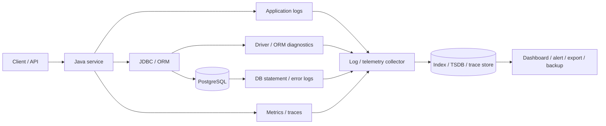
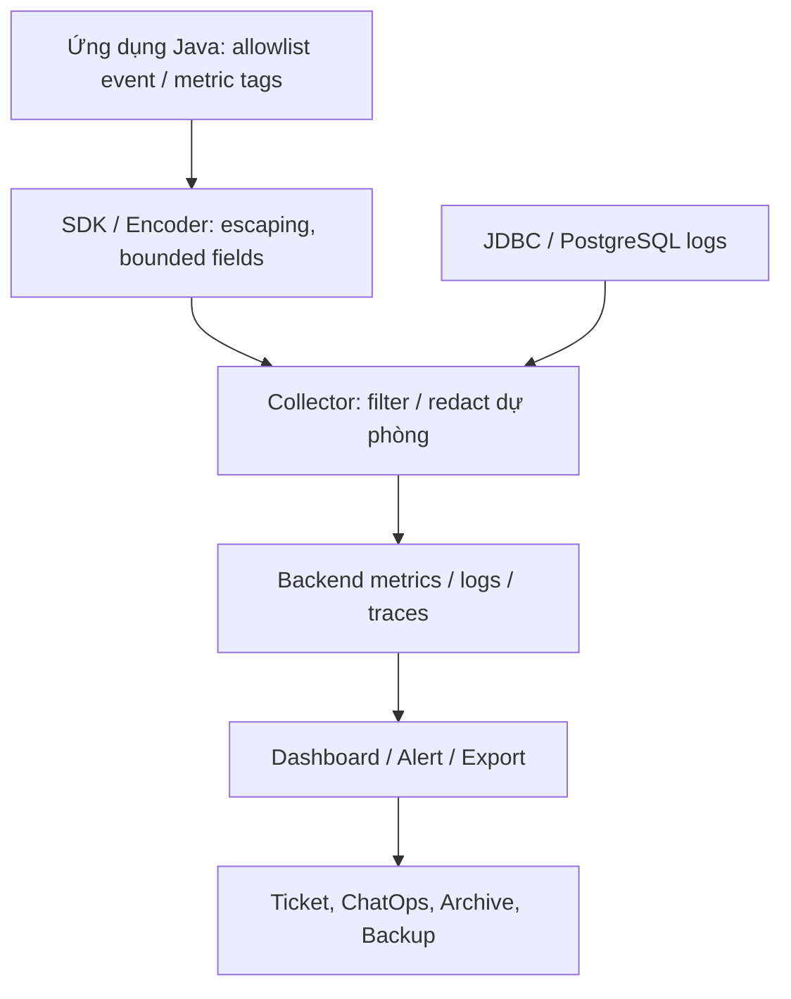

# Giới hạn dữ liệu nhạy cảm trong log và nhãn đo lường

## Mục tiêu học tập

Sau bài học, người học có thể:

- Giải thích vì sao log, metrics, traces và cảnh báo là **bản sao dữ liệu cần bảo vệ**, không phải vùng ngoại lệ của chính sách an toàn dữ liệu.
- Phân loại thông tin được phép ghi trong observability của Java persistence: mã thao tác, trạng thái, SQLSTATE đã chuẩn hóa, duration; phân biệt với mật khẩu, token, PII, query bind values và định danh cá nhân.
- Thiết kế **log theo allowlist**, không log `request.toString()`, SQL có tham số, raw exception hay cấu hình kết nối chứa bí mật.
- Thiết kế **metric labels có cardinality thấp**, dự trù số chuỗi thời gian, loại bỏ các tag động như `userId`, `orderId`, email và raw URL.
- Áp dụng ví dụ Java SLF4J/MDC và Micrometer cho tầng repository, connection pool và transaction với policy không chứa dữ liệu nhạy cảm.
- Nhận diện những tầng tự động thu SQL, URL, headers, exception message; kiểm tra cơ chế lọc ở application, instrumentation, collector và nơi lưu.
- Lập bài kiểm thử và runbook xử lý khi dữ liệu nhạy cảm đã đi vào hệ thống quan sát.

## 1. Quan sát được hệ thống không đồng nghĩa thu thập mọi dữ liệu

Một dịch vụ Java dùng PostgreSQL gặp lỗi tạo đơn. Để điều tra, kỹ sư cần biết:

- `create_order` đang lỗi ở giai đoạn nào: mượn connection, thực thi SQL, chờ khóa hay commit?
- Lỗi là `unique_conflict`, `deadlock`, `connection_unavailable` hay `timeout`?
- Bao nhiêu request bị ảnh hưởng, ở thời gian nào và dưới mức tải nào?
- Có bản ghi đang `PENDING`, transaction chưa rõ kết quả hay connection pool đang đầy không?

Không nhất thiết cần biết **email khách hàng, token đăng nhập, số tài khoản, mật khẩu DB, nội dung SQL parameter hoặc toàn bộ payload đơn hàng**. Những giá trị đó thường không làm câu hỏi vận hành dễ trả lời hơn, nhưng lại tạo rủi ro lộ thông tin.

Xét cách ghi:

```java
// KHÔNG AN TOÀN: dữ liệu đầu vào/ngoại lệ có thể chứa PII và secret.
log.error("Order failed. request={}", request, exception);
```

Một `record` Java mặc định có `toString()` hiển thị các thành phần; logger có thể in stack trace và exception cause chứa SQL, tên bảng hoặc giá trị ràng buộc gây lỗi. Log này có thể được sao chép từ stdout của container vào collector, index tìm kiếm, APM, dashboard, ticket, email cảnh báo và backup.

**Mục tiêu đúng:** giữ **khả năng chẩn đoán với dữ liệu tối thiểu**. Đó là điểm giao nhau giữa an toàn dữ liệu và vận hành của module `DATA_PERSISTENCE_FUNDAMENTALS`: persistence cần theo dõi truy vấn, chỉ mục, transaction, isolation, kết nối, hiệu năng và phục hồi, nhưng telemetry không được biến thành một kho dữ liệu khách hàng thứ hai.

### 1.1. Ba dạng tín hiệu có tính chất khác nhau

| Tín hiệu | Đơn vị cơ bản | Thế mạnh | Rủi ro thường gặp |
| --- | --- | --- | --- |
| **Logs** | Event có timestamp, level, field | Giải thích một sự kiện/lỗi cụ thể | In toàn bộ request, exception, SQL, token, PII |
| **Metrics** | Giá trị số theo tên và nhãn, tổng hợp theo thời gian | Theo dõi tần suất, latency, saturation, SLO | Nhãn chứa ID cá nhân, bùng nổ chuỗi thời gian, dashboard lộ tenant |
| **Traces** | Chuỗi spans gắn một request/workflow | Tìm điểm chờ trong nhiều tầng | Span attributes chứa raw URL, SQL statement, DB args, exception message |

Không hoán đổi các dạng tín hiệu: dùng `request_id` để tìm một lỗi cụ thể trong log/traces **không** có nghĩa nên gắn mỗi `request_id` thành một metric label. Một nhãn đo là một phần của **khóa tập hợp thời gian**; một giá trị khác nhau cho từng request sẽ tạo nhiều chuỗi.

### 1.2. Đường đi của telemetry



Nếu chỉ sửa một câu `log.info` ở tầng Java, dữ liệu vẫn có thể bị ghi bởi JDBC proxy, Hibernate bind logger, PostgreSQL statement logger hoặc exporter của trace. **Chính sách phải được kiểm tra trên cả đường đi**, với từng nơi tạo bản sao.

## 2. Phân loại dữ liệu cho observability

Chính sách tối thiểu nên xác định **loại dữ liệu**, **mục đích quan sát** và **nơi được phép nhận**. Quy định pháp lý/hợp đồng cụ thể phụ thuộc tổ chức và không thể thay bằng một bảng kỹ thuật chung.

| Dữ liệu | Ví dụ | Log ứng dụng thông thường | Metric label | Trace attribute |
| --- | --- | --- | --- | --- |
| **Credential/secret** | Password, API key, Bearer token, cookie, private key, OTP | **Không ghi** | **Không ghi** | **Không ghi** |
| **Thông tin cá nhân** | Email, số điện thoại, địa chỉ, ngày sinh, định danh | Mặc định không ghi raw | Không ghi | Mặc định không ghi raw |
| **Dữ liệu nhạy cảm nghiệp vụ** | Số dư, số thẻ, giá hợp đồng, hồ sơ khách hàng | Không ghi payload | Không ghi giá trị/ID nhạy cảm | Không ghi payload |
| **Dữ liệu truy vấn** | Raw SQL bind parameters, transaction body, JDBC URL có credential | Không ghi nguyên | Không ghi | Chỉ fingerprint/operation được phép |
| **Thông tin nội bộ** | Host DB, schema, tên bảng riêng, shard, địa chỉ mạng | Theo quyền và mục đích | Chỉ nhãn được phê duyệt, cardinality thấp | Theo chính sách nội bộ |
| **Mã thao tác cố định** | `order_read`, `order_create` | Thường được phép | Được phép | Được phép |
| **Mã lỗi chuẩn hóa** | `DB_UNAVAILABLE`, `UNIQUE_CONFLICT` | Thường được phép | Được phép khi tập giá trị có giới hạn | Được phép |
| **Thời lượng, trạng thái** | `elapsed_ms`, `outcome=timeout`, `rows=50` | Theo nhu cầu | Được phép | Được phép |
| **ID liên kết sự kiện** | `request_id` ngẫu nhiên | Có thể cho phép trong log truy cập có quyền | **Không gắn mỗi request một label** | Có thể dùng trace ID/ID được phép |

Một `tenant_id` hoặc `customer_id` vẫn có thể là thông tin có thể liên kết tới một tổ chức/cá nhân. Nếu cần đối soát cụ thể, dùng kho audit có quyền riêng hoặc log được phân quyền; không tự mặc định những ID đó an toàn cho mọi dashboard.

### 2.1. Bốn quy tắc ra quyết định

1. **Không tạo trường nếu không thật sự cần:** giữ mã sự kiện và lỗi có cấu trúc, không dump object để “sau này có thể dùng”.
2. **Chỉ tạo field nằm trong allowlist:** tránh một hàm nhận tự do `Map<String, Object>` từ request rồi chuyển hết vào log.
3. **Chọn nơi lưu phù hợp:** tổng hợp và cảnh báo bằng metrics; điều tra sự kiện bằng log/trace có quyền; kiểm toán nghiệp vụ bằng hệ thống audit riêng.
4. **Quy định thời hạn lưu, quyền và kênh xuất:** dữ liệu an toàn trong log nội bộ chưa chắc được phép copy sang dashboard công khai hoặc SaaS bên thứ ba.

## 3. Structured logging: thiết kế trường trước khi ghi

Thay vì chuỗi khó kiểm soát:

```java
// SAI: raw payload và SQL parameter được đưa vào một message.
log.debug("customer={} sql={} params={}", customer, sql, parameters);
```

hãy định nghĩa một **schema log có trường hữu hạn và rõ ngữ nghĩa**:

| Field | Kiểu/giá trị ví dụ | Quy tắc |
| --- | --- | --- |
| `event` | `persistence_operation_finished` | Danh sách event cố định |
| `operation` | `read_customer_status` | Enum, không ghép ID người dùng |
| `outcome` | `success` / `conflict` / `timeout` / `failure` | Enum hữu hạn |
| `error_code` | `SERIALIZATION_FAILURE` / `DB_UNAVAILABLE` | Mã đã chuẩn hóa, không raw message |
| `duration_ms` | `124` | Số đo từ đồng hồ monotonic |
| `request_id` | UUID do server sinh | Chỉ cho log được phân quyền, không đưa vào metric label |
| `pool` | `orders_read` | Mã cấu hình được phê duyệt, không JDBC URL |

### 3.1. Ví dụ Java với SLF4J

```java
import org.slf4j.Logger;
import org.slf4j.LoggerFactory;
import java.util.UUID;

enum PersistenceOperation {
    READ_ORDER, CREATE_ORDER, UPDATE_INVENTORY
}

enum PersistenceOutcome {
    SUCCESS, CONFLICT, TIMEOUT, UNAVAILABLE, FAILURE
}

public final class PersistenceEventLog {
    private static final Logger LOG =
            LoggerFactory.getLogger(PersistenceEventLog.class);

    private PersistenceEventLog() {}

    public static void finished(
            PersistenceOperation operation,
            PersistenceOutcome outcome,
            long elapsedNanos,
            UUID requestId) {
        long elapsedMs = Math.max(0L, elapsedNanos) / 1_000_000L;

        // operation/outcome là enum; requestId do hệ thống tự sinh.
        LOG.info(
                "event=persistence_finished operation={} outcome={} "
                + "duration_ms={} request_id={}",
                operation.name().toLowerCase(java.util.Locale.ROOT),
                outcome.name().toLowerCase(java.util.Locale.ROOT),
                elapsedMs, requestId);
    }
}
```

Ví dụ **không nhận** email, SQL, token, request body hoặc exception; đây là biện pháp phòng lỗi từ **API thiết kế sẵn**. Trong triển khai thật, `requestId` phải do middleware đáng tin tạo ra hoặc xác minh; không chấp nhận nguyên một header không kiểm tra từ client rồi ghi vào log. Nếu tổ chức hạn chế lưu ID truy vết, bỏ trường đó hoặc dùng mã gián tiếp được cấp phép.

### 3.2. Placeholder `{}` không tự lọc bí mật

SLF4J hỗ trợ parameterized logging, nhưng câu:

```java
// SAI: placeholder không tự xóa raw dữ liệu.
log.info("Authorization={}", authorizationHeader);
```

vẫn ghi giá trị header. Một encoder JSON cũng không tự tạo ra chính sách bảo mật; nó chỉ giúp giữ cấu trúc và escaping. Cần **chặn dữ liệu ở chỗ gọi log**, đồng thời áp bộ lọc phòng vệ ở encoder/collector theo nhu cầu.

### 3.3. MDC: chỉ chứa thông tin thật sự được phép

`MDC` tiện để mọi log trong một request có cùng `request_id` hoặc `trace_id`:

```java
import java.util.UUID;
import org.slf4j.MDC;

public void handleRequest() {
    String requestId = UUID.randomUUID().toString();
    try (MDC.MDCCloseable scope =
            MDC.putCloseable("request_id", requestId)) {
        processAuthorizedRequest();
    }
}
```

**Không đặt** `Authorization`, `Cookie`, email, user object, tài khoản ngân hàng hoặc raw payload vào MDC. Với thread pool phải luôn dọn context sau request; với asynchronous/reactive code cần cơ chế truyền context do framework hỗ trợ, không mặc định `ThreadLocal` đi qua mọi thread.

### 3.4. Error code thay vì raw exception message

`SQLException.getMessage()` có thể chứa thông tin ràng buộc, bảng, query, giá trị trùng và host. Để điều tra, nên phân loại **SQLSTATE**/loại sự cố thành danh sách mã ngắn:

| SQLSTATE PostgreSQL | Phân loại nội bộ minh họa |
| --- | --- |
| `23505` | `UNIQUE_CONFLICT` |
| `23503` | `REFERENCE_CONFLICT` |
| `40001` | `SERIALIZATION_FAILURE` |
| `40P01` | `DEADLOCK` |
| Nhóm `08xxx` | `CONNECTION_FAILURE` |
| Trường hợp khác | `DB_FAILURE` |

Không coi `23505` đồng nghĩa “email đã tồn tại” cho mọi bảng: đó là lỗi unique tổng quát. Mã lỗi công khai cũng phải tránh tiết lộ một định danh có tồn tại hay không. Khi cần stack trace, dùng kênh chẩn đoán hạn chế quyền và đã kiểm thử việc sanitize exception/cause, thay vì truyền raw exception đến mọi collector hoặc client.

## 4. SQL, kết nối và lỗi: những nguồn log tự động dễ bỏ sót

Ứng dụng Java có thể tuân thủ schema log nhưng vẫn rò rỉ dữ liệu ở **một thư viện được bật debug** hoặc tại database. Cần kiểm kê ít nhất:

| Nguồn | Nội dung có thể xuất hiện | Biện pháp |
| --- | --- | --- |
| **Spring/web access logging** | Request URL, query string, headers, body | Chuẩn hóa route, chặn header nhạy cảm, không log body mặc định |
| **Hibernate ORM** | SQL, tên bảng/cột, giá trị bind parameter | Không bật bind-value TRACE trên dữ liệu thật; kiểm thử category theo version |
| **JDBC proxy / datasource instrumentation** | SQL kèm tham số, thời gian, exception | Chỉ giữ operation/query fingerprint và duration đã phê duyệt |
| **Connection pool / startup** | JDBC URL, username, credential hoặc properties | Không dump properties/DataSource, che secret ngay từ cấu hình |
| **PostgreSQL statement/error logging** | Statement, một số tham số và chi tiết lỗi | Rà cấu hình logging, retention, quyền truy cập và nội dung thực |
| **`pg_stat_activity` / `pg_stat_statements`** | Query text hoặc fingerprint và metadata | Ưu tiên query ID/chỉ số, hạn chế trích xuất raw SQL |
| **Trace collector / APM agent** | `db.statement`, `url.full`, headers, exception message | Thu theo allowlist và kiểm tra mọi auto-instrumentation |

### 4.1. `PreparedStatement` giúp bảo vệ cấu trúc SQL, không phải log

```java
import java.sql.Connection;
import java.sql.PreparedStatement;
import java.sql.ResultSet;
import java.sql.SQLException;
import java.util.UUID;

public boolean isActiveCustomer(
        Connection connection, UUID tenantId, UUID customerId)
        throws SQLException {
    String sql = """
            SELECT active
            FROM customer
            WHERE tenant_id = ? AND id = ?
            """;
    try (PreparedStatement statement =
            connection.prepareStatement(sql)) {
        statement.setObject(1, tenantId);
        statement.setObject(2, customerId);
        try (ResultSet result = statement.executeQuery()) {
            return result.next() && result.getBoolean("active");
        }
    }
}
```

Đoạn code dùng parameter binding, giảm SQL injection, và chỉ chọn một cột cần dùng. Nhưng nếu Hibernate, JDBC proxy hoặc PostgreSQL bật logging tham số thì `tenantId`/`customerId` vẫn có thể xuất hiện trong telemetry. **Không suy ra “không rò log” chỉ từ việc có dấu `?` trong SQL.**

Ngoài ra, tên bảng/cột động **không bind bằng tham số**; hãy map đầu vào sort/filter vào danh sách identifier cho phép. Không ghi một chuỗi SQL được nối từ user input để phục vụ debug.

### 4.2. Rà cấu hình PostgreSQL đúng phiên bản

Các điểm quan sát thường được cấu hình qua `log_statement`, `log_min_duration_statement`, `log_min_error_statement` và các thiết lập liên quan tới ghi bind parameters. Những tham số như `log_parameter_max_length` hoặc `log_parameter_max_length_on_error` có thể dùng trong phiên bản hỗ trợ; phải xác minh **ngữ nghĩa và hiệu lực trên PostgreSQL đang chạy**. Một cấu hình không ghi tham số ở một kênh không có nghĩa thông tin không xuất hiện trong kênh khác hoặc exception.

Để tìm transaction bị chặn mà không tải cột `query`:

```sql
SELECT
    pid,
    state,
    wait_event_type,
    wait_event,
    now() - xact_start AS transaction_age,
    pg_blocking_pids(pid) AS blocking_pids
FROM pg_stat_activity
WHERE datname = current_database()
  AND backend_type = 'client backend'
ORDER BY xact_start NULLS LAST;
```

Các trường trên vẫn là **thông tin nội bộ**, cần giới hạn quyền. Với `pg_stat_statements` đã được bật, có thể tổng hợp theo `queryid` và timing/calls thay vì tải nguyên `query` để đưa vào dashboard. Tên view/cột/quyền và tính năng của PostgreSQL thay đổi theo phiên bản; không yêu cầu tự bật extension hoặc logger ở production chỉ để làm bài học.

### 4.3. Không log secret của `DataSource`

Những biểu thức nên tránh:

```java
// Cả ba mẫu dưới đều có thể phát tán bí mật hoặc metadata nội bộ.
log.info("datasource={}", dataSource);
log.debug("database properties={}", configurationProperties);
log.error("Cannot connect to jdbcUrl={}", jdbcUrlWithCredentials);
```

Thay bằng một **mã cấu hình được phê duyệt**, chẳng hạn `db_target=orders_primary`, loại lỗi chuẩn hóa và thời điểm. Secret nên được cấp qua secret manager hoặc cơ chế cấu hình an toàn, có rotation/revocation; không đặt password trực tiếp trong source hoặc ticket.

### 4.4. Mã lỗi API và log vận hành là hai hợp đồng riêng

Khi database lỗi, client có thể nhận:

```json
{
  "code": "PERSISTENCE_UNAVAILABLE",
  "message": "Không thể hoàn tất yêu cầu lúc này.",
  "requestId": "f0c59521-8987-419f-826a-6be5acacdd84"
}
```

Không trả `SQLException.getMessage()`, stack trace, SQL, tên database, host hoặc raw constraint value. Log nội bộ giữ `requestId`, loại thao tác, duration và `error_code` đã phân loại. Với thao tác ghi bị timeout đúng lúc `COMMIT`, kết quả có thể **không rõ**; phải dùng idempotency key và đường tra cứu trạng thái, không tự retry ghi lần nữa chỉ vì không nhận được response.

## 5. Metric labels: số lượng giá trị là một ràng buộc tài nguyên và an toàn

Trong hệ thống đo lường dạng time series, **một tổ hợp tên metric và tập label values khác nhau** thường tạo một chuỗi thời gian riêng. Cách làm tưởng vô hại:

```text
persistence_query_duration_seconds{
  user_id="u-123",
  order_id="ord-999",
  sql="SELECT ... WHERE email='...'"} ...
```

có thể vừa lộ dữ liệu, vừa làm nổ số series được tạo mỗi ngày. Sự cố không nhất thiết xảy ra ở Java heap; Prometheus/remote-write/backend metrics cũng phải lưu index, sample và label combinations.

### 5.1. Cardinality tăng theo tích Descartes

Ví dụ một histogram duration được gắn các nhãn:

| Label | Số giá trị dự kiến |
| --- | ---: |
| `operation` | 8 |
| `outcome` | 5 |
| `shard_group` | 4 |
| `environment` | 2 |

Trần lý thuyết là `8 × 5 × 4 × 2 = 320` **tổ hợp nhãn** cho một tên metric (giả sử mọi tổ hợp xuất hiện). Nếu thêm `user_id` có 100.000 giá trị, trần thành **32.000.000 tổ hợp**. Với histogram cổ điển xuất thêm nhiều chuỗi theo bucket (`le`), `_sum` và `_count`, số series thực tế còn lớn hơn; số lượng phụ thuộc cách export và backend.

**Không phải mọi tổ hợp đều xuất hiện**, nên đây là ước tính **ngân sách thiết kế**, không phải số series đo được. Cardinality thực phải theo dõi từ backend và metric registry, đặc biệt khi deployment, label mới và traffic thay đổi.

### 5.2. Nhãn nào được phép?

| Nhãn | Nên dùng? | Cách an toàn hơn |
| --- | --- | --- |
| `operation=read_order` | Có | Enum cố định |
| `outcome=success / timeout` | Có | Tập trạng thái chuẩn hóa |
| `db_pool=orders_read` | Có điều kiện | Tên pool cấu hình đã giới hạn |
| `sqlstate_class=23` | Có điều kiện | Phân nhóm hữu hạn; không dùng raw message |
| `shard=shard-001...` | Phụ thuộc quy mô và quyền | Nhóm shard hoặc label đã giới hạn, tính ngân sách trước |
| `tenant_id` | Thường không | Tổng hợp theo loại tenant, tier hoặc nhóm đã được phê duyệt |
| `user_id`, `order_id`, `request_id` | Không | Log/trace có quyền qua request ID; không gắn metric |
| `email`, `phone`, `token` | **Không** | Không đưa thông tin này vào telemetry |
| `url=/orders/1234` | Không | Route template `/orders/{id}` |
| `sql=SELECT ... params` | Không | Operation enum hoặc query fingerprint được phê duyệt |
| `exception.message` | Không | Exception category/error code hữu hạn |

Nhãn như `tenant_tier=enterprise` tuy có cardinality thấp vẫn có thể nhạy cảm nếu dashboard được chia sẻ không đúng đối tượng. **Cardinality thấp không tự đồng nghĩa dữ liệu được phép công bố**; cần cả hai bước kiểm tra: **mức nhạy cảm** và **số lượng giá trị**.

### 5.3. Đặt ngân sách cardinality cụ thể

Một quy trình thiết kế metric:

1. Xác định câu hỏi cần trả lời, ví dụ “p95 của truy vấn tạo đơn trên mỗi môi trường là bao nhiêu?”.
2. Chọn nhãn tối thiểu để phân nhóm cho câu hỏi ấy.
3. Dự tính số tổ hợp trong hiện tại và sau 12 tháng, tính cả histogram buckets và số instance/pool.
4. Đặt **ngưỡng cảnh báo** khi series mới tăng đột biến hoặc label values vượt số đã dự kiến.
5. Review mọi nhãn mới trong PR và kiểm tra runtime instrumentation của thư viện.
6. Nếu cần điều tra một request cụ thể, **chuyển sang log/trace bằng ID có quyền**, không thêm nhãn duy nhất cho mỗi request.

Không dùng `hash(userId)` rồi gắn vào metric để “giữ riêng tư”: mỗi người vẫn có một giá trị riêng, cardinality vẫn cao, và hash cố định có thể cho phép liên kết các hành động.

## 6. Java Micrometer: dùng enum và giới hạn nhãn từ chỗ tạo metric

Micrometer có thể tạo `Counter`, `Timer` và histogram với nhãn. Mẫu đúng nên khiến code nghiệp vụ **không dễ truyền giá trị người dùng làm tag**.

```java
import io.micrometer.core.instrument.MeterRegistry;
import io.micrometer.core.instrument.Timer;
import java.time.Duration;
import java.util.Locale;
import java.util.Objects;
import java.util.concurrent.TimeUnit;

enum DbOperation {
    READ_ORDER, CREATE_ORDER, RESERVE_INVENTORY
}

enum DbOutcome {
    SUCCESS, CONFLICT, TIMEOUT, FAILURE
}

public final class PersistenceMetrics {
    private final MeterRegistry registry;

    public PersistenceMetrics(MeterRegistry registry) {
        this.registry = Objects.requireNonNull(registry);
    }

    public void record(
            DbOperation operation,
            DbOutcome outcome,
            long elapsedNanos) {
        if (elapsedNanos < 0) {
            throw new IllegalArgumentException("Invalid duration");
        }

        // Tên và nhãn đều cố định hoặc lấy từ enum hữu hạn.
        Timer.builder("persistence.operation.duration")
                .description("Time spent in a persistence use case")
                .tag("operation",
                        operation.name().toLowerCase(Locale.ROOT))
                .tag("outcome",
                        outcome.name().toLowerCase(Locale.ROOT))
                .publishPercentileHistogram()
                .maximumExpectedValue(Duration.ofSeconds(30))
                .register(registry)
                .record(elapsedNanos, TimeUnit.NANOSECONDS);
    }
}
```

**Điểm đúng của thiết kế:** API chỉ nhận `DbOperation` và `DbOutcome`, không có chuỗi `email`, `userId` hoặc `sqlParams`. Có 3 × 4 = **tối đa 12 tổ hợp tag** theo hai enum này (trước khi tính nhãn chung/resource labels và buckets). Lưu ý `maximumExpectedValue` và histogram configuration phải phù hợp workload; đây chỉ là cấu hình minh họa, không bảo đảm bucket phù hợp mọi SLO.

### 6.1. Không tạo enum động từ user input

Mẫu sau nguy hiểm:

```java
// SAI: mỗi ID có thể tạo một chuỗi thời gian và tiết lộ dữ liệu.
Timer.builder("persistence.operation.duration")
        .tag("customerId", customerId.toString())
        .register(registry);

// SAI: message ngoại lệ có thể chứa URL, SQL, token hoặc giá trị.
registry.counter(
        "persistence.errors", "reason", error.getMessage());
```

Hãy dùng mã lỗi phân loại hữu hạn: `reason=connection_failure`, `reason=deadlock`, `reason=constraint_conflict`, `reason=other`. Nếu loại lỗi quá chi tiết và nở theo tên bảng, schema, mã người dùng hoặc SQL literal, nó vẫn phá ngân sách và chính sách riêng tư.

### 6.2. Meter filter chỉ là lớp dự phòng

Micrometer có `MeterFilter` để áp policy về tên, tag hoặc số meter được đăng ký. Có thể cân nhắc `maximumAllowableTags(...)` và cấu hình chặn metric không được phép. Tuy nhiên:

- Nếu chuỗi nhạy cảm đã được tạo và truyền vào instrumentation **trước khi filter chạy**, nó có thể xuất hiện tại debugger hoặc nguồn quan sát khác.
- Một giới hạn tag có thể khiến những series mới **bị từ chối**, gây mất dữ liệu vận hành khi đã chạm ngưỡng.
- Cardinality không chỉ nằm trong một `MeterRegistry`; nhãn instance, pod, node và pipeline exporter làm tổng series tăng thêm.
- Không dùng filter để thay thế review nhãn ngay trong code và auto-instrumentation.

Nếu metric bị từ chối do vượt ngân sách, cần alert và sửa nguồn tạo tag, không âm thầm coi hệ thống vẫn được đo đầy đủ.

### 6.3. Đo pool và transaction mà không cần PII

Chỉ số hữu ích của tầng Java/persistence:

- Connection pool: active, idle, pending, acquisition duration, usage duration, timeout;
- SQL/use case duration histogram theo `operation` đã chuẩn hóa;
- Error counters theo `outcome` hoặc `sqlstate_class` đã giới hạn;
- Transaction duration, commit/rollback count, lock wait và retry count;
- PostgreSQL: throughput, WAL, CPU/I/O, deadlocks, replica lag và backlog;
- Outbox/inbox: số sự kiện chờ, thời gian chờ, số retry, số event dedup.

Những nhóm này giúp phát hiện pool cạn, query chậm, lock contention và lỗi kết nối **mà không cần** gắn raw SQL parameter hay khách hàng nào vào nhãn metric. Phân tích sâu một trường hợp dùng request/trace ID tại kho có quyền, theo quy trình kiểm soát truy cập.

## 7. URL, headers, trace attributes và exemplars

### 7.1. Đường dẫn URL cần được chuẩn hóa

Một HTTP endpoint có dạng `GET /orders/{id}` có thể được gọi với:

```text
/orders/7ee0cd4c-fbf4-413e-87cc-3eeefb8538a7
/orders/4e178956-782d-4a3e-ab22-6e4f4c57eed2
```

Gắn đường dẫn **thật** vào metric label `uri` sẽ tạo nhiều giá trị khác nhau và có thể lộ order ID. Nên dùng route **template** `/orders/{id}` do framework xác định. Với route không match hoặc path tùy ý, chọn nhãn chuẩn hóa như `UNKNOWN`/`NOT_FOUND` thay vì dùng raw path làm fallback.

Đặc biệt tránh đưa **query string** vào label, log hoặc span name nếu chứa token, email hay tham số nhạy cảm. Một URL như `/reset-password?token=...` có thể bị lưu ở reverse proxy, access log, browser history hoặc tracing trước khi vào Spring controller. Không thể sửa một metric phía Java rồi kết luận mọi tầng đều sạch.

### 7.2. HTTP headers nhạy cảm

Các header phải được chặn hoặc kiểm soát theo chính sách:

- `Authorization`, `Proxy-Authorization`;
- `Cookie`, `Set-Cookie`;
- Trường tự định nghĩa có API key, OTP, session token;
- Header chứa PII hoặc nội dung cá nhân;
- Header `Referer` có URL mang token hoặc query string nhạy cảm.

Ngay cả khi log mức `DEBUG` hữu ích cho troubleshoot, **không log toàn bộ headers một cách mặc định**. Nếu cần kiểm tra routing, có thể ghi phương thức, route template, HTTP status, user-agent family được chuẩn hóa hoặc một mã request server sinh — không cần credential.

### 7.3. Tracing: quan sát request mà không sao chép payload

Trace hữu ích để tìm thời gian trong chuỗi:

```text
HTTP POST /orders            220 ms
  order.create               204 ms
    connection.acquire        45 ms
    db.insert_order          115 ms
    transaction.commit        29 ms
```

Span name và attributes nên dùng **tên operation cố định**. Các giá trị `db.statement`, `db.query.text`, `url.full`, `http.request.header.*` hoặc `exception.message` (tên thuộc tính thực tế phụ thuộc phiên bản instrumentation) có thể chứa dữ liệu nhạy cảm nếu thu không kiểm soát. Không sao chép nguyên tên attribute từ ví dụ để giả định chúng đang tồn tại trong hệ thống; hãy kiểm tra **bản telemetry xuất thực tế**.

Nên lưu `db.system=postgresql`, thao tác, duration, status và error code có giới hạn; nếu cần nhận diện query, dùng **fingerprint/query ID đã phê duyệt**. Một query fingerprint vẫn có thể tiết lộ cấu trúc schema hoặc workload, nên quyền truy cập trace cần theo chính sách nội bộ.

### 7.4. Baggage và exemplar không phải cách lách ngân sách

Trong distributed tracing, **baggage** là context có thể được truyền qua các boundary dịch vụ và đôi khi qua network headers. Không đặt token, email, số tài khoản hoặc dữ liệu nhạy cảm vào baggage: nó dễ lan tới nhiều service ngoài phạm vi ban đầu.

Một **exemplar** có thể liên kết một mẫu metric với trace ID để người vận hành nhảy từ histogram sang trace cụ thể. Đây có thể là cách tốt để **giữ metric labels có cardinality thấp** mà vẫn tìm request đại diện. Nhưng trace liên kết vẫn có quyền riêng và không được chứa payload nhạy cảm; exemplar không tự giải quyết phân quyền hoặc bảo mật.

### 7.5. Sampling chỉ giảm số bản sao, không loại nguy cơ

Nếu trace sampling 1%, vẫn có thể thu một bearer token hoặc một email thật trong trace được giữ. Sampling không thể thay thế redaction/data minimization. Với incident hiếm, sampling còn có thể **bỏ qua trường hợp cần phân tích**, nên kết hợp metrics tổng hợp và log/event được định nghĩa đúng, không bật “capture toàn bộ payload” để bù thiếu thông tin.

## 8. Thiết kế pipeline telemetry an toàn

Một pipeline có nhiều vị trí để kiểm soát:



**Nguyên tắc ưu tiên:** tránh tạo raw secret tại ứng dụng/driver **trước**, dùng encoder và collector để kiểm tra bổ sung **sau**. Nếu dữ liệu đã được gửi tới một endpoint ingestion hoặc debug log trước collector, một processor phía sau có redact cũng không thể xóa những bản sao trước đó.

### 8.1. Kiểm kê nơi phát sinh dữ liệu

Với mỗi service Java, lập một bảng inventory:

| Thành phần | Câu hỏi kiểm tra |
| --- | --- |
| Application logger | Message templates và arguments có raw DTO, request, SQL, exception không? |
| ORM/JDBC | Có bật bind logging, result-value logging hoặc proxy debug không? |
| HTTP server/gateway | Access log có path thật, query string, header, body không? |
| PostgreSQL | Statement/error logging có đưa tham số/literal vào file log không? |
| Agent/SDK | Auto-instrumentation capture những span attributes nào? |
| Collector | Có lưu raw events, retry queue, dead letter hoặc debug logs trước redaction không? |
| Backend | Ai được query log, xem trace, xem metric labels và bulk export? |
| Notification | Alert có đính kèm raw log, SQL, URL hoặc payload vào chat/email không? |
| Archive/backup | Dữ liệu được giữ ở những nơi nào, theo thời hạn nào và xóa ra sao? |

Một nơi thường bị bỏ sót: **lỗi trong chính collector/exporter**. Khi ingestion thất bại, bộ phận này có thể log toàn bộ telemetry payload để debug, vô tình tạo một bản sao nhạy cảm ở kênh phụ. Cần thử failure path, không chỉ successful delivery.

### 8.2. Xử lý log injection và control characters

Giá trị do client kiểm soát có thể chứa newline, ký tự điều khiển, chuỗi trông giống log level/timestamp hoặc JSON khó parse. Nếu buộc phải log một giá trị từ bên ngoài đã được phép, cần **escape**, giới hạn độ dài và chuẩn hóa theo mục đích; structured logging có encoder đúng thường giúp phân biệt field với message. Nhưng tránh đưa raw input vào log vẫn là lớp bảo vệ mạnh nhất.

Không dùng một regex duy nhất để che tất cả bí mật. Regex có thể bỏ sót chuỗi đã URL-encode, JSON nested, base64 hoặc token định dạng mới, đồng thời xóa nhầm dữ liệu hợp lệ. Lọc tại collector là **defense in depth**, không phải lý do log toàn bộ request rồi hy vọng lọc được.

### 8.3. Quyền, phạm vi và thời gian lưu

Tách quyền cho các nhu cầu:

- **Dashboard tổng hợp:** developer/on-call xem SLO, error rate, pool saturation, không cần PII.
- **Logs chi tiết:** chỉ nhóm được ủy quyền xem ID truy vết và thông tin vận hành, có audit truy cập.
- **Audit nghiệp vụ:** kho riêng với schema, quyền và retention phù hợp, không lấy debug log làm ledger.
- **Traces và export:** ngăn truy cập rộng tới span có metadata nội bộ; kiểm soát kết nối bên thứ ba và phân quyền bulk export.

Một báo cáo nhiều giờ theo `tenant_tier` có thể là dữ liệu tổng hợp được phép, nhưng báo cáo theo từng `tenant_id` có thể tiết lộ quan hệ khách hàng. **Quyền truy cập** vẫn cần ngay cả khi metric labels đã có cardinality thấp.

### 8.4. Lưu trữ và retention không chỉ có một nơi

Không chỉ tính thời gian lưu ở index chính. Kiểm tra:

- Buffer của agent và collector;
- Message queue/retry queue hoặc dead-letter store;
- Raw object/archive của backend;
- Snapshot, backup, data lake, notebook và file export;
- Alert payload trong chat/email/ticket;
- Bản tải về máy cá nhân của người có quyền.

Khi hết retention, chính sách cần xác định dữ liệu ở những nơi này được xử lý thế nào. Với credential bị lộ, **xóa log không thay cho revoke/rotate**; secret có thể đã được đọc hoặc sao chép trước khi xóa.

## 9. Thiết kế cảnh báo và SLO mà không phụ thuộc ID người dùng

Một dashboard persistence tốt trả lời:

- Latency p95/p99 của `read_order`, `create_order` có tăng không?
- `connection.acquire` chậm do Hikari pending tăng, hay SQL server execution chậm?
- Error rate thuộc `timeout`, `deadlock`, `serialization_failure` hay `unavailable`?
- WAL/commit, lock wait, replica lag và outbox backlog có tăng không?
- Sau một sự cố, số workflow `PENDING` quá hạn có giảm không?

Những câu hỏi này dùng **operation và outcome tổng hợp**, không cần gắn `orderId` hoặc `customerEmail` vào metrics.

### 9.1. Ví dụ bộ metric an toàn

| Tên metric minh họa | Kiểu | Nhãn đề xuất | Cần chú ý |
| --- | --- | --- | --- |
| `persistence.operation.duration` | Timer/histogram | `operation`, `outcome` | Enum cố định, bucket phù hợp SLO |
| `persistence.errors` | Counter | `operation`, `error_class` | Không raw exception message |
| `db.connection.acquire` | Timer | `pool` được phê duyệt | Không JDBC URL/user DB |
| `db.transactions` | Counter | `operation`, `result` | Phân biệt commit/rollback và nghiệp vụ |
| `outbox.pending` | Gauge | `service`, `event_family` | Không event ID |
| `recovery.reconciliation.mismatch` | Gauge/counter | `check_type` | Không record ID hoặc số tiền cá nhân |

Tên metric trong bảng **chỉ là ví dụ thiết kế**. Micrometer, HikariCP và exporter có thể đặt tên hoặc đổi đơn vị khác nhau; phải kiểm tra metric thực tế đang xuất và tránh tạo metric tùy ý trùng tên nhưng khác ý nghĩa.

### 9.2. Ví dụ PromQL không cần định danh cá nhân

Nếu backend Prometheus đã nhận **classic histogram** với nhãn `operation`, `outcome` và tên `persistence_operation_duration_seconds_bucket`, có thể tính p95:

```promql
histogram_quantile(
  0.95,
  sum by (le, operation) (
    rate(persistence_operation_duration_seconds_bucket[5m])
  )
)
```

Đây là ví dụ có điều kiện: tên, bucket, unit và labels thực tế phụ thuộc cách cấu hình Micrometer/Prometheus; một hệ dùng native histogram sẽ có cách truy vấn khác. Không mặc định mọi lần đăng ký `Timer` đã xuất đúng histogram nếu môi trường không có cấu hình phù hợp.

Muốn theo dõi error rate, dùng **counter lỗi và counter tổng** với nhãn hữu hạn, đảm bảo đếm đúng outcome:

```promql
sum(rate(persistence_operation_count{outcome="failure"}[5m]))
/
clamp_min(sum(rate(persistence_operation_count[5m])), 1)
```

Ví dụ giả định có counter `persistence_operation_count` riêng với outcome như đã định nghĩa và denominator không bỏ sót các loại kết quả khác. Nếu registry chỉ có `Timer` và exporter tạo `_count` với tên khác, cần chỉnh query theo metric thực tế. Không copy một truy vấn placeholder rồi coi dashboard đang đo đúng.

### 9.3. Khi metric không đủ điều tra một request

Đó là thiết kế bình thường. Khi p99 tăng:

1. Dashboard xác định `operation=read_order` và `outcome=timeout` ở cửa sổ ảnh hưởng.
2. Từ trace exemplar hoặc log search có quyền, chọn một `request_id`/trace ID đại diện.
3. Tìm span `connection.acquire` và `db.select_order`, chờ khóa hoặc retry.
4. Đối chiếu với `pg_stat_activity`, `pg_stat_statements` theo query ID và timeline.
5. Nếu cần khảo sát dữ liệu khách hàng thực, dùng quy trình truy cập hạn chế/được phê duyệt thay vì thêm PII vào mọi log/metric.

Thiết kế này giữ **metrics ít nhãn và dễ tổng hợp**, đồng thời vẫn cho phép điều tra sâu trong một phạm vi kiểm soát.

## 10. Kiểm thử chống rò rỉ và chống tăng cardinality

Kiểm thử phải chứng minh cả hai điều:

1. Dữ liệu nhạy cảm **không xuất hiện** trong những kênh quan sát không được phép.
2. Một thay đổi về input **không tạo chuỗi metric mới vô hạn** do tag động.

Chỉ đọc code logging mà không xem **output thực tế** của encoder, exporter và collector là chưa đủ. Đặc biệt, đường lỗi của JDBC/ORM có thể khác hoàn toàn đường thành công.

### 10.1. Dùng canary tổng hợp, tuyệt đối không dùng secret thật

Tạo dữ liệu giả dễ nhận biết:

```text
email = canary_user_123@example.invalid
token = SYNTHETIC_TOKEN_DO_NOT_LOG_67890
tenant = synthetic-tenant-A
order = synthetic-order-991
```

Trong môi trường test, gọi:

- HTTP request thành công có dữ liệu khách hàng giả;
- Request vi phạm validation;
- `INSERT` tạo unique violation trên dữ liệu giả;
- JDBC connection timeout và mất response trong lúc giao dịch thử;
- Query có bind parameter giả với các mức logger dự kiến;
- Auto-instrumentation tạo spans/metrics khi request thất bại.

Thu từ **từng lớp**: application logs, web/proxy logs, ORM/JDBC logs, PostgreSQL statement/error logs, span payload, collector debug/retry queue và metric labels. Assert canary **không xuất hiện ở kênh bị cấm**. Với đường cần audit có quyền, phải kiểm tra đúng mục đích và quyền, không coi mọi dữ liệu định danh là có thể lưu tùy tiện.

### 10.2. Test Java: log allowlist

Ví dụ JUnit 5 + Logback bắt event của một logger, dùng token giả:

```java
import ch.qos.logback.classic.Logger;
import ch.qos.logback.classic.spi.ILoggingEvent;
import ch.qos.logback.core.read.ListAppender;
import org.junit.jupiter.api.Test;
import org.slf4j.LoggerFactory;
import java.util.UUID;
import java.util.stream.Collectors;

import static org.junit.jupiter.api.Assertions.*;

class PersistenceEventLogTest {
    @Test
    void logsOnlyApprovedFields() {
        Logger logger =
                (Logger) LoggerFactory.getLogger(PersistenceEventLog.class);
        ListAppender<ILoggingEvent> appender = new ListAppender<>();
        appender.start();
        logger.addAppender(appender);
        try {
            PersistenceEventLog.finished(
                    PersistenceOperation.CREATE_ORDER,
                    PersistenceOutcome.CONFLICT,
                    5_000_000L,
                    UUID.fromString(
                            "11111111-2222-3333-4444-555555555555"));

            String output = appender.list.stream()
                    .map(ILoggingEvent::getFormattedMessage)
                    .collect(Collectors.joining("\n"));

            assertTrue(output.contains("operation=create_order"));
            assertTrue(output.contains("outcome=conflict"));
            assertFalse(output.contains("SYNTHETIC_TOKEN"));
            assertFalse(output.contains("password="));
            assertFalse(output.contains("sql_params="));
        } finally {
            logger.detachAppender(appender);
            appender.stop();
        }
    }
}
```

**Giới hạn:** Test này chỉ kiểm tra formatted message của một logger trong một đường thực thi; không chứng minh encoder JSON, MDC, exception stack, collector hoặc các logger ORM đã an toàn. Kết quả `assertFalse` về token không được truyền vào hàm chỉ là ví dụ regression nhỏ, **không đủ** làm bằng chứng end-to-end. Test tích hợp phải thực sự đưa canary qua request/repository và kiểm tra output toàn pipeline.

Nếu sử dụng SLF4J backend khác Logback, cần adapter test tương ứng. Trong test song song, việc gắn `ListAppender` lên một logger dùng chung có thể bị ảnh hưởng bởi các luồng khác; nên cô lập logger, request và runtime.

### 10.3. Test Micrometer: số tổ hợp tag không tăng theo số khách hàng

Với `PersistenceMetrics` ở phần trước, dùng registry trong bộ nhớ để kiểm tra nhãn:

```java
import io.micrometer.core.instrument.Meter;
import io.micrometer.core.instrument.simple.SimpleMeterRegistry;
import org.junit.jupiter.api.Test;
import java.util.List;

import static org.junit.jupiter.api.Assertions.*;

class PersistenceMetricsTest {
    @Test
    void onlyBoundedOperationOutcomeLabelsAreCreated() {
        try (SimpleMeterRegistry registry = new SimpleMeterRegistry()) {
            PersistenceMetrics metrics = new PersistenceMetrics(registry);
            for (int i = 0; i < 1000; i++) {
                metrics.record(
                        DbOperation.READ_ORDER,
                        DbOutcome.SUCCESS,
                        1_000_000L + i);
            }

            List<Meter> meters = registry.getMeters().stream()
                    .filter(m -> m.getId().getName().equals(
                            "persistence.operation.duration"))
                    .toList();
            assertEquals(1, meters.size());

            Meter.Id id = meters.get(0).getId();
            assertEquals("read_order", id.getTag("operation"));
            assertEquals("success", id.getTag("outcome"));
            assertNull(id.getTag("userId"));
            assertNull(id.getTag("orderId"));
        }
    }
}
```

Ví dụ dùng Java hỗ trợ `Stream.toList()` và Micrometer API tương ứng. `SimpleMeterRegistry` cho phép quan sát meter IDs trong test nhưng **không mô phỏng toàn bộ chi phí histogram của Prometheus/remote write**, cũng không kiểm tra nhãn được exporter tự thêm. Một test thực tế cần quan sát HTTP scrape payload hoặc exporter khi có nhiều instance/pod, xem cả buckets/`le` và resource labels.

### 10.4. Test cho log nhạy cảm trong lỗi SQL

Tạo unique constraint conflict bằng email giả trên PostgreSQL thử nghiệm rồi kiểm tra:

1. HTTP response không chứa email giả, tên bảng, constraint detail hoặc stack trace.
2. Application log chỉ chứa `operation`, `outcome`, `error_code` và request ID được phép.
3. Hibernate/JDBC logging không xuất bind value.
4. Database error/statement log theo cấu hình tương đương production không xuất giá trị ngoài chính sách.
5. Traces và metrics không chứa email ở attributes/tags.
6. Collector không ghi lại raw event khi exporter lỗi.

Nếu test phát hiện email xuất hiện ở **database error log** trong môi trường được phép chẩn đoán, cần đánh giá chính sách thật: có kênh hoàn toàn cấm PII hay kênh hạn chế quyền được phép lưu một phần? Không xóa thông tin quan trọng từ một bản kiểm toán đã được ủy quyền chỉ để tất cả test `contains(email)` đều xanh; tiêu chí phải nhất quán với chính sách phân loại và mục đích.

### 10.5. Kiểm soát thay đổi thư viện và agent

Một bản nâng cấp Spring Boot, Hibernate, JDBC driver, Micrometer, OpenTelemetry agent hoặc collector có thể:

- Đổi tên metric, thêm label/attribute mặc định;
- Bắt đầu capture SQL statement hoặc headers trong chế độ debug;
- Đổi cách format exception stack;
- Phát raw data ở đường error mới;
- Khiến một dashboard/alert hiện tại mất số liệu.

Vì vậy, pipeline CI/CD và pre-production cần thử **telemetry schema, cardinality và canary** khi nâng thư viện, không chỉ test functional API. Khi metric được đổi tên, phải điều chỉnh dashboard và alert trước rollout để không mất khả năng quan sát đúng lúc hệ thống có sự cố.

## 11. Tình huống thực tế: metric label chứa `customer_id`

Một ứng dụng Java báo cáo mọi lỗi của tầng persistence bằng:

```java
// ANTI-PATTERN: một chuỗi cho mỗi khách hàng có lỗi.
registry.counter(
        "persistence.failure",
        "operation", "update_customer",
        "customer_id", customerId.toString(),
        "error", error.getMessage())
        .increment();
```

Sau một đợt lưu lượng lớn:

- Các khách hàng khác nhau tạo hàng trăm nghìn giá trị `customer_id`.
- `error.getMessage()` có thể thay đổi theo SQL, user input, connection và constraint; bản thân message có thể chứa PII.
- Time-series backend phải giữ nhiều chuỗi ít mẫu, tăng memory/index/ingestion cost.
- Dashboard cho nhiều người xem có thể cho phép suy ra khách hàng nào vừa lỗi.
- Cardinality cao làm query SLO chậm hoặc telemetry bị từ chối, gây **mù giám sát** đúng lúc cần điều tra.

### 11.1. Thiết kế lại

```java
// ĐÚNG HƯỚNG: chỉ giữ enum vận hành có phạm vi hữu hạn.
registry.counter(
        "persistence.failure",
        "operation", "update_customer",
        "error_class", "conflict")
        .increment();

// Một request cụ thể được truy vết tại kho log có quyền.
log.warn("event=customer_update_failed request_id={} "
        + "operation=update_customer error_code=CONFLICT", requestId);
```

Khi cần biết khách hàng nào bị ảnh hưởng để hỗ trợ, dùng **quy trình truy vấn nghiệp vụ/audit có quyền** hoặc tham chiếu request ID, thay vì lưu bản đồ khách hàng toàn hệ thống trong metric labels. Tài nguyên nhiều khi được phục hồi bằng việc giảm cardinality **và** xử lý số chuỗi cũ còn lưu ở backend theo retention/clean-up được quản lý; sửa code không làm dữ liệu cũ biến mất ngay.

### 11.2. Bảng so sánh trước và sau

| Tiêu chí | Trước | Sau |
| --- | --- | --- |
| Điều tra sự cố từng request | Tìm bằng customer ID trong metric | Tìm bằng request/trace ID có quyền, liên kết với nghiệp vụ khi được phép |
| Tổng hợp error rate | Nhiều chuỗi rời rạc | Một số chuỗi theo `operation` và `error_class` |
| Nguy cơ PII | Cao vì customer ID và message | Thấp hơn nhờ data minimization |
| Chi phí telemetry | Có thể tăng theo số khách hàng | Có trần label do enum quy định |
| Bằng chứng về tính đúng | Cần kiểm tra lỗi thực tế | Vẫn cần test logic, timeout, số transaction thất bại |

**Không được kết luận “nhãn có ít giá trị nên an toàn tuyệt đối”.** Một label cố định `environment=production` vẫn có thể là metadata nội bộ; quyền đọc/retention phải áp dụng như với telemetry khác.

## 12. Khi dữ liệu nhạy cảm đã bị ghi: vận hành sự cố

Giả sử một access token xuất hiện trong application log và được gửi sang APM. Quy trình cần xử lý **nguồn phát tán lẫn các bản sao đã tồn tại**:

1. **Phân loại và cô lập:** xác định loại dữ liệu, mức ảnh hưởng, kênh xuất và thời điểm; không copy raw token vào chat/ticket để báo sự cố.
2. **Dừng thu thập tiếp:** sửa code hoặc tắt logger/agent feature gây lỗi, chặn đường xuất dữ liệu không được phép.
3. **Thu hồi/luân chuyển secret:** token/key/password bị lộ cần revoke/rotate theo chính sách; chỉ xóa log là không đủ.
4. **Điều tra quyền truy cập:** xác định ai có thể xem index/trace/export và có dấu hiệu truy cập trái phép hay không.
5. **Khoanh vùng bản sao:** stdout, collector buffer, TSDB, log archive, trace backend, alert, ticket, backup, exported files.
6. **Xử lý dữ liệu đã lưu:** phối hợp security/operations/legal theo quy trình, bảo toàn bằng chứng cần thiết và áp deletion/redaction/retention phù hợp.
7. **Xác nhận không tái diễn:** bổ sung regression test có canary, rà logger/driver/agent, kiểm tra output thực tế sau rollout.
8. **Thông báo và hậu kiểm:** đánh giá nghĩa vụ thông báo theo quy định/hợp đồng áp dụng và cập nhật runbook/owner.

Một số dữ liệu cá nhân không thể “xoay vòng” như password; cần xem xét quyền người dùng, thời gian lưu và tác động lâu dài. Với ID/pseudonym, dù giá trị đã hash/HMAC, vẫn có thể liên kết hoạt động qua thời gian và thuộc phạm vi bảo vệ.

### 12.1. Thay đổi telemetry cần có đường phục hồi

Nếu giảm log sau sự cố nhưng làm mất toàn bộ khả năng chẩn đoán:

- Duy trì counters/histograms theo `operation`/`outcome`;
- Duy trì các loại lỗi `SQLSTATE` đã chuẩn hóa, không raw message;
- Duy trì `request_id`/trace ID trong kênh cho phép;
- Đo pool pending, acquire duration, transaction age, lock wait, WAL/replica lag;
- Chỉ mở thêm thông tin đặc thù trong thời hạn ngắn, có quyền và dữ liệu giả lập khi có thể.

An toàn telemetry không đồng nghĩa **tắt mọi tín hiệu**. Mục tiêu là loại dữ liệu không cần thiết khỏi nơi quan sát, để tín hiệu còn lại vẫn đủ giúp người trực sự cố quyết định đúng.

## 13. Bài tập tình huống và câu hỏi tự kiểm tra

**Câu 1 — Log một DTO.** Một endpoint nhận `CreateCustomerRequest(email, phone, password)`, dùng Java `record`. Khi validation lỗi, controller gọi `log.info("invalid {}", request)`. Hãy chỉ ra các dữ liệu có thể bị lộ, và thay bằng event log nào để vẫn theo dõi được lỗi?

**Câu 2 — Parameterized SQL.** Lập trình viên khẳng định dùng `PreparedStatement` nên không cần quan tâm cấu hình Hibernate bind logging. Nhận định này đúng không? Vì sao?

**Câu 3 — Cardinality.** Một metric có 12 operation, 6 outcome, 3 region. Hãy tính số tổ hợp nhãn tối đa giả định mọi tổ hợp xuất hiện. Nếu thêm 20.000 `user_id`, trần tổ hợp thay đổi thế nào? Điều gì xảy ra nếu histogram có 15 bucket?

**Câu 4 — Tên route.** API có route `/orders/{id}` nhưng hệ thống đưa raw path `/orders/12345` làm metric label. Hãy mô tả vấn đề và cách sửa.

**Câu 5 — Error message làm tag.** Một bộ đếm dùng `tag("exception", error.getMessage())`. Nó gây những rủi ro gì ngoài việc tên label quá dài?

**Câu 6 — Debug Hibernate.** Nhóm on-call bật toàn bộ ORM/JDBC TRACE trên production trong 24 giờ để tìm query chậm. Hãy đề xuất cách giảm phạm vi và các metric/truy vấn quan sát thay thế.

**Câu 7 — `request_id`.** Vì sao có thể dùng một request ID ngẫu nhiên trong log phân quyền nhưng không nên dùng request ID làm label trên mọi histogram?

**Câu 8 — HMAC thay email.** Nhóm kỹ thuật tạo `HMAC(email)` rồi làm metric label để “ẩn danh và đo từng người”. Điều này có giải quyết cardinality và rủi ro riêng tư không?

**Câu 9 — Collector redaction.** Collector xóa token trước khi gửi tới backend, nhưng một proxy đã ghi raw `Authorization` và exporter bật debug log payload khi lỗi. Có thể kết luận an toàn chưa?

**Câu 10 — SQLSTATE 23505.** Một transaction tạo người dùng trả `23505`, controller ghi nguyên `SQLException.getMessage()` vào log và trả “Email đã tồn tại”. Hai rủi ro cần kiểm soát là gì?

**Câu 11 — Trace baggage.** Để nối các bước saga, developer đặt `customerEmail` và `apiKey` vào baggage để mọi service nhận. Hãy chỉ ra vấn đề và đề xuất thuộc tính thay thế.

**Câu 12 — Metrics bị từ chối.** Sau khi thêm `maximumAllowableTags`, registry bắt đầu từ chối nhiều series và dashboard mất dữ liệu. Có phải hệ thống đã tự được bảo vệ hoàn toàn? Cần làm gì?

**Câu 13 — Rò secret trong log.** Một API token xuất hiện trong trace store 12 giờ trước. Code đã sửa, dashboard không còn hiện token. Những bước ứng cứu nào vẫn cần?

**Câu 14 — Dashboard nhiều tenant.** Một biểu đồ có label `tenant_id` cho từng khách hàng doanh nghiệp. Cardinality chưa cao nhưng dashboard được chia sẻ cho toàn công ty. Vấn đề còn lại là gì?

**Câu 15 — Test thiếu tầng.** Unit test xác nhận log của service không có email giả. Trên môi trường thật, PostgreSQL vẫn ghi parameter của query lỗi vào statement log. Làm sao cải tiến test?

**Câu 16 — Quan sát khi pool cạn.** HikariCP pending tăng mạnh, nhưng chính sách bảo mật không cho phép log raw SQL bind. Những tín hiệu nào vẫn đủ để tìm nguyên nhân?

### Gợi ý đáp án

1. `record.toString()` thường chứa cả email, số điện thoại và password. Dùng `event=customer_validation_failed`, `operation=create_customer`, `error_code=VALIDATION_FAILED`, thời gian và `request_id` hợp lệ; tránh đưa DTO/raw validation value vào log.
2. **Không đúng.** Bind parameter bảo vệ cấu trúc SQL khỏi injection trong ngữ cảnh phù hợp, nhưng logger ORM/driver/database có thể ghi **giá trị**. Phải rà cấu hình, quyền và output thực tế.
3. `12 × 6 × 3 = 216` tổ hợp; thêm `20.000 user_id` cho trần `4.320.000` tổ hợp. Nếu là classic histogram 15 bucket, mỗi tổ hợp có thêm series bucket và `_count`/`_sum` tùy exporter; số series có thể rất lớn. Đây là trần thiết kế, không phải số series thực tế nếu ít tổ hợp xuất hiện.
4. Mỗi ID tạo giá trị label mới, có thể tiết lộ danh tính đơn và gây cardinality cao. Dùng `/orders/{id}` do router chuẩn hóa; khi không match dùng nhãn hữu hạn, không raw path.
5. Message có thể chứa SQL literal/PII/host, khác nhau ở mỗi request, gây bùng series, lộ thông tin và khó tổng hợp. Map thành enum/code được phê duyệt.
6. Không bật bind TRACE rộng trên dữ liệu thật; ưu tiên thời gian SQL, Hikari acquire/usage, `pg_stat_activity` không lấy raw query, `pg_stat_statements` theo `queryid`, `EXPLAIN` trên dữ liệu thử, trace spans không payload và debug ngắn hạn có phê duyệt.
7. Request ID có độ phân biệt cao để tra một sự kiện trong **kho log có quyền**, còn metric dùng để tổng hợp theo nhóm. Gắn ID riêng mỗi request vào metric phá khả năng tổng hợp và tăng chi phí.
8. **Không.** HMAC có thể giảm rủi ro đoán input nếu khóa bí mật nhưng vẫn cho liên kết theo người và vẫn có mỗi người một label, không giảm cardinality. Có thể là dữ liệu phải bảo vệ.
9. **Chưa.** Proxy/SDK đã tạo bản sao trước bước redaction. Cần lọc ở nguồn, rà debug paths, collector buffers, retention và quyền export.
10. Raw SQLException có thể chứa dữ liệu cá nhân trong message; phản hồi “email đã tồn tại” có thể tạo **user enumeration** tùy use case. Dùng error mapping và thông báo được phép, log mã lỗi thay vì raw message.
11. Baggage có thể đi qua nhiều service/network headers, lan rộng secret/PII. Chỉ truyền opaque operation/trace ID, thông tin nghiệp vụ đã được phê duyệt và không chứa credential.
12. **Không.** Filter có thể ngăn tạo thêm series trong một registry nhưng không xử lý rò dữ liệu ở điểm khác và làm mất số đo. Cần alert, sửa code/auto-instrumentation gây cardinality, kiểm tra exporter và dashboard.
13. Revoke/rotate token, khoanh vùng mọi bản sao, đánh giá ai đã xem/export, chặn nguồn phát, xử lý archive/backup theo quy trình, thêm test và đánh giá nghĩa vụ thông báo.
14. **Lộ quan hệ khách hàng/tenant** và quyền truy cập không phù hợp vẫn là rủi ro, dù cardinality thấp. Cần mục đích, giới hạn quyền và nhóm nhãn được phê duyệt.
15. Tích hợp với PostgreSQL/driver/logger cấu hình tương tự production, tạo lỗi bằng **dữ liệu giả có canary**, thu các output database/JDBC/collector và assert theo chính sách của từng kênh.
16. Đo pool active/idle/pending, acquire/usage duration, transaction age, SQL duration đã chuẩn hóa, lock wait, `pg_blocking_pids`, JDBC error code, CPU/I/O, retry và trace ID. Không nhất thiết cần raw email hay tham số.

## 14. Checklist trước khi triển khai logging và metrics cho persistence

- [ ] Liệt kê các loại secret, PII, dữ liệu nghiệp vụ nhạy cảm và metadata nội bộ của service.
- [ ] Quy định mục đích của **log, metric, trace và audit**; không dùng một kênh để thay mọi nhu cầu.
- [ ] Log theo **allowlist**: event/operation/outcome/error code/duration; không dump request, entity hay response.
- [ ] Không ghi password, token, cookie, OTP, số thẻ, raw body, JDBC URL chứa bí mật hoặc SQL bind values.
- [ ] Không truyền raw `Throwable` tới logger truy cập rộng khi chưa có policy bảo vệ cause/stack.
- [ ] Dùng `PreparedStatement` cho SQL values và chỉ đọc cột cần thiết; kiểm tra cả ORM/JDBC proxy/database logging.
- [ ] Không dùng `tenant_id`, `user_id`, `order_id`, email, token, raw URL hoặc exception message làm metric label.
- [ ] Dùng route template, mã query/operation và outcome enum; có fallback hữu hạn khi route không nhận diện được.
- [ ] Tính ngân sách cardinality (kể cả histogram buckets và resource labels) trước khi tạo nhãn mới.
- [ ] Có alert khi series/tag values tăng đột biến hoặc backend từ chối metric.
- [ ] Mọi metric/timer có đơn vị, scope, outcome và bucket/SLO được xác định rõ.
- [ ] Không lấy trung bình p95 từ nhiều instance; dùng histogram/tập phân phối phù hợp nếu cần tổng hợp.
- [ ] Tracing chỉ thu attributes đã phê duyệt; không đặt PII/secret vào baggage, exemplar hoặc span name.
- [ ] Kiểm tra HTTP/access logs, reverse proxy, ORM bind logging, PostgreSQL statement/error logs và APM auto-instrumentation.
- [ ] Collector redaction chỉ là **lớp bổ sung**; không phát dữ liệu nhạy cảm ngay ở application/driver.
- [ ] Có cơ chế escaping, giới hạn độ dài và chống log injection cho chuỗi được phép ghi.
- [ ] Kiểm soát RBAC, mã hóa, retention, backup, archive, export và cảnh báo gửi chat/email.
- [ ] Không dùng request ID do client gửi mà chưa xác minh; dọn MDC/context sau request và qua async boundary.
- [ ] Test bằng **canary tổng hợp** trên đường success, validation, conflict, timeout, SQL lỗi và exporter lỗi.
- [ ] Test số lượng/tag của meter, scrape/export payload và metric labels do thư viện tự thêm.
- [ ] Có runbook revoke/rotate bí mật và xử lý log/trace/archive đã chứa dữ liệu nhạy cảm.
- [ ] Sau mỗi nâng cấp framework/agent, xác nhận telemetry schema và quyền không thay đổi ngoài dự kiến.

**Ghi nhớ:** Để vận hành persistence an toàn, cần quan sát được **thao tác nào chậm, tài nguyên nào đang chờ, transaction nào thất bại và lỗi nào lặp lại** — không cần thu thập định danh khách hàng hoặc bí mật truy cập ở mọi bước. **Log dùng trường cho phép; metric labels có tập giá trị hữu hạn; trace hạn chế attributes; collector là lớp phòng vệ; quyền và retention bao trùm mọi bản sao.** Chỉ cần một đường debug SQL, một label chứa ID hoặc một exporter ghi raw payload cũng có thể làm sai toàn bộ chính sách observability.
