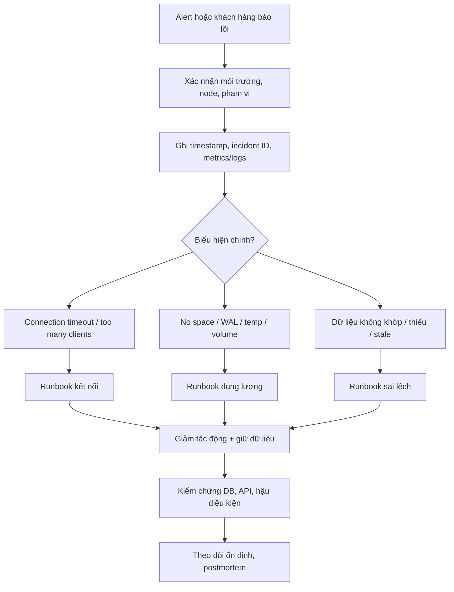

# Lập hướng dẫn xử lý hết kết nối, hết dung lượng và dữ liệu sai lệch

## 1. Vì sao cần runbook thay vì chỉ có cảnh báo?

Ứng dụng Java có thể đang hoạt động bình thường rồi đột ngột xuất hiện hàng loạt lỗi: request chờ kết nối PostgreSQL đến timeout, database báo không còn chỗ ghi WAL, hoặc khách hàng nhìn thấy tổng tiền đơn hàng không khớp với các dòng hàng. Ba biểu hiện này đều thuộc **sự cố persistence**, nhưng nguyên nhân và hành động an toàn rất khác nhau.

Nếu chỉ thấy thông báo “database lỗi” rồi tự động tăng connection pool, xóa file để lấy dung lượng hoặc sửa dữ liệu theo cảm tính, người vận hành có thể làm tình trạng tệ hơn:

- Tăng pool khi PostgreSQL đã hết connection làm số tiến trình DB và mức tranh chấp tăng.
- Xóa tệp trong `pg_wal` để lấy chỗ có thể làm database không thể phục hồi.
- Chạy `UPDATE` sửa hàng loạt khi chưa xác định nguồn dữ liệu có thẩm quyền có thể xóa bằng chứng hoặc ghi đè giao dịch đúng.
- Restart không có kế hoạch có thể làm mất trace, hủy transaction đang hoạt động và khiến nhiều instance cùng reconnect.

**Runbook** là một hướng dẫn có thể thực hiện và kiểm chứng trong sự cố: phát hiện, phân loại, giữ an toàn, chẩn đoán, giảm tác động, khôi phục, xác minh và bàn giao. Nó ghi rõ **điều kiện quyết định** chứ không chỉ liệt kê câu lệnh.

Bài này thuộc chương **Quan sát và vận hành** của **DATA_PERSISTENCE_FUNDAMENTALS**. Nội dung gắn với ranh giới persistence trong Java, lỗi kết nối, transaction và isolation, chỉ mục, durability/WAL, dữ liệu phân tán, bảo mật, sao lưu và hiệu năng. Ví dụ chủ yếu dùng PostgreSQL, JDBC, Spring Boot và HikariCP; một số thao tác phụ thuộc DBMS, phiên bản và quyền vận hành.

> **Mục tiêu:** Khi gặp **hết kết nối**, **hết dung lượng** hoặc **dữ liệu sai lệch**, người học xác định được trạng thái đáng tin, chọn biện pháp giảm tác động có điều kiện, tránh thao tác phá hủy và biết khi nào thực sự có thể tuyên bố dịch vụ đã phục hồi.

## 2. Cấu trúc bắt buộc của một runbook persistence

Một runbook hữu dụng cần được viết trước sự cố và diễn tập trên môi trường được phép:

| Mục | Câu hỏi cần trả lời | Ví dụ |
| --- | --- | --- |
| **Triệu chứng và kích hoạt** | Alert hay lỗi nào đủ để mở sự cố? | Pool pending tăng, SQLSTATE `53300`, disk còn rất ít |
| **Phạm vi** | Ảnh hưởng API, tenant, node, vùng nào? | Chỉ read replica hay cả primary ghi |
| **Bằng chứng ban đầu** | Giữ lại chỉ số/log/trace gì trước khi can thiệp? | Pool active, `pg_stat_activity`, WAL lag |
| **An toàn và quyền** | Ai được phép làm thao tác có tác động? | DBA/on-call phê duyệt kill session, storage resize, repair |
| **Điều kiện phân nhánh** | Bằng chứng nào chọn phương án A hoặc B? | Pool cạn nhưng DB còn slot hay DB đã hết slot |
| **Giảm tác động** | Cách nào giảm lỗi nhanh mà không mất dữ liệu? | Giảm concurrency, pause job, định tuyến failover hợp lệ |
| **Khôi phục căn nguyên** | Làm gì để lỗi không tái diễn? | Sửa leak, giới hạn truy vấn, giải quyết WAL retention |
| **Tiêu chí xác minh** | Thế nào là ổn định trở lại? | Kết nối thành công, ghi/đọc đúng, backlog giảm |
| **Rollback và leo thang** | Nếu biện pháp thất bại thì sao? | Hoàn tác config, chuyển sang incident commander/DBA |
| **Theo dõi sau sự cố** | Ai chịu trách nhiệm và thời hạn nào? | Điều tra truy vấn, bổ sung alert và diễn tập |

Không nên để người vận hành phải tự suy đoán “xóa gì”, “restart dịch vụ nào” hoặc “lấy dữ liệu từ đâu”. Các câu lệnh đọc ở phần sau là **gợi ý chẩn đoán**; thao tác làm thay đổi dữ liệu hay tính sẵn sàng cần áp dụng theo quyền và runbook đã được kiểm chứng, không tự động chạy trên production.

## 3. Quy trình 5 phút đầu: an toàn trước, tối ưu sau



Ngay khi xác nhận sự cố:

1. **Đặt incident ID và mốc thời gian** có múi giờ rõ ràng; ghi phiên bản ứng dụng, bản deploy/migration gần nhất, primary/replica đang liên quan.
2. **Xác định hệ có thẩm quyền:** lỗi xuất hiện tại Java pool, proxy/connection broker hay chính PostgreSQL? Dữ liệu sai đọc từ cache, replica hay primary?
3. **Giữ bằng chứng:** snapshot dashboard theo thời gian, log đã che thông tin nhạy cảm, error codes, query fingerprints, transaction/operation IDs, trạng thái replication, backup/WAL. Không chỉnh sửa/xóa bằng chứng trước khi có bản lưu phù hợp.
4. **Khoanh miền tác động:** một API, một tenant, toàn bộ thao tác ghi hay chỉ màn hình đọc? Một node đĩa đầy hay toàn cluster?
5. **Giảm lưu lượng gây hại bằng biện pháp có thể đảo ngược:** giới hạn retry, pause import/background worker, chuyển UI sang read-only nếu được phê duyệt; không để hệ thống liên tục gửi ghi lỗi.
6. **Chỉ chọn hành động khi có dấu hiệu:** đừng tăng `max_connections`, xóa WAL, reset cluster hoặc repair dữ liệu theo lời đồn.

Nếu có dấu hiệu **mất dữ liệu, hỏng file vật lý hoặc ghi không nhất quán**, ưu tiên bảo toàn bằng chứng và các nguồn phục hồi trước khi thử các thao tác tác động rộng. Với tình huống hết dung lượng khẩn cấp, quyết định cũng phải tính tới khả năng database cần thêm chỗ để thực hiện recovery/checkpoint.

## 4. Phân biệt ba nhóm sự cố qua dấu hiệu

| Triệu chứng | Ví dụ tín hiệu | Chẩn đoán sơ bộ | Không nên kết luận vội |
| --- | --- | --- | --- |
| **Hết kết nối** | Hikari chờ connection timeout, SQLSTATE `53300` | Pool cạn, DB hết slot, proxy giới hạn, network | Tăng pool sẽ giải quyết |
| **Hết dung lượng** | “No space left on device”, SQLSTATE `53100`, WAL/archive tăng | Volume/inode/quota đầy, WAL retention, temp files, tăng dữ liệu | Xóa `pg_wal` là an toàn |
| **Dữ liệu sai lệch** | API báo đơn thiếu, tổng tiền sai, số liệu cache khác DB | Replica lag, cache stale, ghi chưa commit, migration/dual write lỗi, dữ liệu thật sai | Chỉ cần retry SELECT hoặc sửa ngay hàng DB |

Các mã lỗi chỉ là **dấu hiệu theo ngữ cảnh**, không là phép chẩn đoán hoàn chỉnh:

- PostgreSQL `53300` (`too_many_connections`) chỉ rõ server từ chối do giới hạn kết nối ở thời điểm đó.
- `53100` (`disk_full`) là lỗi thiếu chỗ trên thiết bị liên quan một thao tác; cũng có thể có lỗi quota/tệp/hệ thống khác.
- Các SQLSTATE lớp `08` mô tả vấn đề kết nối nói chung; không chứng minh DB đã hết slot.
- Timeout lấy kết nối từ HikariCP có thể xảy ra khi pool **đang có đầy connection bận**, ngay cả khi PostgreSQL vẫn còn nhiều connection trống.
- `40001` (serialization failure) hoặc `40P01` (deadlock) không phải thông báo “hết kết nối”; chúng cần quy tắc retry toàn transaction phù hợp.

## 5. Thiết lập quan sát ở ba tầng: Java, database và hạ tầng

Một alert tốt cho persistence cần liên hệ **request ↔ pool ↔ session DB ↔ storage**.

| Tầng | Chỉ số/trace nên quan sát | Tác dụng |
| --- | --- | --- |
| Java API | Error rate theo endpoint, p50/p95/p99, retry, request concurrency | Xác định người dùng và đường đi bị ảnh hưởng |
| HikariCP | Active, idle, total, pending, acquire time, timeout count | Phân biệt pool bận, pool leak và DB/network |
| PostgreSQL sessions | `numbackends`, `pg_stat_activity`, state, wait event, tuổi transaction | Phát hiện phiên dài, query chậm và nhóm client chiếm slot |
| PostgreSQL locks | Blocked sessions, blockers, lock wait | Phát hiện connection bị giữ vì khóa |
| PostgreSQL storage | Dung lượng volume, inode, WAL, temp, tốc độ tăng | Tìm nguyên nhân chiếm chỗ thay vì xóa ngẫu nhiên |
| PostgreSQL replication | Send/write/flush/replay LSN, slot retention, archive failures | Phân biệt lag và WAL bị giữ |
| Data correctness | Chênh lệch invariant, cache version, outbox backlog, error từ batch/migration | Phát hiện sai dữ liệu và độ trễ đồng bộ |
| Recovery | Backup/restore drill, RPO/RTO, khả năng truy cập WAL | Quyết định mức rủi ro trước khi sửa/hủy |

Các tên metric Hikari/Micrometer thay đổi theo registry, phiên bản và chuẩn xuất. Ví dụ thường gặp là `hikaricp.connections.active`, `hikaricp.connections.pending` hoặc tên được biến đổi khi xuất Prometheus; hãy xác nhận tên thực trong ứng dụng thay vì tạo alert trên tên đoán.

**Không gắn `userId`, `orderId` hoặc SQL text đầy đủ làm label metric** vì tạo cardinality rất cao và có thể lộ dữ liệu. Dùng service, pool, role, endpoint/mẫu query được chuẩn hóa, nhóm SQLSTATE và zone; lưu ID chi tiết trong trace/log có giới hạn quyền.

## 6. Runbook A — Hết kết nối: bắt đầu từ pool hay PostgreSQL?

### A1. Nhận diện và phân loại

Triệu chứng phía Java có thể là:

```text
SQLTransientConnectionException:
  HikariPool - Connection is not available,
  request timed out after ... ms.

PostgreSQL server log:
  FATAL: sorry, too many clients already
```

Hai thông báo có thể xuất hiện cùng lúc, nhưng cũng có thể **chỉ có một**. Vì vậy runbook đầu tiên kiểm tra:

1. Số connection đang được dùng, rảnh và đang chờ tại **từng instance Java**.
2. Timeout lấy connection khác gì timeout thực thi SQL và timeout kết nối TCP.
3. PostgreSQL còn slot theo cấu hình hay đã chạm giới hạn dành cho loại role này?
4. Có query chậm, transaction mở lâu, connection leak hoặc burst traffic không?
5. Lỗi có trùng thời điểm deploy, scale-out, migration hay batch job không?

### A2. Kiểm tra giới hạn server và hoạt động session (chỉ đọc)

```sql
SHOW max_connections;
SHOW superuser_reserved_connections;

SELECT COUNT(*) AS all_backends,
       COUNT(*) FILTER (WHERE backend_type = 'client backend')
           AS client_backends
FROM pg_stat_activity;

SELECT application_name,
       usename,
       state,
       COUNT(*) AS sessions
FROM pg_stat_activity
WHERE backend_type = 'client backend'
GROUP BY application_name, usename, state
ORDER BY sessions DESC;
```

`max_connections` không phải số slot ứng dụng được phép dùng hết; PostgreSQL dành một số slot cho các vai trò đặc biệt/khôi phục quản trị và ở phiên bản mới có thể có thêm `reserved_connections`. Ngoài ra còn có backend nội bộ và giới hạn ngoài DB (proxy/service provider). **Không trừ các chỉ số theo một công thức cố định cho mọi phiên bản** mà chưa đọc cấu hình thực tế.

`pg_stat_activity` thường cho thấy số session và trạng thái, nhưng quyền xem nội dung truy vấn/session của role khác có thể bị giới hạn. Dùng role quan sát phù hợp, không cấp superuser rộng chỉ để có một dashboard.

### A3. Tìm transaction lâu và query đang chờ

```sql
SELECT pid,
       application_name,
       usename,
       state,
       wait_event_type,
       wait_event,
       now() - xact_start AS transaction_age,
       now() - query_start AS query_age,
       pg_blocking_pids(pid) AS blocking_pids
FROM pg_stat_activity
WHERE backend_type = 'client backend'
  AND (state = 'active' OR state LIKE 'idle in transaction%')
ORDER BY xact_start NULLS LAST, query_start NULLS LAST
LIMIT 50;
```

Một session `idle in transaction` giữ transaction/snapshot và có thể giữ lock, làm VACUUM bị cản trở và khiến pool connection lâu được giải phóng. Tuy nhiên trạng thái `idle` không tự là lỗi: Hikari có thể giữ kết nối rảnh để tái sử dụng. **Không tiêu diệt mọi session idle** nếu pool đang hoạt động đúng.

`query_age` khi session không active có thể biểu thị thời gian từ câu query gần nhất, không đồng nghĩa query đang chạy lâu. Muốn tìm truy vấn chậm đang thực thi, lọc `state = 'active'` và kết hợp `wait_event`, query fingerprints, CPU/I/O, lock graph.

### A4. Nhận biết các nhánh nguyên nhân

| Bằng chứng | Nguyên nhân có khả năng | Cách giảm tác động hợp lý |
| --- | --- | --- |
| Hikari `active ≈ maximumPoolSize`, `pending > 0`; DB còn slot | Query/transaction quá lâu hoặc pool không đủ so với concurrency | Giới hạn request/job, tìm span SQL lâu, đóng connection đúng; cân nhắc điều chỉnh pool theo ngân sách |
| Hikari `total` chưa đạt max nhưng tạo connection thất bại; PostgreSQL báo `53300` | Database hết slot hoặc proxy giới hạn | Giảm tổng pool/instance, ngừng job ít quan trọng, kiểm tra client tăng bất thường |
| Rất nhiều `idle in transaction` cùng application name | Code giữ transaction mở hoặc lỗi lifecycle | Xác định request/batch, sửa đường giữ transaction; xử lý từng session có phê duyệt |
| Nhiều active query chờ lock cùng blocker | Lock contention, DDL chờ khóa, transaction dài | Xem blocker, dừng/rollback tác vụ gốc nếu an toàn; không chỉ tăng pool |
| Pool tăng sau deploy/scale-out | Mỗi instance mở pool mới; tổng connection tăng theo số instance | Xác định số pool × instances + worker + headroom |
| Pool pending tăng nhưng DB không có session tương ứng | Network, proxy, auth, TLS, DNS, failover, DB không nhận connect | Kiểm tra log/connectivity, không tự suy kết nối cạn |

**Đánh giá ngân sách connection:** với 6 instance API, mỗi pool tối đa 20 thì **riêng API có thể dùng tới 120 connections**; cộng scheduler, consumer, migration, DBA và monitoring. Không để tổng cấu hình tiến sát `max_connections` đến mức không còn chỗ cho khôi phục hay thao tác quản trị. Phân bổ headroom theo các giới hạn thực tế của cluster.

### A5. Hành động giảm tác động theo mức an toàn

Thứ tự ưu tiên thường hợp lý:

1. **Giảm nguồn tải gây hại:** giới hạn concurrency, pause import/report nặng, đặt retry budget và backoff có jitter; tránh mọi instance reconnect cùng lúc.
2. **Khôi phục đường đọc/ghi có kiểm soát:** đảm bảo router trỏ đúng primary sau failover, kiểm tra pool không giữ connection cũ bị chết; reset/recycle pool theo quy trình đã kiểm thử, không restart toàn bộ instance đồng thời.
3. **Xử lý transaction bị treo theo PID cụ thể:** nhận diện owner, tuổi, query, lock, rủi ro rollback. Có thể dùng cancel query hoặc terminate session khi được phê duyệt; thao tác này **có thể làm transaction rollback, hủy công việc và ảnh hưởng client**.
4. **Sửa nguyên nhân mã nguồn:** connection leak, gọi DB trong vòng lặp, HTTP call trong transaction, pool cấu hình quá lớn, thiếu timeout hoặc transaction không đóng.
5. **Điều chỉnh giới hạn nếu có cơ sở:** tăng pool/`max_connections` không phải cứu cánh; phải đo RAM mỗi backend, CPU, lock và ngân sách connection. Một số cấu hình cần restart DB và có thể gây downtime.

**Cấm thao tác mù:** không chạy hàng loạt `pg_terminate_backend` theo trạng thái “idle” hay tăng `max_connections` vô hạn. Khi cần chặn một query thực sự gây hại, ghi PID, application name, owner, tác động dự kiến, người phê duyệt và hậu kiểm.

### A6. Kiểm chứng đã phục hồi

- Tỷ lệ timeout lấy connection giảm về mức chấp nhận trong **một khoảng quan sát đủ dài**, không chỉ một request thành công.
- `pending` ổn định, pool active/idle hợp lý, không có xu hướng tăng không giới hạn.
- Số DB client connections có headroom cho cả tác vụ quản trị; không xuất hiện `53300` mới.
- API ghi/đọc bằng một operation ID thử nghiệm hợp lệ, transaction commit đúng, không có retry trùng.
- Query latency và lock wait trở về ngưỡng, các job tạm dừng được mở lại từng bước.

## 7. Ví dụ Java: giữ connection trong ranh giới ngắn

Một nguyên nhân phổ biến của pool exhaustion là lấy connection rồi giữ trong lúc gọi HTTP, xử lý file hoặc chờ queue. Ví dụ **không nên làm**:

```java
// MINH HỌA LỖI: giữ connection trong lúc gọi hệ thống ngoài.
try (java.sql.Connection c = dataSource.getConnection()) {
    c.setAutoCommit(false);
    updateOrder(c, orderId);
    paymentClient.callRemoteProvider(orderId); // Có thể treo nhiều giây.
    c.commit();
}
```

Nếu remote provider chậm, transaction giữ connection và có thể giữ lock. Khi nhiều request cùng tới, pool bị chiếm hết. Ngoài ra, `commit` DB không đồng bộ nguyên tử với một thao tác ngoài hệ thống.

Một thiết kế tốt hơn thường phân tách transaction DB với side effect thông qua **outbox**:

```mermaid
sequenceDiagram
    participant A as API
    participant D as Database
    participant W as Outbox worker
    participant P as External service
    A->>D: BEGIN; ghi order + outbox
    A->>D: COMMIT; trả connection
    D-->>A: Commit result
    W->>D: Lấy event đã commit
    W->>P: Gửi với idempotency key
    P-->>W: Xác nhận
    W->>D: Đánh dấu processed / retry nếu cần
```

Outbox cần retry/idempotency và cơ chế xử lý event trùng; nó không tự bảo đảm gửi đúng một lần xuyên DB và mạng. Dù vậy, nó giúp giảm thời gian giữ connection của request và cho phép quản lý hậu quả của giao dịch với hệ ngoài có chủ đích.

Ví dụ sử dụng JDBC an toàn về lifecycle:

```java
import java.sql.Connection;
import java.sql.PreparedStatement;
import java.sql.SQLException;
import java.util.UUID;
import javax.sql.DataSource;

public final class OrderStatusRepository {
    private final DataSource dataSource;

    public OrderStatusRepository(DataSource dataSource) {
        this.dataSource = dataSource;
    }

    public int changeStatus(UUID tenantId, UUID orderId, String nextStatus)
            throws SQLException {
        if (tenantId == null || orderId == null || nextStatus == null) {
            throw new IllegalArgumentException("Invalid command");
        }
        String sql = """
            UPDATE ops_orders
            SET status = ?, version = version + 1
            WHERE tenant_id = ? AND id = ?
            """;
        try (Connection c = dataSource.getConnection();
             PreparedStatement st = c.prepareStatement(sql)) {
            st.setString(1, nextStatus);
            st.setObject(2, tenantId);
            st.setObject(3, orderId);
            return st.executeUpdate();
        }
    }
}
```

Đoạn này minh họa **try-with-resources** để trả connection về pool sau câu lệnh. Với JDBC auto-commit mặc định, một `UPDATE` đơn thường được commit theo cấu hình connection; trong ứng dụng thực, cần ranh giới transaction đúng nếu còn outbox hoặc nhiều bảng liên quan. Không dùng đoạn mã ngắn này thay cho use case transaction hoàn chỉnh.

## 8. Cấu hình HikariCP: timeout không phải chỉ số sức khỏe duy nhất

Ví dụ cấu hình Spring Boot mang tính minh họa:

```properties
spring.datasource.hikari.maximum-pool-size=12
spring.datasource.hikari.minimum-idle=4
spring.datasource.hikari.connection-timeout=3000
spring.datasource.hikari.validation-timeout=1000
spring.datasource.hikari.max-lifetime=1800000
```

Không sao chép các giá trị này sang production mà không đo đạc. Cần tính tổng số instance, connection limit của DB/proxy, workload và tài nguyên. `max-lifetime` cần phối hợp với timeout đóng connection của network/proxy/DB và có thể có các yếu tố cấu hình khác; `connection-timeout` là thời gian chờ **lấy connection từ pool**, không phải timeout của mọi câu SQL.

Những loại timeout cần phân biệt:

| Timeout/giới hạn | Phạm vi | Hệ quả |
| --- | --- | --- |
| Pool acquisition timeout | Đợi có `Connection` | Request không lấy được connection, chưa chắc SQL đã chạy |
| Connect/socket timeout | Thiết lập kết nối/truyền dữ liệu | Có thể xuất hiện khi DB/network/failover lỗi |
| PostgreSQL `statement_timeout` | Thời gian thực thi statement theo cấu hình | Statement bị hủy; transaction có thể phải rollback |
| PostgreSQL `lock_timeout` | Thời gian chờ lấy khóa | Giảm nguy cơ DDL/query chờ khóa quá lâu |
| `idle_in_transaction_session_timeout` | Session giữ transaction nhưng không làm việc | Có thể cắt session và rollback transaction còn mở |
| Tổng deadline request | Thời gian API có thể chờ | Cần phối hợp mọi tầng để tránh request hết hạn nhưng DB vẫn xử lý |

Timeout không thay thế cleanup: code vẫn phải đóng tài nguyên, ngừng retry không giới hạn và xử lý **commit outcome chưa rõ** khi mất phản hồi sau `COMMIT`.

## 9. Runbook B — Hết dung lượng: phân biệt data, WAL, temp và backup

### B1. Nhận diện nơi thực sự đầy

“Disk full” có thể là nhiều điều khác nhau:

- Volume chứa bảng/index (`PGDATA` hoặc tablespace) không còn block trống.
- Volume chứa `pg_wal` đầy do WAL tăng nhanh hoặc bị giữ quá lâu.
- Volume log/temporary files đầy; truy vấn sort/hash lớn tạo nhiều temp file.
- Kho lưu WAL archive/backup đầy hoặc không ghi được, làm queue lưu trữ/phục hồi bị ảnh hưởng.
- **Hết inode** dù vẫn còn byte trống.
- Quota hoặc giới hạn dịch vụ managed database đã chạm ngưỡng, không nhất thiết do filesystem local thật sự hết.

Lúc cảnh báo xuất hiện, ghi rõ **thiết bị/volume/quota nào**, mức sử dụng, tốc độ tăng, thời điểm dự kiến chạm giới hạn, tác vụ vừa chạy, và database có còn nhận ghi hay không.

Trên máy Linux tự quản lý, các lệnh **chỉ đọc** có thể hỗ trợ:

```bash
# Chỉ kiểm tra trên host/namespace được phép; đường dẫn tùy triển khai.
df -h
df -i

# Xem các thư mục lớn khi đã xác minh đường dẫn và quyền:
du -sh /var/lib/postgresql/* 2>/dev/null
```

Với PostgreSQL managed service, thay bằng dashboard dung lượng, storage metrics và công cụ được nhà cung cấp hỗ trợ. **Không tự thao tác file bên trong data directory của dịch vụ quản lý**.

### B2. Quan sát kích thước database và bảng (SQL đọc)

```sql
SELECT current_database() AS database_name,
       pg_size_pretty(pg_database_size(current_database()))
           AS database_size;

SELECT n.nspname AS schema_name,
       c.relname AS relation_name,
       pg_size_pretty(pg_total_relation_size(c.oid)) AS total_size,
       pg_size_pretty(pg_relation_size(c.oid)) AS table_bytes
FROM pg_class AS c
JOIN pg_namespace AS n ON n.oid = c.relnamespace
WHERE c.relkind IN ('r', 'm')
  AND n.nspname NOT IN ('pg_catalog', 'information_schema')
ORDER BY pg_total_relation_size(c.oid) DESC
LIMIT 20;
```

`pg_database_size` không đại diện đầy đủ cho mọi dữ liệu cluster/volume, ví dụ WAL và log hệ thống có thể nằm ngoài phần dữ liệu database được đo. Một database nhỏ không chứng minh `pg_wal` còn chỗ. Quan sát kích thước trong SQL cần kết hợp thông tin volume.

### B3. Kiểm tra WAL archiving và replication slot

```sql
SELECT archived_count,
       last_archived_wal,
       last_archived_time,
       failed_count,
       last_failed_wal,
       last_failed_time,
       stats_reset
FROM pg_stat_archiver;

SELECT slot_name,
       slot_type,
       active,
       restart_lsn,
       CASE WHEN restart_lsn IS NOT NULL THEN
           pg_size_pretty(
               pg_wal_lsn_diff(pg_current_wal_lsn(), restart_lsn)::bigint)
       END AS approximate_retained_wal
FROM pg_replication_slots;
```

Giá trị `approximate_retained_wal` là **chênh lệch LSN tham khảo trên primary**, không phải phép đo chính xác số byte file WAL riêng do từng slot giữ. Các slot dùng chung đoạn WAL, checkpoint, archive, cơ chế recycle, giới hạn retention và các chính sách khác đều ảnh hưởng dung lượng thực tế. Không cộng số byte “retained” của mọi slot để ra tổng WAL trên đĩa.

Các câu hỏi điều tra:

1. `archive_command` có thất bại liên tục không? Kho đích có đủ dung lượng và quyền ghi không?
2. Có replication slot **inactive** nhưng `restart_lsn` rất cũ không?
3. Replica có bị lag do network, I/O, replay hoặc đang dừng không?
4. Có tác vụ nhập dữ liệu/backfill/index làm WAL tăng đột biến không?
5. Có logical replication/CDC subscriber không còn tiêu thụ, khiến slot giữ log?

**Không drop slot bừa**: slot có thể bảo vệ follower/CDC; xóa slot có thể khiến consumer **không còn log để bắt kịp**, cần tái đồng bộ hoặc mất khả năng phục hồi theo kế hoạch. Tương tự, không tự tắt archiving để “nhanh giải phóng WAL” khi chưa chấp nhận hệ quả RPO/PITR.

### B4. Phân biệt temp file, log và dữ liệu phình to

```sql
SELECT datname,
       temp_files,
       pg_size_pretty(temp_bytes) AS total_temp_bytes_since_reset,
       deadlocks,
       stats_reset
FROM pg_stat_database
WHERE datname = current_database();

SHOW temp_file_limit;
SHOW work_mem;
SHOW maintenance_work_mem;
```

`temp_bytes` là thống kê tích lũy kể từ `stats_reset`, **không phải số byte temp file đang tồn tại ngay lúc này**. Muốn biết vấn đề tức thời, kết hợp host/provider storage metrics, query plan, logging temp file (nếu đã cấu hình phù hợp) và các câu query đang chạy.

Đừng tăng `work_mem` hàng loạt chỉ vì một truy vấn sort chậm. Nó có thể được dùng cho **nhiều thao tác trong cùng query và nhiều query đồng thời**, khiến tổng memory tăng mạnh. `VACUUM FULL` hoặc rebuild index có thể yêu cầu **thêm** dung lượng và khóa mạnh; không phải giải pháp đầu tiên khi volume gần như đầy.

### B5. Giảm tác động khi disk sắp hết

Ưu tiên theo mức độ an toàn, quyền và bằng chứng:

1. **Ngừng nguồn tăng trưởng không thiết yếu**: pause bulk import, job tạo report/temp lớn, batch backfill hoặc consumer nếu việc tạm dừng không làm mất dữ liệu và đã xét backlog.
2. **Khôi phục dung lượng bằng hạ tầng được hỗ trợ**: tăng dung lượng volume/quota hoặc chuyển workload qua topology dự phòng có kiểm chứng; phải bảo đảm nhà cung cấp hỗ trợ resize online và cân nhắc hiệu năng/cost.
3. **Giải quyết nguyên nhân retention**: phục hồi WAL archive, sửa kết nối replica/CDC, cho subscriber bắt kịp; không xóa log cần cho PITR/recovery.
4. **Dọn những dữ liệu không thuộc DB và được chứng minh an toàn** theo retention, ví dụ file tạm của một job đã kết thúc nằm ngoài `PGDATA`; cần xác minh owner và quyền.
5. **Thực hiện retention/archive/partition management đúng quy trình** sau khi có backup/approval, tránh drop bảng/partition chứa dữ liệu cần giữ.
6. **Theo dõi liên tục**: free bytes, WAL tăng hay giảm, archive success, replica lag, transaction failure và tốc độ khôi phục.

**Tuyệt đối không xóa thủ công file trong `pg_wal`, data files, control files hoặc tệp tablespace đang dùng để lấy chỗ**. Việc này có thể khiến PostgreSQL không khởi động hoặc phục hồi được. Với lỗi hết dung lượng nghiêm trọng, hãy leo thang DBA/storage on-call; hành động đúng phụ thuộc cách đặt volume và trạng thái WAL/checkpoint.

### B6. Kiểm chứng khi đã có chỗ

- Volume còn headroom đủ cho **đỉnh tải dự kiến**, không chỉ trống vài MB trong vài giây.
- WAL archiving hoạt động lại và backlog đã giảm/ổn định; retention không còn tăng không kiểm soát.
- Replica/CDC bắt kịp theo hợp đồng, không có slot mới bị bỏ mặc.
- Transaction ghi test thành công; DB có thể checkpoint/flush và restart/recover theo quy trình kiểm thử.
- Kiểm tra backup/PITR vẫn đạt mục tiêu sau các thay đổi archive/slot.
- Tỷ lệ lỗi `53100` và lỗi ghi giảm, các job chỉ mở lại theo thứ tự có kiểm soát.

## 10. Runbook C — Dữ liệu sai lệch: trước hết tìm nguồn có thẩm quyền

“Sai lệch” có nhiều loại:

| Loại | Ví dụ | Bản chất |
| --- | --- | --- |
| **Read replica lag** | POST đơn thành công, GET từ replica trả 404 | Bản sao đọc chưa apply commit |
| **Cache stale** | DB giá mới nhưng Redis vẫn có giá cũ | Bản sao dữ liệu cache chưa invalidate/refresh đúng |
| **Projection/CDC lag** | Bảng nghiệp vụ đúng, search index/outbox-derived view thiếu bản ghi | Pipeline cập nhật bất đồng bộ chưa bắt kịp |
| **Commit outcome chưa rõ** | Kết nối đứt sau `COMMIT`, client retry bằng ID mới | Có thể tạo hai thao tác cùng ý định |
| **Lỗi nghiệp vụ đã commit** | Tổng đơn không khớp dòng hàng, thiếu FK do đường ghi sai | Dữ liệu nguồn thực sự không thỏa bất biến |
| **Migration/backfill lỗi** | Một phần tenant được chuyển schema, phần khác chưa | Không tương thích mã/schema/dữ liệu lịch sử |
| **Hỏng dữ liệu vật lý** | Checksum/page read error, không đọc được bảng | Cần điều tra storage/backup/recovery, không chỉ UPDATE |

Không dùng cùng một biện pháp cho tất cả. **Đọc lại primary** có thể giải thích replica lag, nhưng không sửa tổng tiền thật đã được ghi sai. **Invalidate Redis** sửa stale cache, nhưng không khôi phục một hàng đã bị xóa khỏi primary.

### C1. Đặt câu hỏi theo thứ tự

1. **Hợp đồng dữ liệu là gì?** Bất biến nào được cho là bị vi phạm: hàng thiếu, tiền sai, status không hợp lệ, cache chậm?
2. **Nguồn đáng tin ở đâu?** Primary, ledger, log giao dịch, object storage, hệ thanh toán, backup/PITR hay dữ liệu đầu vào được ký/xác minh?
3. **Bản đọc hiện tại đến từ đâu?** Primary, replica nào, cache key/version nào, search index nào?
4. **Sai lệch xảy ra từ khi nào?** Sau deploy, migration, restore/failover, thay đổi read routing, consumer ngừng?
5. **Có giao dịch mới đang sửa cùng dữ liệu không?** Nếu có, cần cách lấy snapshot/lock/version phù hợp để không chẩn đoán từ ảnh dữ liệu lẫn nhiều thời điểm.
6. **Phạm vi là bao nhiêu?** Một operation ID, một tenant, một partition, mọi request hay chỉ một aggregate?

Khi chưa xác định nguồn có thẩm quyền, **không chạy script repair hàng loạt**. Trước hết chặn đường ghi lỗi mới theo cách có thể đảo ngược và lưu bằng chứng.

### C2. Tìm hiểu lag của PostgreSQL replica

Trên primary:

```sql
SELECT application_name,
       state,
       sync_state,
       sent_lsn,
       write_lsn,
       flush_lsn,
       replay_lsn
FROM pg_stat_replication;
```

Trên standby:

```sql
SELECT pg_is_in_recovery(),
       pg_last_wal_receive_lsn(),
       pg_last_wal_replay_lsn(),
       pg_last_xact_replay_timestamp();
```

Phân biệt **receive/write/flush/replay**: đã nhận WAL chưa chắc đã apply để `SELECT` thấy dữ liệu. `pg_last_xact_replay_timestamp()` là thời điểm replay transaction gần nhất và có thể cũ khi primary không có giao dịch mới; không coi chênh lệch hiện tại với timestamp đó luôn là “số giây lag thực”.

Nếu yêu cầu **read-your-writes**, định tuyến đọc tới primary hiện tại hoặc chờ replica đạt commit watermark/LSN phù hợp nếu nền tảng hỗ trợ. Không tăng isolation level trên một replica chưa bắt kịp rồi mong kết quả tự mới hơn.

### C3. Kiểm tra cache/projection/outbox

Với một bản ghi sai lệch:

- So sánh **business ID + tenant + version** giữa primary và cache, không chỉ giá trị một field.
- Kiểm tra mốc DB commit, event outbox đã commit, thời điểm event được xử lý, số lần retry và dead-letter.
- Xác minh invalidation/refresh chỉ dựa trên dữ liệu đã commit; event cũ đến muộn không được ghi đè dữ liệu mới nếu dùng cache put.
- Xác định cache key phụ thuộc: detail, list, negative cache, search view; xóa một key chi tiết có thể chưa đủ.
- Nếu có version fence, kiểm tra thao tác compare-and-set ở cache là **nguyên tử** và không tự nhận một entry cũ sau evict.

**Outbox có thể làm mất tín hiệu đồng bộ ít khả năng hơn qua crash**, nhưng xử lý bất đồng bộ vẫn có delay. Đừng báo dữ liệu nguồn hỏng chỉ vì read model chưa bắt kịp trong một khoảng đã được hợp đồng cho phép.

## 11. Ví dụ kiểm tra dữ liệu nguồn bằng SQL bất biến

Giả sử hệ thống đặt hàng có hai bảng trong **môi trường kiểm thử**:

```sql
CREATE TABLE ops_orders (
    tenant_id UUID NOT NULL,
    id UUID NOT NULL,
    status TEXT NOT NULL,
    total NUMERIC(18, 2) NOT NULL CHECK (total >= 0),
    version BIGINT NOT NULL DEFAULT 1,
    PRIMARY KEY (tenant_id, id)
);

CREATE TABLE ops_order_lines (
    tenant_id UUID NOT NULL,
    id UUID NOT NULL,
    order_id UUID NOT NULL,
    quantity INTEGER NOT NULL CHECK (quantity > 0),
    unit_price NUMERIC(18, 2) NOT NULL CHECK (unit_price >= 0),
    PRIMARY KEY (tenant_id, id),
    FOREIGN KEY (tenant_id, order_id)
      REFERENCES ops_orders(tenant_id, id)
);
```

**Giả định nghiệp vụ riêng của ví dụ:** `ops_orders.total` bằng tổng `quantity × unit_price` của dòng hàng; không có thuế, phí vận chuyển, giảm giá hay hoàn tiền. Trong hệ thống thật, phải viết đúng công thức nghiệp vụ (bao gồm discount, tax, rounding, currency và trạng thái refund) trước khi dùng truy vấn để kết luận dữ liệu sai.

Truy vấn chỉ đọc để tìm đơn lệch:

```sql
WITH line_totals AS (
    SELECT tenant_id,
           order_id,
           SUM(quantity::numeric * unit_price) AS expected_total
    FROM ops_order_lines
    GROUP BY tenant_id, order_id
)
SELECT o.tenant_id,
       o.id AS order_id,
       o.total AS stored_total,
       COALESCE(l.expected_total, 0) AS calculated_total,
       o.version
FROM ops_orders AS o
LEFT JOIN line_totals AS l
       ON l.tenant_id = o.tenant_id
      AND l.order_id = o.id
WHERE o.total IS DISTINCT FROM COALESCE(l.expected_total, 0)
ORDER BY o.tenant_id, o.id
LIMIT 100;
```

**Phạm vi truy vấn:** ví dụ này quét/tổng hợp toàn bộ bảng con; trên production lớn, cần lọc tenant/khoảng thời gian/ID và đánh giá plan để không gây thêm sự cố hiệu năng. Một phép so ở hai statement/nguồn khác nhau có thể nhìn thấy hai snapshot khác thời điểm. Khi cần một điểm so nhất quán, dùng một transaction snapshot thích hợp và xác định rõ nguồn đọc.

Đừng tự `UPDATE total = calculated_total` cho mọi dòng chênh chỉ vì SQL trả kết quả. Có thể **dòng hàng mới bị ghi sai**, còn total đúng theo ledger đã xác nhận. Repair phải dựa trên một nguồn đối soát có thẩm quyền và quyết định nghiệp vụ.

### Phân biệt sai logic và vi phạm constraint

Một bảng có `CHECK (total >= 0)` vẫn có thể lưu tổng `100` trong khi các dòng cộng lại `120`: mỗi hàng tự nó hợp lệ, nhưng **bất biến xuyên nhiều hàng** bị sai. Constraint thông thường trên từng hàng không tự bảo vệ mọi aggregate nhiều bảng.

Nếu một use case cần giữ total đúng, cân nhắc tính trong một transaction có đồng bộ thích hợp, dùng cập nhật có điều kiện/khóa, hoặc thiết kế mô hình tính total từ source. Việc kiểm thử đồng thời và hậu kiểm đối soát giúp phát hiện những bất biến mà schema chưa diễn đạt đầy đủ.

## 12. Quy trình sửa dữ liệu: đóng băng phạm vi nhỏ, đối soát rồi mới ghi

Một **repair script** cần có **bằng chứng và cơ chế đảo ngược/khôi phục**:

1. **Dừng nguồn sai lệch tiếp diễn**: tạm dừng worker/migration/version lỗi, chặn một hành vi ghi cụ thể; không tự ngắt toàn dịch vụ nếu có lựa chọn giảm phạm vi.
2. **Chụp bằng chứng**: operation ID, tenant, bản ghi trước sửa, WAL/log liên quan, nguồn đối soát, bản backup; ghi lý do và người phê duyệt.
3. **Xác định expected state** từ nghiệp vụ/ledger/nguồn đáng tin, không từ bản cache hoặc replica còn stale.
4. **Dry-run**: SELECT đúng những ID sẽ sửa, số hàng, version hiện tại, dữ liệu liên quan; chạy ở môi trường test/restore nếu có thể.
5. **Giao dịch repair**: giới hạn bằng khóa nghiệp vụ/tenant/version; không ghi đè khi concurrent writer đã thay đổi row.
6. **Đối chiếu hậu điều kiện**: kiểm tra tổng tiền/bất biến/row count sau commit, cả read path và projection cần refresh.
7. **Theo dõi và ghi audit**: sửa gì, bởi ai, lúc nào, vì sao, backup nào, kết quả nào; có phương án hoàn tác hoặc khôi phục có chọn lọc.

Ví dụ **minh họa cú pháp**, tuyệt đối không dùng các tham số giả để thay đổi production:

```sql
-- Trên môi trường diễn tập riêng, sau khi giá trị đã được đối soát.
BEGIN;
SET LOCAL lock_timeout = '3s';
SET LOCAL statement_timeout = '10s';

SELECT tenant_id, id, total, version
FROM ops_orders
WHERE tenant_id = :approved_tenant_id
  AND id = :approved_order_id
FOR UPDATE;

UPDATE ops_orders
SET total = :verified_total,
    version = version + 1
WHERE tenant_id = :approved_tenant_id
  AND id = :approved_order_id
  AND version = :expected_version
RETURNING tenant_id, id, total, version;

-- Chỉ COMMIT khi đúng 1 hàng, đúng giá trị, đúng giao dịch,
-- và đã xác định không làm lệch hệ khác.
-- Nếu không đạt điều kiện: ROLLBACK.
COMMIT;
```

Các placeholder `:...` biểu thị **named parameters** của công cụ/thư viện, không phải cú pháp nguyên gốc của `psql`; khi dùng JDBC `PreparedStatement` phải chuyển thành `?` và bind từng giá trị. Câu `COMMIT` trong mẫu **chỉ dành cho diễn tập sau khi kiểm chứng**, không thể thay thế sự phê duyệt kỹ thuật và nghiệp vụ trong tình huống thật.

Nếu `UPDATE` trả 0 hàng, có thể version đã thay đổi; không được bỏ điều kiện version để “ép script chạy được”. Nếu DB commit xong rồi ứng dụng mất kết nối, outcome sửa có thể chưa rõ; tra cứu theo audit/operation ID trước khi retry một thao tác có side effect.

## 13. Sự cố dữ liệu sau deploy, migration hoặc failover

Ba dấu hiệu thường bị nhầm:

**Sai schema hoặc migration chưa đồng bộ.** Bản Java mới đọc cột chưa tồn tại hoặc viết enum không hợp lệ. SQLSTATE có thể là lỗi cú pháp/column/constraint, không đồng nghĩa database đã mất hàng. Cần kiểm tra migration version thực, rolling deploy, writer cũ và tương thích expand–migrate–contract.

**Failover với replication bất đồng bộ.** Primary cũ đã ACK một số transaction mà replica được promote chưa có. Bản ghi trên leader mới “biến mất” không nhất thiết do query sai; cần đối chiếu operation IDs đã ACK, WAL/LSN/timeline và cam kết RPO. **Không tự đưa primary cũ trở lại nhận ghi** nếu nó có thể chứa lịch sử phân nhánh — cần quy trình fencing/rejoin và reconciliation.

**Cache hoặc replica vẫn nhìn snapshot cũ.** DB primary đúng nhưng GET qua read replica/cache trả phiên bản thấp hơn. Dùng route có bảo đảm độ mới/read-your-writes thay vì chạy repair lên bảng đang đúng.

Khi có **lỗi storage vật lý**, như page corruption, không dùng script UPDATE để chữa các file hỏng. Cần DBA/storage incident, giữ log/backup và áp dụng quy trình phục hồi được DBMS hỗ trợ; replica có thể sao chép sai lệch logic nhưng không tự là bản backup lịch sử.

## 14. Bảng quyết định nhanh theo mức độ tác động

| Quan sát | Tác động nguy hiểm nhất | Hành động đầu tiên | Không nên làm |
| --- | --- | --- | --- |
| Pool pending tăng, PostgreSQL còn slot | Request timeout do connection lâu được giải phóng | Giới hạn tải, tìm query/transaction giữ connection | Tăng pool vô điều kiện |
| PostgreSQL `53300` toàn cluster | Không còn slot nhận kết nối | Giảm số client/batch, bảo toàn slot quản trị | Restart đồng loạt mọi app |
| WAL volume gần 100% | DB có thể ngừng ghi/checkpoint | Phân biệt archive lag/slot/ghi đột biến, bổ sung capacity an toàn | Xóa file `pg_wal` |
| Kho backup/archive đầy | PITR/RPO có nguy cơ suy giảm | Khôi phục archive và retention theo chính sách | Xóa bản lưu/log chưa biết phụ thuộc |
| Replica trả dữ liệu cũ | Người dùng thấy sai dù source đúng | Đọc primary hoặc chờ watermark, kiểm tra lag | Sửa primary theo replica |
| Outbox consumer chậm | Projection/search/cache stale | Kiểm tra backlog, worker retry, poison message | Phát lại toàn bộ event không có dedup |
| Tổng tiền thực sự sai | Hệ nghiệp vụ thiếu nhất quán | Cô lập đường ghi lỗi, đối soát nguồn | Update tất cả bằng phép tính vội |
| Có dấu hiệu file corruption | Có thể mất dữ liệu bền vững | Giữ bằng chứng, đánh giá backup/restore và node | Chạy xóa/rebuild thiếu kế hoạch |

Một hệ có thể gặp **nhiều nhóm cùng lúc**: WAL đầy làm transaction thất bại, API retry gây cạn connection, rồi cache hiển thị trạng thái cũ. Incident commander phải ưu tiên **nguyên nhân gốc và tính toàn vẹn dữ liệu**, không chỉ xử lý từng alert độc lập.

## 15. Mẫu giao tiếp sự cố: rõ phạm vi, mức tin cậy và tác động

Trong incident, thông báo cần phân biệt điều **đã xác minh** và điều **đang nghi ngờ**. Một mẫu nội bộ:

```text
Incident ID: DB-2026-11-22-001
Mức độ: [SEV được định nghĩa theo quy trình]
Bắt đầu/phát hiện: [timestamp + timezone]
Ảnh hưởng: [service/tenant/endpoint/đọc/ghi, tỷ lệ lỗi]
Tình trạng dữ liệu: [chưa rõ / đã xác minh nguyên vẹn / có sai lệch]
Điều đã quan sát: [pool, disk, WAL/LSN, SQLSTATE, trace]
Giả thuyết đang kiểm chứng: [nêu bằng chứng và độ tin cậy]
Biện pháp đã áp dụng: [owner, mốc thời gian, phạm vi]
Hành động tiếp theo: [điều kiện kích hoạt, chủ sở hữu]
Rủi ro còn lại: [ACK chưa rõ, replication lag, backlog, RPO]
Lần cập nhật tiếp theo: [theo chính sách incident]
```

**Không đưa password, connection string chứa secret, dữ liệu khách hàng, full SQL với payload hoặc dump production vào kênh incident rộng**. Giữ liên kết tới telemetry có kiểm soát quyền thay vì sao chép bí mật.

Với người dùng cuối, không hứa “không mất dữ liệu” khi chưa đối chiếu các commit đã được ACK và phạm vi lỗi. Nếu còn sai lệch, nêu rõ nhóm thao tác/khung thời gian có thể bị ảnh hưởng và quy trình kiểm chứng hoặc đối soát đang được thực hiện.

## 16. Kiểm chứng phục hồi: không chỉ thấy dashboard xanh

Sau biện pháp xử lý, cần kiểm tra **cả tính sẵn sàng lẫn tính đúng đắn**:

| Lớp | Hậu điều kiện cần xác minh |
| --- | --- |
| Java API | Error rate và latency ổn định qua cửa sổ quan sát; không có retry storm |
| Pool | Active/idle/pending trong ngân sách, không rò rỉ connection hoặc tạo pool tăng mãi |
| PostgreSQL | Ghi/đọc, transaction commit, checkpoint/WAL archive và locks hoạt động bình thường |
| Storage | Headroom đủ cho cao điểm, tốc độ tăng WAL/data được kiểm soát |
| Replication | Replica và CDC theo kịp hợp đồng độ mới; không có slot vô chủ mới |
| Data | Invariant trên sample và phạm vi ảnh hưởng, operation IDs, thứ tự version, không mất bản ghi đã cam kết ngoài RPO được phê duyệt |
| Downstream | Outbox queue, search/cache, audit và side effect được đối soát |
| Recovery | Backup/restore/PITR vẫn khả dụng và được thử theo lịch |

**Một request `SELECT 1` thành công chưa đủ** để kết luận đã sửa hết kết nối, hết dung lượng hoặc dữ liệu sai lệch. Nên có synthetic transaction dùng dữ liệu thử riêng (chỉ trong môi trường/đường vận hành được phê duyệt) và xác minh write-after-read, rollback hoặc read-your-writes theo hợp đồng.

Việc mở lại các worker/job đã pause cần theo đợt với rate limit. Nếu bật tất cả cùng lúc, DB có thể lại cạn connection hoặc WAL tăng khiến disk full tái diễn ngay.

## 17. Khôi phục an toàn từ backup khi không thể sửa tại chỗ

Khi dữ liệu nguồn đã bị xóa/sửa sai rộng hoặc hỏng vật lý, không phải lúc nào `UPDATE` repair cũng phù hợp. Cần đánh giá:

1. **Backup có độc lập với replica đang phục vụ không?** Replica có thể đã sao chép chính lệnh xóa sai.
2. **Khôi phục tới mốc nào?** Base backup, chuỗi WAL và recovery target có đủ không?
3. **Giao dịch hợp lệ sau recovery target thì sao?** PITR về trước lỗi có thể làm mất cả các thay đổi hợp lệ sau đó.
4. **Có thể restore riêng và sửa có chọn lọc không?** Đối với vài hàng, lấy nguồn từ bản restore cách ly rồi áp sửa theo transaction có thể tốt hơn thay toàn DB.
5. **Đối tác ngoài DB đã nhận gì?** Thanh toán, email, object storage và queue không tự rollback theo database.
6. **Thời gian thực tế có đáp ứng RTO/RPO?** Phải dựa vào restore drill đã đo, không dựa vào trạng thái “backup succeeded”.

Không thực hiện `pg_restore --clean`, promote replica hay áp WAL replay vào production một cách thử nghiệm. Đây là các thao tác có rủi ro cao; cần lựa chọn đã được kiểm chứng với owner và phương án phục hồi.

## 18. Diễn tập runbook trên môi trường cô lập

Những kịch bản sau dành cho **sandbox PostgreSQL/Testcontainers** và dữ liệu giả, không tự ý gây lỗi hoặc dừng node production.

### Kịch bản 1 — Cạn pool do transaction giữ lâu

Tạo ứng dụng test với pool nhỏ và một số request giữ transaction lâu có kiểm soát. Quan sát Hikari `active/pending/acquire time`, `pg_stat_activity` và lock waits. Xác minh test phân biệt được pool cạn và `max_connections` server. Thử giới hạn concurrency, rút ngắn transaction, đảm bảo connection trả pool; đo thời gian phục hồi.

### Kịch bản 2 — Giới hạn connection của DB

Trên PostgreSQL test có `max_connections` theo ngân sách an toàn, mô phỏng nhiều client hơn giới hạn được cấp. Xác minh SQLSTATE và log, headroom quản trị, kết quả của giảm số pool. **Không thử tăng số connection tới giới hạn trên database dùng chung**.

### Kịch bản 3 — WAL bị giữ bởi replica/slot chậm

Trong môi trường có thể hủy, tạo WAL có kiểm soát và mô phỏng consumer/replica ngừng tiến. Quan sát `restart_lsn`, archive lag, volume. Khôi phục consumer và xác minh backlog giảm; không thử xóa file `pg_wal`. Thử quy trình khi subscriber không thể bắt kịp và cần tái đồng bộ sau quyết định quản trị.

### Kịch bản 4 — Temp/dữ liệu tăng bất thường

Chạy một job tải lớn trên dữ liệu test có giới hạn, quan sát temp metrics, kích thước database, p95 latency và pool. Kiểm tra biện pháp pause job, tối ưu query/plan, giới hạn workload và scale storage được hỗ trợ.

### Kịch bản 5 — Cache/replica hiển thị sai nhưng primary đúng

Commit bản ghi v8 trên primary rồi cố tình giữ replica/cache ở v7 trong sandbox. Gọi GET theo hai đường; kiểm tra runbook biết phân biệt stale read với data corruption, dùng read-your-writes/fence và không chạy UPDATE sai trên primary.

### Kịch bản 6 — Sai lệch aggregate thật

Trên schema `ops_orders` thử nghiệm, tạo một trạng thái không khớp công thức nghiệp vụ trong transaction được phép. Chạy truy vấn đối soát, xác định phạm vi, thực hành dry-run repair theo version, audit và verify. Thử thêm concurrent writer làm version đổi trước repair; script phải **từ chối ghi đè**.

### Kịch bản 7 — Kết quả commit chưa rõ khi failover

Mô phỏng mất kết nối ở ranh giới commit trong môi trường cô lập; bảo đảm client không retry với operation ID mới. Tra cứu trạng thái theo source có thẩm quyền rồi retry idempotent khi được phép, đối chiếu số thao tác đã commit và đọc từ replica theo hợp đồng.

Sau mỗi buổi diễn tập, ghi **dữ liệu trước–sau**, SQLSTATE, thời gian phát hiện, hành động, người quyết định, RPO/RTO đo được, sai sót và điều chỉnh runbook. Kết quả PASS chỉ có ý nghĩa khi test thực sự kiểm chứng được các hậu điều kiện đã định.

## 19. Phòng ngừa: từ sự cố đơn lẻ đến kiểm soát chủ động

| Rủi ro | Kiểm soát phòng ngừa | Tín hiệu cảnh báo sớm |
| --- | --- | --- |
| Connection leak | Try-with-resources, review transaction, leak detection có giới hạn, test tải | Pool active tăng không trở về, pending dương lâu |
| Retry storm sau failover | Exponential backoff/jitter, budget/circuit breaker, idempotency key | Connection attempts và duplicate requests tăng |
| Query/lock quá lâu | Query timeout, index/plan, transaction ngắn, quan sát blocker | xact age, lock wait, p99 tăng |
| WAL retention | Archiving monitor, replica/CDC lag alert, slot lifecycle owner | Restart LSN đứng, WAL volume tăng nhanh |
| Temp files lớn | Query plan/index, pagination, workload limit, monitoring | Temp bytes/rate, spill và disk pressure |
| Dữ liệu nghiệp vụ sai | Constraint, transaction, unique ID, invariant test, reconciliation | Chênh lệch tổng hợp và constraint errors |
| Cache/projection stale | Outbox, version fencing, bounded lag/TTL, read-your-writes | Version gap, oldest event age |
| Restore không dùng được | Backup ngoài miền lỗi, WAL retention, restore drill | Thất bại archive, thiếu backup, restore time vượt RTO |

Nhiều chỉ số có thể được dùng làm alert với **ngưỡng theo tải và SLO của hệ thống**, không có một phần trăm chung cho mọi cluster. Alert disk còn 20% có thể quá muộn khi WAL tăng hàng chục GB mỗi phút; ngược lại một DB nhỏ có tốc độ tăng thấp có thể đủ thời gian chuẩn bị. Nên kết hợp **headroom, tốc độ thay đổi và dự báo thời gian tới ngưỡng**, tránh chỉ giám sát phần trăm tĩnh.

## 20. Checklist một trang cho người trực vận hành

**Trước khi chạm vào hệ thống:** đã xác định node/role/region đúng, lưu incident ID, timestamp, phiên bản deploy và bằng chứng chưa? Có tài khoản đúng quyền và kênh leo thang?

**Nếu hết kết nối:** Hikari pending/active ra sao? PostgreSQL báo `53300` hay chỉ timeout? Session nào giữ transaction/lock? Tổng pool của tất cả instance cộng job có vượt ngân sách? Có thể giảm concurrency trước không?

**Nếu hết dung lượng:** volume nào đầy? Hết block, inode hay quota? WAL archive và replication slot có lag? Có thể tăng capacity hoặc pause nguồn tăng trưởng an toàn không? Đã tránh xóa WAL/data file, drop slot hay VACUUM FULL tùy tiện chưa?

**Nếu dữ liệu sai:** nguồn đọc đang là primary, replica hay cache? Có commit outcome chưa rõ? Dữ liệu nguồn thực sự sai hay projection lag? Bất biến nào bị phá, phạm vi nào bị ảnh hưởng, có backup/snapshot và audit trước khi repair chưa?

**Trước khi công bố phục hồi:** đã ghi/đọc thử đúng hợp đồng, không còn retry storm, backlog/lag giảm, invariant đạt, backup/PITR còn dùng được, job mở lại theo đợt và dashboard ổn định qua khoảng thời gian quan sát?

**Sau sự cố:** ai cập nhật runbook, sửa code/config, bổ sung cảnh báo, diễn tập lần sau và chịu trách nhiệm theo dõi các giao dịch có outcome chưa rõ?

## 21. Những sai lầm thường gặp

1. **“Hikari timeout nghĩa là `max_connections` PostgreSQL đã đầy.”** Có thể chỉ là pool không có connection rảnh do query/transaction lâu.
2. **“Tăng maximumPoolSize sẽ luôn giúp request nhanh hơn.”** Có thể làm DB quá tải hoặc vượt ngân sách connection tổng.
3. **“Mọi session `idle` đều là connection leak.”** Pool khỏe mạnh thường giữ session rảnh để tái sử dụng.
4. **“Kill mọi session lâu là an toàn.”** Có thể rollback transaction quan trọng, mất bằng chứng và tạo retry storm.
5. **“Disk full thì xóa file `pg_wal`.”** Có thể phá khả năng recovery và tính toàn vẹn.
6. **“Slot inactive chắc chắn vô dụng.”** Có thể thuộc CDC/follower cần log để bắt kịp; xóa cần đánh giá hậu quả.
7. **“`pg_database_size` bằng tổng chỗ DB đang chiếm trên volume.”** WAL, log, temp và metadata có thể nằm ngoài phép đo.
8. **“`pg_stat_database.temp_bytes` là kích thước temp file hiện tại.”** Đây là thống kê tích lũy theo khoảng từ reset.
9. **“Replica trả 404 nên bản ghi đã rollback.”** Replica có thể chưa replay commit từ primary.
10. **“Cache sai thì sửa giá ở DB.”** Phải xác minh nguồn có thẩm quyền và version trước.
11. **“Constraint không báo lỗi nên dữ liệu chắc đúng.”** Bất biến xuyên nhiều hàng/hệ có thể vẫn sai.
12. **“Chạy repair không có WHERE/version để đảm bảo đủ hàng được sửa.”** Có thể ghi đè thay đổi hợp lệ và làm sai lệch rộng hơn.
13. **“Có backup thành công thì PITR chắc chắn dùng được.”** Có thể thiếu WAL/khóa/restore test.
14. **“Ứng dụng trả 200 một lần là đã phục hồi.”** Cần đo ổn định, error rate, backlog và tính đúng đắn sau sự cố.
15. **“Dữ liệu sau failover chỉ là chuyện của DBA.”** Java cần hiểu commit outcome chưa rõ, idempotency và read-your-writes.
16. **“Alert nhiều thì nên xóa bớt dashboard.”** Cần gom tín hiệu theo triệu chứng và nguyên nhân, không loại bỏ telemetry thiết yếu.

## 22. Bài tập tự kiểm tra

**Câu 1.** Hikari `pending=30`, `active=12`, `maximumPoolSize=12`; PostgreSQL vẫn còn rất nhiều slot. Nên tăng `max_connections` DB ngay không? Cần kiểm tra gì?

**Câu 2.** Sáu instance Java cấu hình pool tối đa 20, chưa kể job và admin. Vì sao phải xét tổng ngân sách trước khi tăng pool?

**Câu 3.** `pg_stat_activity` có nhiều session `idle` và vài session `idle in transaction` nhiều phút. Vì sao hai nhóm không được xử lý giống nhau?

**Câu 4.** Query bị khóa lâu khiến pool hết connection. Đội đề xuất tăng pool gấp bốn lần. Vấn đề gốc có thể là gì?

**Câu 5.** Volume `pg_wal` đầy; một replication slot không active và `restart_lsn` rất cũ. Có nên drop slot ngay? Vì sao?

**Câu 6.** `pg_stat_database.temp_bytes` hiển thị 500 GB nhưng volume temp hiện còn nhiều chỗ. Hai thông tin có mâu thuẫn không?

**Câu 7.** Hệ thống phát hiện `archive_command` thất bại kéo dài. Ngoài ổ đĩa, cam kết nào liên quan cần kiểm tra?

**Câu 8.** API vừa commit đơn O42 trên primary nhưng GET qua replica trả 404. Điều gì cần kiểm chứng trước khi sửa đơn trong DB?

**Câu 9.** Redis có giá sản phẩm v7, primary có v8. Tại sao script `UPDATE price = value_in_redis` là nguy hiểm?

**Câu 10.** Một đơn có `total=100` nhưng tổng dòng hàng `120`. Vì sao không được sửa mọi `total` thành tổng dòng hàng một cách tự động?

**Câu 11.** Script repair có điều kiện `WHERE version=8` trả 0 hàng. Lập trình viên muốn xóa điều kiện version. Có nên làm không?

**Câu 12.** JDBC ném lỗi kết nối ngay sau khi gửi `COMMIT`. Có thể kết luận chắc transaction rollback không?

**Câu 13.** Hết dung lượng đã được giải quyết, `SELECT 1` trả thành công, nhưng WAL archiving vẫn lỗi và replica lag tăng. Có thể đóng incident chưa?

**Câu 14.** Khi primary mất, replica được promote theo replication bất đồng bộ thiếu một vài operation ID đã được client ACK. Đây là dạng sai lệch nào? Cần đối soát gì?

**Câu 15.** Một runbook bảo “nếu disk đầy thì xóa file lớn nhất”. Vì sao đây không phải hướng dẫn vận hành an toàn?

**Câu 16.** Sau sửa lỗi, API trở lại bình thường nhưng outbox backlog còn tăng và search index thiếu dữ liệu. Những hậu điều kiện nào chưa đạt?

**Gợi ý trả lời:**

1. **Không.** Pool có thể cạn do query/transaction giữ connection, chờ lock hoặc leak; kiểm tra spans, `pg_stat_activity`, lifecycle rồi mới cân đối pool.
2. API có thể dùng tới **120 connections**; còn job, worker, admin và headroom. Tăng đồng loạt có thể vượt giới hạn hoặc tài nguyên DB.
3. Session idle là kết nối rảnh bình thường; idle in transaction có thể giữ snapshot/lock, cần điều tra owner, tuổi và tác động.
4. Lock contention/transaction dài; nhiều connection hơn có thể tạo thêm waiter thay vì giải quyết blocker.
5. **Không tự drop.** Phải xác định owner/CDC/replica và hậu quả mất WAL; ưu tiên phục hồi consumer hoặc tái đồng bộ có kế hoạch.
6. **Không.** `temp_bytes` là giá trị tích lũy từ lúc reset thống kê, không phải disk usage hiện thời.
7. Tính đầy đủ của WAL archive, PITR/RPO, retention, khả năng recovery và replica/slot backlog.
8. Xác định nguồn đọc và replica lag, đối chiếu primary/commit token; không repair một hàng đang đúng.
9. Redis có thể stale; làm vậy ghi đè trạng thái mới hơn bằng bản cũ.
10. Công thức có thể thiếu thuế, phí, khuyến mãi, refund hoặc dòng hàng mới sai; phải đối soát nguồn và quy tắc nghiệp vụ.
11. **Không.** Có thể có concurrent writer; phải đọc lại trạng thái, điều tra thay đổi rồi lập quyết định sửa mới.
12. **Không.** Server có thể đã commit nhưng phản hồi mất; cần operation ID ổn định và kiểm tra nguồn có thẩm quyền trước retry.
13. **Chưa.** Durability/PITR và read consistency vẫn có nguy cơ; xác minh archive/replica và thời gian ổn định.
14. Mất commit đã ACK qua failover bất đồng bộ; đối chiếu operation IDs, log/timeline, side effect ngoài DB và RPO.
15. Không biết file có phải WAL/data, còn được tham chiếu hay cần để restore; xóa có thể làm DB không khôi phục.
16. Projection chưa đồng bộ và công việc nền có thể còn lỗi; cần giảm backlog, xác minh event và read model đạt hợp đồng.

## Kết luận

Một sự cố persistence phải được xử lý theo **bằng chứng và thứ tự an toàn**. **Hết kết nối** đòi phân biệt cạn pool với cạn slot DB, query lâu và retry storm. **Hết dung lượng** đòi tìm đúng data/WAL/temp/archive/quota và bảo vệ các file phục hồi thay vì xóa tùy tiện. **Dữ liệu sai lệch** đòi xác định nguồn có thẩm quyền, phân biệt replica/cache lag với dữ liệu nguồn sai, đối soát và repair theo transaction/version có kiểm chứng.

Trong **DATA_PERSISTENCE_FUNDAMENTALS**, một runbook đáng tin liên kết **Java connection lifecycle, transaction, PostgreSQL metrics, replication, constraint, cache/outbox, backup/PITR, quyền vận hành và tiêu chí phục hồi rõ ràng**. Thành công không phải chỉ làm alert tắt hoặc một truy vấn chạy lại; thành công là đưa dịch vụ về trạng thái **phục vụ được, dữ liệu đúng, có headroom, có bằng chứng và có kế hoạch ngăn sự cố lặp lại**.
