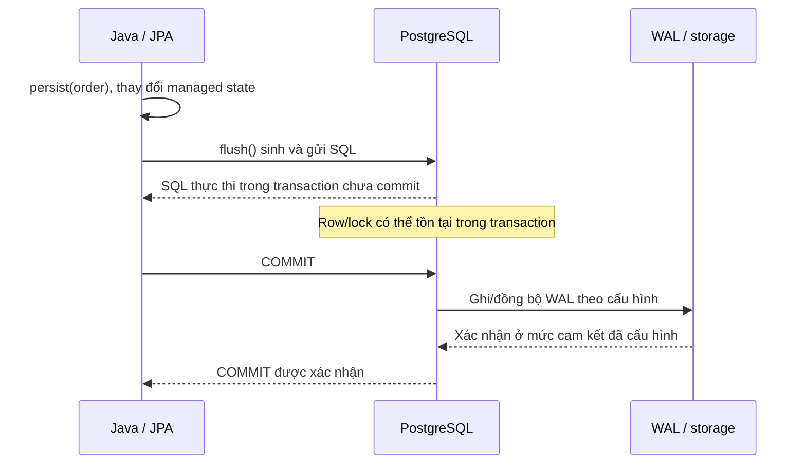

# Đồng nhất flush với commit hoặc với độ bền trên thiết bị

Một lập trình viên gọi `entityManager.flush()` sau khi thêm đơn hàng và thấy câu `INSERT` xuất hiện trong SQL log. Họ kết luận đơn hàng đã lưu an toàn, trả `201 Created` rồi gửi email xác nhận. Ngay sau đó, transaction bị rollback vì một constraint khác hoặc một exception phát sinh khi commit. Email đã gửi, nhưng đơn hàng không tồn tại. Ở tầng thấp hơn, một lời gọi `OutputStream.flush()` có thể làm dữ liệu rời bộ đệm Java mà vẫn chưa bảo đảm dữ liệu sống sót nếu máy mất điện.

Lỗi thiết kế ở đây là dùng một từ **flush** để chỉ ba cam kết rất khác nhau: **đẩy dữ liệu khỏi bộ đệm**, **hoàn tất transaction** và **bảo toàn dữ liệu trên phương tiện lưu trữ sau sự cố**. Chúng không tương đương; để ứng dụng Java hoạt động đúng phải xác định rõ ranh giới nào đang được bảo đảm.

Bài thuộc chương **Lỗi thiết kế** của mô-đun **DATA_PERSISTENCE_FUNDAMENTALS**. Mô-đun cung cấp kiến thức về lưu trữ dữ liệu bền vững, từ mô hình dữ liệu, lược đồ, truy vấn, chỉ mục đến transaction, isolation, concurrency; người học thiết kế persistence boundary cho Java, xử lý lỗi kết nối, tiến hóa schema, bảo mật, sao lưu và tối ưu hiệu năng. Mục tiêu bài này là **nhận diện sự khác biệt về semantics và thiết kế lời hứa với nghiệp vụ ở đúng ranh giới commit/durability**, chứ không chỉ ghi nhớ tên API.

Ví dụ chính sử dụng Spring, JPA/Hibernate, JDBC và PostgreSQL. Hành vi cụ thể của `flush`, constraint, độ bền và replication phụ thuộc ORM/provider, phiên bản DBMS, cấu hình transaction và hệ thống lưu trữ. Không suy từ một ví dụ PostgreSQL sang tất cả database hoặc tất cả phương tiện lưu trữ.

## 1. Nhìn toàn bộ đường đi của một lần ghi

Một thao tác ghi thông thường đi qua nhiều lớp đệm và nhiều ranh giới xác nhận:

```text
Java application
  |  sửa entity / gọi repository.save(...)
  v
JPA persistence context (managed state, dirty checking)
  |  EntityManager.flush(): đồng bộ các thay đổi thành SQL
  v
JDBC driver / network / PostgreSQL transaction
  |  INSERT/UPDATE/DELETE có thể đã thực thi nhưng CHƯA COMMIT
  v
PostgreSQL shared buffers + WAL buffers
  |  COMMIT và xử lý WAL theo chính sách đồng bộ
  v
OS page cache / filesystem / storage controller / device
  |  fsync / write ordering / cache power-loss protection
  v
Nơi có thể phục hồi dữ liệu sau loại sự cố được giả định
```

**Đây là sơ đồ logic, không phải lịch ghi vật lý cố định.** PostgreSQL có thể ghi trang dữ liệu trước hoặc sau commit tùy checkpoint/background writer; quy tắc bảo toàn transaction dựa vào WAL và recovery, không đòi từng data page được ghi ngay khi `COMMIT`. JDBC cũng không nhất thiết có một lớp đệm giống persistence context của JPA.

Một sơ đồ ngắn mô tả các thời điểm:



Nếu transaction bị rollback sau `flush`, chuỗi từ `COMMIT` trở xuống **không diễn ra như một commit thành công**. Nếu mất kết nối đúng lúc commit, Java có thể **không biết** database đã commit chưa; ngoại lệ không chứng minh chắc chắn rollback.

## 2. Bảng đối chiếu: `flush`, SQL execution, `commit`, `fsync`

| Mốc | Ý nghĩa | Đã có thể rollback? | Đã công khai cho transaction khác? | Đã bền vững khi mất điện? |
|---|---|---|---|---|
| JPA `persist`/thay đổi entity | Đăng ký trạng thái trong persistence context; SQL có thể chưa chạy | Có, nếu trong transaction | Thông thường chưa | **Không được bảo đảm** |
| JPA `flush()` hoàn tất | Đồng bộ thay đổi còn chờ thành SQL và thực thi trong transaction | **Có**, nếu chưa commit | Thông thường chưa với PostgreSQL MVCC | **Không được bảo đảm** |
| JDBC `executeUpdate` trong transaction thủ công | Statement đã được DB xử lý theo kết quả trả về | Có, khi chưa commit | Thông thường chưa | **Không được bảo đảm** |
| Transaction `COMMIT` thành công | DB kết thúc transaction, áp dụng quy tắc visibility và durability theo cấu hình | Không thể rollback transaction đã commit | Được thấy theo isolation/snapshot và routing phù hợp | **Phụ thuộc chính sách commit và lớp lưu trữ** |
| WAL flush/fsync thành công | WAL cần thiết được đồng bộ đến tầng lưu trữ theo giao thức OS/DB | Không phải thao tác commit của Java | Không tự làm transaction có thể đọc nếu chưa commit | Là thành phần quan trọng cho **crash durability**, với giả định storage trung thực |
| File stream `flush()` | Đẩy byte khỏi bộ đệm do stream/writer quản lý | Không phải DB transaction | Phụ thuộc app đọc file | Không tương đương `fsync` |
| `FileChannel.force(true)` | Yêu cầu đồng bộ nội dung và metadata file theo semantics nền tảng | Không liên quan trực tiếp tới DB rollback | Tùy filesystem | Mạnh hơn `flush`, nhưng vẫn phụ thuộc OS/filesystem/device |

**Điểm cốt lõi:** hoàn thành một giai đoạn chỉ chứng minh cam kết của **giai đoạn đó**, không tự nâng lên cam kết ở giai đoạn sau. Ví dụ `flush()` có thể làm lỗi unique xuất hiện sớm, nhưng không phải bằng chứng commit đã thành công; `COMMIT` thành công trên cấu hình bất đồng bộ cũng không luôn đồng nghĩa WAL đã tới storage bền vững theo ngưỡng mà nghiệp vụ kỳ vọng.

## 3. `EntityManager.flush()` thực sự làm gì?

JPA sử dụng **persistence context** để quản lý các entity. Khi code gọi `persist`, `merge`, sửa một managed entity hoặc xóa một entity, provider có thể giữ các thay đổi cho tới khi cần **synchronization** với database. `EntityManager.flush()` yêu cầu provider đồng bộ trạng thái chưa ghi thành những thao tác SQL thích hợp trong **transaction đang hoạt động**.

```java
// Minh họa trong transaction của Spring/JPA
entityManager.persist(order);
order.setStatus("PENDING");
entityManager.flush(); // SQL có thể đã được gửi/thực thi.

// Không có COMMIT ở đây; transaction vẫn đang hoạt động.
```

Kết quả thường thấy sau `flush`:

- Những SQL đang chờ có thể đã chạy; lỗi SQL như vi phạm unique hoặc FK **có thể** xuất hiện tại `flush` thay vì lúc commit.
- Database có thể đang giữ **row locks, index locks hoặc transaction state** liên quan; transaction khác có thể bị chặn khi tranh chấp.
- Trong cùng transaction, các câu đọc theo semantics của DB có thể quan sát các thay đổi do chính transaction tạo ra.
- Với PostgreSQL MVCC, transaction độc lập không được đọc dữ liệu **chưa commit** như một bản ghi đã xác nhận.
- Nếu transaction rollback, những ghi transactional do `flush` thực thi bị hoàn tác, dù SQL log đã ghi `INSERT` hoặc driver trả về thành công.

### 3.1. `flush()` không đồng nghĩa mọi SQL chỉ xuất hiện khi gọi flush

Provider có thể tự flush trước một số truy vấn, trước commit hoặc tại những mốc cần có dữ liệu/ID. `FlushModeType.AUTO` cho provider quyền bảo đảm kết quả truy vấn phù hợp với những thay đổi trong persistence context theo hợp đồng; `FlushModeType.COMMIT` có quy tắc quan sát thay đổi khác tùy provider và loại query. Hibernate còn có các chế độ riêng như `ALWAYS` hoặc `MANUAL` theo API của nó.

Với một số chiến lược sinh khóa như database `IDENTITY`, provider có thể phải thực hiện `INSERT` sớm để lấy generated ID, **trước một lời gọi flush tường minh**. Vì vậy câu "`save()` luôn chỉ lưu trong RAM cho tới `flush()`" cũng sai. Hãy quan sát SQL thực tế và hiểu strategy cụ thể; không dựa vào số lần gọi `flush()` để đếm SQL đã gửi.

### 3.2. `saveAndFlush()` cũng chưa commit

Spring Data JPA cung cấp phương thức như `saveAndFlush`, nhưng ý nghĩa là lưu và kích hoạt flush trong phạm vi transaction thích hợp, **không tự biến một transaction lớn đang mở thành commit**. Nếu service ngoài đã mở `@Transactional`, `repository.saveAndFlush(entity)` tham gia transaction đó; một exception sau đó vẫn có thể khiến toàn bộ công việc rollback.

Không nên dùng `flush()` sau mỗi lần sửa entity như một cách "chắc ăn". Flush quá nhiều có thể làm giảm khả năng batching, phát SQL sớm, kéo dài lock wait và tăng round trips. Nếu cần phát hiện lỗi constraint sớm trong transaction, flush có thể hữu ích, nhưng **phải chấp nhận transaction chưa hoàn tất và vẫn có thể thất bại sau đó**.

## 4. `COMMIT` xác nhận điều gì trong PostgreSQL?

Transaction là đơn vị **atomicity** và **visibility**: PostgreSQL quản lý việc các thay đổi cùng commit hoặc cùng rollback, đồng thời dùng MVCC và isolation để xác định transaction khác được thấy phiên bản hàng nào. `COMMIT` thành công đánh dấu kết thúc transaction ở database. Tuy nhiên, câu hỏi **"thành công" có còn đúng sau mất điện hay failover không?** phải xét chính sách durability đã cấu hình.

### 4.1. Visibility và durability là hai thuộc tính khác nhau

- **Atomicity:** trong một transaction, không có trạng thái commit nửa bảng A mà rollback nửa bảng B nếu cả hai là thao tác transactional được DB quản lý.
- **Visibility/isolation:** khi transaction khác thấy phiên bản hàng mới phụ thuộc vào trạng thái commit và snapshot/isolation. Trong PostgreSQL `READ COMMITTED`, câu lệnh mới thường thấy commit đã hoàn tất trước snapshot của câu lệnh đó; một transaction `REPEATABLE READ` với snapshot cũ có thể vẫn thấy phiên bản cũ.
- **Durability:** với transaction được xác nhận theo mức durability đã cấu hình và giả định storage đáp ứng hợp đồng, WAL/recovery bảo vệ thay đổi trước sự cố thuộc phạm vi hỗ trợ.

**Sau `COMMIT`, một replica bất đồng bộ có thể vẫn chưa nhận/applied thay đổi.** Việc đọc replica trả về bản cũ không chứng minh commit trên primary thất bại. Nếu API hứa *read-your-writes*, cần đọc từ nguồn đủ mới hoặc có cơ chế chờ log position/version, không chỉ kiểm tra thời gian SQL.

### 4.2. `COMMIT` vẫn có thể thất bại sau nhiều `flush()` thành công

Có thể có lỗi phát sinh ở lúc commit, ví dụ deferred constraint, lỗi I/O hoặc transaction bị đánh dấu rollback-only ở tầng transaction manager. Với Spring, một inner operation lỗi trong transaction `REQUIRED` rồi đánh dấu rollback-only có thể khiến outer service ném `UnexpectedRollbackException` tại ranh giới commit, mặc dù các method repository trước đó đều trả về bình thường.

Do đó **không phát tín hiệu nghiệp vụ "đã commit" chỉ vì câu SQL cuối hoặc `flush()` hoàn tất**. Bước xác nhận cần đặt tại nơi thực sự sở hữu ranh giới transaction hoặc sau khi một transaction kết thúc thành công; nếu cần tin cậy khi crash, phải thiết kế cơ chế ghi trạng thái/outbox bền vững trong chính transaction.

## 5. Thử nghiệm Spring/JPA: flush thành công rồi rollback

Xét bảng PostgreSQL đơn giản:

```sql
CREATE TABLE orders (
    id BIGINT PRIMARY KEY,
    status TEXT NOT NULL
);
```

Entity JPA với khóa được ứng dụng cấp (ví dụ file `OrderEntity.java`):

```java
import jakarta.persistence.Column;
import jakarta.persistence.Entity;
import jakarta.persistence.Id;
import jakarta.persistence.Table;

@Entity
@Table(name = "orders")
public class OrderEntity {
    @Id
    private Long id;

    @Column(nullable = false)
    private String status;

    protected OrderEntity() {} // JPA cần constructor không đối số.

    public OrderEntity(Long id, String status) {
        this.id = id;
        this.status = status;
    }
}
```

Service ghi entity rồi cố tình ném lỗi sau flush (ví dụ file `OrderWriteService.java`):

```java
import jakarta.persistence.EntityManager;
import jakarta.persistence.PersistenceContext;
import org.springframework.stereotype.Service;
import org.springframework.transaction.annotation.Transactional;

@Service
public class OrderWriteService {
    @PersistenceContext
    private EntityManager em;

    @Transactional
    public void createThenFail(long orderId) {
        em.persist(new OrderEntity(orderId, "PENDING"));
        em.flush(); // INSERT có thể đã chạy; đây KHÔNG PHẢI COMMIT.

        // Minh họa một lỗi runtime khác xảy ra sau flush.
        throw new IllegalStateException("Business step failed");
    }
}
```

Nếu `createThenFail` được gọi **qua Spring transaction proxy**, không có outer transaction chuyển quyền sở hữu commit, và cấu hình Spring/JPA hoạt động như mong đợi, `IllegalStateException` làm transaction rollback theo quy tắc mặc định cho unchecked exception. Câu `INSERT` có thể nhìn thấy trong log, nhưng sau khi method lỗi, câu đọc từ **transaction/connection khác** sẽ không tìm thấy đơn đã rollback.

Điều gì dễ gây hiểu nhầm?

1. Log `insert into orders...` chỉ chứng minh ORM/driver đã thực thi SQL, không chứng minh dữ liệu đã commit.
2. Câu `SELECT` chạy ngay trong **chính transaction** có thể thấy bản ghi; đó không phải bằng chứng transaction khác thấy được.
3. Nếu gọi method bằng **self-invocation** (`this.createThenFail(...)`) thay vì qua Spring proxy, annotation `@Transactional` có thể không được áp dụng theo cách dự kiến. Kiểm tra transaction boundary trong integration test, không suy từ annotation hiện diện.
4. Nếu ai đó đã gửi email/webhook sau `em.flush()`, rollback database **không thu hồi được** thông điệp đó.

### 5.1. Cách sử dụng `TransactionTemplate` để kiểm soát ranh giới

Khi cần xác định rõ điểm kết thúc transaction cho một use-case, có thể dùng Spring `TransactionTemplate` với **đúng `PlatformTransactionManager`**. Ví dụ đoạn sau minh họa logic điều phối bên ngoài transaction:

```java
// Giả định được gọi khi CHƯA có outer transaction và template
// dùng JpaTransactionManager phù hợp với EntityManager này.
Long orderId = transactionTemplate.execute(status -> {
    entityManager.persist(new OrderEntity(501L, "PENDING"));
    entityManager.flush(); // Kiểm tra sớm một số lỗi SQL.
    return 501L;
}); // Commit/rollback của transaction do template tạo xảy ra ở đây.

// Điểm này chỉ đạt được nếu transaction do template sở hữu kết thúc thành công.
// Nhưng gọi HTTP/broker ngay tại đây vẫn có crash window (xem phần outbox).
```

**Giới hạn quan trọng:** Với propagation `REQUIRED`, `TransactionTemplate` có thể **tham gia transaction đã mở**. Khi đó `execute(...)` trả về **không đồng nghĩa outer transaction đã commit**. Vì vậy ví dụ đặt giả định không có outer transaction và manager tương ứng. `REQUIRES_NEW` có thể tạo transaction độc lập khi được cấu hình đúng, nhưng không dùng nó tùy tiện nếu những thay đổi nghiệp vụ cần atomic với outer transaction.

### 5.2. Flush và commit có thể ném lỗi ở những thời điểm khác nhau

- Unique constraint **không deferred** thường có thể bị phát hiện trong statement/flush.
- Optimistic locking/version conflict có thể phát lộ khi ORM flush câu `UPDATE ... WHERE version = ?` và thấy không cập nhật đúng số hàng.
- Deferred constraint có thể chỉ được kiểm tra khi **commit** (hoặc khi được chuyển sang `IMMEDIATE`), sau khi các `flush` trước đó đều thành công.
- Các thao tác bên ngoài DB (broker, HTTP) không được transaction manager hoàn tác nếu đã thực hiện riêng.

Vì thế cần xử lý và quan sát lỗi **ở cả ranh giới statement/flush lẫn ranh giới transaction**. Bắt exception trong thân method `@Transactional` rồi trả thành công có thể che lỗi thực sự xảy ra khi proxy commit sau khi method target đã return.

## 6. JDBC: `executeUpdate`, `executeBatch` và `autoCommit`

Không sử dụng JPA không làm lỗi hiểu nhầm biến mất. Với JDBC và `autoCommit=false`, thực hiện SQL thành công vẫn chưa là commit:

```java
import java.sql.Connection;
import java.sql.PreparedStatement;
import java.sql.SQLException;
import javax.sql.DataSource;

public final class JdbcOrderWriter {
    private final DataSource dataSource;

    public JdbcOrderWriter(DataSource dataSource) {
        this.dataSource = dataSource;
    }

    public void createOrder(long id) throws SQLException {
        try (Connection connection = dataSource.getConnection()) {
            connection.setAutoCommit(false);
            try (PreparedStatement insert = connection.prepareStatement(
                    "INSERT INTO orders(id, status) VALUES (?, ?)")) {
                insert.setLong(1, id);
                insert.setString(2, "PENDING");
                int rows = insert.executeUpdate(); // Statement thành công.
                if (rows != 1) {
                    throw new SQLException("Unexpected row count: " + rows);
                }

                connection.commit(); // Cam kết giao dịch riêng biệt.
            } catch (SQLException | RuntimeException failure) {
                try {
                    connection.rollback();
                } catch (SQLException rollbackFailure) {
                    failure.addSuppressed(rollbackFailure);
                }
                throw failure;
            }
        }
    }
}
```

Mẫu này làm rõ: `executeUpdate()` hoàn tất trước `connection.commit()`; statement success không bảo đảm transaction success. Nếu `commit()` ném lỗi kết nối, **outcome có thể chưa xác định**, việc `rollback()` trong `catch` không chứng minh commit chưa xảy ra. Với nghiệp vụ không được lặp, cần operation ID và đối soát thay vì gọi `createOrder` lại bằng ID khác ngay lập tức.

`executeBatch()` tương tự: kết quả batch/row counts không phải bằng chứng transaction đã commit. Batch còn có hành vi thất bại giữa chừng phụ thuộc driver và cấu hình; phải xét phạm vi transaction, kết quả statement, rollback và trạng thái connection sau lỗi. Không đọc mỗi mảng `updateCounts` rồi kết luận toàn bộ dữ liệu đã bền vững.

### 6.1. Nhưng JDBC `autoCommit=true` thì sao?

Theo mặc định JDBC connection thường ở chế độ **auto-commit**: mỗi statement hoàn tất được coi là một transaction và driver/database thực hiện commit theo semantics của statement. Điều này khác với ví dụ `setAutoCommit(false)` ở trên. Tuy nhiên:

- Không được nói "JDBC `executeUpdate` luôn chưa commit" nếu connection đang `autoCommit=true`.
- Trên statement trả `ResultSet`, thời điểm statement được xem là hoàn tất theo JDBC có thể liên quan đến việc đọc/đóng kết quả; cần quản lý lifecycle đúng.
- Có commit ngầm sau statement vẫn **không đồng nghĩa có một transaction chung** bao quanh chuỗi `INSERT` rồi `UPDATE` nếu mỗi câu ở auto-commit riêng.
- Dù database báo statement/commit thành công, mức crash durability vẫn theo DB, WAL, OS và storage configuration.

Trong Spring, `JdbcTemplate` thường tham gia transaction do `DataSourceTransactionManager`/`JdbcTransactionManager` quản lý khi có transaction context phù hợp. Không tự gọi `setAutoCommit(true)` hoặc `commit()` trong repository đang được Spring transaction manager quản lý vì có thể phá ranh giới nhất quán do framework sở hữu.

## 7. `flush` của stream/file Java khác `fsync`

Từ **flush** còn dễ bị lẫn giữa ORM và file I/O. Với một `BufferedOutputStream`, `flush()` chủ yếu yêu cầu chuyển các byte từ **buffer ở phía Java** xuống stream bên dưới. Nó **không có cùng hợp đồng** với một thao tác force/sync xuống phương tiện lưu trữ:

```java
import java.io.BufferedOutputStream;
import java.io.FileOutputStream;
import java.io.IOException;

public void writeReport(String path, byte[] bytes) throws IOException {
    try (FileOutputStream file = new FileOutputStream(path);
         BufferedOutputStream buffered = new BufferedOutputStream(file)) {
        buffered.write(bytes);
        buffered.flush(); // Đẩy byte khỏi buffered stream; CHƯA đảm bảo fsync.
    }
}
```

Sau `flush()`, byte có thể vẫn nằm trong kernel page cache, storage controller cache hoặc thiết bị với chính sách ghi chưa bền. `close()` cũng không nên được xem như một `fsync` có bảo đảm, trừ khi API/nền tảng cụ thể quy định rõ điều đó.

### 7.1. `FileChannel.force(true)` tiến gần hơn đến yêu cầu crash durability

Nếu ghi một file quan trọng trên filesystem, Java NIO cung cấp `FileChannel.force(...)`:

```java
import java.io.IOException;
import java.nio.ByteBuffer;
import java.nio.channels.FileChannel;
import java.nio.file.Path;
import java.nio.file.StandardOpenOption;

public void writeFile(Path path, byte[] bytes) throws IOException {
    try (FileChannel channel = FileChannel.open(
            path,
            StandardOpenOption.CREATE,
            StandardOpenOption.WRITE,
            StandardOpenOption.TRUNCATE_EXISTING)) {
        ByteBuffer buffer = ByteBuffer.wrap(bytes);
        while (buffer.hasRemaining()) {
            channel.write(buffer);
        }
        channel.force(true); // Yêu cầu force nội dung và metadata theo nền tảng.
    }
}
```

Đây vẫn **chưa phải một giao thức cập nhật file nguyên tử và bền vững hoàn chỉnh**: nếu file cũ bị truncate trước khi ghi mới xong và process/máy sập, nội dung có thể dở dang. Với thay thế file cấu hình hoặc snapshot có yêu cầu mạnh, thường cần **ghi file tạm cùng filesystem, force file, atomic rename nếu hỗ trợ và đồng bộ metadata thư mục chứa** theo khả năng hệ điều hành/filesystem. Java không cung cấp hợp đồng portable đơn giản bảo đảm `fsync` directory trên mọi hệ; NFS/object storage/cloud file semantics cần được kiểm tra riêng.

**Không suy ra `FileChannel.force(true)` có thể chống mọi dạng mất điện hoặc lỗi firmware.** Nó chỉ yêu cầu hệ thống thực hiện đồng bộ theo API và nền tảng; kết quả phụ thuộc vào storage thật, write cache, battery/power-loss protection, filesystem và đường dẫn từ OS tới thiết bị. Tương tự, `OutputStream.flush()` không phải là tương đương với SQL transaction commit hoặc PostgreSQL WAL flush.

## 8. WAL, checkpoint và lý do không cần force từng data page lúc commit

PostgreSQL dùng **write-ahead log (WAL)** để bảo vệ tính nhất quán và khả năng khôi phục sau sự cố trong phạm vi đã cấu hình. Khi một transaction sửa một trang dữ liệu, WAL mô tả những thay đổi cần thiết để **redo/recovery**. Nguyên tắc write-ahead là WAL tương ứng phải được đồng bộ theo thứ tự cần thiết **trước khi các trang dữ liệu chứa thay đổi đó được coi là an toàn trên storage**.

Một dòng thời gian điển hình với local synchronous commit:

```text
T0  BEGIN
T1  UPDATE orders ...       -- đổi trạng thái trong transaction
T2  ORM flush()             -- SQL chạy, WAL records được tạo
T3  COMMIT request
T4  WAL commit record + WAL flush được xử lý theo cấu hình
T5  PostgreSQL xác nhận COMMIT với client
T6  Data pages có thể được ghi lúc sau bởi background writer/checkpoint
```

T2 **không** đồng nghĩa T5. Và T5 **không** đòi toàn bộ data pages đã được ghi vào nơi lưu trữ bền vững: WAL đã được đồng bộ đúng cách cho phép database phục hồi thay đổi sau restart. Một hệ thống có thể có `shared_buffers` chứa trang mới trong RAM trong khi commit đã được xác nhận, miễn thông tin WAL cần phục hồi đáp ứng mức durability đã cam kết.

### 8.1. Ba thao tác thường bị đánh đồng

| Thao tác | Mục tiêu | Tại sao chưa đủ một mình? |
|---|---|---|
| **WAL record generation** | Ghi nhận thay đổi vào cơ chế log logic/vật lý bên trong DB | Log có thể mới nằm trong bộ nhớ, chưa được flush bền vững |
| **WAL write/flush** | Ghi và đồng bộ thông tin log tới mức bảo đảm được cấu hình | Đủ để hỗ trợ recovery khi kết hợp commit protocol; bản thân WAL write của một transaction chưa commit không làm nó thành committed |
| **Data page checkpoint/writeback** | Đẩy các data pages bẩn ra storage, giới hạn lượng WAL cần replay | Không thay thế đúng thứ tự WAL; các trang có thể được ghi ở thời điểm khác commit |

PostgreSQL còn có **group commit**, cho phép nhiều transaction chia sẻ công việc WAL flush, giảm số lần đồng bộ vật lý. Vì vậy một câu giải thích "mỗi `COMMIT` luôn gọi một `fsync` riêng cho đúng một transaction" cũng là giản lược sai. Cần phân biệt độ bền đạt được với số lần syscall hoặc số lần flush đếm được.

### 8.2. `fsync`, `full_page_writes` và giả định về storage

Với PostgreSQL, các tham số như `fsync`, `full_page_writes` và cơ chế checkpoint ảnh hưởng an toàn khi crash. **Không tắt `fsync` trong production để lấy thêm throughput**: khi hệ điều hành hoặc phần cứng gặp sự cố, thiếu đồng bộ WAL có thể dẫn tới mất giao dịch và thậm chí hỏng cơ sở dữ liệu không thể phục hồi bình thường. `full_page_writes` hỗ trợ bảo vệ trước các vấn đề ghi trang không nguyên tử; không tùy tiện tắt nó như một phép tối ưu mặc định.

Ngay cả khi DB cấu hình `fsync=on`, hợp đồng crash durability còn phụ thuộc **filesystem, storage controller và thiết bị thực sự tuân thủ yêu cầu flush/sync**. Một bộ điều khiển báo đã ghi bền vững nhưng giữ dữ liệu trong cache dễ mất điện mà không có bảo vệ có thể phá vỡ giả định của database. Không có cấu hình database đơn lẻ nào bảo vệ được mọi tình huống như mất toàn bộ trung tâm dữ liệu, firmware lỗi, administrator xóa nhầm hoặc ransomware; các rủi ro đó cần replication, backup/PITR và phân tách quyền phù hợp.

## 9. `synchronous_commit` và các mức xác nhận ghi của PostgreSQL

Thông số `synchronous_commit` kiểm soát **mốc nào PostgreSQL chờ trước khi xác nhận commit**. Nó không cùng nghĩa với JPA `flush`. Bảng dưới tập trung vào những cách hiểu quan trọng; việc chờ remote chỉ có ý nghĩa đầy đủ khi `synchronous_standby_names` và các standby đồng bộ được cấu hình thích hợp.

| Giá trị `synchronous_commit` | Điều kiện xác nhận chính | Điều không được suy ra |
|---|---|---|
| `off` | Có thể xác nhận commit **trước khi WAL commit được flush bền vững tại local** | Không được coi mọi commit đã ACK đều sống sót sau OS crash; PostgreSQL vẫn bảo vệ tính nhất quán transaction theo thiết kế, nhưng có thể mất giao dịch gần nhất |
| `local` | Chờ WAL được flush ở primary/local | Không chờ standby đồng bộ; không cam kết mất region/primary vẫn không mất dữ liệu |
| `on` | Chờ local WAL flush; nếu có synchronous standbys cấu hình, chờ mức flush remote tương ứng | Không phải mọi read replica đều đã apply dữ liệu; remote ACK tùy cấu hình sync replication |
| `remote_write` | Khi sync standby được cấu hình, chờ standby ghi WAL tới OS, chưa nhất thiết flush bền vững | Standby OS crash có thể làm mất WAL mới chưa được flush; đừng gọi đây là remote durable flush |
| `remote_apply` | Khi sync standby được cấu hình, chờ standby apply WAL theo mức xác nhận được yêu cầu | Không bảo đảm mọi replica khác cũng bắt kịp; không thay thế backup hoặc transaction phân tán toàn hệ |

Với `synchronous_standby_names` không được cấu hình, các mức remote **không tự tạo thêm standby đồng bộ**; không nên kết luận `remote_apply` có bảo đảm remote nếu không có cấu hình và mục tiêu phù hợp. Cần kiểm tra cluster settings, số standby/quorum, topology và thực nghiệm failover. Giá trị `on` trong cài đặt thông thường với `fsync=on` và storage đáng tin cậy hỗ trợ **local crash durability** sau commit ACK, nhưng không đồng nghĩa dữ liệu đã tồn tại ở nhiều region.

### 9.1. Ví dụ khảo sát cấu hình, không chỉnh tham số bừa bãi

```sql
SHOW fsync;
SHOW full_page_writes;
SHOW synchronous_commit;
SHOW synchronous_standby_names;
SHOW wal_level;
```

Các lệnh `SHOW` chỉ đọc cấu hình đang có; cần xác minh trên đúng primary/cluster và hiểu quyền/cấu hình động. Trong môi trường có replication, quan sát trạng thái standby:

```sql
SELECT application_name,
       state,
       sync_state,
       sent_lsn,
       write_lsn,
       flush_lsn,
       replay_lsn
FROM pg_stat_replication;
```

Sự hiện diện của một hàng trong `pg_stat_replication` không chứng minh standby đó đang là synchronous standby theo policy. Cần đọc `sync_state`, config và topology; các LSN là vị trí WAL theo từng giai đoạn **gửi, ghi, flush, replay**. **Replay/apply** khác **flush**, và câu SELECT trên một replica bất đồng bộ còn có độ trễ theo chính nó.

### 9.2. Tại sao `synchronous_commit=off` không phải "flush nhanh hơn nhưng vẫn chắc chắn"?

Trong chế độ async commit, PostgreSQL có thể phản hồi thành công trước khi WAL commit đã được flush vào storage bền vững. Nếu server/process lỗi theo dạng làm mất những buffer chưa đồng bộ trước lúc WAL writer kịp flush, các transaction đã ACK gần đây **có thể biến mất sau recovery**. PostgreSQL cố gắng bảo toàn trạng thái nhất quán (không tạo một nửa transaction đã commit), nhưng **mất những commit được ứng dụng tin là thành công** có thể không được nghiệp vụ chấp nhận.

Không có một con số cố định "chỉ mất đúng X mili giây" áp dụng cho mọi cấu hình/sự cố. Ngay cả nếu rủi ro nhỏ trong benchmark, với giao dịch tài chính, đặt hàng, phát hành token hoặc cấp quyền, việc trả thành công nhưng không còn bản ghi sau crash có thể phá vỡ hợp đồng API. Chỉ thay đổi mức xác nhận khi đã đánh giá RPO, consistency, failover và sự chấp thuận của owner dữ liệu.

## 10. Ma trận sự cố: tầng nào đã được bảo đảm?

| Tình huống | `flush()` hoàn tất nhưng chưa commit | Commit ACK với local WAL flush và storage đúng hợp đồng | Điều cần bổ sung |
|---|---|---|---|
| Exception trong transaction rồi rollback | Các thay đổi transactional bị rollback | Không áp dụng nếu chưa commit | Kiểm tra trạng thái nghiệp vụ và side effects đã phát |
| Process Java chết trước commit | DB phát hiện kết nối kết thúc và rollback transaction chưa commit theo hành vi transaction | Commit đã hoàn tất trước khi Java chết không bị "uncommit" | Idempotency và đối soát khi caller không nhận ACK |
| PostgreSQL process crash rồi restart | Thay đổi chưa commit không trở thành committed | WAL recovery thường khôi phục các commit đã xác nhận theo chính sách | Test recovery, backups, quản lý lỗi kết nối |
| Mất điện OS/host | Flush không bảo vệ những SQL chưa commit | Mong đợi sống sót nếu WAL đã force bền vững và storage tôn trọng flush | Storage power-loss protection, fsync, diễn tập crash |
| Hỏng toàn bộ disk/host | Không được bảo vệ | Local commit vẫn có thể mất nếu storage vật lý không phục hồi được | Replica đúng cấu hình, backup/PITR ngoài failure domain |
| Failover sang standby lag | Chưa commit không thể là bản ghi authoritative | Primary có thể đã ACK nhưng standby được promote chưa có commit đó (async replication) | RPO, synchronous replication khi cần, fencing và chọn standby đúng |
| Người dùng xóa nhầm dữ liệu | Không phải câu hỏi của flush | Lệnh xóa hợp lệ cũng có thể commit và được replicate | Backup lịch sử/PITR, kiểm soát quyền, restore có kiểm chứng |

**Không nhầm process crash với OS/power crash**: dữ liệu đang nằm trong OS page cache có thể còn sau khi chỉ tiến trình Java chết, nhưng không nhất thiết còn sau khi máy mất điện. Tương tự, PostgreSQL process crash có thể recovery từ WAL còn trên disk; mức rủi ro khác với hỏng toàn bộ storage. Mỗi lời hứa "durable" phải nêu rõ **loại sự cố được chịu đựng**.

### 10.1. Một hệ thống có nhiều mức bền vững đồng thời

Một yêu cầu có thể đạt **local commit ACK** nhưng chưa đạt các điều kiện khác:

- Chưa sao chép đủ tới vùng khác để đáp ứng RPO thảm họa.
- Read replica đang phục vụ GET vẫn chưa replay bản ghi.
- Transactional outbox đã có event nhưng dispatcher chưa publish.
- Backup gần nhất không có WAL tương ứng với thời điểm commit.
- Consumer downstream chưa xử lý và vẫn có thể retry hoặc nhận message trùng.

Do đó, dùng các trạng thái cụ thể như **`committed_locally`**, **`replicated_to_quorum`** (chỉ khi có bằng chứng và cấu hình), **`published`**, **`consumed`** thay vì một trạng thái mơ hồ `flushed=true`. Không tự coi `replicated_to_quorum` là durable theo mọi loại sự cố nếu hệ thống chưa xác định chính xác mức ACK của quorum.

## 11. Deferred constraints và giá trị tăng tự động: hai bẫy khi kiểm thử flush

Một số ràng buộc được kiểm tra ngay khi statement thực thi; những ràng buộc được thiết kế `DEFERRABLE` có thể được kiểm tra **muộn hơn, tại commit**. Vì vậy câu "flush không ném exception thì mọi constraint đã qua" là sai.

### 11.1. Ví dụ foreign key deferred trong PostgreSQL

Chạy trong một môi trường thử độc lập:

```sql
CREATE TABLE parent_records (
    id BIGINT PRIMARY KEY
);

CREATE TABLE child_records (
    id BIGINT PRIMARY KEY,
    parent_id BIGINT NOT NULL,
    CONSTRAINT child_parent_fk
        FOREIGN KEY (parent_id) REFERENCES parent_records(id)
        DEFERRABLE INITIALLY DEFERRED
);

BEGIN;
INSERT INTO child_records(id, parent_id) VALUES (1, 999);
-- INSERT thành công vì FK được hoãn kiểm tra.

COMMIT;
-- Lỗi foreign_key_violation (23503) vì parent id=999 không tồn tại.
-- Transaction không được commit thành công.
```

Với JDBC hoặc JPA, SQL insert có thể đã hoàn tất, nhưng **lỗi xuất hiện tại `COMMIT`**. Nếu chèn bản ghi `parent_records(999)` trước commit thì ràng buộc có thể được thỏa mãn và transaction thành công. Có thể dùng `SET CONSTRAINTS ... IMMEDIATE` trong một transaction khi cần kích hoạt kiểm tra sớm, nhưng **việc kiểm tra sớm không biến transaction thành đã commit**.

PostgreSQL không cho phép tùy ý deferred tất cả loại constraint theo cùng semantics; ví dụ `NOT NULL` và `CHECK` không giống deferred FK/unique constraint. Khi thiết kế test, phải biết ràng buộc nào kiểm tra tại statement, flush hay commit, thay vì nói mọi validation chờ commit.

### 11.2. Sequence/identity gaps không chứng minh transaction đã commit

Trong PostgreSQL, `nextval()`/sequence có tính chất **không transactional như INSERT hàng**: giá trị sequence đã cấp có thể không được hoàn trả khi transaction rollback. Vì thế:

```sql
BEGIN;
SELECT nextval('order_number_seq');
ROLLBACK;
-- Lần nextval tiếp theo có thể bỏ qua số vừa được cấp.
```

Ví dụ trên giả định `order_number_seq` đã được tạo trước đó. Một số chiến lược IDENTITY/sequence của ORM cũng tạo **khoảng trống ID** khi rollback, failover hoặc cache ID. Không dựa vào số ID liên tục để chứng minh các row đã commit, cũng không coi gap là bằng chứng DB mất dữ liệu. Nếu nghiệp vụ cần mã hóa đơn liên tục theo quy tắc pháp lý, phải thiết kế cơ chế cấp số riêng và đánh giá concurrency/rollback đúng bản chất.

### 11.3. Commit thành công không đồng nghĩa mọi việc trong workflow thành công

Một local transaction có thể commit các bảng `orders` và `order_items`, nhưng việc gửi email hoặc phát thông điệp sau đó có thể thất bại. Ngược lại, một webhook phát **trước** commit có thể đến nơi khi transaction cuối cùng rollback. Cả hai tình huống đều là khoảng trống giữa **database transaction** và **side effect bên ngoài**; việc gọi thêm `flush` không khắc phục chúng.

## 12. Sửa lỗi thiết kế bằng transactional outbox và ranh giới rõ ràng

Phản ví dụ dễ gặp:

```java
@Transactional
public void createOrder(OrderEntity order) {
    entityManager.persist(order);
    entityManager.flush();
    externalEmailClient.sendOrderCreated(order); // Sai ranh giới.

    // Một thao tác khác có thể thất bại, làm DB rollback.
}
```

`flush()` không biến email thành một phần của transaction PostgreSQL. Nếu email đã được gửi rồi DB rollback, người nhận có thông báo về đơn hàng không tồn tại. Nếu thay bằng "gửi email sau commit" đơn thuần, vẫn còn tình huống **commit thành công, process chết trước khi gửi email**. `@TransactionalEventListener(phase = AFTER_COMMIT)` có ích để chỉ chạy listener sau commit theo semantics Spring, nhưng một listener chỉ tồn tại trong memory của process **không phải hàng đợi bền vững** nếu process dừng sau commit.

### 12.1. Outbox: lưu cả dữ liệu nghiệp vụ và ý định phát event trong một transaction

Các lệnh DDL sau minh họa một **môi trường độc lập** với ví dụ bảng `orders` ở phần 5; nếu đã có bảng thật, chỉ bổ sung bảng outbox và constraint tương thích, không tạo lại `orders`.

```sql
CREATE TABLE orders (
    id BIGINT PRIMARY KEY,
    status TEXT NOT NULL
);

CREATE TABLE outbox_events (
    event_id UUID PRIMARY KEY,
    order_id BIGINT NOT NULL REFERENCES orders(id),
    event_type TEXT NOT NULL,
    payload JSONB NOT NULL,
    created_at TIMESTAMPTZ NOT NULL DEFAULT now()
);

BEGIN;

INSERT INTO orders(id, status)
VALUES (1001, 'PENDING');

INSERT INTO outbox_events(event_id, order_id, event_type, payload)
VALUES ('5d2546ae-6acd-4c51-858b-234b84b438d1',
        1001, 'OrderCreated', '{"orderId":1001}');

COMMIT;
```

Trong **cùng một local PostgreSQL transaction**, hai `INSERT` hoặc cùng commit hoặc cùng rollback. Dispatcher chạy sau đó đọc các outbox records đã commit, publish tới broker và đánh dấu trạng thái theo quy tắc được thiết kế. Nếu dispatcher crash sau khi publish nhưng trước khi ghi nhận đã gửi, event có thể được giao lại: consumer phải **idempotent**, thường khử trùng lặp bằng `event_id`.

Outbox không tự bảo đảm `exactly once` cho mọi hệ thống và cũng không tự tạo transaction xuyên hai database. Nó giải quyết **atomicity giữa dữ liệu nghiệp vụ và ý định phát sự kiện trong một DB**; phần publish/consumer cần retry, kiểm soát duplicate, ordering và reconciliation riêng.

### 12.2. Cẩn trọng với `AFTER_COMMIT` và transaction context

Khi callback sau commit thực thi trong Spring, transaction đã được hoàn tất về mặt commit của transaction manager, nhưng tài nguyên như connection/session có thể chưa được cleanup ở thời điểm callback chạy. Không suy rằng mọi thao tác ghi database trong callback sẽ tự tạo một transaction độc lập, commit mới. Nếu cần ghi trạng thái khác **sau** commit, sử dụng transaction boundary thích hợp (ví dụ `REQUIRES_NEW` qua proxy/TransactionTemplate) và kiểm tra retry; tuy nhiên một write mới vẫn tạo hai transaction có thể không cùng thành công. Với event quan trọng, outbox thường là cơ chế phù hợp hơn chỉ dùng callback trong memory.

## 13. Mất kết nối lúc commit: "không nhận ACK" khác "đã rollback"

Thử xét timeline này:

```text
Java                 Network                  PostgreSQL
 | BEGIN/INSERT/flush --------------------------->|
 |<----------- SQL OK ----------------------------|
 | COMMIT --------------------------------------->|
 |                     [Mất kết nối]              | WAL flush / COMMIT
 |<---- Không nhận được ACK                      | Transaction có thể đã commit
 |
 | SQLException: connection lost                 |
 | Không đủ bằng chứng rằng DB rollback          |
```

Từ góc nhìn ứng dụng, kết quả là **unknown commit outcome**. Có ít nhất hai khả năng: PostgreSQL đã commit nhưng phản hồi bị mất, hoặc transaction chưa commit và bị rollback. Gọi `flush()` trước đó không phân biệt được. Một lần `rollback()` sau khi kết nối đã hỏng cũng không tạo ra lời xác nhận đáng tin rằng commit chưa diễn ra.

### 13.1. Thiết kế operation ID ổn định và dữ liệu có thẩm quyền

Một API ghi quan trọng nên nhận hoặc tạo **operation ID ổn định qua những lần retry của cùng yêu cầu**, cùng một cơ chế kiểm tra idempotency:

```sql
CREATE TABLE order_requests (
    operation_id UUID PRIMARY KEY,
    order_id BIGINT NOT NULL UNIQUE,
    request_hash TEXT NOT NULL,
    status TEXT NOT NULL
);

-- Trong cùng transaction tạo đơn, ghi operation ID và trạng thái;
-- cấu trúc bảng orders/outbox cần được thiết kế tương ứng.
```

Luồng xử lý gợi ý:

1. Client gửi lại cùng `operation_id` khi không nhận được kết quả; server không tạo ID hoàn toàn khác cho một yêu cầu retry.
2. Server kiểm tra request hash nếu dùng cùng ID để tránh tái sử dụng ID cho payload khác.
3. Nếu DB xác nhận operation ID đã commit với kết quả đầy đủ, trả kết quả đã lưu; nếu chắc chắn chưa tạo sau khi đối soát với nguồn ghi có thẩm quyền và trạng thái ổn định, mới thực hiện thao tác idempotent theo quy trình.
4. Nếu vẫn chưa rõ vì failover, replication lag hoặc mất kết nối kéo dài, trả trạng thái **đang đối soát** theo hợp đồng API thay vì đoán thành công/thất bại.
5. Theo dõi backlog `commit_unknown` và thời gian xác nhận kết quả; không kết luận "không tồn tại" từ replica bất đồng bộ chưa bắt kịp.

SQLSTATE class `08` mô tả nhóm lỗi kết nối, nhưng một lỗi kết nối **không tự là retryable ở mức business operation** nếu đã có side effect không idempotent. Ngay cả với SQLSTATE `40001` hoặc `40P01` thường cần retry toàn transaction, phải giới hạn số lần, backoff/jitter và tránh lặp gửi HTTP hoặc email ngoài DB.

## 14. Quan sát đúng: đo flush, commit, WAL và kết quả nghiệp vụ riêng

Một dashboard chỉ có `sql_execution_ms` hoặc log `Hibernate: insert ...` không đủ để chứng minh durability. Những tín hiệu có ý nghĩa cần được gắn vào **ranh giới** cụ thể:

| Tín hiệu / metric gợi ý | Đo ở đâu? | Ý nghĩa và giới hạn |
|---|---|---|
| `orm_flush_duration` | JPA/Hibernate instrumentation | Thời gian flush/synchronization; không phải transaction commit latency |
| `db_statement_duration` | JDBC/driver/DB trace | Thời gian statement; có thể gồm network/fetch tùy instrumentation |
| `db_transaction_commit_duration` | Transaction manager/driver có instrumentation thật | Thời gian xử lý commit và nhận ACK; không chứng minh toàn cụm/region an toàn |
| `db_transactions_committed_total` | Nguồn DB hoặc transaction manager với định nghĩa rõ | Đếm commit; nếu lấy từ app phải phân biệt commit outcome unknown |
| `db_transactions_rolled_back_total` | DB hoặc transaction manager | Đếm rollback, không suy ra mọi rollback là lỗi hệ thống |
| `commit_unknown_total` | Ranh giới API/service khi mất ACK | Cần đối soát, không tự tăng success/failure business một cách chắc chắn |
| WAL bytes / flush / sync time | PostgreSQL statistics và OS/storage metrics | Giúp tìm bottleneck log; **không thay thế kiểm thử crash durability** |
| Replica write/flush/replay LSN | PostgreSQL replication statistics | Biết standby ở giai đoạn nào; không phải kết quả read trên mọi replica |
| Outbox backlog age / publish retries | Dispatcher và broker | Bước downstream chưa hoàn tất dù DB đã commit |

Trong PostgreSQL, có thể đọc những chỉ số transaction tích lũy:

```sql
SELECT datname,
       xact_commit,
       xact_rollback,
       deadlocks,
       stats_reset
FROM pg_stat_database
WHERE datname = current_database();
```

**Đây là counter tích lũy**, không phải số transaction/s. Muốn tính rate cần so sánh hai thời điểm hoặc dùng hệ metrics có xử lý reset. Các view như `pg_stat_wal`, `pg_stat_io`, `pg_stat_checkpointer` có thể cung cấp thêm thông tin tùy phiên bản PostgreSQL; cần kiểm tra sự tồn tại, quyền truy cập và cấu hình thu thập số liệu trước khi dùng. Kết hợp thời gian commit của ứng dụng với WAL sync latency và I/O metrics, nhưng **không suy ra causal relationship chỉ vì hai đường biểu đồ tăng cùng lúc**.

### 14.1. Không đo commit bằng timer nằm trong thân `@Transactional` một cách máy móc

Với Spring proxy-based transaction thông thường:

```text
Caller -> TransactionInterceptor mở transaction
           -> target service method chạy và trả về
           -> TransactionInterceptor commit/rollback
        -> Caller nhận kết quả hoặc exception
```

Một timer đặt **bên trong method target** có thể dừng **trước** khi transaction interceptor thực hiện commit, bỏ sót commit latency và exception xuất hiện tại commit. Đặt timer ở caller **bên ngoài proxy sở hữu transaction**, hoặc instrument chính transaction manager ở vị trí đáng tin; chú ý propagation `REQUIRED` có thể tham gia một transaction lớn hơn do caller bên ngoài sở hữu.

Đừng gọi metric `flush_success_total` là `durable_writes_total`; đây là **sai hợp đồng dữ liệu quan sát** và có thể khiến cảnh báo hay quyết định khôi phục dựa trên lời hứa không có thật. Nếu cần SLO nghiệp vụ, tính thành công sau outcome đủ tin cậy, xử lý trường hợp commit unknown theo chính sách thay vì đếm mọi SQL success thành business success.

## 15. Kiểm thử từng ranh giới và diễn tập sự cố

Để tự kiểm chứng flush khác commit, có thể dùng **hai phiên PostgreSQL độc lập** với isolation mặc định `READ COMMITTED`. Chạy các lệnh trên **database test** đã có bảng `orders`, với ID chưa tồn tại:

**Session A (connection A):**

```sql
BEGIN;
INSERT INTO orders(id, status) VALUES (2002, 'PENDING');
SELECT id, status FROM orders WHERE id = 2002;
-- A nhìn thấy hàng do A vừa ghi.

-- Giữ transaction mở trong lúc B đọc.
```

**Session B (connection B, trong lúc A chưa commit):**

```sql
SELECT id, status FROM orders WHERE id = 2002;
-- 0 hàng: không thể thấy INSERT chưa commit của A.
```

**Quay lại Session A:**

```sql
ROLLBACK;
-- Thay đổi transactional đã bị hủy.
```

**Session B đọc lại:**

```sql
SELECT id, status FROM orders WHERE id = 2002;
-- Vẫn 0 hàng, dù INSERT ở A từng hoàn tất.
```

Thí nghiệm này chứng minh **SQL statement success và khả năng nhìn thấy trong cùng transaction không đồng nghĩa commit**, nhưng nó **chưa kiểm tra WAL fsync**. Để thử crash durability, cần phương pháp fail-stop/restart có kiểm soát trên hệ test cùng cấu hình storage, theo đúng khả năng của công cụ và nền tảng. Không tắt nguồn, vô hiệu hóa `fsync` hoặc cố ý phá database production để "kiểm chứng".

### 15.1. Ma trận kiểm thử cho ứng dụng Java và PostgreSQL

| Kịch bản | Cách tạo trong môi trường thử | Điều cần xác minh |
|---|---|---|
| JPA flush rồi ném RuntimeException | Gọi `createThenFail` qua Spring proxy | SQL có thể được ghi log nhưng hàng không tồn tại sau rollback |
| Chỉ nhìn trong transaction A | Chạy SQL hai session như trên | A thấy hàng chưa commit; B không thấy với isolation phù hợp |
| `saveAndFlush` trong outer `@Transactional` | Flush thành công rồi làm outer fail | Không có commit độc lập chỉ vì repository `saveAndFlush` |
| Deferred FK | Chạy ví dụ phần 11 | INSERT thành công, commit lỗi và transaction không được xác nhận |
| Auto-commit JDBC | Đối chiếu `autoCommit=true` và `false` | Chú thích đúng ranh giới transaction của mỗi chế độ |
| Sequence gap | Gọi `nextval` rồi rollback | Giá trị cấp tiếp theo có thể bị nhảy dù hàng rollback |
| File stream flush rồi process crash | Ghi thử ở sandbox với close/force khác nhau | Không tuyên bố file crash-durable chỉ dựa trên stream flush |
| Local synchronous commit crash recovery | Dùng PostgreSQL/volume test có chính sách flush xác định | Đối chiếu các commit đã xác nhận sau recovery, log và WAL |
| `synchronous_commit=off` trong test | Tạo workload được phép mất dữ liệu, mô phỏng crash an toàn | Nhận diện rủi ro ACK trước WAL flush; không dùng kết quả làm cam kết production |
| Failover async standby lag | Thử promotion có kiểm soát khi standby chưa bắt kịp | Không suy primary ACK nghĩa standby được chọn đã có bản ghi |
| Mất kết nối đúng lúc commit | Fault injection ở proxy/network test và operation ID ổn định | Không khẳng định rollback từ exception, truy vấn nguồn authoritative và không tạo duplicate |
| Event đã gửi trước commit | Publisher test, cố ý rollback DB | Tìm ra event sai, chứng minh cần outbox hoặc protocol thích hợp |
| Outbox dispatcher crash | Publish rồi dừng trước khi đánh dấu sent | Event có thể lặp và consumer khử trùng lặp theo `event_id` |

Với Spring integration test, chú ý `@Transactional` đặt trên **test method** có thể khiến framework tự rollback sau test; test như vậy có thể không đi qua commit thật hoặc che lỗi deferred constraint ở commit. Muốn kiểm tra commit boundary, thực thi nghiệp vụ qua transaction manager trong test, **kết thúc transaction thật** và đọc kết quả từ connection/transaction độc lập. Với race condition, dùng latch/barrier thay vì chỉ `Thread.sleep` và hy vọng thứ tự thực thi ngẫu nhiên phù hợp.

### 15.2. Các câu khẳng định sai cần loại khỏi code review

- **“Đã `flush()` nên dữ liệu chắc chắn nằm trên đĩa.”** Sai với JPA flush và stream flush; ngay cả force/sync có hợp đồng riêng.
- **“Hibernate đã log INSERT nên đơn hàng đã được tạo thành công.”** Chưa chắc; transaction có thể rollback hoặc commit lỗi.
- **“`saveAndFlush` là cách ép Spring commit.”** Không; nó không thay ranh giới transaction đang mở.
- **“`executeBatch` trả update counts thì đã bền vững.”** Không với manual transaction chưa commit.
- **“`COMMIT` thành công nghĩa mọi read replica đã thấy dữ liệu.”** Không với replication bất đồng bộ hoặc snapshot cũ.
- **“WAL flush nghĩa mọi data page đã được ghi lên disk.”** Không; recovery từ WAL cho phép page writeback muộn hơn.
- **“`synchronous_commit=off` vẫn an toàn như `on` chỉ nhanh hơn.”** Không; ACK có thể xuất hiện trước WAL flush bền vững.
- **“`fsync=off` chỉ mất vài transaction cuối.”** Rất nguy hiểm: có thể làm hỏng database không thể phục hồi bình thường sau crash.
- **“Không có exception ở `flush()` thì chắc chắn commit sẽ thành công.”** Sai với deferred constraints, rollback-only hoặc lỗi tại commit.
- **“Mất kết nối lúc commit chứng minh DB chưa ghi.”** Sai; outcome có thể chưa xác định.
- **“Chạy `ROLLBACK` sau lỗi commit là đủ để biết không có dữ liệu.”** Không nếu commit đã hoàn tất hoặc connection không còn đáng tin.
- **“Phát event sau flush là an toàn.”** Không; event không được rollback cùng DB và có thể được thấy trước khi dữ liệu commit.

## 16. Checklist thiết kế để không đồng nhất flush, commit và durability

1. **Đã xác định API `flush` nào chưa?** `EntityManager.flush`, stream `flush`, JDBC batch flush hay WAL flush có hợp đồng khác nhau.
2. **Ai sở hữu transaction?** Spring proxy, `TransactionTemplate`, JDBC manual transaction hay auto-commit? Có outer transaction làm đổi mốc commit không?
3. **Một `flush()` thành công được dùng làm bằng chứng gì?** Chỉ SQL synchronization/early error detection hay đã bị hiểu sai là business success?
4. **Đã phân biệt visibility và durability?** Có biết transaction khác chỉ thấy dữ liệu theo commit/snapshot/isolation, không phải theo SQL log?
5. **Deferred constraints và lỗi commit được xử lý chưa?** Test ràng buộc deferred, rollback-only và lỗi ngoài thân `@Transactional` chưa?
6. **Cấu hình durability PostgreSQL có được xác minh?** `fsync`, `synchronous_commit`, WAL, storage flush semantics, group commit và checkpoint được hiểu đúng chưa?
7. **RPO/RTO gồm loại sự cố nào?** Process crash, mất điện, mất disk, mất region và lỗi logic có cơ chế riêng chưa?
8. **Replica nào có thể phục hồi/đọc kết quả mới?** `write_lsn`/`flush_lsn`/`replay_lsn`, synchronous standby policy và failover đã được thử chưa?
9. **Có side effect trước commit không?** Email, HTTP, broker, cache, ledger ngoài DB có được tách/điều phối qua outbox/idempotency không?
10. **Commit outcome chưa rõ có đường đối soát không?** Operation ID, nguồn ghi có thẩm quyền, unique constraint, retry budget và khả năng tránh ghi trùng?
11. **Mốc đo telemetry có đúng không?** SQL duration, flush duration, transaction commit duration và business outcome có được gắn nhãn chính xác?
12. **File persistence có yêu cầu bền vững riêng không?** Stream flush, `FileChannel.force`, atomic rename, directory metadata và storage controller đã được xét đúng?
13. **Kiểm thử có đi qua commit thật không?** Hai connection, rollback sau flush, deferred constraint, crash recovery và failover được kiểm chứng ở test/staging?
14. **Backup/PITR đã được diễn tập chưa?** Local crash durability và replication không thay thế lịch sử backup, phân tách failure domain và quyền restore.

**Kết luận:** Trong thiết kế persistence, **flush là đồng bộ một lớp trạng thái hoặc bộ đệm; commit là kết thúc một transaction; còn durability là bảo đảm có thể phục hồi theo chính sách WAL, đồng bộ storage và loại sự cố được giả định**. Chúng liên quan nhưng không thay thế nhau. Khi phát triển Java với JDBC/JPA/Spring và PostgreSQL, chỉ xác nhận thành công nghiệp vụ ở ranh giới phù hợp, không phát side effect dựa vào `flush()`, xử lý commit outcome chưa rõ bằng idempotency và đối soát, đồng thời thử nghiệm crash/failover với đúng yêu cầu RPO/RTO. Đó là cách tránh biến một thao tác SQL chạy thành công thành **lời hứa bền vững mà hệ thống chưa thực sự bảo đảm**.


