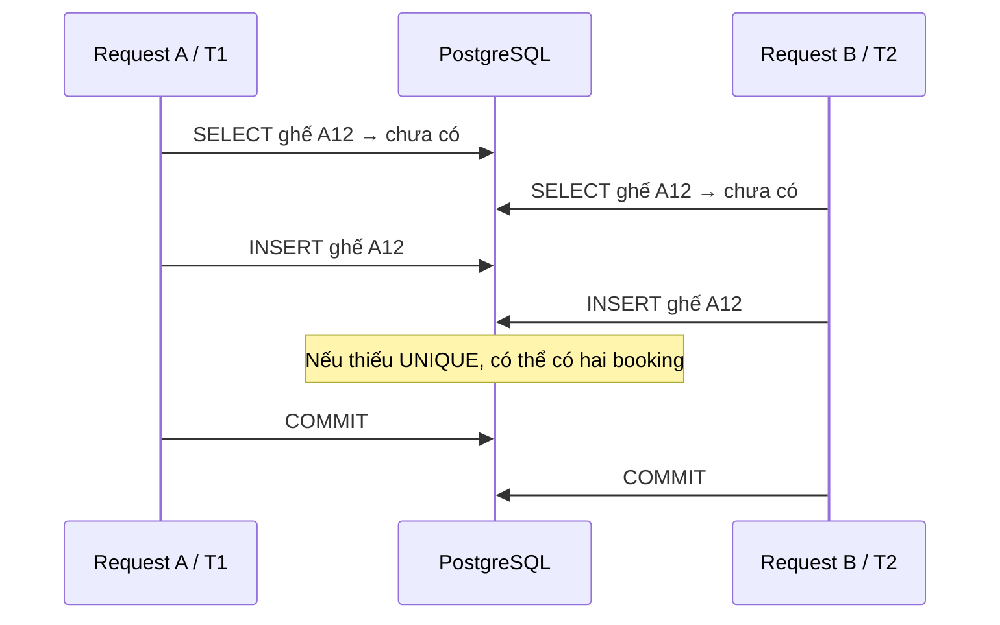
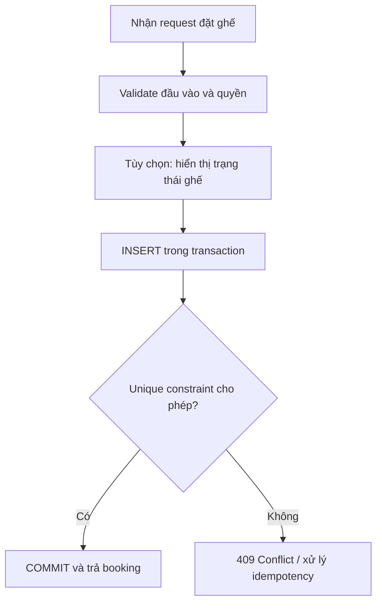
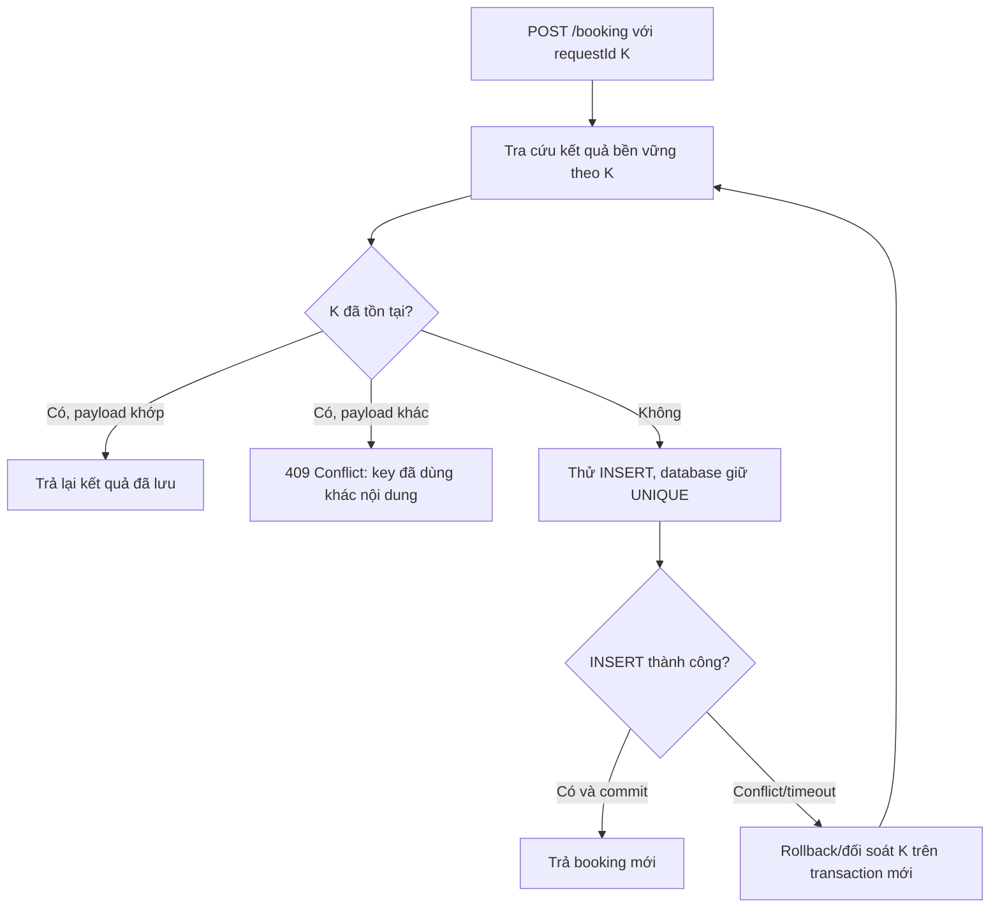

# Dùng kiểm tra trước khi ghi thay cho ràng buộc duy nhất

> **Chương:** Lỗi thiết kế  
> **Phạm vi:** `DATA_PERSISTENCE_FUNDAMENTALS` — hiểu tính bền vững và tính đúng đắn của dữ liệu trong Java, từ mô hình dữ liệu, schema, truy vấn, chỉ mục, transaction, cô lập và đồng thời đến thiết kế repository, bảo mật, migration, vận hành và kiểm thử.

## Mục tiêu học tập

Sau bài học, người học có thể:

1. Giải thích lỗi **time-of-check to time-of-use (TOCTOU)** khi ứng dụng thực hiện `SELECT` để kiểm tra rồi mới `INSERT` hoặc `UPDATE`.
2. Chứng minh vì sao hai transaction có thể cùng thấy “chưa tồn tại” ở PostgreSQL `READ COMMITTED` và cùng thử ghi một giá trị dù ứng dụng đã kiểm tra rất kỹ.
3. Đặt **unique constraint/unique index trong database** làm cơ chế bảo vệ bất biến duy nhất, đồng thời giữ precheck ở tầng Java như một tiện ích trải nghiệm nếu cần.
4. Thiết kế thao tác `INSERT ... ON CONFLICT`, phân loại `SQLSTATE 23505`, xử lý transaction rollback và idempotency mà không che giấu lỗi cạnh tranh.
5. Xác định phạm vi duy nhất theo tenant, trạng thái đang hoạt động, quy tắc chữ hoa/thường, `NULL` và dữ liệu lịch sử.
6. Viết integration test có hai transaction/connection thật và lập kế hoạch thêm ràng buộc duy nhất vào bảng đang chứa dữ liệu mà không làm mất thông tin nghiệp vụ.

## 1. Bất biến phải được bảo vệ ở nơi mọi writer đều đi qua

Giả sử hệ thống bán vé cho phép khách giữ một ghế trong một sự kiện. Quy tắc nghiệp vụ là:

> Với cùng một sự kiện, tại một thời điểm, **một ghế chỉ được thuộc về tối đa một đặt chỗ còn hiệu lực**.

Một API Java có thể triển khai kiểu:

```java
// PHẢN VÍ DỤ: không an toàn dưới concurrency nếu DB không có UNIQUE.
public BookingResult reserve(long eventId, String seatCode, long userId) {
    if (repository.existsByEventIdAndSeatCode(eventId, seatCode)) {
        return BookingResult.alreadyBooked();
    }

    repository.insert(eventId, seatCode, userId);
    return BookingResult.success();
}
```

Trình tự này có vẻ hợp lý khi chỉ có một request. Nhưng trong ứng dụng thực, nhiều thread, pod, job, script migration hoặc consumer có thể đồng thời ghi cùng database.

**Sai lầm thiết kế** không nằm ở việc hỏi “ghế đã có chưa”; nó nằm ở việc **xem câu trả lời ấy là bằng chứng rằng đến lúc ghi ghế vẫn chưa có**. Câu `SELECT` chỉ phản ánh một thời điểm hoặc snapshot; từ đó tới câu `INSERT` có thể đã có một transaction khác thay đổi dữ liệu.

Điểm quan trọng: bất biến duy nhất phải được **database cưỡng chế** bằng constraint/index có phạm vi đúng, vì đây là nơi tất cả writer cùng gặp nhau.

## 2. Race TOCTOU: cả hai request cùng qua bước kiểm tra

Tình huống với hai transaction T1 và T2, ban đầu ghế A12 của sự kiện 9 chưa được đặt:

| Thời điểm | Transaction T1 | Transaction T2 |
| --- | --- | --- |
| 1 | `BEGIN` | `BEGIN` |
| 2 | `SELECT ... WHERE event_id=9 AND seat_code='A12'` → không có hàng | |
| 3 | | `SELECT ...` → cũng không có hàng |
| 4 | `INSERT (9, 'A12', ...)` | |
| 5 | | `INSERT (9, 'A12', ...)` |
| 6 | `COMMIT` | `COMMIT` |

Nếu schema **không có ràng buộc duy nhất** tương ứng, cả hai hàng có thể được lưu. Dù cả hai câu `SELECT` đúng tại lúc đọc, kết quả cuối vẫn vi phạm bất biến.



Đây là lỗi **kiểm tra ở một thời điểm, sử dụng kết quả ở thời điểm khác** (*time-of-check to time-of-use*). Không cần kẻ tấn công; traffic hợp lệ cũng đủ tạo ra race.

### 2.1. Đặt hai câu trong `@Transactional` có giải quyết không?

Không, **chỉ đặt `SELECT` và `INSERT` trong một transaction chưa đủ**.

Trong PostgreSQL `READ COMMITTED`, mỗi statement thường nhìn dữ liệu đã commit phù hợp snapshot của statement. T1 và T2 có thể cùng quan sát chưa có hàng trước khi bên nào commit. Không có unique constraint thì transaction không tự suy ra một ràng buộc nghiệp vụ “chỉ một ghế A12”.

Ở `REPEATABLE READ`, việc thấy một snapshot nhất quán của mỗi transaction cũng **không tự tạo unique constraint**. `SERIALIZABLE` của PostgreSQL có thể phát hiện những lịch trình không tương đương thực thi tuần tự và abort một transaction, nhưng ứng dụng vẫn phải xử lý `40001`/retry, cấu hình isolation đúng cho mọi writer và xác định phạm vi đọc. **Constraint vẫn là cách trực tiếp, rõ ràng và bền vững nhất để bảo vệ tính duy nhất**.

### 2.2. `SELECT ... FOR UPDATE` có khóa được hàng chưa tồn tại?

`SELECT ... FOR UPDATE` khóa **những hàng hiện hữu** mà truy vấn chọn được. Nếu ghế A12 chưa có hàng, một câu `SELECT` không trả dòng nào thì không có hàng A12 để khóa theo cách ấy.

Có thể xây giao thức với **guard row**, advisory lock hoặc transaction serializable, nhưng chúng có tiền đề và quy tắc xử lý riêng. Không thay chúng bằng lời khẳng định “cứ `FOR UPDATE` trước `INSERT` là đủ”. Dù dùng khóa để tối ưu luồng nghiệp vụ, nên giữ unique constraint ở DB để bảo vệ cả những writer không tuân theo cùng giao thức khóa.

## 3. Schema đúng: ràng buộc duy nhất thuộc database

Ví dụ cơ bản với PostgreSQL, chỉ xét đặt ghế chưa có chức năng hủy:

```sql
CREATE TABLE seat_booking (
    booking_id BIGINT GENERATED ALWAYS AS IDENTITY PRIMARY KEY,
    event_id BIGINT NOT NULL,
    seat_code TEXT NOT NULL,
    user_id BIGINT NOT NULL,
    request_id UUID NOT NULL,
    created_at TIMESTAMPTZ NOT NULL DEFAULT now(),
    CONSTRAINT uq_event_seat UNIQUE (event_id, seat_code),
    CONSTRAINT uq_booking_request UNIQUE (request_id)
);
```

Hai ràng buộc có **hai ý nghĩa khác nhau**:

- `UNIQUE (event_id, seat_code)` đảm bảo mỗi ghế thuộc một sự kiện không được đặt hai lần trong mô hình này. Ghế A12 của sự kiện 9 không xung đột ghế A12 của sự kiện 10.
- `UNIQUE (request_id)` bảo đảm cùng một mã yêu cầu không thể tạo hai booking. Nó hỗ trợ idempotency nhưng **chưa tự biến API thành idempotent**: còn phải đối chiếu payload và trả lại kết quả đã commit.

Database sẽ làm phép phân xử cạnh tranh trong cơ chế unique index/constraint. Nếu hai transaction đồng thời `INSERT` cùng `(event_id, seat_code)`, PostgreSQL không thể cho **cả hai bản ghi xung đột** cùng commit. Một transaction có thể phải chờ transaction kia; sau khi biết kết quả, nó được phép tiếp tục hoặc nhận lỗi unique/conflict theo câu lệnh và trạng thái transaction.

```sql
-- Transaction A
INSERT INTO seat_booking
    (event_id, seat_code, user_id, request_id)
VALUES
    (9, 'A12', 101, '11111111-1111-4111-8111-111111111111');

-- Transaction B: cũng cố lấy A12 của sự kiện 9.
-- Nếu không dùng ON CONFLICT, unique violation có thể xuất hiện.
INSERT INTO seat_booking
    (event_id, seat_code, user_id, request_id)
VALUES
    (9, 'A12', 102, '22222222-2222-4222-8222-222222222222');
```

**Không cần chạy `SELECT COUNT(*)` trước để constraint hoạt động.** Mọi câu ghi hợp lệ đều được database kiểm tra.

### 3.1. `UNIQUE` khác `PRIMARY KEY` thế nào?

- `PRIMARY KEY` định danh duy nhất một hàng và yêu cầu các cột khóa không null.
- `UNIQUE` bảo vệ một hoặc nhiều khóa nghiệp vụ, ví dụ `(event_id, seat_code)`, có thể khác khóa chính `booking_id`.
- Trong PostgreSQL, unique constraint thường được hỗ trợ bởi unique B-tree index tương ứng.
- Có thể có nhiều ràng buộc duy nhất trên cùng bảng nếu chúng thể hiện **các bất biến độc lập**; mỗi index đi kèm chi phí ghi, dung lượng và bảo trì.

Không dùng `booking_id` tự tăng làm bằng chứng không thể có hai ghế giống nhau. Hai bản ghi cùng `event_id` và `seat_code` vẫn có `booking_id` khác nhau nếu thiếu unique constraint nghiệp vụ.

## 4. Precheck vẫn có chỗ đứng, nhưng không được làm trọng tài

Ứng dụng có thể kiểm tra trước để hiển thị “ghế đang được giữ” mà không cần làm một `INSERT` thất bại trong mọi trường hợp phổ biến. Điều đó chỉ là **gợi ý trải nghiệm**, không phải lớp kiểm soát tính đúng đắn.

Một mô hình đúng:



Nếu câu `SELECT` trả “chưa có” nhưng `INSERT` trả conflict vì transaction khác vừa thắng, kết quả hợp lệ là **ghế đã hết**. Không nên coi đó là lỗi hạ tầng ngẫu nhiên và lập tức thử lại vô hạn.

Nếu chỉ cần biết “thử đặt ghế có thành công hay không”, một câu `INSERT ... ON CONFLICT` thường đơn giản hơn hai round-trip `SELECT` rồi `INSERT`, đồng thời loại bỏ khe hở giữa kiểm tra và ghi.

## 5. PostgreSQL `ON CONFLICT`: thao tác cạnh tranh ở cấp database

Đối với bài toán giữ ghế, ta muốn “thêm nếu chưa có; nếu ghế đã có thì trả thất bại nghiệp vụ”. PostgreSQL hỗ trợ:

```sql
INSERT INTO seat_booking
    (event_id, seat_code, user_id, request_id)
VALUES
    (9, 'A12', 101, '33333333-3333-4333-8333-333333333333')
ON CONFLICT (event_id, seat_code) DO NOTHING
RETURNING booking_id;
```

Hành vi:

- Trả **một hàng** `booking_id` khi insert thành công.
- Trả **không có hàng** khi gặp conflict trên ràng buộc phù hợp với `(event_id, seat_code)` và chọn `DO NOTHING`.
- Nếu đụng ràng buộc **khác**, ví dụ `uq_booking_request`, câu lệnh vẫn có thể báo lỗi `23505`, vì conflict target đang chỉ định ràng buộc của ghế.

Đừng nhầm `DO NOTHING` với “mọi lỗi đều được nuốt”. Nó chỉ xử lý conflict theo phạm vi đã khai báo. `RETURNING` giúp ứng dụng phân biệt **đã tạo booking** với **không tạo do conflict**, thay vì coi kết quả 0 hàng là đã giữ ghế thành công.

### 5.1. Dùng `DO UPDATE` không phải lúc nào cũng hợp lý

Một câu:

```sql
-- PHẢN VÍ DỤ VỀ NGHIỆP VỤ: không dùng để chiếm ghế của người khác.
INSERT INTO seat_booking
    (event_id, seat_code, user_id, request_id)
VALUES
    (9, 'A12', 102, '44444444-4444-4444-8444-444444444444')
ON CONFLICT (event_id, seat_code)
DO UPDATE SET user_id = EXCLUDED.user_id;
```

Có thể chạy thành công nhưng lại **đổi chủ ghế A12 sang người đến sau**, vi phạm mong đợi nghiệp vụ. `UPSERT` không tự đồng nghĩa với đúng.

`ON CONFLICT DO UPDATE` phù hợp với một số nghiệp vụ cập nhật trạng thái/số đếm mà việc ghi đè đã được định nghĩa rõ; phải xem xét điều kiện, kiểm soát đồng thời và side effect. Với ghế chỉ được đặt một lần, `DO NOTHING` hoặc unique violation rồi trả `409 Conflict` thường là ý nghĩa đúng hơn.

### 5.2. Đừng truy vấn dữ liệu sau conflict trong cùng statement rồi mặc định nhìn thấy đối thủ

Trong `READ COMMITTED`, `INSERT ... ON CONFLICT DO NOTHING` có thể không insert vì conflict với một transaction đồng thời mà **snapshot của chính statement chưa nhìn thấy hàng của transaction ấy**. Vì thế không nên mặc định một `SELECT` gắn trong cùng statement/CTE sẽ luôn tìm thấy booking gây conflict.

Nếu cần phân biệt “request ID cũ của tôi” với “người khác đã giữ ghế”, hãy thực hiện một **statement đọc mới sau khi kết quả conflict được xác định**, trên nguồn chuẩn và trong transaction thích hợp. Đồng thời dùng khóa yêu cầu bền vững để tránh lặp thao tác sau mất kết nối khi commit.

## 6. Java/Spring JDBC: để database quyết định

Một repository có thể trả `OptionalLong` dựa trên `RETURNING`, không cần tự kiểm tra `exists` trước.

```java
import java.util.List;
import java.util.Map;
import java.util.OptionalLong;
import java.util.UUID;
import org.springframework.jdbc.core.namedparam.NamedParameterJdbcTemplate;
import org.springframework.stereotype.Repository;

@Repository
public class SeatBookingRepository {
    private final NamedParameterJdbcTemplate jdbc;

    public SeatBookingRepository(NamedParameterJdbcTemplate jdbc) {
        this.jdbc = jdbc;
    }

    public OptionalLong tryInsert(
            long eventId, String seatCode, long userId, UUID requestId) {
        List<Long> ids = jdbc.query("""
            INSERT INTO seat_booking
                (event_id, seat_code, user_id, request_id)
            VALUES
                (:eventId, :seatCode, :userId, :requestId)
            ON CONFLICT (event_id, seat_code) DO NOTHING
            RETURNING booking_id
            """,
            Map.of(
                "eventId", eventId,
                "seatCode", seatCode,
                "userId", userId,
                "requestId", requestId
            ),
            (rs, index) -> rs.getLong("booking_id"));

        return ids.isEmpty()
                ? OptionalLong.empty()
                : OptionalLong.of(ids.get(0));
    }
}
```

Service điều phối giao dịch và kết quả:

```java
import java.util.UUID;
import org.springframework.stereotype.Service;
import org.springframework.transaction.annotation.Transactional;

public class SeatAlreadyBookedException extends RuntimeException {
    public SeatAlreadyBookedException() {
        super("Seat already booked");
    }
}

@Service
public class SeatReservationService {
    private final SeatBookingRepository bookings;

    public SeatReservationService(SeatBookingRepository bookings) {
        this.bookings = bookings;
    }

    @Transactional
    public long reserve(
            long eventId, String seatCode, long userId, UUID requestId) {
        if (eventId <= 0 || userId <= 0 || requestId == null
                || seatCode == null || seatCode.isBlank()) {
            throw new IllegalArgumentException("Invalid reservation");
        }

        return bookings.tryInsert(
                eventId, seatCode, userId, requestId)
            .orElseThrow(SeatAlreadyBookedException::new);
    }
}
```

Ở ứng dụng thực tế:

- `userId` phải đến từ **ngữ cảnh đã xác thực**, không tin một tham số client tự khai báo.
- `seatCode` phải được chuẩn hóa theo hợp đồng nghiệp vụ (ví dụ cùng chấp nhận `a12` và `A12` hay không), nhất quán giữa Java và DB.
- `@Transactional` cần được gọi **qua Spring proxy**, có transaction manager và `DataSource` phù hợp; không gọi `this.reserve(...)` rồi tin rằng transaction được kích hoạt trong cấu hình proxy thông thường.
- `SeatAlreadyBookedException` có thể được ánh xạ ra HTTP `409 Conflict`. Khi method trả về từ proxy và commit thành công, client nhận booking ID; nhưng nếu mất kết nối quanh commit, kết quả có thể **chưa xác định**.
- Ràng buộc unique trên `request_id` vẫn có thể ném `DuplicateKeyException` khi retry cùng request. Phần 8 trình bày giao thức trả kết quả cũ; không coi đoạn code trên là idempotency API hoàn chỉnh.

**Lợi ích chính:** dù hai pod cùng gọi `tryInsert` với ghế A12, database đảm bảo chỉ một booking hợp lệ được tạo. Hành vi này không phụ thuộc JVM synchronization hay việc hai request đi qua cùng instance.

## 7. Khi dùng JPA/Spring Data JPA, có khác không?

Spring Data JPA giúp nạp/lưu entity, nhưng `existsByEventIdAndSeatCode(...)` theo sau bởi `save(...)` **vẫn có race tương tự**. Persistence context/dirty checking không phải unique constraint.

Ví dụ entity ánh xạ ràng buộc:

```java
import jakarta.persistence.Column;
import jakarta.persistence.Entity;
import jakarta.persistence.GeneratedValue;
import jakarta.persistence.GenerationType;
import jakarta.persistence.Id;
import jakarta.persistence.Table;
import jakarta.persistence.UniqueConstraint;

@Entity
@Table(
    name = "seat_booking",
    uniqueConstraints = {
        @UniqueConstraint(
            name = "uq_event_seat",
            columnNames = {"event_id", "seat_code"}),
        @UniqueConstraint(
            name = "uq_booking_request",
            columnNames = {"request_id"})
    }
)
public class SeatBooking {
    @Id
    @GeneratedValue(strategy = GenerationType.IDENTITY)
    @Column(name = "booking_id")
    private Long bookingId;

    @Column(name = "event_id", nullable = false)
    private Long eventId;

    @Column(name = "seat_code", nullable = false)
    private String seatCode;

    @Column(name = "user_id", nullable = false)
    private Long userId;

    @Column(name = "request_id", nullable = false)
    private java.util.UUID requestId;

    protected SeatBooking() {}
    // Constructor/domain methods phù hợp cần được bổ sung.
}
```

`@Table(uniqueConstraints = ...)` mô tả ý định mapping/schema, nhưng **không thay thế migration có kiểm soát trên production**. Cần xác nhận unique constraint thật sự đã tồn tại trong PostgreSQL bằng DDL/migration, không chỉ nhìn annotation.

Lưu ý đặc biệt khi kiểm thử:

- `save(...)` có thể chưa khiến SQL thực thi ngay; unique violation có thể xuất hiện ở `flush` hoặc `commit`.
- `saveAndFlush(...)` buộc flush nhưng **không đồng nghĩa commit**; commit sau đó vẫn có thể thất bại.
- Khi một transaction đã bị lỗi unique, không nên bắt exception bên trong transaction rồi tiếp tục dùng persistence context như thể không có gì xảy ra. Cần rollback/đóng transaction lỗi và xử lý business conflict ở **ranh giới ngoài** phù hợp.
- Dùng `@Transactional` ở test với mặc định tự rollback có thể làm test “thành công” mà chưa quan sát commit thật. Bài thử concurrency phải dùng các transaction độc lập và xác nhận dữ liệu sau khi chúng kết thúc.

## 8. Phân biệt conflict nghiệp vụ và idempotency

Trong schema ở phần 3 có hai câu hỏi khác nhau:

1. **Ghế A12 đã thuộc booking nào chưa?** Trả lời bằng `UNIQUE (event_id, seat_code)`.
2. **Yêu cầu có `request_id = K` đã được xử lý chưa?** Trả lời bằng `UNIQUE (request_id)` và bản ghi bền vững của kết quả.

Nếu retry do client không nhận được phản hồi, phải dùng **cùng request ID**. Nếu tự tạo UUID mới, unique request không giúp nhận ra lần gọi trước; unique seat có thể từ chối nhưng ứng dụng không phân biệt được “ghế của chính lần trước” với “người khác đã đặt”.

Giao thức gợi ý:



Sơ đồ diễn đạt **giao thức**, không phải vòng lặp vô hạn. Cần timeout/budget, retry có backoff và trạng thái `UNKNOWN` nếu DB authoritative chưa truy cập được. Bước đọc trước theo `request_id` cũng có race; chính unique constraint vẫn là lớp phân xử cuối.

Ví dụ truy vấn đối soát:

```sql
SELECT booking_id, event_id, seat_code, user_id, request_id
FROM seat_booking
WHERE request_id = :requestId;
```

| Kết quả | Hành động |
| --- | --- |
| Có `K` và payload cùng sự kiện, ghế, người dùng | Trả booking cũ, không ghi thêm. |
| Có `K` nhưng payload khác | Trả conflict idempotency key, không tự ghi đè. |
| Chưa có `K`, ghế đã được request khác giữ | Trả “ghế không còn”; không nhận là thành công của K. |
| Không có `K` và ghế chưa được giữ | Có thể thử ghi lại với **cùng K** theo giao thức retry. |
| Không truy cập được primary | Không kết luận đã rollback; báo kết quả chưa xác định/tiếp tục đối soát. |

Đặc biệt, một exception mất kết nối **ngay khi COMMIT** không chứng minh DB đã rollback. Unique constraint là lớp phòng ngừa double-write, nhưng API vẫn cần đọc lại authoritative state để biết lần trước đã thành công hay chưa.

## 9. Các loại “duy nhất” phải được định nghĩa đúng

Không phải lúc nào `UNIQUE(email)` hoặc `UNIQUE(seat_code)` cũng phản ánh đúng yêu cầu. Phải xác định **miền định danh và quy tắc so sánh** trước khi tạo index.

### 9.1. Theo tenant hoặc phạm vi cha

Nếu tên người dùng chỉ phải duy nhất trong mỗi tenant:

```sql
CREATE TABLE tenant_user (
    user_id BIGINT GENERATED ALWAYS AS IDENTITY PRIMARY KEY,
    tenant_id BIGINT NOT NULL,
    username TEXT NOT NULL,
    CONSTRAINT uq_tenant_username UNIQUE (tenant_id, username)
);
```

`UNIQUE(username)` toàn bảng sẽ từ chối cả những username hợp lệ ở tenant khác. `UNIQUE(tenant_id, username)` cho phép cùng tên ở tenant khác, nhưng vẫn phải đặt điều kiện tenant/authorization khi đọc và ghi.

**Không được tin tenant từ client** nếu người dùng không có quyền thuộc tenant đó. Unique constraint ngăn trùng khóa, không tự bảo vệ dữ liệu khỏi truy cập xuyên tenant.

### 9.2. Bản ghi “đang hoạt động” khác lịch sử đã hủy

Nếu nghiệp vụ cho phép hủy đặt chỗ và đặt lại cùng ghế, unique constraint **trên toàn bộ lịch sử** sẽ từ chối cả trường hợp hợp lệ. Có thể dùng **partial unique index** cho những bản ghi chưa hủy.

Một schema **thay thế** ví dụ (không chạy cùng với unique toàn cục `uq_event_seat` của phần 3):

```sql
CREATE TABLE seat_booking_history (
    booking_id BIGINT GENERATED ALWAYS AS IDENTITY PRIMARY KEY,
    event_id BIGINT NOT NULL,
    seat_code TEXT NOT NULL,
    user_id BIGINT NOT NULL,
    canceled_at TIMESTAMPTZ,
    created_at TIMESTAMPTZ NOT NULL DEFAULT now()
);

CREATE UNIQUE INDEX uq_active_event_seat
ON seat_booking_history (event_id, seat_code)
WHERE canceled_at IS NULL;
```

Ý nghĩa: có thể có nhiều bản ghi lịch sử đã hủy cùng `(event_id, seat_code)`, nhưng **tối đa một bản có `canceled_at IS NULL`**. Nếu trạng thái “đang hiệu lực” còn phụ thuộc vào hạn giữ chỗ, thanh toán hoặc khoảng thời gian, phải thiết kế bất biến/constraint tương ứng; không mặc định một partial index như trên đã giải quyết được mọi trạng thái.

Với partial unique index, `ON CONFLICT` có thể phải chỉ rõ conflict target/predicate phù hợp để PostgreSQL suy ra unique index; không thể mặc định dùng `ON CONFLICT ON CONSTRAINT uq_active_event_seat` vì đây là **index**, không phải một table unique constraint được khai báo bằng `ADD CONSTRAINT`.

### 9.3. Chữ hoa/thường, khoảng trắng và chuẩn hóa

PostgreSQL `TEXT` thông thường so sánh theo quy tắc collation/operator được cấu hình. Nếu nghiệp vụ muốn `Alice` và `alice` được xem là cùng tên, cần thiết kế **cùng một quy tắc chuẩn hóa được DB cưỡng chế**.

Ví dụ một functional unique index:

```sql
-- Minh họa cho tenant_user; tùy chính sách chữ hoa/thường,
-- Unicode và collation được dùng trong hệ thống thực tế.
CREATE UNIQUE INDEX uq_tenant_username_normalized
ON tenant_user (tenant_id, lower(btrim(username)));
```

Không tạo thêm index này khi đang tồn tại các username chỉ khác hoa/thường/khoảng trắng mà chưa xử lý duplicate; tạo index sẽ thất bại. Cũng không nên tự cho rằng `lower(btrim(...))` giải quyết mọi tình huống Unicode, chuẩn hóa email hoặc tên quốc tế. Quy tắc “cùng một định danh” phải được xác định ở domain và thử nghiệm đúng database/collation.

Đặt default ở Java cho `username` không ngăn được một script SQL hoặc service khác bỏ qua chuẩn hóa; unique index theo cùng quy tắc bảo vệ toàn bộ writer.

### 9.4. Cột nullable: `NULL` không luôn được coi là trùng

Trong PostgreSQL, unique constraint thông thường cho phép nhiều hàng có `NULL` ở các vị trí tương ứng vì `NULL` không được xem là bằng nhau trong phép kiểm tra unique theo mặc định.

```sql
CREATE TABLE external_reference (
    id BIGINT GENERATED ALWAYS AS IDENTITY PRIMARY KEY,
    tenant_id BIGINT NOT NULL,
    external_id TEXT,
    UNIQUE (tenant_id, external_id)
);

-- Với UNIQUE thông thường, nhiều hàng tenant_id = 7,
-- external_id = NULL có thể được chấp nhận.
```

Nếu yêu cầu nghiệp vụ cho rằng `NULL` phải được xem là cùng một giá trị để kiểm tra uniqueness, PostgreSQL **15+** hỗ trợ cú pháp `NULLS NOT DISTINCT`:

```sql
-- Ví dụ schema thay thế trên phiên bản PostgreSQL phù hợp.
CREATE TABLE external_reference_strict (
    id BIGINT GENERATED ALWAYS AS IDENTITY PRIMARY KEY,
    tenant_id BIGINT NOT NULL,
    external_id TEXT,
    CONSTRAINT uq_tenant_external_strict
        UNIQUE NULLS NOT DISTINCT (tenant_id, external_id)
);
```

Không tự ý áp quy tắc “mỗi tenant chỉ có một external_id null” nếu `NULL` thực sự nghĩa là “chưa gắn mã” và có thể có rất nhiều hàng chưa có mã. Khi đó unique nullable thông thường có thể đúng hơn.

## 10. Khi ghi bị xung đột: lỗi SQL và transaction

Nếu dùng `INSERT` thông thường và PostgreSQL phát hiện unique violation, SQLSTATE là `23505`. Spring JDBC thường dịch lỗi này thành `DuplicateKeyException` hoặc một subtype của `DataIntegrityViolationException` tùy driver/translator.

```java
// Phác thảo xử lý ở ranh giới API/application, ngoài transaction
// đã thất bại: không nuốt SQLException rồi tiếp tục dùng cùng
// transaction PostgreSQL đang ở trạng thái aborted.
try {
    long bookingId = reservationService.reserve(
        eventId, seatCode, authorizedUserId, requestId);
    return httpCreated(bookingId);
} catch (SeatAlreadyBookedException conflict) {
    return httpConflict("Seat already booked");
}
```

`httpCreated` và `httpConflict` là các hàm ánh xạ HTTP **minh họa**, không thuộc API Java chuẩn. Nếu dùng Spring MVC, có thể ánh xạ exception qua `@ControllerAdvice`/`@ExceptionHandler` sau khi transaction đã kết thúc.

Những lỗi cần tránh:

- **Catch rồi trả thành công:** nếu unique violation xảy ra, không có booking mới; phải trả đúng kết quả nghiệp vụ.
- **Catch trong transaction rồi tiếp tục SQL:** nhiều lỗi ở PostgreSQL khiến transaction bị *aborted* cho tới rollback hoặc rollback về savepoint phù hợp.
- **Retry mù quáng:** unique conflict vì ghế đã được người khác đặt không phải một lỗi tạm thời có thể giải quyết bằng retry vô hạn.
- **Gộp mọi `23505` thành một lỗi:** xem constraint name hoặc operation để phân biệt trùng ghế, trùng request ID và một unique key khác.
- **Coi `saveAndFlush` của JPA là commit:** vi phạm unique có thể phát hiện khi flush, nhưng transaction vẫn có thể thất bại sau đó; phía API chỉ xác nhận tạo mới khi commit được xác nhận.

`SAVEPOINT` có thể cho phép ứng dụng phục hồi khỏi một statement lỗi trong cùng transaction khi dùng đúng; tuy nhiên nó không biến dữ liệu xung đột thành hợp lệ và không thay thế thiết kế service boundary. Nếu không có nhu cầu nghiệp vụ rõ ràng, rollback transaction lỗi và xử lý ở tầng ngoài dễ hiểu và an toàn hơn.

## 11. Đưa unique constraint vào bảng đã có dữ liệu

Một hệ thống đang chạy có thể có duplicate từ trước khi sửa thiết kế. Khi thêm ràng buộc mới, tạo unique index có thể thất bại vì dữ liệu lịch sử không hợp lệ.

### 11.1. Tìm duplicate trước khi thay đổi schema

Với bảng lịch sử chỉ cho **một booking còn hiệu lực**:

```sql
SELECT
    event_id,
    seat_code,
    COUNT(*) AS active_count,
    array_agg(booking_id ORDER BY created_at, booking_id) AS booking_ids
FROM seat_booking_history
WHERE canceled_at IS NULL
GROUP BY event_id, seat_code
HAVING COUNT(*) > 1
ORDER BY active_count DESC, event_id, seat_code;
```

Không tự động xóa những hàng “thừa” chỉ vì muốn tạo index. Mỗi booking có thể liên quan thanh toán, vé đã phát hành, email, log và yêu cầu bồi hoàn. Cần quy tắc **giữ/hủy/chuyển** dựa trên nguồn chuẩn, được phê duyệt và có khả năng đối soát.

### 11.2. Quy trình migration có kiểm soát

1. **Định nghĩa bất biến thật:** khóa gồm những cột nào, có tenant không, bản hủy có được lặp không, xử lý `NULL` và normalization ra sao.
2. **Đo hiện trạng:** liệt kê nhóm duplicate, số lượng, luồng ghi đang tạo duplicate, các bảng/thanh toán tham chiếu.
3. **Sửa đường ghi:** chuẩn bị code xử lý conflict; tổ chức cửa sổ migration hoặc cơ chế tạm thời để **không sinh duplicate mới** trong lúc cleanup.
4. **Làm sạch dữ liệu có kiểm toán:** chọn bản ghi đúng theo quy trình nghiệp vụ, giải quyết phụ thuộc, lưu bằng chứng; kiểm tra lại điều kiện unique.
5. **Tạo unique constraint/index:** cân nhắc thời gian lock và lưu lượng ghi. Với bảng lớn, PostgreSQL hỗ trợ `CREATE UNIQUE INDEX CONCURRENTLY` nhưng phải vận hành đúng giới hạn.
6. **Xác minh DB thực sự bảo vệ bất biến:** chạy hai transaction thử trên môi trường staging, kiểm tra constraint/index và application error mapping.
7. **Triển khai và giám sát:** đo `23505`/conflict, thời gian chờ khóa, latency và lỗi khi rollout; có runbook nếu index creation thất bại.

Ví dụ cho **bảng lịch sử chưa có index này**:

```sql
-- Chạy như một bước DDL riêng ngoài transaction block.
CREATE UNIQUE INDEX CONCURRENTLY uq_active_event_seat
ON seat_booking_history (event_id, seat_code)
WHERE canceled_at IS NULL;
```

`CREATE INDEX CONCURRENTLY` không được chạy trong một transaction block, có thể phải chờ transaction khác và khi thất bại có thể để lại **index không hợp lệ** cần điều tra/dọn dẹp theo quy trình. Không mặc định lệnh này bảo đảm không có lock hoặc hoàn toàn không ảnh hưởng ghi.

**Quan trọng:** nếu giữ cả bản dữ liệu đang tạo duplicate và code cũ vẫn tạo thêm duplicate trong lúc chạy index, migration có thể thất bại. Chỉ tạo index “sau khi xóa các bản trùng” chưa đủ nếu chưa kiểm soát được race ghi mới.

### 11.3. Khi unique constraint không khớp quy tắc lịch sử

Nếu doanh nghiệp cần giữ tất cả bản booking cũ, có thể dùng partial unique index cho **bản ACTIVE** thay vì `UNIQUE(event_id, seat_code)` toàn lịch sử. Nếu một seat có nhiều khoảng thời gian đặt/giữ chỗ không được chồng lấn, bài toán thật có thể là **ràng buộc không giao nhau** chứ không chỉ unique trên một cặp cột; cần mô hình thời gian, constraint thích hợp và quy tắc gia hạn/hủy riêng.

Đừng bóp dữ liệu cho vừa một unique constraint sai. Hãy sửa **mô hình dữ liệu trước**, rồi mới áp constraint phù hợp.

## 12. Hiệu năng và vận hành của uniqueness

Unique constraint không miễn phí, nhưng cần được đánh giá như một phần bảo vệ dữ liệu:

| Chi phí hoặc hiện tượng | Nguyên nhân | Cần quan sát |
| --- | --- | --- |
| Chi phí `INSERT`/`UPDATE` | DB cập nhật unique index và kiểm tra conflict | Latency ghi, WAL, I/O, throughput. |
| Chờ do tranh cùng khóa | Hai writer cạnh tranh cùng natural key | Lock wait, p95/p99, tỷ lệ conflict. |
| Unique index lớn | Khóa dạng text/composite dài hoặc quá nhiều index trùng chức năng | Dung lượng index, cache hit, vacuum và bloat. |
| `23505` tăng đột biến | Duplicate request, bug retry, lỗi idempotency hoặc tấn công lưu lượng | Constraint name, operation, request key đã làm sạch dữ liệu. |
| Migration tạo index lâu | Bảng lớn, transaction dài, dữ liệu duplicate | Lock wait, progress, dung lượng dự phòng. |

Một unique index thường cũng có thể hỗ trợ các truy vấn đọc theo các cột của nó, nhưng không vì thế mà mọi `SELECT` sẽ dùng index hay mọi query nhanh. Kiểm tra kế hoạch thực thi và phân bố dữ liệu thật khi tối ưu.

Không dùng precheck để “tránh contention” rồi xóa unique constraint. Precheck có thể giảm tỷ lệ lỗi cho những request đã biết ghế hết, nhưng không loại bỏ race. Nếu tỉ lệ tranh chấp rất cao trên một ghế, cân nhắc queue, giới hạn tốc độ, điều phối theo key hoặc thiết kế quota — **vẫn giữ constraint để bảo vệ cuối cùng**.

## 13. Kiểm thử concurrency đúng bằng PostgreSQL thật

Unit test mock `existsBy...` trả `false` rồi mock `save` thành công **không tái hiện race** và không chứng minh unique ở DB. Cần integration test trên PostgreSQL thật, ví dụ Testcontainers.

### 13.1. Ma trận kết quả mong đợi

| Tình huống | Kết quả đúng |
| --- | --- |
| Một request hợp lệ cho ghế trống | Tạo đúng một booking. |
| Hai request với `request_id` khác nhau cùng lấy một ghế | Chính xác **một** booking của ghế ấy được commit; request còn lại nhận conflict. |
| Hai request đặt hai ghế khác nhau | Cả hai có thể thành công nếu không có ràng buộc khác. |
| Hai sự kiện khác nhau cùng mã ghế A12 | Không xung đột nếu unique được scope theo `event_id`. |
| Retry cùng `request_id` với payload khớp | Không tạo booking thứ hai, trả đúng kết quả đã lưu khi API hỗ trợ idempotency. |
| Retry cùng khóa nhưng payload khác | Báo xung đột, không tạo hoặc sửa dữ liệu mới. |
| Java nhận exception sau khi gửi `COMMIT` | Không mặc định rollback; đối soát theo `request_id` trên DB authoritative. |
| `SELECT ... FOR UPDATE` không thấy hàng | Không xem đó là bằng chứng đã khóa một chỗ trống. |
| Dữ liệu có `NULL` hoặc lệch hoa/thường | Kiểm chứng theo đúng domain rule và unique index/constraint đã chọn. |

### 13.2. Bài test đồng thời đơn giản bằng JUnit 5

Đoạn dưới giả định `SeatReservationService` đã được Spring inject, PostgreSQL Testcontainers đã được cấu hình bằng `@DynamicPropertySource` hoặc cơ chế tương đương và migration tạo `seat_booking` đã chạy.

```java
import static org.junit.jupiter.api.Assertions.*;

import java.util.UUID;
import java.util.concurrent.CountDownLatch;
import java.util.concurrent.ExecutorService;
import java.util.concurrent.Executors;
import java.util.concurrent.Future;
import java.util.concurrent.TimeUnit;
import org.junit.jupiter.api.Test;
import org.springframework.beans.factory.annotation.Autowired;
import org.springframework.boot.test.context.SpringBootTest;
import org.springframework.jdbc.core.JdbcTemplate;

@SpringBootTest
class SeatBookingConcurrencyTest {
    @Autowired SeatReservationService service;
    @Autowired JdbcTemplate jdbc;

    @Test
    void twoRequestsCannotBookTheSameSeat() throws Exception {
        // Chạy trên database/schema test độc lập.
        jdbc.update("DELETE FROM seat_booking WHERE event_id = ?", 9001L);

        ExecutorService workers = Executors.newFixedThreadPool(2);
        CountDownLatch start = new CountDownLatch(1);

        try {
            java.util.concurrent.Callable<Boolean> first = () -> {
                start.await();
                return reserveOrConflict(9001L, "A12", 101L);
            };
            java.util.concurrent.Callable<Boolean> second = () -> {
                start.await();
                return reserveOrConflict(9001L, "A12", 102L);
            };

            Future<Boolean> a = workers.submit(first);
            Future<Boolean> b = workers.submit(second);
            start.countDown();

            int successes = (a.get(10, TimeUnit.SECONDS) ? 1 : 0)
                          + (b.get(10, TimeUnit.SECONDS) ? 1 : 0);

            Integer committedRows = jdbc.queryForObject("""
                SELECT COUNT(*)
                FROM seat_booking
                WHERE event_id = ? AND seat_code = ?
                """, Integer.class, 9001L, "A12");

            assertEquals(1, successes);
            assertEquals(1, committedRows);
        } finally {
            workers.shutdownNow();
        }
    }

    private boolean reserveOrConflict(
            long eventId, String seatCode, long userId) {
        try {
            service.reserve(
                eventId, seatCode, userId, UUID.randomUUID());
            return true;
        } catch (SeatAlreadyBookedException expectedConflict) {
            return false;
        }
    }
}
```

**Giới hạn quan trọng của test:** latch cho hai tác vụ bắt đầu gần nhau nhưng **không bảo đảm** cả hai đã qua precheck trước khi một bên insert. Nó chứng minh bất biến trong lần chạy được quan sát, không chứng minh đã tạo ra mọi lịch trình race. Để tái hiện TOCTOU quyết định, dùng **hai transaction/connection riêng với barrier sau bước `SELECT`, trước `INSERT`**; khi đó cả hai thấy trống rồi cố insert. Có constraint, một bên sẽ bị từ chối; nếu bỏ constraint trong **một schema thử riêng**, có thể quan sát hai hàng trùng được commit.

Không gắn `@Transactional` ở class test nếu mục tiêu là kiểm tra commit thật: transaction kiểm thử của Spring thường rollback khi test kết thúc và có thể khiến quan sát không phản ánh trạng thái đã commit. Xác minh dữ liệu qua transaction/kết nối độc lập sau khi các future hoàn tất.

**Không biến test thành tải phá hoại:** giới hạn số thread, thời gian chờ và test database; không chạy các câu `DELETE` hoặc cố tạo race trên database production.

## 14. Những phản biện phổ biến và câu trả lời

| Nhận định | Vì sao chưa đúng |
| --- | --- |
| “Đã check `exists` thì insert không thể trùng.” | Kết quả check hết hiệu lực khi transaction khác ghi giữa hai statement. |
| “`@Transactional` tự khóa mọi điều kiện đã đọc.” | Transaction không mặc định tạo khóa cho mọi predicate; cần isolation/constraint/giao thức thích hợp. |
| “`SELECT FOR UPDATE` khóa cả ghế chưa có.” | Row-level lock chỉ áp dụng trên hàng đã chọn, không có hàng thì không có row lock ấy. |
| “Dùng `synchronized` trong Java là đủ.” | Nó chỉ điều phối các thread trong một JVM/lock scope; không bao quát pod, worker, script hoặc DB client khác. |
| “Tăng isolation sẽ luôn thay thế unique index.” | Cần đúng isolation cho mọi writer và xử lý abort/retry; constraint vẫn biểu diễn bất biến trực tiếp. |
| “`ON CONFLICT DO UPDATE` luôn tốt hơn `DO NOTHING`.” | Nó có thể chuyển chủ ghế/người sở hữu sai nghiệp vụ. |
| “JPA `save` là đã commit.” | SQL có thể được flush muộn; commit còn có thể thất bại. |
| “`request_id` unique là đủ cho idempotency.” | Cần so sánh payload, trả lại kết quả bền vững và xử lý commit unknown. |
| “`UNIQUE(email)` mặc định bỏ qua hoa/thường.” | Phụ thuộc kiểu/collation/quy tắc so sánh; phải thiết kế normalization rõ. |
| “`UNIQUE(nullable_column)` chỉ cho một NULL.” | PostgreSQL mặc định coi các NULL là distinct khi kiểm tra unique, trừ khi chọn `NULLS NOT DISTINCT` theo phiên bản hỗ trợ. |
| “Cứ xóa duplicate rồi tạo unique index là xong.” | Cần xử lý nghiệp vụ của các bản ghi, writer còn chạy, lock và rollback plan. |

## 15. Bài thực hành: sửa API đặt ghế bị đúp

**Bối cảnh:** bảng booking cũ chỉ có `booking_id` là primary key; API kiểm tra `exists` rồi gọi `INSERT`. Khi hai người đặt A12 cùng lúc, đôi khi xuất hiện hai booking. Hệ thống dùng Java/Spring JDBC và PostgreSQL.

**Yêu cầu:**

1. Dựng bảng **không có unique constraint nghiệp vụ** trên môi trường thử. Dùng hai connection với barrier sau `SELECT` để chứng minh hai transaction đều có thể ghi A12.
2. Thêm `UNIQUE (event_id, seat_code)` và chạy lại đúng lịch trình. Chứng minh chỉ một booking của ghế A12 có thể commit.
3. Viết repository dùng `INSERT ... ON CONFLICT (event_id, seat_code) DO NOTHING RETURNING booking_id`, ánh xạ 0 hàng thành conflict nghiệp vụ.
4. Viết integration test với hai transaction độc lập và xác nhận trạng thái sau commit; không dựa vào test `@Transactional` tự rollback.
5. Thêm `UNIQUE(request_id)` và giao thức retry bằng cùng request ID: cùng payload trả kết quả cũ, payload khác trả conflict, mất kết nối khi commit phải đối soát.
6. Đổi yêu cầu để cho phép hủy ghế rồi đặt lại. So sánh unique toàn bảng với partial unique index trên những booking có `canceled_at IS NULL`.
7. Thử tên ghế `a12` và `A12`; xác định có coi là một ghế không rồi thiết kế normalization/index theo quy tắc đó.
8. Cho dữ liệu lịch sử chứa duplicate, lập kế hoạch sửa có kiểm toán trước khi tạo unique index; mô phỏng tạo `CONCURRENTLY` thất bại và cách phát hiện/dọn index lỗi.
9. Đo số `23505`, lock wait, p95/p99 insert và dung lượng index khi tải tăng. Không bỏ constraint chỉ vì muốn giảm tỷ lệ lỗi.

**Tiêu chí đạt:**

| Kiểm tra | Kết quả mong đợi |
| --- | --- |
| Hai request đồng thời khác request ID giữ cùng ghế | Chỉ một booking còn hiệu lực. |
| Hai sự kiện khác nhau có ghế A12 | Cả hai có thể đặt hợp lệ. |
| Retry cùng request ID, payload trùng | Không ghi lặp, trả kết quả gốc theo giao thức idempotent. |
| Retry cùng request ID, payload khác | Báo conflict, không chuyển ghế. |
| Booking hủy rồi cho phép giữ lại | Unique theo trạng thái active, lịch sử vẫn được giữ. |
| Hệ thống còn dữ liệu lịch sử trùng | Không tạo unique index thành công giả; migration phải xử lý duplicate có kiểm toán. |
| Mất ACK khi commit | Trạng thái chưa xác định phải được đối soát, không tạo ID mới để retry mù quáng. |

**Câu hỏi tự đánh giá**

1. Lỗi TOCTOU là gì? Vì sao hai lần `SELECT` trả “không có” đều có thể đúng nhưng kết quả cuối lại sai?
2. Vì sao `@Transactional` ở `READ COMMITTED` không thay thế được `UNIQUE`?
3. `SELECT ... FOR UPDATE` có khóa một hàng chưa tồn tại không? Muốn điều phối trước khi insert, cần xem xét những cách nào?
4. Vì sao ghế phải unique theo `(event_id, seat_code)` chứ không chỉ `seat_code`?
5. `ON CONFLICT DO NOTHING RETURNING booking_id` trả 0 hàng nghĩa là gì? Nó có tự nuốt conflict ở `request_id` không?
6. Khi nào `ON CONFLICT DO UPDATE` có thể gây lỗi nghiệp vụ dù câu SQL hợp lệ?
7. Vì sao annotation `@UniqueConstraint` của JPA không thay thế migration DDL đã được kiểm soát?
8. Hai khái niệm “trùng ghế” và “trùng request ID” khác nhau thế nào trong idempotency?
9. Khi unique violation xảy ra, tại sao không nên tiếp tục thao tác SQL trong cùng transaction PostgreSQL bị lỗi?
10. Tại sao partial unique index phù hợp với lịch sử booking đã hủy? Điều gì xảy ra nếu vẫn còn unique constraint toàn bảng?
11. `NULL`, chữ hoa/thường và phạm vi tenant ảnh hưởng thế nào đến định nghĩa duy nhất?
12. Để thêm unique constraint trên bảng production đang ghi, cần làm gì trước khi tạo index và sau khi index được tạo?

## Ghi nhớ

**Kiểm tra trước khi ghi không phải ràng buộc duy nhất.** `SELECT`/`exists` chỉ cho biết trạng thái quan sát được tại một thời điểm; transaction khác có thể chen vào trước `INSERT`. `@Transactional`, synchronized hay việc thêm một precheck không tự giải quyết race đó. Bất biến “không được trùng” phải được biểu diễn bằng **UNIQUE constraint hoặc unique index phù hợp ở database**.

Trong Java, hãy để PostgreSQL phân xử bằng `INSERT`/`ON CONFLICT`, phân loại kết quả thành công và conflict đúng nghiệp vụ, đồng thời xử lý lỗi commit/idempotency theo khóa bền vững. Chọn đúng phạm vi tenant, trạng thái active, normalization và `NULL`; khi tiến hóa schema, xử lý duplicate lịch sử có kiểm toán và kiểm thử concurrency bằng các transaction thật. Cách thiết kế này bảo vệ tính nhất quán kể cả khi nhiều pod, worker hoặc client cùng ghi dữ liệu.
