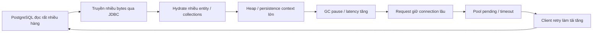

# Tải toàn bộ dữ liệu để lọc hoặc phân trang trong bộ nhớ

## 1. Một trang hiển thị 20 đơn hàng nhưng Java lại tải 200.000 đơn

Một API Java phục vụ trang **“Đơn hàng đã thanh toán”**. Client gửi yêu cầu hiển thị 20 đơn gần nhất của một tenant. Thay vì để PostgreSQL lọc và giới hạn, ứng dụng gọi `findAll()`, tải toàn bộ đơn hàng, rồi dùng Java Stream:

```java
// MINH HỌA ANTI-PATTERN — không sử dụng cho API production.
List<OrderEntity> all = orderRepository.findAll();

List<OrderEntity> page = all.stream()
        .filter(o -> tenantId.equals(o.getTenantId()))
        .filter(o -> "PAID".equals(o.getStatus()))
        .sorted(Comparator.comparing(OrderEntity::getCreatedAt)
                .reversed())
        .skip(40)
        .limit(20)
        .toList();
```

Kết quả trả về có 20 phần tử, nhưng **database có thể đã gửi hàng trăm nghìn hàng** qua mạng, JVM đã tạo hàng trăm nghìn object và bộ nhớ phải chứa danh sách lớn trong khi chỉ cần một trang nhỏ.

Nếu có 10 API instance, 100 request đồng thời và mỗi request tải cùng một tập lớn, ứng dụng còn có thể gây áp lực lên **connection pool, heap, garbage collection, băng thông và CPU của database**. Lỗi ban đầu trông như một vấn đề UI phân trang, nhưng có thể trở thành sự cố toàn hệ thống.

Chủ đề thuộc chương **Lỗi thiết kế** của module **DATA_PERSISTENCE_FUNDAMENTALS**: học cách đặt ranh giới persistence để Java chỉ nhận dữ liệu cần dùng, hiểu truy vấn, index, transaction, isolation, bảo mật tenant, và đo hiệu năng. Bài này phân biệt **lọc/phân trang tại database**, **lọc trên tập dữ liệu nhỏ có chủ đích** và **xử lý streaming** — ba cách làm có hợp đồng tài nguyên rất khác nhau.

> **Nguyên tắc:** Nếu API yêu cầu một trang nhỏ từ dữ liệu bền vững, hãy đưa những điều kiện lọc, sắp xếp và giới hạn trang có thể biểu đạt bằng SQL xuống database. Đừng tải toàn bộ dữ liệu chỉ để Java quyết định giữ lại vài phần tử.

## 2. “Phân trang trong bộ nhớ” khác gì phân trang tại database?

Giả sử tập dữ liệu có `N` đơn; API cần trả `P` đơn mỗi trang với `P ≪ N`.

| Công việc | Tải hết rồi lọc trong JVM | Lọc và phân trang ở database |
| --- | --- | --- |
| Dữ liệu database phải xét | Có thể phải đọc lượng lớn hoặc toàn bộ N | Tùy index, planner và selectivity |
| Hàng gửi qua JDBC | Thường là toàn bộ N | Thường là tối đa P (hoặc P+1 nếu kiểm tra trang sau) |
| Object Java tạo | Có thể O(N) object/entity | Xấp xỉ O(P) row/DTO theo kết quả |
| Sắp xếp | Có thể O(N log N) trên JVM | Database thực hiện, có thể dùng index để tránh sort |
| Bảo mật phạm vi | Có nguy cơ đọc cả tenant khác vào tiến trình | Điều kiện phân quyền có thể được thực thi trong SQL/RLS |
| Bộ nhớ của ứng dụng | Tăng theo N, cộng overhead ORM/collection | Chủ yếu tăng theo P và dữ liệu cần hiển thị |
| Khi N tăng 10 lần | API dễ tăng bộ nhớ và thời gian tương ứng | Có thể ít thay đổi nếu index và truy vấn phù hợp |

“Lọc ở database” **không bảo đảm truy vấn luôn nhanh**. Nếu lọc trên một biểu thức không có index hoặc yêu cầu trang rất sâu bằng `OFFSET`, PostgreSQL vẫn phải quét, tính toán hoặc bỏ qua nhiều hàng. Tuy nhiên, trả về đúng một trang vẫn tránh chuyển dữ liệu thừa qua JDBC và tạo hàng loạt object trên JVM.

Ước lượng chi phí truyền tải:

\[
\text{bytes qua mạng} \approx \text{số hàng trả về} \times \text{kích thước hàng trung bình}
\]

Ví dụ giả định 200.000 đơn, trung bình 1 KiB dữ liệu được chọn cho mỗi hàng: truyền toàn bộ có thể khoảng **200 MiB**, trước cả overhead của giao thức, đối tượng Java, chuỗi và ORM. Trả 20 đơn tương ứng khoảng **20 KiB** phần payload hàng trong cùng giả định. Đây là phép tính **minh họa**, không phải benchmark thực tế; kích thước hàng, cache, encoding, query plan và JVM heap có thể làm số đo khác nhiều.

## 3. Mô hình dữ liệu dùng xuyên suốt

Dùng PostgreSQL với một bảng đơn hàng đa tenant. Mọi ID dùng UUID, thời điểm bắt buộc không null để có thứ tự rõ ràng:

```sql
-- Chỉ tạo trong database thử nghiệm.
CREATE TABLE demo_orders (
    id UUID PRIMARY KEY,
    tenant_id UUID NOT NULL,
    customer_id UUID NOT NULL,
    status TEXT NOT NULL
        CHECK (status IN ('NEW', 'PAID', 'CANCELLED')),
    total NUMERIC(18, 2) NOT NULL CHECK (total >= 0),
    created_at TIMESTAMPTZ NOT NULL,
    updated_at TIMESTAMPTZ NOT NULL,
    version BIGINT NOT NULL DEFAULT 1
);

-- Hỗ trợ danh sách chung theo tenant.
CREATE INDEX ix_demo_orders_tenant_recent
ON demo_orders(tenant_id, created_at DESC, id DESC);

-- Hỗ trợ danh sách theo tenant + trạng thái.
CREATE INDEX ix_demo_orders_tenant_status_recent
ON demo_orders(tenant_id, status, created_at DESC, id DESC);
```

Giả sử API có hai use case:

1. `GET /orders?status=PAID&page=2&size=20`: hiển thị một trang, thứ tự **mới nhất trước**, và có thể cần tổng số trang.
2. `GET /orders/feed?status=PAID&cursor=...`: tải tiếp 20 đơn sau mốc cuối, không cần biết tổng số trang.

`tenant_id` phải lấy từ **principal/phiên đã xác thực**, không tin giá trị tự khai trong request. `id` trong khóa chính duy nhất toàn bảng giúp tạo thứ tự phụ khi nhiều đơn trùng `created_at`. Nếu thực tế dùng khóa chính ghép (`tenant_id`, `id`), mọi truy vấn/constraint/index phải được điều chỉnh tương ứng.

Index trong ví dụ là **ứng viên dựa trên query pattern**, không phải lời khuyên tạo cả hai index trên mọi bảng. Index tăng chi phí INSERT/UPDATE, WAL, dung lượng và bảo trì; phải đo workload trước khi triển khai.

## 4. Mổ xẻ anti-pattern `findAll()` rồi `filter/skip/limit`

```java
// Không nên: truy vấn không có điều kiện, không có giới hạn.
List<OrderEntity> orders = orderRepository.findAll();

long totalPaid = orders.stream()
        .filter(o -> tenantId.equals(o.getTenantId()))
        .filter(o -> "PAID".equals(o.getStatus()))
        .count();

List<OrderEntity> page = orders.stream()
        .filter(o -> tenantId.equals(o.getTenantId()))
        .filter(o -> "PAID".equals(o.getStatus()))
        .sorted(Comparator.comparing(OrderEntity::getCreatedAt)
                .thenComparing(OrderEntity::getId).reversed())
        .skip(1_000)
        .limit(20)
        .toList();
```

Đoạn trên gây một số vấn đề đồng thời:

- `findAll()` thường tạo một truy vấn không `WHERE`/`LIMIT`; tùy provider, nó hydrate nhiều entity managed cùng quan hệ/metadata.
- Hai luồng `stream()` duyệt lại tập trong JVM, tính cả `totalPaid` lẫn `page` thay vì dùng những phép tối ưu của DB.
- `sorted()` cần xem các phần tử trước khi bỏ qua `skip()`; giới hạn 20 phần tử **không** làm bước tải từ DB chỉ lấy 20 phần tử.
- Các quan hệ LAZY bị truy cập trong mapper/serializer có thể tiếp tục gây **N+1 query**, làm sự cố nghiêm trọng hơn.
- Danh sách entity lớn còn được JPA persistence context giữ theo dõi cho dirty checking; `clear()` sau đó có thể giảm giữ object, nhưng **không sửa thiết kế fetch-all**.
- Dữ liệu của tenant khác có thể đi vào ứng dụng trước khi bị lọc, làm tăng nguy cơ lộ thông tin ở log, tracing, heap dump hoặc code khác.
- Một request có thể thất bại với `OutOfMemoryError`, gây GC pause hoặc chiếm connection lâu nếu transaction bao bọc cả lúc xử lý danh sách.

**Lưu ý cú pháp:** `Stream.skip()` và `Stream.limit()` không phải SQL pagination. Cách đặt chúng trên một danh sách **đã lấy hết** không thể trả dữ liệu về database để giảm số hàng được truyền.

### Biến thể nguy hiểm: tìm một bản ghi sau khi tải tất cả

```java
// Không nên dùng để kiểm tra một khóa trong database lớn.
Optional<OrderEntity> found = repository.findAll().stream()
        .filter(o -> orderId.equals(o.getId()))
        .findFirst();
```

Nếu có khóa chính, câu trả lời là `findById(orderId)` hoặc truy vấn `WHERE tenant_id = ? AND id = ?`. Nếu cần kiểm tra **tồn tại**, dùng query `EXISTS` thay vì tải hàng rồi lọc. Nếu cần tổng, dùng `COUNT(*)` theo phạm vi, thay vì lấy toàn bộ object.

## 5. Đưa lọc, sắp xếp và giới hạn xuống SQL

Cho trang thứ ba (`page=2` nếu đánh số từ 0), kích thước 20, trạng thái `PAID`:

```sql
SELECT id, status, total, created_at
FROM demo_orders
WHERE tenant_id = :tenant_id
  AND status = 'PAID'
ORDER BY created_at DESC, id DESC
LIMIT 20 OFFSET 40;
```

Những điểm cần hiểu:

1. `WHERE` loại những hàng không thuộc tenant/trạng thái trước khi dựng kết quả ứng dụng.
2. `ORDER BY created_at DESC, id DESC` tạo thứ tự xác định cả khi hai đơn cùng thời gian.
3. `LIMIT` giới hạn số hàng **được trả**; với query plan tốt, DB có thể giảm công việc cần thiết.
4. `OFFSET` bỏ qua một số hàng **sau khi sắp theo thứ tự**; nó không miễn phí khi trang rất sâu.
5. Projection chỉ lấy `id/status/total/created_at`, tránh tải payload không cần thiết.

Placeholder `:tenant_id` là cú pháp biểu diễn named parameter của thư viện/công cụ; JDBC thuần dùng `?`. Không chèn chuỗi `tenantId`/`status` trực tiếp vào SQL.

### Query count tổng số hàng là một yêu cầu riêng

Nếu UI cần tổng số đơn phù hợp:

```sql
SELECT COUNT(*)
FROM demo_orders
WHERE tenant_id = :tenant_id
  AND status = 'PAID';
```

**Cùng điều kiện lọc** phải xuất hiện ở cả truy vấn page và count. Nếu count đếm toàn bảng hoặc quên tenant, tổng trang sai và có thể rò rỉ thông tin về dữ liệu của tổ chức khác.

`COUNT(*)` trên một điều kiện lớn vẫn có chi phí; không tự “miễn phí” vì chỉ trả một số nguyên. Nếu UI không thực sự cần tổng số trang, có thể chỉ trả `hasNext` bằng cách lấy `size + 1` hàng.

## 6. JDBC: phân trang trên server, bind tham số, trả DTO nhỏ

Ví dụ Java 17+ dùng PostgreSQL qua `DataSource`. Repository nhận các điều kiện đã được tầng API kiểm tra, giới hạn page size và trả một DTO nhỏ. Code có thể đặt trong một lớp Java và bổ sung package/DI phù hợp:

```java
import java.math.BigDecimal;
import java.sql.Connection;
import java.sql.PreparedStatement;
import java.sql.ResultSet;
import java.sql.SQLException;
import java.sql.Timestamp;
import java.time.Instant;
import java.util.ArrayList;
import java.util.List;
import java.util.UUID;
import javax.sql.DataSource;

public final class OrderPageRepository {
    private final DataSource dataSource;

    public record OrderRow(
            UUID id, String status, BigDecimal total, Instant createdAt) {}

    public OrderPageRepository(DataSource dataSource) {
        this.dataSource = dataSource;
    }

    public List<OrderRow> findPaidPage(
            UUID authenticatedTenantId, Instant fromInclusive,
            Instant untilExclusive, int page, int requestedSize)
            throws SQLException {
        if (authenticatedTenantId == null
                || fromInclusive == null || untilExclusive == null
                || !fromInclusive.isBefore(untilExclusive)
                || page < 0 || requestedSize < 1 || requestedSize > 100) {
            throw new IllegalArgumentException("Invalid page/filter");
        }

        long offset = Math.multiplyExact((long) page, requestedSize);
        if (offset > 10_000L) {
            throw new IllegalArgumentException(
                    "Deep pagination requires a cursor");
        }

        String sql = """
            SELECT id, status, total, created_at
            FROM demo_orders
            WHERE tenant_id = ? AND status = ?
              AND created_at >= ? AND created_at < ?
            ORDER BY created_at DESC, id DESC
            LIMIT ? OFFSET ?
            """;

        List<OrderRow> result = new ArrayList<>(requestedSize);
        try (Connection c = dataSource.getConnection();
             PreparedStatement st = c.prepareStatement(sql)) {
            st.setObject(1, authenticatedTenantId);
            st.setString(2, "PAID");
            st.setTimestamp(3, Timestamp.from(fromInclusive));
            st.setTimestamp(4, Timestamp.from(untilExclusive));
            st.setInt(5, requestedSize);
            st.setLong(6, offset);
            try (ResultSet rs = st.executeQuery()) {
                while (rs.next()) {
                    result.add(new OrderRow(
                        (UUID) rs.getObject("id"),
                        rs.getString("status"),
                        rs.getBigDecimal("total"),
                        rs.getTimestamp("created_at").toInstant()
                    ));
                }
            }
        }
        return result;
    }
}
```

Ưu điểm của cách này:

- Mọi giá trị đến từ request được **bind** qua `PreparedStatement`, không ghép text tùy tiện.
- API giới hạn `requestedSize` và độ sâu `OFFSET`; tránh yêu cầu một trang chứa hàng triệu dòng.
- `Math.multiplyExact` với `long` tránh lỗi overflow số học; nếu chính sách ngưỡng bị vượt, chuyển sang phương thức cursor.
- Chỉ hydrate tối đa 100 `OrderRow` thay vì 200.000 entity.
- `try-with-resources` đóng result set, statement và connection cả khi exception.

**Không suy rằng `setReadOnly(true)` tự chuyển truy vấn sang read replica**; việc route connection phụ thuộc DataSource/proxy. Một SQL `SELECT` vẫn phải được thực thi trên nguồn có độ mới phù hợp với yêu cầu nghiệp vụ.

## 7. JPA/Hibernate: tránh `findAll()` và chọn fetch plan theo use case

Spring Data JPA có `Pageable` để yêu cầu phân trang trong truy vấn. Ví dụ entity ứng dụng có các thuộc tính `id`, `tenantId`, `status`, `total` và `createdAt`; DTO chỉ giữ những trường UI cần:

```java
package com.example.persistence;

import java.math.BigDecimal;
import java.time.Instant;
import java.util.UUID;

public record OrderSummary(
        UUID id, Instant createdAt, String status, BigDecimal total) {}
```

Repository Spring Data:

```java
import java.util.UUID;
import org.springframework.data.domain.Page;
import org.springframework.data.domain.Pageable;
import org.springframework.data.jpa.repository.JpaRepository;
import org.springframework.data.jpa.repository.Query;
import org.springframework.data.repository.query.Param;

public interface OrderRepository extends JpaRepository<OrderEntity, UUID> {
    @Query(
        value = """
            SELECT new com.example.persistence.OrderSummary(
                o.id, o.createdAt, o.status, o.total)
            FROM OrderEntity o
            WHERE o.tenantId = :tenantId AND o.status = :status
            ORDER BY o.createdAt DESC, o.id DESC
            """,
        countQuery = """
            SELECT COUNT(o)
            FROM OrderEntity o
            WHERE o.tenantId = :tenantId AND o.status = :status
            """
    )
    Page<OrderSummary> findSummaries(
            @Param("tenantId") UUID tenantId,
            @Param("status") String status,
            Pageable pageable);
}
```

Gọi từ service:

```java
int pageNumber = 2;  // Đã kiểm tra >= 0 ở API.
int pageSize = 20;   // Đã kiểm tra 1..100 ở API.

Page<OrderSummary> page = repository.findSummaries(
        authenticatedTenantId,
        "PAID",
        org.springframework.data.domain.PageRequest.of(pageNumber, pageSize));
```

Đây là ví dụ interface; lớp `OrderEntity`, cấu hình package, schema migration và dependency Spring Data cần được định nghĩa trong ứng dụng. Query dùng `ORDER BY` cố định để tránh client chọn tên cột tùy ý. Hãy thống nhất chiến lược order nếu còn cho phép `Sort` qua `Pageable`; không để sort từ client vô tình thay/đè logic truy vấn bằng biểu thức thiếu kiểm soát.

`Page<T>` có thể cần thêm một truy vấn count để dựng tổng số phần tử, tùy nội dung và tối ưu của Spring Data. Nếu không cần count, cân nhắc `Slice<T>` với phương thức repository phù hợp; `Slice` thường đọc đủ để biết có trang tiếp theo mà không yêu cầu tổng số hàng.

**Đừng trả thẳng entity JPA ra JSON** rồi để serializer truy cập nhiều LAZY relation. Điều đó có thể làm phát sinh N+1, quá tải DB hoặc lộ field không dự định xuất bản. Dùng projection/DTO và fetch plan theo mục đích.

## 8. Phân trang danh sách có quan hệ con: tránh JOIN FETCH collection cùng LIMIT

Một phiên bản khác của lỗi tải thừa là cố “chữa N+1” bằng fetch join collection trực tiếp trên một truy vấn có `Pageable`:

```java
// ANTI-PATTERN với collection + pagination.
List<OrderEntity> orders = entityManager.createQuery(
        """
        SELECT o FROM OrderEntity o
        LEFT JOIN FETCH o.lines
        WHERE o.tenantId = :tenantId
        ORDER BY o.createdAt DESC, o.id DESC
        """,
        OrderEntity.class)
    .setParameter("tenantId", authenticatedTenantId)
    .setMaxResults(20)
    .getResultList();
```

Một đơn có thể có nhiều dòng hàng, nên JOIN tạo **nhiều hàng SQL cho một đơn**. Áp `LIMIT 20` trực tiếp lên hàng JOIN không nhất thiết trả đủ 20 đơn. Hibernate có thể cảnh báo hoặc phân trang **trong bộ nhớ** sau khi tải nhiều dòng, làm lỗi ban đầu quay trở lại dưới hình thức khác.

### Chiến lược hai bước an toàn hơn

**Bước 1 — Chọn ID của trang cha:** chỉ lấy 20 ID theo tenant và thứ tự ổn định.

```sql
SELECT id
FROM demo_orders
WHERE tenant_id = :tenant_id AND status = 'PAID'
ORDER BY created_at DESC, id DESC
LIMIT 20 OFFSET 40;
```

**Bước 2 — Nạp những cha/con thuộc chính tập ID đã chọn** bằng một truy vấn gom hoặc fetch join **không phân trang collection**:

```sql
SELECT o.id, o.status, o.total,
       l.id AS line_id, l.sku, l.quantity
FROM demo_orders AS o
LEFT JOIN demo_order_lines AS l ON l.order_id = o.id
WHERE o.tenant_id = :tenant_id
  AND o.id IN (:page_order_ids);
```

Ở đây `demo_order_lines` chỉ là bảng minh họa bổ sung nếu ứng dụng quản lý dòng hàng; schema phần 3 không tạo bảng này. Với hệ thống thật, phải có FK và index thích hợp cho `order_id`, cùng điều kiện tenant ở truy vấn join nếu dữ liệu/khóa có thể cần scope bổ sung.

**Bước 3 — Sắp lại theo danh sách ID trang** trong Java, vì `IN (...)` **không giữ thứ tự** theo các ID đã truyền. Nếu JOIN trả nhiều hàng cho cùng đơn, dùng map/grouping để dựng đúng DTO và giữ những đơn không có dòng.

Chiến lược này thường cần **2–3 câu SQL**, nhưng lượng dữ liệu ở bước hai chỉ liên quan tối đa 20 đơn. Cần đo fan-out; nếu một đơn có hàng nghìn dòng thì vẫn phải phân trang quan hệ con riêng, không tự động tải toàn bộ dòng chỉ vì số đơn ít.

## 9. OFFSET pagination: hợp lý ở trang nông, tốn ở trang sâu

Mẫu truy vấn:

```sql
SELECT id, status, total, created_at
FROM demo_orders
WHERE tenant_id = :tenant_id
ORDER BY created_at DESC, id DESC
LIMIT :page_size OFFSET :offset;
```

Với `page_size = 20`:

| Trang (từ 0) | OFFSET | Ý nghĩa |
| ---: | ---: | --- |
| 0 | 0 | 20 đơn đầu |
| 1 | 20 | Bỏ 20 đơn đầu |
| 10 | 200 | Bỏ 200 đơn |
| 1.000 | 20.000 | Bỏ 20.000 đơn |
| 10.000 | 200.000 | Bỏ 200.000 đơn |

Ngay cả khi có index theo `tenant_id, created_at DESC, id DESC`, database vẫn có thể phải **duyệt qua phần kết quả bị bỏ** trước khi trả 20 hàng đích. Query không gửi 200.000 hàng tới Java, nhưng công việc quét/bỏ qua ở DB có thể tăng cùng độ sâu.

Điều này khiến `OFFSET` phù hợp hơn cho:

- Màn hình quản trị có số trang giới hạn và nhu cầu nhảy đến trang số cụ thể.
- Tập dữ liệu vừa phải, người dùng thường xem vài trang đầu.
- Báo cáo snapshot tĩnh cần thuật toán đánh số trang đơn giản.

Không nên cho client gửi `page=999999999` rồi ép DB tính `OFFSET` khổng lồ. Đặt **giới hạn page size, độ sâu trang, timeout** và xem xét cursor/keyset khi kết quả lớn.

## 10. Keyset (seek) pagination: tiếp tục sau bản ghi cuối

Thay vì bảo database “bỏ qua 200.000 hàng”, cursor có thể nói **“lấy 20 hàng kế tiếp nằm sau cặp khóa sắp xếp cuối cùng đã thấy”**.

Trang đầu:

```sql
SELECT id, status, total, created_at
FROM demo_orders
WHERE tenant_id = :tenant_id AND status = 'PAID'
ORDER BY created_at DESC, id DESC
LIMIT :page_size_plus_one;
```

Giả sử bản ghi cuối cùng được trả cho client có:

```text
last_created_at = 2026-11-22T08:30:00Z
last_id         = aaaaaaaa-aaaa-4aaa-8aaa-aaaaaaaaaaaa
```

Trang sau:

```sql
SELECT id, status, total, created_at
FROM demo_orders
WHERE tenant_id = :tenant_id
  AND status = 'PAID'
  AND (created_at, id) < (:last_created_at, :last_id)
ORDER BY created_at DESC, id DESC
LIMIT :page_size_plus_one;
```

PostgreSQL có so sánh theo **tuple/row** với thứ tự từ trái sang phải; khi cả hai cột đều `NOT NULL` và cùng `DESC`, điều kiện `(created_at, id) < (...)` tương ứng với “nằm sau” cặp cuối trong danh sách giảm dần. Nếu cách sắp xếp trộn `ASC/DESC`, dùng `NULLS FIRST/LAST` hoặc biểu thức/collation phức tạp, không sao chép máy móc điều kiện này: phải suy đúng phép so theo order được chọn.

### Vì sao cần khóa phụ `id`?

Nhiều hàng có thể có cùng `created_at` đến độ chính xác timestamp đang lưu. Nếu cursor chỉ chứa `created_at`, các hàng cùng thời gian với hàng cuối có thể **bị bỏ sót** ở trang sau. Cặp `(created_at, id)` tạo thứ tự toàn phần khi `id` là duy nhất.

### Trả `hasNext` bằng `size + 1`

Nếu page size là 20, truy vấn lấy tối đa 21 hàng:

- Có 21 hàng: chỉ trả 20, `hasNext = true`, cursor mới lấy từ **hàng thứ 20 đã trả**.
- Có tối đa 20 hàng: `hasNext = false`.
- Không có hàng: trả danh sách rỗng; không tạo cursor mới.

`hasNext` chỉ cho biết còn hàng **theo snapshot/trạng thái quan sát của truy vấn đó**. Các ghi/xóa sau đó có thể thay đổi trang tiếp theo. Cần công bố semantics của feed; keyset không tự cho một snapshot bất biến xuyên nhiều request.

## 11. Cursor không chỉ là timestamp hoặc ID

Một cursor của API production nên lưu **ngữ cảnh truy vấn** chứ không đơn thuần là ID:

```json
{
  "v": 1,
  "sort": "created_at_desc_id_desc",
  "filter": {
    "status": "PAID",
    "before": "2026-12-01T00:00:00Z"
  },
  "lastCreatedAt": "2026-11-22T08:30:00Z",
  "lastId": "aaaaaaaa-aaaa-4aaa-8aaa-aaaaaaaaaaaa"
}
```

Đây là **payload minh họa ở dạng đã giải mã**. API có thể mã hóa/encode thành token opaque và ký HMAC để phát hiện sửa đổi; không đặt secret/key trực tiếp trong cursor. Mọi thuộc tính, giới hạn và tenant phải được **ràng buộc với danh tính được xác thực và chính sách truy vấn hiện tại**.

Các quy tắc thiết yếu:

1. **Không tin cursor do client sửa:** xác thực chữ ký/token, version, kiểu giá trị, expiration và filter.
2. **Không dùng tenant trong cursor để thay thế authentication:** tenant hiện hành phải đến từ principal; cursor cần khớp tenant/phạm vi.
3. **Không đổi filter giữa hai trang** mà dùng cursor cũ: chẳng hạn từ `PAID` sang `NEW` sẽ làm trình tự vô nghĩa.
4. **Đừng bỏ qua time precision:** timestamp parse/serialize phải giữ đủ độ chính xác so với DB để tránh rơi/mất hàng.
5. **Giới hạn page size và thời gian sống cursor:** ngăn client dùng token từ cấu hình/schema cũ quá lâu.
6. **Version hóa định dạng:** khi thay sort key hoặc index, có kế hoạch chuyển cursor cũ thay vì giải mã sai.

Opaque token **không tự đảm bảo bảo mật** nếu chỉ dùng Base64; đó là encoding, không phải chữ ký hay mã hóa. Nếu cursor có thông tin nhạy cảm, cần cân nhắc không đưa vào payload có thể giải mã bởi client.

## 12. Lọc và sort phải dựa trên một hợp đồng nghiệp vụ rõ

### Lọc đúng nơi

Tránh:

```java
// Tải tất cả rồi tìm tenant; scope bảo mật áp dụng quá muộn.
repository.findAll().stream()
        .filter(o -> tenantId.equals(o.getTenantId()))
        .filter(o -> o.getTotal().compareTo(minTotal) >= 0)
        .toList();
```

Thay bằng:

```sql
SELECT id, total, created_at, status
FROM demo_orders
WHERE tenant_id = :authenticated_tenant_id
  AND total >= :min_total
ORDER BY created_at DESC, id DESC
LIMIT :page_size;
```

Với điều kiện `total`, index tenant/time trong schema mẫu có thể chưa tối ưu. Query plan và mức chọn lọc quyết định liệu cần index bổ sung, thay đổi thứ tự cột hay không. **Không tạo index cho từng filter tùy chọn** trước khi đo workload.

### Sắp xếp phải ổn định

`ORDER BY created_at DESC` không đủ nếu nhiều đơn cùng timestamp. Thêm `id DESC` làm tie-breaker giúp paging xác định hơn; tuy nhiên **việc dữ liệu được thêm/xóa/cập nhật giữa các request** vẫn có thể khiến OFFSET bị trùng/mất.

Nếu hỗ trợ nhiều sort field, dùng **allowlist** trên API: `createdAt`, `total`, `id` theo hợp đồng. Không cho client truyền nguyên SQL `ORDER BY` hoặc tên cột tùy ý rồi ghép trực tiếp vào text. Bind parameter chỉ bảo vệ **giá trị**, không dùng để bind tên cột/SQL keywords.

### Null, collation và case sensitivity

Nếu một trường sort có thể `NULL`, phải quy định `NULLS FIRST/LAST` và cursor predicate tương ứng. Với text, sort chịu ảnh hưởng collation/locale; thứ tự Java `Comparator` và PostgreSQL `ORDER BY` không nhất thiết giống nhau. Thực hành tốt là **một nguồn quyết định thứ tự của page**, thông thường là DB theo collation đã chọn.

Một filter như `lower(email) LIKE ...` hoặc `ILIKE` có thể cần index expression/trigram tùy loại tra cứu. Đừng đem về JVM chỉ vì SQL filter cần được tối ưu thêm; hãy xác định semantics và query plan trước.

## 13. Chỉ mục hỗ trợ truy vấn: vì sao thứ tự cột quan trọng?

Với truy vấn:

```sql
SELECT id, status, total, created_at
FROM demo_orders
WHERE tenant_id = :tenant_id
  AND status = 'PAID'
ORDER BY created_at DESC, id DESC
LIMIT 20;
```

Một index thường đáng thử:

```sql
CREATE INDEX ix_demo_orders_tenant_status_recent
ON demo_orders(tenant_id, status, created_at DESC, id DESC);
```

Theo B-tree PostgreSQL, hai cột đầu lọc bằng **điều kiện bằng nhau** giúp thu hẹp phạm vi index, còn phần `created_at DESC, id DESC` có thể phục vụ thứ tự truy vấn, hạn chế sort trên nhiều hàng.

Nếu hệ thống thường liệt kê **mọi status**, index `(tenant_id, created_at DESC, id DESC)` cũng có giá trị. Lựa chọn giữa một, hai hoặc index khác phụ thuộc tần suất query, selectivity, chi phí ghi và dung lượng. Index phủ thêm cột bằng `INCLUDE` có thể giảm một số heap fetch trong tình huống index-only scan, nhưng không bảo đảm luôn index-only vì MVCC visibility map và cách truy vấn thực tế.

**B-tree không giải quyết mọi filter.** Ví dụ tìm `contains` tự do trong JSON/text hoặc tính khoảng cách địa lý thường cần công cụ/index phù hợp khác. Quan trọng là **đặt logic ở tầng DB có khả năng xử lý dữ liệu tập hợp**, không phải kéo toàn bảng vào JVM để né việc thiết kế truy vấn.

### Đo bằng `EXPLAIN` trước khi kết luận

```sql
-- Ví dụ chỉ dành cho DB thử nghiệm, thay tham số bằng giá trị phù hợp.
EXPLAIN (ANALYZE, BUFFERS)
SELECT id, status, total, created_at
FROM demo_orders
WHERE tenant_id = '11111111-1111-4111-8111-111111111111'::uuid
  AND status = 'PAID'
ORDER BY created_at DESC, id DESC
LIMIT 20;
```

`EXPLAIN ANALYZE` **thực thi truy vấn** để đo; với SELECT là đọc nhưng vẫn tiêu tài nguyên. Xem:

- `Index Scan`/`Bitmap Heap Scan`/`Seq Scan` theo quy mô và tính chọn lọc.
- `Sort`/`top-N heapsort` và bộ nhớ, liệu order đã được index cung cấp.
- `actual rows`, `loops`, `Buffers: shared hit/read` và thời gian thực tế.
- `rows removed by filter` hoặc mức quét lớn dù LIMIT nhỏ.
- Sự khác biệt giữa **estimated rows và actual rows** (thống kê cũ làm planner chọn sai).

Một index mới không được dùng không hẳn là lỗi DB: trên bảng nhỏ hoặc phần lớn hàng phù hợp, sequential scan có thể rẻ hơn. Cần đo với dữ liệu, thống kê và tải đại diện; không ép index hoặc tạo quá nhiều index chỉ vì kỳ vọng thấy một dòng trong query plan.

## 14. Sai lầm mới: gọi streaming rồi tin rằng đã phân trang

Khi thấy `findAll()` dùng nhiều heap, có người đổi sang `stream()` hoặc JDBC `fetchSize` rồi vẫn xử lý toàn bộ:

```java
// VẪN SAI nếu chỉ cần 20 hàng nhưng đọc toàn bộ tập lớn.
try (Stream<OrderEntity> rows = repository.streamAllOrders()) {
    List<OrderEntity> page = rows
            .filter(o -> tenantId.equals(o.getTenantId()))
            .sorted(Comparator.comparing(OrderEntity::getCreatedAt))
            .skip(100_000)
            .limit(20)
            .toList();
}
```

Streaming **có thể giảm mức đệm trong JVM** nếu được cấu hình đúng, nhưng:

1. Nó vẫn có thể khiến DB quét và **truyền nhiều hàng** trước khi biết phần tử nào hợp lệ.
2. Một `sorted()` ở Java trên stream cần giữ/buffer nhiều phần tử; có thể mất lợi ích streaming.
3. JPA streaming và persistence context có thể tiếp tục giữ managed entities, driver có thể materialize kết quả tùy cấu hình.
4. Connection/result set có thể phải mở **suốt thời gian xử lý**, tăng pool occupancy và giữ transaction/snapshot lâu.
5. Đóng stream không khôi phục được thời gian DB/network đã lãng phí.

**Streaming là kỹ thuật chuyển dữ liệu tuần tự**, không phải một cách thay thế cho database pagination khi API chỉ cần một trang.

### JDBC fetch size với PostgreSQL

Trong pgJDBC, cursor-based fetching thường yêu cầu connection trong transaction (ví dụ `autoCommit=false`), forward-only result set phù hợp và `fetchSize > 0`; hành vi cụ thể chịu ảnh hưởng driver, statement và cấu hình.

```java
// Chỉ phù hợp với job xử lý tuần tự CẦN đọc toàn bộ dữ liệu.
try (Connection c = dataSource.getConnection()) {
    c.setAutoCommit(false);
    c.setReadOnly(true);
    try (PreparedStatement st = c.prepareStatement(
            """
            SELECT id, status, total, created_at
            FROM demo_orders
            WHERE tenant_id = ?
            ORDER BY created_at, id
            """,
            ResultSet.TYPE_FORWARD_ONLY,
            ResultSet.CONCUR_READ_ONLY)) {
        st.setObject(1, authenticatedTenantId);
        st.setFetchSize(500);
        try (ResultSet rs = st.executeQuery()) {
            while (rs.next()) {
                // Xử lý từng hàng theo lô, không tích lũy toàn bộ vào list.
                processOneRow(rs);
            }
        }
    }
    c.commit();
}
```

`processOneRow` là phương thức minh họa của job; không phải API chuẩn JDBC. Một job lớn cần xử lý lỗi, checkpoint và cách tránh transaction/snapshot kéo dài. `setReadOnly(true)` không phải cách tự chuyển sang read replica; việc định tuyến nguồn vẫn phải được cấu hình bên ngoài.

Với API phân trang, tốt hơn là dùng `WHERE + ORDER BY + LIMIT`/cursor để **giảm số hàng phải xử lý ngay ở DB**.

## 15. Khi nào lọc trong bộ nhớ vẫn hợp lý?

Không phải mọi phép `filter()` đều là lỗi. Chúng phù hợp khi **tập dữ liệu đã nhỏ và có giới hạn rõ ràng**, hoặc việc lọc chỉ liên quan dữ liệu đã có sẵn:

- Lọc một danh sách cấu hình 20 phần tử được tải từ startup và không tăng theo dữ liệu người dùng.
- Lọc 20 DTO **đã được SQL phân trang** theo một điều kiện trình bày thuần túy, nhưng cần lưu ý có thể trả **ít hơn 20 phần tử** mà không đại diện cho một trang lọc chính xác.
- Biến đổi định dạng, gắn nhãn hiển thị hoặc tính toán nhỏ từ một tập đã bị giới hạn.
- Phân tích một tập kết quả có giới hạn tài nguyên đã được quy định và kiểm thử.
- Xử lý batch offline **thực sự cần duyệt mọi phần tử**, với streaming/checkpoint/backpressure thay vì API request thông thường.

Ví dụ hợp lý:

```java
List<OrderRow> page = repository.findPaidPage(
        tenantId, fromInclusive, untilExclusive, 0, 20);

List<OrderCard> cards = page.stream()
        .map(o -> new OrderCard(
                o.id(), o.status(), formatForDisplay(o.total())))
        .toList();
```

Ở đây Java **chuyển đổi kết quả 20 hàng đã giới hạn ở DB**, không quyết định lọc/phân trang trên toàn bộ database. Các kiểu `OrderCard`/`formatForDisplay` là minh họa tầng trình bày.

**Điểm tinh tế:** nếu áp dụng thêm `filter()` **sau** khi SQL `LIMIT 20` cho một điều kiện lẽ ra thuộc hợp đồng truy vấn, API có thể trả 7 phần tử dù còn 100 phần tử phù hợp ở các hàng sau. Khi cần **“20 phần tử khớp filter”**, filter phải được áp dụng **trước giới hạn** trong truy vấn (hoặc có chiến lược quét tiếp được thiết kế đúng).

## 16. Tính nhất quán khi dữ liệu thay đổi giữa các trang

Xét hai request:

```text
T0  Trang 1, LIMIT 20 OFFSET 0 -> O1..O20
T1  Một đơn mới O0 được chèn vào đầu danh sách
T2  Trang 2, LIMIT 20 OFFSET 20 -> O20..O39
                                         ^
                     O20 xuất hiện lại vì vị trí bị dịch
```

Ngay cả khi query chạy đúng trong PostgreSQL, **OFFSET theo vị trí** vẫn có thể trả trùng/mất phần tử qua hai request khi tập dữ liệu đổi.

Keyset giảm hiện tượng “dịch vị trí bởi các hàng mới xuất hiện trước cursor”, vì nó tìm theo **khóa sắp xếp**. Nhưng keyset không cho snapshot vĩnh viễn: đơn có thể bị xóa, `status` thay đổi, hoặc `created_at` bị cập nhật; bản ghi có thể rời/đổi vị trí so với cursor. Cần định nghĩa hợp đồng feed:

| Yêu cầu nghiệp vụ | Chiến lược cần cân nhắc |
| --- | --- |
| Danh sách đọc theo thời gian thực, chấp nhận tập thay đổi | Keyset + khóa sắp xếp ổn định, xử lý idempotent bên client |
| Nhảy tới trang 10 trong bảng nhỏ/vừa | OFFSET có giới hạn, index và thứ tự ổn định |
| Báo cáo phải thấy một snapshot cố định | Transaction snapshot trong một lượt xử lý hoặc export/snapshot định danh riêng |
| Quét toàn bộ đơn để xử lý batch | Keyset/checkpoint theo khóa ổn định, hoặc streaming có giới hạn, đối phó cập nhật concurrent |
| Danh sách có sort key thường xuyên thay đổi | Cân nhắc khóa bất biến, snapshot dữ liệu hoặc chính sách xử lý thay đổi rõ |

Trong PostgreSQL `READ COMMITTED`, mỗi SELECT thông thường nhìn một snapshot theo statement; truy vấn `COUNT` và truy vấn page có thể thấy số hàng khác nhau nếu có commit cạnh tranh. Nếu yêu cầu hai kết quả thuộc **cùng snapshot trong một lượt request**, có thể dùng transaction `REPEATABLE READ` phù hợp nhưng phải cân nhắc giữ snapshot lâu, MVCC retention và tải. Giữ một transaction DB mở qua **nhiều request HTTP** thường không phải kiến trúc phù hợp.

## 17. Count, Slice và tổng số trang: không đếm nếu không cần

Một UI hay yêu cầu “Trang 2 / 50.000 trang”, khiến repository chạy:

```sql
SELECT COUNT(*) FROM demo_orders
WHERE tenant_id = :tenant_id AND status = 'PAID';
```

Count chính xác có thể phải đọc nhiều index/heap entry tùy visibility và query plan, đặc biệt khi dữ liệu lớn, lọc động. Trả một số nguyên nhỏ **không đồng nghĩa công việc DB nhỏ**.

Các lựa chọn:

- **Page + exact count:** dùng khi sản phẩm thực sự cần số trang và dữ liệu/hiệu năng cho phép.
- **Slice + hasNext:** lấy `size + 1` hàng để biết còn trang, không đếm toàn bộ.
- **Ước lượng hoặc count trì hoãn:** chỉ khi UI chấp nhận “khoảng N kết quả”, có chú thích rõ không phải exact.
- **Precomputed aggregate:** khi có nghiệp vụ cần số đếm thường xuyên; phải thiết kế độ mới và xử lý đồng thời cho bảng tổng hợp.

**Không dùng `findAll().size()` để thay COUNT**. Nó chuyển rất nhiều dữ liệu và object vào Java chỉ để tính một con số.

Nếu có count cache, phải công bố TTL/staleness. Không trộn kết quả count của tenant/filter khác hoặc giả định count snapshot luôn khớp từng trang dưới lưu lượng ghi liên tục.

## 18. Ranh giới đa tenant và an toàn đầu vào

Fetch-all-filter-in-Java không chỉ là vấn đề hiệu năng; nó còn là **lỗi đặt ranh giới truy cập dữ liệu**. Khi query không chứa tenant scope, tiến trình có thể thấy dữ liệu không được phép trước khi code filter.

Một tầng API an toàn cần:

1. Lấy `tenantId` từ danh tính đã xác thực và quyền hiện hành.
2. Bind `tenantId` vào **mọi truy vấn dữ liệu và count**, gồm cả bước nạp collection theo tập ID.
3. Kiểm tra `page ≥ 0`, `1 ≤ size ≤ maxPageSize` và giới hạn độ sâu/budget.
4. Chỉ chấp nhận filter/sort từ **allowlist**; không ghép text SQL từ input.
5. Xác thực cursor/filter/tenant giữa các trang; dùng token có integrity khi cần.
6. Không phát tán DTO/entity có field bí mật hoặc thông tin tenant khác.
7. Kiểm tra lại quyền truy cập với ID chi tiết, kể cả khi ID là UUID khó đoán.

PostgreSQL **Row-Level Security (RLS)** có thể là thêm một lớp bảo vệ nếu thiết kế và vận hành đúng, nhưng không thay việc scope query và kiểm thử. Một ứng dụng dùng role bypass RLS hoặc thiết lập session tenant sai vẫn có thể có vấn đề.

Với phân trang hai bước, việc lấy `pageIds` theo tenant nhưng **bước hai quên tenant** có thể nguy hiểm nếu ID được cung cấp/sửa từ nguồn không tin cậy hoặc mô hình khóa không duy nhất toàn hệ. Đặt ranh giới truy cập ở tất cả các đường dữ liệu có thẩm quyền.

## 19. Ảnh hưởng lên heap, GC, connection pool và database

Một endpoint trả chỉ 20 DTO có thể vẫn tiêu tốn rất nhiều tài nguyên khi làm sai:



Vòng lặp trên có thể biến một lỗi truy vấn thành **retry storm và cạn pool**. Nhưng không phải mỗi request đều đi qua đúng chuỗi này; nó phụ thuộc transaction boundary, tài nguyên, pool behavior và timeout.

Quan sát nên phân biệt:

| Tầng | Metric/trace | Câu hỏi |
| --- | --- | --- |
| API | p50/p95/p99 latency, request size, page/size distribution | Trang sâu hay filter rộng gây chậm? |
| JDBC | Số rows fetched, bytes, query span time | DB gửi bao nhiêu hàng cho một request 20 phần tử? |
| ORM | Entity load count, collection fetch count, persistence context | Có hydrate thừa/N+1 không? |
| JVM | Heap after GC, allocation rate, GC pause, OOM | Entity/list lớn đang gây áp lực memory? |
| Pool | Active, pending, acquire time, connection hold time | Request chiếm connection lâu không? |
| PostgreSQL | Actual rows, buffers, sort/temp I/O, CPU, query frequency | Query plan/index đã phù hợp chưa? |
| Bảo mật | Tenant scope, query audit, dữ liệu bị trả/ghi log | Có đọc chéo tenant hoặc lộ field không? |

Đừng đưa các `orderId`/`tenantId` riêng lẻ làm **label metrics** gây cardinality cao; dùng trace ID trong log có kiểm soát quyền và mẫu truy vấn được chuẩn hóa.

## 20. Một phép đo trước/sau có thể kiểm chứng

Thiết kế benchmark trên database thử nghiệm chứa:

- 200.000 đơn phân bố cho nhiều tenant, trong đó một tenant có đủ hàng cho trang 1, 100 và 1.000.
- Trạng thái `NEW/PAID/CANCELLED`, timestamp trùng nhau ở một số nhóm để thử tie-breaker.
- Một số hàng có payload lớn/quan hệ con nhằm đo over-fetching.
- Cấu hình JPA cache/DB cache được ghi rõ; phân biệt cold/warm run.

Đo cùng dữ liệu, cùng kết quả nghiệp vụ, các phương án:

| Phương án | Hàng trả qua JDBC | Java giữ đối tượng | Ghi chú |
| --- | --- | --- | --- |
| `findAll()` + filter/sort/skip | Có thể 200.000 | Rất lớn | Không chấp nhận cho API list lớn |
| `WHERE` + `LIMIT 20 OFFSET 0` | Tối đa 20 | Khoảng 20 DTO | Ứng viên tốt cho trang đầu |
| `WHERE` + `LIMIT 20 OFFSET 200.000` | Tối đa 20 | Khoảng 20 DTO | DB vẫn có thể duyệt rất nhiều hàng bị bỏ |
| Keyset với cursor hợp lệ | Tối đa 21 nếu lấy `size+1` | Khoảng 21 DTO | Tránh chi phí OFFSET sâu, phụ thuộc index/filter |
| Streaming rồi filter/sort JVM | Có thể rất nhiều | Có thể vẫn rất lớn nếu sort | Không tự giải quyết request pagination |

**Không coi các số trên là kết quả benchmark thực tế**. Cần lấy trace SQL và `EXPLAIN (ANALYZE, BUFFERS)`, đo p95/p99, số hàng/bytes, allocation/GC, CPU, pool wait và phản hồi đúng.

Một kết luận thực nghiệm hữu ích có dạng:

```text
Use case: GET /orders?status=PAID&size=20
Rows matching filter: [measured]
SQL calls: [measured]
Rows returned by DB: [measured]
Rows returned by API: [measured]
DB time p95: [measured]
API time p95: [measured]
Allocated bytes/request: [measured]
Tenant + filter + sort correctness: PASS/FAIL
Concurrent update/pagination tests: PASS/FAIL
```

Đừng so sánh kết quả chỉ trên tập 10 đơn: ở dữ liệu nhỏ, anti-pattern có thể trông nhanh hơn vì tránh overhead thiết kế query; nó không cho biết behavior khi dữ liệu tăng hàng nghìn lần.

## 21. Kiểm thử hồi quy: ngăn ai đó thêm `findAll()` trở lại

### Test đúng số lượng, đúng thứ tự và tenant

Tạo trên PostgreSQL test một tenant A có 45 đơn `PAID`, 10 đơn `NEW`; tenant B có 30 đơn `PAID`. Cố tình cho nhiều đơn cùng `created_at`, mỗi đơn một `id` khác nhau.

Truy vấn page A với `size=20`:

1. Trang 0 phải có đúng 20 đơn A/`PAID`.
2. Trang 1 đúng 20 đơn tiếp theo, không trùng trang 0.
3. Trang 2 có 5 đơn, không có bản ghi tenant B hay `NEW`.
4. Thứ tự đúng `created_at DESC, id DESC`, kể cả timestamp trùng.
5. Count tương ứng 45 nếu API yêu cầu exact count.
6. Size vượt ngưỡng, page âm hoặc cursor sửa bị từ chối.

### Test query count và số hàng trả về

Trong integration test, có thể dùng proxy datasource hoặc Hibernate statistics để đảm bảo một trang chỉ kích hoạt số SQL dự kiến. Nhưng **chỉ đếm số SQL không đủ**: một `SELECT * FROM demo_orders` cũng chỉ là **một câu truy vấn** nhưng có thể trả toàn bảng.

Do đó test cần xác minh thêm:

- SQL có `WHERE`/`LIMIT` theo hợp đồng hoặc có cursor predicate phù hợp.
- Số hàng **được JDBC trả về** phù hợp page size, không chỉ số phần tử trong list cuối.
- Không có `N+1` khi mapper chạm quan hệ con.
- Trên dữ liệu lớn, lượng heap/rows/latency không tăng tuyến tính theo toàn bộ N với page size cố định.

### Test dữ liệu thay đổi giữa hai trang

1. Lấy page đầu có `size=20` và lưu cursor từ phần tử cuối.
2. Chèn một đơn mới có `created_at` mới hơn tất cả đơn trước.
3. Dùng cursor lấy page tiếp theo, xác minh không trùng hàng do dịch vị trí đầu.
4. Thử một hàng có cùng timestamp nhưng ID nhỏ/lớn hơn; xác minh tie-breaker.
5. Thử đổi `status` hoặc xóa một hàng giữa hai request; ghi rõ semantics được chấp nhận.
6. Đối chiếu kết quả với OFFSET để hiểu khác biệt.

Đây là bài test **hợp đồng phân trang dưới concurrent changes**, không có nghĩa keyset bảo đảm snapshot cố định.

### Một test cấu trúc minh họa với Spring Data

```java
import static org.assertj.core.api.Assertions.assertThat;
import org.junit.jupiter.api.Test;
import org.springframework.data.domain.Page;
import org.springframework.data.domain.PageRequest;

// Fixture setup trong test PostgreSQL cô lập đã tạo 45 PAID orders của tenant A.
@Test
void listShouldReturnOnlyRequestedTenantPage() {
    Page<OrderSummary> result = repository.findSummaries(
        tenantA, "PAID", PageRequest.of(2, 20));

    assertThat(result.getContent()).hasSize(5);
    assertThat(result.getTotalElements()).isEqualTo(45);
    assertThat(result.getContent()).allMatch(
            row -> "PAID".equals(row.status()));
}
```

Đây là **test method minh họa**: `repository`, `tenantA`, fixture và dependency test cần được định nghĩa ở lớp kiểm thử thật. Kiểm tra tenant qua ID trong danh sách fixture hay scope query; DTO `OrderSummary` ví dụ không chứa `tenantId`. Nếu mục tiêu là chứng minh không rò rỉ chéo tenant, hãy thêm assertion so ID trả về với tập ID được phép, không chỉ kiểm tra status.

## 22. Thiết kế API phân trang và giới hạn tài nguyên

Một API dễ vận hành nên có hợp đồng rõ:

| Thuộc tính | Quy tắc khuyến nghị |
| --- | --- |
| `size` | Mặc định vừa phải, có max cứng (ví dụ 100 tùy sản phẩm) |
| `page` | Đánh số từ 0 hay 1 rõ ràng; tránh off-by-one |
| `sort` | Chỉ các lựa chọn trong allowlist; tie-breaker theo khóa duy nhất |
| `filter` | Thực thi trong DB, bind tham số, scope tenant |
| `totalCount` | Chỉ trả nếu cần, công bố có exact hay estimated |
| `hasNext` | Lấy `size+1` hoặc metadata tương ứng |
| `cursor` | Opaque, kiểm tra integrity, version, tenant/filter/sort và expiry |
| `timeout` | Tổng deadline API/DB được phối hợp, không retry vô hạn |
| `deep paging` | Dùng cursor, giới hạn offset hoặc endpoint export riêng |
| `export` | Job riêng có checkpoint, streaming/batching và quyền hạn, không ép API list trả toàn bảng |

Một endpoint `/orders/export` có thể cần xuất hàng triệu dòng; đó là **một mục tiêu khác** với API phân trang. Export nên được thực hiện dưới quyền, quota, background job hoặc stream có backpressure/checkpoint, không bắt người dùng gửi `size=999999999` trên endpoint list.

Nếu client muốn nhảy thẳng tới “trang cuối” của tập dữ liệu thường xuyên biến đổi, cần giải thích chi phí/count/snapshot; không phải mọi mô hình dữ liệu đều có khái niệm “trang cuối” ổn định với chi phí nhỏ.

## 23. Quy trình sửa một endpoint đang tải toàn bảng

1. **Xác định hành vi hiện tại:** tìm `findAll`/`getResultList` không có giới hạn, `stream.filter`, `skip/limit`, hoặc mapper đang load collection.
2. **Ghi hợp đồng UI:** điều kiện tenant/quyền, filter, order, page size, count/hasNext, mức stale cho phép.
3. **Ghi query/metrics trước:** kích thước dữ liệu, SQL, số row trả, latency, heap, GC, pool usage.
4. **Tạo truy vấn server-side:** `WHERE + ORDER BY + LIMIT/OFFSET` hoặc keyset; chỉ select các cột cần.
5. **Chọn index và kiểm tra plan:** đo index scan, sort, rows examined, buffers và latency ở dữ liệu đại diện.
6. **Giải quyết quan hệ con riêng:** DTO cho list, fetch join detail, hoặc page parent IDs rồi fetch children; không fetch join collection trực tiếp với pagination.
7. **Kiểm tra nhất quán/bảo mật:** tenant ở mọi query, count cùng filter, tie-breaker, xử lý thay đổi concurrent và cursor integrity.
8. **Giới hạn tài nguyên:** max page size, deep offset policy, timeout và retry budget.
9. **Kiểm thử rồi rollout từng bước:** so kết quả cũ/mới cho fixture, test tải, theo dõi p95/p99 và errors.
10. **Quan sát sau deploy:** cảnh báo sự tăng lại của rows fetched/request, allocation, pool pending, deep page queries và N+1.

Một migration code có thể cần đổi kiểu response: từ `List<OrderEntity>` sang `Page<OrderSummary>` hoặc `Slice<OrderSummary>`. Đừng cố giữ hợp đồng “trả tất cả đơn” chỉ để không thay frontend; có thể bổ sung endpoint trang mới và chuyển client dần theo kế hoạch.

## 24. Những sai lầm thường gặp

1. **“`limit(20)` của Stream làm DB chỉ gửi 20 hàng.”** Sai nếu Stream chạy trên danh sách đã `findAll()`.
2. **“Truy vấn chỉ có một SELECT nên chắc tối ưu.”** Một SELECT có thể trả hàng trăm nghìn hàng.
3. **“Có index rồi tải hết vẫn nhanh.”** Index không làm Java khỏi tạo object hoặc network khỏi truyền dữ liệu.
4. **“Chỉ cần chuyển list sang `Stream` là hết lỗi.”** Stream có thể vẫn đọc mọi hàng, giữ connection và buffer khi sort.
5. **“`OFFSET 1.000.000` có index thì miễn phí.”** DB vẫn có thể duyệt/bỏ nhiều hàng.
6. **“Dùng mỗi timestamp làm cursor là đủ.”** Trùng timestamp có thể làm bỏ sót hàng.
7. **“`IN (ids)` giữ nguyên thứ tự trang.”** SQL không bảo đảm thứ tự nếu không có `ORDER BY` phù hợp.
8. **“`JOIN FETCH` collection với Pageable luôn phân trang trong SQL.”** ORM có thể phân trang trong bộ nhớ hoặc báo lỗi.
9. **“Count từ `findAll().size()` tiết kiệm truy vấn.”** Đổi một số nguyên lấy lượng dữ liệu lớn và nhiều object.
10. **“Dữ liệu có tenant ID nên lọc tenant ở Java là đủ.”** Dữ liệu không được phép đã đi vào tiến trình trước khi lọc.
11. **“`ORDER BY created_at` cho thứ tự tuyệt đối.”** Timestamp trùng cần tie-breaker.
12. **“Page và count trong READ COMMITTED luôn cùng snapshot.”** Hai SELECT có thể nhìn các commit khác nhau.
13. **“Keyset chắc chắn không bao giờ lặp/mất hàng khi cập nhật.”** Thay đổi sort/filter vẫn ảnh hưởng feed.
14. **“Bind parameter dùng được cho cả tên cột ORDER BY.”** Chỉ bind giá trị; tên cột phải được chọn từ allowlist.
15. **“Lọc sau LIMIT vẫn cho đủ 20 item phù hợp.”** Có thể chỉ còn vài item dù các trang sau còn nhiều hàng khớp.
16. **“API list cũng có thể phục vụ export bằng size rất lớn.”** Cần workflow export riêng có kiểm soát.
17. **“Bật `@Transactional(readOnly=true)` sẽ tự tránh fetch-all.”** Transaction hint không viết lại truy vấn thiếu điều kiện/giới hạn.
18. **“Giảm object ở JVM nghĩa là giảm công việc DB.”** Streaming và batching có thể giảm memory nhưng vẫn quét/tải toàn bộ.

## 25. Bài tập tự kiểm tra

**Câu 1.** Một endpoint gọi `findAll()` lấy 80.000 đơn rồi `stream().filter(...).skip(40).limit(20)`. Có bao nhiêu đơn có thể đã được chuyển từ DB tới JVM, và vì sao chỉ trả 20 item không chứng minh tối ưu?

**Câu 2.** Truy vấn PostgreSQL cần các đơn `PAID` mới nhất của tenant A, page 2 (đếm từ 0), size 25. Viết các thành phần SQL quan trọng: `WHERE`, `ORDER BY`, `LIMIT`, `OFFSET`.

**Câu 3.** Hai đơn có cùng `created_at`. Nếu phân trang theo `ORDER BY created_at DESC` và dùng timestamp làm cursor, điều gì có thể sai?

**Câu 4.** Một trang `LIMIT 20 OFFSET 100000` chỉ trả 20 hàng. Tại sao PostgreSQL vẫn có thể mất nhiều thời gian?

**Câu 5.** Vì sao `@OneToMany JOIN FETCH` cùng `setMaxResults(20)` có thể làm ORM tải quá nhiều hàng hoặc tạo trang sai?

**Câu 6.** UI không cần tổng số đơn mà chỉ cần nút “Trang tiếp”. Có thể bỏ truy vấn `COUNT(*)` bằng cách nào?

**Câu 7.** Một ứng dụng chỉ lọc tenant sau khi nhận toàn bộ dữ liệu ở Java. Nêu hai rủi ro ngoài latency.

**Câu 8.** Stream JPA đọc tất cả order, Java `sorted()` và lấy 20 phần tử cuối. Vì sao streaming chưa chắc giảm memory hay thời gian DB?

**Câu 9.** API cho client tự nhập chuỗi `ORDER BY`, repository nối trực tiếp vào SQL. Cần thay bằng gì?

**Câu 10.** Bạn lấy page đầu bằng OFFSET, sau đó người khác chèn một đơn mới ở đầu. Trang tiếp theo có thể trùng bản ghi không? Keyset cải thiện thế nào?

**Câu 11.** `COUNT(*)` chỉ lọc status mà không lọc tenant, trong khi SELECT trang có điều kiện tenant. Hậu quả là gì?

**Câu 12.** Một index `(tenant_id, status, created_at DESC, id DESC)` có thể giúp dạng truy vấn nào? Có nên tạo hàng loạt index cho mọi tổ hợp filter ngay không?

**Câu 13.** Một báo cáo cần duyệt 2 triệu đơn để export. Có nên tải 2 triệu entity vào một `List` hay phân tách thành job streaming/chunking có checkpoint?

**Câu 14.** Với cursor giảm dần theo `(created_at, id)`, điều kiện nào chọn những hàng đứng sau cursor khi cả hai cột đều NOT NULL?

**Câu 15.** Filter hiển thị “chỉ những đơn thỏa điều kiện X” được thực hiện **sau** SQL LIMIT 20. Vì sao trang có thể không đầy dù DB còn nhiều đơn thỏa X?

**Câu 16.** Một endpoint đã giảm từ 100.000 entity xuống 20 DTO nhưng p99 vẫn cao. Ngoài số row trả về, cần xem các chỉ số hay nguyên nhân nào?

**Gợi ý trả lời:**

1. Có thể **80.000 hàng/entity** đã được trả/hydrate; `limit(20)` chỉ giới hạn list cuối sau khi `findAll()` đã hoàn tất.
2. `WHERE tenant_id = :tenant AND status='PAID' ORDER BY created_at DESC, id DESC LIMIT 25 OFFSET 50`.
3. Có thể bỏ sót hoặc lặp các hàng có cùng timestamp; cần khóa phụ duy nhất như `id`.
4. DB có thể phải duyệt qua 100.000 hàng bị bỏ dù chỉ truyền 20 hàng cuối.
5. Join nhân các hàng con; LIMIT vật lý áp vào hàng join, ORM có thể phải tải nhiều hàng rồi paginate ở memory.
6. Lấy tối đa `size+1` hàng, trả `size` và đặt `hasNext` theo hàng dư.
7. Nguy cơ **đọc chéo tenant** và lộ dữ liệu trong log/heap dump; cũng có thể gây OOM/GC pause.
8. Stream vẫn duyệt/nhận nhiều hàng; `sorted` đòi buffer/sắp xếp, JPA context có thể giữ entity và connection mở lâu.
9. Allowlist sort field/direction và dựng SQL từ cấu trúc đã kiểm soát; bind các giá trị lọc.
10. **Có.** OFFSET theo vị trí có thể bị dịch; keyset tiếp tục theo khóa sắp xếp cuối đã thấy, giảm lặp do insert phía trước.
11. Tổng số trang không đúng và có thể tiết lộ mức dữ liệu tenant khác.
12. Truy vấn lọc bằng tenant + status, sắp theo thời gian/ID; chỉ tạo index sau khi đo query pattern, chi phí ghi và plan.
13. Dùng job streaming hoặc chia batch theo khóa, có backpressure, checkpoint và môi trường/tài nguyên được giới hạn.
14. `(created_at, id) < (:last_created_at, :last_id)` với `ORDER BY created_at DESC, id DESC`.
15. Vì X không tham gia chọn tập 20 hàng ở DB; những hàng khớp X phía sau LIMIT chưa được xét.
16. `EXPLAIN`/buffers, sort/temp I/O, count query, deep OFFSET, lock wait, N+1, GC, pool wait, network và cache.

## Kết luận

**Tải toàn bộ dữ liệu rồi lọc hoặc phân trang trong bộ nhớ** là lỗi thiết kế persistence thường bị che giấu bởi một response nhỏ hoặc một bài test với dữ liệu ít. Nó chuyển phần việc mà database có thể tối ưu theo tập hợp sang JVM, làm tăng dữ liệu truyền qua mạng, object được tạo, heap/GC, thời gian giữ connection và nguy cơ đọc chéo tenant.

Trong **DATA_PERSISTENCE_FUNDAMENTALS**, hãy thiết kế truy vấn dựa trên **phạm vi quyền truy cập, filter, thứ tự xác định, giới hạn kết quả, index và consistency**. Dùng `WHERE + ORDER BY + LIMIT` cho trang nông, **keyset/cursor** cho feed hoặc trang sâu, DTO projection để tránh over-fetching, và pagination hai bước khi cần quan hệ con. Phân biệt **API list** với **job export**; streaming không phải phép thay thế cho lọc sớm. Cuối cùng, kiểm chứng bằng SQL trace, số row qua JDBC, query plan, tải đồng thời và các bài test về tenant, thứ tự và thay đổi dữ liệu giữa những trang.
