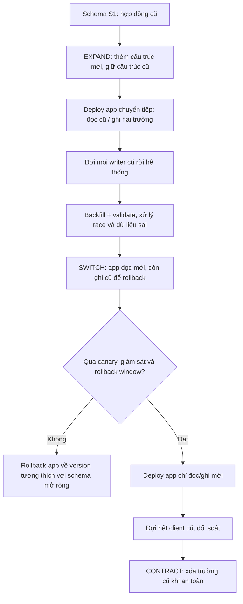
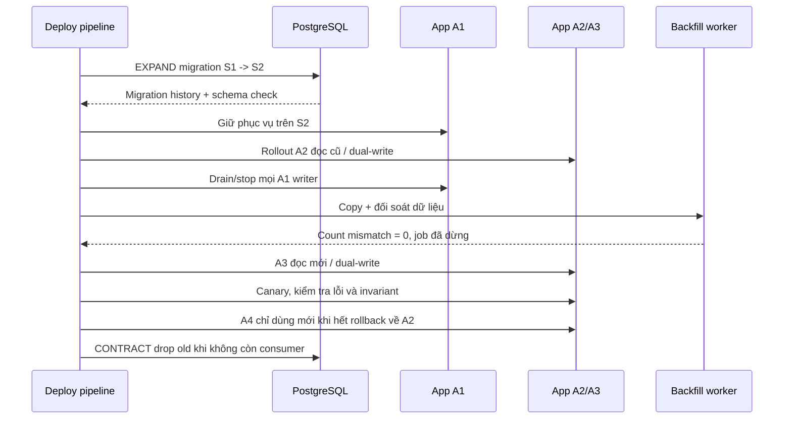

# Thay đổi lược đồ mà không xét nhiều phiên bản ứng dụng

## Mục tiêu học tập

Sau bài học, người học có thể:

- Giải thích vì sao **schema migration chạy thành công** chưa đủ để một hệ thống persistence được xem là triển khai an toàn.
- Xác định mọi phiên bản ứng dụng, worker, consumer, job và công cụ đọc dữ liệu có thể đồng thời sử dụng một schema trong rolling deployment, canary, blue-green và rollback.
- Lập **ma trận tương thích ứng dụng–schema**, phân biệt thay đổi tương thích ngược, tương thích xuôi và thay đổi phá vỡ hợp đồng.
- Thực hiện chiến lược **expand → migrate/backfill → switch → contract** mà không xóa hợp đồng cũ khi còn client sử dụng.
- Phân tích ví dụ PostgreSQL/Java về đổi tên cột, thêm ràng buộc, chuyển kiểu, tạo index và chuyển ngữ nghĩa dữ liệu; nhận diện các cuộc đua giữa backfill và writer.
- Thiết kế rollout, feature flags, kiểm thử nhiều phiên bản, đối soát và kế hoạch rollback/roll-forward dựa trên dữ liệu có thật.
- Giữ các bảo đảm giao dịch, phân quyền, độ bền và quan sát vận hành trong suốt quá trình tiến hóa schema.

## 1. Sai lầm điển hình: database đúng phiên bản mới, ứng dụng cũ vẫn đang chạy

Một ứng dụng Java quản lý khách hàng có bảng PostgreSQL:

```sql
CREATE TABLE customer (
    id UUID PRIMARY KEY,
    tenant_id UUID NOT NULL,
    full_name TEXT NOT NULL
);
```

Ứng dụng **v1** thực thi:

```sql
SELECT id, full_name
FROM customer
WHERE tenant_id = ? AND id = ?;
```

Đội phát triển muốn chuẩn hóa tên thành `display_name` nên chạy:

```sql
-- THAY ĐỔI PHÁ VỠ HỢP ĐỒNG: không thực hiện trực tiếp khi v1 còn chạy.
ALTER TABLE customer RENAME COLUMN full_name TO display_name;
```

Migration trên database **thành công**. Nhưng instance v1 chưa được thay hết có thể trả lỗi PostgreSQL `42703` (undefined column), vì mã SQL/JPA của nó vẫn tham chiếu `full_name`. Nếu v2 được rollout theo từng pod và v1 vẫn xử lý request, lỗi chỉ xảy ra trên một phần traffic, khó tái hiện với môi trường chỉ chạy phiên bản mới.

Điều tương tự xảy ra nếu:

- Xóa một cột cũ trước khi tất cả worker ngừng dùng;
- Đổi kiểu hoặc ý nghĩa cột nhưng consumer cũ vẫn diễn giải theo quy ước trước;
- Thêm `NOT NULL` trước khi code cũ biết cách ghi trường mới;
- Bật ràng buộc unique/FK trước khi dữ liệu cũ được dọn và các writer cũ tuân theo;
- Xóa enum value hoặc đổi trạng thái mà một client cũ vẫn tạo ra;
- Chạy code mới trước khi một bảng/cột/index bắt buộc đã có;
- Rollback application sau khi schema hoặc dữ liệu đã chuyển theo cách không đọc được bằng code cũ.

**Nguyên tắc:** tính tương thích phải được xem tại **mọi cặp phiên bản có thể cùng hoạt động trong thời gian rollout**, không chỉ so `app-v2` với `schema-v2` tại thời điểm deploy hoàn tất.

### Liên hệ với nền tảng lưu trữ dữ liệu bền vững

Chủ đề nằm trong chương **Lỗi thiết kế** của module `DATA_PERSISTENCE_FUNDAMENTALS`. Việc tiến hóa lược đồ ảnh hưởng trực tiếp đến ranh giới persistence của Java, tính nhất quán giao dịch, chỉ mục và query plan, khóa DDL, bảo mật, khôi phục, backup và độ tin cậy khi triển khai. Một migration có cú pháp hợp lệ vẫn có thể làm mất khả năng phục vụ hoặc phá bất biến nghiệp vụ nếu **vòng đời phiên bản và dữ liệu** bị bỏ qua.

## 2. “Nhiều phiên bản ứng dụng” bao gồm những thành phần nào?

Không chỉ HTTP pods mới là client của database:

| Thành phần | Vì sao có thể tồn tại phiên bản cũ? | Rủi ro với schema mới |
| --- | --- | --- |
| HTTP API Java v1/v2 | Rolling update, canary, blue-green, autoscaling | Một số request lỗi hoặc đọc/ghi khác ngữ nghĩa |
| Background worker | Queue backlog, job sống lâu, replica service deploy độc lập | Worker cũ còn ghi trường bị xóa hoặc enum cũ |
| Scheduled/batch job | Chạy ban đêm, image cũ, job tạm dừng rồi resume | Job chỉ hỏng khi tới kỳ chạy |
| Message consumer/CDC | Event cũ đang trong broker; offset không đồng bộ | Consumer diễn giải schema/event payload sai |
| Reporting, BI, ETL | SQL hard-coded, view/materialized view ngoài repo | Báo cáo thiếu cột, dữ liệu bị đếm sai |
| Admin script/ops tool | Dùng script cũ lúc khẩn cấp | Sửa nhầm dữ liệu hoặc không chạy được |
| Mobile/offline clients | Client gửi payload theo contract API cũ | Application mới phải dịch dữ liệu mà client vẫn gửi |
| Read replicas / DR | Độ trễ replication, restore từ backup đời trước | Query/schema/version không cùng trạng thái |
| Hibernate/JPA mapping và JDBC | Có thể chạy cùng lúc từ nhiều image | Entity/SQL mapping không khớp database |

Một client **không truy cập database trực tiếp** vẫn có thể ảnh hưởng migration: ví dụ mobile cũ chỉ gửi `name` còn HTTP API mới dự kiến `displayName` bắt buộc. Hợp đồng API và schema database là hai ranh giới khác nhau, nhưng thay đổi ở một ranh giới có thể làm ranh giới kia không tương thích.

### 2.1. Các kiểu triển khai phổ biến

- **Rolling deployment:** pod v1 và v2 hoạt động đồng thời. Đôi khi rollback quay lại v1 sau khi v2 đã ghi dữ liệu mới.
- **Canary:** 1% traffic chạy v2, 99% vẫn ở v1; cả hai truy cập cùng dữ liệu. Trạng thái v2 ghi ra có thể được v1 đọc sau đó.
- **Blue-green:** nhóm blue/green tách ứng dụng nhưng cùng database; chuyển route không đồng nghĩa blue đã hoàn toàn ngừng ghi vì còn in-flight jobs hoặc connection.
- **Multi-region:** một region có thể deploy trễ hơn; schema chung hoặc replication được cập nhật không cùng thời điểm.
- **Long-running batch / queue:** version cũ có thể còn hoạt động lâu hơn thời gian rollout API.

Do đó, “mọi pod mới đã healthy” **không chứng minh** “không còn writer cũ”. Cần quan sát worker, job, queue và đường kết nối thật.

## 3. Ma trận tương thích: câu hỏi phải trả lời trước migration

Đặt:

- `A1`: mã Java hiện hành, chỉ biết schema cũ.
- `A2`: mã chuyển tiếp, hiểu cả schema cũ và mở rộng.
- `A3`: mã dùng hợp đồng mới nhưng còn hỗ trợ rollback phù hợp.
- `S1`: schema cũ.
- `S2`: schema mở rộng, có cả trường cũ và trường mới.
- `S3`: schema rút gọn, đã loại trường cũ.

### 3.1. Bảng tương thích minh họa

| Application | S1: chỉ `full_name` | S2: cả hai cột | S3: chỉ `display_name` |
| --- | --- | --- | --- |
| **A1** đọc/ghi `full_name` | Hoạt động | Hoạt động nếu không có constraint mới chặn write cũ | **Không hoạt động** |
| **A2** đọc legacy, ghi cả hai | Chỉ nếu code có fallback theo schema; thông thường **không** | Hoạt động theo kế hoạch | **Không hoạt động** nếu vẫn ghi legacy |
| **A3** đọc mới, còn ghi cả hai để hỗ trợ rollback | Không hoạt động | Hoạt động khi dữ liệu đã backfill/hội tụ | Không hoạt động nếu vẫn ghi legacy |
| **A4** chỉ đọc/ghi trường mới | Không hoạt động | Hoạt động | Hoạt động |

Ma trận là **hợp đồng thiết kế cụ thể của ví dụ**, không phải quy luật mọi migration. Vấn đề quan trọng là xác định **cặp nào thực sự có thể gặp nhau** và test chúng; các cặp không tương thích phải bị ngăn bởi thứ tự triển khai và gate.

### 3.2. Ba loại tương thích cần phân biệt

1. **Ứng dụng cũ dùng schema mới (backward-compatible schema):** code v1 vẫn chạy khi database đã thêm cột/index mới. Đây thường là điều kiện đầu của rolling deployment.
2. **Ứng dụng mới dùng schema cũ (forward-compatible application):** code v2 có chạy được nếu migration chưa hoàn tất hoặc rollout bị đảo thứ tự không? Không bắt buộc mọi thiết kế phải hỗ trợ cặp này, nhưng nếu không thì phải có gate “schema trước code”.
3. **Tương thích dữ liệu qua hai chiều ghi/đọc:** v1 có đọc đúng dữ liệu do v2 ghi và ngược lại không? Việc SQL vẫn chạy không đảm bảo giá trị đúng khi **ngữ nghĩa dữ liệu** đã thay đổi.

Một cột mới có thể khiến app cũ vẫn chạy, nhưng một hàng mới do v2 tạo với status `ARCHIVED` có thể khiến v1 ném exception trong `switch` hoặc mapper enum. Đó là lỗi **semantic compatibility**, không phải thiếu cột.

### 3.3. Các chiều tương thích phải chứng minh

| Chiều | Kiểm tra |
| --- | --- |
| Đọc | Query/JPA còn select được? Dữ liệu null/giá trị mới có được xử lý đúng? |
| Ghi | Insert/update từ version cũ có vi phạm NOT NULL/check/FK không? |
| Giao dịch | Invariant không bị phá bởi writer cũ trong giai đoạn chuyển tiếp? |
| Bảo mật | RLS/GRANT/default có khiến version cũ vô tình lộ hoặc mất quyền không? |
| Sự kiện | Outbox/CDC/consumer cũ có đọc được payload/field mới? |
| Rollback | Code cũ có tiếp tục đọc/ghi đúng sau khi code mới đã commit dữ liệu? |
| Hiệu năng | DDL, backfill, index và hai đường ghi có ảnh hưởng lock/WAL/CPU/pool? |
| Khôi phục | Backup/DR restore schema đời trước có đường nâng cấp và app tương thích? |

## 4. Chiến lược expand → migrate → switch → contract

Thay vì đổi schema và code trong một lần “all-or-nothing” ở cấp deploy, chia thành các **bước tương thích**:



### 4.1. EXPAND: chỉ bổ sung khả năng mới

Ví dụ thêm nullable column, bảng mới, index mới, ràng buộc chưa validate. Mục tiêu: **app cũ vẫn có thể ghi và đọc**. Không được thêm `NOT NULL` mới nếu writer cũ chưa có đường cung cấp giá trị hợp lệ.

**Thêm cột không mặc nhiên vô hại:** một default phức tạp có thể làm DDL nặng; `SELECT *`, ORM mapping theo thứ tự cột, trigger hoặc serialization tự động vẫn có thể bị ảnh hưởng. Với PostgreSQL, phải kiểm tra phiên bản, loại DDL và lock thực tế thay vì coi mọi `ADD COLUMN` đều zero-downtime.

### 4.2. MIGRATE: chuyển ứng dụng và dữ liệu theo thứ tự

Đưa app chuyển tiếp vào trước, sau đó backfill theo batch với điều kiện idempotent, ghi nhận tiến độ. Nếu writer cũ vẫn sửa legacy field, dữ liệu mới có thể bị **lệch sau backfill**. Vì vậy phải có cơ chế đồng bộ (dual-write/trigger/CDC hoặc xác nhận old writer đã rời) và gate kiểm tra convergence.

Không dùng một lần `UPDATE` toàn bảng trên dữ liệu lớn mà chưa tính lock, WAL, replication lag và khả năng retry. Một backfill ngắt giữa chừng phải được resume an toàn.

### 4.3. SWITCH: đọc từ cấu trúc mới khi đã đủ điều kiện

Đổi read path/feature flag **sau khi backfill và đối soát**, theo từng đợt canary. Nếu cần rollback app về phiên bản chuyển tiếp, giữ write path legacy trong khoảng thời gian đó. Đổi read path trước khi dữ liệu cũ được chuyển đầy đủ có thể trả null/sai giá trị mà không có lỗi SQL.

### 4.4. CONTRACT: xóa hợp đồng cũ muộn hơn

Chỉ drop/rename lại cột legacy khi:

- Không còn ứng dụng, worker, job, reporting hoặc script cần cột ấy;
- Khoảng rollback về code cũ đã kết thúc;
- Data convergence/invariant đã được kiểm tra;
- Backup/DR và lịch triển khai tương thích với schema thu gọn;
- Đã dự trù DDL lock và kế hoạch xử lý lỗi;
- Có phê duyệt của owner nghiệp vụ và vận hành theo mức rủi ro.

**Contract là một đợt triển khai riêng**, không nên tự động chạy ngay sau khi v2 đạt 100% traffic. Cần nhớ các consumer và job có thể còn xử lý tác vụ từ thời điểm trước rollout.

## 5. Ví dụ xuyên suốt: đổi `customer.full_name` thành `display_name`

Giả định PostgreSQL có nhiều triệu khách hàng, một số JVM v1 còn chạy trong rolling deployment, và tên được phép cập nhật trong khi triển khai. Mục tiêu cuối cùng là giữ giá trị nghiệp vụ như cũ nhưng đổi tên thuộc tính trong persistence.

### 5.1. Bước 0 — Xác định owner, dữ liệu và writer

Trước khi động đến schema, kiểm kê:

- API tạo/sửa khách hàng ở những version nào;
- Worker cập nhật thông tin khách hàng và các batch script định kỳ;
- JPA entity, native query, SQL view, báo cáo và consumer nào còn dùng `full_name`;
- Cơ chế rollback tới phiên bản ứng dụng nào được phép;
- Data quality: `full_name` có null/bất thường không, mặc dù schema khai báo `NOT NULL`;
- Quyền `GRANT`/RLS, cache keys, event payload, audit và hệ thống tìm kiếm liên quan.

Định nghĩa invariant trong suốt quá trình: **một customer ở bất kỳ thời điểm commit nào cũng có một tên hiển thị hợp lệ, và mọi phiên bản được phép hoạt động phải thấy giá trị phù hợp với hợp đồng của mình**. Trong chuyển tiếp có thể tồn tại hai cột, nhưng không được cho phép chúng âm thầm phân kỳ khi đã chuyển read path.

### 5.2. Bước 1 — EXPAND chỉ thêm cột

```sql
-- Schema S2. Cột mới nullable để writer v1 vẫn INSERT được.
ALTER TABLE customer
ADD COLUMN display_name TEXT;
```

Không đổi tên hoặc xóa `full_name` ở bước này. Không thêm `display_name TEXT NOT NULL` vì v1 chưa biết cung cấp giá trị cho nó. Cần kiểm tra lock, thời gian chạy và migration history; kể cả câu `ALTER TABLE` ngắn cũng cần khóa metadata/DDL và có thể phải chờ transaction dài.

Trước khi đưa app mới vào traffic, xác nhận S2 đã có ở primary phù hợp, toàn bộ database/shard mà v2 dùng đã được migrate đúng version, và các quyền của DB role cho phép truy cập cột mới.

### 5.3. Bước 2 — A2: đọc legacy, ghi đồng thời hai cột

Đây là **phiên bản chuyển tiếp**. Vì A1 có thể vẫn cập nhật `full_name`, A2 **chưa đọc `display_name` làm nguồn có thẩm quyền**. A2 đọc legacy nhưng khi sửa dữ liệu thì ghi cùng giá trị vào hai cột **trong một SQL/transaction địa phương**.

```java
import java.sql.Connection;
import java.sql.PreparedStatement;
import java.sql.SQLException;
import java.util.Objects;
import java.util.UUID;
import javax.sql.DataSource;

public final class CustomerNameWriterV2 {
    private final DataSource dataSource;

    public CustomerNameWriterV2(DataSource dataSource) {
        this.dataSource = Objects.requireNonNull(dataSource);
    }

    public void rename(UUID tenantId, UUID customerId, String newName)
            throws SQLException {
        if (tenantId == null || customerId == null
                || newName == null || newName.isBlank()) {
            throw new IllegalArgumentException("Invalid customer name");
        }

        String sql = """
                UPDATE customer
                SET full_name = ?, display_name = ?
                WHERE tenant_id = ? AND id = ?
                """;
        try (Connection connection = dataSource.getConnection();
             PreparedStatement statement = connection.prepareStatement(sql)) {
            statement.setString(1, newName);
            statement.setString(2, newName);
            statement.setObject(3, tenantId);
            statement.setObject(4, customerId);

            if (statement.executeUpdate() != 1) {
                throw new IllegalStateException("Customer not found or denied");
            }
        }
    }
}
```

Đây là ví dụ giản lược: `UPDATE` đơn lẻ chạy atomically theo transaction PostgreSQL, connection mặc định auto-commit theo DataSource bình thường. Nếu thao tác còn cập nhật audit/outbox hoặc nhiều bảng, phải dùng **cùng transaction** và quản lý rollback đúng cách. Giá trị `tenantId` phải đến từ authorization context được kiểm chứng; ví dụ không giải quyết đầy đủ phân quyền, concurrency version hay audit.

**Các writer khác cũng phải tuân theo hợp đồng.** Đặc biệt, đường `INSERT` của A2 phải ghi `full_name` và `display_name` cùng giá trị; không chỉ sửa đường `UPDATE`. Nếu dùng JPA, mapping và lifecycle hooks phải được kiểm tra để đảm bảo không có đường ghi nào bỏ sót.

Trong giai đoạn A1 và A2 cùng hoạt động:

- A1 tiếp tục ghi **chỉ** `full_name`;
- A2 ghi **cả hai** và đọc `full_name`;
- `display_name` có thể null hoặc lạc hậu ngay sau một cập nhật của A1;
- Không được chuyển tất cả reader sang cột mới chỉ vì A2 đã bắt đầu dual-write.

### 5.4. Bước 3 — Drain hết writer A1, rồi backfill

Điều kiện mở gate:

1. HTTP pods A1 đã ngừng nhận request và hoàn thành/drain in-flight transactions;
2. Worker, scheduler, job dài và công cụ ghi cũ đã dừng hoặc nâng lên A2;
3. Có bằng chứng từ deployment inventory, logs/metrics phiên bản ứng dụng và trạng thái connection/routing;
4. Nếu còn nguồn ghi ngoài API, đã có một cơ chế đồng bộ/fencing riêng — không dựa vào giả định “chắc không còn”.

Sau đó chạy backfill **idempotent theo batch**, ví dụ:

```sql
-- PostgreSQL minh họa: gọi lặp nhiều transaction nhỏ.
-- Phù hợp khi đã loại writer chỉ cập nhật full_name.
WITH batch AS (
    SELECT id
    FROM customer
    WHERE display_name IS DISTINCT FROM full_name
    ORDER BY id
    LIMIT 500
    FOR UPDATE SKIP LOCKED
)
UPDATE customer AS c
SET display_name = c.full_name
FROM batch AS b
WHERE c.id = b.id;
```

Lặp đến khi các lần quét cuối không còn hàng khác nhau. `IS DISTINCT FROM` xử lý cả khác biệt có null; `SKIP LOCKED` hỗ trợ nhiều worker backfill tránh chờ hàng đang bị khóa, nhưng một lần batch không chọn được hàng **không chứng minh** toàn bảng đã hội tụ nếu có hàng bị khóa hoặc worker khác đang xử lý. Sau khi dừng các writer legacy, cần một **đợt đối soát cuối** dưới điều kiện có kiểm soát, không chỉ dựa vào lần `UPDATE 0`.

Ví dụ kiểm tra:

```sql
SELECT count(*) AS remaining_mismatches
FROM customer
WHERE display_name IS DISTINCT FROM full_name;

SELECT count(*) AS missing_display_name
FROM customer
WHERE display_name IS NULL;
```

Kỳ vọng trước khi switch: cả hai đều bằng **0** theo invariant giả định. Với bảng lớn, các query toàn bảng có thể tốn I/O; cần thực hiện theo kế hoạch vận hành, có thể chia phân đoạn/checkpoint và cuối cùng xác nhận đầy đủ bằng phương pháp được duyệt.

### 5.5. Cuộc đua giữa backfill và writer

Hai cách dễ sai:

**Sai 1 — Backfill một lần khi A1 vẫn chạy:**

```text
10:00 Backfill copy full_name="Lan" sang display_name="Lan".
10:01 Một pod A1 đổi full_name="Linh", không sửa display_name.
10:02 A3 đọc display_name="Lan" và trả dữ liệu cũ.
```

**Sai 2 — Dual-write thành hai transaction độc lập:**

```text
Transaction 1: UPDATE full_name ...; COMMIT.
Process chết trước Transaction 2.
Transaction 2: UPDATE display_name ...; (không chạy)
```

Muốn giữ cả hai cột đồng bộ phải ghi trong **một transaction** hoặc có cơ chế đáng tin cậy sửa lệch với quy tắc version rõ ràng. Có thể dùng trigger trong DB để đồng bộ các thay đổi legacy trong thời gian chuyển tiếp, nhưng trigger có các vấn đề riêng về thứ tự cập nhật, recursion, hiệu năng, quyền và việc tránh ghi đè từ hai nguồn. Không triển khai hai nguồn có thể chỉnh ngược nhau mà chưa định nghĩa **field authority**.

Trong ví dụ này, chiến lược đơn giản là: **`full_name` là nguồn có thẩm quyền cho tới khi tất cả A1 rời hệ thống và backfill hoàn tất; sau gate đó, A2/A3 cùng ghi hai cột; A3 mới bắt đầu đọc `display_name`**.

### 5.6. Bước 4 — Thêm invariant trên cột mới, chỉ sau khi writer cũ đã rời

Ví dụ PostgreSQL hỗ trợ `CHECK ... NOT VALID` rồi `VALIDATE CONSTRAINT` để tách thời điểm bắt đầu áp constraint với quá trình quét dữ liệu lịch sử:

```sql
-- Chỉ sau khi không còn writer chỉ ghi full_name.
ALTER TABLE customer
ADD CONSTRAINT customer_display_name_present
CHECK (display_name IS NOT NULL) NOT VALID;

-- Chạy sau khi backfill xong. Có thể mất thời gian vì phải quét dữ liệu.
ALTER TABLE customer
VALIDATE CONSTRAINT customer_display_name_present;
```

**Quan trọng:** `NOT VALID` không có nghĩa constraint bị bỏ qua cho các hàng mới hoặc hàng được cập nhật sau khi tạo constraint. Trong PostgreSQL, CHECK constraint dạng này vẫn được enforce đối với thao tác ghi mới; chỉ việc kiểm tra toàn bộ dữ liệu lịch sử được trì hoãn. Nếu bật quá sớm, một phiên bản cũ INSERT thiếu cột mới sẽ thất bại.

Sau khi `CHECK` hợp lệ, có thể cân nhắc `ALTER COLUMN display_name SET NOT NULL` theo hỗ trợ/phiên bản PostgreSQL thực tế. Một số phiên bản có thể tận dụng CHECK constraint đã validate để tránh quét lại toàn bảng; **vẫn cần cân nhắc DDL lock và đo thời gian**. Không mặc định mọi `SET NOT NULL` trên bảng lớn đều an toàn, không có downtime.

### 5.7. Bước 5 — A3 đọc mới, vẫn dual-write trong cửa sổ rollback

A3 bắt đầu đọc:

```sql
SELECT id, display_name
FROM customer
WHERE tenant_id = ? AND id = ?;
```

A2 và A3 cùng ghi **hai cột trong một transaction**, nên A2 (đọc legacy) và A3 (đọc mới) thấy cùng giá trị nếu writer đều tuân hợp đồng. Trong giai đoạn này, có thể rollback A3 về A2 mà **không cần rollback schema**, vì S2 vẫn còn cả hai cột và dữ liệu legacy được duy trì.

Nếu A3 phát hiện null hoặc mismatch sau gate, nên phát cảnh báo và xử lý sai lệch thay vì âm thầm dùng `COALESCE(display_name, full_name)` mãi mãi. Fallback không giới hạn có thể che lỗi đồng bộ và khiến đội tưởng migration đã hoàn tất dù hai nguồn dữ liệu vẫn khác nhau.

### 5.8. Bước 6 — A4 chỉ dùng mới; sau đó CONTRACT

Khi hết thời hạn rollback về A2/A3 và các client còn dùng `full_name` đã được loại bỏ:

1. Deploy A4 chỉ đọc/ghi `display_name`. Trong giai đoạn A3 và A4 đồng thời, cả hai đọc mới; A3 còn ghi legacy nhưng không ảnh hưởng read path.
2. Xác nhận không còn A2, A3 hoặc writer/report nào cần `full_name`.
3. Giữ gate theo thời gian/traffic đủ đại diện và đối soát application/query.
4. Thực hiện **một migration riêng** để bỏ `full_name`:

```sql
-- CONTRACT: chỉ sau khi không còn consumer hoặc rollback cần cột cũ.
ALTER TABLE customer DROP COLUMN full_name;
```

`DROP COLUMN` là bước **khó rollback** hơn thêm cột: một ứng dụng A2/A3 cũ sẽ lỗi nếu quay lại; dữ liệu legacy không còn ngay trong schema. PostgreSQL có thể không thu hồi toàn bộ dung lượng vật lý ngay sau khi drop column, tùy storage/maintenance; không dùng drop để dự đoán ngay kích thước file giảm mạnh.

### 5.9. Ma trận gate cuối của ví dụ

| Thời điểm | Schema | Các writer được phép | Reader được phép | Điều kiện quan trọng |
| --- | --- | --- | --- | --- |
| Trước deploy | S1 | A1 | A1 | Cột legacy tồn tại |
| Sau expand | S2 | A1, A2 | A1, A2 đọc legacy | Cột mới nullable, chưa bắt NOT NULL |
| Sau drain A1/backfill | S2 | A2 | A2 đọc legacy | Mismatch = 0, không writer cũ |
| Canary A3 | S2 | A2, A3 dual-write | A2 legacy, A3 new | Constraint mới hợp lệ, theo dõi convergence |
| Sau chuyển read | S2 | A3, A4 | A3, A4 new | Không cần rollback về A2 |
| Sau contract | S3 | A4 | A4 | Không có client cũ, backup/DR đã chuẩn bị |

Đừng lấy bảng này làm một trình tự bất biến cho mọi hệ thống. Nếu có dịch vụ không thể loại A1 sớm, cần cơ chế đồng bộ legacy→new như trigger/CDC với hợp đồng không lùi version, hoặc **hoãn switch read**. Mấu chốt là **gate dựa trên bằng chứng**, không dựa vào cảm giác “rollout chắc đã xong”.

## 6. Các thao tác DDL tưởng đơn giản nhưng có thể phá nhiều phiên bản

Không phải mọi thay đổi schema đều là đổi tên cột. Một số thay đổi trông giống “chỉ tăng độ chặt chẽ” lại làm code cũ không thể ghi.

### 6.1. Thêm cột bắt buộc quá sớm

Giả sử `purchase_order` chỉ có `customer_id` và `total_amount`. Ứng dụng mới muốn thêm `currency_code`. Nếu trực tiếp thêm cột `NOT NULL` không có default hợp lệ:

```sql
-- Không áp dụng bừa trên hệ thống có dữ liệu và writer cũ.
ALTER TABLE purchase_order
ADD COLUMN currency_code TEXT NOT NULL;
```

Thao tác có thể thất bại khi bảng đã chứa dữ liệu, và các phiên bản app cũ không cung cấp `currency_code` có thể không insert được. Một phương án theo pha:

1. Thêm `currency_code TEXT` **nullable**; dữ liệu cũ vẫn hợp lệ về cấu trúc.
2. Deploy app mới ghi currency theo **nguồn nghiệp vụ có thẩm quyền**.
3. Xác minh mọi writer cũ đã được nâng cấp hoặc có default/adapter thực sự đúng về ý nghĩa.
4. Backfill tiền tệ cho dữ liệu cũ từ thông tin đáng tin cậy, không tự điền `'USD'` nếu có đơn nhiều loại tiền.
5. Đối soát dữ liệu, thêm/check `CHECK (currency_code IS NOT NULL) NOT VALID` rồi validate, hoặc triển khai `NOT NULL` theo phương án PostgreSQL/version phù hợp.
6. Bỏ fallback và rút hợp đồng cũ chỉ khi tất cả consumer đã hiểu tiền tệ.

**Default chỉ hợp lệ khi đúng về nghiệp vụ.** `DEFAULT 'VND'` có thể tương thích về SQL nhưng sai về số tiền của giao dịch quốc tế. Khi ý nghĩa trường mới phụ thuộc lịch sử, phải có đường xác định thật, xử lý trường hợp không chắc chắn, hoặc giữ trạng thái `UNKNOWN` với quy tắc rõ ràng.

### 6.2. Đổi kiểu dữ liệu in-place

Một migration:

```sql
-- Đề xuất nguy hiểm khi có nhiều code path và bảng lớn.
ALTER TABLE purchase_order
ALTER COLUMN total_amount TYPE BIGINT
USING total_amount::bigint;
```

có thể phá hợp đồng nếu v1 còn mapping `NUMERIC` sang `BigDecimal` và hiểu số tiền theo đơn vị chính, trong khi v2 hiểu `BIGINT` là số đơn vị nhỏ nhất. Phép cast trên cũng có thể **làm mất phần thập phân**, hoặc lỗi nếu giá trị không chuyển được. Dù SQL có chạy thành công, số tiền có thể sai theo hệ số 100.

Phương án thận trọng là thêm cột mới `amount_minor_units BIGINT`, xây bộ chuyển đổi **có currency/scale/rounding rule** trong domain, dual-write nhất quán, backfill/đối soát theo từng loại tiền, rồi switch reader và contract ở các đợt khác nhau. Khi hai trường biểu thị **hai đơn vị đo khác nhau**, không thể copy raw số mà coi là hoàn tất migration.

### 6.3. Thêm unique constraint trên dữ liệu có sẵn

Giả sử cần email duy nhất theo tenant. Trước khi thêm uniqueness, phải:

- Xác định cách chuẩn hóa email: case sensitivity, khoảng trắng, Unicode, NULL và quy tắc sản phẩm;
- Tìm và xử lý **duplicate đang tồn tại** theo quyết định nghiệp vụ;
- Xác minh v1 không còn tạo duplicate hợp lệ theo hợp đồng cũ;
- Tính tác động lock/index build, retry, WAL và tình trạng replication;
- Kiểm tra thứ tự triển khai của code xử lý unique conflict.

Một ví dụ PostgreSQL (chỉ là ứng viên trong môi trường đã kiểm tra dữ liệu):

```sql
-- Chạy bên ngoài transaction block trên PostgreSQL.
CREATE UNIQUE INDEX CONCURRENTLY idx_customer_tenant_email
ON customer (tenant_id, email);
```

`CREATE INDEX CONCURRENTLY` giảm thời gian chặn thao tác ghi trong quá trình tạo index so với một số kiểu tạo index thông thường, nhưng **không miễn phí và không không-lock hoàn toàn**. Nó không được chạy trong transaction block tường minh; nếu thất bại, PostgreSQL có thể để lại **index INVALID** cần kiểm tra và dọn theo quy trình. Việc xây unique index có thể gặp duplicate do các writer đang chạy; constraint/uniqueness cũng có thể bắt đầu ảnh hưởng thao tác ghi trước khi toàn bộ quá trình tạo index hoàn tất.

Không dùng `UNIQUE NOT VALID` như thể PostgreSQL cho phép mọi unique constraint tạo trước rồi validate giống CHECK/FK: **chiến lược NOT VALID cho CHECK/FK không áp dụng trực tiếp cho UNIQUE theo cùng cách**. Nếu cần ràng buộc dạng constraint thay vì index riêng, hãy kiểm tra điều kiện của `ALTER TABLE ... ADD CONSTRAINT ... UNIQUE USING INDEX ...` trên PostgreSQL đang dùng.

### 6.4. Thêm foreign key

Một worker v1 từng ghi `order_item` trước khi tạo `purchase_order`, sau đó sửa dữ liệu bằng batch. Nếu thêm FK không cho phép orphan ngay lập tức, writer cũ có thể lỗi.

Ví dụ PostgreSQL:

```sql
-- Chỉ sau khi đã xác định quan hệ và chính sách writer.
ALTER TABLE order_item
ADD CONSTRAINT order_item_order_fk
FOREIGN KEY (order_id)
REFERENCES purchase_order (id)
NOT VALID;

-- Sau khi dọn các dữ liệu lịch sử không hợp lệ:
ALTER TABLE order_item
VALIDATE CONSTRAINT order_item_order_fk;
```

`NOT VALID` có thể trì hoãn kiểm tra các hàng cũ, nhưng **ghi mới vẫn phải tuân FK**. Nếu code v1 tiếp tục tạo dữ liệu tạm thiếu parent, thêm FK sẽ làm nó thất bại. Cần sửa workflow/transaction trước; không chỉ dựa vào việc validate chưa chạy.

### 6.5. Đổi hoặc xóa trạng thái enum

Nếu v2 ghi trạng thái `ON_HOLD` và v1 có:

```java
enum OrderState {
    CREATED, PAID, CANCELLED
}

// V1 có thể lỗi nếu đọc "ON_HOLD" từ database.
OrderState state = OrderState.valueOf(rawStatus);
```

thì việc **thêm giá trị mới** có thể phá **đường đọc v1**, dù không thay schema. Cần deploy reader tolerant/có trạng thái fallback được định nghĩa trước khi producer bắt đầu ghi giá trị mới. Không được gộp mọi trạng thái không biết vào `PAID` hoặc `CANCELLED` chỉ để tránh exception: điều đó có thể phá luồng tài chính.

Với PostgreSQL enum type, hành vi `ALTER TYPE ... ADD VALUE`, transaction và rollback khác nhau theo phiên bản. Cần xác minh runbook của hệ quản trị/công cụ migration cụ thể, không suy rằng `DROP TYPE` hoặc xóa enum value có thể undo an toàn mọi dữ liệu đã lưu.

### 6.6. Thay default, constraint hoặc ý nghĩa cột

Thay `DEFAULT false` thành `DEFAULT true` có thể làm writer v1 INSERT không nêu cột bắt đầu tạo dữ liệu với ngữ nghĩa khác mà **không có SQL error**. Đó là silent data corruption ở tầng nghiệp vụ. Tương tự:

- Đổi cách tính số tiền từ thuế chưa tính sang đã tính;
- Đổi timestamp từ giờ local sang UTC nhưng giữ cùng kiểu;
- Đổi `status` từ “đang xử lý” sang “đã xác nhận”;
- Đổi cột định danh từ unique trong tenant thành unique toàn hệ thống;
- Tách một bảng sang nhiều shard với routing mới;
- Thay điều kiện mặc định của query hoặc view báo cáo.

**Tương thích cấu trúc không đủ**; phải kiểm thử **ý nghĩa của dữ liệu ghi bởi mọi version**. Một migration không gây lỗi ở SQL có thể nguy hiểm hơn một lỗi `42703` vì nó tồn tại âm thầm.

## 7. Lock và hiệu năng migration cũng là một phần của tính tương thích

Trong PostgreSQL, nhiều thao tác `ALTER TABLE` cần lock mạnh để thay metadata hoặc kiểm tra dữ liệu. Một DDL phải chờ transaction dài có thể làm các query khác **xếp hàng phía sau**; toàn bộ ứng dụng bị tăng latency dù migration chỉ có một câu SQL.

### 7.1. Đừng đánh đồng “online migration” với “không gây ảnh hưởng”

| Thao tác | Nguy cơ vận hành | Cách chuẩn bị |
| --- | --- | --- |
| `ADD COLUMN` | DDL lock, thay đổi cấu trúc cho ORM/positional insert | Đo trên phiên bản PostgreSQL và bảng đại diện |
| `SET DEFAULT` / default phức tạp | Cách xử lý dữ liệu cũ và chi phí tùy version/biểu thức | Kiểm tra ngữ nghĩa, rewrite/lock nếu có |
| `ALTER COLUMN TYPE` | Có thể rewrite bảng, giữ lock lâu, tăng WAL | Ưu tiên cột mới/backfill khi cần |
| `CREATE INDEX CONCURRENTLY` | Chờ transaction/snapshot, thêm I/O, có thể để INVALID | Chạy tách transaction, theo dõi tiến độ và failure cleanup |
| `VALIDATE CONSTRAINT` | Quét bảng và tranh chấp I/O, vẫn có khóa | Chạy giờ phù hợp, giám sát và chia pha |
| `DROP COLUMN` | DDL lock và chấm dứt hợp đồng cũ | Thực hiện sau gate client/rollback, có stop condition |
| Backfill hàng triệu row | WAL bùng, replica lag, lock row, dead tuple | Batch, throttle, checkpoint, idempotency |

Với PostgreSQL mới, thêm cột có default không volatile có thể được tối ưu để tránh rewrite trong một số trường hợp; **điều này phụ thuộc phiên bản và biểu thức**, không cho phép coi mọi `ADD COLUMN DEFAULT` đều rẻ. Cần đo thực tế, đặc biệt nếu bảng lớn hoặc có transaction dài.

### 7.2. Giới hạn thời gian chờ DDL

Một migration được chuẩn bị kỹ có thể đặt `lock_timeout` và `statement_timeout` phù hợp để **thất bại có kiểm soát** thay vì chặn lưu lượng kéo dài:

```sql
-- Minh họa trên môi trường thử nghiệm/đợt migration được quản lý.
BEGIN;
SET LOCAL lock_timeout = '3s';
SET LOCAL statement_timeout = '30s';

ALTER TABLE customer
ADD COLUMN migration_batch_id BIGINT;

COMMIT;
```

Ví dụ chỉ để minh họa cơ chế giới hạn thời gian, **không đề xuất thêm cột này** vào bài toán đổi tên. Khi lệnh bị timeout, transaction có thể ở trạng thái lỗi và phải được rollback theo tool; không tự retry vô hạn. Chọn timeout dựa trên SLO, khối lượng và behavior của DBMS.

**Lưu ý:** `CREATE INDEX CONCURRENTLY` không được đặt trong một `BEGIN ... COMMIT` như trên. Một migration runner như Flyway/Liquibase có thể mặc định bao mỗi migration trong transaction tùy loại script/DBMS; phải khai báo cách chạy **non-transactional migration** phù hợp với phiên bản và công cụ khi làm index concurrently.

### 7.3. Backfill lớn cần đo và giới hạn

Trong quá trình backfill, theo dõi:

- Số hàng đã xử lý, còn lại và số hàng lệch;
- Transaction duration, lock wait, deadlocks và retry;
- WAL bytes, I/O read/write, replica replay/apply lag;
- HikariCP acquire/usage duration, CPU của Java worker và PostgreSQL;
- Ảnh hưởng p95/p99 lên endpoint đọc/ghi đang phục vụ;
- Tiến độ theo cursor/checkpoint và khả năng resume sau crash.

Không chạy một backfill với hàng triệu `UPDATE` trong **một transaction dài** nếu có thể batch; nó có thể giữ row locks lâu, tăng WAL, cản VACUUM và ảnh hưởng việc đọc replica. Khi batch xử lý bằng nhiều worker, cần quy tắc chia khóa/claim, idempotency và kiểm tra hội tụ cuối.

### 7.4. Migration không được tự đạp lên transaction nghiệp vụ

DDL và backfill có thể chạy song song với giao dịch tạo đơn/đổi tên, nên phải xác định:

1. Cột nào là **source of truth** ở từng pha?
2. Các writer cũ/new có ghi cùng một trường không?
3. Nếu hai transaction ghi cạnh tranh, thứ tự commit/locking và version check là gì?
4. Backfill có thể áp dữ liệu được đọc **trước** một cập nhật mới và ghi đè giá trị mới không?
5. Có cần optimistic locking, row lock, compare-and-set hoặc trigger để ngăn mất cập nhật?

Một câu `UPDATE ... SET new_column = old_column` được thực hiện trên DB không tự sửa mọi race nếu các writer vẫn cập nhật hai cột không đồng bộ hoặc sự kiện CDC đến sai thứ tự. Điều kiện **convergence** là một phần của hợp đồng migration, không phải một bước sau cùng tùy chọn.

## 8. Phối hợp Java, JPA và migration runner trong nhiều phiên bản

### 8.1. Flyway/Liquibase chỉ thực thi migration; chúng không hiểu toàn bộ application contract

Flyway hoặc Liquibase giúp quản lý lịch sử migration và thứ tự áp dụng thay đổi schema. Điều này cần thiết nhưng **chưa đủ** để xác nhận:

- App A1 có tương thích với schema S2 không?
- Writer v1 nào còn có thể tạo bản ghi thiếu cột mới?
- Đã backfill hết dữ liệu của tenant lớn chưa?
- Consumer v1 có hiểu event payload mới không?
- Nếu rollback từ A3 về A2 thì dữ liệu ghi sau đó có còn đọc được không?

**Không gộp một lần chạy migration thành giấy phép triển khai mọi code mới.** Lịch sử schema là một phần bằng chứng; các gate phiên bản và dữ liệu phải được kiểm tra riêng.

### 8.2. Thứ tự triển khai có kiểm soát

Một pipeline minh họa:



Trong ứng dụng Spring Boot:

- Nếu mỗi pod tự chạy Flyway lúc startup, nhiều instance có thể phải chờ migration lock, khởi động chậm, hoặc thất bại vì một migration kéo dài. Chọn **một bước migration do pipeline điều phối** khi phù hợp; không bắt buộc mọi hệ phải dùng cách này, nhưng cần cơ chế rõ ai sở hữu DDL.
- Không để Hibernate `ddl-auto=update` tự suy ra và thay lược đồ production mà không có kế hoạch migration, review và rollback. Có thể dùng chế độ `validate` ở giai đoạn phù hợp để phát hiện mapping không khớp, nhưng `validate` cũng không chứng minh data compatibility.
- Một migration tạo `CREATE INDEX CONCURRENTLY` có thể cần cấu hình chạy không bao trong transaction. Tên tùy chọn/file metadata thay đổi theo phiên bản Flyway/Liquibase; cần xác minh tài liệu và cấu hình của tool đang triển khai.
- Không khởi động phiên bản A3 phụ thuộc cột mới trước khi migration S2 được xác nhận ở mọi DB/shard mà A3 có thể truy cập.

### 8.3. Kiểm tra schema version nhưng không lạm dụng version number

Có thể ghi nhận migration version vào một bảng lịch sử do công cụ quản lý, rồi triển khai **gating** ở pipeline hoặc readiness cho những version ứng dụng chỉ hoạt động từ S2 trở lên.

Tuy nhiên, so sánh `schema_version >= 12` không tự chứng minh:

- Cột đã được backfill đúng;
- Replication và router không trỏ đến schema cũ;
- Worker v1 đã hết;
- Sự kiện/DTO đã được nâng version;
- Một migration được áp dụng không sai thứ tự hoặc thiếu dữ liệu phụ thuộc;
- Có thể rollback về bản Java trước đó.

**Schema version là điều kiện cần cho deploy, không phải bằng chứng hoàn chỉnh cho migration an toàn.**

### 8.4. JPA entity và native query có thể lỗi theo cách khác nhau

Một entity v1:

```java
import jakarta.persistence.Column;
import jakarta.persistence.Entity;
import jakarta.persistence.Id;
import jakarta.persistence.Table;
import java.util.UUID;

@Entity
@Table(name = "customer")
class CustomerEntityV1 {
    @Id
    UUID id;

    @Column(name = "full_name", nullable = false)
    String fullName;
}
```

Nếu `full_name` bị drop, một thao tác đọc entity có thể tạo SQL vẫn chọn cột cũ và thất bại. `@Column(nullable=false)` trong mapping cũng không thay thế một migration có kiểm soát hoặc validation dữ liệu lịch sử.

Đối với bản chuyển tiếp, cần kiểm tra:

- Native SQL, projections, JPQL/HQL, criteria queries, triggers và stored procedures;
- Mọi câu `INSERT`, `UPDATE` — không chỉ đường đọc phổ biến;
- Các script DBA, report và dữ liệu test đã dùng tên cột;
- Serialization của entity thành JSON, nên tránh trực tiếp expose entity persistence ra API;
- `equals()`, lifecycle callbacks, optimistic locking (`@Version`) và batch updates nếu chúng ảnh hưởng write path.

**Không tự động cho Hibernate cập nhật schema ở production** để “tự sửa mapping” khi v1/v2 hoạt động đồng thời. Điều đó có thể khiến bản app đầu tiên lên node vô tình xóa/đổi cấu trúc mà node khác chưa biết.

### 8.5. Tách data backfill khỏi DDL ngắn

Một migration chỉ gồm SQL DDL nhanh có thể dễ deploy. Backfill hàng chục triệu bản ghi lại là **công việc dài**, cần:

- Job ID, cursor/checkpoint, trạng thái từng batch, retry policy;
- Throttle để không lấn át transaction nghiệp vụ;
- Idempotent update, điều kiện ngăn ghi đè dữ liệu mới;
- Cơ chế dừng/tiếp tục và metrics;
- Kết quả đối soát cuối cùng có owner chấp nhận.

Không nhét toàn bộ backfill kéo dài nhiều giờ vào transaction migration startup khiến mọi pod phải chờ. Tách bước chuẩn bị schema, chuyển phiên bản code, backfill và data gate là một thiết kế vận hành hợp lý khi dữ liệu lớn.

## 9. Chuyển đổi dữ liệu khi nhiều writer và consumer chạy đồng thời

### 9.1. Dual-write trong một database khác dual-write sang hai hệ thống

Trong ví dụ hai cột cùng bảng `customer`, một câu `UPDATE` thay cả hai trong **một PostgreSQL transaction** có tính nguyên tử cục bộ. Nhưng nếu code vừa cập nhật PostgreSQL vừa ghi một search index hoặc một database khác:

```text
COMMIT customer in PostgreSQL
HTTP call to search service
Search update fails
```

thì không có atomicity mặc định qua hai hệ. Để chuyển read model, có thể dùng outbox/CDC với idempotency, version và reconciliation; không gọi hai câu lệnh ghi tách rời là “dual-write transaction” chỉ vì đặt trong cùng phương thức `@Transactional` của Spring.

### 9.2. Version giúp chống dữ liệu cũ ghi đè dữ liệu mới

Một nguồn dữ liệu có `row_version` tăng đơn điệu khi cập nhật có thể giúp consumer/backfill xác định update nào mới hơn. Ví dụ một event `CustomerChanged(id, version=8)` tới trước `CustomerChanged(id, version=7)`: projection phải **từ chối version 7** thay vì ghi đè trạng thái version 8.

Tuy nhiên:

- `version` trên **một aggregate** không phải timestamp toàn cục cho mọi bảng;
- Không tự tin so sánh version từ hai shard độc lập nếu không cùng chuỗi thứ tự;
- Một event có thể phát lại sau crash, nên consumer phải idempotent;
- Xóa cần tombstone/generation để bản refresh cũ không hồi sinh bản ghi;
- Version của event và schema version của payload là **hai khái niệm khác nhau**.

Với migration thay đổi nghĩa của field, cần định nghĩa rõ source of truth, mapping chuyển đổi và khả năng khôi phục. Chỉ copy data theo một số `updated_at` không đủ nếu đồng hồ khác nhau hoặc giờ cập nhật không phải commit order.

### 9.3. Giao thức chuyển đổi event payload

Giả sử consumer cũ hiểu:

```json
{
  "eventType": "CustomerRenamed",
  "eventVersion": 1,
  "customerId": "11111111-1111-1111-1111-111111111111",
  "fullName": "An"
}
```

Producer mới muốn dùng `displayName`. Không nên xóa `fullName` khỏi payload ngay nếu consumer v1 còn đọc. Một pha chuyển tiếp có thể gửi cả hai field hoặc đăng event version 2 theo một **hợp đồng versioned event** mà consumer cũ không bắt buộc hiểu:

```json
{
  "eventType": "CustomerRenamed",
  "eventVersion": 2,
  "customerId": "11111111-1111-1111-1111-111111111111",
  "fullName": "An",
  "displayName": "An"
}
```

Nhưng việc thêm field chỉ an toàn khi consumer cũ **bỏ qua unknown fields**, hoặc hệ thống có cơ chế version routing/adapter phù hợp. Có consumer dùng strict schema/deserializer sẽ từ chối payload có field mới. **Không giả định JSON luôn tương thích ngược.**

Nếu consumer v1 không hỗ trợ eventVersion=2, nên giữ producer v1 event, hoặc tạo luồng version 2 tách biệt/adapter đã được kiểm thử. Khi replay event từ nhiều tháng trước, consumer mới cũng cần đọc được payload lịch sử hoặc có quá trình migration/replay riêng.

### 9.4. Cache và các bản sao có thể giữ ngữ nghĩa schema cũ

Ngay cả khi database đã backfill, Redis, local cache, search index và materialized view có thể chứa snapshot theo contract cũ. Nếu key/serializer của v1 và v2 giống nhau nhưng cách hiểu giá trị khác, app mới có thể deserialize sai hoặc nhầm version.

Có thể dùng:

- Cache key namespace có version/ngữ nghĩa rõ ràng;
- Schema version trong cached payload và adapter đọc tương thích;
- Invalidation/rebuild với kế hoạch tránh cache stampede;
- TTL làm cơ chế hỗ trợ **không thay thế** đối soát phiên bản;
- Không dùng stale read model để chốt quyết định giao dịch có yêu cầu dữ liệu mới.

Chuyển read path sang cache/index mới chỉ sau khi đã có snapshot đủ dùng và được kiểm chứng. Thay schema không phải lý do bỏ qua hợp đồng read-your-writes hoặc quyền truy cập theo tenant.

## 10. Kịch bản rollback: rollback code không đồng nghĩa rollback dữ liệu

### 10.1. Các dạng rollback cần phân biệt

| Cần quay lại cái gì? | Có thể làm thế nào? | Giới hạn |
| --- | --- | --- |
| Chỉ tắt read path mới | Feature flag đã kiểm soát; quay về đọc legacy | Chỉ an toàn khi legacy vẫn được cập nhật đầy đủ |
| Rollback A3 về A2 | Deploy lại app chuyển tiếp khi schema S2 còn hai cột | Không an toàn sau khi A4 đã ghi new-only gây legacy stale |
| Rollback A4 về A3 | Có thể nếu A3 đọc mới và schema vẫn hỗ trợ cột mới | Cần kiểm tra event/cache/transaction khác biệt |
| Rollback schema S2 về S1 | Có thể không phù hợp khi A2/A3 đang chạy | App cần cột mới sẽ lỗi, mất data mới |
| Rollback schema S3 về S2 | Thêm lại cột cũ không khôi phục nội dung cũ đã drop | Cần tái dựng dữ liệu và đối soát nếu thật sự bắt buộc |
| PITR toàn database | Khôi phục tới mốc trước thay đổi | Có thể mất **mọi transaction hợp lệ sau mốc**; phải đối soát hệ thống ngoài |

**Ưu tiên rollback application trong phạm vi schema đang tương thích**, hoặc sửa tiến lên (roll-forward) khi dữ liệu đã chuyển tới cấu trúc mới. Chạy `DROP COLUMN` rồi “rollback” bằng `ADD COLUMN` có thể tạo cột rỗng, không phục hồi giá trị trước đó.

### 10.2. Feature flag không thay thế hợp đồng dữ liệu

Một flag `readDisplayName=true` có thể bật A3 đọc cột mới, rồi tắt khi canary không ổn. Nhưng flag chỉ hỗ trợ rollback nếu:

- Mọi writer được phép vẫn duy trì `full_name` mới nhất;
- Không có giá trị/enum mới mà A2 không hiểu;
- Snapshot/cache/secondary index cũ đủ đúng;
- Flag được cập nhật cho mọi instance theo chính sách, không một pod giữ trạng thái trễ gây kết quả khác nhau nguy hiểm;
- Có kiểm tra quyền điều khiển flag và audit thay đổi.

Không đặt mọi biến thể schema vào feature flag rồi mặc định an toàn; chính **data compatibility** mới quyết định có quay lại được không.

### 10.3. “Rollback tự động khi lỗi” có thể phá dữ liệu

Một pipeline detect lỗi p99 tăng rồi tự động deploy v1 lại sau khi v2 đã ghi giá trị mới vào cùng schema có thể tạo lỗi đọc hoặc im lặng bỏ qua giá trị. Vì vậy pipeline cần biết **lowest rollback-compatible app version** cho từng pha migration. Khi đã qua điểm không thể quay về A2, phải khoá rollback cũ và dùng A3 hoặc A4 tương thích với dữ liệu mới.

Với tài chính, tồn kho hay phân quyền, việc sửa dữ liệu trở về mốc cũ có thể gây ghi lặp, mất giao dịch hoặc mở lại quyền đã thu hồi. Backup là một công cụ khôi phục, **không phải nút undo an toàn cho mỗi release**.

## 11. Nhiều database, shard và disaster recovery làm ma trận phức tạp hơn

Trong một PostgreSQL cluster đơn giản, A1 và A2 có thể cùng kết nối một primary với schema S2. Khi hệ thống có nhiều database/shard, mỗi shard có thể ở **schema version khác nhau** trong lúc migration đang chạy.

### 11.1. Không đồng nhất “migration đã chạy” với “mọi shard đã cập nhật”

Giả sử router định tuyến:

```text
tenant A -> shard-1 (S2)
tenant B -> shard-2 (S1, migration đang chờ lock)
tenant C -> shard-3 (S2)
```

Nếu rollout A2 bắt đầu ngay sau migration shard-1, request của tenant B có thể chạy `UPDATE ... SET display_name = ?` vào shard-2 và lỗi `42703`. Một bước deploy được đánh dấu **green** vì một DB đã xong không chứng minh version tương thích trên mọi shard.

Cần quy định **minimum schema level** cho mỗi app version và chỉ route request đến shard đã đạt level đó; hoặc chờ **tất cả shard** đủ điều kiện trước rollout nếu app không hỗ trợ mixed schema. Với hàng nghìn shard, có thể di chuyển tenant theo cohort, nhưng router phải biết version và tránh gửi một writer không tương thích vào shard cũ.

### 11.2. Replication lag và read replica

Đổi cấu trúc trên primary và đọc trên replica có những độ trễ/đặc thù tùy loại replication:

- Với physical replication, thay đổi WAL được replay theo thứ tự, nhưng replica có thể chưa bắt kịp, hoặc query dài trên standby có thể bị cancel do conflict.
- Với logical replication/CDC, việc truyền DDL và schema mapping **không nhất thiết tự động** giống physical replica; consumer có thể cần nâng cấp riêng.
- Một app đọc từ replica không được suy rằng S2 đã sẵn sàng chỉ vì migration đã commit trên primary nếu cơ chế replication chưa xác minh nó đã áp dụng.

Khi cần read-your-writes, phải chọn nguồn đọc hoặc commit position đủ mới; không dùng sleep cố định làm bằng chứng replica đã áp dụng migration hay dữ liệu mới.

### 11.3. Backup/restore có thể đưa schema về phiên bản trước

Một bản khôi phục PITR từ trước khi cột `display_name` được thêm sẽ trở về S1. Nếu A3/A4 tự khởi động vào database này, query có thể lỗi ngay. Kịch bản DR cần biết:

- Backup mốc nào chứa schema nào;
- Phiên bản Java tương ứng có thể kết nối;
- Có thể reapply migration nào theo thứ tự sau restore;
- Có cần rebuild/backfill lại dữ liệu mới;
- Những commit nghiệp vụ xảy ra sau PITR đã được đối soát hay chưa.

**Không khôi phục schema bằng cách chạy đại một loạt migration** trước khi kiểm tra dữ liệu và RPO: một backup cũ có thể thiếu những giao dịch đã được bên ngoài xác nhận. Đối soát tài chính/outbox/cache quan trọng như việc ứng dụng compile thành công.

### 11.4. Thay đổi quyền và RLS có thể cũng phá phiên bản cũ

Nếu schema mới tách bảng `customer_private` và thu hồi quyền `SELECT` trên cột cũ, A1 có thể nhận permission denied thay vì undefined column. Thay role, Row Level Security, policy hoặc view definition cũng là **migration của application contract**.

Một thay đổi security có thể cần **fail closed** lập tức khi có lỗ hổng; khi đó ưu tiên an toàn có thể yêu cầu dừng phiên bản cũ thay vì giữ tương thích. Quyết định này phải được mô tả thành hành động rõ ràng (ngừng traffic, revoke role, triển khai bản vá) thay vì âm thầm phá app cũ và hy vọng retry tự giải quyết.

## 12. Kiểm thử ma trận ứng dụng–schema trước khi rollout

Không chỉ chạy unit test trên repository của A3 với S2; cần kiểm tra những **cặp phiên bản thực sự cùng xuất hiện** và các dữ liệu được tạo giữa chúng.

### 12.1. Ma trận test tối thiểu

| Bài test | Schema | App/Writer | Điều cần khẳng định |
| --- | --- | --- | --- |
| V1 đọc dữ liệu | S2 mở rộng | A1 | SQL legacy chạy đúng; không bị constraint mới chặn |
| V1 tạo/sửa | S2 mở rộng | A1 | INSERT/UPDATE cũ thành công trong thời gian cho phép |
| V2 tạo/sửa | S2 | A2 | Cả hai cột được ghi trong **cùng transaction** |
| V1 và V2 cùng sửa một hàng | S2 | A1 + A2 | Source of truth legacy còn đúng; chưa switch read mới |
| Backfill bị dừng giữa chừng | S2 | A2 | Chạy lại idempotent, không làm mất update mới |
| V3 đọc mới | S2 đã backfill | A2 + A3 | Không null/mismatch; đọc mới đúng trong canary |
| Rollback A3 → A2 | S2 | A2 | Dữ liệu legacy còn mới, giao dịch vẫn xử lý đúng |
| V4 mới-only | S2 | A3 + A4 | Không consumer nào còn cần legacy read |
| Sau contract | S3 | A4 | Không SQL/JPA/job nào truy cập cột đã drop |
| Restore backup đời cũ | S1 hoặc S2 | Bản app tương thích | DR có thứ tự migration và đối soát rõ |

Nếu có nhiều tenant/shard, lặp các case trên **đủ vùng dữ liệu và schema version**. Tất cả test phải dùng các DB role/tenant isolation phù hợp, không chỉ superuser.

### 12.2. Test contract bằng JDBC

Sau EXPAND, có thể có một test tích hợp chạy câu SQL v1 trên database S2:

```java
import static org.junit.jupiter.api.Assertions.assertEquals;
import java.sql.Connection;
import java.sql.PreparedStatement;
import java.sql.ResultSet;
import java.util.UUID;
import javax.sql.DataSource;
import org.junit.jupiter.api.Test;
import org.springframework.beans.factory.annotation.Autowired;
import org.springframework.boot.test.context.SpringBootTest;

// Giả định test fixture cung cấp DataSource của schema S2 và
// một bản ghi customer cố định đã tạo bằng dữ liệu tổng hợp.
@SpringBootTest
class LegacySchemaCompatibilityTest {
    @Autowired
    private DataSource testDataSource;

    @Test
    void oldReaderMustStillWorkOnExpandedSchema() throws Exception {
        UUID tenantId =
                UUID.fromString("11111111-1111-1111-1111-111111111111");
        UUID customerId =
                UUID.fromString("22222222-2222-2222-2222-222222222222");

        try (Connection connection = testDataSource.getConnection();
             PreparedStatement statement = connection.prepareStatement("""
                     SELECT full_name FROM customer
                     WHERE tenant_id = ? AND id = ?
                     """)) {
            statement.setObject(1, tenantId);
            statement.setObject(2, customerId);
            try (ResultSet rows = statement.executeQuery()) {
                assertEquals(true, rows.next());
                assertEquals("An", rows.getString("full_name"));
            }
        }
    }
}
```

`testDataSource` được inject từ Spring Boot test context; ví dụ thể hiện **hành vi cần assert**, không phải một class đầy đủ có thể chạy không cần cấu hình schema S2 và fixture. Trong một test thật, dùng test profile/Testcontainers hoặc framework phù hợp với dữ liệu tổng hợp, không dùng DB production. Không chỉ test `SELECT`: phải chạy cả `INSERT/UPDATE` phiên bản cũ và xác nhận constraint/trigger không chặn.

### 12.3. Test race giữa writer và backfill

Tạo hai transaction độc lập với barrier/latch:

1. T1 từ A2 cập nhật `full_name` và `display_name` của một khách hàng.
2. T2 từ backfill cố sửa cùng hàng theo điều kiện mismatch.
3. Cho các lịch commit khác nhau xảy ra.
4. Xác nhận hai cột hội tụ và không mất bản ghi cập nhật mới.
5. Lặp với lỗi mạng, deadlock, restart worker và retry cùng batch.

Không chỉ dùng `Thread.sleep` để hy vọng tái hiện race; dùng synchronization có kiểm soát, transaction thật và assert rõ thứ tự. Trong PostgreSQL, quan sát locking và isolation trên **hai connection**, vì một connection không mô phỏng tranh chấp thực.

### 12.4. Test dữ liệu lịch sử và giá trị biên

Các case bắt buộc khi đổi schema/kiểu:

- Bản ghi rất cũ và mới tạo, null/empty/Unicode, tên rất dài;
- Tiền tệ có scale khác nhau, số âm/hạn mức, rounding/overflow;
- Định danh trùng theo case/whitespace, duplicate trước unique constraint;
- Timestamp qua múi giờ/DST, dữ liệu nhập sai định dạng;
- Enum unknown/retired value, bản ghi đang `PENDING`;
- Event payload v1 replay sau khi consumer v2 hoạt động;
- Cache chứa schema version cũ nhưng app version mới đọc;
- Transaction lỗi giữa hai bước khi dual-write nhiều bảng.

Một phép chuyển kiểu có thể chạy trên 99% dữ liệu và thất bại ở 1% còn lại; trước khi bật `NOT NULL` hoặc đổi reader, cần báo cáo những hàng chưa chuyển và quyết định nghiệp vụ về cách xử lý.

### 12.5. Test triển khai và rollback, không chỉ test source code

Một bài diễn tập nên mô phỏng:

```text
S1 + A1
 -> EXPAND S2 (A1 vẫn phục vụ)
 -> Rollout A2 ở 10% traffic
 -> Tạo dữ liệu đồng thời từ A1 và A2
 -> Nâng hết writer lên A2
 -> Backfill có pause/restart
 -> Verify mismatch = 0
 -> Canary A3 đọc mới
 -> Rollback A3 về A2
 -> Rollout A3 lần nữa
 -> Kết thúc rollback window, deploy A4
 -> Contract S3 chỉ khi mọi client cũ rời hệ thống
```

Mỗi bước cần số liệu từ database, ứng dụng và queue, không chỉ thông báo deploy thành công. Nếu fail, dừng ở pha an toàn; không cố contract để “dọn cho sạch” khi vẫn có triệu chứng bất thường.

## 13. Quan sát và gate trong thời gian tiến hóa schema

### 13.1. Chỉ số phải theo dõi

| Nhóm | Dấu hiệu / metric | Nguy cơ |
| --- | --- | --- |
| SQL errors | Số lỗi `42703`, `23502`, `23505`, `23503` theo operation/version | Code không tương thích, constraint mới chặn |
| Deploy inventory | Số pod/worker/job theo artifact version và trạng thái active | Writer cũ chưa hết |
| Data convergence | Count mismatch/null theo bucket, version conflict | Backfill thiếu hoặc dữ liệu âm thầm lệch |
| Migration | Schema version từng shard, thời gian lock/DDL, index VALID/INVALID | Migration kẹt, schema không đồng bộ |
| Backfill | Rows/s, cursor, retries, batch failures, remaining | Chưa thể switch reader |
| PostgreSQL | Lock wait, deadlock, WAL bytes, replica lag, I/O, transaction age | Migration làm chậm workload |
| Java | Hikari pool active/pending, JDBC timeouts, p95/p99 endpoint | Pool cạn hoặc query chậm do DDL |
| Consumer | Outbox backlog, event version errors, DLQ, replay mismatches | Reader/worker ngoài HTTP không tương thích |
| Business | Duplicate orders, số dư/tồn kho lệch, số request bị trả lỗi | SQL hợp lệ nhưng nghiệp vụ sai |

Nếu SQL errors không tăng nhưng giá trị `display_name` không khớp `full_name`, migration vẫn **không đạt**. Quan sát **lỗi có thể thấy** và **độ đúng dữ liệu** cùng lúc.

### 13.2. Truy vấn PostgreSQL hỗ trợ điều tra

Một số query đọc chỉ lấy metadata vận hành thay vì in raw SQL/PII:

```sql
-- Quan sát transaction có thể giữ lock/DDL lâu.
SELECT
    pid, state, wait_event_type, wait_event,
    now() - xact_start AS transaction_age,
    pg_blocking_pids(pid) AS blockers
FROM pg_stat_activity
WHERE datname = current_database()
  AND backend_type = 'client backend'
ORDER BY xact_start NULLS LAST;
```

Khi tạo index đồng thời ở PostgreSQL hỗ trợ view này:

```sql
SELECT
    pid, command, phase, blocks_done, blocks_total
FROM pg_stat_progress_create_index;
```

Với query dài hoặc tài nguyên bị giới hạn, phải xem chi phí quan sát và quyền DB, không chỉ copy raw `pg_stat_activity.query` hoặc bind parameters vào alert. Metrics nên có nhãn hữu hạn như `operation`, `version_family`, `outcome`; không gắn email/ID từng bản ghi để đếm mismatch.

### 13.3. Các gate triển khai mẫu

| Gate | Bằng chứng PASS | Khi FAIL |
| --- | --- | --- |
| G0 — Inventory | Đã liệt kê mọi reader/writer, schema và rollback owner | Không bắt đầu DDL phá hợp đồng |
| G1 — Expand | S2 có trên mọi shard/endpoint cần dùng, A1 vẫn chạy được | Giữ A1, sửa migration |
| G2 — Transitional writer | A2 dual-write đúng, không tăng lỗi, side effect đúng | Rollback A2, giữ S2 |
| G3 — Drain legacy | Không còn A1 writer, queue/job cũ đã xử lý hoặc pause | Không chuyển reader sang cột mới |
| G4 — Convergence | Backfill = PASS, mismatch = 0, constraint/version đã xác nhận | Resume backfill, sửa race/data |
| G5 — Switch read | A3 canary đọc đúng, không tăng lỗi/latency vượt SLO | Tắt flag/rollback về A2 khi còn an toàn |
| G6 — Contract | Không còn client/rollback cần cũ, migration đã được duyệt | Giữ schema mở rộng; không drop |

Mỗi gate có người chịu trách nhiệm, thời điểm, phạm vi tenant/shard, báo cáo SQL/test và **stop condition**. Đừng để một pipeline chỉ kiểm tra `kubectl rollout status` hoặc health endpoint rồi tự xóa cột cũ; readiness không đo được data convergence hay các client ngoài HTTP.

## 14. Tình huống thực tế: một migration thành công nhưng 30% request thất bại

### 14.1. Bối cảnh

Hệ thống có:

- PostgreSQL primary, hai read replicas;
- Spring Boot v1 đang chạy trên 10 pod;
- 3 worker tiêu thụ `CustomerChanged`, một batch import khách hàng chạy hằng đêm;
- HikariCP với các connection giữ lâu trong quá trình request;
- Một pipeline Flyway, triển khai rolling update mỗi lần 2 pod;
- Dashboard p95 latency và error rate, nhưng chưa có số liệu theo schema version.

Đội phát triển chạy một migration `RENAME COLUMN full_name TO display_name` rồi mới rollout ứng dụng v2. Lúc đầu v2 chạy đúng và migration cũng báo `Success`. Nhưng 8 pod v1 còn lại tiếp tục gọi `SELECT full_name` và nhận lỗi `42703`. Một worker v1 cũng thất bại khi tạo khách hàng; hệ thống bắt đầu retry, queue backlog tăng và người dùng nhìn thấy lỗi không đồng đều.

### 14.2. Diễn biến minh họa

```text
09:00  CI chạy ALTER TABLE RENAME ... -> Success.
09:01  2 pod v2 mới sẵn sàng; 8 pod v1 còn active.
09:02  V1 SELECT full_name -> SQLSTATE 42703.
09:03  Error rate lên 30%; Hikari pending tăng do retry.
09:05  Worker v1 tạo lại event lỗi; broker backlog tăng.
09:07  Đội định rollback v2 về v1 -> càng nhiều pod dùng cột đã mất.
09:10  Incident commander đóng rollout, đánh giá khôi phục tương thích.
```

**Điểm sai đầu tiên:** dùng DDL phá hợp đồng khi v1 còn sống. **Điểm sai thứ hai:** đề xuất rollback ứng dụng về v1 khi schema đã thay đổi và không tương thích. **Điểm sai thứ ba:** nhìn health check và trạng thái migration mà không kiểm tra actual traffic/SQL error.

### 14.3. Xử lý sự cố an toàn

Một quy trình phản ứng phù hợp:

1. Dừng rollout/DDL tiếp theo và hạn chế retry vô hạn để tránh khuếch đại tải.
2. Xác định schema thực tế, các app version đang chạy, đường SQL lỗi và writer bị ảnh hưởng.
3. Giữ an toàn dữ liệu: không vội đổi cột qua lại khi v2 đã có thể ghi theo contract mới.
4. Chọn phương án **roll-forward** nhanh tới code có khả năng làm việc với schema hiện tại, hoặc thêm lớp tương thích được đánh giá rõ ràng; không giả định `ROLLBACK` của Flyway sẽ phục hồi toàn bộ hệ.
5. Nếu bắt buộc khôi phục cấu trúc cũ, phải xác minh transaction ghi mới, event, cache, quyền và rollback window; có thể cần repair có kiểm toán.
6. Khi đường đọc/ghi tương thích được khôi phục, kiểm tra error rate, outbox/worker backlog và các request đã bị retry.
7. Cập nhật pipeline: migration phải có bước kiểm tra A1 trên S2 và gate loại writer cũ trước contract.

Không có một “lệnh chữa cháy” an toàn cho mọi tình huống. `ALTER TABLE ... RENAME` ngược có thể giúp v1 nhưng ngay lập tức phá v2. Nếu cả hai đang xử lý traffic và ghi dữ liệu, việc dao động schema giữa hai tên có thể làm sự cố lan rộng. Cần chọn một **hợp đồng chuyển tiếp rõ ràng**, xử lý traffic/worker đồng bộ và quyết định theo trạng thái thực tế.

### 14.4. Kịch bản đúng ở lần triển khai tiếp theo

Thay vì `RENAME` trực tiếp:

```text
R0. Inventory A1, batch, worker, reporting; lập compatibility matrix.
R1. Add nullable display_name, giữ full_name -> S2.
R2. Canary A2: đọc full_name, dual-write full_name/display_name.
R3. Rollout toàn bộ A2; drain A1 kể cả job và consumer.
R4. Backfill theo batch; chứng minh mismatch=0.
R5. CHECK mới/validation; canary A3 đọc display_name.
R6. Giữ dual-write trong rollback window; theo dõi data drift.
R7. Chuyển A4 chỉ dùng display_name; bỏ quyền rollback A2.
R8. Sau khi không còn phụ thuộc cũ, DROP full_name ở release riêng.
```

Kịch bản không yêu cầu ngừng toàn bộ hệ thống lâu nếu các bước được hỗ trợ phù hợp, nhưng **không hứa zero-downtime tuyệt đối**: DDL lock, mất kết nối, backfill load và failure vẫn phải được thử nghiệm.

## 15. Anti-pattern và cách nhận diện trong code review

| Anti-pattern | Dấu hiệu trong PR/runbook | Sửa theo hướng nào? |
| --- | --- | --- |
| **Rename/drop ngay** | `ALTER TABLE ... RENAME/DROP` cùng release với mapping mới | Add new, chuyển tiếp, backfill, contract muộn |
| **Migrations at startup không có owner** | Mọi pod tự chạy DDL dài khi khởi động | Pipeline owner/lock có kế hoạch, readiness theo schema level |
| **Thêm `NOT NULL` sớm** | Cột bắt buộc khi writer cũ không ghi | Nullable trước, đổi writer, backfill, validate |
| **Backfill một lần khi old writer còn chạy** | Không có gate drain/fencing | Đồng bộ đáng tin hoặc hoãn switch read |
| **Hai lần ghi không cùng transaction** | `UPDATE old`, commit, rồi `UPDATE new` | Cùng transaction/SQL, idempotency nếu cần |
| **Silent fallback mãi mãi** | `COALESCE(new, old)` không có deadline/metrics | Gate convergence, đo mismatch, loại fallback có kiểm soát |
| **Default thay đổi nghiệp vụ** | `DEFAULT` mới được coi là “không ảnh hưởng” | So sánh ngữ nghĩa và dữ liệu do writer cũ tạo |
| **Enum mới không có reader tương thích** | Producer ghi state mới trước deploy consumer | Reader tolerance/contract version trước |
| **DDL không xét lock** | Không có timeout, đo tải hoặc phương án retry | Đo lock/WAL, batch, concurrent index nếu phù hợp |
| **Schema version thay cho data gate** | “Flyway success nên bật v3” | Đối soát dữ liệu, kiểm tra old writers, metrics |
| **Rollback code bất chấp dữ liệu** | Có nút rollback v1 sau contract | Xác định lowest rollback-compatible version |
| **Bỏ quên worker/BI/CDC** | Chỉ kiểm tra HTTP pods | Inventory toàn bộ client, replay và job dài |
| **Drop trước khi backup/DR sẵn sàng** | Không test restore với schema/version mới | DR drill, rehearsal, kế hoạch roll-forward |
| **Log raw SQL/PII để debug migration** | Bật Hibernate bind TRACE toàn production | Log error code/operation, fingerprint, query metrics |

### Cách review một migration nguy cơ cao

Trước khi duyệt PR, yêu cầu tác giả trả lời **bằng bằng chứng hoặc kịch bản test**:

- Phiên bản ứng dụng thấp nhất còn được phép chạy trên schema mới là gì?
- Phiên bản Java nào được deploy **trước và sau** mỗi DDL?
- Những thao tác ghi nào của v1 sẽ tiếp tục xảy ra trong thời gian rollout?
- Những hàng dữ liệu cũ nào có thể chưa backfill, và cách nhận diện chúng?
- Có sự kiện, cache, consumer hoặc report nào dùng field/enum cũ?
- Điều gì sẽ xảy ra nếu pod chết giữa backfill hoặc commit sau khi client timeout?
- Có thể rollback app tới bản nào **sau khi v2 đã ghi dữ liệu mới**?
- Khi nào xóa cột cũ, ai ký duyệt gate, và dựa vào metric nào?

Nếu tác giả chỉ trả lời “migration chạy thành công ở máy tôi”, chưa có đủ điều kiện để gọi đây là migration an toàn khi sản xuất chạy nhiều phiên bản.

## 16. Bài tập thực hành và câu hỏi tự kiểm tra

**Câu 1 — Rename cột.** PostgreSQL thực hiện `ALTER TABLE customer RENAME COLUMN full_name TO display_name` thành công trong rolling deployment, nhưng 20% request v1 lỗi `42703`. Tại sao schema được migrate thành công vẫn gây lỗi? Phương án phòng ngừa là gì?

**Câu 2 — Nullable trước hay NOT NULL trước?** Muốn thêm `currency_code` vào `purchase_order` đang có dữ liệu lịch sử. Một số writer cũ chưa ghi cột đó. Có nên thêm ngay `currency_code TEXT NOT NULL` không? Hãy nêu trình tự thay thế.

**Câu 3 — V1 cùng V2 ghi dữ liệu.** A1 chỉ ghi `full_name`, A2 ghi cả `full_name`/`display_name`. Backfill chạy lúc A1 vẫn hoạt động. Vì sao A3 chưa được đọc `display_name`?

**Câu 4 — Backfill bị dừng.** Sau xử lý được 30% bảng, worker backfill crash rồi restart. Cần những đặc tính nào để không tạo dữ liệu sai hoặc phải bắt đầu lại toàn bộ?

**Câu 5 — Dual-write an toàn.** Hai cột trong cùng một bảng được cập nhật bằng **hai câu SQL ở hai transaction riêng**. Có đảm bảo nguyên tử không? Làm thế nào?

**Câu 6 — Unique index.** Đội muốn tạo unique index khi dữ liệu còn duplicate và writer cũ có thể sinh duplicate mới. Lỗi có thể xảy ra ở đâu? `CREATE INDEX CONCURRENTLY` có tự giải quyết không?

**Câu 7 — NOT VALID.** PostgreSQL có `CHECK ... NOT VALID`. Nếu tạo constraint trước khi writer v1 ngừng INSERT thiếu cột mới, v1 có còn chắc chắn ghi được không? Giải thích ý nghĩa `NOT VALID`.

**Câu 8 — Enum mới.** DB không đổi cột nhưng app v2 bắt đầu ghi `ON_HOLD`. App v1 dùng `OrderState.valueOf(raw)` chỉ có `CREATED/PAID/CANCELLED`. Có lỗi gì? Đổi thứ tự rollout thế nào?

**Câu 9 — Feature flag.** A3 bắt đầu đọc `display_name`. Sau đó A4 chuyển sang ghi only-new, một số row không còn đồng bộ `full_name`. Có thể tắt feature flag để rollback về A2 đọc legacy mà không cần kiểm tra không?

**Câu 10 — Hệ thống nhiều shard.** S2 đã áp dụng trên 7/10 shard. A2 yêu cầu cột mới đã được rollout 100% JVM. Điều gì xảy ra với tenant trên ba shard chưa migrate? Cần gate nào?

**Câu 11 — Đổi đơn vị tiền.** v1 lưu `NUMERIC` là số tiền đơn vị chính, v2 dùng `BIGINT` là minor units. Vì sao `CAST numeric AS bigint` không đủ? Cần kiểm tra điều gì?

**Câu 12 — Consumer cũ.** Producer v2 gửi event JSON thêm `displayName`, còn consumer v1 dùng strict decoder. Có chắc thêm field là backward-compatible không?

**Câu 13 — Migration tool.** Flyway báo migration version 15 thành công, nhưng A3 đọc giá trị null ở `display_name`. Công cụ đã sai hay quy trình thiếu bằng chứng nào?

**Câu 14 — Data recovery.** App A4 chỉ dùng cột mới, nhưng DR restore một backup trước bước `ADD COLUMN`. Bật A4 ngay sau khi PostgreSQL khởi động có an toàn không? Cần chuẩn bị gì?

**Câu 15 — Lock.** DDL trên bảng lớn chỉ mất 200 ms khi không tải, nhưng production p99 tăng mạnh khi migration chờ transaction dài. Cần quan sát gì, và `lock_timeout` giúp được phần nào?

**Câu 16 — Constraint mới và dữ liệu cũ.** Trước khi thêm FK, nhiều `order_item` lịch sử không có order header hợp lệ. Có thể thêm FK `NOT VALID` và coi hệ thống đã hoàn toàn được bảo vệ không?

**Câu 17 — SQL hợp lệ nhưng dữ liệu sai.** Một migration đổi `DEFAULT active` từ false sang true. Writer v1 không chỉ định `active`. Vì sao đây có thể là sự cố nghiệp vụ dù tất cả API trả 200?

**Câu 18 — Contract.** API pods A4 đã 100% nhưng một batch chạy mỗi đầu tháng vẫn dùng `full_name`. Có thể drop cột cũ ngay không? Bạn kiểm tra những nguồn client nào?

### Gợi ý đáp án

1. **DDL chỉ xác nhận schema**, không xác nhận mọi instance v1 đã ngừng dùng cột. Dùng expand/migrate/switch/contract, giữ legacy tới khi writer/reader cũ đã được drain và kiểm chứng.
2. Không thêm `NOT NULL` khi old writer chưa cung cấp giá trị. Thêm nullable, đổi writer, backfill theo nguồn nghiệp vụ, xác minh, validate constraint rồi mới siết khi an toàn.
3. A1 có thể sửa `full_name` sau khi backfill, để `display_name` cũ. Chỉ switch sau khi A1 rời hoặc có đồng bộ legacy→new đáng tin và đối soát đạt.
4. Cần batch nhỏ, idempotent, checkpoint/cursor, retry/backoff, điều kiện chống lost update, kiểm tra cuối và khả năng re-run theo từng phân đoạn.
5. **Không.** Hai transaction có cửa sổ commit một phần. Với cùng PostgreSQL, dùng một `UPDATE` thay hai cột hoặc một transaction chứa cả hai câu SQL.
6. Duplicate sẵn có hoặc sinh thêm có thể khiến unique index build thất bại, thậm chí để index INVALID. `CONCURRENTLY` chủ yếu giảm blocking theo cơ chế PostgreSQL, **không loại bài toán dữ liệu trùng** hoặc nhu cầu đổi writer.
7. Không chắc. `NOT VALID` chỉ trì hoãn quét hàng cũ; constraint vẫn kiểm tra insert/update mới, nên writer v1 có thể bị chặn.
8. V1 có thể ném `IllegalArgumentException` hoặc mapper lỗi khi gặp trạng thái mới. Triển khai reader tương thích với enum/event mới trước producer tạo giá trị mới.
9. **Không.** Khi A4 đã new-only, legacy có thể stale, A2 đọc sai. Chỉ rollback tới phiên bản tiếp tục đọc new hoặc có repair đồng bộ và xác minh trước.
10. A2 có thể nhận `42703` trên ba shard S1. Phải gate theo schema version từng shard/tenant hoặc đảm bảo S2 toàn bộ trước rollout.
11. Scale/currency/rounding khác nhau, cast có thể mất phần thập phân. Dùng field mới, chuyển đổi theo quy tắc tiền tệ, dual-write, đối soát, test overflow và rollback.
12. **Không chắc.** Strict decoder có thể từ chối unknown field hoặc eventVersion mới. Cần contract test với consumer cũ hoặc version routing/adapter.
13. Tool có thể làm đúng chức năng. Còn thiếu backfill, xử lý writer cũ và gate đối soát dữ liệu; schema version không chứng minh non-null.
14. **Không.** Schema có thể thiếu field. Cần tương thích app–backup, migration/recovery plan theo version, backfill và đối soát commit/RPO trước khi mở traffic.
15. Đo `pg_stat_activity`, lock wait, transaction age, p95/p99, WAL/IO và migration phase. `lock_timeout` giới hạn thời gian chờ khóa nhưng không xóa nhu cầu thiết kế DDL an toàn.
16. Chưa. Dữ liệu cũ có thể vẫn sai cho tới khi dọn và `VALIDATE CONSTRAINT` thành công; writer mới phải tuân FK ngay từ khi thêm.
17. Default áp lên INSERT không nêu cột; writer cũ có thể tạo trạng thái active ngoài ý muốn. Phải xét ngữ nghĩa của data, không chỉ SQL success.
18. **Không.** Batch vẫn là client cũ. Cần kiểm kê HTTP, worker, cron, BI, CDC, report, script, DR/rollback và chỉ contract khi tất cả không phụ thuộc.

## 17. Checklist review schema migration trong hệ thống nhiều phiên bản

- [ ] Xác định chính xác **application/data contract** cũ và mới, không chỉ mô tả câu DDL.
- [ ] Liệt kê mọi HTTP pod, worker, scheduler, batch, consumer, BI, script và client offline có thể còn phiên bản cũ.
- [ ] Lập ma trận ứng dụng–schema cho rollout, canary, rollback, multiple shards/regions và DR.
- [ ] Giữ một thứ tự triển khai rõ: **expand trước, chuyển writer/readers, đối soát dữ liệu, contract sau**.
- [ ] Không rename/drop legacy field khi còn client hoặc rollback cần field đó.
- [ ] Không thêm `NOT NULL`/FK/unique mới trước khi writer cũ và dữ liệu lịch sử tuân invariant.
- [ ] Với trường thêm mới, phân biệt default đúng nghiệp vụ với default chỉ làm SQL chạy.
- [ ] Phân biệt cấu trúc schema và ngữ nghĩa dữ liệu: currency, timestamp, enum, tenant scope, status, quyền.
- [ ] Dual-write hai trường cùng DB trong một transaction; nếu qua nhiều hệ, dùng outbox/CDC/reconciliation thích hợp.
- [ ] Quy định source of truth cho từng pha và chống backfill/CDC cũ ghi đè cập nhật mới.
- [ ] Backfill theo batch, retry idempotent, checkpoint, throttle, theo dõi mismatch và xác nhận hội tụ cuối.
- [ ] Chạy `CREATE INDEX CONCURRENTLY` ngoài transaction khi PostgreSQL yêu cầu; có kế hoạch xử lý index INVALID và duplicate.
- [ ] Kiểm tra lock, WAL, I/O, replica lag, p95/p99 và pool khi chạy DDL/backfill trên tải đại diện.
- [ ] Không cho ORM tự đổi schema production ngoài migration pipeline có review/owner.
- [ ] Test v1 trên schema mới, v2 trên schema phù hợp, mixed writers, rollback, restore và event cũ.
- [ ] Kiểm tra security: DB role, GRANT/RLS, tenant isolation và log/tracing không phát tán dữ liệu.
- [ ] Xác định **lowest rollback-compatible app version** sau từng pha; không rollback mù khi schema/data đã đổi.
- [ ] Kiểm tra mọi shard/replica/region và schema version trước khi đưa app mới vào route.
- [ ] Không dùng `migration success` hoặc HTTP readiness thay cho data convergence/invariant/business check.
- [ ] Có gate G0–G6 với owner, bằng chứng, stop condition và kế hoạch roll-forward/repair.
- [ ] Giữ contract migration thành một release riêng sau rollback window và sau khi consumer cũ rời hệ thống.
- [ ] Có báo cáo sau rollout: phiên bản, lỗi, số hàng còn lệch, duration, impact và những gì cần dọn.

**Ghi nhớ:** Lược đồ database không thay đổi trong một thế giới chỉ có một binary ứng dụng. Khi triển khai Java bằng rolling/canary hoặc có worker, consumer, báo cáo và DR, nhiều phiên bản có thể cùng đọc và ghi một PostgreSQL schema. **Lỗi thiết kế lớn nhất là xem migration SQL thành công như bằng chứng tương thích ứng dụng và đúng dữ liệu.** Hãy duy trì hợp đồng cũ đủ lâu, chuyển đổi bằng các pha mở rộng–đồng bộ–kiểm chứng–thu gọn, và chỉ loại bỏ khả năng tương thích khi có bằng chứng rằng không còn phiên bản nào cần nó.
