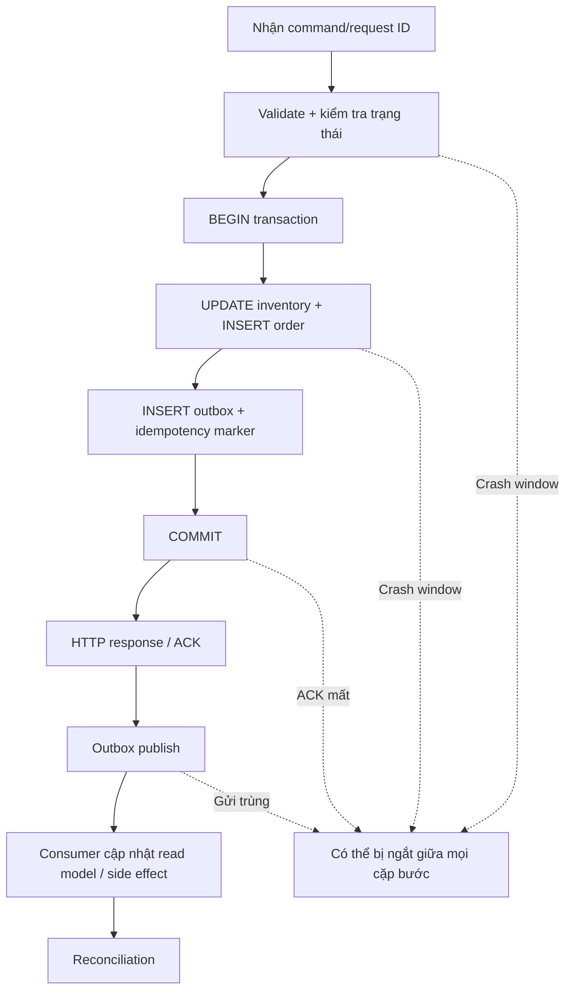
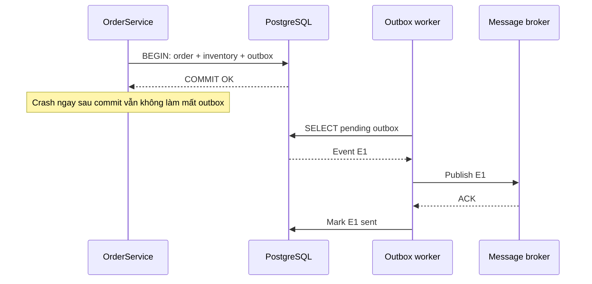

# Chỉ kiểm thử đường thành công và bỏ qua khả năng khôi phục

Trong chương **Lỗi thiết kế** của module **DATA_PERSISTENCE_FUNDAMENTALS**, một sai lầm nghiêm trọng là coi một quy trình persistence đã đúng chỉ vì kịch bản **ghi thành công → nhận phản hồi thành công → đọc lại thấy dữ liệu** đã được kiểm thử. Bài test này cần thiết nhưng chỉ xác nhận một nhánh thuận lợi. Ứng dụng Java trong thực tế còn gặp lỗi mạng, giao dịch bị hủy, deadlock, process crash, đĩa đầy, database failover, replication lag, job xử lý lặp, schema migration thất bại và thậm chí mất hẳn một vùng triển khai.

Ví dụ, test đặt hàng sau thường xanh:

```text
Given: tồn kho còn 10
When:  client tạo đơn mua 2 sản phẩm
Then:  nhận HTTP 201; orders có một hàng; tồn kho còn 8
```

Nhưng test ấy **không trả lời**: nếu DB đã commit mà response HTTP bị mất thì client gửi lại có tạo hai đơn không? Nếu `orders` đã commit nhưng message `OrderCreated` chưa phát, hệ thống có tự bù được không? Nếu restore database từ backup cũ, những đơn hàng đã được xác nhận sau thời điểm backup có bị mất và được nhận diện không? Một thiết kế thiếu câu trả lời là thiếu **hợp đồng khôi phục**, dù tất cả unit tests hoặc happy-path integration tests đều xanh.

Mục tiêu của bài là giúp người học xác định **mô hình lỗi**, các **cửa sổ sự cố** giữa các bước ghi, cơ chế **rollback, retry, idempotency, outbox, reconciliation, backup/restore** và cách xây dựng phép thử đủ khả năng kiểm chứng chúng. Những ví dụ dùng Java, JDBC, Spring và PostgreSQL, nhưng cần đối chiếu cơ chế thực tế của database, driver, transaction manager và hạ tầng trước khi suy rộng.

> **Nguyên tắc:** “Hoạt động khi mọi thứ khỏe mạnh” và “không làm mất/nhân đôi/ghi sai dữ liệu sau sự cố” là **hai thuộc tính khác nhau**. Kiểm thử phải chứng minh từng thuộc tính trong phạm vi điều kiện được thử, không lấy happy path làm bảo đảm phục hồi.

## 1. Happy path thực sự chứng minh điều gì?

Một test tạo khách hàng:

```java
@Test
void createsCustomer() {
    Customer created = registrationService.register(
        "sample@example.invalid"
    );
    assertNotNull(created.id());
    assertEquals("sample@example.invalid", created.email());
}
```

Nếu dùng mock repository, test có thể chỉ chứng minh service trả về đối tượng Java. Nếu dùng PostgreSQL thật và đọc lại bằng transaction mới, nó có thể chứng minh bản ghi đã **commit và hiển thị ở primary** trong điều kiện kiểm thử. Cả hai vẫn không tự chứng minh bất kỳ điều nào sau đây:

- Một lỗi xảy ra sau bước ghi đầu tiên có làm rollback toàn bộ transaction?
- Hai request đồng thời có vi phạm unique/stock/account invariant?
- Client nhận timeout có thể biết chính xác thao tác đã commit hay chưa?
- Một retry có tạo thêm đơn hàng, charge, event hoặc counter increment?
- Worker khởi động lại sau crash có tìm được công việc chưa xử lý?
- Bản sao đọc, cache và search index có được đồng bộ/repair sau outage?
- Dữ liệu đã xác nhận có còn tồn tại sau database restart, failover hoặc restore?
- Backup có thể giải mã, khôi phục và chạy cùng phiên bản schema/application không?
- Hệ thống có đạt **RPO** và **RTO** đã cam kết trong những lỗi được hỗ trợ?

Một bài kiểm thử end-to-end đi qua HTTP và database thật **mạnh hơn test mock**, nhưng nếu chỉ thực hiện một giao dịch trong trạng thái khỏe mạnh thì phần lớn câu hỏi vẫn chưa được kiểm chứng.

### 1.1. Vì sao lỗi này dễ lọt qua code review?

Các test thuận lợi thường ngắn, ổn định và có vẻ thuyết phục: trả đúng status, đúng JSON, số dòng đúng. Trong khi đó, test sự cố khó hơn vì phải điều khiển đúng thời điểm crash, có nhiều kết quả hợp lệ cần phân biệt, và tốn tài nguyên để khởi tạo DB/broker/backup.

Một mẫu lập luận sai:

```text
Controller test pass
  → Service test pass
    → Repository integration test pass
      → "Persistence đã an toàn khi có sự cố"  [KẾT LUẬN SAI]
```

Mỗi cấp test có thể kiểm tra đúng phần trách nhiệm của mình, nhưng **không có test nào từng dừng tiến trình sau commit hoặc khôi phục từ backup**. Không thể suy ra thuộc tính chưa được chạy/quan sát.

### 1.2. Phân biệt tính đúng đắn, tính bền vững và khả năng khôi phục

| Thuộc tính | Câu hỏi phải trả lời | Ví dụ phép thử |
| --- | --- | --- |
| **Correctness** | Dữ liệu sau thao tác có giữ invariant nghiệp vụ không? | Không bán quá tồn kho sau hai update đồng thời |
| **Atomicity** | Những thay đổi trong cùng transaction có cùng commit/rollback không? | Gây lỗi giữa hai câu SQL rồi đọc lại |
| **Durability** | Ghi đã được xác nhận có sống sót dưới kiểu lỗi đã hứa không? | Restart/crash DB có kiểm soát và đọc lại |
| **Idempotency** | Cùng một ý định được gửi lặp có gây tác dụng phụ trùng không? | Gửi lại cùng request ID sau mất ACK |
| **Recoverability** | Sau crash, hệ thống tìm lại và tiếp tục việc dang dở thế nào? | Kill worker sau từng checkpoint, restart, đối chiếu |
| **Disaster recovery** | Mất node/volume/vùng triển khai thì phục vụ lại thế nào? | Restore/failover drill đo RPO/RTO |
| **Consistency sau recovery** | Cache, replica, search, analytics có trở về trạng thái hợp lệ không? | Replay/outbox/repair rồi kiểm tra nguồn và sink |

Không nên dùng từ “durable” chỉ để nói rằng một bảng hiện đang trả đúng kết quả `SELECT`. Và không nên dùng từ “recovery ready” nếu backup chỉ tồn tại trên dashboard nhưng **chưa từng được phục hồi thử**.

## 2. Vẽ failure model trước khi viết test

**Failure model** mô tả loại sự cố và phạm vi hệ thống cam kết xử lý. Ví dụ:

| Loại sự cố | Phạm vi | Câu hỏi kiến trúc |
| --- | --- | --- |
| Validation/constraint failure | Một statement/transaction | Đã rollback đúng và trả lỗi nghiệp vụ ổn định chưa? |
| Deadlock hoặc serialization failure | Transaction cạnh tranh | Retry toàn transaction có được phép và idempotent không? |
| Network timeout | Client ↔ DB/provider | Kết quả commit/side effect có thể chưa rõ không? |
| Application process crash | JVM đang xử lý | Công việc đã commit hoặc chưa commit được khôi phục thế nào? |
| Worker/broker restart | Queue/outbox/consumer | Có mất hoặc xử lý trùng message không? |
| DB restart/failover | Primary/replica | Ranh giới ACK, replication lag và kết nối đổi ra sao? |
| Storage full/corruption | Disk/WAL/volume | Ghi bị từ chối, backup/restore hoạt động được không? |
| Region outage | Một vùng triển khai | RPO/RTO, consistency và khả năng chuyển vùng? |
| Operator mistake | Delete/drop/migration sai | PITR, rollback plan và phục hồi dữ liệu thế nào? |
| Restore dữ liệu cũ | DB đã khôi phục nhưng timeline quay lùi | Có phát hiện yêu cầu/đơn hàng đã xác nhận bị thiếu không? |

**Không phải ứng dụng nào cũng cần chịu được mọi loại lỗi**, nhưng mỗi yêu cầu phải nêu rõ giới hạn. Nếu sản phẩm chỉ cam kết chịu lỗi một node, hãy kiểm thử đúng lỗi đó; đừng ghi tài liệu “chịu mất cả region” khi chưa có chiến lược replication/backup và restore ngoài region.

### 2.1. Xác định điều kiện đầu, lúc gây lỗi và quan sát cuối

Một testcase phục hồi có cấu trúc:

```text
GIVEN:
  schema/migration và dữ liệu ban đầu
  trạng thái transaction, queue, cache, replica
WHEN:
  một hành động nghiệp vụ đang được thực hiện
AND:
  chèn lỗi tại mốc xác định (sau write, trước commit, sau commit...)
THEN:
  ứng dụng/worker phục hồi hoặc kết thúc theo chính sách
  trạng thái DB và downstream được đối chiếu
  các bất biến nghiệp vụ còn đúng
  request retry không gây tác dụng phụ trùng
```

Nếu không có **điểm gây lỗi cụ thể** và **oracle kiểm chứng dữ liệu cuối**, test “restart server rồi thấy trang web chạy” không chứng minh transaction dang dở được xử lý đúng.

### 2.2. Sơ đồ các cửa sổ lỗi



Đặt câu hỏi tại **từng mốc**:

1. Dữ liệu authoritative đang ở trạng thái nào?
2. Những phần nào đã commit, những phần nào mới nằm trong RAM?
3. Nếu tiến trình biến mất vĩnh viễn, thành phần nào phát hiện việc dang dở?
4. Nếu client/worker retry, có cần operation ID hoặc CAS để tránh lặp?
5. Sau recovery, phép kiểm tra nào cho phép khẳng định trạng thái đúng?

## 3. Lỗi giao dịch: rollback phải được kiểm chứng sau khi transaction kết thúc

Một giao dịch có thể chứa hai cập nhật cần nguyên tử, như chuyển 30 đơn vị giữa hai tài khoản:

```sql
BEGIN;

UPDATE accounts
SET balance = balance - 30
WHERE id = 101 AND balance >= 30;

UPDATE accounts
SET balance = balance + 30
WHERE id = 202;

COMMIT;
```

Đây là **sơ đồ SQL**, chưa phải implementation an toàn hoàn chỉnh: phải kiểm tra affected rows của cả hai UPDATE, bảo vệ ranh giới tenant/quyền, tránh cập nhật một tài khoản không tồn tại, và kiểm soát concurrency/isolation. Nếu bước hai lỗi sau bước một mà service vô tình commit, một khoản tiền có thể bị mất về mặt nghiệp vụ.

### 3.1. Integration test cần gây lỗi ở bước giữa

```text
Setup, COMMIT:
    account A = 100
    account B = 50

Act:
    bắt đầu transaction
    trừ A thành 70
    gây lỗi trước hoặc trong bước cộng B
    bảo đảm transaction rollback

Assert từ connection/transaction MỚI:
    account A = 100
    account B = 50
    ledger/outbox không có bản ghi commit nửa chừng
```

Nếu test đọc lại trên **cùng persistence context Java** hoặc cùng transaction chưa kết thúc, nó có thể quan sát object đã sửa trong RAM hoặc thay đổi chưa commit. Bằng chứng rollback phải đến từ **trạng thái authoritative sau khi ranh giới transaction đã kết thúc**.

### 3.2. Với Spring `@Transactional`, không được nuốt lỗi sai cách

```java
@Service
public class TransferService {
    private final AccountRepository accounts;

    public TransferService(AccountRepository accounts) {
        this.accounts = accounts;
    }

    @Transactional
    public void transfer(long from, long to, long amount) {
        if (amount <= 0) {
            throw new IllegalArgumentException("Invalid amount");
        }

        int debited = accounts.debitIfEnough(from, amount);
        if (debited != 1) {
            throw new InsufficientFundsException();
        }

        int credited = accounts.creditExisting(to, amount);
        if (credited != 1) {
            throw new DestinationNotFoundException();
        }
    }
}
```

Các repository và exception ở đây là abstraction của ứng dụng; ví dụ giả định exception là runtime và cả hai adapter tham gia **cùng transaction manager/connection**. Cần test thật để phát hiện trường hợp một adapter tự mở connection `autoCommit=true`, khiến một nửa thao tác vẫn commit khi service throw exception.

Đừng chỉ unit-test:

```java
verify(repository).debitIfEnough(from, amount);
verify(repository).creditExisting(to, amount);
```

Vì hai lời gọi mock không chứng minh DB đã rollback đúng nếu bước hai thất bại.

### 3.3. Tại sao test tự rollback có thể tạo cảm giác an toàn giả?

Nhiều framework test cho phép bọc test trong transaction rồi rollback tự động để cleanup. Một test như thế hữu ích cho isolation giữa testcase, nhưng **có thể không thực hiện commit thật**. Do đó nó không kiểm tra:

- Constraint hoặc lỗi phát sinh muộn ở commit.
- `AFTER_COMMIT` callbacks và transactional event listeners.
- Kết quả nhìn thấy từ một transaction khác sau commit.
- Lỗi khi driver gửi lệnh commit hoặc nhận ACK.

Nếu mục tiêu là kiểm tra commit, hãy để transaction business **thực sự hoàn tất**, sau đó kiểm tra bằng một connection mới hoặc cơ chế test transaction có hỗ trợ commit theo framework. Không lấy `saveAndFlush()` hoặc `EntityManager.flush()` làm thay thế `COMMIT`.

## 4. Tình huống bị bỏ qua nhiều nhất: ACK mất sau khi `COMMIT` thành công

Giả sử client tạo đơn hàng `order-101`. Server thực hiện thành công transaction và gửi phản hồi. Mạng bị ngắt đúng lúc response trở về:

```mermaid
sequenceDiagram
    participant Client as Client
    participant App as Java API
    participant DB as PostgreSQL
    Client->>App: POST /orders, requestId=R1
    App->>DB: BEGIN; INSERT order; COMMIT
    DB-->>App: COMMIT OK
    App--xClient: HTTP 201 bị mất
    Note over Client: Client chỉ thấy timeout
    Client->>App: Retry POST /orders, requestId=R1
    Note over App,DB: Phải trả kết quả cũ, không tạo đơn thứ hai
```

Nếu client tạo request ID mới cho mỗi lần retry, hoặc service chỉ gọi `INSERT orders` theo ID tự sinh, hệ thống có thể tạo **hai đơn cho cùng một ý định**. Happy-path test chỉ thực hiện một request sẽ không phát hiện vấn đề.

### 4.1. Ba kết quả cần phân biệt

| Trạng thái ở client | Điều biết được | Hành động an toàn |
| --- | --- | --- |
| Thành công có xác nhận hợp lệ | Hệ thống đã báo đạt điều kiện thành công theo contract | Trả kết quả/đối chiếu các hệ thống phụ trợ theo thiết kế |
| Thất bại có xác nhận rollback/từ chối | Không có commit thành công của thao tác theo contract tương ứng | Có thể sửa input hoặc retry theo loại lỗi và điều kiện nghiệp vụ |
| **Kết quả không rõ** (*unknown outcome*) | Timeout/mất kết nối có thể xảy ra **trước hoặc sau commit** | Tra cứu request/operation ID, không tự coi là rollback |

Lỗi `SQLException` hoặc exception từ `Connection.commit()` **không phải lúc nào cũng cho biết trạng thái DB cuối cùng**. Trường hợp gửi COMMIT thành công nhưng ACK mất không thể được giải quyết chỉ bằng một `catch` hoặc retry tự động.

### 4.2. Test phải cắt ACK, không chỉ mock lỗi trước khi gọi DB

Một test như:

```java
when(orderRepository.save(any()))
    .thenThrow(new TransientDataAccessException("timeout") {});
```

chỉ mô phỏng repository **báo lỗi trước khi service quan sát kết quả**. Nó chưa mô phỏng trạng thái DB đã commit. Nếu service retry rồi test xanh, vẫn chưa biết production có tạo đơn thứ hai khi lỗi phát sinh **sau commit**.

Một testcase có giá trị hơn:

```text
Given:
  request_id=R1, chưa tồn tại đơn R1

When:
  gửi POST R1
  cho phép DB COMMIT thành công
  cắt response giữa API và client
  client gửi lại cùng R1

Then:
  chỉ tồn tại một business operation cho R1
  response retry tham chiếu cùng order_id
  inventory chỉ bị trừ một lần
  event/side effect có thể được giao lặp nhưng không áp dụng trùng
```

Để điều khiển chính xác cửa sổ lỗi, có thể sử dụng fault proxy hoặc **test hook được giới hạn ở môi trường test** đặt sau commit nhưng trước response. Bài test cần quan sát database thật; không đủ khi chỉ stub `save()` trả success/error.

### 4.3. Idempotency key phải có phạm vi và khả năng lưu bền vững

Một thiết kế tham khảo:

```sql
CREATE TABLE business_requests (
    tenant_id BIGINT NOT NULL,
    request_id UUID NOT NULL,
    command_type TEXT NOT NULL,
    request_fingerprint TEXT NOT NULL,
    status TEXT NOT NULL
           CHECK (status IN ('COMPLETED', 'REJECTED')),
    result_id BIGINT,
    created_at TIMESTAMPTZ NOT NULL DEFAULT now(),
    PRIMARY KEY (tenant_id, request_id)
);
```

Bảng trên **chỉ là cấu trúc minh họa** và không có trạng thái `PROCESSING`; thiết kế thực tế có thể cần mô hình nhiều pha, constraint/check hoặc transaction/lock quản lý request đang chạy. Điều bắt buộc là:

1. Một request ID được gắn với **đúng tenant, command và payload/fingerprint**.
2. Kiểm tra request cũ và tạo business operation mới phải được bảo vệ trước **hai request đồng thời** (unique constraint và transaction/locking phù hợp).
3. Ghi dấu idempotency và side effect nội bộ **nguyên tử trong cùng DB transaction** khi có thể.
4. Nếu request ID lặp nhưng nội dung khác, **từ chối xung đột**, không trả nhầm kết quả của một command khác.
5. Định nghĩa retention của dấu idempotency đủ dài so với cửa sổ retry/replay; không xóa marker quá sớm rồi cho phép tạo tác vụ trùng.
6. Nếu có side effect ngoài DB, cần biết provider hỗ trợ idempotency key hay không và phạm vi/TTL của nó.

**Chỉ tạo `UUID` ở client không tự mang lại idempotency.** Nếu service không lưu và kiểm tra token bằng nguồn authoritative, hai request có cùng ID vẫn có thể thực hiện hai lần.

### 4.4. Ví dụ hợp đồng Java có kết quả chưa rõ

```java
public record PlaceOrderCommand(
        UUID requestId,
        long tenantId,
        long productId,
        int quantity) {}

public sealed interface PlacementResult
        permits PlacementResult.Completed,
                PlacementResult.Rejected,
                PlacementResult.Unknown {
    record Completed(long orderId) implements PlacementResult {}
    record Rejected(String reasonCode) implements PlacementResult {}
    record Unknown(UUID requestId) implements PlacementResult {}
}
```

Đây là code minh họa Java hỗ trợ sealed interface, không phải API có sẵn. Giá trị `Unknown` phải có đường **tra cứu trạng thái** hoặc reconciliation cụ thể; nó không được hiểu là “thất bại chắc chắn”, và cũng không nên tự động chuyển thành một thao tác đặt hàng mới.

## 5. Retry: lặp một transaction không giống lặp một tác dụng phụ

Retry có thể là chiến lược đúng khi transaction gặp **deadlock** hoặc **serialization failure** được xác nhận, với điều kiện cần chạy lại **toàn bộ transaction** trên dữ liệu mới. Nhưng retry nguy hiểm nếu tác dụng phụ đã thoát khỏi transaction hoặc commit outcome chưa rõ.

### 5.1. Phân loại lỗi trước khi retry

| Nhóm lỗi | Ví dụ ở PostgreSQL | Hành vi tham khảo |
| --- | --- | --- |
| Input/constraint không hợp lệ | `23502` NOT NULL, `23503` FK, `23514` CHECK | Từ chối hoặc sửa dữ liệu; không retry vô hạn cùng input |
| Unique conflict | `23505` | Có thể là tranh chấp nghiệp vụ/idempotency; đọc lại theo khóa và xử lý đúng context |
| Deadlock | `40P01` | Rollback và retry **toàn transaction** nếu operation an toàn |
| Serialization failure | `40001` | Retry transaction mới, đọc lại dữ liệu và quyết định nghiệp vụ |
| Lock timeout | Ví dụ `55P03` | Có thể retry với backoff/budget, nhưng kiểm tra policy contention |
| Connection acquisition failure | Pool không cấp kết nối | Chưa gửi SQL từ lần thử đó; xem tải, backpressure và deadline |
| Connection lost / commit timeout | Không nhận xác nhận từ DB | Có thể **không biết commit hay chưa**; đối chiếu trước |
| Storage/DB unavailable | Server lỗi, disk full, failover | Circuit breaker/budget, phục hồi hạ tầng, không tạo retry storm |

SQLSTATE cụ thể phụ thuộc nơi phát sinh lỗi và backend; Java driver/framework có thể bọc lại exception. Không dùng một câu `if (ex instanceof DataAccessException) retry()` cho mọi lỗi. Với một transaction đang ở trạng thái aborted, phải rollback và mở transaction mới trước lần thử tiếp.

### 5.2. Retry phải có giới hạn và jitter

```text
Attempt 1: transaction gặp serialization failure được xác nhận
Rollback
Backoff ngắn + jitter
Attempt 2: transaction mới, đọc lại phiên bản mới
Nếu vẫn lỗi:
  backoff có giới hạn, đến overall deadline thì dừng
```

Một retry policy nên xác định:

- Loại lỗi được phép retry và loại lỗi không retry.
- Tổng deadline của business operation.
- Số lần thử tối đa và exponential backoff với jitter.
- Có retry ở driver, ORM, service, API gateway và client hay không; tránh **nhân số lần thử giữa các tầng**.
- Idempotency của command và những side effect ngoài DB.
- Điều kiện hủy/đối chiếu khi outcome chưa rõ.

Retry nhiều lần dưới áp lực lớn có thể tạo **retry storm**, làm lock contention, connection pool exhaustion và p99 tệ hơn. Không coi “test retry pass” là bằng chứng hệ thống phục hồi tốt nếu test chưa đo tải và quan sát số lần gọi thực tế.

### 5.3. Lưu ý Spring transaction proxy

Một lỗi thiết kế:

```java
@Transactional
public void process() {
    try {
        doDatabaseWork();
    } catch (RuntimeException ex) {
        doDatabaseWork(); // thử lại trong transaction có thể đã lỗi
    }
}
```

Sau một lỗi SQL, transaction hiện tại có thể ở trạng thái aborted hoặc rollback-only. Lặp lại ngay **trong cùng transaction** không bảo đảm có thể tiếp tục; có thể dẫn tới `UnexpectedRollbackException` hoặc lỗi khác khi kết thúc.

Retry phải được thực hiện ở **ranh giới nằm ngoài transaction**, để mỗi attempt được transaction manager bắt đầu/kết thúc độc lập. Nếu dùng Spring AOP, tránh lỗi self-invocation làm `@Transactional` trên lời gọi nội bộ không đi qua proxy. Test integration nên kiểm tra thật số transaction và trạng thái dữ liệu sau các attempt.

### 5.4. `PUT`, `DELETE`, `INCREMENT` có cùng idempotency không?

- `PUT key=value` theo semantics đặt giá trị tuyệt đối có thể idempotent về giá trị, nhưng không chắc idempotent về event, version, timestamp hoặc audit.
- `DELETE key` có thể an toàn lặp nếu target được nhận diện ổn định, nhưng cần kiểm tra generation, side effects, các bản object/version và tombstone.
- `INCREMENT`, `DECREMENT`, “trừ tồn kho”, “charge payment” thường **không idempotent** khi chạy lại vô điều kiện.

Đây là lý do test cần kiểm tra **bất biến cuối cùng**, không chỉ verify repository hoặc payment client được gọi một lần trong một execution path.

## 6. Side effects sau commit: nếu JVM crash, ai làm nốt?

Giả sử đặt hàng thực hiện:

```text
BEGIN
  UPDATE inventory
  INSERT orders
COMMIT

Publish OrderCreated
Send confirmation email
Invalidate cache
```

Đường thành công có vẻ hợp lý, nhưng crash **sau COMMIT trước Publish** khiến database đã có đơn nhưng không có event nào đến downstream. Tình huống ngược lại cũng có thể xảy ra nếu publish trước commit: downstream nhận event cho một đơn hàng sau đó rollback.

### 6.1. Hai cửa sổ lỗi đối xứng

| Trình tự | Khi crash đúng thời điểm | Kết quả có thể xảy ra |
| --- | --- | --- |
| Publish event **trước** DB commit | Event đã phát nhưng DB rollback | **Ghost event**: consumer xử lý đối tượng không tồn tại |
| DB commit **trước** publish | DB đã commit nhưng app crash | **Lost event**: downstream không bao giờ biết nếu không có cơ chế bù |
| Broker ACK rồi app crash trước ghi “đã gửi” | Event đã đến broker, trạng thái publisher chưa cập nhật | **Duplicate publish** khi worker phục hồi |

Một mock `verify(publisher).publish(any())` chỉ chứng minh service có gọi phương thức, không kiểm tra kết quả **xuyên hai tài nguyên** và trạng thái sau crash.

### 6.2. Transactional outbox ghi intent cùng business state

```sql
BEGIN;

UPDATE inventory
SET available = available - :quantity
WHERE tenant_id = :tenant_id
  AND product_id = :product_id
  AND available >= :quantity;

-- Ứng dụng phải kiểm tra affected row = 1 trước khi tiếp tục.
INSERT INTO orders(tenant_id, request_id, product_id, quantity)
VALUES (:tenant_id, :request_id, :product_id, :quantity);

INSERT INTO outbox_events(event_id, aggregate_type, aggregate_id, payload)
VALUES (:event_id, 'ORDER', :order_id, :event_payload);

COMMIT;
```

SQL trên chỉ minh họa **ý tưởng atomic write**; để chạy thật cần schema hợp lệ, cách sinh `:order_id`, unique constraint, tham số binding của framework và kiểm tra affected rows. JDBC thuần dùng placeholder `?`, không dùng `:name` trực tiếp.

Điều quan trọng là order và outbox **được ghi trong cùng DB transaction**, vì vậy nếu transaction rollback, event intent cũng rollback; nếu commit, worker có thể tìm outbox chưa xử lý sau restart.



Outbox giải quyết **durable intent**, không tạo “exactly-once delivery”. Worker có thể publish trùng khi ACK từ broker đã đến nhưng database chưa được cập nhật. Consumer phải **idempotent** hoặc dùng cơ chế tương đương trên phạm vi cần bảo vệ.

### 6.3. Bằng chứng cần kiểm tra ở hai tầng

**Database integration test:**

```text
Rollback transaction → không có order, không có outbox event.
Commit transaction   → có order và outbox event cùng request ID.
```

**Recovery/fault test:**

```text
Commit order+outbox.
Kill application trước khi publish.
Restart outbox worker.
Event vẫn được publish và consumer đạt trạng thái mong đợi.
Kill worker sau broker ACK trước mark-sent.
Restart worker.
Event có thể gửi lại nhưng business effect không áp dụng trùng.
```

Chỉ một happy-path test “order created + email sent” không kiểm tra được bất kỳ cửa sổ crash nào ở trên.

## 7. Consumer crash và xử lý trùng: khôi phục không có nghĩa chỉ chạy một lần

Với broker và consumer, một luồng phổ biến:

```text
1. Consumer nhận event E1.
2. Consumer cập nhật read model trong database.
3. Consumer commit database thành công.
4. Consumer crash trước khi ACK/commit offset ở broker.
5. Broker giao lại E1.
```

Nếu consumer chỉ `UPDATE total = total + 1` thì read model có thể tăng **hai lần**. Việc broker bảo đảm “at-least-once delivery” có thể là đúng theo contract, nhưng **tác dụng phụ nghiệp vụ** vẫn cần được thiết kế để xử lý trùng.

### 7.1. Inbox marker và cập nhật state trong cùng transaction

Ví dụ PostgreSQL:

```sql
CREATE TABLE processed_events (
    consumer_name TEXT NOT NULL,
    event_id UUID NOT NULL,
    processed_at TIMESTAMPTZ NOT NULL DEFAULT now(),
    PRIMARY KEY (consumer_name, event_id)
);
```

Một transaction xử lý:

```text
BEGIN
  INSERT processed_events(consumer_name,event_id)
    ON CONFLICT DO NOTHING

  Nếu có đúng 1 hàng mới:
      cập nhật projection trong cùng transaction
  Nếu marker đã tồn tại:
      bỏ qua tác dụng phụ lần này
COMMIT

Sau commit DB:
  ACK/commit offset broker
```

Đây là **mô hình logic**; implementation phải kiểm tra update count của `INSERT ... ON CONFLICT DO NOTHING`, dùng một transaction thật và cùng database/resource mà projection được cập nhật. Nếu cập nhật projection ở một database khác hoặc gọi HTTP bên ngoài, inbox marker cục bộ **không tự bao trùm side effect đó**.

### 7.2. Test cần gây crash đúng sau side effect

```text
Given:
  event E1 chưa có trong processed_events
  projection.count = 0

When:
  consumer nhận E1, DB commit marker và count=1
  kill consumer trước khi ACK broker
  broker redeliver E1, consumer restart

Then:
  projection.count = 1
  processed_events có đúng một marker (consumer, E1)
  offset/ACK cuối cùng tiến lên, không mắc kẹt mãi
```

Một unit test mock `verify(projectionRepository).increment()` được gọi một lần **không có khả năng tạo broker redelivery** sau crash. Với test phục hồi, cần broker/test harness hoặc một cơ chế giả lập giao lại event đủ trung thực, cộng với database thật để chứng minh atomicity marker–projection.

### 7.3. Sự kiện cũ đến sau sự kiện mới

Chỉ dedup theo event ID không xử lý **out-of-order delivery**:

```text
OrderUpdated(version=8, status=CONFIRMED)
OrderUpdated(version=7, status=PENDING)   <-- retry đến muộn
```

Nếu consumer viết đè vô điều kiện, trạng thái có thể **đi lùi**. Test phục hồi cần gửi event trùng, đảo thứ tự và trễ, rồi kiểm tra version/generation barrier. Với luồng có yêu cầu strict ordering, cần xác định partition/aggregate key và giao thức bảo đảm thứ tự; không giả định broker toàn cluster giữ thứ tự tuyệt đối.

### 7.4. Xóa và tombstone cũng phải chịu được replay

Nếu `CustomerDeleted(v9)` đã xử lý mà một `CustomerUpdated(v8)` đến từ archive khi replay, consumer không được hồi sinh hồ sơ cũ. Tombstone/version marker phải được giữ đủ lâu so với retention event/replay window và chính sách rebuild.

Đây không chỉ là chuyện eventually consistent UI. Nếu hồ sơ đã được xóa theo chính sách dữ liệu, việc replay bản cũ có thể vi phạm nghĩa vụ an toàn dữ liệu. Happy-path “DELETE rồi GET không thấy” không thử được lỗi này.

## 8. Workflow nhiều hệ thống: không tự động có rollback xuyên tài nguyên

Một nghiệp vụ thương mại điện tử có thể liên quan:

```text
Order DB → Inventory DB → Payment provider → Shipping provider
```

Một `@Transactional` trong Spring thường chỉ quản lý các resource được transaction manager của nó điều phối. Nó **không tự biến** bốn hệ thống thành một transaction ACID duy nhất. Nếu thanh toán thành công nhưng cập nhật shipping thất bại, ứng dụng phải có cách nhìn thấy và phục hồi trạng thái **đang xử lý dở**.

### 8.1. Saga/workflow không phải rollback cơ học

Một workflow có thể lưu:

```text
ORDER_CREATED
  ↓ reserve inventory
INVENTORY_RESERVED
  ↓ request payment với idempotency key ổn định
PAYMENT_PENDING
  ↓ payment confirmed
PAID
  ↓ prepare shipping
READY_TO_SHIP
```

Khi một bước lỗi, workflow có thể:

- Retry bước chưa hoàn tất với idempotency key ổn định.
- Đối chiếu trạng thái từ hệ thống authoritative.
- Chuyển sang bước bù (*compensation*), ví dụ giải phóng reserved inventory.
- Yêu cầu xử lý thủ công khi kết quả thanh toán chưa rõ.

**Compensation không phải rollback transaction phân tán.** Hoàn tiền là một giao dịch mới, có thể chậm hoặc lỗi; nó không làm như thể charge ban đầu chưa từng tồn tại. Bằng chứng của workflow gồm **trạng thái bền vững và khả năng resume** sau crash.

### 8.2. Kiểm tra mất ACK từ payment provider

```text
Given:
  payment operation ID=P1
When:
  provider đã nhận/áp dụng charge P1
  API call timeout trước khi ứng dụng nhận kết quả
  worker restart và retry cùng P1
Then:
  không tạo charge nghiệp vụ thứ hai
  trạng thái payment được đối chiếu
  order cuối cùng ở state đúng (PAID/NEEDS_REVIEW...)
```

Test này đòi hỏi một **provider sandbox có idempotency contract** hoặc fault stub phản ánh đúng hành vi phía provider, cộng với kiểm tra trạng thái authoritative ở ứng dụng. Mock luôn `thenReturn(success)` chỉ kiểm tra đường thuận lợi.

Nếu provider không hỗ trợ idempotency hoặc query status, hệ thống phải nêu rõ hạn chế và thiết kế manual reconciliation; không thể dùng một UUID phía client để tự bảo đảm exactly-once charge.

### 8.3. Checkpoint và resume của batch

Một batch import 10.000 bản ghi có thể crash sau khi xử lý 6.000. Nếu restart từ đầu mà không có idempotency, 6.000 bản ghi đầu có thể bị nhân đôi. Nếu tiếp tục từ dòng 6.001 chỉ dựa trên counter trong RAM, mất process sẽ làm mất checkpoint.

Một thiết kế tốt cần:

1. **Định danh batch và từng item** ổn định.
2. Checkpoint bền vững, gồm offset/last-success ID và generation của input.
3. Quy tắc atomicity giữa xử lý item và đánh dấu item đã xử lý.
4. Retry/skip các item lỗi theo chính sách, không âm thầm bỏ dữ liệu.
5. Reconciliation số lượng đầu vào, số thành công, lỗi, trùng và tổng giá trị nghiệp vụ.

**Không đồng nhất `processed_count=6000` với “6000 phần tử đầu đã commit”** nếu worker có thể xử lý song song/out-of-order. Checkpoint phải biểu đạt được tập phần việc hoặc một thứ tự tuyến tính đủ tin cậy.

## 9. Backup khác restore: có file sao lưu chưa phải bằng chứng khôi phục

Một hệ thống có thể báo `backup_job_status=SUCCESS` hàng đêm nhưng vẫn không thể restore vì:

- Thiếu một phần **incremental backup chain** hoặc WAL archive.
- Backup lưu cùng failure domain và bị mất theo primary.
- Khóa giải mã không còn, credential hoặc IAM policy không cho phép đọc.
- Backup chứa dữ liệu cũ nhưng migration/application mới không tương thích.
- Chỉ có snapshot của một database trong khi nghiệp vụ cần đồng bộ với broker/object store.
- Tệp backup lỗi hoặc chỉ được kiểm tra checksum một phần, chưa chạy thử recovery.
- Restore mất quá nhiều thời gian so với SLO kinh doanh.

Vì vậy phải phân biệt **backup creation success** với **restore verification success**.

### 9.1. RPO và RTO là hợp đồng, không phải khẩu hiệu

**Recovery Point Objective (RPO)**: mức dữ liệu mới nhất được phép mất khi khôi phục từ một sự cố xác định, thường đo bằng khoảng thời gian hoặc phạm vi thao tác đã được phê duyệt.

**Recovery Time Objective (RTO)**: khoảng thời gian mục tiêu để khôi phục dịch vụ tới mức được chấp nhận sau sự cố, bao gồm các bước cần thiết cho tính đúng đắn và khả năng phục vụ.

Ví dụ giả định:

```text
RPO = tối đa 5 phút đối với báo cáo eventual.
RTO = tối đa 60 phút để API đọc hoạt động lại.
```

Hai con số trên là minh họa **không áp dụng mặc định** cho hệ thống thanh toán hoặc dữ liệu cần zero-data-loss. Một ứng dụng có thể có RPO/RTO khác nhau cho đơn hàng, nhật ký thanh toán, báo cáo và dữ liệu cache.

Đặc biệt, **RPO=0 chỉ đúng trong phạm vi failure model và giao thức xác nhận đã thiết kế**. Không thể tuyên bố không bao giờ mất dữ liệu với một primary và một backup hàng ngày chỉ vì unit tests đã pass.

### 9.2. Thực nghiệm cần đo RPO/RTO từ sự cố giả lập

```text
T0: commit các bản ghi có sequence và timestamp kiểm thử.
T1: xác nhận các write được ứng dụng ACK.
T2: giả lập mất primary/volume/region theo failure model.
T3: bắt đầu restore hoặc failover.
T4: hệ thống phục hồi, qua health check và correctness checks.

RTO quan sát: khoảng từ sự cố tới khi dịch vụ đủ điều kiện phục vụ.
RPO quan sát: tập các write đã xác nhận nhưng thiếu sau recovery,
              quy đổi ra khoảng mất dữ liệu theo định nghĩa.
```

Không chỉ đo thời gian database process bật lại. Nếu API vẫn trả trạng thái sai vì cache/replica cũ, chưa replay outbox hoặc chưa xử lý schema mismatch, dịch vụ **chưa đạt trạng thái phục hồi có thể chấp nhận**.

### 9.3. PostgreSQL WAL, base backup và PITR

Trong PostgreSQL, **Write-Ahead Log (WAL)** ghi thông tin phục vụ durability/recovery và physical replication. **Point-in-Time Recovery (PITR)** yêu cầu kết hợp base backup với các WAL segment phù hợp, recovery configuration và target timeline/thời điểm thích hợp.

Happy-path test tạo và đọc hàng không kiểm tra:

- WAL archive có đủ và truy xuất được không.
- Backup chain có liền mạch không.
- Recovery có thể tới điểm trước một lệnh xóa nhầm không.
- Các bảng, index, constraint và dữ liệu có nhất quán sau restore không.
- Lệnh restore có phá dữ liệu mới hơn hoặc làm mất những transaction đã ACK không.

**Không xóa WAL hoặc replication slot bừa bãi để chữa đầy disk**, vì việc đó có thể phá khả năng khôi phục hoặc replication. Nếu WAL retention gây quá tải, phải tìm nguyên nhân như slot/replica bị tụt, archive lỗi hoặc cấu hình retention, rồi xử lý theo runbook.

### 9.4. Thử phục hồi từ trước một thao tác xóa dữ liệu

Nếu dữ liệu cá nhân đã bị xóa tại T2 mà restore từ backup T1, bản sao trước T2 có thể **hồi sinh** thông tin. Cần deletion ledger hoặc cơ chế replay độc lập với restore point, cô lập môi trường phục hồi và áp dụng lại những yêu cầu xóa trước khi mở truy cập.

Test restore cần xác minh không chỉ “đủ row”, mà còn **không tái xuất dữ liệu phải xóa**, quyền truy cập, mã hóa và retention phù hợp với chính sách.

## 10. Khôi phục sau database failover và replication lag

Một hệ thống có read replicas hoặc nhiều region có thể đưa traffic tới node mới sau khi primary lỗi. Nhưng **failover không đồng nghĩa tự động bảo toàn mọi write đã ACK**, nếu kiến trúc replication có khoảng bất đồng bộ và hợp đồng chưa yêu cầu chờ đủ mức xác nhận bền vững.

### 10.1. Phân biệt các mốc ghi

```text
Client                  Primary                 Replica
   | INSERT               |                       |
   |--------------------->|                       |
   |                      | WAL/local commit      |
   |<--- COMMIT ACK -------|                       |
   |                      |-- WAL streaming ----->|
   |                      |                       | replay/apply
```

Nếu primary trả ACK trước khi replica nhận/replay được thay đổi, một lần failover rất sớm có thể khiến replica mới không có write đó, tùy sản phẩm, replication mode và quy trình chọn primary. **Không suy rằng có replica đồng nghĩa dữ liệu đã ACK luôn tồn tại trên replica.**

Các trạng thái thường cần phân biệt:

- **Sent:** primary đã gửi thay đổi.
- **Written/flushed:** replica đã nhận/lưu tới một mốc trong WAL theo cơ chế cụ thể.
- **Replayed/applied:** replica đã áp dụng thay đổi và có khả năng phục vụ kết quả theo quy tắc snapshot.
- **Client-visible:** ứng dụng có thể đọc từ node đó với yêu cầu consistency cụ thể.

Các tên metric và yêu cầu ACK phụ thuộc cấu hình PostgreSQL hoặc database khác; không lấy một chỉ số lag duy nhất để đại diện cho mọi mốc.

### 10.2. Test read-your-writes và failover

Một bài thử có kiểm soát:

```text
Given:
  key K có value=v1 ở primary và replica
When:
  client ghi K=v2, nhận ACK
  cố tình làm replica lag hoặc failover theo điều kiện test
  client đọc K từ đường được định tuyến sau failover
Then:
  kết quả phải thỏa hợp đồng read consistency/RPO đã công bố
  nếu không thể thỏa, API trả lỗi/trạng thái tạm thời phù hợp
  không âm thầm nói đã đọc bản mới nhất khi chỉ có v1
```

Với sản phẩm yêu cầu read-your-writes, có thể dùng version/token hoặc đọc authoritative source. Với hệ thống cho phép eventual consistency, test đo **thời gian hội tụ** và giới hạn stale phù hợp, không kỳ vọng mọi replica luôn phản ánh write ngay tức thì.

### 10.3. Fencing để tránh hai primary cùng chấp nhận ghi

Một bài kiểm thử failover phải kiểm tra khả năng **split-brain** hoặc stale leader tiếp tục ghi khi network partition xảy ra. Chỉ có health check “new primary trả 200” là chưa đủ:

- Primary cũ đã bị từ chối/fenced hay chưa?
- Routing của client và worker có được cập nhật thống nhất không?
- Hai node có thể cùng báo ghi thành công trong cửa sổ chuyển đổi không?
- Sau khi mạng nối lại, hệ thống phân xử log/transaction và dữ liệu ở hai nhánh thế nào?

Khả năng tránh split-brain phụ thuộc DB/HA orchestration và failure model. Không tự viết một cơ chế leader election bằng cách chỉ lưu `is_primary=true` trong cache nếu không có consensus/fencing và quy tắc ownership đúng.

### 10.4. Backup khác replication

Replication có thể truyền **lỗi logic** như `DELETE FROM orders` hoặc migration sai sang replica rất nhanh. Một replica không tự thay thế **backup lịch sử** hoặc PITR để phục hồi trước thao tác sai. Ngược lại, backup hàng ngày không thay thế failover nhanh khi primary mất.

Một chiến lược recovery cần kiểm tra riêng **high availability** (giảm thời gian gián đoạn), **durability** (mất dữ liệu trong phạm vi nào) và **backup/restore** (quay về điểm hợp lệ). Không vì một thành phần tồn tại mà giả định hai thành phần còn lại đã được bảo đảm.

## 11. Schema migration hỏng: rollback ứng dụng có thể không đủ

Một happy-path CI thường kiểm tra migration chạy được trên database rỗng. Production lại có hàng triệu dòng, truy vấn đang hoạt động và dữ liệu theo nhiều version ứng dụng.

Ví dụ thay `full_name` thành `given_name`/`family_name`. Một migration trực tiếp:

```sql
ALTER TABLE customers DROP COLUMN full_name;
```

có thể khiến những instance ứng dụng chưa được deploy mới tiếp tục query cột cũ và lỗi, thậm chí làm mất dữ liệu chưa được backfill đúng. **Rollback ứng dụng bằng cách deploy lại phiên bản cũ không tự khôi phục cột đã drop hoặc dữ liệu đã biến đổi.**

### 11.1. Expand–migrate–contract

Một chiến lược giảm rủi ro có nhiều pha:

```text
Phase A — EXPAND
  Thêm cột/schema mới tương thích với ứng dụng cũ.
  Deploy code có thể đọc/ghi theo ranh giới chuyển đổi.

Phase B — MIGRATE
  Backfill có checkpoint theo batch.
  Quan sát lỗi, tiến độ và đối chiếu dữ liệu.
  Cập nhật read path/owner theo version.

Phase C — CONTRACT
  Chỉ xóa cấu trúc cũ khi toàn bộ writer/reader liên quan đã chuyển.
  Chuẩn bị dữ liệu/backup và khả năng phục hồi nếu cần.
```

Thiết kế dual-write nếu được sử dụng phải giải quyết thứ tự, idempotency và dữ liệu lệch, không tự đảm bảo hai cột luôn đồng bộ khi một bước ghi lỗi. **Việc tách thành pha không thay thế test ngược/xuôi compatibility** giữa những phiên bản ứng dụng còn chạy.

### 11.2. Những kịch bản migration cần thử

| Kịch bản | Hành động test | Bất biến cần kiểm tra |
| --- | --- | --- |
| Migration bắt đầu rồi lỗi | Inject lỗi giữa các bước hoặc batch | Schema/data ở trạng thái có thể retry/recover |
| App cũ và app mới chạy đồng thời | Chạy cả hai version trong giai đoạn rolling deploy | Không lỗi đọc/ghi vì cột thiếu |
| Backfill restart | Kill worker sau checkpoint | Không mất/nhân đôi dữ liệu, tiến độ đi tiếp |
| DDL chờ lock | Có transaction đang giữ lock, chạy migration | Timeout/abort đúng runbook, không làm treo traffic lâu |
| Rollback application | Deploy lại code cũ trên schema mở rộng | Code cũ còn hoạt động trong giai đoạn rollback được hứa |
| Hủy bỏ cấu trúc cũ | Chạy bước contract khi còn reader cũ (test) | Phát hiện dependency, không drop sớm |
| Restore backup cũ | Restore schema/data rồi chạy migration tương thích | Dữ liệu trở về trạng thái phục vụ được |

Không phải mọi câu DDL đều có cùng transactional behavior trên mọi DB; PostgreSQL hỗ trợ transaction cho nhiều thao tác DDL, nhưng có lệnh/chế độ thao tác hoặc công cụ migration cần quy trình riêng. Phải kiểm tra version và cách tool quản lý transaction, **không suy mọi migration đều tự rollback**.

### 11.3. Phục hồi dữ liệu bị backfill sai

Nếu một script cập nhật nhầm `tenant_id` hoặc chuẩn hóa sai trường email của hàng triệu bản ghi, rollback binary app không đảo ngược dữ liệu. Cần có:

- Checkpoint và validation dựa trên tập dữ liệu đại diện.
- Backup/PITR hoặc dữ liệu đối soát đủ để sửa sai.
- Query kiểm tra số hàng/aggregate/invariant trước và sau.
- Khả năng dừng/retry batch với idempotent semantics.
- Kế hoạch repair khi chỉ một phần batch đã commit.

Test một migration trên database trống không thể chứng minh những thuộc tính này. Recovery drill nên tạo **dữ liệu có chủ ý gây lỗi** trong môi trường test, thực thi migration và đối chiếu trạng thái sau từng pha.

## 12. Cache, search và read model: hệ thống phục hồi nhưng dữ liệu vẫn sai

Database primary có thể khôi phục thành công, trong khi cache hoặc search index vẫn chứa snapshot từ trước sự cố. Nếu client được định tuyến tới những bản sao ấy, họ có thể thấy trạng thái không đúng như kỳ vọng.

### 12.1. Cache stale-fill sau commit

```text
Reader A: cache MISS, SELECT DB lấy order version=7.
Writer B: COMMIT order version=8 và invalidate cache.
Reader A: cache PUT version=7 SAU invalidate.
Reader C: cache HIT version=7.
```

Happy-path “UPDATE rồi GET thấy v8” có thể pass nếu test không tạo đúng lịch chạy. Phải đặt test barrier sau SELECT của Reader A và trước cache PUT, rồi chạy Writer B và xác minh **version barrier, CAS cache hoặc TTL/repair contract** ngăn stale vượt mức cho phép.

### 12.2. Rebuild search từ snapshot cũ

Một quá trình recovery có thể rebuild search từ DB snapshot T1, trong khi primary đã có cập nhật T2:

```text
T1: snapshot orders chứa order-101 status=PENDING
T2: DB status=SHIPPED, event v8
T3: Reindex từ T1
T4: Search trả PENDING nếu không replay thay đổi v8
```

Test cần biết:

- Snapshot và CDC/event log được đồng bộ theo **mốc offset/LSN** nào?
- Reindexer có replay các thay đổi đến sau snapshot không?
- Event được xử lý idempotent, có version không?
- Index mới chỉ được đưa lên phục vụ khi đã bắt kịp mốc yêu cầu chưa?
- Nếu offset/cursor bị mất sau crash, có cơ chế replay/đối chiếu không?

Một HTTP 200 từ lệnh reindex hoặc chỉ số “document count bằng nhau” chưa chứng minh trạng thái field và version đúng.

### 12.3. Khi recovery tự tạo thêm dữ liệu trùng

Một outbox hoặc CDC consumer có thể được khởi động lại từ checkpoint cũ và replay hàng nghìn event. Nếu read model áp dụng `UPDATE count=count+1` không có dedup, số liệu sẽ tăng sai dù DB primary chưa từng sai.

Test sau recovery cần so sánh **projection với nguồn authoritative** bằng reconciliation hoặc bất biến định lượng; không chỉ kiểm tra broker queue đã hết backlog.

### 12.4. Các hệ thống không cùng restore point

Một hệ thống có DB primary ở T2, object storage ở T1 và search index ở T3 có thể phục vụ dữ liệu không nhất quán. Nếu một invoice record tồn tại nhưng file PDF chưa được restore, API không thể giả vờ tất cả tài nguyên đã sẵn sàng.

Đối với multi-resource recovery, cần:

1. Manifest các resource/phụ thuộc cần phục hồi.
2. Mốc và generation của nguồn dữ liệu authoritative.
3. Quy tắc rebuild/repair từng read model.
4. Trạng thái API trong giai đoạn thiếu phụ thuộc (degraded/read-only/blocked).
5. Acceptance criteria trước khi mở đầy đủ traffic.

**“DB health check xanh” không có nghĩa toàn bộ dữ liệu nghiệp vụ đã khôi phục đúng** khi các dependency còn thiếu hoặc đang lệch.

## 13. Xây test pyramid có một tầng riêng cho recovery

Không cần mọi unit test đều khởi tạo database và giả lập lỗi mạng. Mục tiêu là đặt **mỗi tính chất vào đúng tầng có khả năng quan sát**.

| Tầng | Công cụ/nguồn dữ liệu có thể dùng | Bằng chứng phù hợp | Giới hạn |
| --- | --- | --- | --- |
| Unit với mock/fake | JUnit, Mockito, fake clock/repository | Business rules, retry policy, error mapping, state machine transitions | Không có commit/lock/storage/driver thật |
| Repository integration | PostgreSQL test, JDBC/JPA, migrations | Constraint, SQL, mapping, rollback/commit, generated values | Không tự kiểm tra crash/failover toàn hệ thống |
| Concurrency integration | Nhiều connection/transaction, barrier | Lost update, unique race, deadlock, isolation, CAS | Chỉ các lịch chạy đã tạo |
| Component fault test | DB + worker/broker/cache thật hoặc faithful test double | Lost ACK, crash windows, outbox replay, idempotency | Có thể thiếu topology/sự cố cấp vùng |
| Recovery/DR drill | Backup, WAL/archive, restore target, failover rehearsal | RPO/RTO quan sát, restore correctness, replay deletion | Tốn chi phí; chưa chứng minh mọi failure mode |
| Production canary/monitoring | Metric, log, trace, synthetic operations | Phát hiện lệch và thời gian phục hồi trong vận hành | Không nên chủ động gây lỗi phá hủy trên production |

Một chiến lược thực dụng:

```text
Mỗi commit:
  unit tests + repository integration nhanh.

Mỗi thay đổi transaction/adapter:
  concurrency và lỗi tại commit/retry boundary.

Mỗi thay đổi outbox/worker/migration:
  fault-injection & resume/replay tests.

Định kỳ và trước release rủi ro cao:
  backup restore drill + failover + reconciliation.
```

Đây là lịch gợi ý cần điều chỉnh theo rủi ro và khả năng CI. Điểm cốt lõi không phải số lượng test, mà là **một lỗi có hậu quả nghiêm trọng phải có bài thử hoặc bằng chứng quản trị tương ứng**.

### 13.1. Ma trận sự cố tối thiểu cho một nghiệp vụ tạo đơn

| Vị trí gây lỗi | Tác động mong đợi | Oracle xác minh |
| --- | --- | --- |
| Trước `BEGIN` | Không có gì được ghi | Không có order/request marker mới |
| Sau `UPDATE inventory`, trước `INSERT order` | Rollback toàn transaction | Inventory không đổi; không có order/outbox |
| Sau `INSERT order`, trước `COMMIT` | Rollback khi transaction mất kết nối/crash | Không có partial state được commit |
| Sau `COMMIT`, trước HTTP ACK | Retry trả cùng kết quả | Một đơn và một lần trừ tồn kho |
| Sau `COMMIT`, trước outbox publish | Worker resume gửi intent | Không mất event |
| Sau broker ACK, trước mark sent | Có thể publish trùng | Consumer không gây side effect trùng |
| Sau consumer DB commit, trước broker ACK | Broker redelivery | Projection/ledger vẫn đúng một logical operation |
| Sau cache invalidation, trước stale load PUT | Có thể nạp bản cũ lại | Version barrier hoặc freshness contract được giữ |
| Trong DB failover | Connection lỗi/chuyển node | Outcome và RPO theo hợp đồng, không split-brain |
| Trong restore snapshot cũ | State quay về mốc cũ | Khôi phục/reconcile đúng mất dữ liệu cho phép |

Một bài test chỉ xác nhận **“HTTP 201, SELECT orders trả hàng”** bao phủ đúng một ô của bảng. Không phải tất cả các ô phải chạy trong mọi pipeline, nhưng **mỗi ô phải có owner và cơ chế xác minh rõ**.

## 14. Testcontainers và database thật: thiết kế phép thử rollback

Các đoạn Java sau chỉ minh họa JUnit 5, JDBC và một PostgreSQL container dùng cho integration testing; import, dependencies, cấu hình container runtime và migration setup phụ thuộc dự án.

```java
@Testcontainers
class TransactionRecoveryIT {
    @Container
    static PostgreSQLContainer<?> db =
        new PostgreSQLContainer<>("postgres:16-alpine");

    Connection connect() throws SQLException {
        return DriverManager.getConnection(
            db.getJdbcUrl(), db.getUsername(), db.getPassword()
        );
    }
}
```

Container đang chạy PostgreSQL thật, nhưng **chưa có schema** trong ví dụ. Trong ứng dụng thật, cần tạo schema qua cùng migration với production, kèm constraint/trigger phù hợp và fixture riêng. Không xem một container trống với hai bảng tự tạo là bản sao hoàn chỉnh của topology production.

### 14.1. Dùng lỗi có chủ ý để quan sát rollback thật

Giả sử bảng `accounts(id PRIMARY KEY, balance NUMERIC(18,2) NOT NULL CHECK(balance >= 0))`. Một transaction test:

```java
void transferThenFail(Connection c) throws SQLException {
    try (PreparedStatement debit = c.prepareStatement(
            "UPDATE accounts SET balance = balance - ? " +
            "WHERE id = ? AND balance >= ?")) {
        debit.setBigDecimal(1, new BigDecimal("30.00"));
        debit.setLong(2, 101L);
        debit.setBigDecimal(3, new BigDecimal("30.00"));
        if (debit.executeUpdate() != 1) {
            throw new SQLException("Account cannot be debited");
        }
    }
    throw new IllegalStateException("Injected failure before credit");
}

@Test
void rollsBackAfterFirstWrite() throws Exception {
    // Fixture: A=100, B=50 đã COMMIT từ trước.
    try (Connection c = connect()) {
        c.setAutoCommit(false);
        try {
            transferThenFail(c);
            fail("Expected injected exception");
        } catch (IllegalStateException injected) {
            c.rollback();
        }
    }

    // Một connection MỚI đọc lại A=100, B=50 và ledger/outbox.
    // Assertions phải thực hiện ở đây, không trên object Java chưa commit.
}
```

Đây là **khung test chưa hoàn chỉnh** vì không chứa setup/assertion/DDL; nó minh họa nơi đặt fault hook và rollback. Test cần chạy với repository/service thật khi kiểm tra transaction manager và connection ownership; một test JDBC trực tiếp không chứng minh tất cả method Spring dùng cùng connection.

### 14.2. Inject ở nhiều mốc, không chỉ ném exception đầu method

Giả sử ứng dụng có hook chỉ tồn tại trong test:

```java
public interface FailurePoint {
    void hit(String checkpoint);
}

public final class NoFailure implements FailurePoint {
    @Override
    public void hit(String checkpoint) { }
}
```

Trong code nghiệp vụ/test harness:

```text
checkpoint "after-inventory-update"
checkpoint "after-order-insert"
checkpoint "before-commit"
checkpoint "after-commit-before-response"
checkpoint "after-publish-before-mark-sent"
```

Một failure point **được đặt ở đúng ranh giới** cho phép test tạo những lịch chạy hiếm mà random kill khó tái hiện. Nhưng phải phân biệt **throw exception trong JVM** với **process crash thật**:

- `throw` có thể được transaction manager bắt và rollback bình thường.
- `System.exit`/kill process khiến application không có cơ hội chạy `finally`, callback hoặc cleanup.
- Mất network không đồng nghĩa kill DB; DB có thể tiếp tục commit.
- Mất đĩa/node/region là loại lỗi khác hẳn lỗi thread hoặc network.

Những phép thử khác nhau bổ sung cho nhau; **một fake exception không thể đại diện cho mọi sự cố**.

### 14.3. Nên thử test nhiều connection khi có concurrency invariant

Một bài test “không bán quá tồn kho” cần hai connection/transaction độc lập:

```text
Setup: inventory.available = 10, COMMIT.

Worker A: đọc available=10; barrier trước write.
Worker B: đọc available=10; barrier trước write.

Barrier mở:
  cả A và B cùng reserve quantity=6.

Assert sau mọi transaction kết thúc:
  chỉ một reserve thành công.
  inventory.available = 4.
  không có hai order đều ở trạng thái RESERVED.
```

Trong PostgreSQL, một conditional `UPDATE ... SET available=available-6 WHERE available>=6` cùng affected row check có thể bảo vệ invariant ở hàng đó. Test phải thực sự chạy adapter này, không mock `reserve` luôn trả success.

**Lưu ý về test barrier:** đặt barrier trước câu SQL có thể bị block. Nếu một worker đang chờ row lock **trước khi đạt barrier**, test có thể tự tạo deadlock. Mỗi future/barrier/statement cần timeout và cleanup, không dùng vô hạn `Thread.sleep()`.

### 14.4. Dùng Testcontainers đúng mức

Testcontainers có thể kiểm tra JDBC/schema/commit/rollback với PostgreSQL thật và một số lỗi lifecycle. Nhưng nó **không tự tái hiện**:

- Lưu trữ nhiều vùng với replication lag thực.
- Tham số durability/failover giống managed DB của production.
- Khôi phục backup dài hạn từ một môi trường cloud khác.
- Độ trễ và topology mạng cùng workload thực tế.
- Mọi tình huống disk corruption hoặc split-brain.

Những điểm này phải có **recovery drill/chaos test riêng trong môi trường được cô lập**, hoặc bằng chứng từ provider và cấu hình cụ thể. Tránh gọi một test container restart là “DR tested” nếu mục tiêu là mất cả region.

## 15. Chaos/fault injection: kiểm tra kết quả, không chỉ khả năng khởi động lại

Một thử nghiệm chaos có giá trị cần trả lời: **sự cố nào được tạo**, **thao tác nào đang diễn ra**, **trạng thái sau phục hồi có đúng không**, và **thời gian/dữ liệu mất có nằm trong giới hạn đã cam kết không**.

### 15.1. Quy trình thực nghiệm có kiểm soát

1. Dùng môi trường **test/staging riêng**, dữ liệu giả có thể đối chiếu, không lấy database production làm mục tiêu ngắt phá hủy.
2. Xác định failure model, ví dụ mất ứng dụng, mất broker, mất primary hoặc mất kết nối trong một khoảng thời gian.
3. Chuẩn bị **write probe** với request ID/sequence tăng, ghi nhận những thao tác đã được ACK.
4. Cài đặt fault injection có mốc xác định, không chỉ kill ngẫu nhiên.
5. Kích hoạt sự cố trong lúc workload chạy và ghi lại timeline.
6. Khôi phục theo runbook thực tế, **không sửa dữ liệu bằng tay ngoài quy trình** trừ khi muốn test manual recovery.
7. Đọc DB từ nguồn authoritative, đối chiếu outbox/broker/consumer và các bất biến domain.
8. Đo RPO/RTO, duplicate, lost events, stuck states và số trường hợp cần can thiệp.
9. Lặp lại theo những mốc lỗi khác nhau, ghi kết quả và điều chưa được bao phủ.

### 15.2. Một ma trận fault injection tổng quát

| Fault | Cách tạo trong test | Bằng chứng phải thu |
| --- | --- | --- |
| JVM kill trước commit | Kill service sau một câu UPDATE chưa commit | Transaction bị rollback/recover đúng, không partial commit |
| JVM kill sau commit | Kill trước HTTP response hoặc publish | Idempotency marker/outbox còn, retry không duplicate |
| DB connection cut | Proxy/network drop trong execution/commit | Phân loại result unknown và reconciliation |
| Broker ACK lost | Broker xử lý nhưng response về producer mất | Publish retry không làm double business effect |
| Consumer restart | Stop sau projection commit trước broker ACK | Inbox/dedup và replay đúng |
| Pool exhaustion | Giữ pool connections có thời hạn trong test | Timeout/backpressure, không leak connection |
| Lock contention | Nhiều transactions cùng update hot row | Invariant và retry budget, không deadlock vô hạn |
| Primary restart/failover | Restart/kill instance theo test topology | RPO/RTO theo hợp đồng và no split-brain |
| Replica lag | Tạm chặn replication/apply | Read path tôn trọng consistency contract |
| Disk full | Giả lập trên volume test có hạn mức | DB/app trả lỗi đúng, recovery không giả successful commit |
| Backup restore | Restore từ base backup/PITR có chủ đích | Schema/dữ liệu đúng, service phục vụ được, mốc mất dữ liệu |
| Schema migration interrupted | Kill backfill/migration theo phase | Resume/rollback plan và backward compatibility |

Đừng bật mọi fault cùng lúc khi chưa có baseline. Nếu một test làm đồng thời mất database, broker và mạng liên vùng, việc xác định nguyên nhân sẽ khó hơn. Bắt đầu với **một fault tại một cửa sổ**, rồi mở rộng kết hợp khi hệ thống đã có observability và oracle đủ tốt.

### 15.3. Các kết quả một test phải báo

```text
Test ID: crash-after-commit-before-http-ack
Backend/version: PostgreSQL test version X
Code/schema version: build & migration id
Input command: request_id=R1, quantity=2
Fault point: sau commit, trước HTTP response
Observed client: timeout
DB result: một order + một inventory decrement
Retry result: trả cùng order id
Outbox result: một logical event, delivery có thể lặp
Consumer result: không duplicate side effect
Recovery time: measured from crash to verified serving
Status: PASS/FAIL + evidence traces/queries
```

Không đủ khi test chỉ in `"Application restarted successfully"`. Hãy ghi **bất biến sau sự cố**, timeline, phiên bản schema và các mốc checkpoint; đừng tạo cảm giác đã chứng minh tất cả lỗi phần cứng chỉ nhờ một thử nghiệm.

## 16. Quan sát recovery: có thể phát hiện việc dang dở sau restart không?

Một hệ thống có thể tự động khôi phục tốt nhưng thiếu telemetry, khiến người vận hành không biết có việc nào mắc kẹt. Recovery design phải đi cùng **khả năng chứng minh trạng thái sau lỗi**.

### 16.1. Tín hiệu cần đo

| Nhóm | Metric/log/trace cần thiết | Nguy cơ nếu không đo |
| --- | --- | --- |
| Transaction | Commit success/failure, rollback count, deadlocks, serialization conflicts, unknown outcome | Không phân biệt lỗi transient với dữ liệu đã commit |
| Idempotency | Request ID conflict, duplicate retries, số operation chưa đối chiếu | Tạo đơn/charge trùng mà không phát hiện |
| Outbox | Pending count, oldest pending age, publish attempts, error count | DB commit nhưng downstream không nhận event |
| Consumer/inbox | Lag, retry count, poison messages, dedup hit, dead-letter queue | Read model sai hoặc nghẽn không tiến triển |
| Workflow/saga | State age, stuck transitions, compensation pending, manual review | Nghiệp vụ dở dang không tự kết thúc |
| Database replication | Lag, role changes, failover count, apply position | Đọc stale hoặc không biết dữ liệu nào bị mất |
| Backup/archive | Backup job/chain age, WAL archive gap, key accessibility | Tưởng có backup nhưng restore thất bại |
| Restore/DR | Drill timestamp, RPO/RTO quan sát, correctness check pass rate | Cam kết phục hồi không có bằng chứng |
| Reconciliation | Số chênh lệch, số item sửa, backlog đối chiếu | Hệ thống phục vụ nhưng business state lệch lâu dài |

Không gắn raw email, payment card, token hoặc per-order ID vào metric labels có độ phân biệt vô hạn. Có thể dùng **operation type, target system, region/shard, error category và build version**; giữ request ID trong trace/log có bảo vệ quyền và retention phù hợp.

### 16.2. Reconciliation là một cơ chế phục hồi, không chỉ một báo cáo

Một job đối chiếu có thể so:

```text
orders(PAID)             ↔ payment operations có xác nhận
orders(RESERVED)         ↔ inventory reservations
orders(status)           ↔ search/read model version
outbox(event_id)         ↔ consumer applied/inbox marker
deletion requests        ↔ cache/search/analytics/object versions
```

Khi có chênh lệch, cần chính sách:

1. Xác định **nguồn authoritative** cho từng loại trạng thái.
2. Tìm command/event/transaction liên quan bằng ID ổn định.
3. Phân biệt dữ liệu chỉ **đang lag** với dữ liệu đã mất/hỏng.
4. Repair idempotent với version/generation để không làm hỏng bản mới.
5. Ghi trạng thái cần review khi không thể tự quyết định.
6. Kiểm tra lại bất biến sau repair và lưu bằng chứng tối thiểu.

Một worker tự động “chữa” mọi chênh lệch bằng cách overwrite theo nguồn bất kỳ có thể gây lỗi thứ hai lớn hơn. **Reconciliation phải dựa trên quyền sở hữu dữ liệu và quy tắc nghiệp vụ**, không chỉ so hai bảng bằng số dòng.

### 16.3. Recovery readiness là một dashboard có owner

Một bảng vận hành định kỳ nên cho biết:

```text
Last successful backup: ...
Last verified restore drill: ...
Last known good restore point: ...
RPO measured vs target: ...
RTO measured vs target: ...
Outbox max pending age: ...
Saga max stuck age: ...
Unresolved unknown commits: ...
Schema migration rollback/recovery plan tested: yes/no
```

Nếu một dòng chưa có dữ liệu, hãy ghi **không được kiểm chứng** thay vì tự điền `PASS`. Đặc biệt, backup tạo tự động mỗi đêm nhưng chưa bao giờ thử restore phải được thể hiện là **backup exists, restore unverified**.

## 17. Runbook phục hồi: trước, trong và sau sự cố

### 17.1. Trước sự cố — chuẩn bị điều kiện phục hồi

- Định nghĩa RPO/RTO theo dữ liệu và failure model, được owner phê duyệt.
- Thiết lập backup, WAL/archive, replication và quyền/khóa giải mã cho môi trường recovery.
- Có inventory của DB/schema/region/broker/object storage/cache và dependency phục hồi.
- Duy trì migration history, cấu hình DB và khả năng deploy binary phù hợp backup.
- Thiết kế operation ID, idempotency, outbox/inbox, workflow checkpoints.
- Thu thập metrics/trace và định nghĩa dashboard phục vụ đối chiếu.
- Thực hiện restore drill trên môi trường **cô lập**, ghi thời gian và kết quả thực tế.
- Xác định người có thẩm quyền kích hoạt failover, restore, chuyển read-only và mở traffic.

Một runbook chỉ là tài liệu khi chưa được thực hành. Cần đảm bảo người trực vận hành có **quyền và công cụ thực sự** để truy xuất backup và khóa mã hóa trong tình huống được ủy quyền; không kiểm thử bằng cách chia sẻ secrets trong chat hoặc log.

### 17.2. Khi sự cố bắt đầu — ngăn lỗi tiếp diễn

1. Xác định phạm vi: mất JVM, mất DB primary, mất storage, mất broker hay network partition?
2. Đánh giá transaction/side effect đang có thể **không rõ kết quả**.
3. Bảo vệ dữ liệu: không lập tức failover/restore cùng lúc trên nhiều phía khi chưa biết role/fencing.
4. Nếu cần, đưa các đường ghi rủi ro sang **read-only/degraded mode** theo contract.
5. Chặn retry storm bằng bounded queue, circuit breaker và backoff.
6. Chụp evidence: timeline, last acknowledged request IDs, WAL/replica positions, outbox lag, lỗi.
7. Thực hiện bước failover/restore đã được thử và xác định owner.

Không gọi `pg_terminate_backend` hoặc drop replication slots bừa bãi chỉ vì hệ thống đang chậm. Những hành động đó có thể ảnh hưởng transaction, replication/backup chain và khả năng forensic cần cho recovery.

### 17.3. Sau khi DB hoạt động lại — chưa vội mở toàn bộ traffic

Kiểm tra:

```text
Database:
  schema/migrations hợp lệ?
  dữ liệu đã ACK có trong phạm vi RPO?
  constraints/index/permissions còn đúng?

Application:
  operation idempotency markers còn?
  retry có tạo record trùng?
  transaction đang dở có bị rollback/cleanup?

Downstream:
  outbox/inbox/backlog đã xử lý?
  cache/search projection được đồng bộ version?
  file/object và dữ liệu liên quan có sẵn?

Safety:
  deletion ledger sau restore có được replay?
  tenant isolation và quyền không thay đổi?
  API không phục vụ dữ liệu chưa được kiểm chứng?
```

Chỉ chuyển traffic đầy đủ khi đạt **acceptance criteria đã được phê duyệt**. Nếu chỉ đạt một phần, phải ghi trạng thái degraded/partial recovery rõ ràng, không báo hệ thống đã phục hồi hoàn toàn vì health endpoint trả 200.

### 17.4. Sau incident — tạo phép thử ngăn tái diễn

Một postmortem cần phân biệt:

- **Trigger:** ví dụ mất kết nối tới DB trong pha commit.
- **Root cause/thiết kế dễ tổn thương:** không có idempotency, retry mọi timeout.
- **Detection gap:** không đo unknown commits hoặc duplicate operations.
- **Recovery gap:** không có reconciliation hoặc outbox lag alert.
- **Regression test:** chèn lỗi sau commit trước ACK, retry cùng request ID và kiểm tra kết quả cuối.
- **Runbook improvement:** owner, thời gian xử lý, quyền và điểm quyết định.

Không chỉ chữa bằng việc tăng timeout; nếu commit đã thành công mà ACK mất, tăng timeout không loại bỏ hoàn toàn rủi ro mạng bị ngắt sau commit.

## 18. Những ngộ nhận thường gặp khi chỉ test happy path

### 18.1. “Đã có `@Transactional` nên mọi bước cùng rollback”

Không. `@Transactional` chỉ bảo vệ những resource được transaction manager quản lý đúng và khi lời gọi đi qua proxy/boundary phù hợp. HTTP provider, broker, Redis hoặc database thứ hai thường không tự rollback cùng JDBC transaction. Cần outbox, idempotency hoặc workflow phù hợp và các test riêng.

### 18.2. “Timeout nghĩa là thao tác chưa diễn ra”

Không. Có thể ACK mất sau commit hoặc provider đã áp dụng charge. Test phải tạo **unknown outcome**, rồi dùng operation ID để đối chiếu, không mặc định retry với ID mới.

### 18.3. “Retry sẽ giúp hệ thống tự chữa mọi lỗi”

Retry có thể làm đúng khi lỗi tạm thời được phân loại chính xác, nhưng có thể tạo retry storm hoặc nhân đôi side effect. Cần backoff, budget, transaction mới, idempotency và điều kiện dừng.

### 18.4. “Worker restart thành công nghĩa là công việc đã phục hồi”

Không. Worker có thể mất offset/checkpoint trong RAM, xử lý trùng hoặc bỏ sót một nửa batch. Cần test crash sau từng mốc commit/ACK và kiểm tra output cuối.

### 18.5. “Có replica thì không cần backup”

Sai. Replication có thể chuyển lỗi logic và thao tác xóa nhầm sang replica. Backup/PITR phục vụ quay về trạng thái quá khứ; replication thường phục vụ HA/read scale với hợp đồng riêng.

### 18.6. “Backup job báo success nên RTO đã đạt”

Không. RTO phải được đo qua restore/failover drill đến khi hệ thống **phục vụ đúng**, gồm schema, dependencies, khóa giải mã, reconciliation và health/correctness checks.

### 18.7. “Mất một transaction đã ACK sau failover là không thể”

Không thể kết luận nếu không biết replication/durability contract. Với replication bất đồng bộ và failover khi replica chưa bắt kịp, dữ liệu mới nhất có thể thiếu ở node mới. Test cần kiểm tra RPO, ACK policy và các tình huống mất primary.

### 18.8. “Rollback phiên bản Java sẽ khôi phục dữ liệu sau migration sai”

Không. Schema và dữ liệu có thể đã bị biến đổi/drop. Cần expand–migrate–contract, checkpoint, rollback/repair plan, backup và migration tests với dữ liệu đại diện.

### 18.9. “Bản ghi cache/search được rebuild nên chắc chắn đúng”

Không. Rebuild từ snapshot cũ có thể bỏ sót update/delete mới; event cũ replay có thể ghi đè version mới. Cần mốc offset/LSN, version barrier và reconciliation.

### 18.10. “Một lần chaos test xanh chứng minh mọi sự cố”

Không. Nó cung cấp bằng chứng cho **cấu hình, failure point và lịch chạy đã thử**. Những lỗi đồng thời, phần cứng, độ trễ và tải khác có thể tạo kết quả mới. Cần failure model rõ và lặp/đa dạng hóa test theo rủi ro.

### 18.11. “Một đơn đã có trong DB là toàn bộ nghiệp vụ đã xong”

Không. Payment, inventory reservation, shipping, notification và projections có thể chưa hoàn tất hoặc đã thực hiện trùng. Cần trạng thái workflow và tiêu chí đối chiếu, không chỉ kiểm tra row count của orders.

### 18.12. “Test cleanup bằng rollback đồng nghĩa đã kiểm tra commit”

Không. Một Spring test tự rollback có thể không kích hoạt AFTER_COMMIT listeners hoặc lỗi xảy ra ở commit. Nếu mục tiêu là durability/commit, phải cho transaction kết thúc thật và đọc từ transaction mới.

## 19. Checklist: thiết kế persistence có thật sự sẵn sàng phục hồi?

Khi review một tính năng mới hoặc một thay đổi ranh giới lưu trữ, hãy kiểm tra tuần tự:

1. **Đã định nghĩa failure model chưa?** App crash, mất ACK, DB failover, broker restart, operator mistake, mất region — hỗ trợ những gì và không hỗ trợ gì?
2. **Đã ghi rõ bất biến nghiệp vụ chưa?** Unique, số dư, tồn kho, không tạo đơn trùng, không có projection đi lùi.
3. **Happy-path test đang chạy tầng nào?** Mock, fake, DB thật, end-to-end hay distributed topology?
4. **Có test rollback tại nhiều mốc không?** Lỗi sau câu SQL đầu, sau `flush`, trước commit, tại commit.
5. **Có đọc lại dữ liệu sau transaction kết thúc không?** Không dùng object trong RAM hoặc cùng persistence context làm bằng chứng commit.
6. **Có test hai transaction cạnh tranh không?** Lost update, unique violation, write skew và version conflict theo invariants cần bảo vệ.
7. **Đã phân biệt lỗi từ chối/rollback và unknown commit chưa?** Không retry mù quáng sau timeout.
8. **Có stable operation/request ID không?** Persist idempotency marker với phạm vi tenant/command/payload đúng.
9. **Có unique/conditional constraints ở DB không?** `exists` rồi `insert` ở service không tự bảo vệ race.
10. **Retry có ngân sách rõ không?** Error categories, backoff/jitter, overall deadline, số tầng retry, transaction mới.
11. **Có tác dụng phụ ngoài DB không?** Payment, email, broker, cache, object storage; transaction nào thật sự điều phối chúng?
12. **Có durable intent/outbox không?** Nếu commit thành công rồi crash, ai tìm việc còn lại?
13. **Consumer có dedup/inbox và bảo vệ version không?** Broker giao lặp hoặc đảo thứ tự có làm state sai?
14. **Batch/worker có checkpoint bền vững không?** Restart giữa chừng không bỏ sót hoặc nhân đôi item.
15. **Backup có được phục hồi thử chưa?** Base backup, incremental chain, WAL, key, IAM và schema version có đủ không?
16. **RPO/RTO có được định nghĩa theo dữ liệu và loại sự cố không?** Có bằng chứng đo thực tế không?
17. **Failover có fencing và kiểm soát role không?** Không có hai primary cùng chấp nhận ghi sai hợp đồng.
18. **Read replica/cache/search có thể stale không?** Đường đọc nào cần freshness, cơ chế version/lag/rebuild ra sao?
19. **Migration có kế hoạch phục hồi không?** Expand–migrate–contract, backfill checkpoint, compatibility và restore.
20. **Dữ liệu đã xóa có thể xuất hiện lại sau restore không?** Deletion ledger và replay trước go-live đã được thử chưa?
21. **Có reconciliation không?** Chỉ số lượng record bằng nhau chưa đủ; cần so đúng state/amount/version theo nguồn authoritative.
22. **Có telemetry phục vụ recovery không?** Unknown commits, outbox age, stuck saga, backup age, restore drill, duplicate retries.
23. **Test đã bao gồm dữ liệu giả, isolation và cleanup an toàn chưa?** Không gây chaos hoặc xóa dữ liệu production.
24. **Kết luận test có đúng giới hạn không?** “Pass sau kill JVM” khác “chịu lỗi mất region”, “backup tồn tại” khác “restore verified”.
25. **Ai chịu trách nhiệm vận hành và sửa sai?** Runbook, quyền truy cập, rollback plan, on-call/escalation và lịch diễn tập.

### 19.1. Bảng kiểm tra nhanh trước khi tuyên bố hoàn thành tính năng

| Bằng chứng hiện có | Trạng thái có thể ghi | Chưa được phép khẳng định |
| --- | --- | --- |
| Mockito happy-path pass | Service xử lý kết quả giả lập đúng ở nhánh đã test | Database transaction/durability đã đúng |
| Integration test commit + readback | Ghi/đọc đúng trên DB, schema và điều kiện đã test | Retry sau mất ACK an toàn |
| Fault test kill trước commit + readback | Rollback/recovery trước commit hoạt động trong bài thử | Crash sau commit không làm mất event |
| Fault test crash sau commit + outbox replay | Intent không mất trong cửa sổ đã kiểm thử | Consumer không áp dụng trùng nếu chưa test |
| Consumer redelivery + inbox test | Side effect được dedup trong kịch bản đã thử | Mọi side effect ngoài DB exactly-once |
| Backup job success | Có artifact backup được tạo/ghi nhận | Restore hoặc RTO đã kiểm chứng |
| PITR restore drill pass + consistency checks | Phục hồi tới mốc đã thử và dịch vụ đạt tiêu chí kiểm tra | Mọi sự cố storage/region đều khôi phục được |
| Multi-region failover drill pass | Chịu lỗi đã mô phỏng theo cấu hình/traffic đã test | Không có rủi ro với failure mode khác |

## 20. Câu hỏi tự kiểm tra

**Câu 1.** Một test `POST /orders` trả `201`, sau đó `SELECT COUNT(*)=1`. Có đủ để kết luận người dùng retry an toàn khi timeout không?

**Gợi ý:** Không. Cần tạo lost-ACK sau commit, retry cùng request ID và kiểm tra chỉ một logical order/stock decrement được lưu.

**Câu 2.** Vì sao `SQLException` từ `commit()` không luôn đồng nghĩa rollback?

**Gợi ý:** Database có thể đã commit nhưng client mất kết nối trước khi nhận ACK. Kết quả là **unknown**, cần reconciliation theo operation ID hoặc nguồn authoritative.

**Câu 3.** Mock repository ném `DeadlockException` và service retry thành công. Test ấy chứng minh điều gì?

**Gợi ý:** Service xử lý một exception được mô phỏng theo policy. Nó không chứng minh DB tạo deadlock đúng, transaction cũ rollback và lần retry dùng transaction mới.

**Câu 4.** Tại sao phải ghi idempotency marker cùng transaction với business update?

**Gợi ý:** Nếu marker và business state commit riêng, một crash có thể để marker “đã xử lý” nhưng chưa cập nhật nghiệp vụ, hoặc cập nhật nghiệp vụ rồi mất marker; retry gây thiếu hoặc trùng thao tác.

**Câu 5.** Outbox có loại bỏ hoàn toàn duplicate message không?

**Gợi ý:** Không. Worker có thể publish thành công rồi crash trước mark sent. Consumer phải xử lý redelivery/idempotency phù hợp.

**Câu 6.** Consumer đã cập nhật projection và commit DB, nhưng broker chưa nhận ACK. Phục hồi nên làm gì?

**Gợi ý:** Event có thể được giao lại. Dùng inbox marker/dedup nguyên tử với projection, hoặc một cơ chế idempotent tương đương, để không áp dụng tác dụng phụ trùng.

**Câu 7.** Một REST call thanh toán timeout sau khi provider charge. Có được retry với mã charge mới không?

**Gợi ý:** Không nếu chưa đối chiếu. Cần provider idempotency key ổn định, query status và workflow cho trạng thái chưa rõ.

**Câu 8.** Vì sao `@Transactional` quanh ba repository khác nhau không tự bảo đảm atomicity?

**Gợi ý:** Nếu repository dùng nhiều datasource/transaction manager hoặc gọi hệ thống ngoài, một local transaction có thể không bao trùm chúng. Phải kiểm chứng resource ownership và có cơ chế phân tán/workflow riêng.

**Câu 9.** Một backup được tạo thành công mỗi đêm, nhưng chưa từng thử restore. Có thể tuyên bố RTO dưới một giờ không?

**Gợi ý:** Chưa. RTO cần đo từ sự cố tới khi toàn bộ dịch vụ đủ điều kiện phục vụ sau restore, gồm decrypt, schema, replay và data correctness.

**Câu 10.** Hệ thống có một read replica. Có chắc dữ liệu đã ACK ở primary luôn còn sau failover không?

**Gợi ý:** Không nếu cấu hình replication/failover cho phép replica chưa nhận hoặc flush/replay write đã ACK. Cần kiểm chứng ACK policy, RPO và lựa chọn primary mới.

**Câu 11.** Vì sao read replica không thay thế backup?

**Gợi ý:** Nó có thể nhận và áp dụng thao tác xóa nhầm/migration lỗi từ primary. Backup/PITR cung cấp đường về mốc lịch sử phù hợp, với điều kiện restore đã được thử.

**Câu 12.** Khi rollback version ứng dụng sau migration đã drop cột, có chắc dữ liệu được khôi phục không?

**Gợi ý:** Không. Binary rollback không đảo ngược DDL/data migration. Cần compatibility theo pha, recovery plan, checkpoint hoặc backup/repair.

**Câu 13.** Một search index rebuild từ snapshot cũ có thể sai như thế nào dù job báo thành công?

**Gợi ý:** Nó có thể thiếu cập nhật/xóa sau snapshot và phát lại event cũ khiến state đi lùi. Cần mốc CDC/LSN, version barrier và kiểm tra truy vấn thực.

**Câu 14.** Khi chạy chaos test, chỉ kiểm tra service khởi động lại và HTTP health trả 200 có đủ không?

**Gợi ý:** Không. Phải đối chiếu dữ liệu đã ACK, invariants, idempotency, outbox/consumer, RPO/RTO và khả năng phục vụ đúng.

**Câu 15.** Test chuyển tiền bị lỗi sau khi trừ tài khoản A cần xác minh ở đâu?

**Gợi ý:** Sau rollback và từ transaction/connection mới, kiểm tra cả A, B, ledger và outbox không có partial state; không dùng entity trong RAM làm bằng chứng.

**Câu 16.** Tại sao retry nhiều tầng có thể làm sự cố nặng thêm?

**Gợi ý:** Driver, service, gateway và client có thể nhân số attempt, gây retry storm/lock contention; cần overall deadline, retry budget và backoff có jitter.

**Câu 17.** Vì sao crypto key và IAM permissions cũng thuộc bài diễn tập restore?

**Gợi ý:** Có backup bytes nhưng không còn quyền/khóa giải mã thì restore không sử dụng được. Recovery phải kiểm tra khả năng truy cập hợp lệ vào toàn bộ chain và dependencies.

**Câu 18.** Một dữ liệu cá nhân đã bị xóa, sau restore từ snapshot cũ lại xuất hiện. Thiết kế cần bổ sung gì?

**Gợi ý:** Deletion ledger bền vững ngoài restore point, reapply trước go-live, kiểm tra cache/search và chính sách dữ liệu tương ứng.

**Câu 19.** Tại sao việc so `COUNT(*)` giữa primary và projection có thể chưa đủ để phát hiện sai lệch?

**Gợi ý:** Số hàng có thể bằng nhau nhưng trạng thái, phiên bản, amount, tenant hoặc object IDs khác nhau. Cần reconciliation theo authoritative business invariants.

**Câu 20.** Khi nào có thể ghi “recovery tested” một cách chính xác?

**Gợi ý:** Khi đã công bố failure model, cấu hình và version, chạy thử các mốc lỗi/restore tương ứng, đo thời gian và dữ liệu mất, xác minh trạng thái nghiệp vụ, lưu bằng chứng và nêu rõ các giới hạn chưa kiểm tra.

**Điểm cần ghi nhớ:** **Chỉ kiểm thử đường thành công là một lỗi thiết kế kiểm thử persistence, vì nó bỏ qua những trạng thái nguy hiểm nhất: partial write, unknown commit, duplicate retries, lost events và dữ liệu phục hồi lệch.** Hãy mô tả failure model, đặt fault tại các ranh giới transaction/ACK/crash, dùng idempotency và workflow bền vững, thử restore và failover có đo RPO/RTO, kiểm tra dữ liệu authoritative cùng các bản sao, rồi **chỉ tuyên bố khả năng khôi phục trong phạm vi bằng chứng đã thu thập**.


