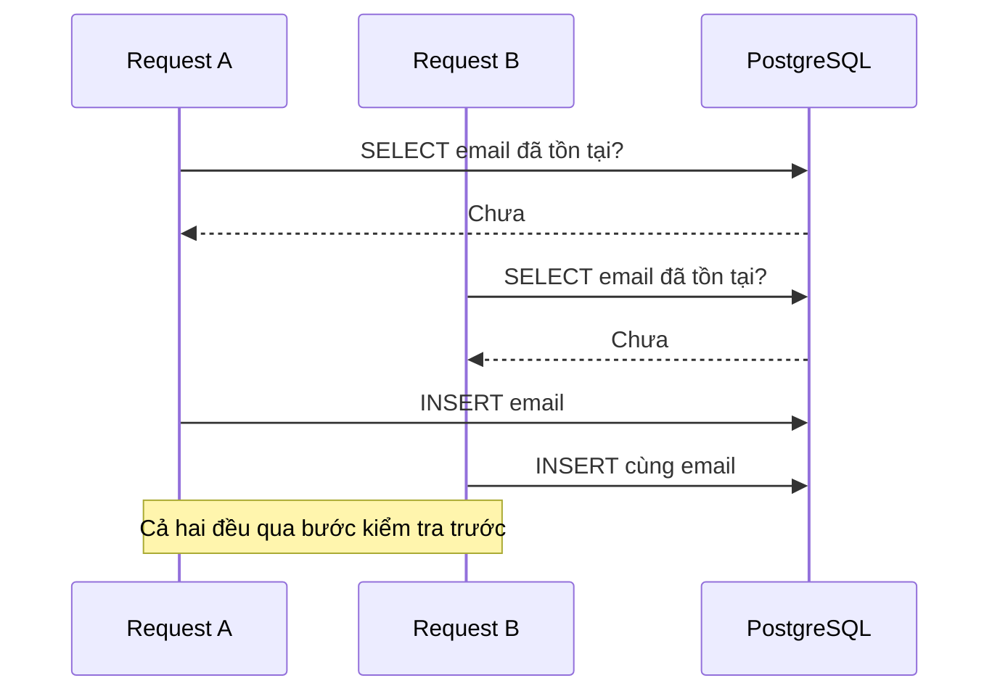

# Kiểm chứng ràng buộc duy nhất trước các yêu cầu đồng thời

## 1. Bài toán thực hành: hai yêu cầu đăng ký cùng một email

Một hệ thống Java quản lý tài khoản của nhiều tổ chức (*tenant*). Quy tắc nghiệp vụ quy định **trong cùng một tenant, hai tài khoản không được sử dụng cùng địa chỉ email đã chuẩn hóa**. Hai tenant khác nhau vẫn được phép có cùng email vì danh tính được quản lý theo phạm vi tổ chức.

Khi một người gửi biểu mẫu đăng ký, service thường thực hiện:

1. Kiểm tra email đã được sử dụng hay chưa.
2. Nếu chưa có, tạo tài khoản mới.
3. Trả kết quả thành công.

Thao tác đó có vẻ an toàn nếu thử tuần tự. Nhưng điều gì xảy ra khi **hai request đến đồng thời** và cùng đọc thấy email chưa tồn tại?



Nếu chỉ dựa vào `SELECT` kiểm tra trước và validation phía Java, cả hai request đều có thể cho rằng mình được quyền tạo. **Quy tắc duy nhất phải được bảo vệ ở nơi thực hiện ghi có thẩm quyền**, thường là unique constraint/unique index của database, rồi ứng dụng xử lý xung đột như một kết quả nghiệp vụ được dự kiến.

Bài này thuộc chương **Thực hành tổng hợp** của module **DATA_PERSISTENCE_FUNDAMENTALS**. Người học sẽ kết hợp thiết kế lược đồ, câu SQL, transaction, mức cô lập, JDBC/Spring, kiểm thử đồng thời, idempotency, bảo mật đa tenant, migration, quan sát và phục hồi. Mục tiêu không phải chỉ thấy PostgreSQL trả lỗi, mà là **chứng minh một bất biến còn đúng sau khi các request thực sự tranh chấp**.

> **Bất biến cần kiểm chứng:** Với mỗi cặp `(tenant_id, normalized_email)`, tại mọi trạng thái database đã commit, có **không quá một tài khoản** tương ứng. Hai request cùng cố tạo cặp đó không được làm xuất hiện hai hàng hợp lệ.

## 2. Tiêu chí hoàn thành của bài thực hành

Sau bài này, bạn phải tạo được một phép thử có thể lặp lại và giải thích rõ:

| Tiêu chí | Kết quả yêu cầu |
| --- | --- |
| Quy tắc dữ liệu | Email được chuẩn hóa theo chính sách đã chọn; uniqueness có phạm vi tenant |
| Lược đồ | Database có unique index/constraint thực sự bảo vệ khóa nghiệp vụ |
| Cạnh tranh | Hai transaction độc lập đều thấy “chưa có” trước khi cố ghi |
| Kết quả cạnh tranh | Chỉ **một** request tạo được tài khoản; request kia gặp conflict theo cơ chế đã chọn |
| Trạng thái cuối | Query từ connection mới thấy đúng **một** hàng có khóa nghiệp vụ |
| Tính cô lập tenant | Email giống nhau ở **hai tenant khác nhau** có thể tồn tại |
| Transaction | Request bị lỗi rollback đúng, không để connection trong trạng thái transaction aborted |
| Lỗi ứng dụng | Phân biệt `23505` với lỗi kết nối, lỗi dữ liệu hoặc serialization failure |
| Xử lý retry | Tránh biến request lặp thành tài khoản trùng; phân biệt idempotency với uniqueness |
| Khả năng tái chạy | Test độc lập dữ liệu cũ, có timeout và không treo vô hạn |

**Phạm vi ví dụ:** PostgreSQL và Java 17+, JDBC với JUnit 5/Testcontainers. SQL và tính năng PostgreSQL có thể khác trên MySQL, SQL Server hay database embedded. Mọi thao tác tạo/xóa schema trong bài chỉ chạy trên **database thực hành cô lập**, không hướng tới production.

## 3. Định nghĩa chính xác của “duy nhất”

Trước khi viết SQL, cần trả lời những câu hỏi tưởng nhỏ nhưng quyết định **khóa nghiệp vụ thật**:

- Email `Alice@example.test` và `alice@example.test` có được coi là một không?
- Có bỏ khoảng trắng đầu/cuối không?
- Email rỗng hoặc `NULL` có được phép không?
- Duy nhất trên toàn hệ thống hay trong từng tenant?
- Tài khoản đã vô hiệu hóa có tiếp tục giữ email hay không?
- Một người có nhiều tài khoản/alias email hay không?
- Quy tắc Unicode, collation và quy tắc chuẩn hóa có ổn định giữa phiên bản phần mềm không?

Trong thực hành này, ta **chọn rõ một chính sách đơn giản**:

1. Mỗi bản ghi bắt buộc có `tenant_id` và `email` không null, không chỉ toàn khoảng trắng.
2. Chuẩn hóa bằng `lower(btrim(email))` trên PostgreSQL.
3. Unique trên `(tenant_id, lower(btrim(email)))`.
4. Email đã gán vẫn chiếm khóa duy nhất dù tài khoản chưa kích hoạt; không có cơ chế tái sử dụng email của tài khoản đã xóa mềm trong ví dụ.

Hàm `lower(btrim(...))` ở đây là **quy tắc thực hành đã chọn**, không phải chuẩn hóa email phổ quát. Chính sách thật cần xét Unicode, collation, kiểm chứng sở hữu email, quy định của nhà cung cấp và các trường hợp alias; không tự ý gộp tài khoản chỉ vì hai chuỗi chuẩn hóa giống nhau.

## 4. Thiết kế schema và unique index trên PostgreSQL

Trên một PostgreSQL **test instance riêng**, tạo bảng:

```sql
CREATE TABLE practice_accounts (
    tenant_id UUID NOT NULL,
    account_id UUID NOT NULL,
    email TEXT NOT NULL CHECK (btrim(email) <> ''),
    display_name TEXT NOT NULL,
    created_at TIMESTAMPTZ NOT NULL DEFAULT CURRENT_TIMESTAMP,
    PRIMARY KEY (tenant_id, account_id)
);

CREATE UNIQUE INDEX uq_practice_accounts_tenant_email_normalized
ON practice_accounts (tenant_id, lower(btrim(email)));
```

Ta dùng **unique expression index** vì khóa cần so sánh theo biểu thức `lower(btrim(email))`, không phải theo email thô. Unique index có khả năng thực thi bất biến trên mọi thao tác `INSERT` hoặc `UPDATE email`, kể cả ghi từ JDBC, ORM, job nhập dữ liệu hoặc phiên bản ứng dụng khác.

Một số điều phải phân biệt:

- `PRIMARY KEY (tenant_id, account_id)` bảo vệ danh tính bản ghi, **khác** với khóa nghiệp vụ email.
- `UNIQUE (tenant_id, email)` trên email thô sẽ có semantics khác nếu DB phân biệt chữ hoa/thường; nó không thay thế index biểu thức trên.
- `CHECK (btrim(email) <> '')` từ chối chuỗi rỗng/toàn khoảng trắng; `NOT NULL` ngăn null. Chỉ `CHECK` không tự cấm null trong PostgreSQL vì biểu thức ra `UNKNOWN` không bị coi là vi phạm.
- Hai tenant khác nhau được phép trùng normalized email vì `tenant_id` là thành phần của unique key.
- Unique index biểu thức thực thi uniqueness nhưng **không mặc nhiên là một table-level UNIQUE constraint gắn được bằng `ADD CONSTRAINT ... USING INDEX`**. Khi tìm metadata, cần xem cả `pg_index` chứ không chỉ `pg_constraint`.

### Kiểm tra index đã thực sự hợp lệ

```sql
SELECT idx.indexrelid::regclass AS index_name,
       idx.indisunique,
       idx.indisvalid,
       idx.indisready,
       pg_get_indexdef(idx.indexrelid) AS index_definition
FROM pg_index AS idx
WHERE idx.indrelid = 'practice_accounts'::regclass
ORDER BY idx.indexrelid::regclass::text;
```

Kết quả cần có index `uq_practice_accounts_tenant_email_normalized` với `indisunique = true`, `indisvalid = true` và trạng thái sẵn sàng tương ứng. Một index tạo `CONCURRENTLY` bị lỗi có thể để lại bản ghi catalog **invalid**; chỉ nhìn thấy tên index chưa đủ kết luận đang bảo vệ đúng.

## 5. Thử tuần tự để kiểm chứng cách chuẩn hóa và phạm vi

Chạy các lệnh sau **chỉ trong DB thực hành**:

```sql
-- Tenant A đăng ký lần đầu: thành công.
INSERT INTO practice_accounts
    (tenant_id, account_id, email, display_name)
VALUES
    ('11111111-1111-4111-8111-111111111111',
     'aaaaaaaa-aaaa-4aaa-8aaa-aaaaaaaaaaa1',
     ' Alice@Example.test ', 'Alice A');

-- Cùng tenant, email đã chuẩn hóa trùng: phải bị từ chối.
INSERT INTO practice_accounts
    (tenant_id, account_id, email, display_name)
VALUES
    ('11111111-1111-4111-8111-111111111111',
     'aaaaaaaa-aaaa-4aaa-8aaa-aaaaaaaaaaa2',
     'alice@example.test', 'Duplicate Alice');
```

Lệnh thứ hai phải gây lỗi unique (`SQLSTATE 23505`). Nếu chạy trong transaction tường minh, transaction chứa lệnh lỗi của PostgreSQL sẽ bị đánh dấu aborted và cần `ROLLBACK`; trong chế độ auto-commit theo từng statement, xử lý transaction phụ thuộc client.

Lệnh cùng email ở tenant khác được phép:

```sql
INSERT INTO practice_accounts
    (tenant_id, account_id, email, display_name)
VALUES
    ('22222222-2222-4222-8222-222222222222',
     'bbbbbbbb-bbbb-4bbb-8bbb-bbbbbbbbbbb1',
     'ALICE@example.test', 'Alice B');

SELECT tenant_id, lower(btrim(email)) AS normalized_email,
       COUNT(*) AS account_count
FROM practice_accounts
GROUP BY tenant_id, lower(btrim(email))
ORDER BY tenant_id, normalized_email;
```

Kết quả hợp lệ là mỗi cặp `tenant_id + normalized_email` có số lượng bằng 1, dù cùng email xuất hiện ở các tenant khác nhau.

**Lưu ý vận hành:** Sau thử nghiệm tuần tự, dùng **database mới hoặc dữ liệu test riêng** cho thử nghiệm cạnh tranh; nếu email đã có từ trước thì cả hai request sẽ bị từ chối và không kiểm chứng được trạng thái “cùng thấy chưa có”.

## 6. Tại sao `SELECT rồi INSERT` không giữ được bất biến?

Một implementation phổ biến:

```java
// PSEUDOCODE — có race condition.
if (!accountRepository.existsByTenantAndNormalizedEmail(
        tenantId, normalizedEmail)) {
    accountRepository.insert(tenantId, email);
    return "CREATED";
}
return "ALREADY_EXISTS";
```

Mỗi lời gọi riêng lẻ đúng về mặt logic, nhưng **khoảng giữa SELECT và INSERT** không được khóa bằng một bất biến nguyên tử. Hai transaction cùng quan sát không có hàng rồi đều cố ghi.

Trên PostgreSQL `READ COMMITTED`, một lịch chạy điển hình:

| Thời điểm | Transaction A | Transaction B | Trạng thái |
| --- | --- | --- | --- |
| T1 | `BEGIN` | `BEGIN` | Chưa có email |
| T2 | `SELECT` → 0 | | A thấy trống |
| T3 | | `SELECT` → 0 | B cũng thấy trống |
| T4 | `INSERT` → tạo tuple chưa commit | | Unique index có khóa đang tranh chấp |
| T5 | | `INSERT` cùng unique key → có thể **chờ** | B chờ kết quả A |
| T6 | `COMMIT` | | Hàng A trở thành committed |
| T7 | | `INSERT` bị từ chối `23505` | B phải rollback |
| T8 | | `ROLLBACK` | Sau cùng chỉ còn một hàng |

Nếu A **rollback** thay vì commit, B có thể tiếp tục và insert thành công. Đừng coi request nào thắng là xác định trước bởi thứ tự mở connection, thread ID hay thời điểm gọi Java.

**Điểm mấu chốt:** `SELECT` trước ghi có ích để trả thông báo sớm và kiểm tra quyền/luồng nghiệp vụ, nhưng **không phải cơ chế bảo vệ cuối cùng**. Unique index giải quyết tranh chấp ngay tại bước ghi có thẩm quyền.

## 7. Thực hành thủ công: hai phiên kết nối và cùng một khóa

Chuẩn bị **hai cửa sổ psql/SQL client riêng**, cùng kết nối tới database test đã tạo bảng. Đảm bảo chưa có hàng nào cho tenant và email dùng trong kịch bản:

```sql
-- Chạy kiểm tra trên một phiên riêng khi chưa bắt đầu hai transaction.
SELECT COUNT(*)
FROM practice_accounts
WHERE tenant_id = '33333333-3333-4333-8333-333333333333'
  AND lower(btrim(email)) = 'race@example.test';
-- Kỳ vọng: 0.
```

### Phiên A

```sql
BEGIN;
SET TRANSACTION ISOLATION LEVEL READ COMMITTED;

SELECT COUNT(*)
FROM practice_accounts
WHERE tenant_id = '33333333-3333-4333-8333-333333333333'
  AND lower(btrim(email)) = 'race@example.test';
-- Kỳ vọng: 0.

INSERT INTO practice_accounts
    (tenant_id, account_id, email, display_name)
VALUES
    ('33333333-3333-4333-8333-333333333333',
     'cccccccc-cccc-4ccc-8ccc-ccccccccccc1',
     'Race@Example.test', 'Request A');

-- CHƯA COMMIT cho đến khi phiên B đã thử INSERT.
```

### Phiên B

```sql
BEGIN;
SET TRANSACTION ISOLATION LEVEL READ COMMITTED;

SELECT COUNT(*)
FROM practice_accounts
WHERE tenant_id = '33333333-3333-4333-8333-333333333333'
  AND lower(btrim(email)) = 'race@example.test';
-- Kỳ vọng: 0, vì A chưa commit.

INSERT INTO practice_accounts
    (tenant_id, account_id, email, display_name)
VALUES
    ('33333333-3333-4333-8333-333333333333',
     'cccccccc-cccc-4ccc-8ccc-ccccccccccc2',
     ' race@example.test ', 'Request B');
-- Có thể bị CHẶN chờ A COMMIT hoặc ROLLBACK.
```

### Trở lại phiên A rồi hoàn tất phiên B

Khi `INSERT` ở B đang chờ, trong phiên A:

```sql
COMMIT;
```

Sau A commit, phiên B thông thường sẽ trả lỗi vi phạm unique index với SQLSTATE `23505`. Trên phiên B, chạy:

```sql
ROLLBACK;
```

Đọc kết quả từ một connection mới:

```sql
SELECT account_id, tenant_id, email
FROM practice_accounts
WHERE tenant_id = '33333333-3333-4333-8333-333333333333'
  AND lower(btrim(email)) = 'race@example.test';
-- Kỳ vọng: đúng một hàng của A.
```

**Không chạy thứ tự này trên bảng production:** phiên A cố tình giữ transaction mở và có thể làm phiên B chờ khóa. Trong sandbox, đặt timeout/giới hạn thời gian thao tác; nếu phiên B chờ quá lâu, hãy kiểm tra trạng thái giao dịch và rollback an toàn thay vì bỏ hai phiên treo.

## 8. Vì sao cần kiểm thử đồng thời thực sự?

Một bài test tuần tự như sau **không đủ**:

```java
register("alice@example.test"); // success
register("alice@example.test"); // duplicate
```

Nó chỉ kiểm tra rằng **khi hàng đã commit trước đó**, một insert mới bị từ chối. Nó không tái hiện tình huống hai request **cùng vượt qua bước kiểm tra trước**.

Một bài kiểm thử cạnh tranh đúng phải kiểm soát:

- **Hai kết nối/transaction độc lập**, không phải hai lệnh trong cùng transaction JUnit.
- **Cùng tenant, cùng normalized email** nhưng ID bản ghi khác nhau.
- **Điểm đồng bộ** để cả hai thấy “chưa tồn tại” trước khi insert.
- **Timeout** để test không treo nếu một transaction chờ khóa.
- **Kết quả đã commit**, không chỉ exception ném ra khi gọi repository.
- **Query hậu kiểm bằng connection mới** để xác nhận duy nhất ở trạng thái quan sát được từ bên ngoài.
- **Môi trường sạch** trước test, không phụ thuộc thứ tự/chạy lại.

`Thread.sleep(...)` không bảo đảm hai thread đi tới cùng một trạng thái. Dùng `CountDownLatch` hoặc `CyclicBarrier` để tạo lịch kiểm thử được kiểm soát. Trong test thật, vẫn phải cho database tự quyết định thứ tự giao dịch thắng; mục tiêu là bất biến, **không ép A phải thắng B**.

## 9. Integration test Java 17 + JUnit 5 + Testcontainers

Đây là bài test có thể ghép vào một dự án Java đã cấu hình **JUnit Jupiter, Testcontainers PostgreSQL và PostgreSQL JDBC driver**. Nó dùng PostgreSQL thật, không dựa vào H2 để suy ra hành vi unique index hoặc khóa.

### 9.1. Cấu hình test và lược đồ

```java
import java.sql.Connection;
import java.sql.DriverManager;
import java.sql.PreparedStatement;
import java.sql.ResultSet;
import java.sql.SQLException;
import java.sql.Statement;
import java.util.UUID;
import java.util.concurrent.CountDownLatch;
import java.util.concurrent.ExecutorService;
import java.util.concurrent.Executors;
import java.util.concurrent.Future;
import java.util.concurrent.TimeUnit;
import java.util.stream.Stream;
import org.junit.jupiter.api.BeforeAll;
import org.junit.jupiter.api.Test;
import org.junit.jupiter.api.Timeout;
import org.testcontainers.containers.PostgreSQLContainer;
import org.testcontainers.junit.jupiter.Container;
import org.testcontainers.junit.jupiter.Testcontainers;
import static org.junit.jupiter.api.Assertions.*;

@Testcontainers
class AccountUniqueConcurrencyIT {
    @Container
    static PostgreSQLContainer<?> postgres =
            new PostgreSQLContainer<>("postgres:16")
                    .withDatabaseName("unique_practice")
                    .withUsername("practice")
                    .withPassword("test_password_only");

    private static Connection openConnection() throws SQLException {
        return DriverManager.getConnection(
                postgres.getJdbcUrl(),
                postgres.getUsername(),
                postgres.getPassword());
    }

    @BeforeAll
    static void createSchema() throws SQLException {
        try (Connection c = openConnection();
             Statement st = c.createStatement()) {
            st.execute("""
                CREATE TABLE practice_accounts (
                    tenant_id UUID NOT NULL,
                    account_id UUID NOT NULL,
                    email TEXT NOT NULL CHECK (btrim(email) <> ''),
                    display_name TEXT NOT NULL,
                    created_at TIMESTAMPTZ NOT NULL DEFAULT now(),
                    PRIMARY KEY (tenant_id, account_id)
                )
                """);
            st.execute("""
                CREATE UNIQUE INDEX
                    uq_practice_accounts_tenant_email_normalized
                ON practice_accounts
                    (tenant_id, lower(btrim(email)))
                """);
        }
    }

    private record Attempt(
            boolean sawNoExisting, boolean committed, String sqlState) {}

    // Phần còn lại nằm trong cùng class, xem mục 9.2 và 9.3.
}
```

Container `static` được tạo cho lớp test theo vòng đời Testcontainers; ví dụ giả định lớp dùng **database test mới**, không bật reuse tới một database đã có bảng cùng tên. Nếu chạy các bài test khác trên cùng container/schema, cần reset có chủ đích hoặc dùng namespace riêng để tránh va chạm dữ liệu. Đây là ví dụ có một lớp test minh họa; không tạo hay xóa bảng trên database dùng chung.

### 9.2. Hai transaction cùng kiểm tra rồi cố insert

Thêm các phương thức sau **bên trong lớp `AccountUniqueConcurrencyIT`**:

```java
private static boolean accountAbsent(
        Connection c, UUID tenant, String email) throws SQLException {
    try (PreparedStatement st = c.prepareStatement(
            """
            SELECT NOT EXISTS (
                SELECT 1 FROM practice_accounts
                WHERE tenant_id = ?
                  AND lower(btrim(email)) = lower(btrim(?))
            )
            """)) {
        st.setObject(1, tenant);
        st.setString(2, email);
        try (ResultSet rs = st.executeQuery()) {
            if (!rs.next()) {
                throw new SQLException("Expected one boolean result");
            }
            return rs.getBoolean(1);
        }
    }
}

private static Attempt tryCreate(
        UUID tenant, String email,
        CountDownLatch bothInspected, CountDownLatch startInsert)
        throws Exception {
    try (Connection c = openConnection()) {
        c.setAutoCommit(false);
        c.setTransactionIsolation(Connection.TRANSACTION_READ_COMMITTED);

        boolean absent = accountAbsent(c, tenant, email);
        bothInspected.countDown();
        if (!startInsert.await(10, TimeUnit.SECONDS)) {
            c.rollback();
            throw new IllegalStateException("Insert barrier timeout");
        }

        try (PreparedStatement st = c.prepareStatement(
                """
                INSERT INTO practice_accounts
                    (tenant_id, account_id, email, display_name)
                VALUES (?, ?, ?, ?)
                """)) {
            st.setObject(1, tenant);
            st.setObject(2, UUID.randomUUID());
            st.setString(3, email);
            st.setString(4, "Concurrent signup");
            st.executeUpdate();
            c.commit();
            return new Attempt(absent, true, null);
        } catch (SQLException failure) {
            try {
                c.rollback();
            } catch (SQLException rollbackFailure) {
                failure.addSuppressed(rollbackFailure);
            }
            return new Attempt(absent, false, failure.getSQLState());
        }
    }
}
```

Những điều đáng chú ý:

- Mỗi worker dùng `openConnection()`, nên có **transaction và connection riêng**.
- `accountAbsent` thực hiện `SELECT NOT EXISTS` theo cùng cặp tenant/email chuẩn hóa.
- `bothInspected` báo rằng **hai SELECT đã xong**, `startInsert` chỉ cho hai request đi tiếp sau mốc đó.
- Hai `account_id` khác nhau để xung đột thực sự đến từ **unique index email**, không phải PK.
- `commit()` chỉ được gọi sau khi `INSERT` thành công; giao dịch thua phải `rollback()` vì sau lỗi constraint PostgreSQL transaction đã bị abort.
- `SQLSTATE 23505` được xem là **kết quả mong đợi của phép thử kiểm soát**, không phải kết luận mọi `SQLException` có thể bị nuốt trong production.

### 9.3. Assert kết quả cạnh tranh và hậu điều kiện

Tiếp tục thêm phương thức vào cùng lớp:

```java
@Test
@Timeout(value = 30, unit = TimeUnit.SECONDS)
void onlyOneSignupCommitsWhenRequestsRace() throws Exception {
    UUID tenant = UUID.randomUUID();
    String firstEmail = " Alice@Example.test ";
    String secondEmail = "alice@example.test";
    CountDownLatch inspected = new CountDownLatch(2);
    CountDownLatch startInsert = new CountDownLatch(1);
    ExecutorService workers = Executors.newFixedThreadPool(2);

    try {
        Future<Attempt> first = workers.submit(() ->
                tryCreate(tenant, firstEmail, inspected, startInsert));
        Future<Attempt> second = workers.submit(() ->
                tryCreate(tenant, secondEmail, inspected, startInsert));

        assertTrue(inspected.await(10, TimeUnit.SECONDS),
                "Both requests must finish the precheck");
        startInsert.countDown();

        Attempt a = first.get(10, TimeUnit.SECONDS);
        Attempt b = second.get(10, TimeUnit.SECONDS);

        assertTrue(a.sawNoExisting());
        assertTrue(b.sawNoExisting());
        assertEquals(1L,
                Stream.of(a, b).filter(Attempt::committed).count());
        assertEquals(1L,
                Stream.of(a, b)
                        .filter(x -> "23505".equals(x.sqlState()))
                        .count());

        try (Connection c = openConnection();
             PreparedStatement st = c.prepareStatement(
                     """
                     SELECT COUNT(*) FROM practice_accounts
                     WHERE tenant_id = ?
                       AND lower(btrim(email)) = ?
                     """)) {
            st.setObject(1, tenant);
            st.setString(2, "alice@example.test");
            try (ResultSet rs = st.executeQuery()) {
                assertTrue(rs.next());
                assertEquals(1L, rs.getLong(1));
            }
        }
    } finally {
        startInsert.countDown(); // Tránh để worker chờ nếu assert lỗi sớm.
        workers.shutdownNow();
    }
}
```

**Điều bài test chứng minh:** ngay cả khi cả hai transaction **đã quan sát khóa chưa tồn tại**, database vẫn chỉ cho **một** transaction tạo bản ghi và commit; giao dịch còn lại nhận unique violation `23505` và rollback. Test không phụ thuộc request A hay B thắng.

**Giới hạn:** test này không tự chứng minh toàn bộ hành vi HTTP, ORM exception translation hay độ bền dữ liệu khi server crash. Nó kiểm chứng một bất biến trên PostgreSQL thật trong một lịch cạnh tranh được kiểm soát. Với network lỗi khi commit, kết quả có thể **chưa biết** từ phía caller; không tự xem mọi `SQLException` là transaction chắc chắn đã rollback ở server.

## 10. Lập lịch kiểm thử sao cho không treo và không kết luận sai

Đồng bộ bằng latch có thể phát hiện race, nhưng vẫn cần kiểm soát các tình huống thất bại:

| Tình huống | Điều có thể xảy ra | Cách thiết kế test |
| --- | --- | --- |
| Worker chưa mở được connection | Một `SELECT` không hoàn thành; latch còn đợi | `await(timeout)` rồi fail có thông báo, dừng executor |
| Hai request chờ nhau do lock | `INSERT` không trả kết quả | Timeout cho future/test, rollback/đóng connection |
| Connection pool quá nhỏ | Hai worker không có hai connection thật | Dùng DriverManager riêng hoặc pool tối thiểu đủ số kết nối |
| Email đã tồn tại từ fixture cũ | Cả hai precheck thấy có hàng | Database disposable hoặc tenant/khóa test mới |
| Test phụ thuộc A phải thắng | Thỉnh thoảng fail do scheduler | Chỉ assert **một success + một conflict** |
| Một worker ném lỗi không phải `23505` | Có thể mạng, permission, deadlock hoặc schema sai | Không nuốt lỗi; bài test fail vì outcome không đúng |
| Exception bị ném tại `flush/commit` của ORM | Assert trước commit vô tình báo pass | Kiểm tra transaction đã commit và hậu điều kiện từ connection mới |
| Test cleanup xóa sai hàng | Tác động tới bài test khác | Chỉ dùng DB/test tenant do bài sở hữu |

Để phân tích chi tiết, có thể ghi **mốc A/B đã qua precheck, bắt đầu INSERT, kết thúc commit/rollback** vào log test, nhưng không dùng thứ tự log của các thread như bằng chứng quyết định transaction nào sẽ thắng.

## 11. Cùng email nhưng khác tenant: không được chặn nhầm

Một kiểm thử tốt không chỉ chứng minh duplicate bị chặn; nó còn chứng minh **những trường hợp hợp lệ không bị từ chối**.

```sql
-- Hai tenant, email giống nhau: cả hai INSERT phải thành công.
INSERT INTO practice_accounts
    (tenant_id, account_id, email, display_name)
VALUES
    ('44444444-4444-4444-8444-444444444444',
     'dddddddd-dddd-4ddd-8ddd-ddddddddddd1',
     'shared@example.test', 'Tenant A');

INSERT INTO practice_accounts
    (tenant_id, account_id, email, display_name)
VALUES
    ('55555555-5555-4555-8555-555555555555',
     'dddddddd-dddd-4ddd-8ddd-ddddddddddd2',
     'SHARED@example.test', 'Tenant B');
```

Nếu index chỉ là `UNIQUE (lower(btrim(email)))` mà thiếu tenant, request của tenant B sẽ bị từ chối dù hợp đồng cho phép. Ngược lại, nếu code chỉ kiểm tra email bằng `SELECT` **không lọc tenant**, có thể trả `409 Conflict` sai, đồng thời tiết lộ rằng một email tồn tại ở tổ chức khác.

**Bảo mật:** trong hệ đa tenant, không lấy `tenant_id` trực tiếp từ payload mà tin nó đã được phép. Tầng API lấy tenant từ danh tính/quyền đã xác thực; unique index bảo vệ bất biến dữ liệu, **không thay thế authorization hoặc Row-Level Security** nếu kiến trúc cần.

## 12. `UNIQUE` trên INSERT và UPDATE: cả hai đều phải được kiểm chứng

Quy tắc không chỉ áp dụng cho đăng ký mới. Một người có thể sửa email sau khi tài khoản đã tồn tại:

```sql
-- Trong DB thực hành, với hai account đã tồn tại cùng tenant.
-- Nếu normalized email mới đã thuộc account khác, UPDATE bị từ chối.
UPDATE practice_accounts
SET email = 'occupied@example.test'
WHERE tenant_id = :tenant_id
  AND account_id = :account_to_change;
```

Trường hợp cạnh tranh:

1. Account A và B có hai email khác nhau.
2. Hai request đồng thời đổi email của A và B thành cùng normalized email X.
3. Có thể cả hai `SELECT` tiền kiểm thấy X còn trống.
4. Unique index chỉ cho một giao dịch cập nhật thành công ở trạng thái đã commit.

**Bài kiểm thử mở rộng:** tạo hai account cho cùng tenant, mở hai transaction khác nhau, đặt barrier sau precheck và chạy hai câu `UPDATE`. Assert một commit thành công, một conflict `23505`; kiểm tra row sau cùng và email ban đầu của account thua vẫn còn vì transaction rollback.

Một constraint có phạm vi **partial** như “email chỉ duy nhất ở account ACTIVE” sẽ có semantics khác: cần định nghĩa predicate và các chuyển trạng thái `INACTIVE → ACTIVE`, soft delete, khôi phục dữ liệu. Ví dụ bài này **không** dùng partial index vì muốn duy nhất bất kể trạng thái tài khoản.

## 13. Không nhầm uniqueness, idempotency và “cùng một ý định”

Hai yêu cầu cùng email **có thể là hai trường hợp rất khác nhau**:

- Hai người hoặc hai browser cố đăng ký tài khoản giống nhau: một tạo thành công; yêu cầu kia phải nhận **conflict nghiệp vụ**.
- Client gửi một request đã thành công, nhưng mất phản hồi rồi gửi lại **cùng ý định**: cần cơ chế trả lại kết quả tương ứng thay vì tạo thêm tài khoản hoặc báo lỗi khó hiểu.

**Unique email** trả lời câu hỏi “có tối đa một account cho khóa này không?”. **Idempotency key** trả lời “đây có phải đúng một thao tác đã được xử lý trước đó không?”. Không dùng một khái niệm thay thế khái niệm kia.

Một schema bổ sung minh họa:

```sql
CREATE TABLE practice_signup_requests (
    tenant_id UUID NOT NULL,
    request_id UUID NOT NULL,
    payload_hash TEXT NOT NULL,
    account_id UUID,
    state TEXT NOT NULL
        CHECK (state IN ('PROCESSING', 'SUCCEEDED', 'FAILED')),
    created_at TIMESTAMPTZ NOT NULL DEFAULT now(),
    PRIMARY KEY (tenant_id, request_id)
);
```

Một thiết kế xử lý idempotency thực tế cần:

1. Gắn `request_id` ổn định cho **cùng ý định**, không tạo key mới khi retry.
2. So `payload_hash` để phát hiện việc tái sử dụng key với payload khác, thay vì coi mọi trùng key là thành công.
3. Ghi record idempotency và account **trong cùng transaction** nếu muốn tránh tình huống account đã commit nhưng record kết quả chưa commit.
4. Với trạng thái `PROCESSING`, có timeout/lease và quy trình quyết định request nào được tiếp tục, không chờ vô hạn.
5. Khi kết nối đứt sau commit, tra cứu nguồn dữ liệu **có thẩm quyền**, không chỉ read replica còn lag, trước khi retry.
6. Duy trì unique email ở database bất kể cơ chế idempotency có lỗi hay thiếu ở một đường ghi.

Đoạn schema chỉ nêu thành phần, **không phải thuật toán exactly-once**. Nếu request gây side effect ngoài database (email, payment, message broker), cần thêm outbox/inbox hoặc cơ chế dedup ở bên nhận và thiết kế phục hồi theo ngữ nghĩa nghiệp vụ.

## 14. Chuyển lỗi PostgreSQL thành kết quả HTTP hợp lý

Trong JDBC, khi `INSERT` vi phạm unique index của PostgreSQL, driver thường trả `SQLException` với `SQLSTATE = 23505`.

```java
try {
    accountService.register(command);
    return ResponseEntity.status(201).build();
} catch (DuplicateAccountEmailException conflict) {
    return ResponseEntity.status(409)
            .body(Map.of("code", "EMAIL_ALREADY_IN_USE"));
}
```

Đoạn trên minh họa **boundary controller**, không phải lớp chạy độc lập; `ResponseEntity` và `Map` thuộc Spring/Java, `DuplicateAccountEmailException` là domain exception do ứng dụng định nghĩa. Logic ánh xạ chi tiết exception có thể nằm trong service/exception handler.

Một bảng định hướng xử lý:

| Kết quả DB | Ý nghĩa thường gặp | Phản hồi/hành động phù hợp |
| --- | --- | --- |
| Insert đã commit | Tài khoản được tạo | `201 Created` cùng ID/định danh an toàn |
| `23505` do index email | Khóa email đã có trong tenant | `409 Conflict`, hoặc hợp đồng nghiệp vụ khác đã định nghĩa |
| `23505` do PK/request ID | Có thể là duplicate thao tác/idempotency | Tra cứu kết quả và payload tương ứng, không gắn nhãn “email đã dùng” máy móc |
| `23502` | Thiếu giá trị bắt buộc | Sửa validation/mapping; có thể phản hồi lỗi input hoặc lỗi nội bộ tùy nguồn |
| `23514` | Vi phạm CHECK | Xác định constraint và invariant, không retry cùng payload mù |
| `40001` | Serialization failure | Có thể retry **toàn transaction** với backoff và giới hạn |
| `40P01` | Deadlock | Retry transaction bị rollback có kiểm soát |
| SQLSTATE lớp `08` | Kết nối/transport lỗi | Kiểm tra kết quả commit có thể chưa rõ, route/failover/retry an toàn |

Đừng bắt **mọi** `DataIntegrityViolationException` rồi trả “email trùng”. Trong một service có nhiều constraint, lỗi có thể xuất phát từ khóa ngoại, PK hoặc CHECK. Cần truy ra **SQLSTATE và tên constraint/index nếu có**, cùng ranh giới bảo mật khi hiển thị lỗi cho client.

**Không rò rỉ thông tin nhạy cảm:** với một số sản phẩm, thông báo “email này đã tồn tại” có thể cho phép dò danh sách tài khoản. Chính sách response có thể dùng thông báo trung tính hoặc quy trình xác minh email, nhưng **database vẫn phải thực thi uniqueness**.

## 15. Trong Spring/JPA, exception có thể xuất hiện ở `flush()` hoặc `commit`

Với JPA, `save(entity)` không nhất thiết phát SQL `INSERT` ngay. Hibernate có thể trì hoãn cho đến `flush` hoặc lúc commit transaction:

```java
@org.springframework.transaction.annotation.Transactional
public UUID registerAccount(RegisterAccountCommand command) {
    AccountEntity entity = mapper.toEntity(command);
    entityManager.persist(entity);
    entityManager.flush(); // Có thể phát sinh unique violation tại đây.
    return entity.getId();
}
```

Đây là mã minh họa trong một Spring service. `flush` có thể giúp phát hiện lỗi sớm hơn **trong transaction**, nhưng **không đồng nghĩa transaction đã commit**. Khi transaction rollback, đối tượng đã được flush cũng không phải kết quả bền vững.

Nếu exception phát sinh tại `commit` ngoài thân phương thức, một `try/catch` chỉ bao quanh `persist` có thể không bắt được. Cần đặt mapping lỗi ở **ranh giới transaction và controller**, hiểu exception translation của Spring và không nuốt lỗi khiến Spring tiếp tục cố commit một transaction đã thất bại.

### Vì sao `@Transactional` không giải quyết race bằng phép màu?

`@Transactional` xác định ranh giới transaction, không làm hai transaction có bước `SELECT trước INSERT` trở thành một thao tác nguyên tử. Ngay trong transaction `READ COMMITTED`, cả hai vẫn có thể thấy “chưa có”.

Thay mức cô lập lên `SERIALIZABLE` có thể phát hiện các lịch không tuần tự hóa được và yêu cầu retry toàn transaction, nhưng **không thay thế unique constraint cho một khóa nghiệp vụ**. PostgreSQL có thể vẫn báo `23505` trong một số lịch, nên ứng dụng phải xử lý xung đột dữ liệu được DB thực thi.

## 16. `ON CONFLICT`: biến cạnh tranh thành kết quả có chủ đích

Trên PostgreSQL, một cách khác là để database **thử insert nguyên tử** rồi xử lý conflict ngay trong câu SQL.

```sql
INSERT INTO practice_accounts
    (tenant_id, account_id, email, display_name)
VALUES
    (:tenant_id, :account_id, :email, :display_name)
ON CONFLICT DO NOTHING
RETURNING account_id;
```

- Có một hàng trong `RETURNING`: câu lệnh đã **insert** hàng đó (transaction vẫn phải commit thành công).
- Không có hàng trong `RETURNING`: insert đã bị bỏ qua do một conflict được `DO NOTHING` xử lý.
- Bản ghi khác có thể được tạo đồng thời; PostgreSQL điều phối việc phát hiện conflict ở database.

**Cần cẩn thận:** `ON CONFLICT DO NOTHING` **không có conflict target** có thể bỏ qua xung đột trên **bất kỳ unique/exclusion constraint đủ điều kiện** nào, không chỉ email. Muốn ánh xạ thành `EMAIL_ALREADY_IN_USE`, phải xác minh conflict liên quan email hoặc dùng conflict target phù hợp.

Với index biểu thức của ví dụ, PostgreSQL có thể suy ra arbiter từ biểu thức khóa khi conflict target được viết tương ứng:

```sql
INSERT INTO practice_accounts
    (tenant_id, account_id, email, display_name)
VALUES
    (:tenant_id, :account_id, :email, :display_name)
ON CONFLICT (tenant_id, (lower(btrim(email))))
DO NOTHING
RETURNING account_id;
```

Các placeholder `:...` là ký hiệu named binding của thư viện; với psql cần dùng giá trị literal cho demo hoặc dùng cơ chế biến của client; với JDBC dùng `?`. Conflict target phải khớp định nghĩa index, bao gồm biểu thức, collation/predicate liên quan nếu có. Kiểm thử SQL thực tế trên đúng phiên bản PostgreSQL thay vì suy từ câu ví dụ.

**Không mặc định dùng `DO UPDATE` để lấy lại ID của account đã tồn tại.** Việc update một account khác chỉ để tránh duplicate có thể kích hoạt audit/trigger, thay đổi dữ liệu hoặc trao quyền sai. Nếu muốn trả lại kết quả cũ của **cùng request**, dùng giao thức idempotency được kiểm chứng.

## 17. Lock thủ công có thay thế unique index không?

Một cách thử phổ biến là khóa một hàng email trước khi insert:

```sql
SELECT account_id
FROM practice_accounts
WHERE tenant_id = :tenant_id
  AND lower(btrim(email)) = lower(btrim(:email))
FOR UPDATE;
```

Nhưng khi **chưa có hàng nào**, câu `SELECT ... FOR UPDATE` không khóa được một hàng chưa tồn tại. Hai transaction vẫn có thể cùng thấy “không có kết quả” rồi cố INSERT. Tùy DBMS và mức cô lập, có các cơ chế khóa phạm vi/predicate khác, nhưng không nên tự thay unique index bằng một giả định khóa mơ hồ.

Một số hệ dùng **advisory lock**, parent-row lock hoặc serialized command processor để điều phối workflow phức tạp. Những kỹ thuật đó có thể bổ sung điều kiện nghiệp vụ liên quan nhiều bảng, nhưng:

- Mọi writer phải tuân thủ cùng giao thức khóa; một writer bỏ qua khóa phá giả định.
- Tăng lock contention, nguy cơ timeout/deadlock và độ phức tạp failover.
- Không tự thay thế một ràng buộc duy nhất có thể khai báo rõ ràng trong DB.

**Thứ tự ưu tiên:** biểu diễn bất biến bằng unique constraint/index; dùng cơ chế khóa bổ sung chỉ khi có một lý do giao dịch/kinh doanh cụ thể được kiểm chứng.

## 18. Những bẫy về `NULL`, collation và dữ liệu mềm

### Nhiều giá trị NULL có thể cùng vượt qua UNIQUE

Trong PostgreSQL theo semantics mặc định của unique index, nhiều hàng có giá trị `NULL` ở một khóa có thể cùng tồn tại vì `NULL` không được coi là bằng nhau trong uniqueness mặc định. Bảng thực hành đã khai báo `email NOT NULL` để tránh mơ hồ.

Với PostgreSQL 15 trở lên có cú pháp `NULLS NOT DISTINCT` cho một số ràng buộc/index unique, nhưng **đó là một lựa chọn chính sách khác**. Không dựa vào UNIQUE để ngăn null mà không định nghĩa rõ semantics.

### Email chuẩn hóa không nhất thiết đơn giản

Index `lower(btrim(email))` phản ánh collation/biểu thức cụ thể của PostgreSQL. Nếu Java chuẩn hóa bằng thư viện khác trước khi `SELECT` mà DB dùng một cách chuẩn hóa khác khi `INSERT`, ứng dụng có thể trả “chưa có” rồi gặp unique violation. Điều đó vẫn an toàn về dữ liệu nhờ index, nhưng trải nghiệm và test phải bao phủ sự khác biệt.

Với Unicode, chuyển đổi chữ hoa/thường và locale, cần lựa chọn chuẩn hóa được phê duyệt và có migration nếu chính sách thay đổi. Không tự suy rằng mọi email khác hoa/thường phải được hợp nhất một cách không kiểm soát.

### Soft delete thay đổi nghĩa của khóa

Nếu business muốn email được tái sử dụng sau khi account chuyển `DELETED`, có thể cân nhắc **partial unique index** trên các account còn hiệu lực. Nhưng khi thay đổi trạng thái, `RESTORE` account cũ có thể lại xung đột với account mới. Phải kiểm thử đồng thời cho cả INSERT, UPDATE email và chuyển trạng thái; đây là **một bất biến khác** so với bài hiện tại.

## 19. Bổ sung unique index trên bảng đã có dữ liệu

Trong production, bảng có thể đã chứa email trùng trước khi chính sách mới ra đời. Không thể chỉ thêm index rồi coi mọi dữ liệu cũ được “tự làm sạch”.

### 19.1. Kiểm kê dữ liệu trùng

```sql
SELECT tenant_id,
       lower(btrim(email)) AS normalized_email,
       COUNT(*) AS duplicates,
       array_agg(account_id ORDER BY account_id) AS account_ids
FROM practice_accounts
GROUP BY tenant_id, lower(btrim(email))
HAVING COUNT(*) > 1
ORDER BY duplicates DESC, tenant_id, normalized_email;
```

Nếu có kết quả, cần **xác minh danh tính và chính sách xử lý**, không tự xóa hoặc hợp nhất account để đạt unique index. Dữ liệu có thể liên quan quyền sở hữu, thanh toán, audit và lịch sử nghiệp vụ.

### 19.2. Không có cửa sổ an toàn chỉ vì scan trả về 0

Sau scan, một writer cũ vẫn có thể tạo duplicate **trước khi index được xây xong**. Để rollout an toàn, cần có:

1. Quy tắc normalization và schema đã được kiểm chứng.
2. Các đường ghi được chuyển sang hành vi tương thích.
3. Dữ liệu trùng lịch sử được xử lý có đối soát.
4. Bước tạo index ở thời điểm và chế độ phù hợp.
5. Kiểm tra catalog và thử cạnh tranh sau khi index hợp lệ.

Trên bảng PostgreSQL lớn, có thể tạo:

```sql
-- Chạy riêng bên ngoài explicit transaction block tường minh.
CREATE UNIQUE INDEX CONCURRENTLY uq_practice_accounts_tenant_email_normalized
ON practice_accounts(tenant_id, lower(btrim(email)));
```

Lệnh trên **không chạy lại nếu index đã tồn tại**; đây là cú pháp minh họa dành cho môi trường đang bổ sung index lần đầu, không phải bước chạy tiếp sau `CREATE UNIQUE INDEX` ở phần 4.

`CREATE UNIQUE INDEX CONCURRENTLY` tránh giữ một số loại khóa chặn DML dài như index build thông thường, nhưng vẫn dùng I/O/CPU và có thể chờ transaction; nó **không** có nghĩa không ảnh hưởng hệ thống. Nếu có duplicate sẵn hoặc phát sinh trong lúc build, quá trình có thể thất bại và để lại **index invalid**. Không cho rollout tiếp mà chưa kiểm tra `indisvalid/indisready` và xử lý trạng thái index theo quy trình.

**Không có cú pháp `UNIQUE NOT VALID` tương đương CHECK/FK NOT VALID** để tùy ý bỏ qua duplicate cũ rồi validate sau. Migration unique cần chiến lược xử lý dữ liệu riêng.

## 20. Đo khả năng chịu tải và giới hạn transaction

Khi số request cùng tranh một email tăng lên, unique index đảm bảo bất biến nhưng không đảm bảo mọi request đều nhanh. Nhiều transaction có thể chờ cùng một khóa, chiếm connection và làm API latency tăng.

Một kịch bản tải trong sandbox:

| Thử nghiệm | Mục tiêu | Quan sát |
| --- | --- | --- |
| 2 requests cùng khóa | Chứng minh conflict | 1 commit, 1 conflict, 1 hàng cuối |
| 20 requests cùng khóa | Chứng minh dưới tranh chấp mạnh | 1 commit; 19 conflict trong môi trường kiểm thử sạch nếu tất cả tới cùng khóa |
| 20 requests khác email | Không tạo lock hotspot giả | 20 commits khi không có lỗi khác |
| Cùng email, 10 tenant khác nhau | Chứng minh scope tenant | Mỗi tenant có tối đa 1 hàng, không chặn nhầm |
| Cạnh tranh UPDATE email | Unique trên thay đổi, không chỉ INSERT | 1 đổi thành công, transaction thua rollback |
| Crash/lỗi commit | Kiểm tra outcome chưa rõ | Có quy trình tra cứu trước retry, không đếm duplicate theo ý định |

**Không nhất thiết mọi request thua đều trả ngay `23505` trong mọi kịch bản.** Với `ON CONFLICT DO NOTHING`, request thua có thể trả 0 hàng; với timeout/deadlock/lỗi mạng, kết quả khác. Bảng trên mô tả kỳ vọng khi dùng **INSERT thông thường** và môi trường không có lỗi phụ.

Các chỉ số nên đo: p95/p99 request, thời gian chờ connection, `pg_stat_activity`, SQLSTATE `23505` theo endpoint/constraint, pool active/pending, transaction age, deadlock, số hàng committed và số retry. Không đưa email thô làm metric label vì dữ liệu nhạy cảm và cardinality cao.

### Không giữ transaction trong khi gọi hệ thống ngoài

```java
// ANTI-PATTERN: giữ transaction/connection khi chờ email/HTTP.
beginTransaction();
insertAccount();
emailService.sendWelcomeEmail(); // Có thể chậm hoặc thất bại.
commitTransaction();
```

Hãy commit account và bản ghi outbox trong một transaction, sau đó worker gửi email **sau commit** với idempotency phù hợp. Khi hai request cạnh tranh, chỉ account được tạo thành công mới nên phát sinh sự kiện chào mừng có hiệu lực. Không gửi email trước rồi hy vọng rollback DB sẽ thu hồi email đã gửi.

## 21. Kiểm chứng bằng hậu điều kiện, không chỉ số lỗi `23505`

Một bộ test đầy đủ có thể lập bảng chứng minh:

| Bất biến / hậu điều kiện | Cách đo |
| --- | --- |
| Không có khóa email trùng trong tenant | `GROUP BY tenant_id, lower(btrim(email)) HAVING COUNT(*) > 1` trả 0 |
| Hai request race đều thấy key chưa tồn tại | Latch và kết quả precheck của từng worker |
| Chỉ một transaction thành công | Kết quả commit từ hai worker, không chỉ kết quả `executeUpdate` |
| Request thua được rollback | Connection mới thấy 1 hàng; không có outbox side effect cho request thua |
| Tenant khác nhau độc lập | Cùng normalized email ở hai tenant được phép |
| UPDATE email cũng được bảo vệ | Thử hai thay đổi thành cùng key |
| Retry cùng operation không tạo account thứ hai | Unique key + idempotency record/flow tương ứng |
| Lỗi không bị dịch sai | SQLSTATE/index cụ thể dẫn tới phản hồi nghiệp vụ đã định |
| Lặp lại được | Chạy trên DB disposable hoặc namespace/test tenant mới |

Truy vấn hậu kiểm tổng quát:

```sql
SELECT tenant_id,
       lower(btrim(email)) AS email_key,
       COUNT(*) AS row_count
FROM practice_accounts
GROUP BY tenant_id, lower(btrim(email))
HAVING COUNT(*) > 1;
-- Kỳ vọng: không có hàng.
```

Truy vấn trên một bảng nhiều triệu tài khoản có thể quét/tổng hợp dữ liệu rất lớn; dùng nó trong **sandbox, migration validation hoặc job audit được lập lịch**, không chạy liên tục trên primary production khi không cần. Với đường ghi mới, unique index đã bảo đảm kiểm tra nguyên tử trên khóa phù hợp.

### Kiểm tra những trường hợp có thể “pass giả”

- Hai worker **dùng chung connection/transaction**, nên test không chứng minh concurrency độc lập.
- Hai worker dùng **email khác nhau sau chuẩn hóa**, nên không hề tranh cùng khóa.
- Hàng đã có từ trước, khiến **cả hai request thất bại**, nhưng assert chỉ kiểm tra không có duplicate.
- Không chờ `commit`; assert ngay khi insert thành công nhưng transaction sau đó rollback.
- Chỉ đếm một dòng trong cache hoặc read replica có lag, không phải primary có thẩm quyền.
- Test gọi service có mock repository, nên unique constraint DB không bao giờ được thực thi.
- Bảng thiếu unique index do migration test không được áp, nhưng logic ứng dụng tuần tự khiến test xanh.
- Lỗi `SQLException` bất kỳ được xem như `23505`, che lỗi mạng/permission/DDL.

## 22. Quy trình triển khai thực hành theo từng mốc

### Mốc A — Xác nhận mô hình

Viết rõ khóa nghiệp vụ `(tenant_id, lower(btrim(email)))` và quy định email không null/không blank. Chọn dữ liệu sandbox, PostgreSQL version và cách tạo schema bằng migration/test harness.

### Mốc B — Viết test tuần tự

Thử email khác hoa/thường/khoảng trắng ở một tenant, rồi cùng email ở hai tenant. Đảm bảo lỗi thứ hai đúng `23505` và index được thấy là valid trong catalog.

### Mốc C — Chứng minh race có tồn tại

Trước tiên chạy hai transaction chỉ với bước `SELECT NOT EXISTS` và latch; ghi nhận **cả hai thấy chưa có**. Kết quả này chứng minh precheck không phải cơ chế đồng bộ đủ.

### Mốc D — Bật ghi dưới unique index

Cho cả hai chạy `INSERT` cùng normalized email. Assert một commit và một `23505`, query hậu kiểm trên connection mới chỉ có một hàng.

### Mốc E — Đưa vào service/HTTP

Chuyển `23505` của index email thành domain conflict/HTTP response; không gộp mọi lỗi integrity. Thử Spring `flush/commit` và xác minh transaction thua không phát outbox side effect.

### Mốc F — Thử retry, update và tenant

Thử request ID ổn định, retry sau mất phản hồi trong sandbox, hai UPDATE email cạnh tranh, hai tenant dùng chung email và các điều kiện normalization.

### Mốc G — Đo và tài liệu hóa

Ghi query count, thời gian chờ lock, SQLSTATE, số hàng cuối, timeout/test lifecycle. Ghi giới hạn và trường hợp đặc biệt, làm sạch môi trường sau buổi học.

## 23. Bài tập tự kiểm tra

**Câu 1.** Hai transaction đều `SELECT NOT EXISTS` và nhận true, nhưng cùng `INSERT` một email. Vì sao `SELECT` không chứng minh cả hai được quyền tạo?

**Câu 2.** Unique index chỉ có `lower(btrim(email))`, không có tenant. Một người ở tenant B không đăng ký được email tenant A đã dùng. Lỗi thiết kế nằm ở đâu?

**Câu 3.** PostgreSQL trả SQLSTATE `23505` khi hai request insert cùng khóa. Transaction thua có nên tiếp tục thực thi các câu SQL khác trong transaction đó không?

**Câu 4.** Nếu transaction A insert cùng email nhưng sau đó rollback, transaction B đang chờ unique key có nhất thiết phải thất bại không?

**Câu 5.** Test mở hai thread nhưng dùng cùng `EntityManager`/connection. Vì sao không chứng minh được hai transaction cạnh tranh thật?

**Câu 6.** Hai request gửi `ALICE@example.test` và ` alice@example.test ` trong cùng tenant. Với index `lower(btrim(email))`, có được tạo hai account không?

**Câu 7.** Hai tenant khác nhau có email giống nhau. Bất biến của bài cho phép hay cấm, và vì sao?

**Câu 8.** Test chỉ assert “database còn 1 account” sau hai request. Có đủ chứng minh hai request đã cùng đi qua precheck không?

**Câu 9.** Một service trả `201 Created` sau `entityManager.persist`, nhưng transaction commit sau đó gặp `23505`. Cần sửa ranh giới xử lý thế nào?

**Câu 10.** Khi dùng `ON CONFLICT DO NOTHING RETURNING`, không có hàng trả về có luôn nghĩa là email trùng không?

**Câu 11.** Client gửi lại **cùng request** sau khi mất ACK commit. Unique email đủ để xác nhận request cũ đã thành công với cùng payload chưa?

**Câu 12.** Một tài khoản đang tồn tại đổi email để trùng với tài khoản khác. Unique index có áp dụng cho `UPDATE` không?

**Câu 13.** `SELECT ... FOR UPDATE` trả không có hàng vì email chưa tồn tại. Nó có tự khóa được khóa email “trống” cho đến khi insert không?

**Câu 14.** Trước khi build unique index trên bảng đang có dữ liệu, query kiểm kê trả không có duplicate. Vì sao index vẫn có thể tạo thất bại khi writer đang hoạt động?

**Câu 15.** `CREATE UNIQUE INDEX CONCURRENTLY` thất bại và catalog vẫn có index tên đúng. Có thể tuyên bố schema đã bảo vệ uniqueness không?

**Câu 16.** Tăng mức cô lập lên `SERIALIZABLE` có làm unique index trở nên không cần thiết không?

**Câu 17.** Một request thua vì unique email nhưng worker đã gửi email chào mừng trước commit. Có thể rollback email đã gửi bằng `ROLLBACK` PostgreSQL không?

**Câu 18.** Một integration test thỉnh thoảng treo khi hai transaction cạnh tranh. Những biện pháp đồng bộ, timeout và cleanup nào cần có?

**Câu 19.** Tại sao không nên map mọi `23505` thành `EMAIL_ALREADY_IN_USE` khi bảng còn có PK và idempotency key?

**Câu 20.** Hãy thiết kế ba hậu điều kiện đủ mạnh hơn “không có duplicate” để chứng minh bài test đồng thời đã thực sự kiểm chứng hành vi mong muốn.

**Gợi ý trả lời:**

1. `SELECT` chỉ quan sát một snapshot; request khác có thể ghi giữa bước đọc và bước insert. Uniqueness cần được thực thi nguyên tử ở DB.
2. Thiếu `tenant_id` trong khóa duy nhất; đang áp một chính sách toàn cục ngoài ý định.
3. **Không.** Sau lỗi constraint, transaction PostgreSQL đã abort và phải rollback trước khi tiếp tục.
4. **Không.** Nếu A rollback, B có thể insert/commit thành công vì khóa không còn bị A giữ.
5. Transaction/session dùng chung không biểu diễn hai đơn vị cạnh tranh độc lập; cần hai connection/transaction.
6. **Không.** Hai email chuẩn hóa thành cùng khóa nên chỉ một hàng được phép commit.
7. **Cho phép.** Bất biến có scope theo tenant; cặp `tenant_id + email_key` là khác nhau.
8. **Chưa đủ.** Có thể một request chạy sau khi hàng đã tồn tại; cần barrier chứng minh cả hai precheck trả “chưa có”.
9. Chỉ trả success sau khi transaction thật sự commit; lỗi có thể xuất hiện ở `flush` hoặc `commit`, mapping cần đặt đúng boundary.
10. **Không chắc.** Khi không có conflict target, `DO NOTHING` có thể xử lý conflict từ ràng buộc khác; cần xác minh nguyên nhân.
11. **Chưa.** Cần operation/request ID ổn định, so payload và truy tìm kết quả giao dịch có thẩm quyền.
12. **Có.** Unique index áp dụng cả `INSERT` lẫn `UPDATE` làm thay đổi khóa.
13. **Không.** `FOR UPDATE` khóa hàng hiện hữu được chọn, không mặc nhiên khóa một hàng chưa tồn tại.
14. Writer có thể tạo duplicate sau scan hoặc trong khi index đang được xây; cần kiểm soát đường ghi và kiểm tra build.
15. **Không.** Phải kiểm tra `indisvalid`/`indisready` và xử lý invalid index theo quy trình.
16. **Không.** Serializable có thể yêu cầu retry transaction, nhưng unique index vẫn diễn đạt bất biến nghiệp vụ.
17. **Không.** Side effect ngoài database không được tự động rollback; nên dùng outbox và idempotency.
18. Hai connection, latch/barrier trước insert, `Future.get(timeout)`, timeout tổng test, rollback/close và shutdown executor trong `finally`.
19. `23505` có thể đến từ nhiều constraint/index; cần xác định ràng buộc vi phạm trước khi dịch sang lỗi domain.
20. Ví dụ: **hai precheck đều thấy chưa có**, **đúng một commit + một lỗi `23505`**, **một hàng cuối được query bằng connection mới**, cộng kiểm tra outbox/tenant nếu có.

## Kết luận

Ràng buộc duy nhất không được kiểm chứng đầy đủ bằng một bài test tuần tự. Khi hai yêu cầu đồng thời cùng kiểm tra “chưa tồn tại”, cả hai có thể vượt qua validation phía Java; **unique index/constraint ở database** mới là lớp bảo vệ nguyên tử cho khóa nghiệp vụ, còn ứng dụng phải coi conflict và rollback là các kết quả hợp lệ của môi trường cạnh tranh.

Trong **DATA_PERSISTENCE_FUNDAMENTALS**, bài thực hành này kết hợp **lược đồ đúng scope tenant, chuẩn hóa khóa, transaction độc lập, PostgreSQL `23505`, kiểm thử với latch và Testcontainers, mapping lỗi API, idempotency và hậu kiểm dữ liệu đã commit**. Khi triển khai, cần kiểm kê duplicate cũ, tạo unique index an toàn, quan sát lock/timeout và xác nhận mọi writer tuân theo bất biến. Chỉ khi **cùng một lịch cạnh tranh được tái hiện, đúng một thay đổi được commit và dữ liệu cuối vẫn hợp lệ**, chúng ta mới có bằng chứng kỹ thuật đáng tin rằng hệ thống giữ được uniqueness trước các yêu cầu đồng thời.
