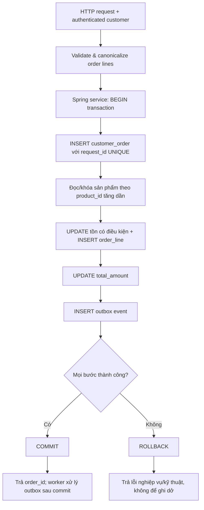
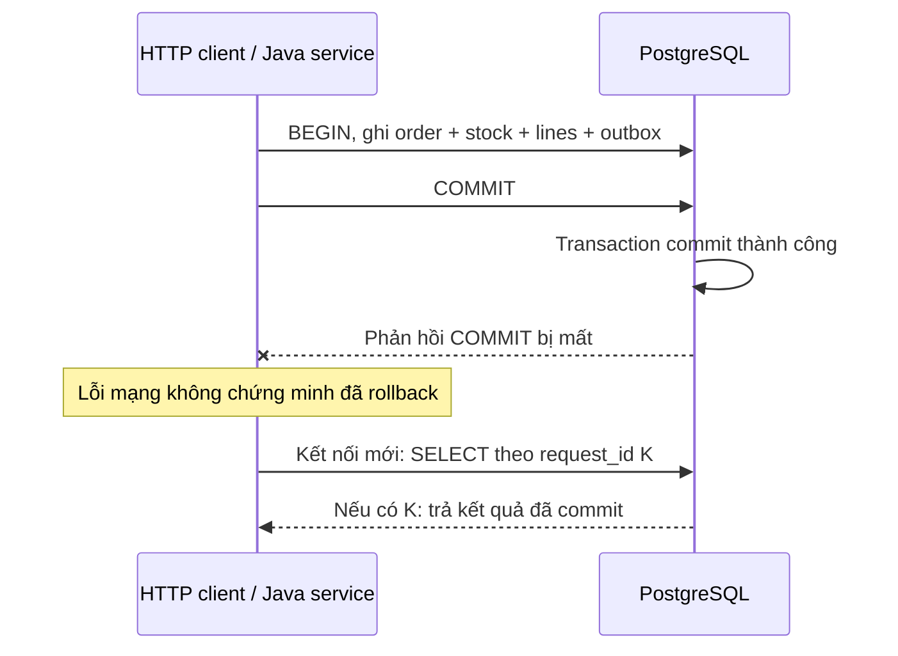
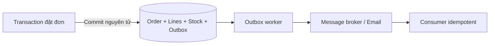

# Dựng một thao tác nghiệp vụ nhiều bước có commit và rollback

> **Chương:** Thực hành tổng hợp  
> **Phạm vi:** `DATA_PERSISTENCE_FUNDAMENTALS` — vận dụng mô hình dữ liệu, lược đồ, SQL, chỉ mục, giao dịch, cô lập, kiểm soát đồng thời và ranh giới persistence của Java để xây dựng một nghiệp vụ ghi dữ liệu bền vững, kiểm thử rollback, xử lý lỗi kết nối và tổ chức vận hành an toàn.

## Mục tiêu học tập

Sau bài thực hành, người học có thể:

1. Phân rã một nghiệp vụ có **nhiều câu SQL phụ thuộc nhau** thành các bất biến và một ranh giới transaction rõ ràng.
2. Thiết kế schema với `PRIMARY KEY`, `FOREIGN KEY`, `UNIQUE`, `CHECK` và điều kiện cập nhật chống tồn kho âm.
3. Viết một ứng dụng Java dùng Spring JDBC và `@Transactional` để tạo đơn, trừ tồn khả dụng, ghi chi tiết đơn và outbox theo nguyên tắc **cùng commit hoặc cùng rollback**.
4. Kiểm chứng commit thực sự từ một transaction/kết nối khác; tiêm lỗi ở nhiều checkpoint để chứng minh không để lại bản ghi hoặc số dư tồn kho dở dang.
5. Giải thích cách transaction đồng thời, thứ tự khóa, deadlock, idempotency và kết quả commit chưa xác định ảnh hưởng đến thao tác nhiều bước.
6. Xây checklist kiểm thử và vận hành, phân biệt phạm vi bảo đảm của PostgreSQL với các tác động lên HTTP, message broker hoặc hệ thống ngoài DB.

## 1. Bài toán: đặt một đơn hàng gồm nhiều sản phẩm

Một API `POST /orders` nhận yêu cầu của khách hàng muốn đặt một đơn gồm:

| Sản phẩm | Số lượng đặt | Đơn giá ở PostgreSQL | Tồn khả dụng trước đặt |
| --- | ---: | ---: | ---: |
| `product_id = 11` | 2 | 15.00 | 5 |
| `product_id = 22` | 1 | 25.00 | 4 |

Nếu thành công, hệ thống phải:

1. Ghi **đầu đơn hàng** với `request_id` duy nhất.
2. Xác định giá và tồn từ **database**, không tin giá do client gửi.
3. Trừ đúng 2 đơn vị tồn của sản phẩm 11 và 1 đơn vị của sản phẩm 22.
4. Ghi hai **dòng chi tiết** với số lượng, giá chốt và thành tiền.
5. Ghi tổng tiền **55.00** vào đầu đơn.
6. Ghi một sự kiện `ORDER_RESERVED` vào **transactional outbox** để worker có thể gửi thông báo sau khi transaction commit.

Sau thành công, tồn khả dụng tương ứng phải còn **3** và **3**. Nếu bất kỳ bước nào thất bại **trước commit**, tất cả số liệu và bản ghi vừa tạo phải quay về trạng thái ban đầu.

Ví dụ này chỉ **giữ tồn và ghi đơn ở trạng thái `RESERVED`**, chưa thu tiền thật. Thanh toán qua cổng bên ngoài không thể được rollback bằng transaction PostgreSQL; để thêm thanh toán cần một quy trình nghiệp vụ khác như saga, idempotency và đối soát.

### 1.1. Tiêu chí nghiệm thu nghiệp vụ

| Bất biến | Điều cần đúng sau mỗi transaction đã kết thúc |
| --- | --- |
| Tồn kho | `available_qty >= 0` cho mọi sản phẩm. |
| Tính nguyên tử | Không tồn tại một đơn `RESERVED` chỉ trừ tồn một sản phẩm hoặc thiếu chi tiết đơn. |
| Chi tiết đơn | Mỗi cặp `(order_id, product_id)` có tối đa một dòng; số lượng dương. |
| Giá chốt | `unit_price` trong chi tiết lấy từ bản ghi nguồn chuẩn tại thời điểm giữ hàng, không từ payload client. |
| Tổng tiền | `total_amount = SUM(quantity × unit_price)` của các dòng đơn. |
| Chống yêu cầu lặp | Một `request_id` chỉ gắn với tối đa một đơn. |
| Outbox | Đơn thành công có sự kiện gửi sau commit; đơn rollback không để lại sự kiện. |
| Phân quyền | `customer_id` được xác định bởi ngữ cảnh đã xác thực, không tin một ID bất kỳ từ HTTP. |

**Không kiểm tra mỗi số dư tồn:** nếu transaction chỉ trừ tồn nhưng quên ghi order, số tồn vẫn hợp lệ về số học nhưng nghiệp vụ đã hỏng. Cần kiểm tra **đồng thời trạng thái tồn, đầu đơn, chi tiết và outbox**.

## 2. Transaction nằm ở đâu trong ứng dụng?

Sơ đồ tổng quát:



**Ranh giới transaction** ở tầng *application service* điều phối một nghiệp vụ; repository thực thi các SQL thành phần qua cùng `DataSource`/transaction manager.

Nếu mỗi repository tự mở/commit một transaction riêng, tình huống “đã trừ tồn 11 nhưng lỗi khi trừ tồn 22” sẽ để lại dữ liệu dở dang. Ngược lại, không giữ transaction qua những bước **không thuộc PostgreSQL** như gọi thanh toán HTTP, gửi email, hoặc chờ người dùng xác nhận.

### 2.1. Những gì được PostgreSQL bảo đảm

Một transaction PostgreSQL được thiết kế để tuân thủ ACID trong phạm vi DB và cấu hình tương ứng:

- **Atomicity:** các câu SQL đã thực thi trong một transaction được commit cùng nhau hoặc rollback cùng nhau.
- **Consistency:** các constraint DB tiếp tục có hiệu lực; bất biến nghiệp vụ không được mã hóa trong DB còn cần thuật toán Java phù hợp.
- **Isolation:** cách transaction tương tác với writer khác phụ thuộc mức cô lập, khóa và câu lệnh.
- **Durability:** commit đã được xác nhận có bảo đảm bền vững theo thiết lập PostgreSQL/WAL/storage. Không đồng nhất việc method Java trả về trước interceptor commit với việc DB đã xác nhận commit.

Để demo, sử dụng PostgreSQL `READ COMMITTED`, cập nhật tồn có điều kiện và khóa các hàng sản phẩm theo **thứ tự nhất quán**. Không cần nâng lên `SERIALIZABLE` theo phản xạ nếu bất biến đã được bảo vệ đúng ở mức hàng/constraint; đồng thời phải biết giới hạn khi mở rộng nghiệp vụ sang các bất biến liên quan nhiều hàng.

## 3. Thiết kế schema PostgreSQL

Schema minh họa dưới đây dùng `NUMERIC(18,2)` cho tiền và `BIGINT` cho số lượng. Cấu trúc chỉ dành cho bài thực hành, không tự là hệ thống thương mại điện tử đầy đủ.

```sql
CREATE TABLE catalog_stock (
    product_id BIGINT PRIMARY KEY,
    sku TEXT NOT NULL UNIQUE,
    unit_price NUMERIC(18, 2) NOT NULL CHECK (unit_price >= 0),
    available_qty BIGINT NOT NULL CHECK (available_qty >= 0),
    active BOOLEAN NOT NULL DEFAULT TRUE,
    version BIGINT NOT NULL DEFAULT 1 CHECK (version > 0)
);

CREATE TABLE customer_order (
    order_id BIGINT GENERATED ALWAYS AS IDENTITY PRIMARY KEY,
    request_id UUID NOT NULL UNIQUE,
    customer_id BIGINT NOT NULL,
    status TEXT NOT NULL CHECK (status IN ('RESERVED')),
    total_amount NUMERIC(18, 2) NOT NULL DEFAULT 0
        CHECK (total_amount >= 0),
    created_at TIMESTAMPTZ NOT NULL DEFAULT now()
);

CREATE TABLE order_line (
    order_id BIGINT NOT NULL
        REFERENCES customer_order(order_id),
    product_id BIGINT NOT NULL
        REFERENCES catalog_stock(product_id),
    quantity BIGINT NOT NULL CHECK (quantity > 0),
    unit_price NUMERIC(18, 2) NOT NULL CHECK (unit_price >= 0),
    line_total NUMERIC(18, 2) NOT NULL CHECK (line_total >= 0),
    PRIMARY KEY (order_id, product_id),
    CHECK (line_total = quantity * unit_price)
);

CREATE TABLE order_outbox (
    event_id UUID PRIMARY KEY,
    order_id BIGINT NOT NULL REFERENCES customer_order(order_id),
    event_type TEXT NOT NULL CHECK (event_type = 'ORDER_RESERVED'),
    created_at TIMESTAMPTZ NOT NULL DEFAULT now(),
    delivered_at TIMESTAMPTZ,
    UNIQUE (order_id, event_type)
);

CREATE INDEX ix_order_outbox_pending
ON order_outbox (created_at, event_id)
WHERE delivered_at IS NULL;

INSERT INTO catalog_stock
    (product_id, sku, unit_price, available_qty, active)
VALUES
    (11, 'P-011', 15.00, 5, TRUE),
    (22, 'P-022', 25.00, 4, TRUE);
```

### 3.1. Mỗi constraint bảo vệ điều gì?

| Thành phần | Vai trò |
| --- | --- |
| `catalog_stock.product_id PRIMARY KEY` | Mỗi ID sản phẩm xác định một hàng tồn. |
| `available_qty CHECK >= 0` | Hàng rào cuối cùng ngăn lưu tồn âm. |
| `customer_order.request_id UNIQUE` | Không để cùng một mã yêu cầu tạo hai đơn; phải kết hợp đối soát payload để có API idempotent. |
| `order_line PRIMARY KEY(order_id, product_id)` | Không ghi lặp cùng sản phẩm trong một đơn. |
| `FOREIGN KEY` | Chi tiết không tham chiếu đến đơn/sản phẩm không tồn tại. |
| `CHECK(line_total = quantity × unit_price)` | Bảo vệ phép tính trên từng dòng; không tự chứng minh tổng tiền đầu đơn đúng. |
| `outbox UNIQUE(order_id, event_type)` | Không ghi cùng loại sự kiện hai lần cho một đơn trong mô hình này. |

Một số bất biến liên quan **nhiều bảng** (ví dụ tổng đơn bằng tổng dòng, đơn thành công có outbox) không được khai báo đầy đủ bằng `CHECK` thông thường. Đây là lý do thao tác tạo đơn phải được điều phối trong một transaction, kết hợp test và đối soát.

Trong dữ liệu production, `customer_id` thường là FK tới khách hàng/tenant, order cần trạng thái thanh toán/hủy, chính sách hoàn trả tồn và ledger. Bài này giữ phạm vi hẹp để chứng minh transaction trước khi mở rộng.

## 4. Đầu vào: chỉ nhận dữ liệu cần thiết từ client

Client gửi `request_id` và danh sách sản phẩm/số lượng. Không nhận `unit_price` hay `total_amount` do client quyết định.

```json
{
  "requestId": "f764b48d-7d40-4cf0-9f9c-51f108d90d9c",
  "items": [
    {"productId": 11, "quantity": 2},
    {"productId": 22, "quantity": 1}
  ]
}
```

Java records đại diện command:

```java
import java.math.BigDecimal;
import java.util.List;
import java.util.UUID;

record ItemInput(long productId, long quantity) {}
record ReserveCommand(
    UUID requestId,
    long authenticatedCustomerId,
    List<ItemInput> items
) {}
record StockRow(
    long productId,
    BigDecimal unitPrice,
    long availableQty,
    boolean active
) {}
record ReservationReceipt(long orderId, BigDecimal totalAmount) {}
```

Tên `authenticatedCustomerId` nhấn mạnh service phải lấy ID từ principal/session đã xác thực, không lấy một giá trị mà caller HTTP tùy ý khai báo rồi mặc nhiên cho phép. Với đa tenant, phải mở rộng khóa và mọi truy vấn theo tenant, đồng thời kiểm tra quyền đọc/đặt từng sản phẩm.

### 4.1. Chuẩn hóa danh sách hàng trước khi bắt đầu ghi

Mỗi product ID trong command chỉ xuất hiện một lần, số lượng dương và có giới hạn. Sắp xếp product ID **tăng dần** trước khi lấy khóa để những request khác nhau giữ khóa theo thứ tự nhất quán, giảm khả năng deadlock.

```java
import java.util.ArrayList;
import java.util.Comparator;
import java.util.List;

final class ReserveValidation {
    private ReserveValidation() {}

    static List<ItemInput> normalized(ReserveCommand cmd) {
        if (cmd == null || cmd.requestId() == null
                || cmd.authenticatedCustomerId() <= 0
                || cmd.items() == null || cmd.items().isEmpty()
                || cmd.items().size() > 50) {
            throw new IllegalArgumentException("Invalid order");
        }

        List<ItemInput> sorted = new ArrayList<>(cmd.items());
        // Kiểm tra null trước khi gọi Comparator trên productId.
        for (ItemInput item : sorted) {
            if (item == null) {
                throw new IllegalArgumentException("Null order item");
            }
        }
        sorted.sort(Comparator.comparingLong(ItemInput::productId));

        long previous = Long.MIN_VALUE;
        for (ItemInput item : sorted) {
            if (item.productId() <= 0
                    || item.quantity() <= 0
                    || item.quantity() > 1000
                    || item.productId() == previous) {
                throw new IllegalArgumentException(
                        "Invalid or duplicate order item");
            }
            previous = item.productId();
        }
        return List.copyOf(sorted);
    }
}
```

**Lưu ý triển khai:** mã trên chỉ có tác dụng validate/trật tự của command; quy tắc tổng số lượng, hạn mức từng khách, trạng thái sản phẩm và quyền mua thực tế phải được quyết định trong domain và **xác nhận bằng dữ liệu nguồn chuẩn** ở thời điểm giao dịch. Đối với DTO từ HTTP, nên tách thông tin principal khỏi body để tránh client giả `authenticatedCustomerId`.

## 5. Thực hiện nhiều bước trong một transaction Spring JDBC

Giả định Java 17+, Spring Boot 3.x, `JdbcTemplate` và transaction manager gắn với cùng một PostgreSQL `DataSource`.

Ta thêm một điểm móc phục vụ test (**không phải tính năng cho client**) để tiêm lỗi sau mỗi bước.

```java
interface ReservationCheckpoint {
    void hit(String point);
}

@org.springframework.stereotype.Component
class NoopReservationCheckpoint implements ReservationCheckpoint {
    @Override
    public void hit(String point) {
        // Production: không làm gì.
    }
}
```

Service cốt lõi:

```java
import java.math.BigDecimal;
import java.util.List;
import java.util.UUID;
import org.springframework.jdbc.core.JdbcTemplate;
import org.springframework.stereotype.Service;
import org.springframework.transaction.annotation.Transactional;

@Service
public class OrderReservationService {
    private final JdbcTemplate jdbc;
    private final ReservationCheckpoint checkpoint;

    public OrderReservationService(
            JdbcTemplate jdbc,
            ReservationCheckpoint checkpoint) {
        this.jdbc = jdbc;
        this.checkpoint = checkpoint;
    }

    @Transactional
    public ReservationReceipt reserve(ReserveCommand command) {
        List<ItemInput> items = ReserveValidation.normalized(command);

        // Bước 1: tạo đầu đơn, chưa commit.
        Long orderId = jdbc.queryForObject("""
            INSERT INTO customer_order
                (request_id, customer_id, status)
            VALUES (?, ?, 'RESERVED')
            RETURNING order_id
            """,
            Long.class,
            command.requestId(),
            command.authenticatedCustomerId());

        if (orderId == null) {
            throw new IllegalStateException("No order ID returned");
        }
        checkpoint.hit("AFTER_HEADER");

        BigDecimal total = new BigDecimal("0.00");

        // Bước 2-3: khóa, trừ tồn và ghi từng dòng.
        // items đã được sắp tăng dần theo productId.
        for (ItemInput item : items) {
            StockRow stock = jdbc.queryForObject("""
                SELECT product_id, unit_price, available_qty, active
                FROM catalog_stock
                WHERE product_id = ?
                FOR UPDATE
                """,
                (rs, rowNumber) -> new StockRow(
                    rs.getLong("product_id"),
                    rs.getBigDecimal("unit_price"),
                    rs.getLong("available_qty"),
                    rs.getBoolean("active")),
                item.productId());

            // Nếu product không tồn tại, queryForObject ném lỗi.
            // Không có bản ghi hoặc sai trạng thái => rollback.
            if (stock == null || !stock.active()) {
                throw new IllegalStateException("Product unavailable");
            }
            if (stock.availableQty() < item.quantity()) {
                throw new IllegalStateException("Insufficient stock");
            }

            int changed = jdbc.update("""
                UPDATE catalog_stock
                SET available_qty = available_qty - ?,
                    version = version + 1
                WHERE product_id = ?
                  AND active = TRUE
                  AND available_qty >= ?
                """,
                item.quantity(),
                item.productId(),
                item.quantity());

            if (changed != 1) {
                throw new IllegalStateException(
                    "Stock changed or unavailable");
            }
            checkpoint.hit("AFTER_STOCK:" + item.productId());

            BigDecimal lineTotal = stock.unitPrice()
                .multiply(BigDecimal.valueOf(item.quantity()));

            jdbc.update("""
                INSERT INTO order_line
                    (order_id, product_id, quantity, unit_price, line_total)
                VALUES (?, ?, ?, ?, ?)
                """,
                orderId,
                item.productId(),
                item.quantity(),
                stock.unitPrice(),
                lineTotal);

            checkpoint.hit("AFTER_LINE:" + item.productId());
            total = total.add(lineTotal);
        }

        // Bước 4: chốt tổng tiền của đơn.
        int updatedOrder = jdbc.update("""
            UPDATE customer_order
            SET total_amount = ?
            WHERE order_id = ?
            """, total, orderId);

        if (updatedOrder != 1) {
            throw new IllegalStateException("Order disappeared");
        }
        checkpoint.hit("AFTER_TOTAL");

        // Bước 5: ghi ý định phát thông báo *trong cùng transaction*.
        jdbc.update("""
            INSERT INTO order_outbox
                (event_id, order_id, event_type)
            VALUES (?, ?, 'ORDER_RESERVED')
            """, UUID.randomUUID(), orderId);
        checkpoint.hit("AFTER_OUTBOX");

        // Method body trả về chưa phải một lời cam kết độc lập:
        // Spring transaction interceptor sẽ commit khi method kết thúc.
        return new ReservationReceipt(orderId, total);
    }
}
```

### 5.1. Vì sao đây là một transaction?

- `@Transactional` được Spring áp dụng khi lời gọi `reserve` đi **qua bean proxy** và có transaction manager phù hợp.
- Tất cả `JdbcTemplate` sử dụng **cùng DataSource/transaction manager**, nên chúng tham gia cùng một transaction thread-bound. Không tự tạo kết nối riêng `DriverManager.getConnection(...)` rồi chạy autocommit trong từng helper.
- Những exception unchecked thoát ra từ phương thức khiến Spring **thông thường rollback** (trừ khi cấu hình chính sách rollback thay đổi). Hook test dùng `RuntimeException` nhằm kiểm chứng hành vi này.
- `SELECT ... FOR UPDATE` khóa một hàng sản phẩm; khóa được giữ đến khi transaction commit/rollback.
- `UPDATE ... AND available_qty >= ?` bảo vệ tồn không âm ngay tại lúc ghi, trong khi `CHECK (available_qty >= 0)` là hàng rào ở DB.
- Outbox là **dữ liệu DB**, không phải lần gửi message ra broker. Bởi vậy outbox có thể rollback cùng order.

**Không gọi** `this.reserve(...)` từ phương thức khác trong cùng bean rồi dựa vào proxy transaction nếu dự án dùng Spring proxy thông thường. Cũng không gọi method ghi bên trong một luồng bất đồng bộ mới mà mặc nhiên mong thread đó chia sẻ transaction hiện tại.

### 5.2. Ý nghĩa của khóa theo thứ tự

Giả sử hai request đồng thời đặt hai sản phẩm theo thứ tự ngược nhau:

```text
Request A ban đầu: [11, 22]
Request B ban đầu: [22, 11]

Sau chuẩn hóa:
Request A: [11, 22]
Request B: [11, 22]
```

Tất cả đường ghi trong service lấy `FOR UPDATE` của sản phẩm 11 trước sản phẩm 22. Điều đó giảm nguy cơ T1 giữ khóa 11 chờ 22, còn T2 giữ khóa 22 chờ 11. **Không loại trừ mọi deadlock** khi các bảng/transaction khác khóa tài nguyên theo thứ tự khác; vẫn cần xử lý `40P01` và kiểm thử concurrency.

### 5.3. Vì sao không tính giá từ request?

Client có thể gửi giá cũ, sửa số tiền hoặc không được quyền áp khuyến mãi. `unit_price` được đọc từ `catalog_stock` khi giữ row lock, rồi lưu vào `order_line` làm **snapshot giá tại lúc đặt**. Nếu giá sản phẩm thay đổi sau đó, hóa đơn cũ không nên đổi theo dữ liệu catalog hiện tại.

Đây là một quyết định nghiệp vụ trong ví dụ: hệ thống chốt giá tại thời điểm đặt. Nếu ứng dụng cần báo giá có hiệu lực riêng hoặc chính sách khuyến mãi, cần lưu quote/giá đã phê duyệt ở nguồn bền vững và kiểm tra hiệu lực theo transaction.

## 6. Khi commit thành công, database phải có trạng thái nào?

Với yêu cầu ở phần 1, sau commit:

| Bảng | Trước | Sau commit |
| --- | --- | --- |
| `catalog_stock`: sản phẩm 11 | `available_qty=5` | `available_qty=3` |
| `catalog_stock`: sản phẩm 22 | `available_qty=4` | `available_qty=3` |
| `customer_order` | Chưa có request ID này | Một hàng `RESERVED`, `total_amount=55.00` |
| `order_line` | Chưa có dòng cho order mới | Hai dòng: (11,2,15.00,30.00) và (22,1,25.00,25.00) |
| `order_outbox` | Chưa có event cho order | Một `ORDER_RESERVED` chưa giao |

Có thể kiểm tra:

```sql
SELECT product_id, available_qty, version
FROM catalog_stock
WHERE product_id IN (11, 22)
ORDER BY product_id;

SELECT order_id, request_id, customer_id, status, total_amount
FROM customer_order
WHERE request_id = :requestId;

SELECT product_id, quantity, unit_price, line_total
FROM order_line
WHERE order_id = :orderId
ORDER BY product_id;

SELECT event_id, event_type, delivered_at
FROM order_outbox
WHERE order_id = :orderId;
```

Kết luận “đã commit” nên dựa trên **đọc từ connection/transaction độc lập sau khi service proxy trả về**, không chỉ đọc trong cùng transaction trước khi commit. Một transaction tự nhìn thấy các thay đổi chưa commit của chính nó, nên assert trong cùng transaction có thể tạo **false positive**.

### 6.1. Kết quả trả về và dữ liệu có thể khác nhau khi lỗi mạng

Nếu `@Transactional` method body tạo `ReservationReceipt`, Spring vẫn cần thực hiện commit trong interceptor. Khi commit thành công và phản hồi tới service/client còn nguyên, API có thể trả đơn thành công. Nếu kết nối mất ngay lúc commit, PostgreSQL có thể đã commit dù Java nhận exception. Phần 10 xử lý **commit outcome chưa xác định**.

## 7. Khi một bước lỗi: rollback toàn bộ

Giả sử sản phẩm 11 còn đủ nhưng sản phẩm 22 đã hết hàng. Service có thể đã thực thi:

```text
BEGIN
INSERT customer_order
SELECT FOR UPDATE catalog_stock(11)
UPDATE catalog_stock(11): 5 -> 3
INSERT order_line(11)
SELECT FOR UPDATE catalog_stock(22)
Phát hiện available_qty không đủ
THROW RuntimeException
ROLLBACK
```

Sau rollback, tồn sản phẩm 11 phải **trở lại 5** và không còn order/header/line/outbox cho request đó. Không cần viết một câu SQL “bù lại tồn 2 đơn vị” trong nhánh catch khi các thao tác đã thuộc **cùng transaction**: rollback thực sự sẽ hủy tất cả thay đổi chưa commit.

### 7.1. Ma trận các điểm tiêm lỗi

| Checkpoint / tình huống | Đã có thao tác SQL nào chạy? | Trạng thái sau rollback |
| --- | --- | --- |
| `AFTER_HEADER` | Đã insert đầu đơn | Không còn đầu đơn, tồn giữ nguyên. |
| `AFTER_STOCK:11` | Đã insert đầu đơn và trừ tồn 11 | Tồn 11 trở lại 5, không có đơn/dòng/outbox. |
| `AFTER_LINE:11` | Đã ghi một dòng đơn | Không còn dòng hoặc đầu đơn, tồn giữ nguyên. |
| `AFTER_STOCK:22` | Đã trừ tồn cả 11 và 22 | Cả hai tồn trở lại ban đầu; không có đơn. |
| `AFTER_LINE:22` | Đã ghi đủ hai dòng | Các dòng, đầu đơn và mọi lần trừ tồn đều rollback. |
| `AFTER_TOTAL` | Đã tính/chốt tổng `55.00` | Không còn đầu đơn và chi tiết. |
| `AFTER_OUTBOX` | Đã ghi event nhưng chưa commit | Không còn outbox event, order hay thay đổi tồn. |
| Sai FK, unique hoặc check | Database từ chối câu ghi | Transaction lỗi phải được rollback; không giữ trạng thái dở. |

**Quan trọng:** test ném exception **trước khi gửi SQL đầu tiên** rồi assert không có dữ liệu không chứng minh được rollback nhiều bước. Đặt điểm lỗi **sau khi SQL thực sự chạy** như `AFTER_STOCK:22` và `AFTER_OUTBOX` mới tạo bằng chứng tốt.

### 7.2. Vì sao không bắt lỗi rồi bỏ qua?

```java
@Transactional
public void wrong() {
    jdbc.update("UPDATE catalog_stock SET ..."); // Minh họa.
    try {
        jdbc.update("INSERT INTO order_line ..."); // Có thể lỗi.
    } catch (RuntimeException ignored) {
        // Sai: trả về 'thành công' và mong transaction vẫn hợp lệ.
    }
}
```

Trong Spring, exception unchecked thông thường cần **thoát ra qua transaction interceptor** để kích hoạt rollback. Với PostgreSQL, nhiều lỗi SQL còn đưa transaction vào trạng thái *aborted* đến khi rollback hoặc rollback về savepoint đúng cách.

Nếu cần chuyển lỗi kỹ thuật thành kết quả nghiệp vụ, nên làm ở **ranh giới bên ngoài transaction đã rollback**, hoặc đánh dấu rollback-only có chủ đích và kiểm tra kết quả cuối. Đừng trả thành công từ một phương thức đã ghi dở.

## 8. Kiểm thử integration: PostgreSQL thật thay vì chỉ mock

Mock repository giúp kiểm tra validation và luồng điều phối, nhưng không chứng minh:

- SQL và JDBC type mapping thực sự đúng.
- PostgreSQL đã cưỡng chế `CHECK`, `UNIQUE`, `FOREIGN KEY`.
- Cùng transaction được commit/rollback.
- `FOR UPDATE` thật sự khóa row dưới concurrency.
- Bản ghi outbox cũng rollback khi service thất bại.

Sử dụng JUnit 5, Spring Boot Test và Testcontainers PostgreSQL. Ví dụ giả định schema `CREATE TABLE` của phần 3 đã được áp bằng migration hoặc test SQL initialization.

### 8.1. Khung cấu hình test với fault hook

```java
import java.math.BigDecimal;
import java.util.List;
import java.util.UUID;
import org.junit.jupiter.api.BeforeEach;
import org.junit.jupiter.api.Test;
import org.springframework.beans.factory.annotation.Autowired;
import org.springframework.boot.test.context.SpringBootTest;
import org.springframework.boot.test.context.TestConfiguration;
import org.springframework.context.annotation.Bean;
import org.springframework.context.annotation.Import;
import org.springframework.context.annotation.Primary;
import org.springframework.jdbc.core.JdbcTemplate;
import org.springframework.test.context.DynamicPropertyRegistry;
import org.springframework.test.context.DynamicPropertySource;
import org.testcontainers.containers.PostgreSQLContainer;
import org.testcontainers.junit.jupiter.Container;
import org.testcontainers.junit.jupiter.Testcontainers;

import static org.junit.jupiter.api.Assertions.*;

@SpringBootTest
@Testcontainers
@Import(OrderReservationIntegrationTest.TestFaultConfig.class)
class OrderReservationIntegrationTest {
    @Container
    static final PostgreSQLContainer<?> postgres =
        new PostgreSQLContainer<>("postgres:16-alpine");

    @DynamicPropertySource
    static void registerDatasource(DynamicPropertyRegistry registry) {
        registry.add("spring.datasource.url", postgres::getJdbcUrl);
        registry.add("spring.datasource.username", postgres::getUsername);
        registry.add("spring.datasource.password", postgres::getPassword);
    }

    static final class InjectedFault extends RuntimeException {
        InjectedFault(String point) {
            super("Injected failure at " + point);
        }
    }

    static final class TestCheckpoint implements ReservationCheckpoint {
        volatile String failAt;

        @Override
        public void hit(String point) {
            if (point.equals(failAt)) {
                throw new InjectedFault(point);
            }
        }
    }

    @TestConfiguration
    static class TestFaultConfig {
        @Bean
        @Primary
        TestCheckpoint testCheckpoint() {
            return new TestCheckpoint();
        }
    }

    @Autowired OrderReservationService service;
    @Autowired JdbcTemplate jdbc;
    @Autowired TestCheckpoint checkpoint;

    @BeforeEach
    void setUp() {
        checkpoint.failAt = null;
        jdbc.update("DELETE FROM order_outbox");
        jdbc.update("DELETE FROM order_line");
        jdbc.update("DELETE FROM customer_order");
        jdbc.update("DELETE FROM catalog_stock");
        jdbc.update("""
            INSERT INTO catalog_stock
                (product_id, sku, unit_price, available_qty, active)
            VALUES
                (11, 'P-011', 15.00, 5, TRUE),
                (22, 'P-022', 25.00, 4, TRUE)
            """);
    }

    private ReserveCommand validCommand(UUID requestId) {
        return new ReserveCommand(requestId, 501L, List.of(
            new ItemInput(11L, 2L),
            new ItemInput(22L, 1L)));
    }

    private long stock(long productId) {
        return jdbc.queryForObject("""
            SELECT available_qty FROM catalog_stock WHERE product_id = ?
            """, Long.class, productId);
    }

    private int countOrders(UUID requestId) {
        return jdbc.queryForObject("""
            SELECT COUNT(*) FROM customer_order WHERE request_id = ?
            """, Integer.class, requestId);
    }

    // Thêm các @Test của phần tiếp theo vào lớp này.
}
```

Để test outbox/dòng đơn, lấy `order_id` theo `request_id` rồi đếm những bảng con; phương thức `countOrders` chỉ truy vấn `customer_order` vì không phải bảng nào cũng có `request_id`. Dùng SQL cố định thay vì nối tên bảng động từ request.

**Không đặt `@Transactional` ở class test** khi muốn chứng minh commit: Spring Test thường tự rollback transaction test khi kết thúc, khiến service `@Transactional(REQUIRED)` có thể chỉ tham gia transaction ngoài, chưa commit thật. Ở đây mỗi lời gọi service đi qua Spring proxy rồi các query kiểm tra của `JdbcTemplate` chạy ngoài transaction test.

### 8.2. Test commit thành công

```java
@Test
void commitsOrderStockLinesAndOutbox() {
    UUID requestId = UUID.randomUUID();
    ReservationReceipt receipt = service.reserve(validCommand(requestId));

    assertEquals(new BigDecimal("55.00"), receipt.totalAmount());
    assertEquals(3L, stock(11L));
    assertEquals(3L, stock(22L));

    assertEquals(1, countOrders(requestId));
    Integer lineCount = jdbc.queryForObject("""
        SELECT COUNT(*) FROM order_line WHERE order_id = ?
        """, Integer.class, receipt.orderId());
    Integer outboxCount = jdbc.queryForObject("""
        SELECT COUNT(*) FROM order_outbox
        WHERE order_id = ? AND event_type = 'ORDER_RESERVED'
        """, Integer.class, receipt.orderId());
    assertEquals(2, lineCount);
    assertEquals(1, outboxCount);

    BigDecimal storedTotal = jdbc.queryForObject("""
        SELECT total_amount FROM customer_order WHERE order_id = ?
        """, BigDecimal.class, receipt.orderId());
    assertEquals(new BigDecimal("55.00"), storedTotal);
}
```

Khi service proxy trả về và database commit thành công, truy vấn kiểm tra riêng đọc thấy **toàn bộ** thay đổi. Không chỉ assert `receipt.orderId() > 0`: giá trị ID có thể đã được cấp ngay cả khi transaction sau đó rollback, và sequence/identity không nhất thiết quay lại giá trị cũ.

### 8.3. Test rollback sau khi đã trừ cả hai sản phẩm

```java
@Test
void rollsBackAllStepsWhenFailureAfterSecondStockChange() {
    UUID requestId = UUID.randomUUID();
    checkpoint.failAt = "AFTER_STOCK:22";

    assertThrows(InjectedFault.class, () ->
        service.reserve(validCommand(requestId)));

    // Đọc ngoài service transaction đã kết thúc.
    assertEquals(5L, stock(11L));
    assertEquals(4L, stock(22L));
    assertEquals(0, countOrders(requestId));

    assertEquals(0, jdbc.queryForObject(
        "SELECT COUNT(*) FROM order_line", Integer.class));
    assertEquals(0, jdbc.queryForObject(
        "SELECT COUNT(*) FROM order_outbox", Integer.class));
}

@Test
void rollsBackOutboxAndOrderWhenFailureImmediatelyBeforeCommit() {
    UUID requestId = UUID.randomUUID();
    checkpoint.failAt = "AFTER_OUTBOX";

    assertThrows(InjectedFault.class, () ->
        service.reserve(validCommand(requestId)));

    assertEquals(5L, stock(11L));
    assertEquals(4L, stock(22L));
    assertEquals(0, countOrders(requestId));
    assertEquals(0, jdbc.queryForObject(
        "SELECT COUNT(*) FROM order_line", Integer.class));
    assertEquals(0, jdbc.queryForObject(
        "SELECT COUNT(*) FROM order_outbox", Integer.class));
}
```

`AFTER_OUTBOX` vẫn nằm **trước lúc interceptor thực hiện COMMIT**. Vì thế test này kiểm chứng rollback sau câu SQL cuối, **không** kiểm chứng trường hợp commit đã thành công nhưng Java mất phản hồi COMMIT. Hai bài test cần tách biệt.

### 8.4. Test thiếu tồn ở sản phẩm cuối

```java
@Test
void insufficientStockOnLastItemDoesNotPartiallyReserveFirstItem() {
    jdbc.update("""
        UPDATE catalog_stock SET available_qty = 0
        WHERE product_id = 22
        """);

    UUID requestId = UUID.randomUUID();
    assertThrows(IllegalStateException.class, () ->
        service.reserve(validCommand(requestId)));

    assertEquals(5L, stock(11L));
    assertEquals(0L, stock(22L));
    assertEquals(0, countOrders(requestId));
    assertEquals(0, jdbc.queryForObject(
        "SELECT COUNT(*) FROM order_line", Integer.class));
    assertEquals(0, jdbc.queryForObject(
        "SELECT COUNT(*) FROM order_outbox", Integer.class));
}
```

Thử cả tình huống sản phẩm không tồn tại, `active = FALSE`, giá không hợp lệ theo DB constraint, lỗi unique `request_id` và lỗi khi outbox INSERT. Nếu lỗi JDBC làm transaction PostgreSQL bị *aborted*, phải để transaction kết thúc bằng rollback rồi mới xử lý nghiệp vụ ở transaction ngoài.

### 8.5. Các test phải kiểm tra điều gì để không xanh giả?

| Ngộ nhận | Cách kiểm tra đáng tin hơn |
| --- | --- |
| “Method không ném exception nên đã commit.” | Đọc dữ liệu sau khi Spring proxy hoàn tất và không có transaction test bao ngoài. |
| “Đã có order ID nên chắc chắn commit.” | Sequence có thể tăng dù transaction rollback; kiểm tra hàng theo `request_id`. |
| “`assertThrows` là đủ chứng minh rollback.” | Tiêm lỗi sau SQL thật; xác nhận không còn order, line, outbox và tồn được hoàn trả. |
| “Tổng tiền đúng thì chi tiết cũng đúng.” | Kiểm tra cả dòng, số lượng, đơn giá, giá trị tổng và FK. |
| “Test mock repository chứng minh transaction.” | Cần PostgreSQL thật với transaction manager/connection. |
| “`flush` trong JPA là commit.” | `flush` gửi SQL nhưng vẫn có thể rollback; cần kiểm tra sau commit. |

## 9. Hai request đồng thời: chống bán quá tồn

Giả sử sản phẩm 11 chỉ còn **1**, hai request khác `request_id` đều muốn mua **1**. Nếu Java đọc tồn rồi cập nhật theo kiểu:

```java
// PHẢN VÍ DỤ: đọc số lượng trước rồi ghi số tuyệt đối,
// không có khóa/điều kiện cập nhật thích hợp.
long current = repository.findAvailable(11L);
repository.setAvailable(11L, current - 1);
```

Hai request có thể cùng đọc `1`, cả hai tưởng thành công. Hệ thống có thể ghi **hai đơn** nhưng chỉ trừ tồn một lần (lost update).

Trong ví dụ service ở phần 5:

1. Request A lấy khóa `SELECT ... FOR UPDATE` trên product 11.
2. Request B phải chờ khi muốn khóa cùng hàng.
3. A kiểm tra tồn, trừ `1 → 0` rồi commit.
4. B nhận khóa, đọc tồn `0` và phải rollback vì không đủ hàng.

Nếu không khóa trước, câu `UPDATE ... SET available_qty = available_qty - 1 WHERE available_qty >= 1` cũng có thể bảo vệ bất biến đơn hàng tại thời điểm ghi, khi xử lý số hàng affected đúng cách. Ở đây ta giữ `FOR UPDATE` để đọc **giá và tồn** nhất quán trong một transaction trước khi ghi dòng đơn; việc khóa thêm có chi phí concurrency cần đo.

### 9.1. Test concurrency

Với hai worker độc lập, khởi động gần như đồng thời bằng latch và xác minh kết quả sau khi cả hai hoàn tất:

```java
import java.util.UUID;
import java.util.List;
import java.util.concurrent.CountDownLatch;
import java.util.concurrent.ExecutorService;
import java.util.concurrent.Executors;
import java.util.concurrent.Future;
import java.util.concurrent.TimeUnit;

// Trong test riêng, sau setUp và trước khi chạy worker:
jdbc.update("""
    UPDATE catalog_stock SET available_qty = 1
    WHERE product_id = 11
    """);

ExecutorService workers = Executors.newFixedThreadPool(2);
CountDownLatch start = new CountDownLatch(1);

try {
    java.util.concurrent.Callable<Boolean> place = () -> {
        start.await();
        try {
            service.reserve(new ReserveCommand(
                UUID.randomUUID(), 501L,
                List.of(new ItemInput(11L, 1L))));
            return true;
        } catch (IllegalStateException insufficient) {
            return false;
        }
    };

    Future<Boolean> first = workers.submit(place);
    Future<Boolean> second = workers.submit(place);
    start.countDown();

    int successes =
        (first.get(10, TimeUnit.SECONDS) ? 1 : 0)
      + (second.get(10, TimeUnit.SECONDS) ? 1 : 0);

    assertEquals(1, successes);
    assertEquals(0L, stock(11L));
    assertEquals(1, jdbc.queryForObject(
        "SELECT COUNT(*) FROM customer_order", Integer.class));
    assertEquals(1, jdbc.queryForObject(
        "SELECT COUNT(*) FROM order_outbox", Integer.class));
} finally {
    workers.shutdownNow();
}
```

Đây là đoạn **bên trong method JUnit test**; cần các import/JUnit assertion và bean tương ứng của phần 8. Latch giúp khởi động gần nhau nhưng không đảm bảo một lịch trình nhất định. Nếu muốn tái hiện một race cụ thể, dùng barrier ở checkpoint bên trong transaction và timeout hữu hạn. Mỗi worker phải dùng connection/transaction độc lập, **không chia sẻ một JDBC Connection hoặc JPA EntityManager mutable giữa hai thread**.

## 10. Idempotency và trường hợp kết quả commit chưa xác định

### 10.1. `UNIQUE(request_id)` giải quyết điều gì?

Nếu client retry cùng `request_id`, database không cho tạo **hai đơn đã commit** với cùng key. Nhưng `UNIQUE` chỉ ngăn trùng dữ liệu; để API thực sự *idempotent*, nó phải:

1. Tìm đơn đã lưu theo request ID trên **authoritative PostgreSQL primary**.
2. So sánh khách hàng và **danh sách product ID/số lượng** đã chuẩn hóa với yêu cầu retry.
3. Nếu payload trùng, trả **kết quả đã lưu** mà không trừ tồn lần nữa.
4. Nếu payload khác, báo xung đột khóa yêu cầu; không âm thầm tái sử dụng đơn.
5. Nếu chưa có dữ liệu xác nhận hoặc DB không thể đọc được, dùng trạng thái **UNKNOWN/pending reconciliation** và retry có giới hạn với **cùng request ID**.

Ví dụ tra cứu:

```sql
SELECT order_id, customer_id, status, total_amount
FROM customer_order
WHERE request_id = :requestId;

SELECT product_id, quantity
FROM order_line
WHERE order_id = :orderId
ORDER BY product_id;
```

Ở mô hình này, `customer_order` và `order_line` cần được coi là lịch sử yêu cầu **không bị sửa nội dung tùy ý sau đặt** để việc đối chiếu payload ổn định. Trong hệ thống có hủy hoặc hoàn hàng, có thể lưu thêm request fingerprint/bản ghi yêu cầu bất biến thay vì suy từ các dòng order có thể thay đổi.

### 10.2. Vì sao không được retry bằng một request ID mới khi timeout?

Lịch trình:



Một timeout quanh `COMMIT` có thể xảy ra sau khi PostgreSQL đã ghi nhận commit nhưng **trước khi Java nhận ACK**. Khi ấy trả thất bại dứt khoát hoặc tạo request ID khác để thử lại có thể tạo hậu quả nghiệp vụ ngoài ý muốn.

**Không dùng** một hook ném `RuntimeException` sau `AFTER_OUTBOX` làm mô phỏng của tình huống này: hook chạy **trước** lệnh commit và chứng minh rollback, không chứng minh mất ACK sau commit. Để kiểm thử đúng cần network proxy/fault injection được điều phối ở tầng JDBC/COMMIT hoặc kiểm thử logic đối soát cho **cả hai khả năng đã commit/chưa commit**.

### 10.3. Xử lý lỗi trùng key ở ranh giới ngoài transaction

Nếu request lặp `request_id`, câu `INSERT customer_order` có thể phát `SQLSTATE 23505` (Spring dịch thành `DuplicateKeyException` tùy driver/translator). Transaction vừa gặp lỗi unique phải được rollback; logic tìm kết quả cũ nên chạy **sau khi transaction thất bại đã kết thúc**, qua transaction mới, thay vì bắt lỗi rồi tiếp tục SQL trong transaction PostgreSQL đã bị aborted.

Không được tự động coi mọi `23505` là “trùng request”: một hệ thống có nhiều unique constraint. Cần xem tên constraint/nguồn lỗi để phân biệt khóa yêu cầu, khóa nghiệp vụ khác và lỗi mapping, đồng thời tránh tiết lộ dữ liệu nhạy cảm trong response.

### 10.4. SQLSTATE, deadlock và retry

| Tình huống | Hành vi đúng |
| --- | --- |
| `23505` — duplicate request | Transaction thất bại/rollback; tra cứu theo key, so sánh payload và trả kết quả cũ hoặc conflict. |
| `23503` — vi phạm FK | Không để tạo dòng/đơn thiếu tham chiếu; trả lỗi tương ứng sau rollback. |
| `23514` — vi phạm CHECK | Không để tồn âm hoặc số lượng không hợp lệ; điều tra bug/mismatch schema. |
| `40P01` — deadlock | DB hủy một transaction; retry **toàn bộ transaction** nếu nghiệp vụ idempotent và budget cho phép. |
| `40001` — serialization failure | Retry toàn bộ transaction trên transaction mới, không chỉ retry một statement trong transaction lỗi. |
| Lỗi kết nối quanh `COMMIT` | Không biết chắc outcome; đối soát trên DB authoritative theo `request_id`. |

Retry phải có giới hạn số lần, backoff và quan sát metric; không tạo vòng lặp retry vô hạn khi sản phẩm hết hàng. Mọi lần retry phải duy trì cùng logical request ID và kiểm chứng lại giá/tồn từ database.

## 11. Outbox: ghi trong transaction, phát sau commit

Trong bài này, `order_outbox` là bản ghi ý định phát thông báo `ORDER_RESERVED`. Worker xử lý nó **sau khi bản ghi đã commit**.



Vì sao không gửi email/broker message ngay trong phương thức `@Transactional` trước khi commit?

- Nếu email đã gửi nhưng DB rollback, khách nhận thông báo đơn không tồn tại.
- Nếu DB commit nhưng process chết trước gửi, thông báo bị bỏ sót.
- Một network call nằm trong transaction kéo dài thời gian giữ connection/lock, tăng contention.

Outbox không tự đảm bảo phát chính xác một lần. Worker có thể gửi thành công rồi chết trước khi đánh dấu `delivered_at`, nên lần chạy lại có thể gửi lặp. Cần idempotent consumer/event ID và retry/backoff.

Đối với worker production, cần claim/lease hoặc chiến lược locking phù hợp, theo dõi backlog, phân loại lỗi không thể phát và bảo đảm các cột outbox được bảo trì theo retention. Không mở transaction DB dài không kiểm soát trong khi đợi broker.

## 12. Ranh giới transaction và những lỗi thiết kế dễ gặp

| Lỗi | Hậu quả | Cách sửa |
| --- | --- | --- |
| Mỗi câu SQL dùng autocommit riêng | Có thể chỉ trừ tồn một sản phẩm rồi dừng, không có rollback toàn nghiệp vụ. | Một transaction tại service, mọi repository dùng cùng transaction manager. |
| Gọi `this.reserve` trong cùng bean | Interceptor proxy có thể không chạy; transaction không được áp như mong muốn. | Gọi qua bean/proxy hoặc thiết kế lại ranh giới service. |
| Catch unchecked exception bên trong service rồi trả thành công | Spring có thể không đánh dấu rollback; PostgreSQL còn có thể bị aborted. | Cho lỗi thoát, rollback rồi xử lý ngoài transaction; hoặc quản lý rollback-only có chủ đích. |
| Ghi outbox bằng `REQUIRES_NEW` riêng | Event có thể commit dù đơn chính rollback. | Outbox phải tham gia cùng transaction nghiệp vụ. |
| Dùng HTTP payment call trước commit | DB rollback không thể rollback thanh toán ngoài DB. | Tách thành luồng hậu commit/saga + idempotency và đối soát. |
| Đọc giá client hoặc cache làm nguồn chốt đơn | Giá/tồn có thể bị sửa hoặc stale. | Đọc authoritative DB, khóa/điều kiện cập nhật theo yêu cầu. |
| Dùng `double` cho tiền | Sai số nhị phân có thể làm tổng/giá không chính xác. | `NUMERIC` ở SQL và `BigDecimal` ở Java. |
| Khóa nhiều sản phẩm theo thứ tự request | Tăng nguy cơ deadlock giữa các order ngược chiều. | Chuẩn hóa thứ tự khóa; vẫn xử lý deadlock có thể xảy ra. |
| Chỉ dựa vào Java if-check rồi ghi số tồn tuyệt đối | Race/lost update làm oversell. | Row lock hoặc atomic conditional update + DB constraint. |
| Test với `@Transactional` ở lớp test và mặc định rollback | Dễ nhìn thấy dữ liệu chưa commit và kết luận sai. | Quan sát sau service commit bằng transaction độc lập. |
| Retry lỗi commit bằng request ID mới | Có nguy cơ tạo hai nghiệp vụ từ một yêu cầu gốc. | Duy trì idempotency key, đối soát authoritative state. |

### 12.1. `@Transactional` và checked exception

Spring theo chính sách mặc định truyền thống rollback cho unchecked exception và `Error`; checked exception có thể cần cấu hình `rollbackFor` hoặc chính sách rollback tương ứng. Nếu nghiệp vụ ném checked business exception sau khi đã ghi SQL, phải xác định rõ có muốn rollback không và **viết test cho chính sách đó**.

`REQUIRES_NEW` tạo transaction riêng có thể commit độc lập; `NESTED` có thể sử dụng savepoint khi transaction manager/tài nguyên hỗ trợ. Không dùng chúng để “chia nhỏ” một nghiệp vụ cần atomicity xuyên toàn bộ bước mà chưa hiểu hiệu ứng commit/rollback.

### 12.2. Isolation không thay thế các constraint

`@Transactional` không khiến tất cả predicate đã đọc được khóa tự động. `READ COMMITTED` cộng `SELECT ... FOR UPDATE` bảo vệ row được khóa và update số lượng có điều kiện; `UNIQUE(request_id)` bảo vệ trùng yêu cầu. Khi bổ sung nghiệp vụ giới hạn “tối đa N đơn trong ngày”, cần thêm thiết kế bảo vệ bất biến liên quan nhiều row; không chỉ thêm một câu `SELECT COUNT(*)` rồi tin không có concurrency race.

## 13. Kiểm thử hiệu năng, bảo mật và vận hành

Khi nghiệp vụ đặt đơn nhiều sản phẩm được gọi dưới tải lớn:

- **Giữ transaction ngắn:** validate request trước khi ghi, không đợi HTTP/broker trong transaction, tránh query N+1 không cần thiết.
- **Giới hạn số dòng đơn:** ví dụ tối đa 50 sản phẩm/request để số hàng khóa trong transaction có giới hạn dự đoán được.
- **Quan sát connection pool:** Hikari active/pending/acquire/usage time; các transaction khóa lâu có thể chiếm connection và gây chờ pool.
- **Quan sát PostgreSQL:** `pg_stat_activity`, `pg_blocking_pids`, `wait_event_type`, deadlock rate, transaction age, lock wait và SQL latency.
- **Theo dõi lỗi nghiệp vụ:** insufficient stock là conflict dự kiến, khác DB outage, deadlock, uniqueness và commit unknown.
- **Bảo vệ dữ liệu:** không log full payload chứa PII hoặc credentials; dùng request/trace ID đã kiểm soát, limit độ dài và ràng buộc quyền customer/tenant.
- **Backup và restore:** phục hồi transaction phải giữ các quan hệ order/line/stock/outbox đúng tới recovery target; kiểm thử restore ở môi trường cách ly.
- **Schema evolution:** khi thêm cột bắt buộc vào order/line, rollout theo expand/backfill/validate/contract để writer cũ và mới tương thích.

Không tăng kích thước connection pool chỉ vì request chờ: có thể nguyên nhân là row-lock contention ở một sản phẩm nóng. Thêm connection khiến nhiều transaction cùng chờ, không tăng năng lực xử lý khóa đó.

### 13.1. Chỉ số gợi ý

| Chỉ số | Mục đích |
| --- | --- |
| `order_reserve_success_total`, `order_reserve_failure_total` theo loại lỗi | Phân biệt outcome của API và lỗi kỹ thuật. |
| `order_reserve_duration` p50/p95/p99 | Quan sát trải nghiệm và độ trễ transaction. |
| `jdbc_connection_acquire`, `hikaricp_pending`, `hikaricp_usage` | Phân biệt chờ pool và giữ connection lâu. |
| `db_lock_wait`, `db_deadlock_count` | Phát hiện contention trong các sản phẩm nóng. |
| `outbox_pending_age`, `outbox_retry_total` | Phát hiện event đã commit nhưng chưa được gửi. |
| `idempotency_reconciled_total`, `commit_unknown_total` | Theo dõi trường hợp cần đọc lại kết quả commit. |

Không đặt `request_id`, `customer_id`, email hoặc nội dung SQL/payload vào metric label vì cardinality và rò rỉ dữ liệu; các chi tiết điều tra nên nằm trong log/trace được phân quyền.

## 14. Bộ kiểm thử tổng hợp trước khi kết luận bài thực hành đạt

| ID | Kịch bản | Kết quả mong đợi |
| --- | --- | --- |
| T01 | Đơn hợp lệ gồm 11×2 và 22×1 | Một order 55.00, hai lines, một outbox; tồn 11=3, 22=3. |
| T02 | Lỗi sau khi insert đầu đơn | Không còn order; tồn và các bảng con giữ nguyên. |
| T03 | Lỗi sau khi trừ tồn 11 | Tồn 11 trở lại 5; không có order/line/outbox. |
| T04 | Lỗi sau khi trừ tồn 22 | Cả hai tồn trở lại 5 và 4; không còn order/line/outbox. |
| T05 | Lỗi sau khi đã ghi outbox | Toàn bộ thay đổi rollback, kể cả outbox. |
| T06 | Sản phẩm 22 thiếu hàng | Không có đơn chỉ giữ được sản phẩm 11. |
| T07 | Sản phẩm ngừng bán hoặc không tồn tại | Rollback; báo kết quả nghiệp vụ phù hợp. |
| T08 | Hai request đồng thời tranh đơn vị tồn cuối | Tối đa một order thành công, tồn không âm. |
| T09 | Hai request cùng `request_id` | Tối đa một order; retry có thể trả kết quả cũ nếu payload khớp. |
| T10 | Cùng request ID nhưng payload khác | Không sửa đơn cũ, báo conflict idempotency key. |
| T11 | Lỗi độc lập tại `INSERT order_line`/outbox | Đảm bảo transaction và constraint rollback đúng. |
| T12 | Deadlock hoặc serialization failure | Transaction bị hủy; retry nguyên transaction trên transaction mới, budget hữu hạn. |
| T13 | Lỗi kết nối quanh `COMMIT` | Không giả định rollback; đối soát theo `request_id` trên primary. |
| T14 | Test vô tình bọc trong transaction tự rollback | Phát hiện false positive và sửa test. |
| T15 | Khôi phục backup trên DB thử | Không thấy nửa transaction; order/lines/stock/outbox khớp recovery target. |

**Không chạy thử ghi, kill DB hoặc chaos test trên production** chỉ để chứng minh các kịch bản. Dùng Testcontainers/môi trường cách ly, connection độc lập và timeout hữu hạn cho concurrency test.

## 15. Bài thực hành mở rộng

**Nhiệm vụ A — Tự triển khai và chứng minh rollback**

1. Tạo schema `catalog_stock`, `customer_order`, `order_line` và `order_outbox` đúng các constraint phần 3.
2. Dùng Spring JDBC và transaction manager để tạo service `reserve` có đầu vào đã validate và product ID được sắp tăng dần.
3. Ghi ra **năm câu SQL quan trọng** và giải thích mỗi câu thay đổi/khóa dữ liệu gì, dùng constraint nào bảo vệ.
4. Tiêm lỗi ở `AFTER_STOCK:11`, `AFTER_STOCK:22`, `AFTER_TOTAL` và `AFTER_OUTBOX`; sau mỗi lỗi, đọc database từ kết nối mới và kiểm tra đủ bốn bảng.
5. So sánh kết quả với phiên bản cố tình sai: mỗi câu SQL chạy autocommit riêng. Giải thích trạng thái dở dang quan sát được và sửa ranh giới transaction.

**Nhiệm vụ B — Concurrency, idempotency và vận hành**

1. Chạy hai request cùng muốn lấy sản phẩm 11 khi chỉ còn một đơn vị; dùng barrier/future có timeout, assert một đơn thành công.
2. Gửi lại cùng `request_id` sau một commit thành công. Thực hiện tra cứu order/line, đối chiếu payload và trả đúng kết quả thay vì trừ tồn lần hai.
3. Mô phỏng hai khả năng của commit unknown: transaction đã commit và transaction chưa commit. Viết thuật toán reconcile/retry cùng request ID và trạng thái trả về khi DB không sẵn sàng.
4. Chạy các đơn gồm sản phẩm được liệt kê theo thứ tự ngược nhau; xác nhận service chuẩn hóa thứ tự khóa. Đo lock wait và phản ứng với deadlock nếu có.
5. Đo p95/p99, Hikari pending, transaction age, SQL query count và outbox backlog. Xác định ba cách rút ngắn transaction không làm yếu bất biến.

**Câu hỏi tự kiểm tra**

1. Vì sao `INSERT customer_order` trả order ID chưa chứng minh transaction đã commit?
2. Nếu đã trừ tồn sản phẩm 11 nhưng sản phẩm 22 hết hàng, vì sao không cần câu `UPDATE` “cộng lại” riêng khi transaction rollback đúng?
3. `CHECK available_qty >= 0` và `UPDATE ... WHERE available_qty >= ?` bổ sung cho nhau thế nào?
4. Vì sao giá phải được xác định từ nguồn chuẩn thay vì client? Tại sao cần lưu `unit_price` vào dòng đơn?
5. Nếu hai giao dịch khóa 11 và 22 theo thứ tự ngược nhau, điều gì có thể xảy ra?
6. Đặt `@Transactional` ở một phương thức gọi nội bộ qua `this` có luôn tác dụng không?
7. Vì sao `@Transactional` trên class test có thể khiến test commit xanh giả?
8. Outbox nằm trong transaction nào để bảo đảm không có event của một order rollback?
9. Khi worker đã gửi message nhưng chết trước khi ghi nhận, hệ thống cần phòng lặp như thế nào?
10. Nếu HTTP client timeout đúng lúc DB đang `COMMIT`, có thể kết luận giao dịch chưa thành công không?
11. Unique request ID giúp được gì và còn thiếu bước nào để API trở nên idempotent?
12. Khi nào cần retry toàn bộ transaction, và vì sao không retry một SQL đơn lẻ trong transaction PostgreSQL đã lỗi?
13. Nếu một test chỉ assert số dòng order, những bất biến nào có thể bị bỏ sót?
14. Tại sao giao dịch DB không thể rollback một lệnh thanh toán qua HTTP đã thực hiện ở nhà cung cấp bên ngoài?
15. Các dấu hiệu vận hành nào giúp phân biệt pool exhaustion với row-lock contention?

## Ghi nhớ

**Một nghiệp vụ ghi nhiều bước phải có một ranh giới transaction phù hợp với bất biến cần bảo vệ.** Trong bài đặt đơn, đầu đơn, dòng đơn, giảm tồn kho, tổng tiền và outbox phải cùng commit hoặc cùng rollback. PostgreSQL bảo vệ bằng khóa hàng, cập nhật có điều kiện, `UNIQUE`, `FOREIGN KEY` và `CHECK`; Java phối hợp những thao tác ấy qua Spring `@Transactional` và một `DataSource` thống nhất.

Hãy kiểm thử với **PostgreSQL thật**, tiêm lỗi **sau khi SQL đã chạy** và đọc lại dữ liệu ngoài transaction để chứng minh rollback/commit. Với tải đồng thời, khóa theo thứ tự và không để tồn âm; khi mất kết nối quanh commit, đối soát theo khóa yêu cầu bền vững thay vì retry mù quáng. Các tác động ngoài DB cần outbox hoặc giao thức phân tán phù hợp, vì transaction PostgreSQL không thể hoàn tác HTTP/message đã phát ra ngoài.
