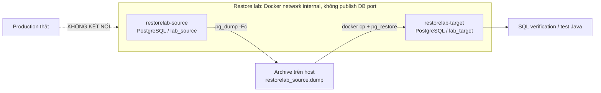
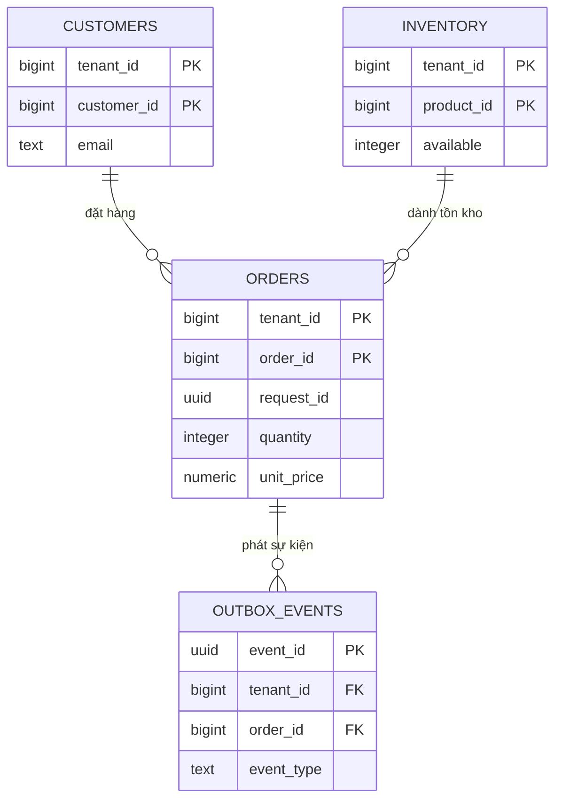
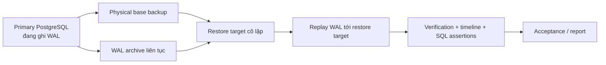

# Khôi phục dữ liệu từ bản sao lưu trong môi trường cô lập

Trong chương **Thực hành tổng hợp** của module **DATA_PERSISTENCE_FUNDAMENTALS**, việc tạo backup mới chỉ là một nửa công việc. Một bản sao lưu chỉ thực sự có giá trị khi có thể **đọc, giải mã, khôi phục và kiểm chứng dữ liệu** trong tình huống mà hệ thống gốc gặp sự cố. Một dashboard hiển thị “Backup succeeded” không chứng minh rằng database sau restore chứa đúng khóa ngoại, số dư, đơn hàng, outbox event hay trạng thái cần thiết để Java service tiếp tục phục vụ.

Bài thực hành này tích hợp kiến thức về **schema, transaction, constraints, ranh giới persistence của Java, durability, bảo mật, quan sát vận hành và kiểm thử sự cố**. Ta sẽ dùng PostgreSQL để tạo một dữ liệu nghiệp vụ nhỏ, xuất bản sao lưu logic dạng custom archive, khôi phục vào **một PostgreSQL đích độc lập**, rồi kiểm chứng không chỉ số lượng bản ghi mà cả bất biến tồn kho, khóa ngoại, idempotency và event intent. Sau đó ta khảo sát các lỗi khôi phục, phương pháp đối soát, RPO/RTO, giới hạn của logical dump và quy trình dành riêng cho physical backup/PITR.

> **Mục tiêu quan trọng nhất:** Hoàn thành bài không phải là nhìn thấy dòng `pg_restore` trả mã thoát `0`, mà là **chứng minh trong phạm vi bài thử rằng bản sao khôi phục có thể phục vụ đúng những dữ liệu và ràng buộc đã cam kết**, mà không tác động đến nguồn hoặc môi trường đang phục vụ.

## 1. Kết quả học tập và tiêu chí hoàn thành

Sau bài thực hành, người học cần có khả năng:

1. Phân biệt **logical backup** (ví dụ `pg_dump -Fc`) với **physical backup/WAL/PITR**, và chọn đúng công cụ phục hồi.
2. Tạo môi trường restore **tách khỏi production**, có database, tài khoản, storage, network và quyền truy cập riêng.
3. Ghi lại manifest gồm source, thời điểm, phiên bản, phạm vi, checksum và những thành phần không nằm trong backup.
4. Thực hiện một restore từ custom archive vào database đích trống; kiểm tra cả exit code và log, không bỏ qua lỗi.
5. Chứng minh schema, constraint, khóa ngoại và **trạng thái nghiệp vụ sau commit** được khôi phục đúng.
6. Phân biệt lỗi **thiếu dữ liệu trong backup** với lỗi dữ liệu đã mất **sau mốc backup** nhưng trước sự cố.
7. Đánh giá các dependency ngoài DB: file/object, secret/key, cache, search, broker, outbox, read replica, công việc bất đồng bộ.
8. Xây dựng báo cáo restore drill với **RPO, RTO quan sát được**, phép kiểm tra dữ liệu, lỗi còn tồn và điều kiện không được phép mở traffic.

### 1.1. Đầu ra phải nộp

| Đầu ra | Nội dung | Dấu hiệu đạt |
| --- | --- | --- |
| Backup artifact | File archive PostgreSQL dạng custom | File tồn tại, checksum được ghi nhận, `pg_restore -l` đọc được |
| Restore target | Database độc lập, chỉ chứa dữ liệu test | Không dùng DSN/volume của source hoặc production |
| Verification results | SQL kiểm tra dữ liệu + invariant | Đúng bản ghi, inventory và orders khớp, FK/unique/check còn |
| Recovery record | Source, version, checksum, restore command, thời gian, lỗi | Có thể giải thích ai/ở đâu/khi nào đã thử |
| Failure case | Ít nhất một lỗi restore được phát hiện rồi xử lý trong môi trường test | Không coi lỗi giữa chừng là success |
| Nhận xét giới hạn | RPO/RTO, logical vs physical, hệ thống ngoài DB | Không tuyên bố đã thử PITR hoặc DR vùng nếu chưa thực hiện |

### 1.2. Phạm vi bài thực hành

Lab chính dùng **PostgreSQL 16 trong Docker** với **dữ liệu hoàn toàn giả**, không mở cổng PostgreSQL ra host, không dùng backup người dùng thật và không đụng tới hệ thống hiện có. Các câu lệnh minh họa cần có Docker Engine/CLI chạy được và quyền tạo container, network, volume. Với Docker Desktop trên Windows, có thể nhập lệnh `docker` trong PowerShell; các ví dụ SQL được chạy qua `psql` trong container, nên không yêu cầu cài `psql` trên host.

**Không chạy lệnh reset, `DROP`, `pg_restore --clean`, `docker rm` hoặc `docker volume rm` với tên database/container/volume chưa kiểm tra.** Dù dùng tên có tiền tố `restorelab-`, người học vẫn phải xác nhận không trùng tài nguyên đang sử dụng. Câu lệnh `docker rm` ở cuối là tùy chọn và chỉ dành cho container **do chính bài lab tạo ra**.

## 2. Những dạng backup không được đánh đồng

Trong PostgreSQL, các phương thức sao lưu thường gặp có cơ chế khác nhau:

| Loại | Ví dụ công cụ/đầu ra | Khôi phục bằng | Điều cần lưu ý |
| --- | --- | --- | --- |
| **Logical SQL dump** | `pg_dump` xuất SQL thuần | `psql` vào database thích hợp | Dễ đọc, không phải physical recovery; phải xem quyền/extension/schema |
| **Logical custom archive** | `pg_dump -Fc` | `pg_restore` | Hỗ trợ liệt kê nội dung/chọn đối tượng; không phải WAL/PITR |
| **Logical directory/tar** | `pg_dump -Fd` / `-Ft` | `pg_restore` | Khác định dạng và khả năng song song, cần tool tương thích |
| **Cluster globals** | `pg_dumpall --globals-only` | Thực thi SQL với quyền phù hợp | Roles/tablespaces và đối tượng toàn cluster không nằm trọn trong dump từng DB |
| **Physical base backup** | `pg_basebackup` hoặc giải pháp backup vật lý đã được hỗ trợ | Quy trình phục hồi **data directory** và cấu hình server | Không dùng `pg_restore` để nạp dữ liệu vật lý |
| **PITR** | Base backup + chuỗi WAL cần thiết | PostgreSQL recovery theo restore target/timeline | Cần đủ WAL, quyền, key, cấu hình và kiểm thử mốc khôi phục |
| **Storage snapshot** | Snapshot volume/cloud của dữ liệu | Quy trình snapshot/restore được provider hỗ trợ | Tính nhất quán phụ thuộc cách snapshot nhiều volume và trạng thái database |

**Lab này chỉ thực hiện restore logic dạng custom archive.** Nó giúp kiểm tra schema và dữ liệu được export tại snapshot nhất quán của `pg_dump`, nhưng **không chứng minh rằng tổ chức có thể failover trong vài giây hoặc phục hồi PostgreSQL đến một LSN tùy ý**. Phần physical/PITR ở cuối là một kịch bản diễn tập riêng, với yêu cầu bổ sung.

### 2.1. Đúng phiên bản công cụ

`pg_dump` có giới hạn về tương thích phiên bản server; công cụ cũ có thể không dump được server mới. Trong bài ta dùng **cùng major PostgreSQL 16** cho source, target và công cụ chạy bên trong container. Khi phục hồi sang phiên bản khác, phải xem tài liệu tương thích và thử đầy đủ extension, collation, encoding, kiểu dữ liệu, functions, triggers và application migrations.

Không xem “cùng tên PostgreSQL” là đủ: một bản dump logic có thể restore thành công về cú pháp nhưng ứng dụng vẫn lỗi do khác extension, role, ICU/collation version hoặc cấu hình authentication.

## 3. Thiết kế ranh giới cô lập trước khi chạm dữ liệu

Mô hình lab:



Source và target có **container và Docker volume khác nhau**; target không nhận traffic từ ứng dụng thật. Docker network `--internal` hạn chế khả năng đi ra ngoài mạng Docker; việc không khai báo `-p 5432:5432` tránh publish cổng DB ra host. Đây là **biện pháp cô lập dành cho lab**, không phải một bằng chứng security-hardening toàn diện đối với Docker daemon, host hoặc người dùng có quyền quản trị container.

### 3.1. Quy tắc an toàn

1. Dùng **tên container, database, volume và network riêng cho lab**; không sử dụng tên hoặc biến môi trường kết nối production.
2. Dùng dữ liệu giả (`example.invalid`, ID không nhạy cảm); không sao chép file backup chứa PII production vào máy cá nhân.
3. Không cho target kết nối tới **payment, email, shipping, webhook, broker production**, kể cả khi đã restore được cấu hình ứng dụng.
4. Không chạy application worker hoặc scheduler tự động trên DB vừa restore trước khi kiểm tra nguy cơ phát side effect từ outbox/event cũ.
5. Giới hạn quyền đọc archive và xóa/giữ artifact theo chính sách thử nghiệm; dump có thể chứa **toàn bộ dữ liệu gốc ở dạng có thể đọc được**.
6. Ghi rõ source và target trong mọi lệnh; không dùng `DROP DATABASE` chỉ vì một biến môi trường có tên đúng nhưng trỏ nhầm nơi.

### 3.2. Khi phải phục hồi backup thật

Một bản sao production chỉ được dùng nếu có **ủy quyền, môi trường kiểm soát, encryption/key management, audit và chính sách xử lý dữ liệu nhạy cảm**. Nếu mục tiêu là diễn tập thao tác, dữ liệu giả và backup lab đủ cho quy trình cơ bản; nếu mục tiêu là xác nhận khả năng restore **của backup production**, cần thực hiện trong hạ tầng cách ly được tổ chức phê duyệt, với chính sách truy cập và xóa dữ liệu sau test. Không gợi ý tải backup production về máy cá nhân làm cách nhanh nhất.

## 4. Chuẩn bị hai PostgreSQL độc lập bằng Docker

Các lệnh bên dưới được chạy trên host có Docker CLI, trong một thư mục làm việc **do người học tự chọn**; file dump sẽ xuất hiện tại thư mục hiện tại. Mỗi lệnh được thực hiện một lần khi các tài nguyên `restorelab-*` chưa tồn tại.

```powershell
docker network create --internal restorelab-net

docker volume create restorelab-source-data
docker volume create restorelab-target-data

docker run -d --name restorelab-source `
  --network restorelab-net `
  -e POSTGRES_USER=labuser `
  -e POSTGRES_PASSWORD=lab-only-not-secret `
  -e POSTGRES_DB=lab_source `
  -v restorelab-source-data:/var/lib/postgresql/data `
  postgres:16

docker run -d --name restorelab-target `
  --network restorelab-net `
  -e POSTGRES_USER=labuser `
  -e POSTGRES_PASSWORD=lab-only-not-secret `
  -e POSTGRES_DB=lab_target `
  -v restorelab-target-data:/var/lib/postgresql/data `
  postgres:16
```

Các dấu backtick ở cuối dòng là **ký tự nối dòng của PowerShell**, không dùng nguyên cú pháp này trong Bash. Nếu chạy Bash/macOS shell, có thể viết mỗi lệnh `docker run ...` trên một dòng hoặc dùng dấu `\` để nối dòng. Mật khẩu `lab-only-not-secret` chỉ dùng với **dữ liệu giả trong lab cô lập**, không phải ví dụ thực hành quản lý secret cho production.

### 4.1. Chờ PostgreSQL sẵn sàng

```powershell
docker exec restorelab-source pg_isready -U labuser -d lab_source
docker exec restorelab-target pg_isready -U labuser -d lab_target
```

Nếu container mới khởi động, lệnh `pg_isready` có thể tạm trả chưa sẵn sàng; chỉ tiếp tục khi cả hai đã phản hồi chấp nhận kết nối. Xem log đúng container khi cần:

```powershell
docker logs --tail 50 restorelab-source
docker logs --tail 50 restorelab-target
```

Không thêm `-p` vì bài lab thao tác bằng `docker exec`. Tránh đưa database dump ra mạng chỉ để Java test kết nối: có thể dùng một **test runner container** được gắn cùng mạng lab, hoặc mở một cổng chỉ trong một môi trường được kiểm soát và xác minh riêng; không cần làm điều đó ở các bước SQL cơ bản.

## 5. Tạo schema nghiệp vụ và dữ liệu gốc nhất quán

Ví dụ xuyên suốt gồm bốn bảng:

- `customers`: một khách hàng có email duy nhất trong mỗi tenant.
- `inventory`: hàng tồn kho phải không âm.
- `orders`: một yêu cầu đặt hàng có `request_id` ổn định, không được trùng trong tenant.
- `outbox_events`: event intent phải liên kết với một order đã tồn tại.



### 5.1. Mở `psql` chỉ tại source

```powershell
docker exec -it restorelab-source psql -U labuser -d lab_source
```

Trong phiên `psql` trên, chạy toàn bộ SQL bên dưới. Lệnh `\set ON_ERROR_STOP on` khiến `psql` dừng thay vì tiếp tục một file/script khi gặp SQL error; trong phiên tương tác, hãy **dừng thực hành và điều tra** nếu có lỗi, không bỏ qua để tạo bản backup không nhất quán.

```sql
\set ON_ERROR_STOP on

BEGIN;

CREATE TABLE customers (
    tenant_id   BIGINT NOT NULL,
    customer_id BIGINT NOT NULL,
    email       TEXT NOT NULL,
    full_name   TEXT NOT NULL,
    PRIMARY KEY (tenant_id, customer_id),
    UNIQUE (tenant_id, email)
);

CREATE TABLE inventory (
    tenant_id  BIGINT NOT NULL,
    product_id BIGINT NOT NULL,
    available  INTEGER NOT NULL CHECK (available >= 0),
    PRIMARY KEY (tenant_id, product_id)
);

CREATE TABLE orders (
    tenant_id    BIGINT NOT NULL,
    order_id     BIGINT NOT NULL,
    request_id   UUID NOT NULL,
    customer_id  BIGINT NOT NULL,
    product_id   BIGINT NOT NULL,
    quantity     INTEGER NOT NULL CHECK (quantity > 0),
    unit_price   NUMERIC(12, 2) NOT NULL CHECK (unit_price >= 0),
    created_at   TIMESTAMPTZ NOT NULL DEFAULT now(),
    PRIMARY KEY (tenant_id, order_id),
    UNIQUE (tenant_id, request_id),
    FOREIGN KEY (tenant_id, customer_id)
        REFERENCES customers (tenant_id, customer_id),
    FOREIGN KEY (tenant_id, product_id)
        REFERENCES inventory (tenant_id, product_id)
);

CREATE TABLE outbox_events (
    event_id      UUID PRIMARY KEY,
    tenant_id     BIGINT NOT NULL,
    order_id      BIGINT NOT NULL,
    event_type    TEXT NOT NULL,
    payload       JSONB NOT NULL,
    published_at  TIMESTAMPTZ,
    FOREIGN KEY (tenant_id, order_id)
        REFERENCES orders (tenant_id, order_id)
);

INSERT INTO customers(tenant_id, customer_id, email, full_name)
VALUES (7, 21, 'restore-lab-customer@example.invalid', 'Restore Lab');

INSERT INTO inventory(tenant_id, product_id, available)
VALUES (7, 101, 10);

-- Mô phỏng một đơn hợp lệ trong cùng transaction.
UPDATE inventory
SET available = available - 2
WHERE tenant_id = 7 AND product_id = 101 AND available >= 2;

INSERT INTO orders
    (tenant_id, order_id, request_id, customer_id,
     product_id, quantity, unit_price)
VALUES
    (7, 5001, '11111111-1111-4111-8111-111111111111',
     21, 101, 2, 125.50);

INSERT INTO outbox_events
    (event_id, tenant_id, order_id, event_type, payload)
VALUES
    ('22222222-2222-4222-8222-222222222222',
     7, 5001, 'OrderCreated',
     '{"orderId":5001,"tenantId":7,"quantity":2}'::jsonb);

COMMIT;
```

Ở bước ví dụ, câu `UPDATE` trừ tồn kho từ 10 xuống 8 nên dự kiến cập nhật đúng một hàng. Trong code Java thực tế phải kiểm tra **affected rows = 1** và rollback nếu không đạt; SQL seed ở đây dùng giá trị đã biết để minh họa. Nếu `CREATE TABLE` hoặc `INSERT` báo lỗi, không tiếp tục backup cho tới khi đã xác nhận toàn transaction thành công và các bảng có trạng thái mong đợi.

### 5.2. Kiểm tra dữ liệu ngay tại source

Trong `psql` source:

```sql
SELECT tenant_id, customer_id, email FROM customers;

SELECT tenant_id, product_id, available FROM inventory;

SELECT order_id, request_id, quantity, unit_price
FROM orders
WHERE tenant_id = 7;

SELECT event_id, event_type, published_at
FROM outbox_events;
```

Kỳ vọng:

| Đối tượng | Giá trị dự kiến |
| --- | --- |
| Customer | Tenant `7`, customer `21`, email giả |
| Inventory | Product `101`, `available=8` |
| Order | Order `5001`, `quantity=2`, `unit_price=125.50` |
| Request ID | `11111111-1111-4111-8111-111111111111` |
| Outbox | Một `OrderCreated`, `published_at IS NULL` |

`published_at IS NULL` có ý nghĩa: event intent đã được ghi nhưng chưa có worker nào gửi event. Khi restore, **không được tự chạy worker production và phát lại email/charge từ event thử nghiệm**; ở môi trường phục hồi thực tế phải xác định rõ mức độ replay và idempotency.

Thoát phiên `psql` bằng `\q` sau khi kiểm tra.

## 6. Tạo custom-format backup tại source

### 6.1. Dump bằng client PostgreSQL 16 ngay trong container

```powershell
docker exec restorelab-source pg_dump `
  -U labuser `
  -d lab_source `
  -Fc `
  --file=/tmp/restorelab_source.dump
```

`-Fc` chọn **custom archive**. Với phương thức này, `pg_dump` lấy snapshot nhất quán của database theo khả năng của PostgreSQL khi export, nhưng không đóng băng thời gian hoặc ngăn mọi transaction khác ở production. Dữ liệu commit **sau snapshot được dùng cho dump** sẽ không tự xuất hiện trong archive. Bài lab không ghi thêm trong lúc dump nên tập dữ liệu có thể kiểm chứng đơn giản.

Nếu command trả exit code khác `0`, **không dùng file dump như một bản backup thành công**. Cần xem stderr, nguồn kết nối, dung lượng lưu và quyền ghi file. Một file tồn tại nhưng bị ghi dở vẫn có thể trông hợp lệ khi chỉ nhìn tên.

### 6.2. Copy backup ra host

```powershell
docker cp restorelab-source:/tmp/restorelab_source.dump .\restorelab_source.dump
```

File này chỉ là **backup dữ liệu giả của bài lab**. Trong thực tế, thao tác copy backup có dữ liệu nhạy cảm phải thực hiện vào repository lưu trữ được kiểm soát, có mã hóa, phân quyền, checksum và retention. Không để backup production trong thư mục download chia sẻ hoặc máy không được quản lý.

### 6.3. Ghi SHA-256 checksum

Trong PowerShell tại thư mục chứa file:

```powershell
Get-FileHash -Path .\restorelab_source.dump -Algorithm SHA256
```

Ghi lại hash trong manifest. **Checksum xác nhận bytes trùng nhau khi so sánh**, không chứng minh backup chứa mọi dữ liệu cần thiết và cũng không tự bảo đảm authenticity nếu attacker có thể thay đổi **cả file lẫn hash**. Trong hệ thống thật, cần bảo vệ integrity của manifest bằng quyền riêng/chữ ký hoặc cơ chế kiểm toán phù hợp.

### 6.4. Lưu manifest phục hồi

Ví dụ nội dung mà người học cần ghi trong nhật ký thực hành:

```yaml
backup_kind: postgres-logical-custom
source_environment: restorelab-source
source_database: lab_source
postgres_major: 16
backup_file: restorelab_source.dump
sha256: "<giá trị thật của Get-FileHash>"
captured_at_utc: "<thời điểm thật>"
scope: single-database
expected_tables:
  - customers
  - inventory
  - orders
  - outbox_events
expected_business_state:
  tenant_id: 7
  product_id: 101
  inventory_available: 8
  order_id: 5001
  expected_orders: 1
  expected_outbox_events: 1
restore_target: restorelab-target/lab_target
```

Đây là **mẫu thông tin**, không phải một file bổ sung cần sinh trong repository module. Có thể ghi các trường vào hệ thống theo dõi bài lab hoặc biểu mẫu vận hành. Không điền hash, timestamp giả rồi tuyên bố đã đo. Một manifest production còn cần backup chain/WAL range, encryption/key reference, migration version, roles/extensions, retention/owner và kết quả verification.

### 6.5. Giới hạn của phạm vi dump

`pg_dump -d lab_source` chủ yếu export **đối tượng và dữ liệu trong một database**, không tương đương snapshot toàn cluster. Các global objects như **roles và một số thông tin tablespace** có thể cần được sao lưu riêng qua công cụ/quy trình phù hợp. Bản dump cũng không tự bao gồm:

- File/object trong bucket, email, payment hoặc storage ngoài PostgreSQL.
- Runtime secrets, key mã hóa, credential, DNS/SSL config hoặc service discovery.
- Tất cả cài đặt của server/cluster, replication slots, WAL archive và thông tin HA.
- Dữ liệu commit sau snapshot được dump.
- Nội dung các hệ thống downstream không nằm trong cùng DB.

Nếu ứng dụng cần các thành phần ấy để phục vụ, phải có **dependency manifest** và quy trình phục hồi riêng. Một restore logic thành công chưa có nghĩa service có thể bật lên và tiếp tục đúng ngay lập tức.

## 7. Kiểm tra archive trước khi restore

Không nên chờ restore xong mới kiểm tra file có tồn tại hay không. Đầu tiên hãy chuyển file sang container đích:

```powershell
docker cp .\restorelab_source.dump restorelab-target:/tmp/restorelab_source.dump
```

### 7.1. So sánh checksum nguồn và đích

```powershell
Get-FileHash -Path .\restorelab_source.dump -Algorithm SHA256

docker exec restorelab-target sha256sum /tmp/restorelab_source.dump
```

So sánh 64 ký tự hexadecimal, không phân biệt chữ hoa/chữ thường. Nếu checksum khác nhau, **dừng và xác định tại sao**; không khôi phục từ một artifact chưa rõ tính nguyên vẹn.

### 7.2. Liệt kê Table of Contents của custom archive

```powershell
docker exec restorelab-target pg_restore -l /tmp/restorelab_source.dump
```

Danh sách mục lục thường bao gồm schema definitions, tables, data, constraints, indexes và các mục phù hợp với nội dung dump. Có thể kiểm tra rằng những đối tượng quan trọng xuất hiện, nhưng **đọc được TOC không chứng minh mọi data block đều giải nén/khôi phục được**. Để xác nhận end-to-end, phải restore rồi đọc và đối chiếu dữ liệu.

### 7.3. Kiểm tra target thật sự trống

Trước khi restore, kết nối đến **target**, không phải source:

```powershell
docker exec -it restorelab-target psql -U labuser -d lab_target
```

Trong `psql` target:

```sql
SELECT current_database(), current_user,
       inet_server_addr(), inet_server_port();

SELECT table_schema, table_name
FROM information_schema.tables
WHERE table_schema = 'public'
ORDER BY table_name;
```

Với target mới, không nên có bốn bảng nghiệp vụ. `inet_server_addr()` có thể là `NULL` nếu kết nối dùng Unix socket **bên trong container**, nên nó không phải bằng chứng duy nhất để phân biệt hai server. Dùng thêm **tên container đang `docker exec`**, database và metadata đã kiểm tra ở host. Sau đó dùng `\q` thoát.

**Không restore đè vào database có dữ liệu thật.** Nếu target đã có bảng/ứng dụng đang sử dụng, dừng bài lab và xác minh tài nguyên; không tự chạy `DROP SCHEMA public CASCADE` để “dọn cho nhanh”.

## 8. Thực hiện restore một cách có kiểm soát

Với target **mới tạo, chưa chứa bảng nghiệp vụ**, chạy:

```powershell
docker exec restorelab-target pg_restore `
  -U labuser `
  -d lab_target `
  --no-owner `
  --no-privileges `
  --single-transaction `
  --exit-on-error `
  /tmp/restorelab_source.dump
```

Giải thích các lựa chọn:

| Cờ | Ý nghĩa | Ghi chú |
| --- | --- | --- |
| `-d lab_target` | Kết nối tới database đích có sẵn | Không tự `CREATE DATABASE` trong ví dụ |
| `--no-owner` | Không cố áp dụng ownership gốc của object | Phù hợp khi source/target dùng role khác, nhưng phải kiểm tra quyền thật sau restore |
| `--no-privileges` | Bỏ qua GRANT/REVOKE từ archive | Không xem đây là cơ chế phân quyền production; phải cấp quyền có chủ đích |
| `--single-transaction` | Restore trong một transaction lớn phù hợp với dạng lệnh và tool | Khi lỗi, tránh trạng thái nửa restore đối với các object transaction được hỗ trợ |
| `--exit-on-error` | Dừng khi gặp lỗi | Không chấp nhận restore “có lỗi nhưng vẫn đi tiếp” |

Lựa chọn một transaction thuận tiện cho **lab nhỏ**, nhưng có thể không phù hợp backup rất lớn do thời gian, lock, WAL, bloat và hạn chế song song; phải thiết kế chiến lược riêng khi phục hồi production. Không dùng `--clean` ở đây: tùy chọn đó có thể phát lệnh `DROP` đối tượng, không an toàn nếu trỏ nhầm database.

### 8.1. Kiểm tra lệnh có thực sự thành công

Sau lệnh `docker exec ... pg_restore`, kiểm tra exit code ở shell. Trong PowerShell:

```powershell
$LASTEXITCODE
```

Kỳ vọng `0`. Nếu khác `0`, xem stderr và trạng thái DB target; **không đánh dấu bước PASS**. Exit code `0` là điều kiện cần, nhưng **không đủ** để kết luận dữ liệu nghiệp vụ, quyền và external dependencies đã phục hồi đúng.

### 8.2. Vì sao phải tránh restore vào cùng instance nguồn?

Ngay cả khi hai database khác tên trong cùng một PostgreSQL instance, một lệnh cấu hình sai hoặc `--clean --create` có thể gây tác động ngoài ý muốn. Việc dùng **container, volume và DB khác nhau** giúp giới hạn blast radius của bài lab. Trong môi trường khôi phục thật, target còn cần được tách về tài khoản cloud, project/namespace và network theo yêu cầu bảo mật.

### 8.3. Đọc lại target, không chỉ nhìn log

```powershell
docker exec -it restorelab-target psql -U labuser -d lab_target
```

Nếu `pg_restore` không lỗi, bước tiếp theo vẫn bắt buộc là **kiểm chứng schema, dữ liệu và bất biến** qua chính database đích. Không chuyển sang dọn lab hoặc mở application ngay sau khi nhìn thấy mã thoát `0`.

## 9. Xác minh dữ liệu sau restore bằng SQL có tiêu chí rõ ràng

Các truy vấn trong mục này được chạy **chỉ trên `restorelab-target/lab_target`** sau bước restore. Không mở `psql` vào source để làm assertion, vì source vẫn có dữ liệu đúng ngay cả khi restore target thất bại.

### 9.1. Xác minh đúng database và đối tượng

Trong `psql` target:

```sql
\set ON_ERROR_STOP on

SELECT current_database(), current_user;

SELECT table_schema, table_name
FROM information_schema.tables
WHERE table_schema = 'public'
  AND table_name IN
      ('customers', 'inventory', 'orders', 'outbox_events')
ORDER BY table_name;
```

Phải thấy `lab_target` và bốn bảng dự kiến. Nếu thiếu bất kỳ bảng nào, kết quả restore **không đạt**; không sửa tay một bảng rồi ghi “bản backup đầy đủ” mà chưa điều tra vì sao nó thiếu.

### 9.2. Kiểm tra số bản ghi và trạng thái nghiệp vụ

```sql
SELECT
    (SELECT COUNT(*) FROM customers) AS customer_count,
    (SELECT COUNT(*) FROM inventory) AS inventory_count,
    (SELECT COUNT(*) FROM orders) AS order_count,
    (SELECT COUNT(*) FROM outbox_events) AS outbox_count;
```

Kỳ vọng mỗi count bằng `1`. Tuy nhiên **số hàng bằng nhau không chứng minh nội dung giống nhau**: hai database có thể có cùng một order nhưng khác tenant, quantity, unit price hoặc request ID.

Truy vấn đối chiếu cụ thể:

```sql
SELECT
    o.tenant_id,
    o.order_id,
    o.request_id,
    c.customer_id,
    c.email,
    o.product_id,
    o.quantity,
    o.unit_price,
    o.quantity * o.unit_price AS line_total,
    i.available,
    e.event_id,
    e.event_type,
    e.published_at
FROM orders AS o
JOIN customers AS c
  ON c.tenant_id = o.tenant_id
 AND c.customer_id = o.customer_id
JOIN inventory AS i
  ON i.tenant_id = o.tenant_id
 AND i.product_id = o.product_id
JOIN outbox_events AS e
  ON e.tenant_id = o.tenant_id
 AND e.order_id = o.order_id
WHERE o.tenant_id = 7
  AND o.order_id = 5001;
```

Kỳ vọng **một hàng** có `request_id` như dữ liệu seed, `quantity=2`, `unit_price=125.50`, `line_total=251.00`, `available=8`, event `OrderCreated` và `published_at IS NULL`. Nếu JOIN không trả hàng, không kết luận chỉ từ `COUNT(orders)=1` rằng tất cả mối liên hệ đã được phục hồi.

### 9.3. Assertion trả kết quả pass/fail dễ đọc

```sql
SELECT
    (SELECT COUNT(*) = 1 FROM customers
     WHERE tenant_id = 7 AND customer_id = 21
       AND email = 'restore-lab-customer@example.invalid')
         AS customer_ok,

    (SELECT COUNT(*) = 1 FROM inventory
     WHERE tenant_id = 7 AND product_id = 101
       AND available = 8)
         AS inventory_ok,

    (SELECT COUNT(*) = 1 FROM orders
     WHERE tenant_id = 7 AND order_id = 5001
       AND request_id = '11111111-1111-4111-8111-111111111111'::uuid
       AND quantity = 2 AND unit_price = 125.50)
         AS order_ok,

    (SELECT COUNT(*) = 1 FROM outbox_events
     WHERE event_id = '22222222-2222-4222-8222-222222222222'::uuid
       AND tenant_id = 7 AND order_id = 5001
       AND event_type = 'OrderCreated'
       AND published_at IS NULL)
         AS outbox_ok;
```

Cả bốn cột phải trả `t`. Đây là phép kiểm tra **một tập dữ liệu đã biết của lab**, không phải công cụ so sánh tự động cho hàng tỷ bản ghi production. Khi có dữ liệu lớn, nên xây **manifest dữ liệu quan trọng, kiểm tra constraint/aggregate/hash hoặc đối chiếu theo business key** với quy trình có thể mở rộng.

### 9.4. Kiểm tra bất biến giữa đơn hàng và tồn kho

```sql
SELECT
    i.tenant_id,
    i.product_id,
    i.available,
    COALESCE(SUM(o.quantity), 0) AS ordered_quantity,
    i.available + COALESCE(SUM(o.quantity), 0)
        AS reconstructed_initial_stock
FROM inventory AS i
LEFT JOIN orders AS o
  ON o.tenant_id = i.tenant_id
 AND o.product_id = i.product_id
WHERE i.tenant_id = 7 AND i.product_id = 101
GROUP BY i.tenant_id, i.product_id, i.available;
```

Kỳ vọng `available=8`, `ordered_quantity=2`, `reconstructed_initial_stock=10`. **Chỉ trong mô hình lab** mọi order đều tương ứng một lần trừ stock từ lượng ban đầu 10; hệ thống thật có nhập hàng, hủy đơn, trả hàng, reservation và nhiều trạng thái khác, nên không được áp dụng công thức này vô điều kiện cho production.

### 9.5. Kiểm tra các ràng buộc đã được khôi phục

```sql
SELECT
    conrelid::regclass AS table_name,
    conname,
    contype,
    convalidated
FROM pg_constraint
WHERE conrelid IN (
    'public.customers'::regclass,
    'public.inventory'::regclass,
    'public.orders'::regclass,
    'public.outbox_events'::regclass
)
ORDER BY table_name, conname;
```

`contype` có các mã đại diện cho primary key, unique, foreign key và check constraint; `convalidated` cho biết tình trạng validation của những loại constraint tương ứng. Khi đọc kết quả, phải kiểm tra đủ những constraint cần bảo vệ nghiệp vụ, không chỉ “có một vài dòng trong `pg_constraint`”.

Nếu production phụ thuộc trigger, partial index, expression index, row-level security, extension hoặc role riêng, cần kiểm tra các đối tượng ấy **bằng catalog/query và phép thử đúng chức năng**, không mặc định dump của lab đơn giản đã đại diện đầy đủ.

## 10. Kiểm tra constraint bằng hành vi, không làm bẩn target

Một database có bốn bảng và dữ liệu đúng vẫn chưa chứng minh rằng **schema bảo vệ các ghi mới**. Có thể dùng những phép thử negative case trong **target test** để buộc DB thực thi constraint.

### 10.1. Thử unique constraint với một subtransaction

Trong `psql` target:

```sql
DO $$
BEGIN
    BEGIN
        INSERT INTO orders
            (tenant_id, order_id, request_id, customer_id,
             product_id, quantity, unit_price)
        VALUES
            (7, 5002, '11111111-1111-4111-8111-111111111111',
             21, 101, 1, 125.50);

        RAISE EXCEPTION
            'FAIL: duplicate request_id unexpectedly accepted';
    EXCEPTION WHEN unique_violation THEN
        RAISE NOTICE 'PASS: unique constraint rejects duplicate';
    END;
END
$$;
```

Nếu unique constraint đúng, insert trùng `(tenant_id, request_id)` bị từ chối, nhánh `unique_violation` in `PASS`. Nếu DB bất ngờ chấp nhận, lệnh `RAISE EXCEPTION` làm cả `DO` thất bại và rollback statement, tránh để lại đơn giả. **Không chạy bài test ghi có chủ đích này trên production**.

### 10.2. Thử FK không cho tham chiếu khách hàng không tồn tại

```sql
DO $$
BEGIN
    BEGIN
        INSERT INTO orders
            (tenant_id, order_id, request_id, customer_id,
             product_id, quantity, unit_price)
        VALUES
            (7, 5003, '33333333-3333-4333-8333-333333333333',
             999999, 101, 1, 125.50);

        RAISE EXCEPTION
            'FAIL: missing customer unexpectedly accepted';
    EXCEPTION WHEN foreign_key_violation THEN
        RAISE NOTICE 'PASS: FK rejects missing customer';
    END;
END
$$;
```

### 10.3. Thử CHECK không cho tồn kho âm

```sql
DO $$
BEGIN
    BEGIN
        UPDATE inventory
        SET available = -1
        WHERE tenant_id = 7 AND product_id = 101;

        RAISE EXCEPTION
            'FAIL: negative stock unexpectedly accepted';
    EXCEPTION WHEN check_violation THEN
        RAISE NOTICE 'PASS: CHECK rejects negative stock';
    END;
END
$$;
```

Cơ chế `BEGIN ... EXCEPTION` trong PL/pgSQL sử dụng phạm vi subtransaction cho những thay đổi đã thực hiện khi xảy ra lỗi. Sau ba phép thử, chạy:

```sql
SELECT COUNT(*) FROM orders;
SELECT available FROM inventory
WHERE tenant_id = 7 AND product_id = 101;
```

Kỳ vọng vẫn là **một order và inventory bằng 8**. Cách kiểm tra này có phạm vi tại lab; trong ứng dụng thật, test cần thực hiện bằng repository/JDBC adapter để xác minh cả **SQL được tạo và exception mapping**, không chỉ constraint tại DB.

## 11. Kiểm chứng phục hồi ở ranh giới Java/JDBC

Đối với Java service, dữ liệu có trong database không bảo đảm rằng repository có thể đọc nó: có thể sai schema search path, vai trò DB, enum mapping, timezone, migration version hoặc cấu hình kết nối.

### 11.1. Kiểm tra DSN trỏ đúng restore target

Vì container không mở port ra host, một test runner được gắn cùng Docker network `restorelab-net` có thể kết nối bằng hostname `restorelab-target`:

```text
jdbc:postgresql://restorelab-target:5432/lab_target
```

Đây là **DSN chỉ có hiệu lực từ container trên cùng mạng Docker**, không phải địa chỉ truy cập từ mọi JVM chạy trên host. Nếu muốn chạy Java trên host, phải có phương án network an toàn riêng; **không dùng JDBC URL của production** rồi đổi mỗi tên database.

### 11.2. Kiểm tra dữ liệu bằng JDBC

Ví dụ Java tối giản:

```java
public final class RestoreVerification {
    public static void verify(Connection connection)
            throws SQLException {
        try (PreparedStatement ps = connection.prepareStatement(
                "SELECT i.available, o.quantity, o.unit_price " +
                "FROM inventory i " +
                "JOIN orders o " +
                "  ON o.tenant_id = i.tenant_id " +
                " AND o.product_id = i.product_id " +
                "WHERE o.tenant_id = ? AND o.order_id = ?")) {
            ps.setLong(1, 7L);
            ps.setLong(2, 5001L);

            try (ResultSet rows = ps.executeQuery()) {
                if (!rows.next()) {
                    throw new AssertionError("Restored order missing");
                }
                int available = rows.getInt("available");
                int quantity = rows.getInt("quantity");
                BigDecimal price = rows.getBigDecimal("unit_price");

                if (available != 8 || quantity != 2 ||
                        price.compareTo(new BigDecimal("125.50")) != 0) {
                    throw new AssertionError("Restore data mismatch");
                }
                if (rows.next()) {
                    throw new AssertionError("Duplicate restored rows");
                }
            }
        }
    }
}
```

`Connection` được cung cấp từ một `DataSource` **chỉ kết nối target lab**; imports và runner được lược bỏ để tập trung vào contract. `BigDecimal.compareTo()` được dùng thay cho so sánh string để kiểm tra giá trị số mà không phụ thuộc khác biệt biểu diễn scale ngoài phạm vi mong đợi.

### 11.3. Tách test đọc và test ghi

Nên chạy theo thứ tự:

1. **Read-only verification:** đọc bảng, constraints, dữ liệu mẫu và invariants.
2. **Controlled-write verification:** dùng một tenant/test ID riêng trong target, thử unique/FK/check hoặc một transaction Java và rollback.
3. **Post-write verification:** đọc lại bằng transaction mới để xác minh không có partial write.
4. **Application smoke test:** chạy service trong cấu hình **vô hiệu hóa email, payment, webhook, consumer và scheduler có side effect**, đồng thời chặn egress tới production.

**Không chạy trực tiếp application production config trên database restore chỉ để “thử xem API hoạt động”.** Một outbox event chưa publish trong backup có thể kích hoạt lại notification, charge hoặc đồng bộ sang hệ thống thật khi worker khởi động.

## 12. Đo thời gian phục hồi và phân biệt RTO với thời gian restore

Mục tiêu vận hành không chỉ là chạy `pg_restore`. Để đánh giá **Recovery Time Objective (RTO)**, cần đo khoảng thời gian từ lúc sự cố được xác định theo failure model đến khi dịch vụ đạt **tiêu chí phục vụ có thể chấp nhận**.

Ví dụ các mốc thời gian cần ghi:

| Mốc | Sự kiện |
| --- | --- |
| T0 | Bắt đầu sự cố/diễn tập được công bố |
| T1 | Xác định và xác thực artifact backup/key/manifest |
| T2 | Target cô lập đã sẵn sàng |
| T3 | `pg_restore` hoàn thành không lỗi |
| T4 | SQL/JDBC correctness checks đều đạt |
| T5 | Dependencies, migration, quyền, outbox/cache đã được xác minh theo scope |
| T6 | Dịch vụ đạt acceptance criteria, có thể phục vụ ở chế độ cam kết |

**Thời gian chạy `pg_restore`** là `T3-T2`, còn **RTO quan sát** trong kịch bản tương ứng có thể là `T6-T0`. Không nói RTO bằng 30 giây chỉ vì lệnh restore mất 30 giây trong khi validation, khởi động ứng dụng hoặc khôi phục object storage mất thêm 30 phút.

### 12.1. RPO: bản dump phản ánh tới thời điểm nào?

**Recovery Point Objective (RPO)** mô tả lượng/mốc dữ liệu được phép mất do một sự cố theo hợp đồng. Một logical dump là ảnh chụp ở thời điểm snapshot của dump; các write đã commit **sau snapshot** không nằm trong archive đó.

Giả sử:

```text
09:00  pg_dump lấy snapshot S.
09:05  User đặt đơn B, nhận xác nhận COMMIT.
09:10  Primary bị mất.
09:20  Restore chỉ từ dump S.
```

Database phục hồi từ dump S có thể **không chứa đơn B**, dù mọi lệnh restore và consistency check của dữ liệu tại S đều PASS. Đây là **data loss theo mốc khôi phục**, không phải lỗi `pg_restore`. Muốn RPO thấp hơn phải có phương án backup/WAL/replication và recovery phù hợp, không tăng số lần gọi `pg_restore`.

### 12.2. Bài lab đã chứng minh được RPO/RTO nào?

Lab này có thể đo **thời gian từ lúc bắt đầu restore custom archive đến khi xác minh dữ liệu giả đạt điều kiện**. Nó chưa kiểm tra mất node đang phục vụ, automation failover, archive WAL, remote region, key recovery của production hoặc những write commit **sau dump**. Vì thế báo cáo đúng phải nêu:

> “Custom logical archive đã restore và qua kiểm tra trong lab PostgreSQL 16 cô lập. Thời gian được đo cho quy trình lab. Không có kết luận RPO/RTO production hoặc PITR nếu chưa thử các hệ thống và mốc sự cố đó.”

Không tạo ra số RPO/RTO giả trong báo cáo. Mọi con số cần đến từ timestamp thực khi diễn tập, kèm định nghĩa rõ thời điểm bắt đầu/kết thúc.

## 13. Thử lỗi có kiểm soát: khi restore không thể hoàn tất

Một bài lab chỉ chạy restore trong điều kiện tốt vẫn chưa đủ. Cần biết **lỗi được phát hiện tại đâu**, **target có bị ảnh hưởng thế nào** và **cách làm lại mà không hủy dữ liệu ngoài phạm vi**.

### 13.1. Thử restore lần hai trên cùng target test

Sau khi restore lần đầu đã thành công, **không nên chạy lại** lệnh `pg_restore` lên cùng database có các bảng. Trong lab, có thể chủ động kiểm tra khả năng phát hiện sai thao tác bằng cách lặp lệnh restore với `--single-transaction --exit-on-error` **chỉ trên target thử nghiệm**:

```powershell
docker exec restorelab-target pg_restore `
  -U labuser `
  -d lab_target `
  --no-owner `
  --no-privileges `
  --single-transaction `
  --exit-on-error `
  /tmp/restorelab_source.dump
```

Kỳ vọng PostgreSQL/`pg_restore` báo lỗi vì bảng hoặc đối tượng đã tồn tại; exit code **khác `0`** và transaction restore bị rollback theo semantics tương ứng. Sau đó vẫn phải kiểm tra lại bốn bảng và dữ liệu gốc. **Không “sửa” lỗi bằng `--clean` ngay**, vì `--clean` yêu cầu xóa đối tượng hiện có; trong production, phải chứng minh target được phép phá bỏ và có đường khôi phục nếu nhầm.

Thử nghiệm này phát hiện một sai sót vận hành đơn giản: restore script không có **preflight target trống/đúng môi trường** và có thể bị chạy hai lần. Bài lab nhỏ không tái hiện mọi rủi ro restore trên database thật có hàng trăm object hoặc extension.

### 13.2. Khi archive thiếu, hỏng hoặc có checksum sai

Những trường hợp cần thử trong môi trường tách biệt:

| Fault | Tín hiệu cần kiểm tra | Phản ứng đúng |
| --- | --- | --- |
| File không tồn tại | `docker cp`, `pg_restore` không đọc được path | Dừng, kiểm tra artifact/đường dẫn, không tự chọn file gần tên |
| Checksum khác manifest | SHA-256 không khớp | Cách ly artifact, tìm nguồn checksum đúng, không restore tiếp |
| File bị truncate/corrupt | `pg_restore -l` hoặc restore báo lỗi | Đánh dấu backup không dùng được, tìm artifact tốt khác |
| Dump không chứa bảng bắt buộc | TOC/verification thiếu object | Xác định dump scope/filter; không ghi backup verified |
| Quyền/role không phù hợp | Lỗi permission/owner/extension | Phục hồi globals và quyền có kế hoạch, không mở superuser tùy tiện |
| Database target không trống | `relation already exists` | Kiểm tra target; tạo target mới nếu cần, không xóa nhầm |
| Target hết dung lượng | Restore fail khi ghi dữ liệu/WAL/index | Điều tra capacity, không tự xem restore đã hoàn tất |
| Phiên bản/extension khác | Lỗi DDL/type/function/collation | Phục hồi stack tương thích hoặc có kế hoạch migration rõ |

**Không phá hỏng file backup duy nhất để thử lỗi**. Nếu muốn thử corruption, tạo một **bản sao dữ liệu lab** riêng và một restore target mới, thay đổi bản sao ấy có kiểm soát rồi xác minh hệ thống phát hiện lỗi; giữ nguyên artifact chuẩn để kiểm tra rollback. Những thử nghiệm ở đây phải tách khỏi production và không được làm mất backup thật.

### 13.3. Restore lỗi giữa chừng: vì sao mã thoát quan trọng?

Nếu chạy `pg_restore` mà **không dừng khi lỗi**, tool có thể tiếp tục nạp các object khác rồi thông báo một số lỗi ở cuối. Database đích có thể có **schema/data một phần** mà người vận hành nhầm là hoàn tất.

Trong lab này, `--exit-on-error` cùng `--single-transaction` làm quy trình nhỏ dễ diễn giải hơn. Với restore production rất lớn, có thể phải dùng phương thức nhiều pha, restore song song và checkpoint; khi đó phải quản lý rõ:

1. Mỗi pha đã hoàn tất hay chưa.
2. Object nào có thể được phục hồi lại an toàn.
3. Có dữ liệu nào bị nạp hai lần không.
4. Có cần xóa target thất bại và tạo lại từ đầu không.
5. Bao giờ đạt acceptance criteria mới mở traffic.

**Khôi phục một phần không đồng nghĩa một hệ thống có thể phục vụ một phần an toàn**. Nếu ranh giới transaction/domain liên quan nhiều bảng, trả dữ liệu trong trạng thái chưa kiểm chứng có thể làm hỏng nghiệp vụ.

### 13.4. Khả năng phục hồi phụ thuộc quyền và khóa

Một archive được mã hóa ở tầng backup repository có thể không thể giải mã khi disaster xảy ra, dù file còn nguyên. Cần kiểm tra:

- Kho khóa (KMS/HSM) và quyền sử dụng khóa khi primary account/region không hoạt động.
- Credentials và IAM role cho **restore target**, không phải copy secrets production vào script lab.
- Phụ thuộc extension, schema owner, role và GRANT sau restore.
- Chứng chỉ TLS, cấu hình networking và DNS cho ứng dụng sau khôi phục.
- Quy trình xoay khóa hoặc thu hồi credential khi môi trường phục hồi kết thúc.

Backup cần **bảo mật như dữ liệu gốc**. Sao lưu vào một bucket công khai hoặc tạo bản copy không mã hóa ở máy cá nhân để “tiện kiểm thử” là một lỗi an toàn dữ liệu.

## 14. Bài mở rộng: kiểm tra mốc snapshot và dữ liệu sau backup

Phần này nhằm chứng minh **logical backup không bao trùm các write xảy ra sau snapshot**. Thực hiện **chỉ với dữ liệu giả**, sau khi đã có archive chuẩn từ bước 6.

### 14.1. Thêm một giao dịch sau khi tạo backup

Trên **source lab**, mở `psql`:

```powershell
docker exec -it restorelab-source psql -U labuser -d lab_source
```

Sau đó thực hiện:

```sql
BEGIN;

UPDATE inventory
SET available = available - 1
WHERE tenant_id = 7
  AND product_id = 101
  AND available >= 1;

INSERT INTO orders
    (tenant_id, order_id, request_id, customer_id,
     product_id, quantity, unit_price)
VALUES
    (7, 5002, '44444444-4444-4444-8444-444444444444',
     21, 101, 1, 50.00);

INSERT INTO outbox_events
    (event_id, tenant_id, order_id, event_type, payload)
VALUES
    ('55555555-5555-4555-8555-555555555555',
     7, 5002, 'OrderCreated',
     '{"orderId":5002,"tenantId":7,"quantity":1}'::jsonb);

COMMIT;
```

Nếu source seed và transaction trên thành công, **source mới** có hai orders, tồn kho `7` và hai outbox events. Nhưng archive **đã tạo trước đó** vẫn chứa một order, tồn kho `8` và một outbox event.

### 14.2. So sánh lại source và target

Chạy ở cả hai database:

```sql
SELECT COUNT(*) AS orders FROM orders;
SELECT COUNT(*) AS outbox_events FROM outbox_events;
SELECT available
FROM inventory
WHERE tenant_id = 7 AND product_id = 101;
```

| Nguồn | Orders | Outbox | Inventory |
| --- | ---: | ---: | ---: |
| Source **sau** giao dịch bổ sung | 2 | 2 | 7 |
| Target restore từ dump **trước** giao dịch bổ sung | 1 | 1 | 8 |

Sự khác biệt này là **đúng theo phạm vi snapshot**. Không được “sửa” bằng cách copy vài dòng sau này sang target rồi tuyên bố logical dump tự có RPO bằng không. Trong production, nếu bản ghi sau snapshot đã được xác nhận với người dùng, chúng cần cơ chế phục hồi/đối chiếu phù hợp với RPO: WAL/PITR, replication protocol, operation ledger hoặc phương án đã được phê duyệt.

### 14.3. Vì sao dump mới không thay thế bản cũ một cách vô thức?

Nếu sau giao dịch bổ sung ta tạo một archive mới, nó có mốc dữ liệu khác. Để so sánh có ý nghĩa, phải ghi manifest riêng cho từng artifact. **Không overwrite file dump chuẩn đang dùng cho bài test snapshot cũ** nếu muốn chứng minh dữ liệu có thể mất giữa các điểm sao lưu.

## 15. Khi cần physical restore hoặc PITR: quy trình khác hoàn toàn

Nếu yêu cầu phục hồi tới **một thời điểm trước khi xóa nhầm dữ liệu**, custom-format `pg_dump` không phải công cụ phù hợp cho việc replay WAL tới một mốc cụ thể. PostgreSQL physical recovery sử dụng **base backup và các WAL segment cần thiết**; mục tiêu khôi phục, timeline và cấu hình server đều quan trọng.

### 15.1. Mô hình một bài diễn tập PITR



Một test PITR có thể dùng các mốc:

```text
T0  Physical base backup bắt đầu/hoàn tất theo công cụ.
T1  Commit một bản ghi canary giả.
T2  Thực hiện một DELETE sai trong môi trường test.
T3  Stop nguồn/giả lập mất database.
T4  Restore base backup + WAL tới mốc ngay trước DELETE.
T5  Query target:
      - Canary đã commit ở T1 có mặt nếu mốc WAL bao gồm nó.
      - DELETE tại T2 chưa được áp dụng nếu target ở trước nó.
      - Schema/constraints và ứng dụng đủ điều kiện phục vụ.
```

**Một bản dump `-Fc` không mang theo lịch sử WAL đủ để thực hiện quy trình này.** Không chạy `pg_restore` trên thư mục `PGDATA` của physical backup; và không copy live `PGDATA` bằng thao tác file không có protocol/snapshot nhất quán rồi coi đó là base backup hợp lệ.

### 15.2. Những phần phải cấu hình trước khi chạy PITR thật

Một môi trường PITR riêng cần:

1. Backup vật lý được tạo bằng phương pháp PostgreSQL/backup tool hỗ trợ, có manifest/checksum và khả năng đọc lại.
2. Cấu hình **WAL archiving** và kiểm tra chuỗi segment không có lỗ hổng cần thiết.
3. Chọn **recovery target** theo time/transaction ID/LSN hoặc cách phù hợp với phiên bản, cùng timeline.
4. Quy trình tạo/khởi động **data directory target riêng**, không làm hỏng source.
5. Cấu hình recovery hiện đại theo phiên bản PostgreSQL, ví dụ signal file và các tham số recovery liên quan thay vì hướng dẫn lỗi thời.
6. Khóa/mã hóa, credentials, file permissions, tablespace mapping và extension cần thiết.
7. Kiểm tra dữ liệu sau replay và hướng xử lý khi recovery target không đạt.

Trong PostgreSQL hiện đại, cấu hình recovery đã thay đổi so với các phiên bản cũ: không nên sao chép máy móc hướng dẫn `recovery.conf` của PostgreSQL đời trước. Việc chọn thời điểm khôi phục cũng phải tính timezone, đồng hồ giữa các nút, transaction commit boundary và khả năng **mốc thời gian không định danh chính xác một business event**.

### 15.3. Một sự cố xóa nhầm cần chọn recovery strategy

Nếu primary vẫn đang phục vụ nhiều giao dịch mới sau khi có một DELETE sai, restore cả database về trước DELETE có thể làm **mất những thay đổi hợp lệ sau đó**. Các hướng xử lý có thể bao gồm:

- Restore PITR vào **database cô lập** để trích xuất và đối chiếu tập bản ghi bị xóa, rồi thực hiện repair có kiểm soát lên hệ thống đang phục vụ.
- Nếu cần rollback toàn bộ hệ thống, công bố RPO và phạm vi dữ liệu bị mất rồi thực hiện cutover theo runbook.
- Giữ hệ thống ở chế độ read-only/degraded khi chưa thể bảo đảm consistency.

**Không restore trực tiếp đè primary đang nhận ghi** chỉ vì một lệnh DELETE nhầm. Restore cô lập cho phép điều tra nguồn dữ liệu quá khứ mà không tự động xóa những ghi mới hợp lệ.

### 15.4. RPO bằng không cần contract riêng

Synchronous replication, WAL durability và failover orchestration có thể làm giảm cửa sổ mất dữ liệu, nhưng **RPO=0** chỉ đúng cho những loại sự cố, chính sách ACK và topology cụ thể. Một physical base backup thành công không tự đồng nghĩa mất primary rồi vẫn giữ tất cả write đã ACK tới thời điểm mới nhất.

## 16. Khôi phục database xong: còn những thành phần nào cần đối chiếu?

Lab chỉ có bốn bảng, nhưng một ứng dụng Java thật thường có nhiều bản sao và thành phần bên ngoài. Sau restore, mỗi thành phần có thể ở **một mốc thời gian khác nhau**:

```text
PostgreSQL primary restored:   snapshot S
PostgreSQL replica:            không tự khớp với instance mới
Outbox events:                 trạng thái trong snapshot S
Message broker:                có thể đã xử lý sự kiện sau S
Search index:                  có thể chứa dữ liệu mới hơn S
Redis cache:                   có thể giữ key/version trước hoặc sau S
Object storage:                có thể chứa file tạo sau S
Payment provider:              giao dịch ngoài DB vẫn đã xảy ra
Application config/secrets:    có thể khác tại thời điểm S
```

**Không được dùng “DB restore thành công” làm tín hiệu tự động mở lại mọi consumer, scheduler hoặc API ghi.** Một outbox event được restore về `published_at IS NULL` có thể đã **được publish thật** trước sự cố nhưng trạng thái mark-sent nằm sau snapshot S; khi worker chạy lại, broker có thể nhận một event trùng. Consumer phải idempotent, hoặc phải đối chiếu với hệ thống đích trước khi kích hoạt lại.

### 16.1. Ma trận phục hồi theo thành phần

| Thành phần | Câu hỏi sau restore | Phương án kiểm tra/repair |
| --- | --- | --- |
| Database primary | Bảng/index/constraint, write đã ACK và transaction cuối có đúng RPO? | Schema validation, SQL/JDBC queries, log/ledger đối chiếu |
| Read replicas | Có đi theo primary mới, đúng timeline/LSN không? | Rebuild/reattach theo quy trình HA, đo replay lag |
| Redis/cache | Có key cũ hơn DB hoặc cache entry từ đời dữ liệu khác không? | Invalidate/rebuild, version barrier, TTL/freshness contract |
| Search/read model | Có event sau S bị bỏ sót hoặc bản cũ được replay? | Rebuild từ authoritative source + CDC/offset đối chiếu |
| Message broker | Những event nào đã ACK và consumer đã áp dụng? | Event ID, inbox/outbox, lag/offset và reconciliation |
| Payment/email/đối tác | Những side effect nào xảy ra sau S mà DB không còn lưu? | Tra cứu theo operation ID ở provider, không retry mù |
| Object storage | File nào tồn tại nhưng DB không tham chiếu, hoặc DB tham chiếu file mất? | Manifest object IDs, checksums, version/generation |
| Dữ liệu đã yêu cầu xóa | Restore từ snapshot cũ có hồi sinh thông tin? | Deletion ledger ngoài restore point + replay trước go-live |
| Schema/code | Binary đang deploy có hiểu restored schema không? | Migration compatibility, smoke tests với side effects bị chặn |
| Security | Role, GRANT, RLS, keys và tenant boundaries còn đúng? | Test bằng principal có quyền tương đương production |

### 16.2. Event và payment không thể “rollback theo backup”

Giả sử ở T1 người dùng đã thanh toán thành công, còn snapshot S ở T0 chỉ chứa order `PENDING`. Restore DB về S **không hoàn tác khoản charge ở payment provider**. Nếu application nhìn `PENDING` rồi tự charge lại với operation ID mới, người dùng có thể bị tính hai lần.

Vì thế cần:

1. Một mã operation/payment ổn định và cơ chế tra cứu trạng thái provider.
2. Reconciliation giữa DB phục hồi, payment provider và các bản ghi giao dịch được giữ độc lập.
3. Bước repair có audit, phân biệt `CHARGED`, `UNKNOWN`, `REFUND_PENDING` và các trạng thái thật.
4. Không gửi email hoặc webhook từ outbox phục hồi nếu chưa xác định nó có được gửi trước S hay không; nếu gửi lại thì consumer/recipient phải có semantics chấp nhận trùng.

Restore là quá trình **khôi phục một trạng thái nguồn** chứ không làm thời gian của mọi external system quay về cùng lúc.

### 16.3. Restore cũ và yêu cầu xóa dữ liệu

Một customer đã được xóa khỏi production sau snapshot S có thể xuất hiện lại ở database phục hồi từ S. Với hệ thống có nghĩa vụ xóa, cần **deletion ledger hoặc workflow điều phối độc lập với restore point**, để:

- Lấy các yêu cầu xóa được chấp nhận sau S.
- Tái áp dụng xóa/ẩn danh theo scope và retention/legal hold đúng.
- Làm sạch hoặc rebuild cache/search/analytics có bản cũ.
- Kiểm tra không còn phục vụ dữ liệu đã xóa trước khi mở traffic.

Một câu `SELECT COUNT(*)` khớp với backup S chưa đủ để xác nhận môi trường được phép phục vụ ở thời điểm hiện tại.

## 17. Security gate trước khi cho ứng dụng truy cập target

Một restore target là **bản sao dữ liệu**, vì vậy phải được bảo vệ ít nhất theo mức phù hợp với dữ liệu gốc. Trong lab dùng dữ liệu giả, nhưng mô hình vận hành nên có các lớp kiểm tra:

### 17.1. Cô lập nguồn side effect

```text
Restore target
   ├── SQL/JDBC read-only verifier     → được phép
   ├── Controlled write tests          → chỉ với dữ liệu giả / tenant test
   ├── Web API smoke test              → side effects disabled
   ├── Outbox publisher                → không được tự gửi production
   ├── Email/payment/notification      → network policy chặn production
   ├── Scheduler, batch, migration     → không tự khởi động
   └── Admin/debug endpoints           → chỉ người có thẩm quyền
```

Không chỉ dựa vào một biến cấu hình `SEND_EMAIL=false` để bảo vệ production nếu container vẫn có credentials và network egress tới provider. Với dữ liệu nhạy cảm, cần thêm **network isolation, IAM separation và test credential riêng**. Sau khi restore, **không khởi động service đầy đủ** cho tới khi đã xác minh cấu hình không trỏ ngược về các sink thật.

### 17.2. Phân quyền và RLS

Trong lab, `--no-owner --no-privileges` giúp restore với một role riêng; đây là thao tác tiện cho thử nghiệm, không có nghĩa quyền production đã được khôi phục. Một application có Row-Level Security, nhiều role và tenant boundary cần:

- Tạo/restore roles và GRANT theo kịch bản được phép.
- Xác minh `ALTER ROLE`, `search_path`, default privileges và các extension cần thiết.
- Chạy SQL/integration test dưới **role ứng dụng bình thường**, không chỉ superuser.
- Kiểm tra tenant A không đọc/sửa/xóa dữ liệu tenant B khi trùng local ID.
- Bảo đảm một principal dùng cho verification có đủ quyền phân biệt **“không tồn tại”** với **“không nhìn thấy vì quyền”**.

Không dùng một role toàn quyền duy nhất cho mọi service chỉ vì restore test pass với superuser.

### 17.3. Backup secret và file system

Một logical dump thường chứa dữ liệu ở dạng có thể khôi phục lại nguyên gốc. Nếu archive không được mã hóa ở tầng file hoặc repository, người có quyền đọc file có thể truy xuất nội dung. Vì thế trong production:

- Bảo vệ encryption at rest/in transit, key references và quyền giải mã.
- Giới hạn quyền tạo/copy/download backup, ghi audit và expiration.
- Không gắn backup thật vào ticket, chat hoặc repository source code.
- Quản lý backup copy trong CI, workspace tạm, shell history và log.
- Dọn môi trường sau diễn tập theo retention, **không xóa nhầm backup đang dùng cho phục hồi thật**.

Checksum không thay thế encryption; mã hóa không thay thế tính nhất quán; và thành công về mặt kỹ thuật không thay thế quyền sử dụng dữ liệu trong môi trường thử nghiệm.

## 18. Runbook ngắn: từ nhận backup đến xác nhận phục hồi

Một quy trình có thể dùng cho những lần diễn tập sau:

**Pha A — Preflight**

1. Xác nhận yêu cầu khôi phục, failure model, RPO/RTO, owner và thời điểm.
2. Xác định **chính xác** backup artifact, source, snapshot point, checksum và phạm vi dữ liệu.
3. Kiểm tra quyền truy cập, key, credentials, storage capacity và tool/DB versions.
4. Tạo target độc lập có khả năng ghi, nhưng **không kết nối hệ thống production**.
5. Tắt worker, scheduler, webhook, email/payment và mọi side effect không phục vụ verification.

**Pha B — Restore**

1. Xác minh checksum/cấu trúc archive và trạng thái target trống.
2. Thực hiện restore bằng đúng công cụ cho định dạng backup (logic hoặc vật lý).
3. Kiểm tra exit code; khi lỗi, giữ log và phân tích, không ghi nhận success.
4. Kiểm tra schema, tables, constraints, ownership/GRANT và những object phụ thuộc.
5. Đọc các business records bằng nguồn authoritative, chạy invariant và ứng dụng verifier.

**Pha C — Reconcile & accept**

1. Đối chiếu những write đã được ACK quanh mốc backup/restore, tính mất dữ liệu theo RPO.
2. Kiểm tra outbox, broker, cache, search, object storage, payment và deletion ledger.
3. Thực hiện application smoke tests **chỉ ở chế độ vô hiệu hóa side effect thật**.
4. Ghi RTO quan sát đến lúc đạt acceptance criteria, không chỉ thời gian chạy `pg_restore`.
5. Nếu chưa đạt: giữ target cô lập/degraded, mở incident/repair với owner; **không tuyên bố đã phục hồi hoàn toàn**.

### 18.1. Ai có quyền đánh dấu hoàn tất?

Ở bài lab, người học có thể tự ghi PASS khi tất cả assertion đúng. Trong tổ chức, quyết định **mở traffic sau disaster recovery** thường cần owner của hệ thống, người phụ trách database/điều phối sự cố và người có thẩm quyền liên quan dữ liệu nhạy cảm tùy quy trình. Cần phân biệt “DBA xác nhận restore” với “business owner xác nhận nghiệp vụ đủ điều kiện phục vụ”.

### 18.2. Lệnh dọn tài nguyên lab — tùy chọn, chỉ sau khi lưu bằng chứng

Nếu đã xác minh tên tất cả container/volume/network đúng là do **chính bài lab tạo ra**, và muốn giải phóng tài nguyên:

```powershell
# Chỉ chạy khi đã xác minh các tên bên dưới thuộc bài lab.
docker rm -f restorelab-source restorelab-target

# Xóa dữ liệu của hai container lab; không thể hoàn tác bằng Docker.
docker volume rm restorelab-source-data restorelab-target-data

docker network rm restorelab-net
```

**Cảnh báo:** `docker volume rm` làm mất dữ liệu trong volume được chỉ định. Không dùng wildcard, không dùng `docker system prune --volumes`, không áp dụng lệnh này cho volume ngoài lab hoặc cho backup production. Đặc biệt **đừng dọn source lab trước khi đã lưu đủ bằng chứng cần thiết**.

File `restorelab_source.dump` ở thư mục host **không bị xóa bởi các lệnh Docker trên**. Hãy quản lý nó theo mục đích bài học và chính sách lưu trữ; nếu chọn xóa, kiểm tra đúng đường dẫn file thử nghiệm, không dùng lệnh xóa đệ quy trên thư mục chưa xác minh.

## 19. Mẫu báo cáo và tiêu chí chấm bài thực hành

Sau khi thực hiện lab, hãy điền **giá trị quan sát thật** thay vì dùng con số hoặc trạng thái giả. Báo cáo có thể theo cấu trúc:

```text
RESTORE DRILL REPORT

Identity:
  experiment_id:
  owner:
  date_started_utc:
  date_finished_utc:
  source: restorelab-source/lab_source
  target: restorelab-target/lab_target
  environment_isolated: yes/no + evidence

Backup artifact:
  type: PostgreSQL logical custom archive
  source_database_version:
  backup_tool_version:
  file_path_or_artifact_id:
  sha256:
  snapshot_or_capture_time:
  coverage: database objects and data within dump
  excluded_dependencies: roles, keys, cache, external objects, WAL...

Restore:
  target_preflight: PASS/FAIL
  archive_readable: PASS/FAIL
  checksum_match: PASS/FAIL
  restore_exit_code:
  restore_started_at:
  restore_completed_at:
  restore_duration:

Verification:
  customers: PASS/FAIL + actual
  inventory_available: PASS/FAIL + actual
  order_request_id_and_amount: PASS/FAIL + actual
  outbox_event: PASS/FAIL + actual
  foreign_keys_unique_checks: PASS/FAIL
  java_jdbc_readback: PASS/FAIL/NOT_RUN
  controlled_negative_tests: PASS/FAIL/NOT_RUN
  security_gate: PASS/FAIL/NOT_RUN
  external_dependencies: VERIFIED/EXCLUDED/NEEDS_REVIEW

Recovery objectives:
  measured_time_to_verified_restore:
  RTO_for_declared_failure_model: measured/not measured
  RPO_for_declared_failure_model: measured/not measured
  post_snapshot_write_test: PASS/FAIL/NOT_RUN

Conclusion:
  status: PASS/FAIL/PARTIAL
  failure_model_covered:
  unsupported_or_untested_claims:
  blockers:
  next_remediation:
  reviewer:
```

### 19.1. Khi nào ghi PASS?

**PASS cho lab chính** khi đồng thời đạt:

1. Source/target là các database độc lập, không mở kết nối tới production và dùng dữ liệu giả.
2. File dump được tạo thành công; checksum được ghi lại và khớp sau copy.
3. `pg_restore -l` đọc được TOC và `pg_restore` vào **target trống** trả exit code `0`.
4. Các truy vấn xác minh tại target trả đúng customer, inventory, order, request ID, total và outbox event.
5. Constraints quan trọng vẫn được khôi phục; các thử nghiệm cố tình vi phạm constraint bị DB từ chối trong target.
6. Người học mô tả đúng giới hạn của backup snapshot, RPO/RTO, role/extension và hệ thống phụ trợ.
7. Không có thao tác ghi/xóa nào ngoài phạm vi lab được thực hiện.

Nếu bỏ qua một phần, ghi **PARTIAL** hoặc `NOT_RUN` với giới hạn tương ứng. Nếu target dùng nhầm DSN production, checksum sai, constraint bị mất hoặc có dữ liệu không khớp, phải ghi **FAIL/BLOCKER** thay vì sửa kết quả báo cáo.

### 19.2. Thang tự đánh giá theo năng lực

| Mức | Điều có thể chứng minh |
| --- | --- |
| **Cơ bản** | Tạo, copy và restore archive vào database mới; kiểm tra bảng và dữ liệu cụ thể |
| **Khá** | Có checksum/manifest, kiểm tra constraints và giải thích lỗi restore, snapshot/RPO |
| **Tốt** | Dùng JDBC/adapters để xác minh, kiểm thử negative cases, giữ target cô lập và tính thời gian |
| **Nâng cao** | Có drill backup/PITR/failover riêng, reconciliation giữa DB và external systems, đo RPO/RTO theo failure model, có runbook và bằng chứng vận hành |

Điểm cao không có nghĩa người học đã được phép thao tác trên production. Năng lực vận hành còn phụ thuộc quyền, change management, hệ thống giám sát, đánh giá rủi ro và quy trình của tổ chức.

## 20. Câu hỏi tự kiểm tra và tổng kết

**Câu 1.** Vì sao một file backup tồn tại trên disk chưa đủ chứng minh khả năng phục hồi?

**Gợi ý:** File có thể hỏng, thiếu data/WAL/key, sai định dạng/phiên bản hoặc không restore được. Cần restore thử và xác minh nội dung ở target.

**Câu 2.** Tại sao phải restore vào một database **khác nguồn**?

**Gợi ý:** Giảm nguy cơ ghi đè, xóa nhầm hoặc làm gián đoạn hệ thống gốc; tạo điều kiện quan sát và đối chiếu hai trạng thái độc lập.

**Câu 3.** `pg_dump -Fc` khác physical base backup ở điểm nào?

**Gợi ý:** Custom dump chứa biểu diễn logic của đối tượng và data để `pg_restore`; physical backup chứa dữ liệu phục vụ khôi phục data directory, kết hợp WAL khi cần PITR. Không tráo công cụ.

**Câu 4.** SHA-256 khớp giữa host và target có chứng minh backup đủ bốn bảng không?

**Gợi ý:** Không. Nó chỉ so sánh bytes của artifact. Còn phải kiểm tra TOC, restore và dữ liệu/schema thực tế.

**Câu 5.** Vì sao cần `--exit-on-error` và kiểm tra exit code?

**Gợi ý:** Một restore có lỗi có thể tiếp tục nếu không được cấu hình dừng, khiến target nạp dở. Exit code khác `0` cần xử lý như lỗi, không công bố thành công.

**Câu 6.** Có nên thêm `--clean` khi target báo “relation already exists” không?

**Gợi ý:** Không theo phản xạ. Trước tiên phải xác minh đúng target và quyết định có được phép phá hủy các object hiện có hay không; trong lab nên tạo target trống riêng.

**Câu 7.** Restore target có bốn bảng và mỗi bảng một hàng. Có đủ kết luận dữ liệu đúng không?

**Gợi ý:** Chưa. Phải kiểm tra tenant, business IDs, quantity, price, inventory, request ID, outbox và những invariant/constraint liên quan.

**Câu 8.** Bài lab khôi phục inventory bằng 8, order quantity bằng 2. Vì sao phép kiểm tra tổng bằng 10 chỉ đúng trong giả định lab?

**Gợi ý:** Production còn nhập kho, trả hàng, hủy đơn, reservation, điều chỉnh thủ công và nhiều trạng thái; một công thức tổng đơn giản không đại diện mọi nghiệp vụ.

**Câu 9.** Vì sao một câu `SELECT` chạy thành công bằng superuser chưa chứng minh Java service có thể truy cập dữ liệu?

**Gợi ý:** Ứng dụng có quyền/role, schema search path, RLS, driver, migration và mapping riêng. Cần smoke test với principal/DSN thực tế của môi trường phục hồi được kiểm soát.

**Câu 10.** Khi `pg_restore` hoàn tất, có được khởi động outbox publisher ngay không?

**Gợi ý:** Không mặc định. Event trong snapshot có thể đã được publish trước sự cố nhưng mark-sent chưa được lưu tại mốc restore; cần idempotency/reconciliation và chặn side effect production trong lab.

**Câu 11.** Một order được commit sau thời điểm `pg_dump` lấy snapshot, rồi source bị mất. Restore dump cũ có order đó không?

**Gợi ý:** Không, vì logical dump phản ánh snapshot của backup. Muốn phục hồi write sau mốc ấy phải có chiến lược phù hợp như WAL/PITR/replication và đối chiếu theo RPO.

**Câu 12.** RTO có bằng thời gian chạy `pg_restore` không?

**Gợi ý:** Thường không. Nó bao gồm các pha cần thiết để dịch vụ đạt acceptance criteria, chẳng hạn cấp hạ tầng, restore, kiểm chứng, dependencies và mở phục vụ.

**Câu 13.** Một snapshot T1 khôi phục thành công, nhưng payment provider đã charge ở T2. Có thể coi thanh toán đã rollback theo database không?

**Gợi ý:** Không. Tác dụng phụ ngoài DB vẫn tồn tại; phải đối chiếu theo payment operation ID và quyết định repair/compensation đúng.

**Câu 14.** Vì sao read replica không tự thay thế backup/PITR?

**Gợi ý:** Replica có thể nhận những thao tác xóa nhầm hoặc thay đổi logic sai từ primary. Backup/PITR giúp khôi phục từ mốc lịch sử trong điều kiện được hỗ trợ.

**Câu 15.** Một file dump logic có thể được replay bằng WAL để đi đến một giây tùy ý không?

**Gợi ý:** Không. PITR yêu cầu physical base backup, chuỗi WAL và cấu hình recovery phù hợp; `pg_restore -Fc` không phải công cụ phục hồi WAL.

**Câu 16.** Vì sao phải kiểm tra encryption key và IAM trước khi đánh giá một backup là recoverable?

**Gợi ý:** Backup bytes có thể còn nhưng không giải mã hoặc truy xuất được khi tài khoản/vùng nguồn gặp sự cố. Recovery test phải kiểm tra đủ quyền, key và dependencies.

**Câu 17.** Khi restore từ trước thời điểm đã xóa một khách hàng, rủi ro gì xuất hiện?

**Gợi ý:** Dữ liệu cũ có thể được phục hồi và phục vụ lại; cần deletion ledger/replay và verification trước khi mở API.

**Câu 18.** Vì sao `pg_restore -l` đọc được TOC vẫn chưa đủ?

**Gợi ý:** TOC không chứng minh mọi data block/DDL/constraint restore được hoặc dữ liệu nghiệp vụ sau restore đúng. Phải thực thi restore và verification.

**Câu 19.** Test cố tình insert trùng `request_id` trên target giúp đánh giá thuộc tính gì?

**Gợi ý:** Nó kiểm tra unique constraint thực sự được DB thực thi, bảo vệ chống trùng trong phạm vi `(tenant_id, request_id)`; không chứng minh toàn bộ idempotency xuyên API/payment.

**Câu 20.** Khi nào người học được ghi “restore drill PASS” một cách trung thực?

**Gợi ý:** Khi target đã cô lập, artifact và restore thành công, dữ liệu/constraint được xác minh, phạm vi RPO/RTO được nêu đúng, các dependency ngoài DB được kiểm soát, và có báo cáo kết quả quan sát cùng những giới hạn chưa thử.

**Điểm cần ghi nhớ:** **Khôi phục dữ liệu an toàn là một quy trình kiểm chứng, không phải một lệnh restore.** Hãy xác minh backup artifact, tạo target cô lập, restore bằng công cụ phù hợp, kiểm tra schema/constraints và trạng thái nghiệp vụ bằng SQL/JDBC, xác định rõ mốc snapshot và dữ liệu chưa được bao phủ, đối chiếu các hệ thống ngoài DB, rồi ghi kết quả RPO/RTO và những giới hạn dựa trên bằng chứng thật. **Chỉ mở dịch vụ sau khi toàn bộ acceptance criteria của phạm vi phục hồi được đáp ứng.**


