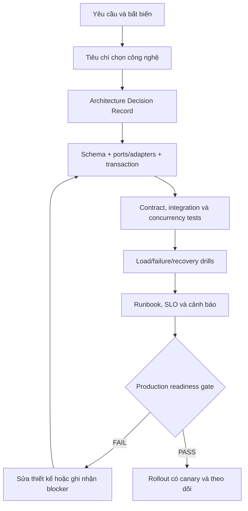
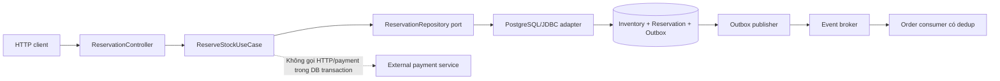
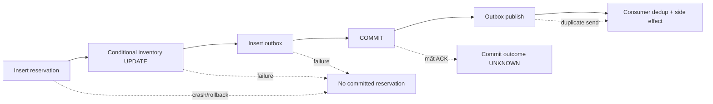

# Hoàn thiện tiêu chí lựa chọn công nghệ, bộ kiểm thử và hướng dẫn vận hành

## Mục tiêu học tập

Sau bài học, người học có thể:

- Biến yêu cầu nghiệp vụ và phi chức năng thành **tiêu chí lựa chọn công nghệ có thể kiểm chứng**, thay vì chọn database, framework hoặc cache theo mức độ quen thuộc.
- Đánh giá riêng **hệ lưu trữ có thẩm quyền**, **cách Java truy cập persistence** và **các thành phần phụ trợ** như cache, search, broker; lập ma trận so sánh có trọng số, rủi ro và giả định.
- Hoàn thiện một bản thiết kế persistence có schema, bất biến, giao dịch, concurrency, idempotency, ranh giới ứng dụng, security và kế hoạch tiến hóa lược đồ.
- Xây dựng **bộ kiểm thử chấp nhận** từ unit test, integration test PostgreSQL thật, test cạnh tranh, migration, lỗi kết nối, hiệu năng đến phục hồi dữ liệu.
- Lập **runbook vận hành** với cách quan sát, ngưỡng cảnh báo, cách chẩn đoán sự cố, thao tác khôi phục, cổng mở traffic và điều kiện dừng.
- Đóng gói bằng chứng quyết định thành một **hồ sơ bàn giao có owner, SLO, RPO/RTO, rủi ro còn lại và kết quả kiểm thử**, đủ để review trước khi đưa hệ thống vào production.

## 1. Bối cảnh thực hành: hệ thống giữ hàng cho đơn đặt mua

Giả sử nhóm Java xây dựng dịch vụ **giữ tồn kho** cho một nền tảng thương mại điện tử nhiều tenant. Dịch vụ nhận yêu cầu giữ số lượng sản phẩm cho đơn hàng, trả mã reservation và phát sự kiện cho hệ thống đặt hàng.

Các ràng buộc nghiệp vụ minh họa:

1. Mỗi `tenant_id` sở hữu tồn kho và reservation của mình; không được đọc/ghi chéo tenant.
2. Với mỗi sản phẩm, `available >= 0` và `reserved >= 0` sau mọi transaction đã commit.
3. Hai yêu cầu đồng thời không được cùng giữ một đơn vị tồn kho cuối cùng.
4. Retry cùng `request_key` và **cùng payload** không tạo hai reservation hay trừ tồn hai lần.
5. Một reservation được chấp nhận và việc giảm tồn phải commit **nguyên tử** trong PostgreSQL.
6. Sự kiện `StockReserved` có thể được gửi tới broker sau commit, không được gửi như một side effect chưa có bản ghi nguồn tương ứng.
7. API không được gọi hệ thống thanh toán trong transaction giữ khóa tồn kho.

Yêu cầu phi chức năng **giả định để luyện thiết kế**:

| Mục tiêu | Giá trị minh họa | Đo bằng gì? |
| --- | --- | --- |
| Tải bình thường / đỉnh | 100 / 300 yêu cầu giữ hàng mỗi giây | Completed requests/s, offered load, peak profile |
| Latency API | p95 dưới 250 ms ở tải mục tiêu | Histogram end-to-end, kể cả lỗi/timeout được báo riêng |
| Tỷ lệ lỗi hạ tầng | Dưới 0,1% trong cửa sổ SLO quy định | Counter theo outcome, loại trừ lỗi nghiệp vụ theo hợp đồng |
| Consistency | Không bán vượt và không tạo trùng | SQL invariant, kiểm thử cạnh tranh, idempotency |
| Durability | Reservation được xác nhận tuân cam kết commit của cấu hình DB | WAL/commit và thử crash/failover, không chỉ HTTP 200 |
| RPO khi mất môi trường | 5 phút | Mốc dữ liệu phục hồi được xác minh |
| RTO cho write API | 60 phút | Từ mốc sự cố quy định đến khi **ghi an toàn** được mở lại |
| Bảo mật | Phân tách tenant; không log token hoặc raw PII | Test quyền, test canary qua log/trace |
| Evolution | Rolling deploy hai phiên bản ứng dụng vẫn chạy được | Compatibility matrix và test migration |

Các con số là **giả thiết bài học**, không phải giá trị chung cho mọi hệ thống. Trong thực tế, product owner, vận hành và nhóm an toàn dữ liệu phải xác nhận. Một mục tiêu RPO 5 phút không được coi là đạt chỉ vì có lịch backup mỗi 5 phút; phải **phục hồi được dữ liệu theo mốc đó** và có diễn tập.

### Mức độ cần thiết của bản thiết kế

Đây là bài **Thực hành tổng hợp** thuộc module `DATA_PERSISTENCE_FUNDAMENTALS`. Người học sẽ kết nối lựa chọn mô hình dữ liệu, schema/index, JDBC/JPA, transaction/isolation, khóa, xử lý lỗi, bảo mật, quan sát hiệu năng và sao lưu/khôi phục. Mục tiêu không phải tự động đưa vào hệ thống mọi công nghệ; mục tiêu là **chọn thành phần ít phức tạp nhất đáp ứng được các bất biến đã tuyên bố**.

## 2. Đầu ra phải bàn giao: một hồ sơ quyết định, test và runbook

Nhóm không chỉ bàn giao source code. Bộ hồ sơ cuối cùng gồm:

| Thành phần | Nội dung tối thiểu | Điều kiện được duyệt |
| --- | --- | --- |
| **Yêu cầu & bất biến** | Use case, dữ liệu, quyền, tải, SLA/SLO, RPO/RTO | Mỗi yêu cầu có phép kiểm tra hoặc nguồn bằng chứng |
| **Technology decision record** | Ứng viên, scoring, benchmark, giả định, lý do từ chối, rủi ro | Có owner, thời điểm và điều kiện xem xét lại |
| **Kiến trúc & dữ liệu** | Sơ đồ, schema, khóa, index, repository port, transaction boundary | Không có trạng thái nghiệp vụ sai trong các lịch cạnh tranh đã xét |
| **Bộ kiểm thử** | Unit, DB integration, concurrency, migration, security, perf, recovery | Có test tự động và bằng chứng cho bài diễn tập thủ công |
| **Bản đo hiệu năng** | Workload, dataset, p50/p95/p99, throughput, error và utilization | Kết quả lặp được, đúng đơn vị, không bỏ request timeout |
| **Runbook** | Triệu chứng → điều tra → hành động → stop/recovery/traffic gate | Người trực vận hành có thể thực hiện mà không suy đoán |
| **Bảng rủi ro & quyết định** | Rủi ro mở, biện pháp giảm, owner, ngày review | Không tuyên bố “sẵn sàng” nếu có blocker chưa được chấp nhận |

Sơ đồ dòng công việc:



**Nguyên tắc kiểm chứng:** mọi lời khẳng định quan trọng như “không oversell”, “idempotent”, “không mất dữ liệu đã xác nhận”, “migrate không downtime” đều phải gắn với **một bài test, một bằng chứng vận hành hoặc một giả định được công khai**.

## 3. Chốt phạm vi và phân loại yêu cầu trước khi so sánh công nghệ

### 3.1. Tách yêu cầu bắt buộc và yếu tố có thể tối ưu

| Nhóm | Hard requirement / điều kiện loại | Tối ưu theo điểm số |
| --- | --- | --- |
| Bất biến tồn kho | Atomic conditional update và ngăn `available < 0` | Latency khi cạnh tranh cao |
| Giao dịch | Reservation và inventory cùng commit/rollback | Độ đơn giản khi debug, thao tác batch |
| Dữ liệu | Unique `(tenant_id, request_key)`, cô lập tenant | Khả năng truy vấn báo cáo |
| Phát event | Không tuyên bố phát đúng một lần nếu không có giao thức end-to-end | Độ trễ publish, độ dễ vận hành |
| Bảo mật | Quyền tối thiểu, tham số hóa truy vấn, không leak secrets | Độ dễ audit và secret rotation |
| Khôi phục | Phục hồi được trong giới hạn đã thống nhất | Chi phí replication/backup |
| Năng lực nhóm | Có thể vận hành, khôi phục, cập nhật schema | Chi phí đào tạo và phát triển |
| Hiệu năng | Đáp ứng tải và SLO khi đúng dữ liệu | Tiết kiệm CPU/IO/storage |

**Không dùng bảng điểm để “bù” cho vi phạm hard requirement.** Một database có độ trễ đọc tốt nhưng không đáp ứng được việc giữ tồn kho nguyên tử theo mô hình đã chọn phải bị loại cho **nguồn tồn kho có thẩm quyền**, cho dù tổng điểm hiệu năng cao.

### 3.2. Tách ba quyết định độc lập

**Quyết định A — Nơi giữ dữ liệu có thẩm quyền:** PostgreSQL quan hệ, một distributed SQL DBMS có transaction phù hợp, hoặc một data store khác được chứng minh đúng với bất biến.

**Quyết định B — Java truy cập dữ liệu bằng gì:** JDBC, JPA/Hibernate, jOOQ hoặc một adapter khác. Đây là lựa chọn **tầng truy cập**, không phải thay thế trực tiếp cho lựa chọn database.

**Quyết định C — Thành phần phụ trợ:** Redis cache, full-text search, broker, CDC, object storage. Một cache có thể giảm độ trễ đọc, nhưng **không tự trở thành nguồn kiểm soát tồn kho** nếu không thiết kế lại hợp đồng nhất quán và ghi.

Vì vậy tránh một bảng duy nhất so sánh “PostgreSQL”, “JPA”, “Redis” và “Kafka” như bốn đáp án cạnh tranh cho cùng một nhu cầu; chúng giải quyết những vấn đề khác nhau.

### 3.3. Câu hỏi khám phá bắt buộc

1. Tồn kho và reservation có thể đặt **trong cùng một database transaction** không?
2. Có bao nhiêu tenant/SKU nóng và mức contention thực tế là bao nhiêu?
3. Yêu cầu uniqueness được bảo vệ **trong tenant** hay toàn hệ thống?
4. Mất primary, AZ hoặc region đòi hỏi mức dữ liệu mới đến đâu? Có WAL archive/backup/replica được diễn tập không?
5. Có yêu cầu multi-region active-active thật hay chỉ cần một region dự phòng?
6. Tác vụ nào đi ra ngoài DB: payment, email, event broker hoặc search?
7. Ai đang vận hành công nghệ đó, và có quyền/khả năng xử lý deadlock, corruption, backup restore hay không?
8. Những phiên bản Java nào sẽ cùng truy cập schema trong rolling deployment?

Nếu không biết phân phối SKU nóng, chọn sharding hoặc tăng connection pool **không có cơ sở**. Nếu không biết RTO/RPO thực tế, không thể kết luận phương án replication/backup có đáp ứng yêu cầu.

## 4. Đánh giá công nghệ có trọng số, ràng buộc và bằng chứng

### 4.1. Chọn ứng viên đáp ứng được bản chất bài toán

Ví dụ ba nhóm ứng viên lưu trữ cho nguồn tồn kho:

| Phương án | Điểm mạnh có thể có | Câu hỏi rủi ro phải chứng minh |
| --- | --- | --- |
| **PostgreSQL một primary có replica và WAL backup** | ACID cục bộ, constraint, SQL, locking, công cụ quan sát/backup phong phú | Năng lực tại SKU nóng, HA/RPO/RTO, vận hành index/schema và storage |
| **Distributed SQL với giao dịch phù hợp** | Có thể mở rộng node và che một phần cơ chế phân bố | Semantics isolation/unique toàn cụm, latency cross-region, chi phí, recovery và mức hỗ trợ của driver |
| **Document/KV store có conditional write** | Mô hình truy cập khóa cụ thể có thể đơn giản, scale phù hợp workload | Transaction qua nhiều đối tượng, constraints, consistency, câu hỏi báo cáo và migration |

Không nên tuyên bố “mọi NoSQL không có transaction” hoặc “mọi distributed SQL đều serializable”. Khả năng khác nhau theo **sản phẩm, phiên bản, cấu hình, topology, mức consistency và cách tổ chức dữ liệu**. Mỗi ứng viên phải được kiểm tra bằng tình huống **hai request cùng tranh chấp một SKU** và bằng chứng thật cho recovery.

Đề bài chọn **PostgreSQL** làm baseline vì tồn kho và reservation có thể được đặt trong **một transaction địa phương** với conditional `UPDATE`, `UNIQUE` và `CHECK`. Đây là một quyết định có điều kiện: nếu tải nóng vượt năng lực sau khi tối ưu hoặc yêu cầu đa vùng thay đổi, cần mở lại ADR.

### 4.2. Bảng chấm điểm mẫu

Quy ước: `1` = chưa phù hợp, `5` = phù hợp tốt nhất theo dữ liệu đã đo. Trọng số cộng lại `100%`. Các điểm dưới đây **là giả định của một workshop**, không phải benchmark hoặc xếp hạng chung cho công nghệ.

| Tiêu chí | Trọng số | PostgreSQL một primary | Distributed SQL phù hợp | Document/KV candidate |
| --- | ---: | ---: | ---: | ---: |
| Giao dịch/consistency theo use case | 25% | 5 | 5 | 3 |
| Truy vấn, constraint và migration | 15% | 5 | 4 | 3 |
| Vận hành, debug, backup/restore | 20% | 4 | 3 | 3 |
| Hiệu năng trên workload dự kiến | 15% | 4 | 3 | 4 |
| Phân bố tải và mở rộng | 10% | 3 | 5 | 5 |
| Năng lực hiện có của nhóm | 10% | 5 | 2 | 3 |
| TCO, license và hạ tầng | 5% | 4 | 2 | 3 |
| **Tổng điểm quy đổi / 5** | **100%** | **4,40** | **3,70** | **3,35** |

Tính cho PostgreSQL:

\[
S = \sum_i w_i s_i
= 0{,}25(5) + 0{,}15(5) + 0{,}20(4)
 + 0{,}15(4) + 0{,}10(3) + 0{,}10(5) + 0{,}05(4)
= 4{,}40.
\]

Chú ý: bảng điểm **chỉ có ý nghĩa sau khi ứng viên vượt hard gate**. Nếu một hệ KV được thiết kế sao cho tồn kho và reservation nằm trong một aggregate atomic hợp lệ, điểm consistency có thể cao hơn. Nếu hệ thống cần active-active đa vùng với yêu cầu chặt, điểm một-primary có thể thấp hơn. Hãy chạy **sensitivity analysis** với trọng số và dữ liệu khác để xem quyết định có đổi không.

### 4.3. Bằng chứng đi kèm điểm số

| Tiêu chí | Bằng chứng tốt | Bằng chứng chưa đủ |
| --- | --- | --- |
| Atomicity | Test cạnh tranh trên database thật; transaction rollback; kiểm tra invariant | “Framework có `@Transactional`” |
| Performance | Load test dataset đại diện, p95/p99, completed RPS và error rate | Một `SELECT` chạy 2 ms trên dữ liệu nhỏ |
| Recoverability | Restore/PITR drill, điểm phục hồi và thời gian mở write đo được | Backup job báo “success” |
| Operations | Runbook đã diễn tập lỗi pool, lock, WAL, migration | Câu trả lời “DBA xử lý được” |
| Security | Role/tenant tests, SQL binding, leak canary, secret rotation | Chỉ có TLS hoặc disk encryption |
| Maintainability | Migration compatibility test và code review ở adapter | Số dòng code CRUD ngắn |

Nếu thiếu bằng chứng, ghi **UNKNOWN** và một action item để đo; không thay sự không chắc chắn bằng điểm cao.

### 4.4. Chọn tầng truy cập Java riêng biệt

| Tiêu chí | JDBC thuần | JPA/Hibernate |
| --- | --- | --- |
| Kiểm soát SQL và row count | Rõ, thích hợp write có điều kiện và retry chính xác | Có thể dùng native query/optimistic lock, nhưng cần hiểu flush/caching |
| Mapping object | Phải viết và kiểm thử mapper | Tiện cho entity graph và CRUD |
| Rủi ro N+1/lazy loading | Thường hiện rõ qua code nhiều query | Cần quan sát lazy loading, fetch plan và N+1 |
| Kiểm soát transaction | Đòi hỏi transaction boundary cụ thể hoặc framework | `@Transactional` thuận tiện, nhưng phải hiểu phạm vi thật |
| Tiến hóa schema | Native query phải cập nhật có kiểm soát | Entity mapping/query/version cũng phải giữ tương thích |
| Vận hành/debug | SQL dễ gắn tên thao tác; boilerplate cao hơn | ORM telemetry và bind logging cần giới hạn PII |

Trong ví dụ giữ hàng, chọn **JDBC với một transaction có điều kiện** để biểu diễn rõ `UPDATE ... WHERE available >= ?`. Một dự án có JPA vẫn có thể dùng repository adapter chạy native SQL cho đoạn critical path mà không cần viết lại toàn bộ ứng dụng.

### 4.5. Thành phần phụ trợ: chỉ thêm khi có lợi ích được đo

- **Broker + transactional outbox:** nếu cần phát `StockReserved` sau commit và chịu được at-least-once delivery. Consumer phải idempotent.
- **Cache:** có thể dùng cho trang catalog hoặc đọc gần đúng, không được dùng một giá trị cache stale làm căn cứ duy nhất để chốt reservation.
- **Search index:** phục vụ tìm kiếm sản phẩm, không nên làm nguồn có thẩm quyền của tồn kho.
- **CDC:** hữu ích khi đồng bộ read model, nhưng phải có event contract, ordering/idempotency/recovery và observability.
- **Sharding:** cân nhắc sau khi đã đo bottleneck và xác định invariant nào bị phá khi inventory, reservation và outbox nằm trên nhiều shard.

Nếu chưa có nhu cầu phát event, có thể chọn **không dùng broker**. Nếu chỉ cần tra cứu một khóa trong PostgreSQL đúng SLO, có thể **không dùng Redis**. “Ít hệ thống hơn” thường đồng nghĩa ít điểm cần đối soát sau sự cố.

## 5. Ghi lại quyết định thành một Architecture Decision Record

Mẫu ADR ngắn có thể đưa vào hồ sơ bàn giao:

```text
ADR-001: Primary store and Java persistence strategy
Status: ACCEPTED FOR PILOT (chưa phải production approval)
Context:
  - Reservation và giảm available phải atomic trong cùng tenant/SKU.
  - Tải mục tiêu 100 req/s, peak 300 req/s; SLA/SLO và RPO/RTO giả định.
Decision:
  - PostgreSQL là source of truth cho inventory, reservation, outbox.
  - JDBC adapter thực hiện transaction và conditional UPDATE.
  - Không giữ DB transaction khi gọi broker/payment/email.
  - Outbox publisher at-least-once; consumer dedup bằng event ID.
Alternatives:
  - Distributed SQL: cần chứng minh cross-region latency và TCO.
  - Document/KV: chưa chứng minh invariant qua các object đã chọn.
Consequences:
  + Constraint, transaction, index và WAL/backup có công cụ rõ.
  - Một hot SKU có thể tạo contention; phải benchmark và điều tiết.
  - Đội chịu trách nhiệm theo dõi pool, lock, replication, backup.
Revisit when:
  - p95 vượt SLO ở peak dù đã tối ưu, hoặc RPO/RTO thay đổi.
Evidence:
  - Test suite IDs, load report, restore drill ID (cập nhật khi chạy).
Owners:
  - Tech lead, data owner, SRE/DBA, security reviewer.
```

**Giá trị của ADR nằm ở giả định và điều kiện xem xét lại**, không ở một điểm số “vĩnh viễn”. Khi số tenant tăng, dataset lớn lên, hoặc triển khai đa vùng trở thành yêu cầu bắt buộc, chạy lại benchmark và xem xét quyết định trên cùng tiêu chí.

## 6. Thiết kế ranh giới Java và giao dịch trước khi viết SQL



**Phân vai:**

- **HTTP/controller:** xác thực, lấy tenant từ authorization context, kiểm tra idempotency key và trả status/code; không đưa SQL vào controller.
- **Application use case:** xác định thao tác giữ hàng và kết quả nghiệp vụ; hiểu trạng thái đang chờ, thất bại có thể retry và commit outcome chưa rõ.
- **Repository port:** mô tả thao tác từ góc nhìn nghiệp vụ, không cho caller tự quyết định thứ tự của các câu SQL cần atomic.
- **JDBC adapter:** sở hữu transaction boundary cho một lần giữ hàng, bind parameter, kiểm tra row count, map lỗi kỹ thuật, tạo outbox trong cùng transaction.
- **Outbox publisher/consumer:** công việc **sau commit** với idempotency; không giữ khóa tồn kho khi chờ broker hoặc dịch vụ bên ngoài.

Với use case nhỏ chỉ có một database, transaction có thể ở repository adapter. Nếu một use case cần nhiều repository cùng transaction, nâng **transaction boundary** lên application service qua một transaction runner/Unit of Work được thiết kế rõ: không để mỗi repository tự lấy connection độc lập rồi tuyên bố atomicity.

### 6.1. Hợp đồng ứng dụng minh họa

```java
import java.util.UUID;

public record ReserveStockCommand(
        UUID tenantId,
        String sku,
        int quantity,
        String requestKey) {}

public record ReservationReceipt(UUID reservationId, String state) {}

public interface ReserveStockUseCase {
    ReservationReceipt reserve(ReserveStockCommand command);
}
```

`tenantId` trong command phải do **phía server xác định từ danh tính đã được xác thực và ủy quyền**, không tin nguyên một trường tenant do client gửi. `requestKey` là opaque value có giới hạn chiều dài; không dùng token xác thực, email, tên khách hàng hoặc raw request body làm key.

Nếu dùng `@Transactional` của Spring, phải xác minh transaction manager thực sự bao phủ mọi SQL trong cùng database/connection. Một annotation trên phương thức tự gọi trong cùng bean, một remote HTTP call hoặc một connection lấy ngoài transaction không tự trở thành cùng giao dịch.

## 7. Thiết kế PostgreSQL schema có bất biến và truy vấn chủ đạo

Schema dưới đây là **mẫu học tập để kiểm thử**; hệ thống production cần thêm metadata audit, quyền DB, chính sách giữ tồn, xử lý hủy/expire, đặt tên migration, dữ liệu phân vùng và quy tắc vận hành.

```sql
CREATE TABLE inventory (
    tenant_id UUID NOT NULL,
    sku TEXT NOT NULL,
    available BIGINT NOT NULL CHECK (available >= 0),
    reserved BIGINT NOT NULL CHECK (reserved >= 0),
    version BIGINT NOT NULL DEFAULT 0,
    PRIMARY KEY (tenant_id, sku)
);

CREATE TABLE reservation (
    tenant_id UUID NOT NULL,
    reservation_id UUID NOT NULL,
    request_key VARCHAR(160) NOT NULL,
    sku TEXT NOT NULL,
    quantity INTEGER NOT NULL CHECK (quantity > 0),
    state TEXT NOT NULL CHECK (state IN ('RESERVED', 'CANCELLED')),
    created_at TIMESTAMPTZ NOT NULL DEFAULT now(),
    PRIMARY KEY (tenant_id, reservation_id),
    UNIQUE (tenant_id, request_key),
    FOREIGN KEY (tenant_id, sku)
        REFERENCES inventory (tenant_id, sku)
);

CREATE TABLE reservation_outbox (
    tenant_id UUID NOT NULL,
    event_id UUID NOT NULL,
    reservation_id UUID NOT NULL,
    event_type TEXT NOT NULL,
    payload JSONB NOT NULL,
    created_at TIMESTAMPTZ NOT NULL DEFAULT now(),
    published_at TIMESTAMPTZ,
    PRIMARY KEY (tenant_id, event_id),
    FOREIGN KEY (tenant_id, reservation_id)
        REFERENCES reservation (tenant_id, reservation_id)
);

CREATE INDEX idx_reservation_outbox_pending
    ON reservation_outbox (created_at, event_id)
    WHERE published_at IS NULL;
```

### 7.1. Tại sao đặt các ràng buộc này?

| Bất biến | Cơ chế DB | Cơ chế application đi kèm |
| --- | --- | --- |
| Không âm tồn kho | `CHECK (available >= 0)` | `UPDATE ... WHERE available >= quantity` |
| Không âm lượng đã giữ | `CHECK (reserved >= 0)` | Khi hủy, chỉ hoàn lại một lần theo state transition |
| Không giữ số lượng 0/âm | `CHECK (quantity > 0)` | Validate input trước khi mượn connection |
| Không có reservation trùng request | `UNIQUE (tenant_id, request_key)` | Cùng key phải so khớp payload |
| Reservation thuộc inventory tồn tại | FK ghép `(tenant_id, sku)` | Tenant scope từ principal, không tin URL/body |
| Outbox không trỏ đến reservation lạ | FK ghép `(tenant_id, reservation_id)` | Insert event trong cùng transaction |
| Chỉ một writer hợp lệ | PostgreSQL row locks/transaction | Một nguồn tồn kho có thẩm quyền; không dual-write mù |

`UNIQUE` áp ở **database**, không dùng `SELECT` kiểm tra rồi `INSERT` như một cơ chế chống race. Hai request đồng thời có thể cùng đọc “chưa tồn tại”; unique constraint mới phân xử được.

Chỉ có `CHECK (available >= 0)` cũng chưa chứng minh nghiệp vụ hoàn chỉnh; một bug có thể cộng tồn kho hai lần khi hủy. Cần **kiểm thử state transition và đối soát tổng lượng hàng**. Nếu sản phẩm có ràng buộc tổng `available + reserved = initial_stock - fulfilled`, phải định nghĩa sự kiện nhập/xuất/hủy và ledger tồn kho đủ để chứng minh.

### 7.2. Câu lệnh giữ hàng nguyên tử

```sql
UPDATE inventory
SET available = available - :quantity,
    reserved = reserved + :quantity,
    version = version + 1
WHERE tenant_id = :tenant_id
  AND sku = :sku
  AND available >= :quantity;
```

Đoạn trên dùng **named parameters để giải thích**, không chạy trực tiếp trong JDBC `PreparedStatement`: code JDBC sẽ dùng `?` và bind đúng thứ tự.

Nếu `UPDATE` ảnh hưởng **1 hàng**, hàng tồn kho đã được thay đổi atomically trong transaction. Nếu **0 hàng**, câu SQL độc lập có thể gặp tình huống hết hàng hoặc không có hàng tương ứng; trong luồng adapter minh họa, `INSERT reservation` có FK tới inventory nên SKU không tồn tại thường bị từ chối sớm bởi FK. Application phải map lỗi theo đúng đường thực thi mà không suy ra nguyên nhân nhạy cảm chỉ từ số hàng. Tại PostgreSQL `READ COMMITTED`, các concurrent `UPDATE` trên cùng hàng phải chờ row lock; sau khi transaction trước kết thúc, điều kiện `available >= quantity` được đánh giá lại trên phiên bản hàng phù hợp. Điều này ngăn hai request cùng trừ đơn vị cuối cùng trong mẫu thiết kế này.

Nếu isolation khác, hoặc có thao tác đọc tổng hợp trên nhiều hàng, cần thêm kiểm tra và retry khi có `40001`. Không dựa vào một lần `SELECT available` trước khi `UPDATE` để quyết định còn hàng khi concurrency cao.

### 7.3. Phạm vi transaction đúng

Trong **một transaction**:

1. Tạo reservation theo `(tenant_id, request_key)` bằng unique conflict handling.
2. Nếu request key đã tồn tại, **so sánh payload** và trả kết quả đã ghi; không trừ tồn thêm.
3. Nếu reservation mới, conditional update inventory; 0 hàng → rollback toàn bộ.
4. Insert `reservation_outbox` với event ID ổn định đã commit cùng reservation.
5. Commit; sau commit worker mới đọc outbox và gửi event.

**Không** gọi Kafka, payment API, email hoặc search service **giữa bước 1 và commit**. Một cuộc gọi ngoài DB có thể thành công trong khi PostgreSQL rollback, gây sai lệch không thể giải quyết bằng annotation transaction địa phương.

### 7.4. Index là giả thuyết hiệu năng, không phải danh sách thêm cho đủ

- `inventory` đã có B-tree primary key `(tenant_id, sku)` cho conditional update.
- Unique `(tenant_id, request_key)` hỗ trợ lookup idempotency.
- Partial index của outbox hỗ trợ lấy hàng chưa publish; workload thực còn cần xét transaction batching và concurrency của publisher.
- Không thêm index trên `available` chỉ vì query có điều kiện đó: index hiện tại đã định vị một hàng bằng key, còn thêm index có thể tăng chi phí ghi/WAL.
- Kiểm tra `EXPLAIN (ANALYZE, BUFFERS)` trên workload/dataset thử; một index có lợi cho đọc nhưng làm write chậm hơn có thể không đáng.

Với tenant/SKU nóng, contention hàng tồn kho có thể là giới hạn thực tế ngay cả khi CPU DB chưa cao. Tăng connection pool từ 20 lên 200 không tự giải quyết khóa cùng một hàng; có thể làm queue và tail latency tệ hơn.

## 8. Java/JDBC: transaction, idempotency và outbox trong cùng một adapter

Đoạn dưới dùng Java 17+ và JDBC với PostgreSQL, dựa trên schema ở phần 7. Để bài không phụ thuộc Spring, ví dụ quản lý transaction bằng `Connection` trực tiếp. Trong sản phẩm thật, có thể dùng Spring transaction manager nếu repository và outbox **cùng tham gia transaction**.

```java
import java.sql.Connection;
import java.sql.PreparedStatement;
import java.sql.ResultSet;
import java.sql.SQLException;
import java.util.Objects;
import java.util.UUID;
import javax.sql.DataSource;

public final class ReservationJdbcService implements ReserveStockUseCase {
    private final DataSource dataSource;

    public ReservationJdbcService(DataSource dataSource) {
        this.dataSource = Objects.requireNonNull(dataSource);
    }

    @Override
    public ReservationReceipt reserve(ReserveStockCommand request) {
        validate(request);

        try (Connection connection = dataSource.getConnection()) {
            connection.setAutoCommit(false);
            try {
                UUID candidateId = UUID.randomUUID();
                UUID insertedId = insertIfAbsent(
                        connection, request, candidateId);

                if (insertedId == null) {
                    Existing existing = findByRequestKey(
                            connection, request.tenantId(),
                            request.requestKey());
                    if (existing == null) {
                        throw new IllegalStateException(
                                "Idempotency state unresolved");
                    }
                    if (!existing.sku().equals(request.sku())
                            || existing.quantity() != request.quantity()) {
                        throw new IdempotencyConflictException();
                    }
                    connection.commit();
                    return new ReservationReceipt(
                            existing.id(), existing.state());
                }

                if (!decrementAvailable(connection, request)) {
                    throw new OutOfStockException();
                }
                insertOutbox(connection, request, insertedId);

                connection.commit();
                return new ReservationReceipt(insertedId, "RESERVED");
            } catch (SQLException | RuntimeException failure) {
                // Rollback không chứng minh COMMIT trước đó đã thất bại
                // khi lỗi mạng làm mất acknowledgement.
                try {
                    connection.rollback();
                } catch (SQLException rollbackFailure) {
                    failure.addSuppressed(rollbackFailure);
                }
                throw failure;
            }
        } catch (SQLException databaseFailure) {
            // Controller log mã lỗi, không log raw cause rộng rãi.
            throw new PersistenceFailure(databaseFailure);
        }
    }

    private static UUID insertIfAbsent(
            Connection c, ReserveStockCommand req, UUID candidate)
            throws SQLException {
        String sql = """
                INSERT INTO reservation
                  (tenant_id, reservation_id, request_key, sku,
                   quantity, state)
                VALUES (?, ?, ?, ?, ?, 'RESERVED')
                ON CONFLICT (tenant_id, request_key) DO NOTHING
                RETURNING reservation_id
                """;
        try (PreparedStatement ps = c.prepareStatement(sql)) {
            ps.setObject(1, req.tenantId());
            ps.setObject(2, candidate);
            ps.setString(3, req.requestKey());
            ps.setString(4, req.sku());
            ps.setInt(5, req.quantity());
            try (ResultSet rs = ps.executeQuery()) {
                return rs.next() ? rs.getObject(1, UUID.class) : null;
            }
        }
    }

    private static Existing findByRequestKey(
            Connection c, UUID tenantId, String requestKey)
            throws SQLException {
        String sql = """
                SELECT reservation_id, sku, quantity, state
                FROM reservation
                WHERE tenant_id = ? AND request_key = ?
                """;
        try (PreparedStatement ps = c.prepareStatement(sql)) {
            ps.setObject(1, tenantId);
            ps.setString(2, requestKey);
            try (ResultSet rs = ps.executeQuery()) {
                return rs.next()
                        ? new Existing(
                                rs.getObject(1, UUID.class),
                                rs.getString(2), rs.getInt(3),
                                rs.getString(4))
                        : null;
            }
        }
    }

    private static boolean decrementAvailable(
            Connection c, ReserveStockCommand req) throws SQLException {
        String sql = """
                UPDATE inventory
                SET available = available - ?,
                    reserved = reserved + ?,
                    version = version + 1
                WHERE tenant_id = ? AND sku = ?
                  AND available >= ?
                """;
        try (PreparedStatement ps = c.prepareStatement(sql)) {
            ps.setInt(1, req.quantity());
            ps.setInt(2, req.quantity());
            ps.setObject(3, req.tenantId());
            ps.setString(4, req.sku());
            ps.setInt(5, req.quantity());
            return ps.executeUpdate() == 1;
        }
    }

    private static void insertOutbox(
            Connection c, ReserveStockCommand req, UUID reservationId)
            throws SQLException {
        String sql = """
                INSERT INTO reservation_outbox
                  (tenant_id, event_id, reservation_id,
                   event_type, payload)
                VALUES (?, ?, ?, 'StockReserved',
                        jsonb_build_object(
                          'reservationId', ?::text,
                          'sku', ?::text, 'quantity', ?::integer))
                """;
        try (PreparedStatement ps = c.prepareStatement(sql)) {
            ps.setObject(1, req.tenantId());
            ps.setObject(2, UUID.randomUUID());
            ps.setObject(3, reservationId);
            ps.setString(4, reservationId.toString());
            ps.setString(5, req.sku());
            ps.setInt(6, req.quantity());
            ps.executeUpdate();
        }
    }

    private static void validate(ReserveStockCommand req) {
        Objects.requireNonNull(req, "command");
        if (req.tenantId() == null || req.sku() == null
                || req.sku().isBlank() || req.sku().length() > 128
                || req.quantity() <= 0 || req.quantity() > 1_000
                || req.requestKey() == null
                || !req.requestKey().matches("[A-Za-z0-9_-]{16,100}")) {
            throw new IllegalArgumentException("Invalid reservation");
        }
    }

    private record Existing(
            UUID id, String sku, int quantity, String state) {}
}

class OutOfStockException extends RuntimeException {}
class IdempotencyConflictException extends RuntimeException {}

class PersistenceFailure extends RuntimeException {
    PersistenceFailure(SQLException cause) {
        super("Persistence operation unavailable", cause);
    }
}
```

### 8.1. Điều gì được đảm bảo bởi ví dụ này?

- Unique constraint làm **hai request cùng key** cạnh tranh một bản ghi, nên không tạo hai reservation đã commit với cùng `(tenant_id, request_key)`.
- Với PostgreSQL `READ COMMITTED` (giả định isolation của connection), khi một request khác cùng key vừa commit thì câu `SELECT` **sau `INSERT ... ON CONFLICT DO NOTHING`** có thể nhìn thấy bản ghi đã commit. Nếu dùng isolation khác, phải xác định lại cách xử lý snapshot/`40001`.
- Mỗi reservation mới chỉ được commit nếu conditional stock update ảnh hưởng 1 hàng và outbox insert thành công.
- Một request lặp với cùng key nhưng **khác SKU hoặc số lượng** bị báo conflict, không lấy nhầm kết quả của payload khác.
- Nếu kho hết hàng thì exception làm rollback transaction vừa tạo reservation; trong thiết kế này **lỗi thiếu hàng không được ghi nhớ như kết quả idempotent cuối cùng**. Retry cùng key có thể thành công sau khi bổ sung tồn kho. Nếu sản phẩm yêu cầu lỗi thiếu hàng cũng phải có cùng kết quả ổn định, phải mở rộng schema/protocol để lưu quyết định thất bại.
- Event được **lưu trong DB** cùng transaction, chứ không phải đảm bảo đã publish ngay khi API trả thành công.

### 8.2. Những bảo đảm ví dụ *không* tự có

Đây chưa phải dịch vụ production hoàn chỉnh. Cần bổ sung:

- Tenant authorization, quota, rate limit và chính sách giới hạn số lượng theo sản phẩm;
- Hủy reservation/expire với **state transition idempotent**, hoàn `reserved` và tăng `available` chỉ một lần;
- Retry **toàn transaction** có giới hạn cho serialization failure/deadlock nếu chính sách nghiệp vụ cho phép;
- Phân biệt `SQLException` do transient connection, constraint, sai schema và tình trạng commit **UNKNOWN**; không trả mọi lỗi thành “hết hàng”;
- Giới hạn số connection, statement timeout, transaction timeout và chính sách retry;
- Xử lý publisher/consumer outbox, DLQ, duplication, delay và replay;
- Kiểm soát giá trị event payload không chứa PII/secret và quyền xem;
- Logging/tracing, metrics và cơ chế điều tra request theo ID an toàn.

Đặc biệt, **mất ACK khi `connection.commit()`** khiến client không biết server đã commit chưa. Việc cố `rollback()` sau exception không chứng minh commit đã bị đảo. Client phải **giữ nguyên request key**, có endpoint tra cứu trạng thái theo key và cơ chế đối soát; không tự tạo key mới để “thử lại” một thao tác có side effect.

### 8.3. Giao dịch với broker và consumer

Worker đọc outbox chưa publish rồi phát event theo giao thức phù hợp. Sau khi broker chấp nhận event, worker đánh dấu `published_at` trong database. Nếu worker chết giữa **publish thành công** và **đánh dấu published**, event có thể được phát lần nữa.

Do đó, consumer cần một **inbox/dedup key** có unique constraint theo `event_id`, và phải ghi record dedup **trong cùng transaction** với thay đổi nghiệp vụ. Điều này hỗ trợ xử lý sự kiện **at-least-once** theo ngữ nghĩa idempotent, không được gọi là exactly-once end-to-end một cách tùy tiện.

Với nhiều publisher song song, có thể claim batch bằng row locking như `FOR UPDATE SKIP LOCKED` theo một transaction claim/lease có kiểm soát, hoặc dùng quy trình phát theo từng partition. Không giữ database transaction mở trong toàn bộ thời gian chờ broker network; phải thiết kế claim/lease/retry và timeout hợp lý để tránh trùng hoặc backlog vô hạn.

### 8.4. Hợp đồng API tối thiểu

```text
POST /reservations
Authorization: <được kiểm tra, không log raw>
Idempotency-Key: opaque stable request key
Body: { "sku": "SKU-42", "quantity": 2 }

201 Created -> { "reservationId": "...", "state": "RESERVED" }
200 OK      -> cùng kết quả đã commit cho key và payload giống nhau
409 Conflict -> key trùng nhưng payload khác, hoặc xung đột nghiệp vụ
409/422      -> hết hàng theo hợp đồng nghiệp vụ đã định
503/timeout  -> trạng thái commit có thể chưa rõ, tra cứu trước retry

POST /reservations/lookup
Body: { "requestKey": "opaque stable request key" }
  -> chỉ tra cứu trạng thái sau khi xác thực tenant và quyền truy cập
```

Đây là hợp đồng minh họa; status `409`/`422` cho hết hàng là quyết định API cần tài liệu hóa. Route `POST /reservations/lookup` chỉ thực hiện truy vấn, dùng body thay vì đưa key vào URL/access log; phải bảo vệ cả body khỏi bị log raw và không cache response tùy tiện. `Idempotency-Key` và request payload có thể xuất hiện ở reverse proxy nếu logging sai; không ghi token, raw body hoặc key có thông tin cá nhân vào metric tags. Mỗi response phải có correlation ID server cấp để điều tra mà không tiết lộ SQL hoặc thông tin kết nối.

## 9. Thiết kế bộ kiểm thử từ bất biến, không từ số lượng dòng code

Mỗi rủi ro quan trọng cần có **một hoặc nhiều bằng chứng**:

| Rủi ro | Loại kiểm thử phù hợp | Kỳ vọng tối thiểu |
| --- | --- | --- |
| Input không hợp lệ | Unit test domain/application | Không mượn connection cho số lượng 0/âm, key sai định dạng |
| SQL/mapper sai | DB integration với PostgreSQL thật | Statement chạy, column types khớp, row count đúng |
| Oversell khi concurrent | Integration/concurrency test **hai connection thật** | Không bao giờ commit `available < 0` |
| Retry cùng key | Integration + fault injection | Một reservation và một lần giảm tồn |
| Cùng key khác payload | Integration/API contract | Conflict; không sửa tồn kho lần thứ hai |
| Hết hàng | DB integration | Reservation/outbox mới bị rollback, tồn không thay đổi |
| Broker publish duplicate | Integration với outbox/inbox | Consumer side effect chỉ có hiệu lực một lần |
| SQLSTATE `40001`/`40P01` | Fault/concurrency tests | Rollback rồi retry **toàn transaction** có giới hạn |
| Mất ACK `COMMIT` | Fault injection/restart | Kết quả được xác minh bằng request key, không dùng key mới |
| Cross-tenant data leak | Security integration | Tenant A không đọc/ghi được bản ghi tenant B |
| Migration v1/v2 | Contract/integration trên nhiều schema | Rolling deploy không phá read/write cũ |
| Pool cạn/connection leak | Load test + pool metrics | Connection được trả cả ở lỗi; timeout có cảnh báo |
| Restore backup/WAL | DR drill | Bằng chứng RPO/RTO và bất biến sau restore |

Unit test **không thể thay** integration test với DBMS thật cho isolation, lock, unique constraint, SQLSTATE hoặc plan. Mock repository trả “đã update 1 hàng” chỉ kiểm tra application có gọi đúng API, không chứng minh cạnh tranh ghi hàng thật.

### 9.1. Chia nhóm test theo vòng phản hồi

| Lớp | Khi chạy | Mục tiêu | Điều không được suy diễn |
| --- | --- | --- | --- |
| Unit | Mỗi commit/PR | Validation, chính sách trạng thái, mapping domain | Không chứng minh JDBC/SQL đúng |
| Integration DB | PR/CI theo điều kiện hạ tầng | DDL, constraint, JDBC, transaction/rollback | Không chứng minh peak throughput |
| Concurrency/fault | CI chuyên biệt hoặc trước release | Race, deadlock, timeout, dedup, unknown commit | Không chứng minh DR chạy trong RTO |
| Migration compatibility | Mỗi thay đổi schema | App cũ/new ↔ schema cũ/mới, backfill | Không đủ nếu quên worker ngoài HTTP |
| Performance/capacity | Trước release lớn, theo chu kỳ | Latency, throughput, saturation, regression | Không đồng nghĩa tính đúng nếu thiếu invariant |
| Security/observability | CI và pre-prod | Quyền tenant, log PII canary, role | Không đảm bảo mọi kênh bên thứ ba đã kiểm tra |
| Restore/DR drill | Định kỳ và sau đổi topology lớn | Backup có dùng được, mở traffic an toàn | File backup “success” không đủ |

**Định nghĩa PASS trước khi viết test**, không cập nhật mục tiêu sau khi thấy kết quả. Lưu timestamp, DB version, migration version, commit hash, dataset, số mẫu và môi trường để kết quả có thể tái hiện.

## 10. Integration test PostgreSQL: fixture và các case quan trọng

Một test DB đáng tin cần chạy trên PostgreSQL thật cùng major version hoặc topology tương đương production **ở những đặc điểm được kiểm chứng**, không dựa vào H2 để kết luận hành vi lock, JSONB, unique conflict và transaction. Có thể dùng Testcontainers trong CI nếu môi trường có container runtime.

### 10.1. Ví dụ khởi tạo datasource Testcontainers

Đoạn dưới thể hiện **phần kết nối test**; test fixture phải chạy migration SQL ở phần 7 (qua tool migration/fixture riêng của bộ test), sau đó tạo tenant/SKU với số lượng biết trước. Không truy cập DB production.

```java
import javax.sql.DataSource;
import org.junit.jupiter.api.BeforeAll;
import org.junit.jupiter.api.TestInstance;
import org.postgresql.ds.PGSimpleDataSource;
import org.testcontainers.containers.PostgreSQLContainer;
import org.testcontainers.junit.jupiter.Container;
import org.testcontainers.junit.jupiter.Testcontainers;

@Testcontainers
@TestInstance(TestInstance.Lifecycle.PER_CLASS)
class ReservationDatabaseIT {
    @Container
    static final PostgreSQLContainer<?> postgres =
            new PostgreSQLContainer<>("postgres:16-alpine");

    DataSource dataSource;
    ReservationJdbcService service;

    @BeforeAll
    void initConnection() {
        PGSimpleDataSource ds = new PGSimpleDataSource();
        ds.setServerNames(new String[]{postgres.getHost()});
        ds.setPortNumbers(new int[]{postgres.getMappedPort(5432)});
        ds.setDatabaseName(postgres.getDatabaseName());
        ds.setUser(postgres.getUsername());
        ds.setPassword(postgres.getPassword());
        dataSource = ds;
        service = new ReservationJdbcService(ds);

        // Chạy schema migration từ phần 7 và fixture qua DB test.
        // Không tự động migrate production khi khởi động JUnit.
    }
}
```

Đây là **khung test, chưa phải bộ test chạy độc lập**: cần dependency JUnit 5/Testcontainers/PostgreSQL JDBC, container runtime và bước tạo schema/fixture. Các version và dependency phải đồng bộ với dự án. Khi viết test thực, áp migration qua công cụ giống production, kiểm tra dữ liệu test đã reset giữa các case và tắt đường gọi broker/payment thật.

### 10.2. Test idempotency cùng một key

Giả sử test fixture đã có:

```sql
-- DỮ LIỆU GIẢ, chỉ chạy trong DB test cô lập.
INSERT INTO inventory (tenant_id, sku, available, reserved)
VALUES (
  '11111111-1111-1111-1111-111111111111',
  'SKU-42', 10, 0
);
```

Test theo trình tự:

1. Gửi `ReserveStockCommand(tenant, "SKU-42", 3, "request_same_key_001")`.
2. Gửi **y hệt** lần thứ hai; nhận cùng `reservationId`, state hợp lệ.
3. Đọc `inventory`: `available = 7`, `reserved = 3`.
4. Đọc `reservation`: đúng **một** hàng theo `(tenant_id, request_key)`.
5. Đọc `reservation_outbox`: đúng **một** event của reservation đó.
6. Gửi cùng key với quantity = 4; phải báo **idempotency conflict**, không đổi `available` và không tạo thêm outbox.

Ví dụ assertion cô đọng:

```java
var first = service.reserve(
        new ReserveStockCommand(
                tenantId, "SKU-42", 3, "request_same_key_001"));
var second = service.reserve(
        new ReserveStockCommand(
                tenantId, "SKU-42", 3, "request_same_key_001"));

assertEquals(first.reservationId(), second.reservationId());
assertEquals("RESERVED", first.state());
assertEquals("RESERVED", second.state());

// Các assert DB dưới được triển khai bằng PreparedStatement
// trên cùng fixture: inventory, reservation count, outbox count.
assertEquals(7L, readAvailable(tenantId, "SKU-42"));
assertEquals(3L, readReserved(tenantId, "SKU-42"));
assertEquals(1L, countReservations(tenantId, "request_same_key_001"));
assertEquals(1L, countOutbox(tenantId, first.reservationId()));
```

Đoạn assertion dùng `assertEquals` của JUnit và các helper fixture đã được khai báo rõ là **cần triển khai**. Nó không chứng minh hành vi nếu helper chỉ mock dữ liệu; helper phải truy vấn database thật.

### 10.3. Test thiếu hàng và rollback

Với `available=2`, yêu cầu quantity `3`:

- Adapter phải báo lỗi hết hàng theo hợp đồng;
- `inventory.available` vẫn bằng `2`, `reserved` không tăng;
- Không có reservation/outbox **đã commit** cho request key đó;
- Không gửi event ra broker;
- Một yêu cầu khác với key hợp lệ vẫn xử lý được sau khi tình huống hết hàng kết thúc.

Lỗi `OutOfStockException` trong mã minh họa được ném **trước commit** nên transaction sẽ rollback. Nếu thiếu hàng xảy ra sau một tác dụng phụ ngoài database thì rollback DB **không đảo được** tác dụng phụ đó; test phải phát hiện bằng fake event sink hoặc broker test.

### 10.4. Test hai request tranh chấp đơn vị cuối cùng

Fixture `inventory.available=1`, `reserved=0`. Hai thread gửi **hai request key khác nhau**, mỗi request quantity `1`, dùng **hai connection độc lập**:

```text
T1: INSERT reservation(key-A) -> UPDATE inventory WHERE available >= 1
T2: INSERT reservation(key-B) -> UPDATE inventory WHERE available >= 1
T1 hoặc T2: COMMIT
Transaction còn lại: UPDATE có thể trả 0 -> ROLLBACK
```

Kết quả kỳ vọng:

- **Chính xác một** transaction giữ hàng thành công;
- `available=0` và `reserved=1` sau cả hai đã kết thúc;
- Đúng một reservation `RESERVED` đã commit và một outbox event tương ứng;
- Không có negative stock hoặc reservation orphan;
- Không có exception làm connection bị giữ mãi trong pool.

Để kiểm thử race **đáng tin**, dùng `CountDownLatch`/barrier tại ranh giới transaction, fault injection hook hoặc cơ chế điều khiển lịch phù hợp. Chỉ gọi hai future một lúc rồi `Thread.sleep` không đảm bảo hai SQL thật sự tranh chấp; nên chạy lặp nhiều lịch trên hai connection và ghi lại lịch được kiểm soát.

### 10.5. Test tenant isolation

Tạo hai tenant có cùng SKU, cùng request key nhưng tồn kho khác nhau. Test:

- Tenant A được phép giữ hàng của A, không thay tồn B.
- Truy vấn của A với `reservationId` thuộc B không trả dữ liệu B.
- Hai tenant có thể dùng cùng `request_key` vì uniqueness trong **phạm vi tenant**.
- Ứng dụng xác thực tenant từ principal, không chấp nhận client thay tenant ID trong body để truy cập B.
- Nếu dùng PostgreSQL Row Level Security, chạy test bằng **đúng DB role và session context** mà production dùng; test bằng superuser/owner có thể bỏ qua RLS theo ngữ nghĩa cấu hình.

Trong ví dụ SQL phần 8, mọi câu truy vấn quan trọng đều có `tenant_id`. Đây là **một lớp bảo vệ**, không thay thế authorization middleware và security integration test.

## 11. Bộ kiểm thử lỗi và giao dịch chưa rõ kết quả

### 11.1. Phân biệt retry an toàn và retry gây tác dụng phụ lặp

| Tình huống | Quan sát | Chính sách thực hiện |
| --- | --- | --- |
| Hết hàng được xác nhận | `UPDATE` trả 0, transaction rollback | Trả lỗi nghiệp vụ; không tự retry liên tục nếu không có tín hiệu thay đổi tồn |
| `40001` serialization failure | PostgreSQL abort transaction | Retry **toàn transaction** với cùng request key, giới hạn lần/backoff |
| `40P01` deadlock | PostgreSQL chọn một transaction làm nạn nhân | Rollback, retry có giới hạn và điều tra thứ tự khóa |
| Không lấy được connection pool | Acquire timeout, chưa chạy SQL | Backpressure/503; cân nhắc retry theo timeout và load |
| Mất ACK lúc `COMMIT` | Client không biết commit đã xảy ra không | Tra cứu theo request key; không tự kết luận thất bại |
| Broker nhận event nhưng publisher chưa ACK | Có thể phát lại event | Consumer inbox dedup theo event ID |
| Consumer đã gây side effect nhưng chưa ACK | Event đến lại | Quy trình idempotency ở đúng nơi side effect và đối soát |
| Validation/authorization lỗi | Input/role không hợp lệ | Trả lỗi, **không retry** như lỗi hạ tầng |

**Không retry toàn workflow với request key mới** sau timeout. Trong một race, server có thể đã commit reservation và outbox nhưng HTTP response mất. Key ổn định giúp tra cứu kết quả đã ghi; không thể dùng `SQLException` hoặc độ dài timeout để suy ra chắc chắn transaction chưa commit.

### 11.2. Các điểm fault injection nên kiểm tra

Mô hình test:



| Điểm ngắt | Cách mô phỏng ở môi trường kiểm thử | Điều cần assert |
| --- | --- | --- |
| Sau `INSERT reservation` | Throw exception trước stock update | Không có reservation đã commit |
| Sau stock update | Throw exception trước outbox | Tồn được rollback, không có event |
| Sau outbox insert | Kill process/connection trước commit | Cả ba thay đổi rollback hoặc được xác minh theo outcome thực |
| Trong `COMMIT` | Proxy chặn response hoặc đóng kết nối đúng thời điểm | Tra theo key; không kết luận bằng timeout |
| Sau commit, trước publish | Dừng outbox publisher | Event còn pending và được gửi khi worker khởi động lại |
| Sau broker ACK, trước `published_at` | Dừng worker | Duplicate event có thể xuất hiện nhưng side effect không lặp |
| Sau consumer local commit, trước broker ACK | Cho broker giao lại | Inbox unique bảo vệ xử lý lặp |
| Trong cancel/release | Hai worker cùng cancel | Chỉ tăng `available` đúng một lần |

**Cần kiểm soát lịch lỗi**, không chỉ thả ngẫu nhiên một process và suy từ kết quả may rủi. Dùng proxy/fault-injection hooks/test fixture, commit barrier và hai connection độc lập để có bằng chứng xác định. Với crash thật của database, thực hiện trong cluster test cô lập và kiểm tra WAL, giao dịch đã xác nhận và khả năng recovery, không thử gián đoạn primary production để kiểm tra một bài học.

### 11.3. Tránh nhầm “exactly once” ở nhiều tầng

Unique `request_key` đảm bảo **không có hai reservation đã commit cùng key trong tenant** ở nguồn PostgreSQL. Nhưng:

- Nó không chứng minh HTTP request chỉ chạy một lần;
- Nó không chứng minh event chỉ phát một lần;
- Nó không chứng minh consumer chỉ nhận một lần;
- Nó không chứng minh nhà cung cấp thanh toán không thu tiền lặp;
- Nó không giải quyết hai request với **hai key khác nhau** muốn giữ cùng hàng — cần conditional stock update;
- Nó không ngăn một handler cancel buggy cộng lại tồn kho hai lần — cần state transition atomic.

Mỗi ranh giới phải ghi rõ **đơn vị idempotency và nơi thực thi**. Không dùng cụm từ “exactly-once end-to-end” khi mới chứng minh unique key ở một bảng.

## 12. Kiểm thử tiến hóa schema và nhiều phiên bản Java

Ứng dụng đang chạy có thể vừa dùng schema `S1`, vừa được nâng lên `S2` trong rolling deployment. Migration cho reservation v2 muốn thêm `expires_at`, trong khi một số worker v1 vẫn chỉ biết `state` và `created_at`.

### 12.1. Trình tự mở rộng–chuyển tiếp–rút gọn

1. **EXPAND:** thêm `expires_at TIMESTAMPTZ` nullable để v1 còn INSERT được; giữ nguyên các cột cũ.
2. **DEPLOY writer chuyển tiếp:** app v2 ghi `expires_at`; reader phải hiểu null theo chính sách cũ, không tự xem null là “đã hết hạn”.
3. **DRAIN writer cũ:** xác minh API pods, background job và consumer cũ đã dừng/được nâng cấp.
4. **BACKFILL:** xác định cách tính expiry cho reservation cũ từ yêu cầu nghiệp vụ; không tự thêm `created_at + 15 min` nếu hợp đồng cũ không có TTL.
5. **VALIDATE:** đếm null và lỗi ngữ nghĩa; chỉ thêm constraint khi dữ liệu và mọi writer đang hoạt động thỏa điều kiện.
6. **SWITCH:** reader mới dùng `expires_at`, quan sát bằng canary; còn khả năng rollback về code chuyển tiếp.
7. **CONTRACT:** bỏ fallback cũ khi rollback window kết thúc và tất cả consumer/job đã chuyển.

Lưu ý `ALTER TABLE ... ADD COLUMN` có thể cần lock DDL; không mặc định “nullable” đồng nghĩa không cần quan tâm lock. Với PostgreSQL, có thể tách `CHECK ... NOT VALID` và `VALIDATE CONSTRAINT` khi phù hợp. `NOT VALID` **không có nghĩa ghi mới được phép vi phạm constraint**.

### 12.2. Ma trận phiên bản tối thiểu

| Java app | S1: không có `expires_at` | S2: có cột nullable | S3: dữ liệu đã validate và code dùng expiry |
| --- | --- | --- | --- |
| v1: không đọc/ghi expiry | Hoạt động | Hoạt động nếu chưa thêm constraint chặn writer | Có thể lỗi khi constraint bắt buộc v1 không ghi |
| v2: biết expiry, xử lý null | Chỉ chạy nếu có schema fallback được thiết kế | Hoạt động | Hoạt động |
| v3: yêu cầu expiry không null | Không hoạt động | Có thể lỗi hoặc sai nếu còn null | Hoạt động khi gate dữ liệu PASS |

**Kiểm thử hai chiều:** chạy v1 trên S2; chạy v2 trên S2; tạo dữ liệu bằng v1 rồi đọc bằng v2; tạo dữ liệu bằng v2 rồi đọc bằng v1 trong giai đoạn được phép; rollback v3 về bản hỗ trợ data v3 đã ghi. Không chỉ chạy `Flyway migrate` rồi kiểm tra exit code.

### 12.3. Migration performance và quyền

Trước khi thêm index/constraint:

- Tìm duplicate/invalid data trong môi trường có quyền, so trên dataset đại diện;
- Đo lock wait, WAL, replica lag, p95/p99 và transaction age;
- Nếu dùng `CREATE INDEX CONCURRENTLY`, chạy ngoài transaction block trên PostgreSQL và kiểm tra trạng thái `INVALID` khi lỗi;
- Có stop/rollback/roll-forward plan theo từng bước; tránh `DROP` cột khi có client cũ;
- Kiểm tra `GRANT`/RLS, view, role migration và khả năng khôi phục từ backup có schema trước đó;
- Thống nhất ai chạy migration (pipeline/DBA/worker), không để mọi pod tự phát thay đổi lược đồ.

Nếu một API v2 cần cột mới ở mọi shard, phải kiểm tra schema version của **mọi shard được route** trước khi đưa v2 vào traffic. Một shard chưa migrate có thể làm một phần tenant nhận lỗi dù các shard khác đã thành công.

## 13. Kiểm thử hiệu năng và năng lực theo tải thực

Mục tiêu không chỉ “300 req/s trong 1 phút”. Cần chứng minh hệ thống chịu được workload thực **mà vẫn giữ các bất biến**.

### 13.1. Mô hình workload đại diện

| Biến | Cấu hình minh họa |
| --- | --- |
| Dataset | 100 tenant, 500.000 SKU tổng hợp, dữ liệu có SKU nóng |
| Tỷ lệ thao tác | 65% reserve, 20% query trạng thái, 10% retry cùng key, 5% cancel |
| Hot key | 10% SKU nhận 70% request reserve |
| Arrival rate | 50 → 100 → 200 → 300 request/s, mỗi bước đủ steady-state |
| Concurrency | Theo arrival model, không dùng một user tuần tự đại diện toàn hệ |
| Resource | Ghi rõ CPU/memory container, pool size, DB IOPS, latency mạng |
| Isolation/DB config | PostgreSQL version, `READ COMMITTED` cho flow mẫu, WAL/durability như production |
| Response | Gồm success, hết hàng, retry conflict, timeout và system failure |

Các tỷ lệ chỉ nhằm **đưa ra một benchmark có thể tái hiện**, không phải điều kiện thực tế của một doanh nghiệp cụ thể. Với SKU nóng, có thể cần đo phân bố `tenant_id, sku` giống sản phẩm thật; phân phối đều ngẫu nhiên thường đánh giá thấp contention.

### 13.2. Các metric phải thu cùng lúc

- HTTP: offered vs completed req/s, p50/p95/p99, timeouts, lỗi hệ thống và lỗi nghiệp vụ;
- Java: CPU/GC, thread queue, Hikari active/idle/pending, acquire/usage duration;
- PostgreSQL: lock wait, deadlocks, transactions/s, WAL bytes/flush, disk read/write và replica lag;
- SQL: `pg_stat_statements` theo query ID khi extension được bật, `EXPLAIN (ANALYZE, BUFFERS)` trên test workload có kiểm soát;
- Domain: số reservation đã commit, inventory negative count, tổng reservation/outbox, duplicate delivery;
- Background worker: outbox lag, retry, dead letter, consumer inbox dedup;
- Availability: connection failures, pool timeouts, commit unknown count.

Không log raw `requestKey`, tenant ID hoặc SQL bind values vào **metric labels**. Chọn tag ít giá trị như `operation`, `outcome`, `pool_group` và `error_class`; một label theo từng SKU/tenant có thể tạo cardinality lớn và tiết lộ dữ liệu nghiệp vụ.

### 13.3. Tránh bẫy benchmark

**Coordinated omission:** closed-loop client chậm theo server nên không gửi đủ load trong khoảng server bị nghẽn; phải phân biệt offered arrival rate với completed throughput và dùng công cụ/thiết lập phù hợp để thấy tail latency.

**Cache lạnh/nóng:** lần đầu có thể tốn I/O hơn; ghi rõ warm-up và reset data. Không so phiên bản A với cache lạnh, B với cache nóng.

**Chỉ đo success:** nếu request chậm bị timeout và bị loại khỏi latency histogram, p95 có thể “đẹp” trong khi hệ thực tệ hơn.

**Sai isolation/durability:** không tắt `fsync`, bỏ constraint hay giảm isolation so với production chỉ để đạt benchmark. Số đo đó không kiểm chứng đúng hợp đồng.

**Pool lớn che nguyên nhân:** tăng pool có thể làm nhiều transaction cùng chờ row lock, khiến p99 tăng dù throughput không tăng.

### 13.4. Mẫu báo cáo trước/sau tối ưu

| Chỉ số ở 300 req/s | Baseline giả định | Sau tối ưu giả định | Cách kết luận |
| --- | ---: | ---: | --- |
| Completed req/s | 250 | 295 | Cần kiểm tra retry/error và workload không đổi |
| API p95 | 420 ms | 230 ms | Đạt mục tiêu minh họa 250 ms nếu mẫu đủ |
| API p99 | 1.200 ms | 500 ms | Còn cần theo dõi tail |
| Hikari acquire p95 | 140 ms | 20 ms | Pool contention giảm, chưa chứng minh nguyên nhân duy nhất |
| Deadlock/min | 4 | 0 | Cần đủ thời gian mẫu |
| Outbox lag p95 | 18 s | 6 s | Cần SLA cho event delivery |
| Oversell/duplicate commit | 0 | 0 | Bất biến là **hard gate**, không đổi lấy latency |

Đây là **số liệu giả định**, không phải kết quả test đã chạy. Người học cần thay bằng kết quả thực, báo phương pháp đo, độ dao động, môi trường và cách xác nhận tính đúng đắn. Không tổng hợp p95 từ nhiều instance bằng cách lấy trung bình p95 của mỗi instance; phải gộp histogram hoặc phân phối với trọng số mẫu phù hợp.

## 14. Bảo mật, phân quyền và an toàn dữ liệu là tiêu chí chấp nhận

Không thể coi một bản thiết kế là hoàn thành nếu transaction đúng nhưng ứng dụng cho phép tenant A xem reservation của tenant B.

### 14.1. Security gate theo từng lớp

| Lớp | Thiết kế | Bài kiểm tra |
| --- | --- | --- |
| API | Authenticate, authorize, tenant scope từ server | Sửa tenant trong payload không giúp truy cập dữ liệu khác |
| SQL | `PreparedStatement`, tenant predicate, không nối input vào identifier | Test input chứa quote/SQL syntax không thay query structure |
| PostgreSQL | App role quyền tối thiểu; migration role tách; RLS nếu có | Đăng nhập bằng đúng role, test denied access |
| Connection | TLS theo yêu cầu, secret quản lý tập trung, rotation | Secret cũ bị thu hồi, app dùng credential mới |
| Data | Hạn chế payload outbox, mã hóa backup/retention | Không PII không cần thiết trong outbox, log, test artifact |
| Observability | Operation/error code có hạn định, low-cardinality labels | Canary giả không xuất hiện ở các kênh bị cấm |
| Operations | Audit quyền thay schema/restore, xác nhận 2 người nếu cần | Mọi hành động phá dữ liệu có trace quyết định |

Với PostgreSQL Row Level Security, dùng `current_setting(...)`/session context chỉ khi đã thiết kế rõ **cách thiết lập và xóa context theo transaction**. Không tùy tiện đặt tenant ID vào một session pooled rồi quên reset: connection có thể được trả cho request khác. App role và owner/superuser có thể có hành vi bypass RLS theo cấu hình, nên test phải dùng đúng vai trò production.

### 14.2. Không dùng log để thay kho audit hoặc để lộ idempotency key

Log vận hành nên chứa:

```text
event=reservation_completed
operation=reserve_stock
outcome=success
elapsed_ms=83
request_id=<opaque server-generated ID>
```

Không log raw `Authorization`, `Cookie`, tên/email khách hàng, toàn bộ `ReserveStockCommand`, giá trị `request_key` hoặc SQL/bind values trong kênh truy cập rộng. Log một `record` trong Java sẽ gọi `toString()` và có thể đưa vào những trường không mong muốn; exception `SQLException` có thể chứa tên bảng/constraint/value.

Với metrics, dùng `operation=reserve_stock`, `outcome=conflict`/`success`, `error_class=connection`, không gắn `tenant_id`, `sku`, `reservation_id` làm tag nếu không có thiết kế cardinality và phân quyền phù hợp.

Khi cần correlation theo một sự kiện riêng, dùng `request_id` tại kho log/traces có quyền, kết hợp audit nghiệp vụ được truy vấn theo chính sách. Dữ liệu tổng hợp không nên trở thành bản sao của bảng `reservation`.

### 14.3. Kiểm thử rò dữ liệu bằng canary

Trong môi trường test:

1. Tạo tenant/SKU và token **giả**, có marker như `SYNTHETIC_SECRET_001`.
2. Thực hiện success, validation error, `23505`, timeout và exception mapping.
3. Thu application logs, proxy logs, JDBC/ORM logs, PostgreSQL statement/error logs, trace payload và metric labels.
4. Kiểm tra canary không xuất hiện ở những kênh bị cấm; response không chứa SQLSTATE raw hoặc host DB.
5. Kiểm tra collector/exporter khi lỗi có ghi lại toàn bộ telemetry payload hay không.
6. Đổi phiên bản framework/driver/agent thì chạy lại test vì instrumentation có thể thay mặc định.

Với secret thật đã lọt vào log, chỉ sửa code và xóa index chính là **chưa đủ**. Cần rotate/revoke, khoanh vùng archive/backup/export/alert, rà quyền truy cập và xử lý incident theo chính sách.

## 15. Kế hoạch sao lưu, khôi phục và kiểm tra độ bền

### 15.1. Phân biệt durability sau commit và RPO của thảm họa

- **Commit durability:** ứng dụng gọi `COMMIT` và nhận phản hồi theo cấu hình database; khả năng tồn tại sau crash/đứt điện phụ thuộc WAL, fsync, storage và replication settings.
- **RPO DR:** khi mất toàn bộ môi trường/region hoặc bị xóa dữ liệu logic, mức lùi của **điểm có thể phục hồi**; điều này phụ thuộc bản backup, WAL archive, replica và khả năng xác minh.
- **RTO DR:** thời gian đến khi **API ghi nghiệp vụ an toàn** được mở lại, gồm cô lập, restore, replay, đối soát và canary; không chỉ thời gian database startup.

Một read replica không tự thay backup: thao tác xóa nhầm, bug ghi sai hoặc mã hóa dữ liệu có thể replicate. Một file backup thành công nhưng chưa thử restore **không chứng minh RPO/RTO**.

### 15.2. Hồ sơ backup phải biết những gì?

| Metadata / control | Vì sao cần |
| --- | --- |
| Backup ID, thời gian, loại physical/logical | Chọn đúng nguồn, biết khả năng PITR |
| Manifest/checksum, kích thước và quyền | Phát hiện thiếu/hỏng file và quản lý backup |
| PostgreSQL version, extension, tablespace | Khôi phục tương thích |
| WAL range và timeline, độ liên tục archive | PITR tới thời điểm cụ thể |
| Encryption key/cert và secret access | Không mất khả năng giải mã khi khẩn cấp |
| Last restore drill | Bằng chứng thời gian và thao tác khôi phục thực tế |
| Schema migration version | Cặp app ↔ DB cần deploy sau restore |
| Recovery owner và các cổng traffic | Không mở write trước khi đối soát |

**Physical base backup + WAL archive đầy đủ** có thể hỗ trợ PITR theo hướng dẫn PostgreSQL. Một `pg_dump` là logical backup và không tự ghép WAL physical thành PITR. Storage snapshot cần đảm bảo snapshot nhất quán của data/WAL/tablespace theo nền tảng sử dụng; không coi bất kỳ snapshot volume nào là database backup hợp lệ.

### 15.3. Kịch bản khôi phục có outbox

Giả sử:

```text
13:50    Base backup đã sẵn sàng.
13:58    Reservation R1 commit, outbox E1 ghi thành công.
13:59    E1 đã publish; order consumer xử lý.
14:00    Job lỗi làm sai giá trị available của một số SKU.
14:02    Dừng writer và bắt đầu PITR về trước job xóa.
```

Nếu điểm PITR giữ R1/E1 thì cần xác nhận event có thể bị publish lặp khi worker khởi động lại và **consumer dedup** phải hoạt động. Nếu restore về **trước 13:58**, PostgreSQL sẽ thiếu R1/E1 nhưng broker/order service có thể đã xử lý E1; đó là **sự không nhất quán xuyên hệ thống**, phải đối soát bằng event ID và operation ID.

Không đơn giản phát lại tất cả event của một bảng outbox vừa restore mà bỏ qua tình trạng đã xử lý tại broker. Cần biết watermark/offset và state của consumer, tránh side effect lặp.

### 15.4. Ma trận đối soát sau restore

| Thành phần | Phép kiểm tra | Gate mở write |
| --- | --- | --- |
| PostgreSQL | Schema, role, WAL target, row count, constraint, dữ liệu theo key | PASS |
| Inventory | Không âm `available/reserved`, tổng tồn theo ledger kho | Không mismatch không giải thích |
| Reservation | Không duplicate key, trạng thái hợp lệ, idempotency lookup | PASS |
| Outbox/inbox | Event đã publish, pending, dedup và trạng thái consumer | Có kế hoạch replay đáng tin |
| Broker/order service | Event ID, reservation ID, thành công/lỗi sau PITR | Không double side effect |
| Cache/search | Xóa epoch cũ hoặc rebuild theo phiên bản nguồn | Không dùng dữ liệu sai để chốt giao dịch |
| Secret/permission | Credential được khôi phục hoặc rotate, quyền theo tenant đúng | PASS |
| Java deployment | App version tương thích schema, connection route đúng | PASS |

**Không chỉ xem `SELECT 1` hay `/health`.** Chúng xác nhận phần kết nối/process, không chứng minh đúng tồn kho, không mất reservation đã xác nhận, hoặc không còn writer cũ.

### 15.5. Diễn tập DR

Thực hành trên cụm **cách ly** với data được bảo vệ:

1. Giả lập mất primary hoặc một job ghi sai tồn kho trong dữ liệu test.
2. Giữ nguyên bằng chứng và fence writer cũ, không để hai primary cùng nhận ghi.
3. Chọn đúng nguồn backup/WAL và recovery target; khởi động cluster mới.
4. Kiểm tra schema/version, phép đọc, role, giao dịch thử và các invariant.
5. Đối soát outbox/broker/consumer/cache theo event ID.
6. Mở read-only, synthetic write canary, rồi tăng write có kiểm soát.
7. Đo **RPO thực tế**, **RTO thực tế**, số mismatch, số thao tác thủ công và lý do quá mục tiêu.
8. Ghi runbook corrections và kiểm tra lại backup sau khi hệ thống phục vụ trở lại.

Một diễn tập “restore thành công” nhưng không thể làm lại một lần trong giờ khẩn cấp, hoặc cần một secret đã mất, là một **kết quả thất bại của khả năng vận hành** dù file dữ liệu hợp lệ.

## 16. Runbook vận hành: từ triệu chứng đến hành động có kiểm soát

Runbook cần dễ sử dụng khi người trực nhận alert. Mỗi kịch bản nên nêu: **cách phát hiện, phạm vi tác động, phép kiểm tra an toàn, hành động, điều kiện dừng và người phê duyệt**. Không dùng một script “chữa mọi lỗi” có thể thay dữ liệu khi chưa xác định nguyên nhân.

### 16.1. Trang đầu runbook

```text
SERVICE: Inventory Reservation (Java + PostgreSQL)
ENVIRONMENT: ...
OWNER: Application on-call / DB on-call / Incident commander
PRIMARY SOURCE OF TRUTH: PostgreSQL cluster identity ...
READ/WRITE ROUTES: service discovery references (không chứa secret)
BUSINESS INVARIANTS:
  - available >= 0
  - reserved >= 0
  - unique (tenant_id, request_key)
  - reservation + inventory + outbox atomic
  - event consumer idempotent
SLO: p95 < 250 ms tại tải mục tiêu; error budget ...
DR: RPO 5 phút; RTO ghi 60 phút (đều là mục tiêu ví dụ)
DEPENDENCIES: broker, outbox worker, proxy, Redis/search nếu có
SECURITY: không ghi raw token/customer/payload vào log
FIRST ACTION: xác nhận loại sự cố, ghi Incident ID, phân công owner
SAFE MODE: tắt write, ngừng consumer/scheduler theo runbook
ESCALATION: DBA / SRE / business data owner / security
RECOVERY GATES: G0-G6, bằng chứng và người ký duyệt
```

Các giá trị `...` phải được điền từ cấu hình vận hành đã được phê duyệt. Không chứa credential, khóa mã hóa, raw connection URL hoặc dữ liệu khách hàng trong runbook. Runbook cần được versioned cùng thay đổi kiến trúc, không phải một trang wiki bị bỏ quên.

### 16.2. Kiểm tra nhanh nhưng không làm thay đổi dữ liệu

**Phía ứng dụng:**

- API throughput, p50/p95/p99, error/timeout theo `operation`;
- HikariCP active/idle/pending, acquire duration, connection usage duration;
- Số thread đang chờ, GC pause, CPU và heap;
- Tỷ lệ retry theo loại lỗi, số `COMMIT` outcome chưa biết;
- Outbox backlog và tuổi event chờ lâu nhất.

**Phía PostgreSQL**, truy vấn quan sát được quyền cho phép:

```sql
-- Kết nối tới đúng database và đúng role quan sát.
SELECT
    pg_is_in_recovery() AS is_standby,
    current_setting('transaction_read_only') AS session_read_only,
    pg_postmaster_start_time() AS started_at;

-- Backend, giao dịch dài và blocking chain (không lấy raw query text).
SELECT
    pid,
    state,
    wait_event_type,
    wait_event,
    now() - xact_start AS transaction_age,
    pg_blocking_pids(pid) AS blocking_pids
FROM pg_stat_activity
WHERE datname = current_database()
  AND backend_type = 'client backend'
ORDER BY xact_start NULLS LAST;

-- Database counters tích lũy; tính throughput bằng delta theo thời gian.
SELECT
    xact_commit,
    xact_rollback,
    deadlocks,
    blks_read,
    blks_hit,
    temp_files,
    stats_reset
FROM pg_stat_database
WHERE datname = current_database();

-- Backlog outbox theo loại event, không trích payload.
SELECT
    event_type,
    count(*) AS pending_events,
    min(created_at) AS oldest_pending
FROM reservation_outbox
WHERE published_at IS NULL
GROUP BY event_type;
```

`pg_stat_database` phần lớn là **counter tích lũy**, không phải số request/s. Để tính rate lấy chênh lệch hai mẫu cùng database chia số giây, kiểm tra reset. `pg_is_in_recovery() = false` không đủ chứng minh node là primary **có thẩm quyền**; cần kiểm tra fencing/HA/route và trạng thái các writer khác.

Nếu có `pg_stat_statements` được bật, ưu tiên xác định mẫu SQL theo `queryid`, total execution time và shared blocks; không tự bật SQL bind logger trên production để điều tra mà có thể phát tán PII.

### 16.3. Runbook A — API chậm, pool cạn

**Triệu chứng:** p95 API tăng, Hikari pending tăng, acquisition timeout; SQL trung bình có thể vẫn nhanh.

1. Đối chiếu thời gian chờ **pool acquire** với thời gian **giữ connection** và transaction duration.
2. Dùng `pg_stat_activity` phân biệt backend chạy SQL, chờ lock hay `idle in transaction`.
3. Tìm transaction giữ connection khi gọi HTTP/broker hoặc mapping dữ liệu lớn.
4. Kiểm tra CPU/I/O/WAL/replica lag; đánh giá có thể DB đã bão hòa.
5. Nếu có hot SKU, kiểm tra lock contention trên inventory row và retry rate.
6. Đặt backpressure/rate limit, giảm queue theo chính sách nếu throughput không đáp ứng.
7. Chỉ tăng pool khi DB còn headroom và phép thử chứng minh mức tăng cải thiện **completed throughput và tail latency**.

**Dừng thay đổi** nếu error/timeout tăng hoặc invariant bị ảnh hưởng. **Không** tăng pool vô hạn, kill backend hàng loạt hay tắt constraint chỉ để p95 giảm.

### 16.4. Runbook B — Deadlock, lock wait hoặc serialization failure

**Triệu chứng:** PostgreSQL SQLSTATE `40P01` hoặc `40001` tăng, p99 transaction tăng, reservation retry nhiều.

1. Quan sát transaction age, `wait_event_type=Lock`, `pg_blocking_pids` và thứ tự cập nhật dữ liệu.
2. Phân biệt deadlock thật với lock wait lâu hoặc pool queue.
3. Kiểm tra tất cả use case cập nhật inventory và reservation có **thứ tự khóa nhất quán** không.
4. Chỉ retry **toàn transaction** với cùng idempotency key, giới hạn số lần và jitter/backoff.
5. Nếu hot row là điểm nghẽn cơ bản, xem giảm cạnh tranh, đặt giới hạn concurrency theo SKU hoặc thay mô hình phân bổ quota **mà không làm yếu invariant**.
6. Ghi regression test với hai connection và lịch khóa có kiểm soát trước khi coi incident đã giải quyết.

**Không tự động gọi `pg_terminate_backend` trên production** chỉ vì một query đang chờ: có thể đang rollback/commit giao dịch quan trọng hoặc cần dữ liệu kiểm toán. Nếu phải terminate, cần quyết định DBA/incident commander, đánh giá tác động và hậu quả commit outcome.

### 16.5. Runbook C — Outbox backlog tăng, event đến trùng

**Triệu chứng:** nhiều `published_at IS NULL`, event age vượt SLA, consumer nhận `StockReserved` lặp.

1. Xác minh PostgreSQL transaction nguồn đã commit và outbox có event.
2. Kiểm tra publisher connectivity, broker ACK, retry queue, DLQ và tenant/event routing.
3. Xác nhận **consumer inbox dedup** còn hoạt động trước khi replay backlog.
4. Nếu publish đã thành công nhưng update `published_at` thất bại, cho phép **phát lại cùng event ID**, không tạo event ID mới cho cùng sự kiện.
5. Chạy worker lại với giới hạn concurrency/rate, theo dõi pending age và lỗi.
6. Đối soát reservation/đơn nhận event trước khi tuyên bố backlog = 0 nghĩa là nghiệp vụ đã hoàn thành.

**Không sửa `published_at = now()` hàng loạt để xóa cảnh báo** khi chưa xác minh broker/consumer đã nhận; như vậy có thể làm mất thông điệp mà nguồn không còn đường retry.

### 16.6. Runbook D — Phát hiện tồn kho âm hoặc reservation sai

**Triệu chứng:** kiểm tra invariant báo âm, reservation trùng hoặc tồn kho lệch với ledger/các giao dịch bên ngoài.

1. **Đóng write gate** với phạm vi tenant/SKU bị ảnh hưởng theo mức độ sự cố; ngăn retry gây thêm sai lệch.
2. Giữ bằng chứng commit, transaction ID, event ID, thời điểm và database snapshot được kiểm soát.
3. Xác định nguồn sự thật: stock ledger, nhập/xuất/hoàn hàng, reservation events, external order state.
4. Kiểm tra có writer chạy ngoài repository chuẩn, SQL admin không có tenant predicate hoặc migration làm lệch dữ liệu không.
5. Đề xuất repair **có kiểm toán, idempotent và được phê duyệt**; không tự chạy `UPDATE inventory SET available = 0` cho mọi hàng âm.
6. Test repair trên bản sao, đối soát trước/sau, ghi các giao dịch có kết quả chưa rõ.
7. Chỉ mở canary rồi tăng write khi invariant PASS và không còn writer trái phép.

Nếu `CHECK` vẫn hợp lệ, một giá trị âm trong bảng thuộc phạm vi constraint cho thấy cần điều tra sâu (ví dụ constraint bị tắt/không áp dụng, lỗi restore, đọc nhầm bảng/cluster). Không kết luận nguyên nhân chỉ từ một dashboard.

### 16.7. Runbook E — Mất kết nối hoặc nghi split-brain

**Triệu chứng:** nhiều lỗi nhóm SQLSTATE `08xxx`, ứng dụng timeout ở commit, primary không truy cập được hoặc HA failover đang diễn ra.

1. Xác nhận phạm vi và tình trạng primary theo **HA controller có thẩm quyền**, không chỉ một ping.
2. Tạm dừng các write có thể gây tác dụng phụ nguy hiểm, chặn retry mù với key mới.
3. **Fence primary cũ** tại routing/network/role/HA phù hợp trước khi cho primary mới nhận write.
4. Kiểm tra replica/backup/WAL, điểm commit mới nhất có thể xác nhận, mức RPO thực tế.
5. Làm mới connection pool/route theo kế hoạch; connection đã mở có thể vẫn trỏ primary cũ dù DNS đã đổi.
6. Tra các request có commit outcome chưa rõ theo request key và outbox/ledger; đánh dấu `NEEDS_RECONCILIATION` nếu chưa thể xác minh.
7. Chạy recovery gates và canary; chỉ mở write khi chỉ còn **một nguồn ghi có thẩm quyền**.

Một cluster có thể ping và chạy `SELECT 1` nhưng vẫn **không an toàn** nếu hai writer cùng tồn tại hoặc dữ liệu đã lệch timeline.

### 16.8. Runbook F — Migration lỗi giữa rolling deployment

**Triệu chứng:** sau migration một số pod nhận `42703` (undefined column), `23502` (not null) hoặc `23505`, còn pod mới vẫn khỏe.

1. Dừng rollout/contract migration và xác định schema version ở mọi shard.
2. Kiểm kê app API, worker và batch version còn đang hoạt động.
3. Xác định cặp app/schema nào đang không tương thích, có dữ liệu mới đã được ghi chưa.
4. Giữ schema mở rộng khi phù hợp và roll-forward sang adapter tương thích; **không tự rollback code về bản cần cột đã drop**.
5. Nếu phải repair/restore, xác minh dữ liệu và side effect sau migration; không dùng PITR như nút undo không mất dữ liệu.
6. Thêm contract test/canary vào pipeline và chỉ contract khi không còn client cũ.

### 16.9. Runbook G — Bí mật trong logs hoặc trace

**Triệu chứng:** phát hiện API key, session token, PII hoặc raw SQL bind value trong log, metric tags hoặc trace.

1. Dừng nguồn thu/ghi nhạy cảm và không copy lại raw secret vào ticket/chat.
2. Revoke/rotate credential bị lộ; xác minh ứng dụng hoạt động với bí mật mới.
3. Khoanh vùng raw logs, collector buffers, archives, backups, exported files và quyền truy cập.
4. Phối hợp security/legal/owner xử lý theo chính sách; bảo toàn bằng chứng cần thiết.
5. Thêm test synthetic canary, rà auto-instrumentation và quyền dashboard.

**Tắt logger sau khi lộ không thu hồi được token đã phát tán.** Với PII không thể rotate, tập trung hạn chế bản sao, đánh giá tác động và quy trình thông báo khi cần.

## 17. Cổng phê duyệt và kế hoạch đưa hệ thống vào production

Không kết luận **GO** chỉ vì build xanh hoặc API canary trả `200`. Mỗi gate có owner và **bằng chứng cụ thể**:

| Gate | Bằng chứng PASS | Owner gợi ý | Khi FAIL |
| --- | --- | --- | --- |
| **G0 — Requirements** | Bất biến, SLO, RPO/RTO, tenant scope được duyệt | Product + domain owner | Chưa chọn công nghệ cuối |
| **G1 — Technology** | ADR, hard gate, PoC, chi phí và vận hành được review | Tech lead + SRE/DBA | Đo lại hoặc thay ứng viên |
| **G2 — Schema/transaction** | Constraint, SQL, transaction boundary, idempotency và outbox contract rõ | App/data owner | Sửa thiết kế |
| **G3 — Correctness** | Unit, integration PostgreSQL, concurrency, fault tests PASS | QA + app owner | Block release |
| **G4 — Evolution/security** | Migration matrix, role/tenant test, leak canary PASS | App + security + DBA | Block release |
| **G5 — Performance** | Tải đại diện, throughput/p95/p99 và error budget đạt; invariant còn đúng | Performance + SRE | Tối ưu hoặc điều chỉnh scope có phê duyệt |
| **G6 — Recovery/operations** | Backup/WAL restore drill, reconciliation, runbook và owner xác nhận | SRE/DBA + nghiệp vụ | Không tuyên bố DR ready |
| **G7 — Rollout** | Canary/feature flag, giám sát, stop condition và rollback-compatible version | Incident owner + release lead | Không mở traffic ghi rộng |

**G3/G4 không được “bù điểm” bằng G5.** Một phương án đạt latency 20 ms nhưng tạo hai reservation từ một key hoặc có thể đọc chéo tenant vẫn không được triển khai.

### 17.1. Progressive rollout

Một trình tự minh họa:

1. **Migration expand:** schema mới tương thích bản Java đang chạy, constraint chưa phá writer cũ; quan sát DDL lock.
2. **Deploy canary:** số ít instance v2, có request synthetic thuộc tenant test đã kiểm soát.
3. **Giám sát:** so error/timeout, p95/p99, lock wait, pool pending, outbox lag và invariant trên cả v1/v2.
4. **Tăng traffic:** theo đợt và trong cửa sổ quan sát đủ đại diện; không gộp sự cố của một version vào số trung bình toàn cụm.
5. **Ngừng tăng khi vượt ngưỡng:** giữ dữ liệu mới, dừng tác vụ gây side effect nếu bất biến sai; không tự rollback DB bằng PITR.
6. **Kết thúc rollback window:** chỉ contract/drop field cũ khi toàn bộ API, worker, consumer, report và DR code không còn phụ thuộc.

**Lowest rollback-compatible version:** sau khi v2 đã tạo dữ liệu có enum/field mới hoặc chỉ ghi cột mới, quay về v1 có thể **không an toàn** dù container v1 vẫn khởi động. Release plan phải ghi rõ version thấp nhất có thể rollback **sau từng pha**, thay vì một nút “rollback previous image”.

### 17.2. Stop condition bắt buộc

Đề xuất một số trường hợp **dừng write/canary và escalation**:

- Tồn kho âm, reservation trùng, key cùng payload tạo hai hiệu lực;
- Một request không rõ commit outcome bị tự động thực thi bằng key khác;
- Consumer gây side effect lặp hoặc ledger/order reconciliation lệch;
- Tenant A đọc/ghi được dữ liệu tenant B;
- Đầu vào API ghi dữ liệu nhạy cảm vào log/traces bị cấm;
- Primary cũ chưa bị fence hoặc có bằng chứng split-brain;
- p95/p99, lỗi hạ tầng, lock wait/pool pending vượt ngưỡng SLO đã chấp nhận kéo dài;
- Schema version không tương thích với app đang nhận traffic;
- Khôi phục DR không đạt RPO/RTO mà chưa có quyết định chấp nhận ngoại lệ.

Đừng áp một con số CPU 80% làm tiêu chí duy nhất: database có thể nghẽn do lock khi CPU thấp. Mỗi stop condition phải gắn tín hiệu, ngưỡng thực tế, hành động và người quyết định.

## 18. Mẫu hồ sơ bàn giao cuối buổi thực hành

Người học hoàn thiện một bảng **evidence ledger**: mỗi tuyên bố phải trỏ tới kết quả kiểm tra hoặc một rủi ro còn mở.

```text
PROJECT: Inventory Reservation
RELEASE CANDIDATE: ...
DATE / ENVIRONMENT: ...
CODE ARTIFACT / DB VERSION / MIGRATION VERSION: ...
DATASET / WORKLOAD PROFILE: ...
OWNERS:
  Domain: ...
  Java application: ...
  DBA/SRE: ...
  Security: ...

REQUIREMENTS:
  Business invariants: [links to approved specifications]
  Latency / throughput / availability SLO: ...
  RPO / RTO: ...
  Tenant / audit / compliance requirements: ...

ARCHITECTURE:
  Source of truth: ...
  Access technology: ...
  Event/outbox/consumer contract: ...
  Transaction and isolation: ...
  Cache/search policy: ...
  ADR ID + alternative evaluation: ...

VERIFICATION:
  Unit: PASS/FAIL + report ID
  Integration PostgreSQL: PASS/FAIL + report ID
  Concurrency / idempotency: PASS/FAIL + report ID
  Failure / unknown commit: PASS/FAIL + report ID
  Migration v1-v2: PASS/FAIL + report ID
  Security / tenant / PII: PASS/FAIL + report ID
  Load / p95/p99/error rate: PASS/FAIL + report ID
  Backup restore + reconciliation: PASS/FAIL + drill ID

OPERATIONS:
  Dashboard and alerts: ...
  Runbook version: ...
  Recovery/failover owner: ...
  Lowest rollback-compatible app version: ...
  Canaries / stop conditions: ...

OPEN RISKS:
  Risk ID | severity | evidence | mitigation | owner | due date

DECISION:
  G0-G7: PASS/FAIL/CONDITIONAL
  GO/NO-GO:
  Approver and timestamp:
```

**Không điền `PASS` hoặc `GO` chỉ vì bài học có ví dụ code.** Đoạn Java/SQL ở đây là mẫu thiết kế, chưa được thực thi trong hạ tầng cụ thể. Báo cáo thật cần output của CI, load test, fault-injection và restore drill. Nếu chưa thực hiện một phép kiểm tra, ghi `NOT RUN` kèm lý do và owner, không thay bằng nhận xét “có lẽ an toàn”.

### 18.1. Bảng rủi ro còn lại, ví dụ

| ID | Rủi ro | Tác động | Biện pháp | Điều kiện GO |
| --- | --- | --- | --- | --- |
| R-01 | Hot SKU gây lock contention | p99 tăng, timeout | Load test SKU skew, throttling, đánh giá model | Peak SLO PASS |
| R-02 | Commit ACK mất và client retry key mới | Duplicate reservation | Contract API stable request key, status lookup | Fault test PASS |
| R-03 | Outbox phát trùng | Order side effect lặp | Inbox unique, test crash sau publish | Replay test PASS |
| R-04 | Client cũ không hiểu schema mới | Deployment partial outage | Expand/backfill/contract, matrix v1/v2 | Compatibility test PASS |
| R-05 | WAL archive thiếu | RPO không đạt | WAL monitoring, restore drill, backup validation | DR owner xác nhận |
| R-06 | Tenant leak trong query hoặc telemetry | Rò dữ liệu | SQL scope, RLS/role test, log canary | Security gate PASS |

Một rủi ro severity cao không được lặng lẽ chuyển thành “đã giảm thiểu” chỉ vì có tài liệu. **Mitigation hoàn thành** là kết quả được thử, có owner và bằng chứng.

## 19. Tình huống tổng hợp: hệ thống “xanh” nhưng không an toàn

Trong một buổi diễn tập, nhóm nhận được kết quả:

```text
Deployment: 100% pod healthy
Migration: success
Database CPU: 38%
Completed throughput: 300 req/s
API p95: 180 ms
Outbox backlog: 0

Nhưng:
  - Test cùng key khác payload trả success thay vì conflict.
  - Một SKU cuối cùng có hai reservation RESERVED đã commit.
  - Event publisher gửi lặp E42; consumer tạo hai đơn.
  - Migration thêm NOT NULL làm worker v1 lỗi.
  - Restore drill mất 25 phút nhưng chưa đối soát dữ liệu payment.
```

**Kết luận:** phải **NO-GO**, mặc dù dashboard hiệu năng và health check rất đẹp. Có ít nhất ba hard gate correctness thất bại; backward compatibility cũng không đạt. Restore nhanh chưa chứng minh đáp ứng RPO và trạng thái business.

### Phân tích theo từng tầng

1. **Idempotency:** phải có `UNIQUE (tenant_id, request_key)` và so payload. Không chỉ lookup theo key rồi trả kết quả nếu payload khác.
2. **Oversell:** hai request dùng hai key khác nhau phải cập nhật cùng hàng `inventory` có điều kiện `available >= quantity`, trong transaction và có row-count check; không dựa vào cache value hoặc `SELECT` trước.
3. **Duplicate event:** outbox publish at-least-once là bình thường; consumer side effect phải có dedup/inbox và ID ổn định.
4. **Schema evolution:** constraint mới chỉ áp khi tất cả writer/worker cũ đáp ứng; dùng expand + transitional version + backfill/gate.
5. **Recovery:** sau restore phải đối soát event đã phát, payment/order ngoài DB, dữ liệu mới sau recovery target và xác nhận chỉ một writer có thẩm quyền.
6. **Release:** đóng gate, sửa từng nguyên nhân, rerun các test tương ứng rồi mới đánh giá lại SLO/capacity.

### Điều gì sẽ thay đổi quyết định?

Khi suite tích hợp chứng minh không oversell dưới concurrency, idempotency cùng key có kết quả đúng, consumer dedup qua crash, migration v1/v2 tương thích, recovery có đối soát và các chỉ số p95/p99/error vẫn nằm trong mục tiêu ở tải đại diện, hội đồng review có thể **xem xét GO**. Điều đó vẫn là một quyết định vận hành được ghi nhận, không phải kết quả tự động từ một điểm số hoặc một test đơn lẻ.

## 20. Bài tập thực hành và câu hỏi tự kiểm tra

**Bài 1 — Lựa chọn công nghệ.** Nhóm đưa PostgreSQL, Redis, JPA và Kafka vào một bảng chấm điểm chung rồi chọn công nghệ có tổng điểm cao nhất làm “database”. Cách đánh giá có gì sai? Hãy tách lại các quyết định.

**Bài 2 — Hard gate.** Một document store đạt điểm throughput và cost cao nhưng PoC chưa chứng minh reservation + inventory update có thể commit nguyên tử theo data model đã chọn. Có được chọn vì tổng điểm lớn hơn không?

**Bài 3 — Chấm điểm có trọng số.** Dùng bảng phần 4, tính lại điểm PostgreSQL và distributed SQL. Nếu trọng số “khả năng phân bố tải” tăng từ 10% lên 30% bằng cách giảm những tiêu chí khác, có thể kết luận lựa chọn sẽ không đổi trước khi tính lại không?

**Bài 4 — Cạnh tranh tồn kho.** Inventory `available=1`, hai request độc lập cùng `SELECT available` được 1 rồi cả hai `UPDATE available = 0`. Vì sao cách này có thể tạo hai reservation? Phương án SQL tốt hơn là gì?

**Bài 5 — Idempotency.** Hai request cùng `request_key` nhưng payload khác: một giữ 1 đơn vị `SKU-A`, một giữ 3 đơn vị `SKU-B`. Trả reservation cũ không kiểm tra payload có đúng không?

**Bài 6 — Kết quả hết hàng.** Mã ví dụ rollback khi không đủ tồn. Nếu client retry cùng key sau khi kho nhập thêm hàng, hệ thống có thể giữ hàng thành công không? Nếu yêu cầu retry phải luôn trả **cùng một kết quả lỗi trước đó**, thiết kế cần thêm gì?

**Bài 7 — Crash trước commit.** Java đã `INSERT reservation` và trừ tồn kho, nhưng worker chết trước khi insert outbox/commit. Dữ liệu nào được phép tồn tại sau recovery?

**Bài 8 — Commit timeout.** Client gửi reserve, `COMMIT` xảy ra ở PostgreSQL nhưng response HTTP mất. Client gửi lại với request key **khác**. Có rủi ro gì? Endpoint nào giúp giải quyết?

**Bài 9 — Outbox duplicate.** Publisher gửi `StockReserved(E42)` thành công rồi chết trước khi ghi `published_at`. Restart gửi E42 thêm lần nữa. Consumer cần đảm bảo điều gì?

**Bài 10 — Test với H2.** Unit test H2 pass cho hai concurrent reservations. Có đủ cơ sở nói PostgreSQL production không oversell không? Cần môi trường/test nào?

**Bài 11 — Test flaky do timing.** Một concurrency test chỉ gọi `Thread.sleep(100)` để “cho chắc hai thread chạy cùng lúc”, đôi khi pass, đôi khi fail. Thiết kế test thế nào để kiểm soát lịch chạy?

**Bài 12 — Schema mới.** Migration thêm `expires_at NOT NULL` ngay khi một số Java worker cũ chưa ghi field này. Điều gì xảy ra? Nêu từng pha an toàn hơn.

**Bài 13 — Tạo index.** Một query outbox cần index mới. Vì sao phải đo tác động ghi/WAL và không được gọi `CREATE INDEX CONCURRENTLY` trong một transaction block trên PostgreSQL?

**Bài 14 — Metric labels.** Một dashboard phân p95 theo `customer_id` và `sku`, mỗi loại có hàng trăm nghìn giá trị. Có hai loại rủi ro nào? Hãy đề xuất nhóm label thay thế.

**Bài 15 — SLO và benchmark.** Sau tối ưu, p95 của **request thành công** giảm từ 400 ms xuống 180 ms, nhưng timeout tăng từ 0,2% lên 4%. Có thể coi tối ưu thành công không?

**Bài 16 — Pool cạn.** Hikari active/max = 40/40, pending = 80, PostgreSQL CPU = 25%, nhiều backend chờ `Lock`. Có nên tăng pool lên 160 ngay không? Nên đo gì trước?

**Bài 17 — RPO/RTO.** Backup job hằng ngày báo success, restore demo mất 20 phút. Có thể khẳng định RPO 5 phút và RTO ghi 60 phút đã đạt không? Những phép kiểm chứng còn thiếu?

**Bài 18 — PITR và event.** Sau PITR, database không còn reservation R1 nhưng broker đã xử lý event E1 trước thời điểm phục hồi. Có nên tạo R1 bằng key mới và phát E1 lần nữa không?

**Bài 19 — Rollback.** Bản Java mới đã chuyển sang chỉ ghi `expires_at` và schema đã drop trường cũ. Có thể rollback container về Java v1 một cách an toàn chỉ bằng lệnh triển khai không?

**Bài 20 — Quyết định release.** Load test đạt 300 req/s, p95 dưới 250 ms; nhưng test tenant isolation cho thấy một query thiếu điều kiện tenant. G5 PASS, G4 FAIL. Đội có được tuyên bố GO vì còn lỗi “chỉ ở trường hợp hiếm” không?

### Gợi ý đáp án

1. Bốn lựa chọn không cùng tầng: PostgreSQL là DBMS, JPA là cách Java ánh xạ/truy cập, Redis thường là cache/data store theo mô hình riêng, Kafka là broker/event platform. Phân thành **source of truth**, **Java access layer** và **thành phần phụ trợ** rồi đánh giá theo yêu cầu tương ứng.
2. **Không.** Atomicity là hard requirement. Phải đổi data model/giao thức, chứng minh bằng test hoặc loại ứng viên.
3. PostgreSQL `4,40/5`, distributed SQL `3,70/5` theo bảng giả định. Khi trọng số thay đổi, phải tính lại toàn bộ với tổng 100% và bằng chứng thích hợp; không suy kết quả từ bảng cũ.
4. `SELECT` trước không khóa/không gắn điều kiện cập nhật sẽ dẫn đến check-then-act race. Dùng một `UPDATE ... SET available=available-? WHERE available>=?` trong transaction, kiểm tra affected rows và tạo reservation/outbox cùng commit.
5. **Không.** Idempotency key phải gắn với payload đã ghi. Cùng key khác payload phải trả conflict theo hợp đồng, không im lặng trả kết quả của giao dịch khác.
6. **Có thể**, vì lỗi thiếu hàng rollback cả reservation/key. Nếu lỗi cũng cần ổn định qua retry, phải lưu kết quả terminal failure/idempotency record có concurrency control và transaction protocol riêng.
7. Với một PostgreSQL transaction chưa commit, reservation, inventory update và outbox mới phải cùng rollback; không được có tồn kho đã trừ nhưng reservation không tồn tại. Test phải phân biệt crash trước commit và mất ACK **sau** commit.
8. Có thể tạo reservation thứ hai hoặc giữ thêm hàng. Dùng **cùng request key** và endpoint status lookup; đối soát kết quả UNKNOWN bằng dữ liệu đã commit trước khi thay key.
9. Consumer cần unique event/inbox key và ghi dedup **cùng transaction với side effect**, hoặc giao thức idempotent tương đương tại nơi xử lý. Outbox không tự đảm bảo event chỉ được gửi một lần.
10. **Không.** H2 không chứng minh đúng PostgreSQL row locking/SQLSTATE/JSONB/index semantics. Dùng PostgreSQL thật, nhiều connection, fixture và contention test có kiểm soát.
11. Dùng latch/barrier hoặc fault injection hook ngay trước SQL/commit, hai connection độc lập, đo thứ tự và assert invariant; không dựa vào ngủ cố định như một bằng chứng.
12. Writer cũ có thể bị `23502`/not-null violation; thêm cột nullable, nâng writer, backfill đúng nghiệp vụ, validate rồi siết constraint sau khi old writer rời.
13. Index tăng chi phí insert/update, storage và WAL; `CONCURRENTLY` có quy tắc transaction riêng và có thể để lại index INVALID khi lỗi. Cần migration ngoài transaction, quan sát và cleanup.
14. Nhãn chứa định danh có thể lộ dữ liệu và gây cardinality/time-series explosion. Dùng `operation`, `outcome`, `pool_group`, `error_class` có số giá trị hữu hạn; request cụ thể tra bằng log/trace có quyền.
15. **Không đủ để kết luận.** Timeout tăng mạnh có thể làm p95 của success “đẹp giả”. Cần xem SLO/error budget và phân phối request được phát/hoàn tất, đồng thời giữ correctness.
16. **Không ngay.** Có dấu lock contention, thêm connection có thể tăng chờ. Đo query/transaction duration, blocking PIDs, hot SKU, retry, pool usage và DB IO trước khi chỉnh pool.
17. **Chưa.** Cần backup manifest/WAL chain, điểm phục hồi thực tế đạt RPO, kiểm tra restore dữ liệu/schema, reconciliation, canary và thời gian đến khi **write an toàn** mở lại.
18. **Không replay mù.** Dùng operation/event ID ổn định, kiểm tra broker/consumer và trạng thái order; lập repair/reconciliation để không duplicate side effect.
19. **Không chắc và thường không an toàn.** Code cũ có thể cần cột/enum đã mất hoặc không hiểu dữ liệu mới; cần lowest rollback-compatible version, kế hoạch roll-forward/repair.
20. **NO-GO.** Tenant isolation là hard security gate; performance pass không bù được quyền truy cập sai. Sửa query/role, chạy lại security test trước khi duyệt.

## 21. Checklist chấp nhận cuối cùng

### Lựa chọn công nghệ và thiết kế

- [ ] Yêu cầu, invariant, tải, SLO, RPO/RTO được owner nghiệp vụ xác nhận.
- [ ] Chia hard requirement và tiêu chí tối ưu, không cho điểm số bù lỗi correctness/security.
- [ ] Phân biệt source of truth, Java access technology và cache/broker/search phụ trợ.
- [ ] Có ADR với ứng viên bị loại, điểm giả định, benchmark, chi phí, rủi ro và điều kiện xem lại.
- [ ] Schema có PK/unique/FK/check, tenant scope, index dựa trên workload và transaction boundary rõ.
- [ ] Inventory/reservation/outbox commit atomically; không gọi remote side effect trong DB transaction.
- [ ] Idempotency xử lý cùng key/cùng payload, key khác payload, retry, timeout và kết quả UNKNOWN.
- [ ] Consumer có dedup phù hợp; event replay/ordering được kiểm soát.

### Bộ kiểm thử và năng lực

- [ ] Unit test validation, mapping và state transitions.
- [ ] PostgreSQL integration test trên DB thật, kiểm tra constraint/SQL/rollback.
- [ ] Concurrency test nhiều connection chứng minh không oversell, không mất update.
- [ ] Fault injection tại trước/sau commit, outbox publish, consumer ACK.
- [ ] Kiểm thử tenant isolation, SQL injection, secret/PII canary, DB role/RLS nếu có.
- [ ] Migration test v1/v2, data backfill, compatibility và lowest rollback version.
- [ ] Load test có dataset, hot key, read/write mix, open/closed-loop policy và error outcomes.
- [ ] p95/p99, completed throughput, timeout, pool/lock/WAL/IO được đo cùng invariant.
- [ ] Backup/WAL/PITR restore drill cho RPO/RTO, đối soát DB/broker/order và fencing writer.

### Vận hành và bàn giao

- [ ] Runbook có owner, escalation, điểm chặn write, bước chẩn đoán chỉ đọc và stop condition.
- [ ] Dashboard theo operation/outcome, không gắn PII hoặc request ID làm metric label.
- [ ] Alerts bao gồm hiệu năng, lỗi transaction, backlog, replication, capacity và invariant.
- [ ] Secret rotation, audit quyền, log retention và incident response được mô tả.
- [ ] Release gates G0–G7 có bằng chứng PASS/FAIL; không tự chuyển GO khi một gate bắt buộc FAIL.
- [ ] Có kế hoạch rollout canary, thay đổi schema theo pha và cách rollback không mất dữ liệu.
- [ ] Rủi ro chưa đóng có severity, owner, biện pháp, thời hạn và người chấp thuận rõ.
- [ ] Tài liệu ADR, test report, load report, DR drill và runbook có version để người kế nhiệm tiếp tục.

**Ghi nhớ:** Một lựa chọn persistence không hoàn chỉnh khi mới chọn xong PostgreSQL, JPA hay một database khác. **Giải pháp đủ tin cậy** cần chứng minh ba điều cùng lúc: **công nghệ đáp ứng bất biến và ràng buộc nghiệp vụ; bộ kiểm thử có thể bác bỏ các giả định sai; runbook cho phép vận hành, xử lý sự cố và khôi phục một cách an toàn**. Khi thiếu một trong ba, đừng thay bằng tự tin chủ quan hoặc dashboard “xanh”; hãy ghi rõ khoảng trống, thử nghiệm và quyết định có bằng chứng.
