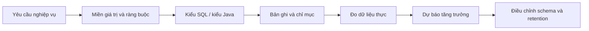

# Xác định kiểu dữ liệu và kích thước bản ghi

> **Chương:** Yêu cầu lưu trữ  
> **Học phần:** `DATA_PERSISTENCE_FUNDAMENTALS` — nền tảng lưu trữ dữ liệu bền vững trong Java: mô hình dữ liệu, lược đồ, truy vấn, chỉ mục, giao dịch, cô lập, kiểm soát đồng thời, tiến hóa schema, bảo mật, sao lưu và hiệu năng.

Trước khi tạo bảng, chọn công nghệ lưu trữ hay ước lượng dung lượng đĩa, người phát triển cần trả lời hai câu hỏi: **mỗi trường thực sự chứa loại dữ liệu nào** và **một bản ghi sẽ chiếm bao nhiêu tài nguyên khi được lưu, đánh chỉ mục và cập nhật**? Hai quyết định này liên quan chặt chẽ: kiểu dữ liệu quyết định phạm vi giá trị, độ chính xác, cách so sánh, khả năng truy vấn và một phần kích thước vật lý; còn kích thước bản ghi ảnh hưởng thời gian đọc/ghi, kích thước chỉ mục, backup và chi phí vận hành.

Ví dụ, lưu giá tiền bằng `double` có thể gây sai số nhị phân; lưu timestamp dưới dạng chuỗi khó bảo đảm so sánh đúng; dùng `VARCHAR(255)` cho mọi cột không tự động chiếm 255 byte trên mọi DBMS, nhưng vẫn để ngỏ những lựa chọn về giới hạn, mã hóa và truy vấn. Một bản ghi “300 byte dữ liệu” cũng có thể cần nhiều hơn đáng kể sau khi tính metadata hàng, căn chỉnh, chỉ mục, phiên bản hàng và transaction log.

Sau bài này, người học có thể:

- Chuyển yêu cầu nghiệp vụ thành danh sách trường, kiểu logic, tính bắt buộc, miền giá trị và kiểu SQL/Java phù hợp.
- Phân biệt kích thước giá trị, kích thước hàng vật lý, kích thước chỉ mục và dung lượng cả hệ thống.
- Ước lượng độ dài chuỗi UTF-8, dữ liệu biến thiên, `NULL` và ảnh hưởng của các trường rất lớn.
- Tạo schema ví dụ bằng PostgreSQL, ánh xạ sang JDBC và đo kích thước bằng dữ liệu mẫu.
- Dự báo dung lượng theo tốc độ sinh bản ghi, thời gian lưu giữ và chi phí cập nhật, sao lưu, replication.

## 1. Đi từ yêu cầu nghiệp vụ đến miền giá trị của từng trường

Kiểu dữ liệu đúng bắt đầu từ **ý nghĩa của giá trị**, không bắt đầu từ cú pháp SQL. Với một hệ thống ghi nhận sự kiện đơn hàng, hãy lập danh mục trước khi viết lược đồ:

| Câu hỏi | Ví dụ về câu trả lời | Tác động đến lựa chọn |
| --- | --- | --- |
| Đây là định danh, số lượng, số tiền hay thời điểm? | `event_id` là định danh duy nhất, `amount_minor` là số tiền theo đơn vị nhỏ nhất | Chọn `UUID`, `BIGINT` hoặc kiểu có ngữ nghĩa tương ứng; tránh dùng `FLOAT` cho tiền |
| Miền giá trị hiện tại và tương lai? | `tenant_id` phải dương; trạng thái có vài giá trị hợp lệ | Chọn dải số đủ lớn, `CHECK` hoặc bảng tham chiếu |
| Cho phép thiếu giá trị không? | `source_reference` có thể chưa biết; `occurred_at` bắt buộc có | `NULL` có chủ đích và `NOT NULL` ở nơi cần bất biến |
| Có bao nhiêu ký tự **và byte**? | Mô tả có thể chứa tiếng Việt, emoji; mã tiền tệ dùng mã ASCII | Tính cả mã hóa, kiểm tra đầu vào, giới hạn độ dài |
| Dữ liệu được lọc, sắp xếp hoặc nối theo trường nào? | Tra theo `tenant_id`, thời điểm, `event_id` | Chọn kiểu so sánh ổn định và thiết kế chỉ mục theo mẫu truy vấn |
| Giá trị có nhạy cảm hoặc cần thời hạn lưu riêng? | Ghi chú khách hàng có thể chứa dữ liệu cá nhân | Giới hạn nội dung, phân quyền, mã hóa, retention |
| Có bị cập nhật thường xuyên không? | Trạng thái đơn hàng thay đổi, event đã ghi có thể bất biến | Ước tính thêm phiên bản hàng, index churn và transaction log |

Một “bản ghi” có thể có nhiều nghĩa: đối tượng Java, một hàng quan hệ, một document JSON, một message trong broker hoặc một object ở object storage. Kích thước của chúng **không bằng nhau** ngay cả khi diễn tả cùng thông tin. Bài này dùng PostgreSQL để minh họa lược đồ và phép đo; không áp những con số vật lý của PostgreSQL sang MySQL, MongoDB, Redis hoặc một kho dữ liệu khác.

## 2. Phân biệt kiểu dữ liệu logic, kiểu Java và kiểu lưu trữ

Đối với Java, tách ba lớp:

1. **Kiểu logic/nghiệp vụ:** số tiền, mã tiền tệ, định danh, thời điểm UTC, trạng thái, văn bản, tệp đính kèm.
2. **Kiểu trong ứng dụng:** `long`, `BigDecimal`, `UUID`, `Instant`, `String`, `byte[]`, record/class hoặc value object.
3. **Kiểu trong hệ lưu trữ:** `BIGINT`, `NUMERIC(p,s)`, `UUID`, `TIMESTAMPTZ`, `VARCHAR(n)`, `TEXT`, `JSONB`, `BYTEA` và các kiểu đặc thù DBMS.

| Nhu cầu | PostgreSQL gợi ý | Java gợi ý | Lưu ý về ý nghĩa và kích thước |
| --- | --- | --- | --- |
| Đếm số lượng nhỏ hoặc trạng thái dạng mã số ổn định | `SMALLINT` (2 byte), `INTEGER` (4 byte) | `short`/`int` hoặc enum ánh xạ rõ | Không dùng mã số nếu danh mục thay đổi mà không quản lý mapping |
| ID dạng số, bộ đếm lớn, số tiền theo đơn vị nhỏ nhất | `BIGINT` (8 byte) | `long` | Kiểm tra dải giá trị, quy tắc đơn vị, tràn số |
| Số thập phân chính xác, tỷ giá, khối lượng | `NUMERIC(p,s)` (kích thước biến thiên) | `BigDecimal` | Định nghĩa precision, scale và quy tắc làm tròn |
| Số đo gần đúng | `REAL` (4 byte), `DOUBLE PRECISION` (8 byte) | `float`, `double` | Không phù hợp khi phải biểu diễn giá trị thập phân tài chính chính xác |
| Định danh toàn cục | `UUID` (16 byte) | `UUID` | Nhỏ và truy vấn thuận tiện hơn chuỗi biểu diễn UUID trong nhiều trường hợp |
| Đúng/sai | `BOOLEAN` (1 byte dữ liệu) | `boolean` / `Boolean` | Dùng wrapper khi trạng thái có thể `NULL`; độ rộng hàng còn overhead |
| Ngày độc lập múi giờ | `DATE` (4 byte) | `LocalDate` | Phù hợp ngày sinh, ngày hiệu lực theo lịch; không dùng để lưu tức thời |
| Mốc thời gian tuyệt đối | `TIMESTAMPTZ` (8 byte) | `Instant` hoặc `OffsetDateTime` | PostgreSQL lưu điểm thời gian và hiển thị theo timezone phiên, không lưu nguyên offset nhập |
| Chuỗi có giới hạn nghiệp vụ | `VARCHAR(n)` hoặc `TEXT` + `CHECK` | `String` | UTF-8 có độ dài byte khác số ký tự; kiểu biến thiên |
| Tài liệu JSON truy vấn theo thuộc tính | `JSONB` | DTO/record + serialization | Có overhead nhị phân, cập nhật và index riêng; không mặc định tiết kiệm |
| Nội dung nhị phân tương đối nhỏ | `BYTEA` | `byte[]` / stream | Dữ liệu lớn thường nên đặt ở object storage theo kiến trúc phù hợp |

**Không chọn kiểu chỉ vì “càng nhỏ càng tốt”.** `SMALLINT` tiết kiệm hơn `INTEGER` cho một giá trị nhưng dải giá trị nhỏ hơn; nếu vượt giới hạn sẽ cần migration. `VARCHAR(20)` không sửa được một định nghĩa nghiệp vụ vốn cần Unicode dài hơn. Kích thước phải cân bằng với tính đúng đắn, khả năng truy vấn và khả năng tiến hóa.

### Số tiền: đơn vị nhỏ nhất hay số thập phân?

Nếu sản phẩm xử lý một loại tiền có đơn vị nhỏ nhất xác định, `amount_minor BIGINT` có thể biểu diễn số lượng đơn vị nhỏ nhất chính xác. Ví dụ `12345` tương ứng 123,45 đơn vị tiền tệ *khi* đơn vị đó có hai chữ số thập phân. Không áp chung quy tắc hai chữ số cho mọi đồng tiền và mọi phép tính.

Khi xử lý tỷ giá, thuế hoặc đại lượng cần nhiều chữ số lẻ, dùng `NUMERIC(19, 4)` cùng `BigDecimal` và quy tắc `RoundingMode` nhất quán:

```java
import java.math.BigDecimal;
import java.math.RoundingMode;

BigDecimal subtotal = new BigDecimal("123.45");
BigDecimal taxRate = new BigDecimal("0.075");
BigDecimal tax = subtotal.multiply(taxRate)
                         .setScale(2, RoundingMode.HALF_UP);
```

`NUMERIC(19,4)` cho tối đa 19 chữ số thập phân, trong đó 4 chữ số sau dấu thập phân; **không phải mặc định 19 byte**. `BigDecimal` giữ biểu diễn thập phân có kiểm soát, trong khi `new BigDecimal(0.1)` kế thừa sai số từ literal `double`; ưu tiên chuỗi hoặc `BigDecimal.valueOf` khi phù hợp.

## 3. Chuỗi và Unicode: số ký tự khác số byte

Với cơ sở dữ liệu UTF-8, chữ ASCII thường chiếm 1 byte/ký tự, nhiều chữ tiếng Việt có dấu chiếm từ 2 đến 3 byte cho mỗi Unicode code point, emoji có thể chiếm 4 byte/code point. Một ký tự hiển thị có thể gồm nhiều code point, nên “số ký tự người dùng nhìn thấy” cũng không luôn bằng số code point.

PostgreSQL `VARCHAR(n)` giới hạn số ký tự theo cách đếm của database, **không cam kết tối đa `n` byte trên đĩa**. `TEXT` và `VARCHAR` sử dụng cơ chế lưu giá trị biến thiên tương tự khi không có giới hạn độ dài; `CHAR(n)` đệm khoảng trắng và không phải lựa chọn mặc định tốt cho mọi chuỗi cố định về mặt nghiệp vụ.

```sql
SELECT
    char_length('Xin chào 👋') AS logical_characters,
    octet_length('Xin chào 👋') AS encoded_bytes;
```

Nếu cả ứng dụng và database dùng UTF-8, Java có thể đo byte thực tế của payload:

```java
import java.nio.charset.StandardCharsets;

String description = "Xin chào 👋";
int javaCodeUnits = description.length();  // Đếm UTF-16 code units.
int utf8Bytes = description.getBytes(StandardCharsets.UTF_8).length;
```

`String.length()` trong Java đếm đơn vị mã UTF-16, không phải số ký tự hiển thị và không phải số byte UTF-8. Để giới hạn nội dung một cách đúng đắn, hãy xác định *chính sách* giới hạn độ dài ký tự, byte hoặc cả hai; kiểm soát cả tầng API và database thay vì cắt chuỗi tùy tiện rồi gây mất dữ liệu.

**Đừng lấy kích thước tối đa làm kích thước trung bình.** Trường `description TEXT` có thể thường rỗng, đôi khi 80 byte, nhưng có một tỷ lệ nhỏ hàng vài chục KB. Hãy đo mẫu đại diện theo các phân vị (p50, p95, p99, max) và xét riêng những hàng lớn bất thường. Cơ chế nén hoặc đẩy giá trị lớn ra ngoài hàng như TOAST của PostgreSQL làm quan hệ giữa kích thước văn bản ban đầu và kích thước vật lý phức tạp hơn.

## 4. Thiết kế một bản ghi sự kiện đơn hàng

Giả sử hệ thống Java nhận các sự kiện thay đổi đơn hàng từ nhiều tenant. Nghiệp vụ đòi hỏi có thể tra cứu theo tenant và thời điểm; ngăn ghi trùng event; biểu diễn số tiền chính xác; có ghi chú ngắn và phần thuộc tính mở rộng tùy chọn.



Lược đồ PostgreSQL minh họa:

```sql
CREATE TABLE purchase_event (
    event_id UUID PRIMARY KEY,
    tenant_id BIGINT NOT NULL CHECK (tenant_id > 0),
    order_id BIGINT NOT NULL CHECK (order_id > 0),
    amount_minor BIGINT NOT NULL CHECK (amount_minor >= 0),
    currency_code VARCHAR(3) NOT NULL
        CHECK (currency_code ~ '^[A-Z]{3}$'),
    status VARCHAR(24) NOT NULL
        CHECK (status IN ('CREATED', 'PAID', 'CANCELLED', 'REFUNDED')),
    occurred_at TIMESTAMPTZ NOT NULL,
    source_reference VARCHAR(64),
    description TEXT,
    attributes JSONB,
    created_at TIMESTAMPTZ NOT NULL DEFAULT CURRENT_TIMESTAMP,
    version INTEGER NOT NULL DEFAULT 0 CHECK (version >= 0)
);

-- Dành cho truy vấn danh sách sự kiện của một tenant theo thời gian.
CREATE INDEX idx_purchase_event_tenant_time
    ON purchase_event (tenant_id, occurred_at DESC, event_id);
```

Các quyết định quan trọng:

- `event_id UUID PRIMARY KEY` giữ tính duy nhất; thêm một khóa chính cũng tạo chỉ mục tương ứng ở PostgreSQL.
- `tenant_id` và `order_id` chọn `BIGINT` cho dải ID lớn, nhưng vẫn cần quy tắc cấp phát ID và kiểm soát tenant ở tầng truy cập.
- `currency_code VARCHAR(3)` giới hạn đúng ba ký tự ASCII viết hoa theo quy tắc minh họa; kiểm tra tính hợp lệ theo danh sách mã được hỗ trợ cần thêm logic hoặc bảng tham chiếu.
- `status` dùng chuỗi có giới hạn và `CHECK` để dễ đọc; nếu miền trạng thái thay đổi phải triển khai schema cùng code tương thích. Dùng số nhỏ hoặc `ENUM` riêng có những đánh đổi khác về migration và khả năng truy vấn.
- `description TEXT` và `attributes JSONB` linh hoạt nhưng cần chính sách giới hạn độ dài JSON, số thuộc tính và quyền truy cập, nếu không một vài bản ghi lớn có thể chi phối dung lượng và latency.
- `version` dành cho optimistic locking khi có cập nhật, cần dùng đúng điều kiện `WHERE version = ?` để kiểm soát cạnh tranh; chỉ có cột `version` thì chưa tự ngăn lost update.

Chỉ mục `idx_purchase_event_tenant_time` phục vụ mẫu:

```sql
SELECT event_id, order_id, status, occurred_at
FROM purchase_event
WHERE tenant_id = 42
  AND occurred_at < TIMESTAMPTZ '2026-11-01 00:00:00+00'
ORDER BY occurred_at DESC, event_id DESC
LIMIT 50;
```

Cần dùng `EXPLAIN (ANALYZE, BUFFERS)` với dữ liệu thật để xác định hiệu quả của chỉ mục. Với pagination ổn định trên nhiều trang, cần xử lý cặp khóa thời gian + ID, ranh giới thời gian và thứ tự khi có các bản ghi cùng timestamp; ví dụ trên chỉ thể hiện bộ lọc/sắp xếp, chưa phải toàn bộ logic cursor pagination.

### Ánh xạ Java và JDBC

```java
import java.sql.Connection;
import java.sql.PreparedStatement;
import java.sql.SQLException;
import java.time.Instant;
import java.time.OffsetDateTime;
import java.time.ZoneOffset;
import java.util.UUID;
import javax.sql.DataSource;

record PurchaseEventInput(
    UUID eventId,
    long tenantId,
    long orderId,
    long amountMinor,
    String currencyCode,
    String status,
    Instant occurredAt,
    String sourceReference,
    String description,
    String attributesJson
) {}

final class PurchaseEventRepository {
    private final DataSource dataSource;

    PurchaseEventRepository(DataSource dataSource) {
        this.dataSource = dataSource;
    }

    void insert(PurchaseEventInput e) throws SQLException {
        String sql = """
            INSERT INTO purchase_event
              (event_id, tenant_id, order_id, amount_minor, currency_code,
               status, occurred_at, source_reference, description, attributes)
            VALUES (?, ?, ?, ?, ?, ?, ?, ?, ?, CAST(? AS JSONB))
            """;
        try (Connection conn = dataSource.getConnection();
             PreparedStatement ps = conn.prepareStatement(sql)) {
            ps.setObject(1, e.eventId());
            ps.setLong(2, e.tenantId());
            ps.setLong(3, e.orderId());
            ps.setLong(4, e.amountMinor());
            ps.setString(5, e.currencyCode());
            ps.setString(6, e.status());
            ps.setObject(7, OffsetDateTime.ofInstant(
                e.occurredAt(), ZoneOffset.UTC));
            ps.setString(8, e.sourceReference());
            ps.setString(9, e.description());
            ps.setString(10, e.attributesJson());
            ps.executeUpdate();
        }
    }
}
```

Ví dụ dùng Java 17+ và cú pháp text block. Caller cần xác thực trường bắt buộc, giới hạn độ dài, quyền tenant, tính hợp lệ JSON và miền giá trị trước khi gọi repository; ràng buộc database là lớp bảo vệ cuối. Với một lệnh `INSERT` đơn lẻ, connection dùng chế độ auto-commit mặc định của pool nếu được cấu hình như vậy. Nếu một nghiệp vụ ghi nhiều bảng, service phải quản lý một transaction chung thay vì mở nhiều kết nối độc lập cho từng repository.

## 5. Ước lượng kích thước một bản ghi: từ giá trị đến hàng vật lý

Một phép cộng độ rộng kiểu chỉ cho **ước lượng payload**, không phải kết quả đo trên đĩa. Cần tách các phần:

```text
Kích thước hàng vật lý xấp xỉ
  = metadata/header + null bitmap + căn chỉnh (alignment)
  + kích thước giá trị cột (gồm định dạng cho trường biến thiên)
  + ảnh hưởng nén/TOAST hoặc lưu trữ ngoài hàng

Dung lượng bảng và chỉ mục
  = dữ liệu các hàng + free space / fillfactor / page overhead
  + phiên bản hàng chưa dọn + dữ liệu TOAST + các chỉ mục
```

Trong PostgreSQL, cấu trúc hàng, page, căn chỉnh và cách lưu cột biến thiên phụ thuộc phiên bản và cấu hình; chỉ một số kiểu như `BIGINT`, `UUID`, `INTEGER`, `TIMESTAMPTZ` mới có độ rộng cố định như bảng trên. `NULL` thường không lưu payload của chính giá trị nhưng có thể cần thông tin đánh dấu và ảnh hưởng alignment. `TEXT`, `VARCHAR`, `NUMERIC` và `JSONB` là dữ liệu độ dài biến thiên; giá trị lớn có thể bị nén hoặc đưa sang TOAST.

**Ví dụ giả định một sự kiện trung bình** với các độ dài thực tế đã quan sát hoặc ước đoán theo byte:

| Trường | Kiểu | Số byte giả định của giá trị |
| --- | --- | ---: |
| `event_id` | `UUID` | 16 |
| `tenant_id`, `order_id`, `amount_minor` | 3 × `BIGINT` | 24 |
| `currency_code` | 3 ký tự ASCII | 3 |
| `status` | `CREATED`, 7 ký tự ASCII | 7 |
| `occurred_at` | `TIMESTAMPTZ` | 8 |
| `source_reference` | Chuỗi ASCII ví dụ | 24 |
| `description` | Nội dung UTF-8 mẫu | 120 |
| `attributes` | Giả định phần dữ liệu JSON đã mã hóa | 70 |
| `created_at` | `TIMESTAMPTZ` | 8 |
| `version` | `INTEGER` | 4 |
| **Tổng byte của giá trị (ước lượng)** | **Chưa gồm overhead** | **284** |

Tổng 284 byte ở đây **chỉ là phép cộng theo giả định**, gồm 70 byte ước đoán cho nội dung thuộc tính; `JSONB` có biểu diễn nội bộ khác JSON văn bản. 284 byte **không phải** số byte cho một hàng `purchase_event` trên PostgreSQL. Dùng `pg_column_size` và kích thước quan hệ để thay giả định bằng kết quả thực; không nên nhân 284 với số bản ghi rồi coi là dung lượng đĩa.

Đặc biệt, nếu `description` tăng từ 120 lên 4.000 byte ở phần lớn bản ghi, dung lượng trung bình và số page cần đọc có thể thay đổi đáng kể. Nếu chỉ 1% bản ghi dài 4.000 byte, trung bình đơn giản riêng trường mô tả là `0,99 × 120 + 0,01 × 4.000 = 158,8` byte trước các hiệu ứng nén và overhead; phân bố độ dài quan trọng hơn một con số “VARCHAR tối đa”.

## 6. Đo kích thước với PostgreSQL

**Cần đo dữ liệu thật hoặc dữ liệu mẫu đại diện.** Dưới đây là các truy vấn chỉ đọc, áp dụng sau khi đã có bảng và dữ liệu kiểm thử:

```sql
-- Độ dài ký tự và độ dài byte của các chuỗi trong hàng.
SELECT
    event_id,
    char_length(description) AS description_chars,
    octet_length(description) AS description_bytes,
    pg_column_size(attributes) AS attributes_stored_bytes,
    pg_column_size(purchase_event) AS estimated_tuple_bytes
FROM purchase_event
LIMIT 20;

-- Độ rộng trung bình do bộ thống kê PostgreSQL thu thập.
-- Chạy ANALYZE với quyền phù hợp sau khi nạp dữ liệu đại diện.
SELECT attname, avg_width
FROM pg_stats
WHERE schemaname = 'public'
  AND tablename = 'purchase_event'
ORDER BY avg_width DESC;

-- Dung lượng quan hệ, chỉ mục và TOAST.
SELECT
    pg_size_pretty(pg_relation_size('public.purchase_event')) AS main_table,
    pg_size_pretty(pg_indexes_size('public.purchase_event')) AS indexes,
    pg_size_pretty(pg_total_relation_size('public.purchase_event')) AS total;
```

Giải thích phép đo:

- `char_length` và `octet_length` cho thấy khác biệt giữa ký tự và byte; `NULL` trả `NULL`, không tự biến thành 0.
- `pg_column_size(value)` trả kích thước biểu diễn của giá trị ở thời điểm đo; đo cả một hàng bằng biểu thức record cho một chỉ báo, nhưng **không thay thế** việc đo toàn bộ quan hệ trên đĩa.
- `pg_stats.avg_width` là số liệu thống kê ước lượng từ mẫu đã phân tích. Độ chính xác phụ thuộc độ đại diện và thời điểm `ANALYZE`.
- `pg_relation_size` đo tệp bảng chính, `pg_indexes_size` đo tổng kích thước chỉ mục, còn `pg_total_relation_size` gồm quan hệ, chỉ mục và TOAST liên quan. Không cộng `pg_total_relation_size` với index size thêm lần nữa.

Để quan sát phân bố giá trị lớn, có thể dùng thống kê phân vị theo số byte mã hóa của mô tả:

```sql
SELECT
    count(*) AS rows_count,
    avg(octet_length(description)) AS avg_description_bytes,
    percentile_cont(0.5) WITHIN GROUP
        (ORDER BY octet_length(description)) AS p50_bytes,
    percentile_cont(0.95) WITHIN GROUP
        (ORDER BY octet_length(description)) AS p95_bytes,
    max(octet_length(description)) AS max_bytes
FROM purchase_event
WHERE description IS NOT NULL;
```

Với bảng rất lớn, truy vấn toàn bảng để tính percentile có thể tốn I/O và CPU; dùng tập mẫu hoặc dữ liệu thống kê khi phù hợp. `pg_total_relation_size / count(*)` đôi khi hữu ích để ước lượng chi phí trung bình, nhưng dễ bị lệch nếu bảng trống, nhiều trang trống, dead tuples hoặc mới `DELETE` nhiều bản ghi. Đừng lấy một truy vấn duy nhất làm cơ sở cam kết dung lượng.

## 7. Dự báo dung lượng theo tải và thời gian lưu giữ

Sau khi đo, chuyển kích thước bản ghi thành yêu cầu tài nguyên. Với dữ liệu được lưu trong một bảng chính và các chỉ mục tương ứng, công thức lập kế hoạch đơn giản là:

```text
Số bản ghi còn hoạt động ≈ bản ghi mới mỗi ngày × số ngày lưu giữ

Dung lượng dữ liệu trên primary
  ≈ số bản ghi còn hoạt động × (byte hàng trung bình + byte index trung bình)
    + phần dự phòng cho page trống, cập nhật, dead tuples và vận hành

Dung lượng toàn hệ thống
  = primary + các replica + WAL/log + backup + dữ liệu tạm khác
```

Ví dụ **giả định để tính quy mô, không phải kết quả đo**:

| Tham số | Giá trị |
| --- | ---: |
| Sự kiện mới mỗi ngày | 1.000.000 |
| Thời gian giữ dữ liệu trực tuyến | 30 ngày |
| Kích thước hàng trung bình đã tính overhead | 480 byte |
| Phân bổ chỉ mục trung bình cho mỗi bản ghi | 220 byte |
| Chi phí dữ liệu và chỉ mục trên mỗi bản ghi | 700 byte |

Khi đó:

```text
N = 1.000.000 × 30 = 30.000.000 bản ghi

Dung lượng cơ sở = 30.000.000 × (480 + 220)
                 = 21.000.000.000 byte
                 ≈ 21 GB (hệ thập phân)

Dự phòng quy hoạch 30% = 21 × 1,30 = 27,3 GB
```

Con số 27,3 GB là **ước lượng quy hoạch cho dữ liệu và index trên một primary trong kịch bản giả định**. Nó chưa bao gồm WAL, replica, snapshot/backup, các bảng khác, cấu trúc tạm, thời gian giữ bản ghi đã xóa theo MVCC, spike dữ liệu và chênh lệch thực tế giữa bản ghi nhỏ/lớn. Nếu có thêm hai replica vật lý có cùng quy mô, riêng phần dữ liệu tương ứng có thể cần xấp xỉ ba bản sao; phải cộng ngân sách riêng cho từng máy, backup và log. Phân vùng bảng theo thời gian và chính sách xóa/archiving có thể giúp quản lý retention, nhưng không tự làm bản ghi nhỏ hơn.

### Ghi nhiều lần và MVCC thay đổi phép tính ra sao?

Kích thước *đang sống* không mô tả toàn bộ dung lượng ở thời điểm chạy. Trong PostgreSQL, `UPDATE` có thể tạo phiên bản hàng mới; chỉ mục cũng có thể phát sinh ghi, trong khi cleanup phụ thuộc VACUUM và tải hệ thống. Vì vậy, cùng 30 triệu hàng đang hoạt động, một bảng cập nhật liên tục có thể dùng nhiều đĩa hơn bảng sự kiện bất biến chỉ `INSERT`.

Ngoài dung lượng đĩa, hàng rộng kéo theo:

- Ít hàng hơn trên mỗi page, tăng số page phải đọc và bộ nhớ cache cần thiết.
- Băng thông mạng và heap Java tăng khi `SELECT *` trả về cột lớn không cần thiết.
- Chi phí WAL, replication và backup cao hơn khi ghi nhiều hoặc cập nhật trường lớn.
- Chỉ mục rộng hơn khi đưa nhiều trường vào key/`INCLUDE`; nhiều chỉ mục giúp một số truy vấn nhưng làm tăng chi phí insert/update.

Lập kế hoạch cần tách **số hàng**, **kích thước từng hàng**, **phân bố dữ liệu lớn**, **tần suất cập nhật** và **đặc điểm truy vấn**.

## 8. Chọn kiểu dữ liệu cũng là chọn cách truy vấn và bảo trì

### Tách trường được truy vấn thường xuyên khỏi payload lớn

Nếu mỗi request chỉ cần `event_id`, `status`, `occurred_at`, đừng buộc nó tải `description` dài hoặc `attributes` lớn:

```sql
SELECT event_id, status, occurred_at
FROM purchase_event
WHERE tenant_id = ?
ORDER BY occurred_at DESC
LIMIT 50;
```

Các trường lớn có thể được lấy khi người dùng mở chi tiết, hoặc tách sang bảng/object storage khi có lý do cụ thể về độ lớn, truy cập và vòng đời. Không tách chỉ để “giảm số cột”: thêm join cũng có chi phí, và tách dữ liệu liên quan có thể khiến cập nhật nguyên tử khó hơn.

### `JSONB` hay cột có kiểu?

`JSONB` phù hợp thuộc tính ít ổn định hoặc mở rộng, nhưng các trường bắt buộc, thường lọc, cần ràng buộc hoặc tham gia join thường nên có cột định kiểu rõ. Index GIN trên JSONB có thể tăng khả năng tìm kiếm nhưng làm kích thước lưu trữ và chi phí ghi tăng; phải đo workload thực trước khi thêm. Nếu cần truy vấn `attributes->>'priority'` nhiều lần, hãy cân nhắc chuẩn hóa hoặc indexed expression phù hợp.

### Định danh và khóa

`UUID` có biểu diễn nhị phân 16 byte tại PostgreSQL, trong khi chuỗi UUID chuẩn có 36 ký tự biểu diễn; kiểu `UUID` bảo đảm cú pháp và so sánh phù hợp. Tuy nhiên, ảnh hưởng đến index locality và page split còn phụ thuộc phân bố ID, thứ tự tạo và loại chỉ mục; không khẳng định UUID luôn chậm hoặc nhanh hơn `BIGINT`. Đo theo lượng ghi và truy vấn thực tế.

### Bảo mật và mã hóa

Mã hóa toàn bộ database ở tầng đĩa thường không làm thay đổi kiểu logic của cột, nhưng mã hóa từng trường tại ứng dụng có thể làm payload lớn hơn do nonce, tag, encoding hoặc metadata. Khi mã hóa giá trị, khả năng lọc/sắp xếp và đánh chỉ mục có thể thay đổi; bảo mật và kích thước bản ghi phải được thiết kế cùng nhau. Không ghi dữ liệu cá nhân nhạy cảm vào các trường JSON tùy ý không có kiểm soát quyền.

## 9. Ràng buộc độ dài, thay đổi schema và tương thích Java

Chọn kiểu nhỏ không được làm dữ liệu bị cắt hoặc mất độ chính xác. Một số lỗi phổ biến:

| Lựa chọn ban đầu | Rủi ro | Cách phòng tránh |
| --- | --- | --- |
| `INTEGER` cho ID tăng vô hạn | Gần giới hạn 32 bit phải đổi kiểu | Ước lượng tốc độ cấp ID, vòng đời và chọn dải phù hợp |
| `DOUBLE PRECISION` cho số tiền | Sai số khi biểu diễn/phép tính thập phân | `BIGINT` đơn vị nhỏ nhất hoặc `NUMERIC` theo nghiệp vụ |
| `VARCHAR(20)` cho tên đa ngôn ngữ | Tên hợp lệ bị từ chối, đếm ký tự có thể khác kỳ vọng UI | Thiết kế giới hạn từ yêu cầu người dùng; đo byte và ký tự |
| `TIMESTAMP WITHOUT TIME ZONE` cho một instant | Dễ hiểu nhầm múi giờ khi trao đổi liên hệ thống | `TIMESTAMPTZ` + `Instant` cho thời điểm tuyệt đối |
| Lưu mọi metadata thành JSON không ràng buộc | Dữ liệu bất nhất, khó truy vấn, dễ phình to | Cột định kiểu cho trường lõi; schema/limit cho phần mở rộng |
| Lưu tệp nhiều MB trực tiếp trong hàng nóng | Truy vấn/backup và băng thông có thể tốn kém | Cân nhắc object storage và metadata trong DB |
| Giả định `NULL` = 0 hoặc chuỗi rỗng | Mất khác biệt giữa “chưa biết” và “giá trị bằng không” | Định nghĩa semantics và áp dụng `NOT NULL` nơi cần |

Khi schema cần mở rộng, áp dụng trình tự chuyển đổi có tương thích giữa phiên bản ứng dụng:

1. Thêm cột/cấu trúc mới hoặc nới giới hạn theo migration đã kiểm tra; xem tác động khóa bảng, rewrite dữ liệu và index.
2. Triển khai code Java biết đọc cả dạng cũ và mới trong giai đoạn chuyển tiếp nếu cần.
3. Backfill theo lô có giám sát, kiểm tra các hàng vượt dải hoặc chứa dữ liệu không hợp lệ.
4. Chuyển luồng ghi/đọc sang dạng mới, kiểm tra truy vấn và kích thước lưu trữ thực.
5. Loại kiểu/cột cũ sau khi không còn phiên bản ứng dụng phụ thuộc.

Không giả định mọi lệnh `ALTER COLUMN TYPE` đều thực hiện tức thời hoặc không khóa; hiệu ứng phụ thuộc phép đổi kiểu, kích thước bảng và phiên bản DBMS. Một thiết kế ban đầu có dư địa hợp lý giúp giảm số lần migration đau đớn nhưng không thay thế khả năng tiến hóa schema.

## 10. Bài tập thực hành: tự lập ngân sách một loại bản ghi

Một ứng dụng Java có bảng `document_upload` với `id`, `owner_id`, `file_name`, `content_type`, `size_bytes`, `checksum`, `object_key`, `created_at` và `scan_status`. Hệ thống nhận khoảng 200.000 tệp/ngày và giữ metadata trực tuyến trong 90 ngày.

Hãy thực hiện các bước:

1. Chọn kiểu PostgreSQL và kiểu Java cho từng trường. Xác định vì sao `size_bytes` thường cần `BIGINT`, `created_at` là một instant và `checksum` cần thuật toán/độ dài biểu diễn được chuẩn hóa.
2. Đề xuất giới hạn `file_name` theo nghiệp vụ và cách đo ký tự/byte UTF-8; giải thích vì sao không lưu toàn bộ nội dung tệp vào một `VARCHAR`.
3. Tạo dữ liệu mẫu có tên ASCII, tiếng Việt, emoji và một số trường `NULL`. Đo `octet_length`, `pg_column_size`, `pg_total_relation_size`; ghi rõ kết quả nào là kích thước logic và kích thước vật lý.
4. Ước tính số bản ghi còn hoạt động: `200.000 × 90 = 18.000.000`. Dùng kích thước hàng/index thực đo để dự báo dung lượng, rồi bổ sung dung lượng dự phòng, WAL, replica và backup.
5. Dự đoán truy vấn thường gặp (`WHERE owner_id = ? ORDER BY created_at DESC`) và đề xuất index phù hợp; đo độ trễ và kích thước index sau khi tạo.
6. Nêu chính sách retention, xóa metadata và object bên ngoài, cũng như kế hoạch nếu phải tăng giới hạn tên tệp hoặc đổi thuật toán checksum sau này.

Kết quả đầu ra mong đợi không phải một con số “byte/bản ghi” đơn lẻ, mà là bảng giả định, schema có kiểm soát, dữ liệu đo đại diện và một mô hình dung lượng có thể cập nhật khi tải thay đổi.

## 11. Checklist trước khi chốt yêu cầu lưu trữ

- [ ] Mỗi trường có ý nghĩa nghiệp vụ, dải giá trị và trạng thái `NULL` được xác định.
- [ ] Kiểu SQL và Java bảo toàn số tiền, độ chính xác, định danh, thời gian và dữ liệu Unicode.
- [ ] Có giới hạn độ dài/phân bố độ dài thực tế cho trường biến thiên; xử lý payload quá lớn có chủ đích.
- [ ] Kích thước hàng được đo với dữ liệu đại diện, không chỉ cộng độ rộng cột từ DDL.
- [ ] Chỉ mục được chọn theo truy vấn, ước lượng và đo dung lượng riêng.
- [ ] Dự báo tính tốc độ ghi, thời gian retention, cập nhật/MVCC, WAL, replica, backup và dự phòng.
- [ ] Có kiểm tra đầu vào và ràng buộc DB để giữ bất biến kể cả khi có nhiều writer.
- [ ] Có phương án migration tương thích khi dải số, độ dài chuỗi hoặc cách biểu diễn dữ liệu thay đổi.
- [ ] Có số liệu theo dõi dung lượng, số hàng, kích thước index, query latency và tốc độ tăng trưởng theo thời gian.

**Nguyên tắc quyết định:** bắt đầu từ ý nghĩa và dải giá trị, chọn kiểu lưu trữ bảo toàn nghiệp vụ, đo kích thước trên dữ liệu đại diện, rồi dự báo cả bảng, chỉ mục và các bản sao vận hành. Cách này giúp Java persistence giữ được tính đúng đắn khi xử lý giao dịch, đồng thời có cơ sở số liệu để kiểm soát hiệu năng, dung lượng, bảo mật và khả năng phục hồi.
