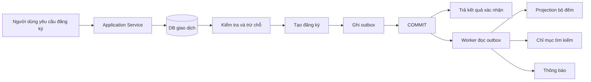
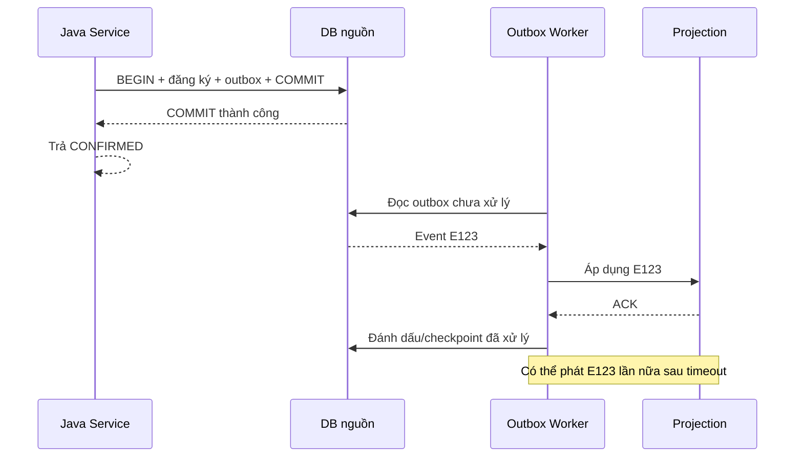

# Xác định dữ liệu cần nhất quán ngay và dữ liệu được phép trễ

## 1. Vì sao cần phân loại mức nhất quán trước khi chọn công nghệ?

Trong ứng dụng Java, một hành động của người dùng có thể thay đổi nhiều loại dữ liệu. Khi khách hàng đặt chỗ tham dự workshop, hệ thống phải xác nhận còn chỗ, tạo đăng ký, cập nhật số chỗ, gửi email và đưa workshop vào báo cáo. Không phải tất cả bước đó đều cần hoàn tất trong cùng thời điểm.

Nếu hệ thống **xác nhận đặt chỗ nhưng đã bán vượt số lượng**, quy tắc nghiệp vụ bị phá vỡ. Ngược lại, nếu số lượt đặt chỗ trên trang thống kê chậm cập nhật vài giây, hoạt động kinh doanh có thể vẫn đúng. Sự khác biệt nằm ở **yêu cầu nhất quán**: dữ liệu nào phải đáp ứng bất biến ngay khi một thao tác được xác nhận, dữ liệu nào có thể cập nhật trễ nhưng cuối cùng phải theo kịp trạng thái nguồn.

Bài thuộc chương **Yêu cầu lưu trữ** của module `DATA_PERSISTENCE_FUNDAMENTALS`. Mục tiêu là đưa một yêu cầu nghiệp vụ thành **hợp đồng nhất quán có thể kiểm chứng**, sau đó chọn mô hình dữ liệu, schema, truy vấn, giao dịch, kiểm soát đồng thời, ranh giới persistence Java, chiến lược xử lý lỗi, bảo mật, sao lưu và tối ưu hiệu năng tương ứng. Trước khi chọn cơ sở dữ liệu, cache, hàng đợi hay kiến trúc nhiều dịch vụ, cần trả lời: **điều gì sẽ sai nếu một giá trị chưa cập nhật?**

### Tình huống xuyên suốt: đăng ký workshop có sức chứa giới hạn

Ứng dụng có workshop `W42` với hai chỗ. Ba người có thể đồng thời nhấn “Đăng ký”. Sau thao tác, hệ thống lưu:

- Số chỗ còn lại và bản đăng ký được chấp nhận.
- Trạng thái “Bạn đã đăng ký” trong hồ sơ người dùng.
- Bộ đếm đăng ký ở trang danh sách workshop.
- Chỉ mục tìm kiếm và bảng tổng hợp số lượt đăng ký theo ngày.
- Email xác nhận và thông báo trong ứng dụng.

Những dữ liệu này có liên quan, nhưng độ nhạy với trễ khác nhau. Lộ trình thiết kế đúng bắt đầu từ quy tắc nghiệp vụ, rồi mới lựa chọn cách ghi và đọc.

## 2. Phân biệt các loại bảo đảm

### 2.1. Nhất quán ngay ở mức nghiệp vụ

Một **bất biến** (*invariant*) là điều kiện phải luôn đúng ở các trạng thái đã được giao dịch cam kết. Trong ví dụ:

- Không được có nhiều đăng ký được xác nhận hơn sức chứa workshop.
- Nếu quy tắc là mỗi người một suất, một người không được có hai đăng ký xác nhận cùng workshop.
- Một yêu cầu đã được xác nhận thành công phải tra cứu được kết quả từ nguồn dữ liệu có thẩm quyền theo hợp đồng đọc.
- Nếu chuyển trạng thái đặt chỗ đòi hỏi nhiều thay đổi cùng cơ sở dữ liệu, các thay đổi liên quan phải `commit` cùng nhau hoặc `rollback` cùng nhau.

Cụm từ **nhất quán ngay** ở đây là yêu cầu đối với hành vi ứng dụng: khi hệ thống **đã xác nhận thành công** thao tác, bất biến liên quan phải đúng trong dữ liệu nguồn. Không suy ra rằng mọi cache, bản sao đọc hay thiết bị người dùng đều quan sát thấy thay đổi lập tức.

### 2.2. Nhất quán cuối cùng (*eventual consistency*)

Một bản sao hoặc dữ liệu dẫn xuất có thể tạm thời cũ hơn nguồn, với điều kiện quá trình truyền/cập nhật tiếp tục hoạt động và có cơ chế phát hiện, xử lý lỗi để nó **hội tụ về trạng thái đúng**. Ví dụ:

- Workshop đã có hai người đăng ký nhưng bộ đếm trên trang khám phá vẫn hiển thị “1 người” trong thời gian ngắn.
- Kết quả tìm kiếm hoặc dashboard chưa phản ánh lần đăng ký gần nhất.
- Email xác nhận chưa đến dù bản đăng ký đã được lưu.

**Eventual consistency không tự hứa một thời gian cập nhật tối đa**. Nếu nghiệp vụ cần “95% bản sao cập nhật trong 5 giây; mọi bản sao lỗi phải có cảnh báo và đối soát”, đó là yêu cầu vận hành bổ sung, phải đo và thiết kế để đạt được. Độ trễ chấp nhận được cần được nói rõ thay vì chỉ ghi “đồng bộ bất đồng bộ”.

### 2.3. Nhất quán, cô lập, tính bền vững và tính sẵn sàng là các trục khác nhau

| Khái niệm | Câu hỏi chính | Ví dụ |
| --- | --- | --- |
| Bất biến nghiệp vụ | Sau khi xác nhận, điều gì tuyệt đối không được sai? | Không đặt quá sức chứa |
| Atomicity | Những thay đổi nào phải thành công/hủy cùng nhau? | Trừ chỗ và thêm đăng ký |
| Isolation | Giao dịch đồng thời được thấy và tác động lẫn nhau ra sao? | Hai người cùng tranh chỗ cuối |
| Consistency mô hình phân tán | Thứ tự đọc/ghi được bảo đảm ở phạm vi nào? | Đọc từ leader sau khi ghi được xác nhận |
| Durability | Sau `commit`, dữ liệu chống mất mát tới mức nào? | WAL, replication, cấu hình fsync của DB |
| Availability | Khi một nút hoặc đường truyền lỗi, thao tác nào còn phục vụ được? | Trang danh sách có thể đọc cache cũ |
| Freshness | Bản sao chậm hơn dữ liệu nguồn bao nhiêu? | Chỉ mục tìm kiếm trễ 3 giây |
| RPO/RTO | Khi sự cố nghiêm trọng, mất tối đa bao nhiêu dữ liệu và phục hồi bao lâu? | Mục tiêu phục hồi sau sự cố kho dữ liệu |

Trong lý thuyết hệ phân tán, `linearizability` nói về thứ tự quan sát các thao tác đơn lẻ theo thời gian thực, còn `serializability` nói về kết quả các giao dịch đồng thời tương đương với một thứ tự tuần tự nào đó. Chúng **không đồng nghĩa**. Một cơ sở dữ liệu có mức cô lập `SERIALIZABLE` không tự bảo đảm rằng mọi bản sao đọc ở xa đều mới nhất. Muốn giữ bất biến nghiệp vụ phải đánh giá cơ chế DB, tuyến đọc, thao tác đồng thời và cách hệ thống trả xác nhận.

## 3. Bắt đầu từ hậu quả khi dữ liệu bị cũ

Một cách phân loại có ích là mô tả **điều xấu nhất có thể xảy ra nếu đọc/ghi bị trễ**, thay vì gắn nhãn “quan trọng” hoặc “không quan trọng” một cách chung chung.

| Dữ liệu/hành động | Nếu trễ hoặc dùng dữ liệu cũ | Mức bảo đảm gợi ý | Nguồn quyết định |
| --- | --- | --- | --- |
| Số chỗ còn lại lúc chấp nhận đăng ký | Bán quá số chỗ | Quyết định từ thao tác DB có điều kiện, trong giao dịch | Bảng sức chứa và đăng ký ở DB giao dịch |
| Bản đăng ký đã xác nhận | Người dùng bị xác nhận nhầm hoặc mất quyền tham dự | Ghi bền vững và tra cứu nhất quán sau `commit` | Bản đăng ký có khóa định danh |
| Quy tắc mỗi người một suất | Tạo đăng ký trùng | Ràng buộc duy nhất được thực thi cùng giao dịch | DB có thẩm quyền |
| Trạng thái quyền truy cập hoặc khóa tài khoản khi cho phép thao tác nhạy cảm | Người đã bị thu hồi quyền vẫn được thực hiện thao tác | Kiểm tra quyền từ nguồn đủ mới theo chính sách | Dịch vụ quyền/DB có thẩm quyền |
| Bộ đếm ở trang khám phá | Thấy số lượng chưa cập nhật | Có thể chấp nhận trễ có giới hạn | Projection/cache được đối soát |
| Chỉ mục tìm kiếm | Tìm không ra mục mới trong thời gian ngắn | Có thể chấp nhận trễ nếu trải nghiệm cho phép | Search index |
| Dashboard phân tích | Báo cáo vài phút chưa có giao dịch mới | Thường cho phép trễ được công bố | Kho dữ liệu phân tích |
| Email xác nhận | Người dùng chờ email | Gửi bất đồng bộ với retry và theo dõi | Outbox/worker/email provider |
| Hồ sơ “Đăng ký của tôi” ngay sau xác nhận | Người dùng tưởng thao tác thất bại và thử lại | Cần **read-your-writes** hoặc hiển thị kết quả đã xác nhận | Đọc từ nguồn có thẩm quyền |
| Danh sách công khai đề xuất sự kiện | Gợi ý chậm đổi thứ tự | Thường chịu được trễ | Dữ liệu dẫn xuất |

Lựa chọn này là **ví dụ**: một bộ đếm chỉ mang tính tham khảo có thể trễ; nếu chính bộ đếm đó quyết định có chấp nhận đăng ký hay không, nó trở thành dữ liệu thuộc đường ra quyết định và cần bảo đảm mạnh hơn. Cùng một trường dữ liệu có thể cần những bảo đảm khác nhau tùy thao tác.

### Ví dụ độ trễ: chuyển lời nói thành hợp đồng đo được

Thay vì “báo cáo có thể chậm một chút”, hãy ghi rõ:

| Hợp đồng minh họa | Cách kiểm chứng |
| --- | --- |
| Sau khi API trả `CONFIRMED`, đọc đăng ký từ nguồn giao dịch phải thấy bản ghi | Ghi, nhận xác nhận, gọi endpoint tra cứu có tuyến đọc nhất quán |
| Số chỗ không âm và không vượt sức chứa ở mọi giao dịch đã cam kết | Chạy yêu cầu đồng thời, đối chiếu trạng thái DB |
| 99% sự kiện đăng ký được phản ánh trong bộ đếm trong 10 giây | Đo từ thời điểm commit đến lúc projection có cùng phiên bản |
| Khi bộ đếm trễ quá 60 giây, phát cảnh báo và hiển thị thời điểm cập nhật cuối | Theo dõi lag end-to-end, thử giả lập worker dừng |
| Email được đưa vào hàng công việc bền vững khi đăng ký commit, sau đó gửi theo chính sách retry | Xác minh outbox cùng transaction và tiêu thụ lại sau lỗi |

Các số 10 giây, 60 giây và 99% chỉ là **giả định minh họa cách viết yêu cầu**. Mức chấp nhận thật phải do sản phẩm, người dùng và giới hạn vận hành quyết định. Một SLA/SLO cho bản sao có thể được vi phạm khi hệ thống gặp sự cố; thiết kế cần nêu rõ hành vi khi vượt ngưỡng.

## 4. Chọn ranh giới giao dịch từ bất biến

### 4.1. Cái gì phải xảy ra trong một giao dịch?

Trong workshop có hai chỗ, muốn xác nhận một đăng ký cần đồng thời:

1. Xác định còn suất bằng **cập nhật có điều kiện ngay tại DB**, không dựa vào bộ đếm cache cũ.
2. Tạo bản đăng ký và chặn đăng ký trùng.
3. Ghi một sự kiện phục vụ cập nhật các dữ liệu dẫn xuất sau này.

Nếu cả ba được lưu ở cùng DB quan hệ, chúng có thể nằm trong **một giao dịch DB**. Không nên thực hiện “trừ chỗ xong `commit`” rồi “chèn đăng ký `commit`” vì mất tính nguyên tử.

Sơ đồ:



Luồng trong DB đảm bảo “chấp nhận suất + tạo đăng ký + ghi thông tin cần phát sự kiện” là một đơn vị. Bộ đếm, tìm kiếm và email được xử lý sau. Không gộp tất cả vào một transaction giữ kết nối chờ dịch vụ email hoặc hệ thống tìm kiếm; điều đó kéo dài khóa mà vẫn không biến dịch vụ ngoài DB thành thành viên giao dịch JDBC.

### 4.2. Lược đồ dữ liệu mẫu

Ví dụ sau dùng PostgreSQL; tên kiểu dữ liệu và cú pháp có thể khác ở DB khác.

```sql
CREATE TABLE workshops (
    id              BIGINT PRIMARY KEY,
    title           VARCHAR(200) NOT NULL,
    capacity        INTEGER NOT NULL CHECK (capacity >= 0),
    seats_remaining INTEGER NOT NULL,
    CONSTRAINT ck_workshop_seats
        CHECK (seats_remaining >= 0 AND seats_remaining <= capacity)
);

CREATE TABLE registrations (
    id          BIGINT GENERATED ALWAYS AS IDENTITY PRIMARY KEY,
    workshop_id BIGINT NOT NULL REFERENCES workshops(id),
    user_id     BIGINT NOT NULL,
    request_id  UUID NOT NULL UNIQUE,
    created_at  TIMESTAMPTZ NOT NULL DEFAULT CURRENT_TIMESTAMP,
    CONSTRAINT uq_registration_one_seat UNIQUE (workshop_id, user_id)
);

CREATE TABLE outbox_events (
    id            BIGINT GENERATED ALWAYS AS IDENTITY PRIMARY KEY,
    event_type    VARCHAR(100) NOT NULL,
    aggregate_id  BIGINT NOT NULL,
    payload       JSONB NOT NULL,
    created_at    TIMESTAMPTZ NOT NULL DEFAULT CURRENT_TIMESTAMP,
    processed_at  TIMESTAMPTZ
);

INSERT INTO workshops (id, title, capacity, seats_remaining)
VALUES (42, 'Workshop Java', 2, 2);
```

Có ba lớp bảo vệ:

- `CHECK` đảm bảo số chỗ của từng hàng nằm trong miền hợp lệ.
- `UNIQUE(workshop_id, user_id)` thực thi quy tắc một người một suất. Nếu nghiệp vụ cho phép mua nhiều suất, phải thay quy tắc này bằng mô hình và kiểm tra phù hợp.
- `UNIQUE(request_id)` giúp truy lại cùng một yêu cầu logic khi client gửi lại sau timeout. Muốn trả kết quả idempotent chính xác, service phải lưu hoặc truy ra kết quả gắn với request ID, đồng thời xác thực rằng request lặp mang cùng tham số và cùng chủ thể hợp lệ.

Ràng buộc `CHECK` riêng lẻ **không tự bảo đảm** số chỗ còn lại khớp số bản đăng ký. Tính nhất quán giữa hai bảng đến từ quy trình ghi cùng transaction, bao gồm cả việc hủy/sửa đăng ký về sau.

### 4.3. Ghi nhất quán với cập nhật có điều kiện

```sql
BEGIN;

UPDATE workshops
SET seats_remaining = seats_remaining - 1
WHERE id = :workshop_id
  AND seats_remaining > 0
RETURNING id, seats_remaining;

-- Nếu không trả về đúng một hàng: ROLLBACK và trả lỗi hết chỗ/không tồn tại.

INSERT INTO registrations (workshop_id, user_id, request_id)
VALUES (:workshop_id, :user_id, :request_id)
RETURNING id;

-- Dùng id trả về ở bước INSERT để ghi outbox:
INSERT INTO outbox_events (event_type, aggregate_id, payload)
VALUES (
    'RegistrationConfirmed',
    :registration_id,
    jsonb_build_object(
        'registrationId', :registration_id,
        'workshopId', :workshop_id,
        'userId', :user_id
    )
);

COMMIT;
```

Ký hiệu `:workshop_id` là tham số đặt tên để mô tả luồng; JDBC thuần cần `?` trong `PreparedStatement`. Các kiểm tra số hàng ở comment phải được service thực thi trên **cùng kết nối và cùng giao dịch**. Nếu `INSERT` vi phạm `UNIQUE`, rollback toàn bộ để không trừ mất suất. Không được xử lý riêng trường hợp duplicate rồi vẫn `commit` cập nhật chỗ.

Cập nhật có điều kiện trên một hàng bảo vệ cuộc đua tranh suất ở DB quan hệ triển khai khóa cập nhật hàng phù hợp. Nếu bất biến trải trên nhiều hàng/tài nguyên, cần đánh giá cô lập giao dịch, khóa, ràng buộc và nguy cơ `write skew`. Không mặc định mức `READ COMMITTED` phù hợp cho mọi quy tắc đa hàng.

## 5. Đọc dữ liệu mới nhất: chọn đúng nơi đọc

Một lỗi phổ biến là ghi vào DB chính rồi ngay lập tức đọc bản sao `read replica` hoặc cache chưa kịp đồng bộ. Người dùng nhận “Đăng ký thành công”, nhưng trang “Đăng ký của tôi” lại hiện “Chưa đăng ký”.

### 5.1. Read-your-writes

**Read-your-writes** là bảo đảm rằng một phiên/người dùng đọc lại có thể thấy kết quả những lần ghi đã được xác nhận của chính họ. Các lựa chọn:

- Tuyến đọc trạng thái đăng ký vừa ghi đến **DB có thẩm quyền** thay vì replica chậm.
- Sau lần ghi, chuyển tạm các yêu cầu đọc quan trọng của cùng phiên đến nguồn đã xác nhận ghi; cần cơ chế nhận diện phiên và thời hạn hợp lý.
- Nếu DB phân tán cung cấp token/LSN/version, chỉ đọc replica sau khi nó đã bắt kịp vị trí ghi tương ứng.
- Hiển thị ngay kết quả đã được API xác nhận trong giao diện, nhưng các hành động tiếp theo vẫn phải kiểm tra nguồn có thẩm quyền.

`Read-your-writes` không có nghĩa tất cả người dùng và mọi bản sao đều đọc mới nhất tại cùng một thời điểm. Nếu màn hình hiển thị trạng thái do cache, cần mô tả nó là tạm thời và không để một giá trị cũ đưa ra quyết định quan trọng.

### 5.2. Dữ liệu cache và replica được dùng ở đâu?

| Nhu cầu đọc | Nguồn nên dùng | Nếu nguồn dẫn xuất cũ |
| --- | --- | --- |
| Quyết định có cho đặt chỗ hay không | DB có thẩm quyền + cập nhật điều kiện | Không được lấy cache làm quyết định cuối |
| Xác nhận người dùng đã có suất | Bản đăng ký ở nguồn có độ mới bảo đảm | Chuyển về nguồn chính hoặc chờ replica đạt mốc ghi |
| Trang khám phá tổng số lượt đăng ký | Cache/projection | Có thể hiện số và dấu “cập nhật lúc...” nếu phù hợp |
| Tìm workshop theo tên/từ khóa | Chỉ mục tìm kiếm | Chấp nhận kết quả xuất hiện trễ theo hợp đồng |
| Báo cáo xu hướng | Warehouse/đọc replica | Ghi rõ mốc dữ liệu và độ trễ đo được |

**Cần phân biệt replica lag với cache TTL:** TTL đặt ngưỡng hết hạn của một mục cache, nhưng không tự bảo đảm dữ liệu mới đã xuất hiện ở nguồn tái nạp. Một projection có thể chậm vô hạn nếu worker ngừng hoặc thông điệp không được xử lý. Cần có đo lag, retry và đối soát.

### 5.3. Đọc snapshot nhất quán khi tổng hợp nhiều giá trị

Một API đôi khi cần trả cả chi tiết workshop, số suất và danh sách đăng ký. Nhiều câu `SELECT` chạy riêng ở mức `READ COMMITTED` có thể thấy dữ liệu ở những thời điểm khác nhau, dù từng câu lệnh đọc đúng. Nếu hợp đồng yêu cầu một snapshot nhất quán, hãy cân nhắc một truy vấn phù hợp hoặc giao dịch đọc với mức cô lập/snapshot do DB hỗ trợ. Không nên tuyên bố một báo cáo nhiều truy vấn là “cùng thời điểm” khi không có cơ chế đảm bảo.

## 6. Dữ liệu được phép trễ: projection, cache và sự kiện

### 6.1. Dữ liệu nguồn và dữ liệu dẫn xuất

**Nguồn dữ liệu có thẩm quyền** (*source of truth*) là nơi quyết định trạng thái nghiệp vụ. **Projection** là bản biểu diễn được tính từ nguồn để phục vụ một nhu cầu đọc cụ thể. Ví dụ:

- Bảng `registrations` là nguồn quyết định người dùng có suất.
- `workshop_registration_counts` là projection để trang khám phá đọc nhanh.
- Search index lưu thông tin workshop và số lượt đăng ký để tìm kiếm.
- Dashboard tổng hợp theo ngày từ các sự kiện giao dịch.

Các projection được phép cập nhật trễ, nhưng không được tự nhận vai trò quyết định quy tắc mà chúng không được thiết kế để bảo vệ.

### 6.2. Cập nhật bằng sự kiện và outbox

Cách viết hai nơi liên tiếp dễ lỗi:

```text
1. COMMIT đăng ký ở DB
2. Gửi thông điệp sang broker
   ↳ Ứng dụng có thể chết giữa 1 và 2: DB đúng nhưng không có sự kiện.
```

Transactional outbox khắc phục khoảng trống đó bằng cách **ghi bản ghi sự kiện vào cùng transaction với dữ liệu nguồn**. Một worker đọc outbox, gửi đến broker hoặc cập nhật projection. Tuy nhiên, worker có thể gửi thành công nhưng mất phản hồi trước khi đánh dấu đã gửi, nên người nhận vẫn có thể nhận **trùng**. Outbox bảo đảm khả năng phát lại khi được vận hành và khôi phục đúng; nó **không mặc nhiên mang lại xử lý đúng một lần từ đầu đến cuối**.



### 6.3. Consumer idempotent và xử lý sai thứ tự

Ví dụ một projection giữ tổng đăng ký theo workshop. Nếu consumer chỉ thực hiện:

```sql
UPDATE workshop_registration_counts
SET total = total + 1
WHERE workshop_id = :workshop_id;
```

mỗi khi nhận sự kiện, một thông điệp được gửi lại có thể làm tổng bị tăng hai lần. Một cách bảo vệ là lưu ID sự kiện đã xử lý và cập nhật projection **trong cùng giao dịch DB của consumer**:

```sql
BEGIN;

INSERT INTO processed_events (consumer_name, event_id)
VALUES ('registration-counts', :event_id)
ON CONFLICT DO NOTHING;

-- Chỉ cập nhật bộ đếm khi INSERT ở trên thực sự thêm một hàng.
-- Nếu trùng event ID, không tăng lần nữa.

UPDATE workshop_registration_counts
SET total = total + 1
WHERE workshop_id = :workshop_id;

COMMIT;
```

Đoạn SQL trên diễn tả **quy trình**, trong đó chương trình phải kiểm tra số hàng bị ảnh hưởng từ `INSERT` và **bỏ qua** `UPDATE` nếu event ID đã tồn tại. Cần tạo `processed_events` với khóa duy nhất `(consumer_name, event_id)` và bảo đảm các cập nhật chạy cùng transaction. Trường hợp nhiều consumer tranh cùng workshop còn cần atomic update/khóa phù hợp.

Nếu sự kiện có thể đến **sai thứ tự**, chỉ chống trùng ID là chưa đủ. Với projection kiểu “ghi đè trạng thái hiện tại”, nên đưa `aggregate_version` hoặc thứ tự thay đổi có nghĩa trong phạm vi cùng aggregate vào event. Consumer có thể bỏ qua bản cũ, nhưng cần đánh giá trường hợp **thiếu sự kiện trung gian**. Đối với bộ đếm sự kiện cộng/trừ, việc bỏ qua bản cũ có thể làm sai tổng; khi đó cần đặt hàng theo khóa aggregate, lưu checkpoint và/hoặc **tái tính từ DB nguồn**. Nếu nhiều nguồn ghi và không có thứ tự chung, phải xác định chiến lược xung đột thay vì gán một timestamp làm thứ tự tuyệt đối.

### 6.4. Đối soát để đạt tính nhất quán cuối cùng

Một hệ thống dẫn xuất đáng tin cậy có quy trình:

1. Ghi nhận event/phiên bản ở nguồn.
2. Phát và tiêu thụ có retry, giới hạn tốc độ và phân loại lỗi.
3. Theo dõi event tồn đọng, tuổi sự kiện cũ nhất và độ trễ nguồn → projection.
4. Đưa sự kiện hỏng vào luồng xử lý riêng, có cơ chế sửa và phát lại.
5. Định kỳ đối chiếu projection với nguồn, sửa lệch hoặc dựng lại toàn bộ nếu cần.

Eventual consistency chỉ có ý nghĩa vận hành khi có **khả năng phát hiện và khắc phục dữ liệu không hội tụ**.

## 7. Kiểm soát đồng thời: nhất quán ngay không đến từ việc “đọc thật nhanh”

Giả sử còn đúng một suất:

```text
A: SELECT seats_remaining = 1
B: SELECT seats_remaining = 1
A: cho phép đặt
B: cho phép đặt
A: UPDATE seats_remaining = 0 + INSERT đăng ký
B: UPDATE seats_remaining = 0 + INSERT đăng ký
=> Nếu thiếu cơ chế đồng thời, có thể có hai đăng ký cho một suất.
```

Tối ưu tốc độ truy vấn `SELECT` không giải quyết cuộc đua. Quy tắc cần được kiểm tra **khi ghi**:

```sql
UPDATE workshops
SET seats_remaining = seats_remaining - 1
WHERE id = :workshop_id AND seats_remaining > 0;
```

Lệnh cập nhật có điều kiện được DB bảo vệ theo cơ chế khóa/điều phối tương ứng. Service chỉ tiếp tục nếu có đúng một hàng bị tác động, và phải chèn đăng ký trong cùng transaction.

Một số chiến lược khi bất biến phức tạp hơn:

| Chiến lược | Thích hợp | Đánh đổi cần chấp nhận |
| --- | --- | --- |
| Ràng buộc PK/UNIQUE/CHECK/FK | Bất biến có thể diễn tả bằng schema | Cần thiết kế chính xác ngay từ đầu |
| Atomic conditional update | Số lượng/trạng thái thuộc một hàng | Không tự bao phủ mọi quy tắc đa hàng |
| Khóa bi quan (`SELECT ... FOR UPDATE`) | Cần quyết định dựa trên trạng thái của hàng được khóa | Tăng chờ khóa, nguy cơ deadlock |
| Khóa lạc quan (`version`) | Xung đột hiếm, cần phát hiện ghi đè | Client phải xử lý xung đột/thử lại |
| `SERIALIZABLE` | Bất biến giao dịch phức tạp, DB hỗ trợ | Có thể tăng chi phí và cần retry toàn transaction |

Đừng đồng nhất “mỗi SQL chạy nguyên tử” với “nhiều SQL trong service cùng nguyên tử”. Thứ tự commit, ranh giới transaction, mức cô lập và quy tắc khóa cần được thiết kế đồng bộ.

## 8. Khi dữ liệu trải qua nhiều dịch vụ hoặc kho lưu trữ

Giả sử “đăng ký” ở một dịch vụ và “thanh toán” ở một dịch vụ khác, mỗi dịch vụ có DB riêng. Không thể mặc định rằng một transaction JDBC địa phương bảo đảm hai nơi cùng commit. Khi không có giao dịch phân tán phù hợp, hãy mô hình hóa **quy trình nghiệp vụ nhiều bước có trạng thái**:

```text
PENDING_PAYMENT
    |
    +-- thanh toán thành công --> CONFIRMED
    |
    +-- thanh toán lỗi / hết hạn --> CANCELLED và giải phóng chỗ giữ
```

Một cách làm là **giữ chỗ tạm thời** với hạn hết hiệu lực, bảo vệ sức chứa ngay khi tạo hold và chuyển hold thành xác nhận khi thanh toán thành công. Cần xử lý retry/idempotency cho thanh toán, hết hạn hold, callback đến trễ và hành động bù trừ. Sơ đồ saga là công cụ tổ chức các bước và bù trừ; **saga không biến các DB thành một giao dịch nguyên tử**, nên trạng thái trung gian phải được thiết kế chấp nhận được.

Câu hỏi quyết định là: **người dùng đã được hứa điều gì tại từng trạng thái?** Không trả `CONFIRMED` nếu việc thanh toán/giữ suất chưa đạt điều kiện xác nhận theo hợp đồng. Nếu yêu cầu nghiệp vụ đòi kết quả nguyên tử ngay giữa nhiều tài nguyên, phải xem xét lại ranh giới sở hữu dữ liệu và công nghệ giao dịch trước khi dùng mô hình bất đồng bộ.

## 9. Xử lý lỗi kết nối, timeout và yêu cầu gửi lặp

Một kết quả lỗi ở client không luôn có nghĩa giao dịch chưa commit. Đặc biệt, khi mất kết nối lúc chờ phản hồi `COMMIT`, trạng thái phía DB có thể **chưa biết**.

| Lỗi xảy ra | Cách nhận diện/phục hồi |
| --- | --- |
| Chưa gửi được yêu cầu | Client có thể thử lại theo chính sách, giữ nguyên request ID |
| Lỗi ràng buộc trước commit | Rollback toàn bộ; trả lỗi nghiệp vụ hoặc đối chiếu một yêu cầu đã tồn tại |
| Deadlock hoặc serialization failure | Rollback; nếu an toàn, retry **toàn giao dịch** với giới hạn |
| Timeout đúng lúc commit | Tra `request_id` hoặc mã nghiệp vụ ở DB có thẩm quyền trước khi tạo giao dịch mới |
| Outbox gửi trùng | Consumer chống xử lý trùng bằng event ID/phiên bản |
| Worker projection ngừng | Phần nguồn vẫn đúng; đo lag, khởi động lại, phát lại và đối soát |
| Replica bị trễ | Đọc từ nguồn có độ mới phù hợp hoặc chờ đạt mốc phiên bản |
| Cache hết hạn nhưng DB không sẵn sàng | Theo chính sách, trả lỗi hoặc chỉ cho đọc dữ liệu cũ ở tác vụ không nhạy cảm |

Với `request_id` duy nhất, trước khi tạo đăng ký service có thể tìm lại kết quả đã xử lý cho cùng yêu cầu. Vẫn phải giữ ràng buộc duy nhất trong DB vì hai request cùng ID có thể đến đồng thời. Nếu vi phạm `UNIQUE(request_id)`, rollback, rồi đọc lại kết quả theo request ID; tránh trừ suất hai lần. Phải kiểm tra chủ thể và tham số yêu cầu lặp để không trả nhầm dữ liệu cho yêu cầu khác.

Cần đặt timeout cho kết nối, truy vấn và worker; giới hạn số lần retry, dùng giãn cách có nhiễu (*backoff with jitter*) khi phù hợp. Retry hàng loạt đúng lúc DB đang quá tải có thể kéo dài sự cố. Log nên chứa mã tương quan, thời gian, mã lỗi phân loại và lag; không đưa bí mật hay dữ liệu nhạy cảm không cần thiết vào log.

## 10. Thiết kế ranh giới persistence cho Java

Đối với ứng dụng Java, nên đặt rõ vị trí ra quyết định và vị trí tương tác với DB:

```text
Controller / API
    |
RegistrationService (kiểm tra nghiệp vụ, transaction)
    |
    +--- RegistrationRepository --\
    +--- WorkshopRepository ------+--> JDBC / DataSource --> DB nguồn
    +--- OutboxRepository --------/
    |
OutboxWorker --> Broker/Consumer --> Projection/Cache/Email
```

Service điều phối những thay đổi phải nguyên tử, còn repository định nghĩa truy vấn và ánh xạ kết quả. Nếu nhiều repository cùng tham gia một transaction JDBC, chúng cần **dùng cùng một `Connection`** hoặc được transaction manager điều phối. Mỗi repository mở kết nối riêng với auto-commit rồi service gọi lần lượt **không tạo ra một giao dịch chung**.

Ví dụ Java 17/JDBC dưới đây minh họa việc giảm chỗ, tạo đăng ký và ghi outbox trên một kết nối. Để ngắn gọn, ví dụ cho phép SQLException lan ra cho service/API phân loại, và thao tác lặp `request_id` phải được đối chiếu trong lớp xử lý bên ngoài như phần trước.

```java
import java.sql.Connection;
import java.sql.PreparedStatement;
import java.sql.ResultSet;
import java.sql.SQLException;
import java.util.UUID;
import javax.sql.DataSource;

public final class RegistrationService {
    private final DataSource dataSource;

    public RegistrationService(DataSource dataSource) {
        this.dataSource = dataSource;
    }

    public long reserve(long workshopId, long userId, UUID requestId)
            throws SQLException {
        try (Connection connection = dataSource.getConnection()) {
            connection.setAutoCommit(false);
            try {
                int updated;
                try (PreparedStatement statement = connection.prepareStatement(
                        "UPDATE workshops "
                      + "SET seats_remaining = seats_remaining - 1 "
                      + "WHERE id = ? AND seats_remaining > 0")) {
                    statement.setLong(1, workshopId);
                    updated = statement.executeUpdate();
                }

                if (updated != 1) {
                    throw new IllegalStateException(
                        "Workshop không tồn tại hoặc đã hết chỗ");
                }

                long registrationId;
                try (PreparedStatement statement = connection.prepareStatement(
                        "INSERT INTO registrations "
                      + "(workshop_id, user_id, request_id) "
                      + "VALUES (?, ?, ?) RETURNING id")) {
                    statement.setLong(1, workshopId);
                    statement.setLong(2, userId);
                    statement.setObject(3, requestId);
                    try (ResultSet rows = statement.executeQuery()) {
                        if (!rows.next()) {
                            throw new SQLException("Không nhận được registration ID");
                        }
                        registrationId = rows.getLong(1);
                    }
                }

                try (PreparedStatement statement = connection.prepareStatement(
                        "INSERT INTO outbox_events "
                      + "(event_type, aggregate_id, payload) "
                      + "VALUES ('RegistrationConfirmed', ?, "
                      + "jsonb_build_object('registrationId', ?, "
                      + "'workshopId', ?, 'userId', ?))")) {
                    statement.setLong(1, registrationId);
                    statement.setLong(2, registrationId);
                    statement.setLong(3, workshopId);
                    statement.setLong(4, userId);
                    statement.executeUpdate();
                }

                connection.commit();
                return registrationId;
            } catch (SQLException | RuntimeException error) {
                try {
                    connection.rollback();
                } catch (SQLException rollbackError) {
                    error.addSuppressed(rollbackError);
                }
                throw error;
            }
        }
    }
}
```

Giải thích các giới hạn thực hành:

- Lệnh `UPDATE` và `INSERT` chạy cùng giao dịch; lỗi ràng buộc khiến rollback cả phần giảm chỗ.
- `PreparedStatement` truyền tham số không ghép chuỗi đầu vào vào SQL.
- `RETURNING id` và `jsonb_build_object` là cú pháp PostgreSQL, không dùng nguyên xi cho mọi DB.
- Nếu `commit` đã thành công ở DB nhưng phản hồi mạng bị mất, việc gọi `rollback` trong `catch` **không bảo đảm** thao tác trước đó chưa commit. Caller phải xác minh bằng `requestId`.
- Ghi outbox không đồng nghĩa email đã gửi hoặc dashboard đã cập nhật; đó là các kết quả bất đồng bộ có theo dõi riêng.
- Nếu ứng dụng dùng Spring, nên quản lý transaction bằng cơ chế của framework, nhưng vẫn phải giữ đúng ranh giới giao dịch, idempotency và quy tắc lỗi.

## 11. Các yêu cầu bảo mật và xóa dữ liệu có thể buộc phải nhất quán mạnh hơn

Không phải dữ liệu cho phép trễ đều vô hại. Ví dụ chỉ mục tìm kiếm có thể trễ thêm một bản ghi mới, nhưng khi người dùng **thu hồi quyền xem** một tài liệu, bản ghi tìm kiếm cũ không được làm lộ nội dung mà người dùng không còn quyền.

Các nguyên tắc:

- **Quyết định cấp quyền phải dựa trên trạng thái đủ mới** theo chính sách. Dữ liệu cache hoặc search index có thể hỗ trợ tìm ứng viên, nhưng trước khi trả nội dung nhạy cảm phải kiểm tra quyền ở nơi có thẩm quyền hoặc dùng cơ chế thu hồi có bảo đảm tương đương.
- **Xóa mềm/xóa vật lý:** hệ thống dẫn xuất cũng phải xử lý sự kiện xóa; quy trình cần hỗ trợ tombstone, chống phục hồi nhầm bản ghi do event cũ đến sau và kiểm tra đối soát.
- **Đa tenant:** nguồn và projection phải mang đúng `tenant_id` hoặc ngữ cảnh sở hữu, áp dụng quyền trong mọi đường truy vấn. Không dựa vào một bộ lọc giao diện.
- **Thông tin bí mật:** không sao chép trường nhạy cảm vào outbox, log hay search index trừ khi có nhu cầu rõ và kiểm soát phù hợp.
- **Retention và backup:** projection có thể được dựng lại từ nguồn, nhưng bản sao lưu, khóa mã hóa và dữ liệu dẫn xuất cần chính sách lưu giữ/xóa độc lập. Chuyển sang mô hình bất đồng bộ không miễn trừ yêu cầu bảo mật.

Nếu chính sách yêu cầu ngừng hiển thị nội dung **ngay khi thu hồi quyền**, thì đọc từ projection trễ mà không kiểm tra quyền là sai thiết kế, dù projection còn trong “độ trễ 10 giây” đã cho phép ở mặt thống kê.

## 12. Tác động lên schema migration, sao lưu và hiệu năng

### 12.1. Tiến hóa schema

Khi DB nguồn và nhiều consumer cập nhật theo lịch riêng, một thay đổi schema cần tương thích qua thời gian:

1. Bổ sung trường mới trên DB nguồn theo cách phiên bản ứng dụng cũ còn hoạt động.
2. Phát event có `schema_version` hoặc hợp đồng cấu trúc tương thích; consumer cũ vẫn xử lý được trường hiện có.
3. Cập nhật consumer và projection theo thứ tự triển khai được kiểm soát; backfill dữ liệu lịch sử nếu cần.
4. Theo dõi lag/sai lệch; chỉ loại trường/hợp đồng cũ khi mọi bên đã chuyển xong.

Vì event có thể được phát lại sau nhiều ngày, bộ tiêu thụ phải biết xử lý phiên bản event cũ hoặc có quy trình chuyển đổi dữ liệu. Không thể giả định mọi sự kiện trong hàng đợi cùng dùng một phiên bản schema.

### 12.2. Sao lưu và phục hồi

Các thành phần cần phục hồi không chỉ là bảng nghiệp vụ. Cần hiểu liệu:

- Outbox có được sao lưu và phát lại an toàn không.
- Consumer có checkpoint hoặc bảng `processed_events` để chống đếm trùng sau phục hồi không.
- Projection có thể dựng lại từ nguồn hoặc nhật ký sự kiện không.
- Replica và cache cần được làm mới/đồng bộ từ mốc nào.
- Khóa mã hóa, metadata schema và bản sao lưu có đủ cho việc khôi phục không.

**RPO/RTO khác với độ trễ projection khi hệ thống chạy bình thường.** RPO nói về dữ liệu có thể mất trong thảm họa; RTO nói về thời gian phục hồi. Độ trễ projection nói về thời gian bản sao bắt kịp nguồn. Cả ba cần mục tiêu riêng và thử nghiệm.

### 12.3. Hiệu năng và chỉ mục

Khi ghi tức thời, quá nhiều chỉ mục hoặc công việc phát sinh trong transaction làm tăng thời gian giữ khóa và độ trễ API. Chuyển dữ liệu dẫn xuất sang worker có thể rút ngắn đường phản hồi, nhưng đổi lại cần xử lý lag, đối soát và chi phí vận hành. Những tối ưu nên dựa trên đo đạc:

| Tín hiệu | Cho biết điều gì |
| --- | --- |
| `p95/p99` latency của giao dịch đăng ký | Đường xác nhận đang chậm đến đâu |
| Số lần update không đủ chỗ / vi phạm unique | Áp lực tranh chấp và hành vi client |
| Thời gian chờ lấy connection | Pool hoặc DB có thể quá tải |
| Lock wait/deadlock/serialization retry | Tranh chấp giao dịch ảnh hưởng người dùng |
| Độ tuổi sự kiện outbox chưa xử lý | Đường phát sự kiện đang trễ hoặc lỗi |
| Độ trễ nguồn → projection tính theo timestamp/phiên bản | Hợp đồng độ mới có được đáp ứng không |
| Sai lệch projection so với nguồn | Dữ liệu có hội tụ đúng hay chỉ cập nhật nhanh |
| Số lần gửi email trùng, thất bại, retry | Idempotency ở hệ thống ngoài DB |

Không dùng một chỉ số trung bình duy nhất để tuyên bố hệ thống đáp ứng yêu cầu. Phải quan sát cả đuôi phân phối độ trễ, tải cao và trường hợp mất kết nối.

## 13. Phương pháp ra quyết định cho một loại dữ liệu mới

Khi thêm trường, bảng hay projection, có thể dùng quy trình sau:

1. **Viết bất biến:** điều gì phải đúng sau khi thao tác được xác nhận? Nêu bằng câu có thể kiểm chứng, ví dụ “số đăng ký đã xác nhận không vượt sức chứa”.
2. **Xác định điểm quyết định:** thành phần nào được phép chấp nhận hoặc từ chối thao tác? Đó phải là nơi có dữ liệu đủ mới và kiểm soát đồng thời.
3. **Chỉ ra dữ liệu nguồn:** ai sở hữu bản ghi, khóa chính/khóa duy nhất/phiên bản ở đâu, và các bảng nào phải cùng transaction?
4. **Phân loại dữ liệu dẫn xuất:** tìm kiếm, cache, báo cáo, email được phép trễ đến đâu; người dùng thấy gì khi trễ?
5. **Định nghĩa hợp đồng đọc:** cần đọc mới nhất, read-your-writes hay được phép đọc cũ? Có tuyến fallback khi replica chậm không?
6. **Mô tả lỗi và retry:** mất kết nối lúc commit thì đối chiếu bằng gì? Sự kiện trùng, sai thứ tự hoặc thiếu được xử lý thế nào?
7. **Định lượng và giám sát:** chọn chỉ số, ngưỡng độ trễ, cảnh báo, đối soát và cách sửa lệch.
8. **Kiểm tra vận hành:** phân quyền, xóa dữ liệu, migration, backup, khôi phục và chi phí/hiệu năng có đáp ứng không?

### Ví dụ tài liệu yêu cầu rút gọn

```text
Tính năng: đăng ký workshop giới hạn chỗ

Bất biến:
- Khi trả CONFIRMED, luôn có một bản đăng ký hợp lệ trong DB nguồn.
- Tổng đăng ký được xác nhận không vượt sức chứa.
- Một user chỉ có một suất ở mỗi workshop.

Nguồn:
- workshops + registrations + outbox_events trong cùng DB giao dịch.

Ghi:
- UPDATE chỗ có điều kiện, INSERT đăng ký, INSERT outbox, một transaction.
- request_id duy nhất; nếu commit mơ hồ, tra kết quả bằng request_id.

Đọc:
- Endpoint "đăng ký của tôi" bảo đảm read-your-writes.
- Trang khám phá được dùng projection, không quyết định đặt chỗ.

Dữ liệu được phép trễ:
- Bộ đếm và tìm kiếm: có SLO độ mới, đo lag và đối soát.
- Email: gửi bất đồng bộ, retry và chống thông báo trùng.

Lỗi:
- Không hoàn tất xác nhận nếu DB không thể commit.
- Worker mất kết nối không làm mất outbox đã commit.
- Consumer xử lý trùng và sự kiện sai thứ tự theo hợp đồng.

Kiểm chứng:
- Test cạnh tranh suất, lỗi giữa transaction, timeout commit,
  dừng worker, phát event trùng, đọc từ replica trễ và khôi phục.
```

## 14. Bài thực hành và tiêu chí hoàn thành

### Bài 1 — Phân loại yêu cầu cho workshop

Tạo bảng gồm các thao tác: đăng ký, hủy đăng ký, xem số chỗ còn, xem bộ đếm công khai, tìm workshop, nhận email và xem dashboard. Với mỗi thao tác, ghi:

- Bất biến hoặc hậu quả nếu dữ liệu cũ.
- Độ trễ chấp nhận được và ai quyết định mức đó.
- Nguồn dữ liệu và đường đọc/ghi.
- Trường hợp lỗi, cách phục hồi, chỉ số đo.

**Yêu cầu:** giải thích vì sao số chỗ trong quyết định nhận đăng ký không được lấy từ bộ đếm cache; trong khi số lượt đăng ký ở trang khám phá có thể lấy từ projection.

### Bài 2 — Giao dịch và đồng thời

Dựng DB PostgreSQL thử nghiệm với hai chỗ và chạy nhiều yêu cầu đăng ký song song:

1. Chỉ cho phép hai đăng ký thành công.
2. Không có hàng `seats_remaining < 0`.
3. Yêu cầu đăng ký lặp với cùng `request_id` không tiêu thụ thêm chỗ.
4. Chủ động gây lỗi `INSERT` sau khi giảm chỗ; xác minh giao dịch rollback.
5. Giả lập client mất phản hồi khi commit; truy vấn bằng request ID trước khi quyết định retry.

Dùng dữ liệu DB làm bằng chứng, không chỉ dựa trên mã HTTP.

### Bài 3 — Cập nhật bộ đếm chậm và phục hồi sau sự cố

Tạo outbox worker và projection `workshop_registration_counts`:

1. Đăng ký thành công, kiểm tra outbox có sự kiện.
2. Tạm dừng worker: nguồn vẫn đúng còn projection bắt đầu trễ.
3. Chạy lại worker và đo thời gian bắt kịp.
4. Phát lại cùng một event; kiểm tra bộ đếm không tăng thêm.
5. Cố ý đưa event sai thứ tự; mô tả chiến lược xử lý và đối soát.
6. Xóa projection rồi dựng lại từ nguồn; đối chiếu tổng với số đăng ký.
7. Mô phỏng read replica chậm và kiểm tra trang “Đăng ký của tôi” vẫn có đường đọc đủ mới.

### Câu hỏi tự đánh giá

1. Phát biểu “dữ liệu cần nhất quán” có đủ để xác định kiến trúc không? Cần bổ sung điều kiện nào?
2. Tại sao một transaction đúng ở DB chính chưa bảo đảm đọc ngay từ read replica thấy dữ liệu mới?
3. Vì sao một chỉ mục tìm kiếm được phép trễ không nên tự quyết định có cho đăng ký hay không?
4. Khi mất kết nối đúng lúc `commit`, điều gì khiến retry có thể tạo trùng?
5. Outbox giải quyết lỗi nào của việc ghi DB và gửi message hai bước? Nó không giải quyết điều gì?
6. Một consumer chống trùng event ID nhưng nhận sai thứ tự có chắc projection đúng không?
7. Khi nào cần read-your-writes, và khi nào có thể hiển thị dữ liệu chậm cập nhật?
8. Tại sao dữ liệu quyền truy cập có thể cần tuyến đọc mới hơn dữ liệu thống kê?
9. Vì sao cần tách SLO độ trễ projection, RPO và RTO?
10. Những phép thử nào chứng minh quy tắc sức chứa vẫn đúng khi nhiều người đăng ký đồng thời?

Một thiết kế persistence đáng tin cậy không yêu cầu mọi bản sao được cập nhật đồng thời. Nó yêu cầu **các quyết định nghiệp vụ dựa trên dữ liệu và cơ chế đủ mạnh để giữ bất biến**, đồng thời quy định rõ độ trễ có thể chấp nhận ở các dữ liệu dẫn xuất. Khi các hợp đồng ghi, đọc, retry, giám sát và khôi phục đã được xác định, lựa chọn DB, transaction, cache, replica, event và Java persistence boundary mới có cơ sở kỹ thuật để đánh giá.
