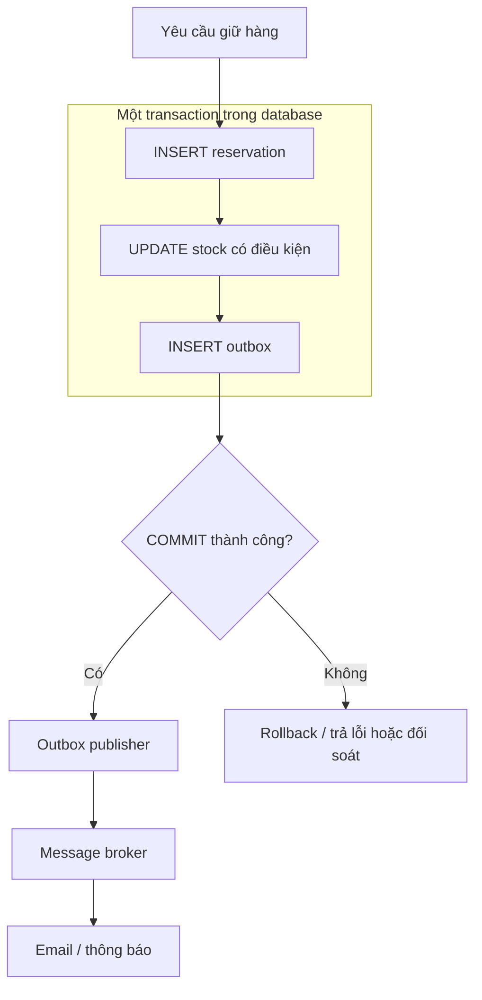
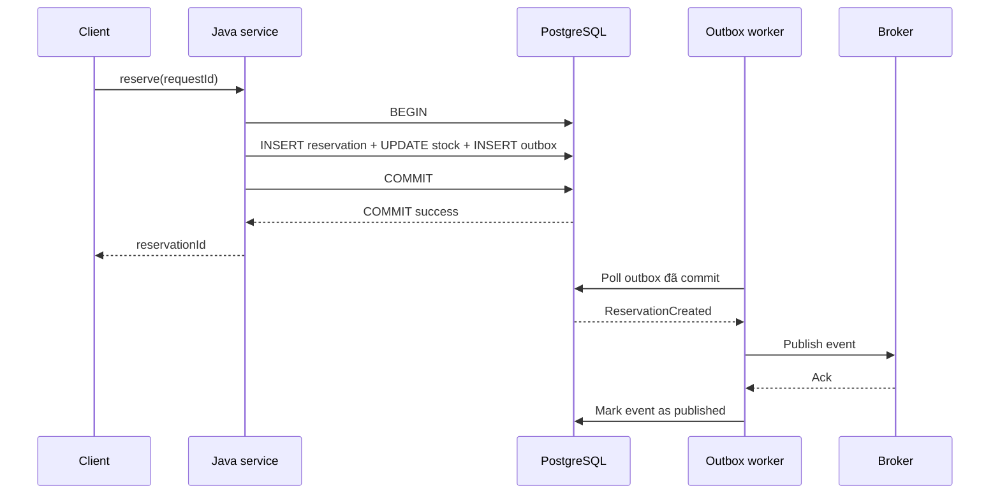
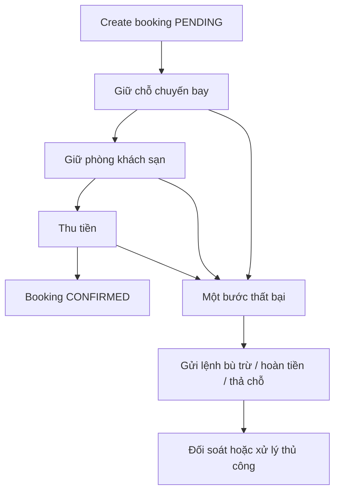

# Xác định phạm vi cập nhật cần tính nguyên tử

## 1. Vì sao cần xác định phạm vi trước khi chọn transaction?

Trong một ứng dụng Java, một thao tác nghiệp vụ thường gồm nhiều thay đổi dữ liệu: tạo đơn, giữ tồn kho, ghi thanh toán, thêm dòng lịch sử, lưu sự kiện và gửi thông báo. Nếu chương trình dừng giữa chừng, một số bước có thể hoàn tất trong khi các bước còn lại thất bại. Câu hỏi thiết kế là: **những thay đổi nào bắt buộc phải thành công hoặc thất bại cùng nhau?**

Đó là bài toán **xác định phạm vi cập nhật cần tính nguyên tử** (*atomic update boundary*). Phạm vi được quyết định từ quy tắc nghiệp vụ trước khi chọn JDBC, JPA, Spring Data, SQL hay công nghệ lưu trữ.

Ví dụ khi giữ hàng:

1. Tạo bản ghi `reservation` với mã yêu cầu của khách.
2. Giảm số lượng còn bán trong kho.
3. Lưu một sự kiện `ReservationCreated` để các tiến trình khác xử lý.
4. Gửi email xác nhận.

Nếu bước 1 thành công nhưng bước 2 không thành công, hệ thống có thể có đơn giữ hàng không được cấp tồn kho. Nếu bước 2 thành công nhưng bước 1 thất bại, hàng bị giữ mà không có đơn tương ứng. Nếu email gửi thành công nhưng database rollback, khách nhận thông báo về một giao dịch không tồn tại.

Vì thế, với một hệ thống dùng **một database giao dịch**, thường cần đưa **bản ghi reservation, cập nhật tồn kho và ý định phát sự kiện (outbox)** vào cùng transaction. Gửi email xảy ra bên ngoài transaction và được điều phối bằng một cơ chế có thể retry.

Không phải tất cả bước trong một use case đều cần hoặc có thể nằm trong cùng transaction. Việc mở rộng phạm vi vô hạn làm tăng thời gian giữ khóa, tắc nghẽn, khả năng timeout và làm khó xử lý hệ phân tán.

## 2. Định nghĩa chính xác về tính nguyên tử

**Atomicity** (chữ A trong ACID) nghĩa là một nhóm thao tác giao dịch được xem như **một đơn vị all-or-nothing**: sau khi transaction hoàn tất, các thay đổi của nhóm hoặc cùng được commit, hoặc được rollback khi giao dịch thất bại theo cơ chế của hệ lưu trữ.

Phải phân biệt các khái niệm liên quan:

| Thuộc tính | Trả lời câu hỏi | Ví dụ |
|---|---|---|
| **Atomicity** | Những thay đổi nào phải được commit hoặc rollback cùng nhau? | Trừ tồn kho và tạo reservation cùng thành công |
| **Consistency** | Các trạng thái dữ liệu sau giao dịch có tuân thủ ràng buộc và invariant không? | Không có tồn kho âm hoặc tài khoản mất cân đối |
| **Isolation** | Các transaction chạy đồng thời có được quan sát/ghi đè nhau theo quy tắc nào? | Hai yêu cầu không bán cùng một sản phẩm cuối |
| **Durability** | Sau khi commit được xác nhận, dữ liệu tồn tại qua những dạng lỗi nào? | Bản ghi đã commit còn sau khi DB khởi động lại trong mô hình lỗi được hỗ trợ |

**Atomicity không tự tạo tính đúng đắn.** Một transaction gồm toàn những câu SQL sai vẫn có thể commit nguyên tử nhưng làm lệch số dư. Ngược lại, kiểm tra nghiệp vụ đúng trong Java nhưng các câu SQL chạy ở hai transaction độc lập vẫn có thể để lại trạng thái dang dở.

**Một transaction cục bộ không bao phủ mọi tác động ngoài database.** Việc gửi HTTP, gửi email, gọi cổng thanh toán, ghi file hoặc xuất message ra broker thường không được rollback chỉ vì database rollback. Muốn nhất quán xuyên hệ thống, cần thiết kế quy trình phối hợp và xử lý thất bại riêng.

**Không dùng atomicity để thay thế isolation.** Đọc tồn kho, thấy còn 1 và sau đó tạo reservation trong một transaction chưa chắc an toàn nếu hai transaction cùng đọc rồi ghi mà không có cơ chế đồng thời phù hợp.

## 3. Xuất phát từ invariant nghiệp vụ

Một *invariant* là điều kiện phải luôn đúng ở các **mốc mà hệ thống cam kết trạng thái hợp lệ**, thường là sau mỗi transaction commit.

Ví dụ:

- Không có `reservation` thành công mà không có lượng hàng tương ứng đã được giữ.
- Tổng số lượng hàng được giữ không vượt quá năng lực bán đã được ghi nhận.
- Mỗi `request_id` chỉ dẫn đến tối đa một hiệu ứng giữ hàng thành công.
- Một giao dịch chuyển tiền phải ghi đồng thời khoản trừ và khoản cộng tương ứng.
- Một trạng thái `PAID` chỉ xuất hiện khi điều kiện nghiệp vụ xác nhận thanh toán đã thỏa.
- Mỗi thay đổi quan trọng đã commit cần có sự kiện outbox để có thể gửi đến hệ thống nhận.

Không phải mọi invariant đều xử lý bằng một transaction đơn giản. Nhưng để tìm phạm vi nguyên tử, hãy bắt đầu từ câu hỏi:

> Nếu hệ thống dừng ngay sau **bất kỳ** bước ghi nào, những tập thay đổi nào không được phép tồn tại độc lập?

### 3.1. Lập bảng phụ thuộc

Giả sử quy trình tạo reservation gồm:

| Bước | Thao tác | Nếu commit độc lập thì rủi ro gì? | Quyết định ban đầu |
|---|---|---|---|
| A | Ghi `reservation` | Có reservation không có tồn kho được giữ | Cùng transaction với B |
| B | Giảm `stock.available` | Hàng bị trừ nhưng không truy được reservation | Cùng transaction với A |
| C | Ghi `outbox` | A+B có thể commit nhưng không có dấu vết sự kiện cần phát | Cùng transaction với A+B |
| D | Phát message tới broker | Broker có thể nhận message dù DB rollback | Thực hiện sau commit qua outbox |
| E | Gửi email | Không thể rollback email đã gửi | Tác vụ bất đồng bộ, xử lý lặp |
| F | Cập nhật dashboard phân tích | Không nhất thiết phải chính xác tức thì | Dữ liệu dẫn xuất, có thể cập nhật sau |

Bảng quyết định dựa trên **mức cam kết nghiệp vụ**. Nếu email chính là điều kiện pháp lý/kinh doanh để hoàn tất một bước, ứng dụng có thể phải dùng trạng thái trung gian `PENDING_NOTIFICATION` và một quy trình xác nhận; điều đó vẫn không làm email trở thành thao tác rollback được bởi database.

### 3.2. Sơ đồ ranh giới nguyên tử



Mũi tên thể hiện thứ tự ý tưởng. Trong thực tế, publisher là tiến trình độc lập đọc dữ liệu đã commit trong outbox, không nhận một “lời gọi callback chắc chắn xảy ra” từ transaction.

## 4. Cách tìm phạm vi nguyên tử theo từng bước

### Bước 1 — Xác định thao tác nghiệp vụ và thời điểm được xem là thành công

Định nghĩa người dùng đang yêu cầu điều gì: “giữ 2 sản phẩm”, “chuyển 100.000 đồng”, “hủy đăng ký”, “cập nhật địa chỉ”. Tránh lấy số API call hoặc số repository làm phạm vi transaction một cách máy móc.

Cần làm rõ thông điệp trả về. Ví dụ, `201 Created` sau commit có nghĩa khác với `202 Accepted` khi yêu cầu mới được nhận vào hàng đợi để xử lý sau.

### Bước 2 — Viết các invariant thành câu kiểm chứng được

Thay vì “dữ liệu phải nhất quán”, viết: “Không có đơn `CONFIRMED` nếu không ghi nhận được lượng hàng đã giữ”, hoặc “Mỗi `transfer_id` có đúng một bộ bút toán hợp lệ”.

Invariant càng rõ thì càng dễ nhận ra các thay đổi cần gộp.

### Bước 3 — Liệt kê tất cả ghi và nguồn dữ liệu có thẩm quyền

Ghi rõ mỗi thay đổi ở đâu: bảng nào, database nào, object storage, cache, broker, hệ thống đối tác. Đừng mặc định hai repository nằm trong cùng transaction nếu chúng dùng các `DataSource` hoặc cơ sở dữ liệu khác nhau.

### Bước 4 — Tìm quan hệ “không thể commit riêng”

Nếu A commit mà B rollback sẽ vi phạm invariant, đánh dấu A và B cần cùng ranh giới nguyên tử **nếu hệ lưu trữ hỗ trợ**. Nếu nhóm liên quan một database giao dịch, dùng transaction và các ràng buộc tương ứng.

Nếu A, B ở những hệ lưu trữ độc lập, phải điều chỉnh workflow/hợp đồng nghiệp vụ hoặc dùng cơ chế phối hợp chuyên biệt; một annotation `@Transactional` thông thường không biến nhiều hệ thống thành một transaction phân tán.

### Bước 5 — Xác định thao tác có thể bất đồng bộ

Tìm các bước có thể chạy sau commit, có thể retry, hoặc có thể sinh dữ liệu dẫn xuất: email, search index, analytics, cache invalidation, notification.

Nếu một bước bên ngoài bắt buộc phải xảy ra trước khi nghiệp vụ được coi là hoàn tất, cân nhắc mô hình **state machine** (chẳng hạn `PENDING → COMPLETED`) và quy trình xác nhận có thể khôi phục.

### Bước 6 — Xác định cạnh tranh, lỗi và ngân sách hiệu năng

Với mỗi ranh giới: bao nhiêu hàng được khóa, transaction kéo dài bao lâu, có rủi ro deadlock không, isolation nào đủ, còn bao nhiêu lần retry an toàn? Ranh giới càng lớn có thể càng dễ duy trì tính nhất quán cục bộ nhưng tăng chi phí khóa và khả năng thất bại.

### Bước 7 — Thiết kế kiểm chứng

Thử crash tại các mốc trước SQL, sau SQL, trước commit, sau commit nhưng trước phản hồi. Thử hai yêu cầu đồng thời, retry cùng khóa và các sự cố hệ thống phụ thuộc.

## 5. Ví dụ 1: Giữ tồn kho trong một database

Giả sử database PostgreSQL lưu số tồn và reservation. Một yêu cầu chỉ có thể thành công nếu:

1. Có ít nhất `quantity` sản phẩm còn bán.
2. Tồn kho giảm đúng `quantity`.
3. Có bản ghi reservation cho yêu cầu.
4. Có một event trong outbox để đồng bộ cho hệ thống khác.
5. Mọi bước trên được commit cùng nhau.

### 5.1. Schema và ràng buộc

```sql
CREATE TABLE stock (
    sku TEXT PRIMARY KEY,
    available INTEGER NOT NULL CHECK (available >= 0)
);

CREATE TABLE reservations (
    id UUID PRIMARY KEY,
    request_id UUID NOT NULL UNIQUE,
    sku TEXT NOT NULL REFERENCES stock(sku),
    quantity INTEGER NOT NULL CHECK (quantity > 0),
    created_at TIMESTAMPTZ NOT NULL DEFAULT now()
);

CREATE TABLE outbox_events (
    event_id UUID PRIMARY KEY,
    reservation_id UUID NOT NULL REFERENCES reservations(id),
    event_type TEXT NOT NULL,
    payload JSONB NOT NULL,
    created_at TIMESTAMPTZ NOT NULL DEFAULT now(),
    published_at TIMESTAMPTZ
);
```

Ở đây:

- `CHECK (available >= 0)` ngăn lưu giá trị tồn kho âm.
- `UNIQUE (request_id)` ngăn tạo hai reservation đã commit cho cùng một khóa yêu cầu.
- Khóa ngoại bảo vệ quan hệ giữa reservation và mã hàng.
- Transaction sẽ gộp việc giảm tồn kho, tạo reservation và thêm outbox.

Các ràng buộc SQL là một lớp bảo vệ quan trọng khi hệ thống có nhiều đường ghi, không chỉ một service Java.

### 5.2. Tại sao “đọc rồi ghi” là chưa đủ?

Đoạn logic sau không tự bảo vệ cạnh tranh:

```java
Stock stock = repository.findBySku(sku);
if (stock.getAvailable() >= quantity) {
    repository.updateAvailable(sku, stock.getAvailable() - quantity);
    repository.insertReservation(...);
}
```

Hai giao dịch cùng đọc `available = 1` có thể đều cho rằng còn hàng. Nếu câu lệnh cập nhật ghi đè giá trị cũ, cả hai có thể tạo reservation. Việc gọi nhiều repository bên trong một transaction vẫn cần **isolation hoặc cập nhật nguyên tử** phù hợp.

Với một hàng tồn kho, cách đơn giản hơn là cập nhật có điều kiện tại database:

```sql
UPDATE stock
SET available = available - :quantity
WHERE sku = :sku
  AND available >= :quantity;
```

Chỉ tiếp tục khi row count bằng 1. Trong PostgreSQL ở `READ COMMITTED`, cập nhật cạnh tranh trên cùng hàng sẽ được phối hợp bằng khóa hàng và đánh giá điều kiện khi có thể cập nhật; yêu cầu đến sau không thể tiếp tục trừ nếu số lượng không còn đủ.

### 5.3. JDBC: một connection, một transaction

Đây là ví dụ triển khai để minh họa ranh giới nguyên tử. Các câu lệnh đều dùng cùng `Connection` đến PostgreSQL.

```java
import javax.sql.DataSource;
import java.sql.*;
import java.util.UUID;

public final class ReservationService {
    private final DataSource dataSource;

    public ReservationService(DataSource dataSource) {
        this.dataSource = dataSource;
    }

    public UUID reserve(UUID requestId, String sku, int quantity)
            throws SQLException {
        if (requestId == null || sku == null
                || sku.isBlank() || quantity <= 0) {
            throw new IllegalArgumentException("Invalid request");
        }

        try (Connection connection = dataSource.getConnection()) {
            connection.setTransactionIsolation(
                Connection.TRANSACTION_READ_COMMITTED);
            connection.setAutoCommit(false);

            try {
                UUID reservationId = UUID.randomUUID();
                int inserted;

                try (PreparedStatement ps = connection.prepareStatement("""
                    INSERT INTO reservations(id, request_id, sku, quantity)
                    VALUES (?, ?, ?, ?)
                    ON CONFLICT (request_id) DO NOTHING
                    """)) {
                    ps.setObject(1, reservationId);
                    ps.setObject(2, requestId);
                    ps.setString(3, sku);
                    ps.setInt(4, quantity);
                    inserted = ps.executeUpdate();
                }

                if (inserted == 0) {
                    // Cùng request_id: chỉ trả kết quả cũ nếu payload giống.
                    try (PreparedStatement ps = connection.prepareStatement("""
                        SELECT id, sku, quantity
                        FROM reservations WHERE request_id = ?
                        """)) {
                        ps.setObject(1, requestId);
                        try (ResultSet rs = ps.executeQuery()) {
                            if (!rs.next()) {
                                throw new SQLException("Request is unresolved");
                            }
                            if (!sku.equals(rs.getString("sku"))
                                    || quantity != rs.getInt("quantity")) {
                                throw new IllegalArgumentException(
                                    "request_id reused with different data");
                            }
                            UUID existing = (UUID) rs.getObject("id");
                            connection.rollback();
                            return existing;
                        }
                    }
                }

                int changed;
                try (PreparedStatement ps = connection.prepareStatement("""
                    UPDATE stock
                    SET available = available - ?
                    WHERE sku = ? AND available >= ?
                    """)) {
                    ps.setInt(1, quantity);
                    ps.setString(2, sku);
                    ps.setInt(3, quantity);
                    changed = ps.executeUpdate();
                }

                if (changed != 1) {
                    throw new IllegalStateException("Insufficient stock");
                }

                try (PreparedStatement ps = connection.prepareStatement("""
                    INSERT INTO outbox_events
                        (event_id, reservation_id, event_type, payload)
                    VALUES (?, ?, 'RESERVATION_CREATED',
                        jsonb_build_object(
                            'reservationId', ?, 'sku', ?, 'quantity', ?))
                    """)) {
                    ps.setObject(1, UUID.randomUUID());
                    ps.setObject(2, reservationId);
                    ps.setString(3, reservationId.toString());
                    ps.setString(4, sku);
                    ps.setInt(5, quantity);
                    ps.executeUpdate();
                }

                connection.commit();
                return reservationId;
            } catch (SQLException | RuntimeException failure) {
                try {
                    connection.rollback();
                } catch (SQLException rollbackFailure) {
                    failure.addSuppressed(rollbackFailure);
                }
                throw failure;
            }
        }
    }
}
```

Các thao tác bắt buộc cùng thành công nằm giữa `setAutoCommit(false)` và `commit()`. Nếu không đủ tồn kho hoặc outbox insert thất bại, đường xử lý ngoại lệ rollback những thay đổi chưa commit.

Ở PostgreSQL, `INSERT ... ON CONFLICT DO NOTHING` trên khóa `request_id` cùng một thao tác đọc sau đó là một cách xử lý retry đồng thời tại `READ COMMITTED`. Cần giữ bản ghi idempotency đủ lâu theo hợp đồng API, và kiểm tra request payload để tránh cùng khóa nhưng nội dung khác.

**Giới hạn quan trọng:** Nếu `commit()` phát sinh timeout hoặc mất kết nối, ứng dụng có thể **không biết** database đã commit hay chưa. Nỗ lực `rollback()` sau đó không chứng minh được commit trước đó chưa xảy ra. Client phải retry bằng **cùng `request_id`** hoặc tra cứu trạng thái đã lưu, không sinh một yêu cầu nghiệp vụ mới một cách mù quáng.

### 5.4. Outbox và đường gửi message

Publisher độc lập lấy các hàng outbox đã commit, gửi sự kiện đến broker rồi đánh dấu đã gửi.



Nếu worker chết **sau khi broker nhận event nhưng trước khi đánh dấu outbox**, sự kiện sẽ được gửi lại. Do đó hệ nhận cần **idempotency theo `event_id`**. Outbox bảo đảm thay đổi nghiệp vụ và *ý định gửi* được lưu nguyên tử, **không** bảo đảm email hoặc broker nhận sự kiện đúng một lần.

## 6. Ví dụ 2: Chuyển tiền và invariant nhiều bản ghi

Chuyển tiền từ ví A sang ví B có điều kiện nghiệp vụ:

- Tài khoản A đủ số dư.
- A giảm đúng số tiền chuyển.
- B tăng đúng số tiền chuyển.
- Có bản ghi giao dịch và các dòng ledger theo quy tắc kế toán.
- Không xử lý lặp một `transfer_id`.

Nếu số dư được lưu trong **cùng một database giao dịch**, có thể đưa các thay đổi vào một transaction. Ví dụ ở mức ý tưởng:

```sql
BEGIN;

-- Đảm bảo mỗi yêu cầu chuyển tiền chỉ được ghi nhận một lần.
INSERT INTO transfers(id, source_id, destination_id, amount, status)
VALUES (:transfer_id, :source, :destination, :amount, 'PENDING');

-- Trừ số dư có điều kiện; yêu cầu đúng 1 hàng được cập nhật.
UPDATE wallets
SET balance = balance - :amount
WHERE id = :source AND balance >= :amount;

-- Nếu số hàng cập nhật != 1: ROLLBACK, không thực hiện bước sau.

UPDATE wallets
SET balance = balance + :amount
WHERE id = :destination;

-- Nếu số hàng cập nhật != 1: ROLLBACK.
-- Ghi những bút toán cân đối theo mô hình ledger được chọn.
INSERT INTO ledger_entries(transfer_id, wallet_id, delta)
VALUES
    (:transfer_id, :source, -:amount),
    (:transfer_id, :destination, :amount);

UPDATE transfers
SET status = 'COMPLETED'
WHERE id = :transfer_id;

COMMIT;
```

Các dòng `BEGIN`/`COMMIT` trên là **phác thảo transaction**, không phải script SQL hoàn chỉnh để chạy nguyên văn: ứng dụng phải kiểm tra row count, giá trị amount dương, hai tài khoản hợp lệ, kiểu số chính xác, khóa duy nhất, quy tắc ledger và rollback khi lỗi. Ví dụ giả định tồn tại những bảng và constraint tương ứng.

Nếu một ví không tồn tại hoặc người chuyển không đủ tiền, cả transaction phải rollback. Nếu chỉ tách thành hai API gọi độc lập, lỗi giữa hai lần gọi có thể dẫn đến ghi nợ mà chưa ghi có.

### 6.1. Thứ tự khóa và deadlock

Hai giao dịch chuyển ngược chiều A → B và B → A có thể khóa hai hàng theo hai thứ tự đối nghịch, dẫn tới deadlock. Cách giảm rủi ro là **khóa các tài khoản theo thứ tự xác định** (ví dụ ID tăng dần) rồi mới cập nhật, đồng thời giữ transaction ngắn. Database có thể vẫn phát hiện deadlock hoặc serialization failure; ứng dụng cần retry **toàn bộ transaction** theo khóa yêu cầu ổn định và có giới hạn.

Một số nghiệp vụ thanh toán thực tế cần ledger bất biến, kiểm soát cân đối kép, chính sách rounding và đối soát; chỉ lưu số dư trên hai hàng không đủ để đáp ứng các yêu cầu đó. Bài toán ở đây là nhận ra **nhóm cập nhật phải commit cùng nhau**.

### 6.2. Khi điều kiện trải qua nhiều hàng

Giả sử lịch trực của bệnh viện có invariant “luôn có ít nhất một bác sĩ trực”. Hai transaction có thể cùng đọc thấy hai người đang trực rồi mỗi transaction cho một người nghỉ, cập nhật trên **hai hàng khác nhau**. Kết quả cả hai đều nghỉ.

Mỗi transaction có thể atomic và không xảy ra ghi đè cùng hàng; invariant vẫn bị phá vì **write skew** ở mức isolation chưa đủ.

Giải pháp tùy DBMS và mô hình dữ liệu: sử dụng `SERIALIZABLE` và retry giao dịch khi serialization failure, khóa một bản ghi điều phối chung, hoặc tái thiết kế ràng buộc để database bảo vệ trực tiếp. Đừng suy ra một transaction tự giải quyết mọi cạnh tranh.

## 7. Xác định “một transaction” ở tầng Java

### 7.1. JDBC thuần: phải dùng cùng connection

Một connection JDBC với `autoCommit=false` thường đại diện cho một transaction của database đang làm việc trên connection đó. Gọi hai repository dùng **hai connection khác nhau** rồi commit riêng không tạo ra atomicity chung.

```java
try (Connection connection = dataSource.getConnection()) {
    connection.setAutoCommit(false);
    try {
        stockDao.reserve(connection, sku, quantity);
        reservationDao.create(connection, requestId, sku, quantity);
        outboxDao.append(connection, event);
        connection.commit();
    } catch (Exception e) {
        connection.rollback();
        throw e;
    }
}
```

Ví dụ giả định các DAO nhận cùng `Connection` và phát SQL phù hợp. Đây là **một ranh giới transaction** rõ ràng; không để mỗi DAO tự mở connection và auto-commit từng câu lệnh. Trong code thật, khi rollback lỗi, nên đính kèm lỗi rollback vào lỗi gốc để không che nguyên nhân.

### 7.2. Spring `@Transactional`: đặt ở use case, hiểu cơ chế thực thi

Một service có thể tổ chức như sau:

```java
@Service
public class ReservationApplicationService {
    private final StockRepository stockRepository;
    private final ReservationRepository reservationRepository;
    private final OutboxRepository outboxRepository;

    public ReservationApplicationService(
            StockRepository stockRepository,
            ReservationRepository reservationRepository,
            OutboxRepository outboxRepository) {
        this.stockRepository = stockRepository;
        this.reservationRepository = reservationRepository;
        this.outboxRepository = outboxRepository;
    }

    @Transactional
    public UUID reserve(ReserveCommand command) {
        UUID id = reservationRepository.createIfAbsent(command);

        stockRepository.decrementIfAvailable(
            command.sku(), command.quantity());

        outboxRepository.appendCreated(id, command);

        return id; // Transaction proxy commit khi method kết thúc thành công.
    }
}
```

Đây là **phác thảo tổ chức service**, không phải code chạy ngay: các repository cần thực thi đúng validation, idempotency, row-count, constraint và xử lý lỗi. Cần đảm bảo ứng dụng đã cấu hình transaction manager phù hợp, các repository tham gia **cùng database transaction**.

Cần đặc biệt lưu ý:

- `@Transactional` thường có hiệu lực khi phương thức được gọi **qua Spring proxy**; self-invocation trong cùng đối tượng có thể bỏ qua advice ở cấu hình proxy mặc định.
- Với Spring mặc định, ngoại lệ không kiểm tra (`RuntimeException`) và `Error` gây rollback; checked exception không mặc định gây rollback nếu không cấu hình `rollbackFor` hoặc chính sách tương đương.
- `save()` hoặc `flush()` không đồng nghĩa với commit. Nếu có transaction ở tầng service, commit thường xảy ra khi lời gọi qua proxy hoàn tất.
- `Propagation.REQUIRES_NEW` tạo transaction riêng; commit của nó **không bị rollback bởi transaction cha** nếu transaction cha thất bại về sau.
- Bất đồng bộ qua thread, một service khác hoặc một `DataSource` không được quản lý bởi cùng transaction manager thường không tự tham gia transaction hiện tại.
- Không kéo dài transaction để chờ HTTP, email, người dùng thao tác trên giao diện hoặc xử lý tệp lớn.

Cần nhận diện ranh giới thực tế ở runtime, không chỉ nhìn annotation rồi kết luận mọi thao tác đã nguyên tử.

### 7.3. JPA persistence context và flush

Trong JPA, sửa entity managed có thể chưa phát SQL ngay. `flush()` đồng bộ thay đổi xuống database **trong transaction**, nhưng transaction vẫn có thể rollback. Một entity có ID hoặc một lệnh `repository.save(entity)` không phải bằng chứng đã commit.

Ví dụ:

```java
@Transactional
public void updateOrder(UUID id) {
    OrderEntity order = entityManager.find(OrderEntity.class, id);
    order.markPaid();         // Thay đổi object managed trong JVM.
    entityManager.flush();   // Có thể gửi SQL; chưa commit.
    outboxRepository.addPaidEvent(id);
    // Commit chỉ sau khi transaction hoàn tất.
}
```

Nếu đòi hỏi outbox được ghi cùng cập nhật đơn, bảo đảm thao tác outbox dùng **cùng transaction manager và resource**. Khi rollback, trạng thái trong object Java không nhất thiết được khôi phục về giá trị trước đó; không tiếp tục xem object đã sửa là trạng thái đã lưu.

## 8. Ranh giới cục bộ và ranh giới phân tán

Khi mọi thay đổi quan trọng nằm trong một database có transaction, một ranh giới all-or-nothing là lựa chọn tự nhiên. Khi bước nghiệp vụ trải qua database, broker, thanh toán và kho file, phạm vi nguyên tử **không thể mặc nhiên kéo dài** qua tất cả hệ thống.

| Trường hợp | Ranh giới thường chọn | Cách quản lý phần bên ngoài |
|---|---|---|
| Hai bảng trong cùng database giao dịch | Một DB transaction | Constraint, lock, commit/rollback |
| Cập nhật DB và gửi event | DB update + outbox trong một transaction | Publisher, idempotent consumer, retry |
| DB và hệ thống gửi email | DB ghi trạng thái/ý định gửi | Worker phát email; trạng thái gửi và đối soát |
| Tạo đơn và gọi cổng thanh toán | Transaction cục bộ cho mỗi bước bền vững | Saga/state machine, idempotency, trạng thái pending |
| Hai database độc lập | Transaction cục bộ cho từng database | Phối hợp phân tán hoặc thiết kế lại ownership/nguồn dữ liệu |
| Ghi DB và lưu file lên object storage | DB transaction cho metadata và ý định | Upload trước/sau theo quy trình có kiểm chứng, cleanup và retry |

**Distributed transaction** (ví dụ cơ chế hai pha commit/2PC) có thể phối hợp nhiều resource khi tất cả bên tham gia hỗ trợ, nhưng tăng độ phức tạp, phụ thuộc thời gian sống của coordinator và ảnh hưởng tính sẵn sàng khi có lỗi. Không nên coi nó là lựa chọn mặc định của mọi microservice.

### 8.1. Saga không phải rollback ACID toàn cục

Giả sử đặt vé máy bay kết hợp nhiều dịch vụ:



Mỗi dịch vụ chỉ có thể commit thay đổi cục bộ. Nếu thu tiền thành công nhưng giữ phòng thất bại, hệ thống cần thực hiện **compensation**: hoàn tiền, hủy giữ chỗ, hoặc chuyển trạng thái yêu cầu sang cần đối soát.

Compensation không tương đương đảo ngược mọi hiệu ứng tức thời. Email đã gửi, phí thanh toán hoặc lịch sử ngoài hệ thống có thể không đảo ngược được. Một saga tốt cần trạng thái trung gian rõ ràng, timeout, idempotency, cơ chế retry có giới hạn và xử lý bước bù trừ thất bại.

### 8.2. Chọn điểm phát biểu “thành công”

Một API thường có các mốc:

- **Accepted:** Đã tiếp nhận yêu cầu để xử lý sau.
- **Locally committed:** Transaction cục bộ thành công, có thể còn tích hợp chưa hoàn tất.
- **Business completed:** Toàn bộ điều kiện nghiệp vụ theo hợp đồng đã đạt.
- **Compensating / needs review:** Một bước đã xảy ra nhưng kết quả chung chưa hoàn tất hoặc chưa thể xác nhận.

Không nên trả “đặt vé hoàn tất” chỉ vì đã tạo bản ghi `PENDING` trong database. Cần xác định **trạng thái nào thật sự có thể cam kết** và thiết kế response phù hợp.

## 9. Nguyên tử đến đâu là đủ: nguy cơ transaction quá lớn

Transaction có phạm vi quá rộng thường gây:

- Giữ khóa nhiều hàng trong thời gian dài, tăng lock wait và deadlock.
- Tạo nhiều WAL/undo, gây áp lực I/O và thời gian khôi phục.
- Tăng nguy cơ timeout; rollback phải làm lại nhiều công việc.
- Làm giảm throughput và khả năng phục vụ khi một hệ phụ thuộc chậm.
- Dễ lẫn thao tác không rollback được, như HTTP hoặc broker.

### 9.1. Tách dữ liệu có thể tái tạo

Ví dụ hệ thống thay đổi địa chỉ giao hàng:

- Ghi địa chỉ mới và version của đơn: cần một transaction để không có trạng thái mâu thuẫn.
- Ghi outbox event `ShippingAddressChanged`: có thể cần cùng transaction với địa chỉ nếu yêu cầu phát sự kiện không được mất.
- Cập nhật search index và cache: thường có thể cập nhật sau commit, thử lại hoặc tái tạo.
- Tính lại biểu đồ thống kê: có thể chạy theo batch, không cần khóa transaction cập nhật đơn.

Điều kiện để tách là **mức nhất quán chậm cập nhật được chấp nhận và có thể phục hồi**, chứ không chỉ vì việc đó “chạy lâu”.

### 9.2. Phần lớn batch không nên nằm trong một transaction khổng lồ

Một job nhập một triệu bản ghi có thể chia thành nhiều transaction nhỏ nếu yêu cầu là “mỗi bản ghi hợp lệ và báo cáo số bản ghi thành công”. Nếu hợp đồng yêu cầu “toàn bộ tệp hoặc không bản ghi nào tồn tại”, cần thiết kế khác: có thể đưa vào bảng staging theo batch rồi **publish một phiên bản dữ liệu hoàn chỉnh** bằng một thao tác nguyên tử nhỏ, hoặc dùng transaction lớn nếu tải cho phép.

Thiết kế theo ranh giới nghiệp vụ thường tốt hơn việc cố gộp mọi byte của một quy trình dài vào một transaction.

## 10. Cách xử lý lỗi và retry theo ranh giới

| Lỗi | Điều có thể đã xảy ra | Hành vi cần thiết |
|---|---|---|
| Validation thất bại trước khi ghi | Chưa có thay đổi DB | Trả lỗi rõ; không bắt đầu transaction nếu không cần |
| Câu `UPDATE` trả row count = 0 | Điều kiện không thỏa hoặc đã có xung đột | Rollback nhóm; trả trạng thái nghiệp vụ/xung đột |
| Constraint violation ở SQL/flush | Transaction có thể không còn hợp lệ để tiếp tục | Rollback; phân loại lỗi trước khi quyết định retry |
| Deadlock / serialization failure | Database hủy một transaction | Retry **toàn bộ** transaction với giới hạn và backoff nếu nghiệp vụ an toàn |
| Mất kết nối sau khi gọi `commit()` | Kết quả có thể đã commit hoặc chưa | Tra cứu bằng idempotency key; không thực hiện tác động kép |
| Publisher gửi event nhưng chết trước ACK | Broker có thể đã nhận event | Phát lại an toàn; consumer khử trùng lặp |
| Dịch vụ thanh toán trả timeout | Không chắc giao dịch thanh toán đã xảy ra | Dùng khóa idempotency của đối tác và quy trình tra cứu/đối soát |

**Retry transaction** cần được thực hiện từ điểm mà logic có thể đọc lại dữ liệu mới. Retry một câu `UPDATE` đơn lẻ mà bỏ qua bước kiểm tra nghiệp vụ có thể sai. Retry cũng phải giữ nguyên khóa yêu cầu và payload; không tạo tác động ngoài DB trước khi biết kết quả commit.

Đối với tiền, tồn kho, quyền truy cập và thay đổi khó hoàn tác, trạng thái **“chưa xác định, cần đối soát”** là kết quả có ý nghĩa. Trả “đã thất bại chắc chắn” khi không biết kết quả commit có thể khiến người dùng gửi lại lệnh mới và gây trùng.

## 11. Liên hệ với schema, isolation và concurrency

Đúng phạm vi transaction là cần thiết nhưng **chưa đủ**; hãy phối hợp với:

### 11.1. Constraint ở database

Dùng `PRIMARY KEY`, `UNIQUE`, `CHECK`, `NOT NULL`, khóa ngoại và các ràng buộc phù hợp để mã hóa quy tắc có thể kiểm tra tại nơi ghi. Chúng ngăn những đường ghi không đi qua Java service phá invariant.

### 11.2. Isolation đúng với loại bất thường

- `READ COMMITTED`: Thường phù hợp với cập nhật có điều kiện trên một hàng; không bảo vệ mọi invariant chéo nhiều hàng.
- `REPEATABLE READ`: Ngữ nghĩa khác nhau giữa các DBMS; không tự suy ra rằng mọi write skew đều bị loại bỏ.
- `SERIALIZABLE`: Cho hành vi tương đương một thứ tự giao dịch tuần tự theo bảo đảm của DBMS, có thể khiến transaction bị hủy để retry dưới cạnh tranh.

Cần phân tích các lịch trình cạnh tranh cụ thể cho từng invariant thay vì chọn isolation mạnh nhất hoặc yếu nhất một cách máy móc.

### 11.3. Khóa và optimistic version

- **Pessimistic lock:** Khóa dữ liệu khi thao tác có cạnh tranh cao hoặc cần điều phối; giữ ngắn.
- **Optimistic locking:** Dùng cột `version` và `WHERE version = ...`; khi row count bằng 0 thì báo conflict hoặc đọc lại.
- **Atomic conditional update:** Phù hợp khi invariant gói gọn trong thao tác cập nhật một hàng.
- **Advisory lock hoặc hàng điều phối:** Có thể hữu ích cho một khóa nghiệp vụ chung, nhưng cần hiểu phạm vi khóa và xử lý khi tiến trình chết.

Khi invariant trải qua nhiều hàng và không thể biểu diễn bằng constraint đơn giản, phải chọn cơ chế khóa hoặc isolation phù hợp rồi **test cạnh tranh thực tế**.

## 12. Những chi tiết làm ranh giới “đã đúng trên giấy” bị phá vỡ

### 12.1. Mỗi repository tự commit

```text
orderDao.insert()   --> connection A, autoCommit=true
stockDao.decrease() --> connection B, autoCommit=true
```

Hai thao tác này có thể commit độc lập dù cùng được gọi trong một phương thức Java. Cần bảo đảm transaction manager tham gia đúng trên toàn đường gọi.

### 12.2. Nuốt ngoại lệ hoặc trả thành công quá sớm

Nếu code bắt ngoại lệ khi ghi outbox rồi tiếp tục commit reservation, invariant “mỗi reservation có event” có thể bị phá. Nếu response được gửi trước commit, database có thể rollback sau khi client nhận thành công.

Nơi bắt lỗi cần quyết định rõ có **rollback toàn nhóm** hay không. Với Spring, các quy tắc rollback phải được kiểm tra khi dùng checked exception hoặc custom exception.

### 12.3. `REQUIRES_NEW` trong một chuỗi cần all-or-nothing

Nếu một bước ghi audit hoặc outbox chạy trong transaction mới và commit trước, bước còn lại rollback sẽ để lại dấu vết độc lập không phù hợp với invariant đã thiết kế. `REQUIRES_NEW` đôi khi đúng cho một loại audit thất bại hoặc hoạt động độc lập, nhưng nó không đáp ứng yêu cầu nguyên tử cùng transaction.

### 12.4. Gọi HTTP ngay bên trong transaction

Code có thể giữ khóa trong lúc chờ phản hồi chậm, rồi rollback database dù phía ngoài đã thực hiện hiệu ứng. Di chuyển bước tích hợp ra workflow bền vững hoặc mô hình saga/outbox khi phù hợp.

### 12.5. Không xử lý timeout tại commit

Khi kết nối hỏng, việc application không nhận được ACK không chứng minh transaction chưa commit. Nếu không có idempotency key và cơ chế đối soát, retry tạo lại lệnh có thể phá invariant.

### 12.6. Dùng cache để quyết định ghi

Cache tồn kho hoặc số dư có thể cũ. Cache dùng để hiển thị nhanh cần hợp đồng về độ mới; quyết định ghi phải được kiểm tra và bảo vệ tại nguồn dữ liệu có thẩm quyền.

## 13. Kiểm thử để chứng minh phạm vi nguyên tử

Kiểm thử giá trị nhất là những trường hợp cố tình làm **một bước thất bại sau khi các bước trước đã thực thi**.

| Bài thử | Cách thực hiện | Điều cần kiểm chứng |
|---|---|---|
| Reservation insert thành công, giảm tồn kho thất bại | Giả lập không đủ hàng sau khi bắt đầu transaction | Không có reservation/outbox mới, tồn kho không đổi |
| Giảm tồn kho thành công, ghi outbox thất bại | Gây lỗi constraint khi insert outbox | Toàn transaction rollback; không mất tồn kho |
| Hai yêu cầu tranh sản phẩm cuối | Cho hai request khác `request_id` cùng đến | Tối đa một request thành công, không tồn kho âm |
| Retry cùng request ID | Gửi lặp đồng thời với payload giống nhau | Một reservation và một hiệu ứng trừ hàng |
| Một request ID nhưng payload khác | Dùng cùng khóa cho số lượng/SKU khác | Không thực hiện lần ghi thứ hai; trả conflict |
| Mất phản hồi ngay sau commit | Ngắt kết nối tại ranh giới ACK | Client tra cứu/retry cùng khóa, không tạo hiệu ứng kép |
| Outbox worker chết sau publish | Cố ý crash trước đánh dấu đã phát | Consumer xử lý lặp an toàn |
| Hai chuyển tiền ngược chiều | Tạo cạnh tranh giữa hai ví | Không mất cân đối, deadlock được xử lý bằng retry phù hợp |
| Isolation không đủ | Dựng write skew nhiều hàng | Phát hiện invariant bị vi phạm ở cấu hình yếu; kiểm chứng giải pháp |

Với bài thử transaction, kiểm tra trạng thái bằng **connection độc lập sau khi giao dịch kết thúc**. Chỉ đọc lại entity trong cùng JPA persistence context có thể trả đối tượng đang được quản lý mà không chứng minh dữ liệu đã commit.

### 13.1. Mẫu test ngắn cho rollback

```java
@Test
void failingOutboxRollsBackReservationAndStock() {
    UUID requestId = UUID.randomUUID();

    // Arrange: stock còn 1; cấu hình outbox insert sẽ thất bại.
    assertThrows(RuntimeException.class,
        () -> reservationService.reserve(requestId, "BOOK-1", 1));

    // Assert qua transaction/connection MỚI:
    assertEquals(1, stockQueries.available("BOOK-1"));
    assertFalse(reservationQueries.existsByRequestId(requestId));
    assertEquals(0, outboxQueries.countByRequestId(requestId));
}
```

Đây là **mẫu ý tưởng**: những fixture, query helper và cách tiêm lỗi cần được định nghĩa trong dự án. Lỗi outbox phải thực sự được phát sinh **bên trong transaction** mà test đang kiểm chứng. Nếu phương thức test tự bọc toàn bộ trong một transaction rollback mặc định, kết quả có thể bị che khuất; cần thiết kế kiểm thử để xác nhận việc commit/rollback của service trong điều kiện thực.

## 14. Mẫu quyết định ranh giới cho một yêu cầu mới

Trước khi viết code, có thể điền mẫu sau cho mỗi use case:

| Câu hỏi | Ví dụ trả lời cho `reserveStock` |
|---|---|
| Lệnh nghiệp vụ là gì? | Giữ `quantity` sản phẩm theo `request_id` |
| Invariant sau commit? | Không oversell, một request chỉ giữ một lần, có outbox event |
| Những ghi nào phải atomic? | `reservations`, `stock`, `outbox_events` |
| Nơi chứa các ghi? | Cùng PostgreSQL database |
| Transaction bắt đầu/kết thúc ở đâu? | Service/repository dùng một transaction; commit trước phản hồi thành công |
| Cạnh tranh nào phải xử lý? | Hai request cùng SKU, retry cùng ID |
| Cơ chế đồng thời? | `UPDATE ... WHERE available >= ?`; `UNIQUE(request_id)` |
| Hệ ngoài transaction? | Broker, email, analytics, cache |
| Cơ chế tích hợp? | Outbox + publisher retry + consumer idempotent |
| Khi commit không xác định? | Retry/tra cứu cùng `request_id`, không tạo lệnh mới |
| Kiểm thử bắt buộc? | Lỗi từng bước, xung đột, retry, timeout, crash |

Mẫu này giúp xác định phạm vi dựa trên **quy tắc dữ liệu** thay vì tổ chức package Java. Một controller có thể gọi nhiều service, nhưng transaction cần được đặt ở nơi sở hữu trọn vẹn các thay đổi phải all-or-nothing. Với quy trình nhiều hệ thống, phải mô tả nhiều ranh giới cục bộ và cách phối hợp giữa chúng.

## 15. Tự kiểm tra

**Tình huống A — Giao dịch đơn hàng:** Ứng dụng tạo đơn, trừ tồn kho và ghi outbox trong ba repository. Mỗi repository tự lấy connection và auto-commit. Vì sao chương trình vẫn có thể tạo trạng thái dang dở, dù cả ba repository đều chạy theo đúng thứ tự?

**Tình huống B — Thanh toán:** Database đã commit lệnh tạo yêu cầu thanh toán, nhưng lần gọi sang cổng thanh toán timeout. Có nên rollback SQL và khẳng định không có tiền được chuyển không? Cần quản lý trạng thái và idempotency như thế nào?

**Tình huống C — Xung đột:** Hai request đều đọc `available=1`, mỗi request trong một transaction và tạo reservation. Vì sao chỉ thêm `BEGIN/COMMIT` chưa đủ? Hãy nêu một cập nhật SQL an toàn cho một hàng.

**Tình huống D — Ranh giới quá lớn:** Khi tạo đơn hàng, ứng dụng giữ transaction mở trong lúc tạo PDF, gửi email và cập nhật dashboard. Bước nào có thể đưa ra ngoài transaction? Cần cơ chế gì để các bước đó không bị thất lạc?

**Tình huống E — Isolation:** Hai transaction thay đổi hai hàng khác nhau nhưng sau commit vi phạm điều kiện tổng. Vì sao atomicity từng transaction không chặn được điều này? Điều gì phải thay đổi?

### Gợi ý trả lời

- **A:** Các connection và auto-commit độc lập làm mỗi bước trở thành một transaction riêng; lỗi ở bước sau không rollback bước trước.
- **B:** Timeout ở hệ ngoài có thể không cho biết kết quả. Cần quy trình trạng thái `PENDING`, khóa idempotency của đối tác, truy vấn trạng thái và đối soát; transaction DB không rollback được tác động từ cổng thanh toán.
- **C:** Hai transaction có thể đều đọc dữ liệu cũ. Dùng `UPDATE stock SET available = available - 1 WHERE sku = ? AND available >= 1` và chỉ thành công khi row count bằng 1.
- **D:** PDF, email và dashboard thường là tác vụ sau commit; lưu ý định thực hiện bằng outbox/job bền vững và xử lý retry/idempotency.
- **E:** Đây có thể là write skew; cần isolation/khóa điều phối hoặc constraint thiết kế lại để bảo vệ invariant nhiều hàng.

## 16. Checklist áp dụng trong thiết kế persistence

1. Đã mô tả rõ **kết quả được coi là thành công** theo góc nhìn người dùng chưa?
2. Đã viết những **invariant sau commit** thành phát biểu kiểm chứng được chưa?
3. Đã liệt kê mọi thay đổi dữ liệu và nơi lưu, kể cả event, file, cache và hệ đối tác chưa?
4. Những thay đổi **không được tồn tại độc lập** có thực sự cùng một database transaction không?
5. Các repository dùng đúng transaction manager/connection không? Có `REQUIRES_NEW`, self-invocation hoặc async làm tách transaction không?
6. Đã bảo vệ cạnh tranh bằng constraint, row count, khóa, version hoặc isolation thích hợp chưa?
7. Có tạo tác động bên ngoài không rollback được **trước khi commit** không?
8. Khi SQL, flush hoặc commit lỗi, code có rollback thích hợp và tránh công bố thành công sai không?
9. Nếu commit outcome chưa rõ, có khóa idempotency và cơ chế tra cứu/đối soát không?
10. Nếu tách các hệ thống thành nhiều ranh giới cục bộ, có state machine, outbox/saga, retry và xử lý bù trừ không?
11. Transaction có giữ khóa ngắn, đủ tối ưu chỉ mục, timeout và tránh gọi mạng ngoài khi đang mở không?
12. Đã thử thất bại ở từng mốc, tranh chấp đồng thời, gửi lại yêu cầu và crash sau commit chưa?

**Nguyên tắc cốt lõi:** Hãy xác định phạm vi cập nhật nguyên tử từ **invariant mà nghiệp vụ cần bảo vệ**. Những thay đổi phải cùng đúng nên nằm trong một transaction của nguồn dữ liệu có thẩm quyền khi có thể; các tác động bên ngoài cần một quy trình phối hợp có trạng thái, retry và đối soát rõ ràng. Ranh giới càng chính xác thì càng dễ giữ tính đúng đắn, bảo toàn dữ liệu, kiểm soát đồng thời và duy trì hiệu năng của ứng dụng Java.
