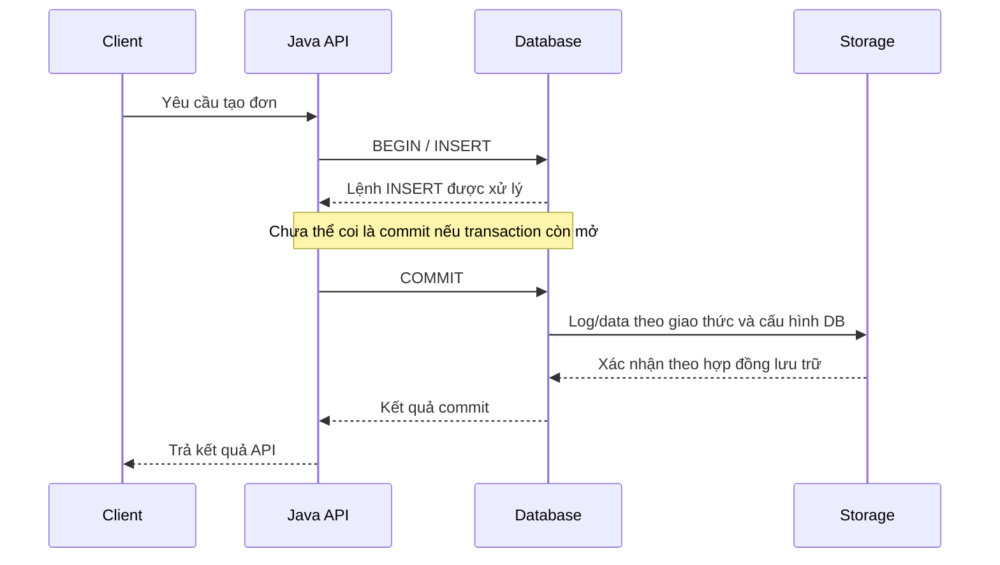
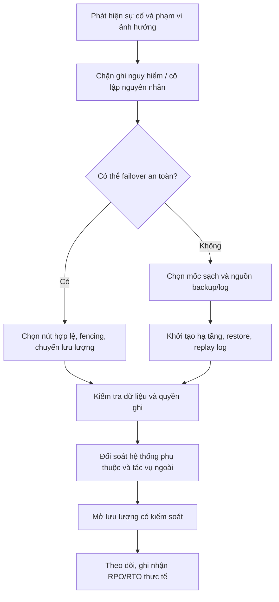

# Yêu cầu về độ bền và khả năng khôi phục

Một ứng dụng Java ghi đơn hàng thành công, trả `201 Created` và ghi log “đã lưu”. Một giờ sau ổ đĩa hỏng; ngày tiếp theo nhân viên vô tình xóa hàng loạt đơn; cuối tuần cả vùng triển khai gặp sự cố. Ba tình huống này đòi hỏi **những bảo đảm khác nhau**. Một database có thể khôi phục sau khi tiến trình bị dừng nhưng vẫn mất dữ liệu khi hỏng cả máy. Một cụm có replica có thể tiếp tục hoạt động khi một nút hỏng nhưng lại sao chép cả lệnh xóa nhầm.

Bài học thuộc chương **Yêu cầu lưu trữ** của module **DATA_PERSISTENCE_FUNDAMENTALS**. Module xây dựng nền tảng về lưu trữ dữ liệu bền vững trong ứng dụng: mô hình dữ liệu, lược đồ, truy vấn và chỉ mục; transaction, isolation và kiểm soát đồng thời; ranh giới persistence cho Java; lỗi kết nối, tiến hóa schema, bảo mật, sao lưu và tối ưu hiệu năng. Ở đây chúng ta tập trung vào cách **phát biểu, thiết kế và kiểm chứng yêu cầu về độ bền (durability) cùng khả năng khôi phục (recoverability)** trước khi lựa chọn công nghệ hoặc cấu hình.

Sau bài học, người học có thể:

- Phân biệt việc lệnh ghi hoàn tất, transaction đã commit và dữ liệu sống sót qua từng kiểu sự cố.
- Xác định phạm vi sự cố cần chịu đựng, đơn vị dữ liệu cần khôi phục và các ràng buộc nghiệp vụ.
- Viết RPO, RTO và yêu cầu khôi phục thành các tiêu chí cụ thể, có thể đo và thử nghiệm.
- Giải thích vai trò và giới hạn của WAL, lưu trữ bền vững, replica, backup, snapshot và point-in-time recovery.
- Thiết kế phương án thử nghiệm khôi phục, đối soát tính toàn vẹn và vận hành trong ứng dụng Java.

## 1. Độ bền và khôi phục là hai câu hỏi khác nhau

**Độ bền (durability)** trong ngữ cảnh transaction là việc các thay đổi đã commit được giữ lại sau những lỗi nằm trong **hợp đồng và cấu hình** của hệ lưu trữ. Đây là chữ **D** trong ACID. Phát biểu “transaction đã commit” chưa đủ để khẳng định dữ liệu không thể mất trong bất kỳ thảm họa nào.

**Khả năng khôi phục (recoverability)** là khả năng đưa dữ liệu và dịch vụ trở lại trạng thái có thể sử dụng sau khi xảy ra sự cố. Khôi phục có thể bao gồm sửa log, tự động failover, phục hồi backup, áp dụng transaction log, dựng lại chỉ mục, chuyển hướng ứng dụng và đối soát các hệ thống bên ngoài.

| Khía cạnh | Câu hỏi cần trả lời | Ví dụ bằng chứng |
| --- | --- | --- |
| **Độ bền của ghi** | Sau khi được xác nhận, bản ghi có tồn tại khi JVM, DB hay OS bị crash không? | Cấu hình commit, nhật ký giao dịch và phép thử crash/restart |
| **Chống mất nút hoặc thiết bị** | Hỏng một máy, ổ đĩa hoặc vùng khả dụng có làm mất bản ghi đã xác nhận không? | Sơ đồ vùng lỗi, cơ chế nhân bản và diễn tập failover |
| **Khôi phục lỗi logic** | Có thể quay lại trước một lệnh `DELETE` sai, lỗi migration hoặc cập nhật nhầm không? | Backup độc lập, nhật ký cho PITR, diễn tập restore |
| **Tính toàn vẹn khi khôi phục** | Dữ liệu sau khôi phục có khớp với ràng buộc và quan hệ nghiệp vụ không? | Kiểm tra constraint, số lượng, checksum, sổ cái, đối soát |
| **Khả dụng trở lại** | Bao lâu người dùng mới truy cập được dịch vụ đúng? | Thời gian phát hiện, thao tác khôi phục, xác minh và chuyển lưu lượng |
| **Bảo vệ bản khôi phục** | Backup có bị đọc hoặc xóa trái phép cùng lúc với hệ thống chính không? | Mã hóa, phân quyền, lưu ở miền lỗi riêng, bản sao chống sửa/xóa |

Một lỗi có thể được khắc phục mà không cần khôi phục backup. Ví dụ, DB process bị kill sau khi WAL đã được ghi bền vững: DB có thể tự chạy crash recovery khi khởi động. Ngược lại, DB và tất cả replica cùng ghi nhận một lệnh xóa sai thì phải dùng dữ liệu lịch sử, bản sao lưu hoặc cơ chế phục hồi nghiệp vụ.

**Sẵn sàng cao (high availability), độ bền và khôi phục là ba mục tiêu liên quan nhưng không thay thế nhau.** Failover có thể phục hồi phục vụ nhanh hơn; backup có thể lưu lịch sử; cấu hình commit quyết định điều gì được coi là ghi thành công. Một hệ thống cần cả ba ở mức phù hợp với rủi ro.

## 2. Yêu cầu phải chỉ ra hệ thống chịu được sự cố nào

Đừng viết chung chung “dữ liệu phải an toàn tuyệt đối”. Hãy xây dựng **mô hình sự cố (failure model)**: giả định sự cố xảy ra ở đâu, phạm vi lan truyền đến đâu và cần bảo vệ dữ liệu nào.

| Sự cố | Điều có thể xảy ra | Cơ chế thường cần xem xét |
| --- | --- | --- |
| JVM bị dừng đột ngột | Dữ liệu chưa commit trong bộ nhớ ứng dụng biến mất | Ghi vào kho ngoài tiến trình, transaction và xác nhận commit |
| DB process crash | Trang dữ liệu chưa được ghi thành file chính; transaction dở dang | WAL/journal, crash recovery, kiểm tra transaction đã commit |
| OS/máy mất điện | Bộ nhớ đệm dễ mất điện mất nội dung | Cấu hình flush/fsync, thiết bị hỗ trợ, cache của controller |
| Hỏng một ổ hoặc nút | Dữ liệu lưu tại một miền lỗi có thể không đọc được | Redundancy, replica, khôi phục từ backup độc lập |
| Mất cả vùng khả dụng/trung tâm dữ liệu | Nhiều bản sao cùng bị ảnh hưởng | Phân tán miền lỗi, sao chép giữa vùng theo yêu cầu |
| Mất mạng giữa các nút | Không biết nút nào được phép ghi, có thể tách cụm | Quy tắc quorum/leader, fencing, chính sách failover rõ ràng |
| Xóa nhầm, cập nhật sai, migration lỗi | Giao dịch sai vẫn được commit và nhân bản | Point-in-time recovery, snapshot lịch sử, quy trình đảo ngược |
| Ransomware hoặc tài khoản quản trị bị lộ | Dữ liệu chính và backup trực tuyến đều có thể bị sửa/xóa | Phân quyền tối thiểu, bản sao cách ly/immutable, bảo vệ khóa |
| Lỗi phần mềm âm thầm làm hỏng dữ liệu | Backup mới cũng chứa dữ liệu sai trước khi phát hiện | Giữ nhiều mốc lịch sử, phát hiện sai lệch, restore thử mốc sạch |
| Hết dung lượng hoặc đứt chuỗi backup | Ghi/backup thất bại; mất khả năng khôi phục đến thời điểm cần | Dung lượng dự phòng, cảnh báo, theo dõi log/backup chain |
| Cả kho dữ liệu và dịch vụ phụ thuộc lỗi | Khôi phục DB xong nhưng chưa thể phục vụ người dùng | Kế hoạch khôi phục ứng dụng, secrets, mạng, DNS, phụ thuộc ngoài |

**Miền lỗi (failure domain)** là tập tài nguyên có thể hỏng cùng lúc. Hai replica trên cùng một máy hoặc cùng một hệ thống lưu trữ có thể không bảo vệ khỏi mất máy. Hai backup trong cùng tài khoản bị chiếm quyền có thể cùng bị xóa. Phải kiểm tra tính độc lập thật của nguồn điện, mạng, storage, quyền quản trị và vùng.

Không phải mọi yêu cầu đều cần bảo vệ khỏi thảm họa ở quy mô lớn. Một bản nháp có thể chấp nhận mất phần chưa lưu gần nhất, còn giao dịch tài chính phải có yêu cầu nghiêm ngặt hơn. Quyết định nên dựa trên hậu quả mất dữ liệu và chi phí khôi phục, không dựa vào khẩu hiệu “zero data loss” thiếu phạm vi.

## 3. “Đã ghi thành công” nghĩa là gì ở từng lớp?

Trong đường ghi Java → DB có những mốc khác nhau:



Sơ đồ là **mô hình khái niệm**: thứ tự và việc chờ đồng bộ tới thiết bị tùy engine/cấu hình. Một số chế độ commit bất đồng bộ có thể phản hồi khi nhật ký chưa được ép xuống nơi lưu bền vững.

- Gọi `entityManager.persist(entity)` hoặc `repository.save(entity)` có thể mới đăng ký thay đổi trong persistence context.
- `flush()` đưa những thay đổi đang chờ thành câu lệnh SQL, nhưng **không phải commit**. Transaction vẫn có thể rollback.
- `executeUpdate()` có thể chạy bên trong transaction chưa commit. Với JDBC `autoCommit=true`, quy tắc commit khác với khi tắt auto-commit.
- `Connection.commit()` trả về thành công có ý nghĩa theo cam kết của DB và chế độ đồng bộ được cấu hình. Nó không thay thế backup, nhân bản giữa vùng hay phòng chống xóa nhầm.
- HTTP `200`/`201` chỉ nói ứng dụng đã trả phản hồi; **thời điểm** trả phản hồi phải do ứng dụng thiết kế đúng với hợp đồng ghi.
- Nếu mạng đứt đúng lúc commit, Java nhận `SQLException` nhưng transaction có thể đã commit hoặc chưa. Kết quả **chưa xác định** không đồng nghĩa rollback.

### WAL và thao tác flush bảo vệ trước những lỗi nào?

Nhiều hệ quản trị quan hệ sử dụng **write-ahead log (WAL)** hoặc cơ chế nhật ký tương đương. Thông tin cần khôi phục có thể được ghi vào log trước khi các trang dữ liệu chính được ghi ra thiết bị. Khi khởi động lại, DB dùng log để xử lý giao dịch đã commit và chưa commit theo cơ chế của engine.

Điểm quan trọng là **bảo đảm ghi log xuống lưu trữ bền vững**. Nếu cấu hình cho phép trả xác nhận trước khi log được đồng bộ, mất điện có thể làm mất một số transaction đã được xác nhận. Kể cả khi đã đồng bộ, hệ điều hành, bộ điều khiển đĩa và thiết bị lưu trữ phải tuân theo cam kết flush/barrier tương ứng. Không suy ra “có WAL” là “không bao giờ mất dữ liệu”.

Ghi file trực tiếp cũng có vấn đề tương tự. `Files.writeString(...)` báo xong không mặc nhiên chứng minh dữ liệu và metadata đã an toàn trước mất điện; khi cần độ bền cụ thể phải xem `FileChannel.force(...)`, rename/metadata, filesystem và thiết bị. File nằm trong volume tạm của container có thể biến mất khi container bị thay thế dù lệnh ghi trước đó thành công.

## 4. RPO và RTO: hai chỉ tiêu bắt buộc định nghĩa rõ

**RPO (Recovery Point Objective)** là **mức mất dữ liệu tối đa chấp nhận được**, đo như khoảng thời gian giữa lúc xảy ra sự cố và thời điểm dữ liệu mới nhất có thể phục hồi một cách hợp lệ. RPO trả lời: *nếu buộc phải phục hồi, có thể phải làm lại bao nhiêu thay đổi?*

**RTO (Recovery Time Objective)** là **thời gian gián đoạn dịch vụ tối đa chấp nhận được** trước khi hoàn thành khôi phục ở mức phục vụ đã định. RTO trả lời: *mất bao lâu để dịch vụ sử dụng lại được?*

| Chỉ tiêu | Viết đúng thành yêu cầu | Điều cần tránh |
| --- | --- | --- |
| **RPO** | “Với sự cố mất một vùng khả dụng, mất tối đa 5 phút thay đổi đã được chấp nhận.” | “Đã bật replica nên RPO = 0.” |
| **RTO** | “Với sự cố mất DB chính, có thể phục vụ thao tác tạo/tra cứu đơn trong tối đa 30 phút từ thời điểm sự cố bắt đầu.” | “Có backup nên RTO thấp.” |
| **Khả năng phục hồi lỗi logic** | “Có thể chọn mốc dữ liệu sạch trước một thao tác xóa nhầm được phát hiện trong 7 ngày.” | “Backup ngày hôm qua là đủ cho mọi lỗi xóa.” |
| **Tính toàn vẹn** | “Sau phục hồi, không có đơn thiếu dòng hàng; sổ cái và số dư được đối soát.” | “DB mở kết nối được thì coi như phục hồi thành công.” |

Nếu tổ chức đo RTO kể từ **lúc phát hiện** thay vì **lúc sự cố bắt đầu**, cần ghi rõ định nghĩa và theo dõi thêm thời gian phát hiện. Hai nhóm dùng cách đo khác nhau sẽ báo cáo kết quả không so sánh được.

### Tính thử trên một kịch bản

Giả sử sự cố xảy ra lúc **14:00**. Nhóm vận hành khôi phục được dữ liệu đã commit tới **13:54** và đưa dịch vụ trở lại hoạt động đã xác minh lúc **14:23**.

- **Mất dữ liệu quan sát được theo mốc phục hồi:** 6 phút.
- **Thời gian khôi phục quan sát được:** 23 phút nếu đo từ 14:00.
- Với mục tiêu **RPO ≤ 5 phút, RTO ≤ 30 phút**, lần diễn tập **không đạt RPO** dù **đạt RTO**.

Ví dụ chỉ mô tả sự cố có thể xác định một mốc thời gian phục hồi. Nếu chỉ có một phần bản ghi bị thiếu hoặc dữ liệu giữa nhiều hệ thống lệch nhau, cần đánh giá **thực thể và transaction nào** được khôi phục, không chỉ lấy timestamp của tệp backup.

RPO/RTO là **mục tiêu**, chưa phải chỉ tiêu thực tế đạt được. Không thể suy ra RPO từ lịch backup đơn lẻ nếu backup thất bại, không nhất quán hoặc không có chuỗi log để khôi phục. Cũng không thể suy ra RTO nếu chưa tính đến tìm nguyên nhân, cấp hạ tầng, giải mã backup, replay log, đối chiếu và chuyển lưu lượng.

### Phân loại dữ liệu theo hậu quả kinh doanh

Ví dụ trong một hệ thống bán hàng:

| Loại dữ liệu | Hậu quả khi mất | Điểm cần làm rõ trước khi chọn mục tiêu |
| --- | --- | --- |
| Đơn hàng đã xác nhận | Có thể mất giao dịch và gây tranh chấp | Mức mất đơn chấp nhận, cách đối soát thanh toán và hỗ trợ khách hàng |
| Số dư, sổ cái thanh toán | Có thể sai nghĩa vụ tài chính | Điều kiện nhất quán kế toán, cách khôi phục và đối chiếu với bên ngoài |
| Giỏ hàng chưa thanh toán | Có thể gây bất tiện nhưng có thể tái tạo | Thời lượng mất dữ liệu chấp nhận, kỳ vọng của người dùng |
| Cache gợi ý sản phẩm | Thường có thể xây dựng lại | Thời gian rebuild và độ trễ trải nghiệm |
| Ảnh/chứng từ do khách tải lên | Có thể không tạo lại được | Độ bền của object, versioning, liên kết metadata và backup |
| Log vận hành và audit | Có thể cần cho điều tra hoặc tuân thủ | Retention, tính chống sửa, chính sách bảo mật và khôi phục |

Không tự gán các mục tiêu số cho từng nhóm: **chủ sở hữu nghiệp vụ** phải phê duyệt hậu quả chấp nhận, **đội kỹ thuật** chứng minh phương án có thể đáp ứng.

## 5. Các lớp bảo vệ: mỗi lớp giải quyết một nhóm lỗi

| Cơ chế | Bảo vệ tốt nhất cho | Không thay thế được |
| --- | --- | --- |
| **Transaction và cơ chế commit bền vững** | Crash tiến trình/DB và đảm bảo nguyên tử theo engine | Hỏng cả vùng, xóa nhầm, thảm họa logic |
| **RAID hoặc redundancy cấp storage** | Một số lỗi phần cứng/thiết bị trong cùng hệ lưu trữ | Backup lịch sử, phân tán vùng lỗi và khôi phục xóa nhầm |
| **Sao chép bất đồng bộ** | Duy trì bản sao khác và có thể phục vụ failover | Bảo đảm không mất transaction mới nhất khi chuyển primary |
| **Sao chép đồng bộ / quorum thích hợp** | Nâng bảo đảm dữ liệu đã xác nhận trước mất nút theo cấu hình | Bảo vệ khỏi lỗi logic lan truyền hoặc mọi sự cố liên vùng |
| **Snapshot/backup theo lịch** | Lấy lại trạng thái tại những thời điểm có lưu bản sao | Khôi phục tới từng phút giữa hai mốc nếu không có log |
| **Backup kết hợp nhật ký liên tục (PITR)** | Khôi phục tới một mốc hợp lệ giữa các bản backup | Tự động khôi phục nhanh; log hỏng hoặc thiếu vẫn là rủi ro |
| **Backup ở miền lỗi riêng, có bảo vệ sửa/xóa** | Mất vùng hoặc kẻ tấn công phá dữ liệu trực tuyến | Chứng minh backup hợp lệ mà không cần restore test |
| **Đối soát và diễn tập khôi phục** | Phát hiện lệch, kiểm tra chất lượng phương án | Không tự tạo ra dữ liệu đã mất nếu thiếu nguồn phục hồi |

### Replica khác backup

Replica thường tiếp tục áp dụng các thay đổi từ nguồn, kể cả cập nhật nhầm, `DROP TABLE` hoặc xóa dữ liệu nếu cơ chế sao chép chuyển những lệnh đó. Do đó **replica giúp phục hồi khả dụng hoặc giảm rủi ro mất máy**, nhưng không mặc nhiên tạo ra bản lịch sử có thể quay lại trước sai sót.

Với replication bất đồng bộ, primary có thể xác nhận commit trước khi replica nhận thay đổi. Failover sang replica chậm có thể mất dữ liệu đã được xác nhận trên primary. Với replication đồng bộ/quorum, khả năng chịu lỗi phụ thuộc số nút, cách tính majority, chính sách xác nhận ghi, mạng và quy tắc chọn leader; đánh đổi có thể là tăng latency hoặc không chấp nhận ghi khi không đủ nút.

Với failover, còn phải ngăn **split-brain**: hai nút cùng tự nhận là primary và chấp nhận ghi khác nhau. Cơ chế leader election, fencing, epoch/term và hướng dẫn vận hành phải phù hợp với loại lưu trữ và yêu cầu bảo đảm.

### Backup khác snapshot đang gắn với máy chính

Một snapshot cấp volume có thể rất hữu ích, nhưng nếu snapshot và dữ liệu gốc cùng tài khoản, cùng vùng lỗi hoặc cùng quyền xóa, chúng có thể cùng mất. Snapshot cũng phải đạt mức **nhất quán** phù hợp: chụp từng file của database đang ghi mà không theo giao thức backup của engine có thể tạo một bản không phục hồi hợp lệ.

Backup có giá trị khi có thể **khôi phục thực sự**, đầy đủ các thành phần cần thiết: dữ liệu, log liên quan, cấu hình, metadata, mã hóa/khóa, phiên bản phần mềm tương thích và hướng dẫn thao tác.

## 6. Yêu cầu thiết kế backup và point-in-time recovery

Một chiến lược backup nên trả lời đầy đủ:

1. **Phạm vi:** bảng, database, schema, object, index, tệp đính kèm, cấu hình và metadata nào được bảo vệ? Dữ liệu dẫn xuất nào có thể rebuild?
2. **Đơn vị nhất quán:** phục hồi cả một database, một nhóm bảng, một ứng dụng hay nhiều dịch vụ? Các khóa ngoại và quy tắc liên hệ có còn đúng không?
3. **Cách tạo backup:** bản đầy đủ (full), tăng dần (incremental), chênh lệch (differential), snapshot nhất quán và nhật ký giao dịch phù hợp.
4. **Tần suất và thời hạn giữ:** đáp ứng RPO và khả năng quay lại trước lỗi được phát hiện chậm; lưu ý backup thất bại và thời gian trễ.
5. **Miền lỗi và quyền:** nơi lưu riêng, tài khoản/role độc lập thích hợp, mã hóa khi truyền/lưu, quyền giải mã khi có thảm họa, bảo vệ chống sửa/xóa.
6. **Kiểm tra:** xác nhận tạo backup thành công, kiểm tra checksum/chain, restore vào môi trường khác, xác minh dữ liệu nghiệp vụ và thời gian hoàn tất.
7. **Vòng đời xóa:** chính sách retention, xóa dữ liệu cá nhân và bảo đảm bản sao phục hồi không vô tình đưa dữ liệu đã bị thu hồi trở lại sử dụng.

**PITR (point-in-time recovery)** là khôi phục dữ liệu về một thời điểm hoặc vị trí log được hỗ trợ: thường bắt đầu từ một backup đủ hợp lệ, rồi áp dụng các log thích hợp đến mốc mong muốn. PITR **không** phải khả năng mặc định của mọi database hoặc mọi bộ backup. Cần bảo đảm đầy đủ chuỗi log, thứ tự, retention, key giải mã và tính tương thích của backup base.

Ví dụ: một nhân viên vô tình xóa đơn lúc **16:20**, phát hiện lúc **17:05**. Khôi phục về **16:19** có thể lấy lại đơn trước lúc xóa, nhưng cũng loại bỏ những đơn hợp lệ tạo sau 16:19 nếu thay thế thẳng database hiện tại bằng bản cũ. Thường cần **restore ra môi trường cách ly**, lấy phần dữ liệu cần phục hồi và áp dụng trở lại có kiểm soát, kèm đối soát những thay đổi xảy ra giữa hai thời điểm.

### Kiểm tra tính toàn vẹn của backup

Một tệp backup tồn tại, có dung lượng lớn hoặc có checksum hợp lệ chưa chứng minh rằng ứng dụng sau restore sẽ hoạt động đúng. Kiểm tra cần có nhiều tầng:

- **Khả năng đọc/giải mã:** công cụ restore và khóa hoạt động; chuỗi backup/log không bị thiếu.
- **Tính nhất quán lưu trữ:** database khởi động được, không báo lỗi phục hồi ở mức engine.
- **Tính đúng nghiệp vụ:** tổng số giao dịch, đối chiếu số dư, khóa ngoại, bản ghi chủ chốt và dữ liệu tham chiếu hợp lệ.
- **Tính đầy đủ xuyên hệ thống:** đơn hàng, thanh toán, object đính kèm, event/outbox và read model được xử lý nhất quán với mốc khôi phục.
- **Khả năng phục vụ:** kết nối, quyền truy cập, migrations, queue consumer, read/write path và kiểm tra chức năng quan trọng hoạt động.

Nếu backup bị lỗi âm thầm trong nhiều tuần, giữ đúng một bản gần nhất có thể không đủ; cần một chính sách giữ nhiều mốc và cơ chế phát hiện sớm sai lệch.

## 7. Thiết kế khôi phục như một quy trình đầu cuối

Khi thảm họa xảy ra, restore data chỉ là một bước. Một kế hoạch khôi phục thực tế cần bao gồm:



Các bước phải có **owner, quyền thực hiện và điều kiện dừng**. Chẳng hạn, nếu chưa biết primary cũ đã bị fencing, mở một primary mới có thể tạo hai nguồn ghi. Nếu backup nghi nhiễm dữ liệu sai, khôi phục nhanh không thể thay thế xác định mốc sạch.

Thời gian khôi phục thực tế gồm nhiều thành phần: phát hiện, ra quyết định, cấp máy và mạng, tải/giải mã backup, replay log, xác minh toàn vẹn, phục hồi phụ thuộc, chuyển DNS/traffic và xác nhận hệ thống phục vụ được. Tăng dung lượng DB hoặc số lượng dịch vụ có thể làm kế hoạch cũ không còn đạt RTO.

**Recovery runbook** nên ghi rõ:

- Thế nào là sự cố kích hoạt phương án và ai được ra quyết định.
- Vị trí backup, snapshot, log và khóa cần dùng; phương án nếu dịch vụ quản lý khóa cũng hỏng.
- Hệ thống/tài nguyên phải phục hồi trước, thứ tự ứng dụng phụ thuộc và ranh giới transaction liên hệ.
- Cách xác định bản sao có thẩm quyền, chọn recovery point, khóa quyền ghi của nguồn cũ.
- Các lệnh/quy trình khôi phục đã diễn tập, điều kiện kiểm tra pass/fail và kế hoạch quay lui.
- Cách thông báo cho các bên vận hành, sản phẩm và khách hàng theo mức ảnh hưởng thực tế.
- Cách đo RPO/RTO, lưu bằng chứng và xử lý nguyên nhân gốc sau khi dịch vụ ổn định.

Runbook cũng cần được lưu hoặc có bản truy cập ở một vị trí **không phụ thuộc hoàn toàn** vào hệ thống đang cần phục hồi.

## 8. Nhiều kho dữ liệu và tác dụng phụ ngoài DB

Ứng dụng thương mại có thể lưu:

- Đơn hàng và tồn kho trong database giao dịch.
- Thanh toán ở một dịch vụ khác hoặc cổng thanh toán ngoài.
- Ảnh hóa đơn trong object storage.
- Sự kiện trong broker và chỉ mục sản phẩm trong search engine.

Khôi phục mỗi nơi về một mốc khác nhau có thể tạo trạng thái mâu thuẫn. Ví dụ, DB đơn hàng được phục hồi về 10:00 nhưng cổng thanh toán đã trừ tiền lúc 10:05. **Không được tự gửi lại lệnh trừ tiền chỉ vì DB không còn bản ghi**.

Với luồng này cần thiết kế:

1. **Nguồn có thẩm quyền** cho từng thực thể/thuộc tính và cách đối soát với hệ thống ngoài.
2. **Khóa idempotency** và định danh nghiệp vụ ổn định để không tạo đơn, trừ tiền hoặc gửi thông báo hai lần sau retry/replay.
3. **Outbox/inbox, checkpoint và event log** nếu có pipeline bất đồng bộ; xác định cách tái phát sự kiện và tránh side effect lặp.
4. **Mốc nhất quán giữa nhiều kho** nếu cần phục hồi một hoạt động có nhiều phần; hoặc quy trình bù trừ khi không thể đạt atomicity xuyên hệ thống.
5. **Chính sách phục hồi dữ liệu dẫn xuất:** cache và search index thường có thể dựng lại từ nguồn, nhưng cần ước lượng thời gian và tránh chiếm hết tài nguyên của hệ thống đang phục hồi.

Một backup DB không chứa object hóa đơn và khóa truy cập object thì không đáp ứng yêu cầu khôi phục hóa đơn. Một replica đã đồng bộ đầy đủ cũng không sửa được lỗi xóa nhầm đồng thời ở tất cả các bản sao.

## 9. Ví dụ Java: mô hình hóa và đánh giá mục tiêu khôi phục

Yêu cầu RPO/RTO nên là dữ liệu kiểm chứng được trong công cụ vận hành và báo cáo diễn tập. Đoạn Java sau minh họa cách **đánh giá một lần diễn tập** theo định nghĩa: bắt đầu đo RTO từ thời điểm sự cố, mốc dữ liệu phục hồi là thời điểm commit mới nhất đã xác nhận có thể sử dụng được.

```java
import java.time.Duration;
import java.time.Instant;

record RecoveryObjective(Duration maxRpo, Duration maxRto) {
    RecoveryObjective {
        if (maxRpo.isNegative() || maxRto.isNegative()) {
            throw new IllegalArgumentException("Objectives must be nonnegative");
        }
    }
}

record RecoveryDrill(
        Instant incidentAt,
        Instant latestRecoveredCommitAt,
        Instant serviceRecoveredAt,
        boolean integrityVerified
) {
    Duration observedRpo() {
        return Duration.between(latestRecoveredCommitAt, incidentAt);
    }

    Duration observedRto() {
        return Duration.between(incidentAt, serviceRecoveredAt);
    }

    boolean meets(RecoveryObjective objective) {
        Duration rpo = observedRpo();
        Duration rto = observedRto();
        return integrityVerified
                && !rpo.isNegative()
                && !rto.isNegative()
                && rpo.compareTo(objective.maxRpo()) <= 0
                && rto.compareTo(objective.maxRto()) <= 0;
    }
}

class RecoveryExample {
    static void evaluate() {
        RecoveryObjective target = new RecoveryObjective(
                Duration.ofMinutes(5),
                Duration.ofMinutes(30)
        );
        RecoveryDrill result = new RecoveryDrill(
                Instant.parse("2026-11-21T14:00:00Z"),
                Instant.parse("2026-11-21T13:54:00Z"),
                Instant.parse("2026-11-21T14:23:00Z"),
                true
        );

        System.out.println(result.observedRpo()); // PT6M
        System.out.println(result.observedRto()); // PT23M
        System.out.println(result.meets(target));  // false: RPO vượt mục tiêu
    }
}
```

Đây chỉ là **phép đánh giá bằng chứng đã thu thập**, không phải code tạo backup, cũng không chứng minh database hiện tại đạt mục tiêu. Trong thực tế cần có cách tin cậy để xác định `latestRecoveredCommitAt` từ transaction/record đã xác minh; kết quả đạt về thời gian nhưng sai dữ liệu vẫn phải bị coi là không đạt.

### Tác động tới ranh giới persistence Java

Giả sử một API tạo đơn dùng JDBC trong transaction:

```java
try (Connection connection = dataSource.getConnection()) {
    connection.setAutoCommit(false);

    try {
        // INSERT đơn hàng và ghi request_key chống tạo trùng.
        // Những thao tác cần nguyên tử phải nằm cùng transaction hỗ trợ.
        connection.commit();
        // Chỉ sau kết quả commit phù hợp mới trả xác nhận "đã ghi".
    } catch (SQLException error) {
        // Nếu lỗi xảy ra lúc commit, chưa thể khẳng định rollback.
        // Cần phân loại lỗi, đối soát request_key rồi mới quyết định retry.
        throw error;
    }
}
```

Đây là **mã minh họa ý tưởng**, không phải transaction handler hoàn chỉnh: cần phân biệt lỗi trước/sau khi gọi `commit()`, rollback khi phù hợp, quản lý kết nối và xử lý kết quả commit chưa rõ. Dù xử lý chuẩn, đoạn Java cũng không thể tự bảo đảm backup, failover hoặc RTO. Những bảo đảm đó thuộc hợp đồng giữa ứng dụng, database, lưu trữ và quy trình vận hành.

Một thiết kế tốt phân chia trách nhiệm:

| Chủ thể | Trách nhiệm |
| --- | --- |
| **Business owner** | Phê duyệt hậu quả mất dữ liệu và thời gian gián đoạn có thể chấp nhận |
| **Application team** | Xác định ranh giới commit, bất biến, idempotency, cách phục hồi tác dụng phụ và kiểm tra nghiệp vụ |
| **DB/platform team** | Cấu hình durability, replication, backup/PITR, phân vùng lỗi và khả năng phục hồi hạ tầng |
| **Security team** | Quyền truy cập, khóa mã hóa, bảo vệ backup, audit, retention |
| **SRE/operations** | Theo dõi backup và log, diễn tập failover/restore, duy trì runbook và số liệu RPO/RTO |

Đây là ví dụ phân vai; một nhóm nhỏ có thể kiêm nhiều vai nhưng không được bỏ sót trách nhiệm.

## 10. Kiểm chứng thay vì chỉ kiểm tra “backup thành công”

Một phép thử có ích phải nêu rõ **sự cố tạo ra**, **bằng chứng trước sự cố**, **điểm quan sát sau sự cố** và **điều kiện đạt**.

| Phép thử | Thực hiện trong môi trường an toàn | Điều kiện cần xác minh |
| --- | --- | --- |
| **Crash sau commit** | Ghi bản ghi có ID, commit, dừng DB/JVM đột ngột theo kịch bản | Bản ghi đã được xác nhận vẫn đọc lại được theo cam kết của hệ thống |
| **Rollback** | Thực hiện một số ghi rồi rollback hoặc gây lỗi có kiểm soát | Không có trạng thái giao dịch dở dang gây vi phạm bất biến |
| **Mất một nút** | Cô lập/khóa một node trong cluster thử nghiệm | Chọn primary hợp lệ, không có split-brain, đo mất dữ liệu và thời gian khôi phục |
| **Backup restore** | Khôi phục backup sang hạ tầng độc lập | Restore thành công, kiểm tra dữ liệu nghiệp vụ và thời gian thực tế |
| **Khôi phục trước xóa nhầm** | Tạo dữ liệu, xóa có chủ ý, chọn mốc trước khi xóa | Khôi phục được bản cần lấy mà không ghi đè thay đổi hợp lệ mới hơn |
| **Đứt chuỗi log/backup** | Cố tình đưa một bản backup/log không đầy đủ vào thử nghiệm | Hệ thống báo lỗi rõ, không tuyên bố có thể đạt RPO nếu nguồn khôi phục thiếu |
| **Mất khóa/thiếu quyền** | Chạy restore bằng role khôi phục đã định nghĩa | Đọc/giải mã được khi có thẩm quyền; người khác không vượt quyền |
| **Hệ thống phụ thuộc** | Tái khởi động consumer, cache, search, gọi đối soát | Không phát sinh giao dịch trùng, bản chiếu được rebuild theo nguồn |
| **Tăng trưởng dữ liệu** | Thử restore ở quy mô gần sản xuất | RTO còn đạt khi dung lượng và số log tăng |

Không thử phá hỏng dữ liệu trên production để chứng minh thiết kế nếu không có quy trình điều phối và phạm vi được phê duyệt. Thực hiện failure injection trong môi trường cô lập hoặc cuộc diễn tập có kiểm soát.

**Thế nào là kết quả PASS?** “Process khởi động lại” chưa đủ. Phải kiểm tra bản ghi đã commit, quan hệ và dữ liệu nghiệp vụ; đo **độ mất dữ liệu thực tế, thời gian hệ thống trở lại trạng thái chấp nhận và mức tin cậy của các bằng chứng**.

### Quan sát và cảnh báo hằng ngày

Các chỉ số nên có ít nhất:

- Thời điểm và kết quả bản backup gần nhất; tuổi của backup hợp lệ.
- Tiến độ lưu trữ và lưu giữ WAL/binlog hoặc log tương đương; khoảng trống trong chuỗi log.
- Replication lag, tình trạng quorum, lần failover và lỗi đồng bộ.
- Tuổi và kích thước backlog backup/restore, dung lượng trống, tốc độ tăng dữ liệu.
- Lần diễn tập restore thành công gần nhất, thời gian restore, số bài kiểm tra toàn vẹn đạt.
- Cảnh báo khi không còn đủ nguồn phục hồi để đáp ứng mục tiêu RPO hoặc khi dự báo RTO không đạt.

Backup success là chỉ báo cần thiết nhưng không đủ. **Restore success và tính đúng sau restore** mới cung cấp chứng cứ mạnh hơn về recoverability.

## 11. Biến yêu cầu thành một hợp đồng có thể nghiệm thu

Ví dụ một **hợp đồng tham khảo**, các con số là giả định để thảo luận, không phải cấu hình mặc định:

```yaml
workload: order-service
authoritative_store: transactional-database
protected_data:
  - confirmed_orders
  - order_lines
  - idempotency_keys

failure_scenarios:
  - database_process_crash
  - primary_node_failure
  - single_availability_zone_failure
  - accidental_delete_detected_within_7_days

commit_acknowledgement:
  rule: "Only acknowledge a created order after its transaction commits"
  scope: "Verify against the deployed DB and storage configuration"

recovery_objectives:
  single_zone_rpo: "PT5M"
  single_zone_rto: "PT30M"
  logical_error_restore_window: "P7D"
  integrity_checks: "Orders, order lines and payment reconciliation"

evidence:
  - failover_drill
  - isolated_backup_restore
  - point_in_time_recovery_drill
  - application_integrity_verification
  - measured_recovery_duration
```

Tài liệu này mới là đầu vào để thiết kế giải pháp. Để biến nó thành điều kiện nghiệm thu, nhóm phải cụ thể hóa:

1. **Phạm vi ghi được công nhận:** request được xem là thành công khi nào và tại lớp nào? Transaction nào phải tồn tại sau crash?
2. **Dữ liệu được bảo vệ:** đơn hàng đã xác nhận, dòng đơn, khóa chống trùng và liên kết thanh toán có cùng mốc phục hồi không?
3. **Sự cố và mục tiêu:** RPO/RTO đo từ thời điểm nào? Có áp dụng khi mất cả vùng hay chỉ một máy? Khôi phục sau xóa nhầm yêu cầu quay lại được bao xa?
4. **Điều kiện nghiệm thu:** số lần thử, quy mô dữ liệu, kết quả kiểm tra toàn vẹn, mức lỗi và thời gian đạt được; ai phê duyệt?
5. **Vận hành:** người trực, quy trình ra quyết định, backup retention, quyền truy cập, cảnh báo, lịch diễn tập và cập nhật khi hệ thống tăng trưởng.

Ví dụ, nếu yêu cầu RPO tối đa 5 phút nhưng backup chỉ chạy mỗi giờ và không có log phục hồi liên tục, thiết kế chưa đủ cơ sở đạt mục tiêu. Nếu backup hợp lệ nhưng phải tải vài terabyte qua đường mạng chậm và phục hồi nhiều dịch vụ phụ thuộc, RTO 30 phút có thể không khả thi. Cần đo bằng diễn tập gần với điều kiện sự cố thật.

## 12. Bài tập áp dụng

**Bài tập 1 — phân biệt bảo đảm.** Một database có ba replica, tất cả tự động nhận lệnh `DELETE` từ primary. Nhân viên xóa nhầm đơn lúc 10:00. Có thể dùng replica để lấy lại dữ liệu lúc 09:59 không?

*Gợi ý:* Không thể kết luận. Nếu replica đã áp dụng lệnh xóa, dữ liệu cũng biến mất ở bản sao. Cần mốc lịch sử phù hợp như PITR, backup hoặc cơ chế lưu phiên bản riêng; phải xác minh bằng diễn tập.

**Bài tập 2 — tính RPO/RTO.** Sự cố xảy ra 08:00; bản dữ liệu mới nhất có thể phục hồi là 07:52; dịch vụ trở lại trạng thái được kiểm chứng lúc 08:19. Đánh giá mục tiêu RPO ≤ 5 phút và RTO ≤ 30 phút.

*Gợi ý:* Mất dữ liệu tính theo mốc khôi phục là 8 phút, thời gian khôi phục là 19 phút. RPO không đạt, RTO đạt nếu đo từ 08:00 và dữ liệu sau restore đúng.

**Bài tập 3 — lỗi sau xác nhận commit.** Java đã gửi `COMMIT` nhưng kết nối bị cắt trước khi nhận phản hồi. API có nên trả lỗi “chắc chắn chưa tạo đơn” và tự chạy lại thao tác không?

*Gợi ý:* Không. Kết quả giao dịch chưa rõ; phải đối soát bằng request key/định danh nghiệp vụ và đảm bảo retry không tạo tác dụng phụ lặp.

**Bài tập 4 — khôi phục nhiều hệ thống.** DB đơn hàng được đưa về trước 10:00 nhưng cổng thanh toán đã trừ tiền lúc 10:05. Hãy nêu cách xử lý đối soát trước khi mở lại dịch vụ.

*Gợi ý:* Lấy dữ liệu chuẩn từ từng nơi, ghép theo payment/order ID, xác định khoản thanh toán đã thực hiện, tái tạo trạng thái và ngăn charge lại qua idempotency. Không coi việc restore DB là đã tự động đảo tác dụng bên ngoài.

**Thực hành có kiểm soát:** Trong một môi trường thử nghiệm, tạo dữ liệu với định danh cố định, ghi lại thời điểm commit, chụp backup và log hợp lệ, mô phỏng crash hoặc xóa nhầm, rồi khôi phục sang môi trường khác. Ghi đủ **mốc dữ liệu mới nhất**, **thời gian khôi phục**, **kết quả kiểm tra toàn vẹn** và **hành động đối soát**. So sánh từng kết quả với yêu cầu đã công bố.

## Ghi nhớ

**Độ bền trả lời dữ liệu đã được xác nhận sống sót trước loại lỗi nào; khả năng khôi phục trả lời có thể lấy lại trạng thái hợp lệ đến mốc nào và trong bao lâu.** WAL, chế độ commit, replication, backup, PITR và cơ chế failover là những công cụ giải quyết các phần khác nhau của bài toán. Để biến “dữ liệu an toàn” thành yêu cầu kỹ thuật của hệ thống Java, phải chỉ rõ mô hình sự cố, dữ liệu ưu tiên, RPO/RTO, ranh giới transaction, sự phụ thuộc ngoài database và bằng chứng từ restore/failure drill đã kiểm chứng.
