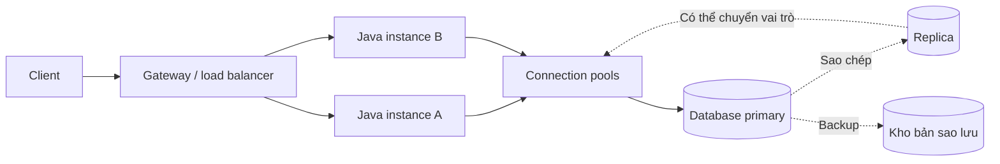
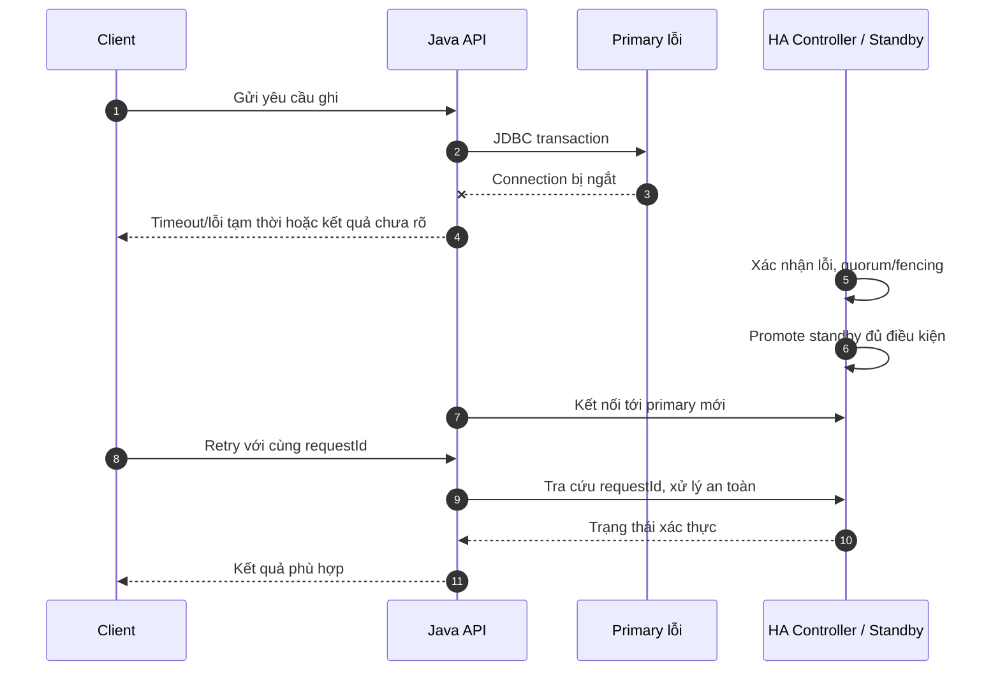

# Xác định mức sẵn sàng và thời gian gián đoạn chấp nhận được

> **Chương:** Yêu cầu lưu trữ  
> **Học phần:** `DATA_PERSISTENCE_FUNDAMENTALS` — hiểu nguyên lý lưu trữ bền vững cho ứng dụng Java, lựa chọn mô hình dữ liệu, lược đồ, truy vấn, chỉ mục, giao dịch, cô lập và kiểm soát đồng thời; thiết kế ranh giới persistence, xử lý lỗi kết nối, tiến hóa schema, bảo mật, sao lưu và tối ưu hiệu năng.

Một database có thể giữ dữ liệu rất bền vững nhưng vẫn ngừng phục vụ khi máy chủ, mạng hoặc tiến trình gặp sự cố. Ngược lại, hệ thống có thể trả lời yêu cầu đọc gần như liên tục nhờ cache nhưng chưa xử lý được thao tác ghi mới. Khi thu thập **yêu cầu lưu trữ**, câu hỏi “hệ thống cần sẵn sàng ở mức nào?” phải được diễn đạt thành **chức năng nào còn hoạt động, người dùng được phép gián đoạn bao lâu, mất bao nhiêu dữ liệu là chấp nhận được và phục hồi ra sao**.

Đây là bài toán xác định yêu cầu trước khi chọn PostgreSQL, MySQL, một kho dữ liệu phân tán, cache hay cấu hình đa vùng. Một con số như “99,99% uptime” đứng riêng không cho biết một API tạo đơn hàng có còn ghi được không, dữ liệu sau failover có bị mất không, hay ứng dụng Java có kết nối lại thành công không.

Sau bài này, người học có thể:

- Viết yêu cầu khả dụng theo hành vi người dùng, phân biệt khả dụng của thao tác đọc và ghi.
- Phân biệt **SLI, SLO, SLA, error budget, RTO và RPO**, và tính khoảng gián đoạn tương ứng với mức sẵn sàng mục tiêu.
- Đánh giá miền lỗi: JVM, connection pool, database primary, replica, availability zone, region và phụ thuộc ngoài.
- Đề xuất cấu hình persistence, failover, backup và kế hoạch khôi phục phù hợp mức gián đoạn được phép.
- Thiết kế ứng dụng Java xử lý timeout, mất kết nối, commit chưa rõ kết quả và hoạt động suy giảm có kiểm soát.
- Kiểm chứng mục tiêu bằng giám sát từ phía người dùng, thử nghiệm chuyển đổi dự phòng và diễn tập phục hồi.

## 1. Thế nào là hệ thống lưu trữ “sẵn sàng”?

**Availability (tính sẵn sàng/khả dụng)** là khả năng dịch vụ thực hiện chức năng đã cam kết tại thời điểm cần dùng. Đối với persistence, phải nêu rõ chức năng và kết quả nào được tính là “phục vụ được”.

| Chức năng | Khi nào được coi là sẵn sàng? | Khi nào chưa đáp ứng? |
| --- | --- | --- |
| Đọc chi tiết đơn hàng | Người dùng được phép truy cập, nhận đúng dữ liệu trong thời gian đáp ứng đã quy định | Request timeout, trả lỗi máy chủ hoặc đọc trạng thái quá cũ so với hợp đồng |
| Tạo đơn hàng | Hệ thống ghi nhận yêu cầu duy nhất và xác nhận ở trạng thái phù hợp | Chỉ lưu trong RAM rồi báo thành công; không thể ghi/tra cứu sau restart |
| Sửa trạng thái thanh toán | Thay đổi được commit đúng ràng buộc, không ghi đúp khi retry | Database từ chối ghi, transaction treo hoặc hai request gây cập nhật sai |
| Tìm kiếm sản phẩm | Trả danh sách có thể chấp nhận theo chính sách độ mới và độ trễ | Tìm kiếm không hoạt động hoặc kết quả cũ vượt quá giới hạn cho phép |
| Xuất báo cáo nền | Yêu cầu đã được tiếp nhận bền vững, có ID để tra cứu và tiếp tục xử lý | Trả `202 Accepted` rồi mất job khi pod Java khởi động lại |

**Khả dụng không đồng nhất với độ bền dữ liệu (durability).** Database đã commit có thể không truy cập được trong lúc phục hồi; dịch vụ vẫn trả `200 OK` từ cache nhưng thiếu dữ liệu quan trọng; một replica có thể trả dữ liệu cũ. Tính đúng đắn của transaction và yêu cầu nhất quán vẫn là một phần của hợp đồng, dù hệ thống có sẵn kết nối.

Một hệ thống có thể chọn **chế độ suy giảm**: cho phép xem catalog đã cache nhưng tạm dừng thanh toán khi không thể ghi an toàn. Hãy quy định chức năng nào tiếp tục, chức năng nào tạm ngừng và điều kiện nào khiến một request được tính là không thành công.

## 2. Biến mong muốn thành SLI, SLO và SLA

Ba khái niệm liên quan nhưng không thay thế nhau:

- **SLI (Service Level Indicator):** chỉ số đo khả năng phục vụ thực tế, ví dụ tỷ lệ request tạo đơn hợp lệ được hoàn thành đúng và nhanh trong cửa sổ quan sát.
- **SLO (Service Level Objective):** mục tiêu nội bộ đặt trên một SLI, ví dụ ít nhất 99,95% request tạo đơn hợp lệ trong 30 ngày phải có kết quả đúng trong 3 giây.
- **SLA (Service Level Agreement):** cam kết theo hợp đồng với khách hàng, thường kèm điều kiện, loại trừ, trách nhiệm và biện pháp khắc phục. SLO kỹ thuật có thể nghiêm ngặt hơn SLA.

Ví dụ định nghĩa SLI cho API ghi:

```text
SLI tạo đơn hàng =
  số request đủ điều kiện được ghi nhận đúng và trả kết quả <= 3 giây
  ------------------------------------------------------------------
  tổng số request tạo đơn hàng đủ điều kiện trong cửa sổ quan sát
```

Phải chốt **mẫu số**: request hợp lệ là gì, các lỗi do client (ví dụ sai dữ liệu đầu vào) có bị loại trừ không, `429` do quá tải có tính là lỗi không, request bị lỗi ngay tại gateway có được tính không. Với nhiều hệ thống, `5xx`, timeout và từ chối vì quá tải là các lần phục vụ thất bại; chỉ đếm những request chạm tới controller sẽ bỏ sót lỗi ở load balancer, DNS hoặc ingress.

Ví dụ SLO theo chức năng:

| SLI | Mục tiêu minh họa, cửa sổ 30 ngày | Điều kiện để một request “tốt” |
| --- | --- | --- |
| Đọc đơn hàng | 99,95% | Trả dữ liệu đúng và đủ mới trong tối đa 1 giây |
| Tạo đơn hàng | 99,95% | Yêu cầu hợp lệ được commit, phản hồi phù hợp trong tối đa 3 giây |
| Tra cứu tiến độ job | 99,9% | Trả trạng thái đã biết trong tối đa 2 giây |
| Khôi phục dịch vụ sau sự cố cụ thể | RTO 15 phút | Từ lúc gián đoạn đến khi API ghi hoạt động lại, qua bước kiểm chứng |

SLO dựa trên request có thể không mô tả đủ hệ thống **ít lưu lượng**: một khoảng mất dịch vụ không có request sẽ khó phản ánh trong mẫu số. Có thể bổ sung kiểm tra tổng hợp định kỳ từ bên ngoài hoặc SLI theo thời gian. Không được coi `SELECT 1` thành công là bằng chứng mọi chức năng của ứng dụng đều khả dụng.

Nếu có bảo trì theo kế hoạch, phải ghi rõ thời gian đó **có** tính vào tổng gián đoạn trong SLO/SLA hay là trường hợp được loại trừ theo hợp đồng; không thay đổi cách tính sau khi xảy ra sự cố.

## 3. Quy đổi mức sẵn sàng ra thời gian gián đoạn

Nếu định nghĩa tính sẵn sàng theo thời gian:

```text
Availability = (thời gian quan sát - thời gian không sẵn sàng)
               / thời gian quan sát

Ngân sách gián đoạn = thời gian quan sát × (1 - mục tiêu availability)
```

Giả định các khoảng thời gian đều được tính vào cửa sổ quan sát; các số sau là **ngân sách lý thuyết**, không phải bảo đảm rằng một lần gián đoạn bất kỳ được phép kéo dài đến mức đó.

| Mục tiêu | Gián đoạn tối đa trong 30 ngày (43.200 phút) | Gián đoạn tối đa trong 365 ngày |
| --- | ---: | ---: |
| 99% | 432 phút = 7 giờ 12 phút | 87 giờ 36 phút |
| 99,9% | 43,2 phút | 8 giờ 45 phút 36 giây |
| 99,95% | 21,6 phút | 4 giờ 22 phút 48 giây |
| 99,99% | 4,32 phút | 52 phút 33,6 giây |

Ví dụ, một dịch vụ có mục tiêu 99,95% theo cửa sổ 30 ngày có **21,6 phút ngân sách gián đoạn** nếu đo theo thời gian. Một sự cố làm API tạo đơn không hoạt động 15 phút đã dùng khoảng **69,4%** ngân sách của giai đoạn đó, ngay cả khi vẫn đáp ứng chỉ tiêu RTO 15 phút cho riêng sự cố ấy.

Đối với **SLI theo tỷ lệ request**, ngân sách tương đương số request xấu được phép, không trực tiếp là phút. Nếu hệ thống đông khách vào giờ cao điểm, 5 phút lỗi có thể gây ảnh hưởng đến nhiều request hơn 15 phút lúc ít tải. Hãy chọn cách đo nhất quán và công bố cửa sổ: lịch tháng, 30 ngày trượt, hoặc quý.

### Error budget dùng để làm gì?

**Error budget** là phần sai lệch còn được phép trong mục tiêu dịch vụ. Ví dụ mục tiêu 99,95% theo request nghĩa là tối đa 0,05% request đủ điều kiện có thể không đạt điều kiện “tốt” trong cửa sổ. Khi tiêu thụ ngân sách quá nhanh, nhóm vận hành có thể giảm tốc độ phát hành thay đổi rủi ro, tăng độ ưu tiên cho lỗi khả dụng và cải thiện quy trình rollout. Đây là một công cụ cân bằng thay đổi sản phẩm với rủi ro vận hành, không phải “hạn mức được chủ động gây lỗi”.

## 4. RTO và RPO: hai câu hỏi khác với uptime

Khi database hoặc một miền hạ tầng gặp lỗi, phải xác định cả thời gian khôi phục và lượng dữ liệu có thể mất:

| Chỉ tiêu | Câu hỏi | Ví dụ |
| --- | --- | --- |
| **RTO — Recovery Time Objective** | Dịch vụ phải phục hồi trong bao lâu sau khi bị gián đoạn? | Sau lỗi primary trong một zone, API ghi hoạt động lại trong 15 phút |
| **RPO — Recovery Point Objective** | Có thể mất tối đa bao nhiêu dữ liệu đã tồn tại trước sự cố? | Sau chuyển sang replica bất đồng bộ, chấp nhận mất tối đa 60 giây dữ liệu gần nhất |
| **SLO availability** | Trong cả cửa sổ quan sát, mức phục vụ tốt tối thiểu là bao nhiêu? | Ít nhất 99,95% request ghi hợp lệ mỗi 30 ngày đạt chuẩn |
| **Thời hạn lưu giữ** | Dữ liệu phải được giữ bao lâu khi hệ thống bình thường? | Lịch sử nghiệp vụ 3 năm, cache 10 phút |

**RTO không phải tổng ngân sách gián đoạn.** RTO 15 phút là mục tiêu cho một kịch bản phục hồi; 3 sự cố, mỗi sự cố 12 phút, vẫn có thể làm vượt ngân sách 21,6 phút của SLO 99,95% theo thời gian. Ngược lại, dịch vụ có độ khả dụng cao trong cả tháng vẫn có thể vi phạm RTO của một lần sự cố kéo dài.

**RPO không phải khoảng thời gian ứng dụng dừng phục vụ.** RPO 0 phút trong phạm vi sự cố đã nêu nghĩa là không chấp nhận mất giao dịch đã được xác nhận khi khôi phục. Nó có thể yêu cầu cơ chế sao chép đồng bộ/ghi nhận theo quorum và vẫn phải được kiểm chứng với đúng cấu hình; không nên hứa “RPO bằng 0 với mọi thảm họa” nếu chỉ có một primary và replica bất đồng bộ.

Nếu backup được chụp mỗi đêm và không có cơ chế khôi phục nhật ký phù hợp, dữ liệu mới nhất có thể bị mất gần một ngày trong trường hợp phải restore từ backup. Với PostgreSQL hoặc DBMS hỗ trợ, base backup kết hợp lưu WAL để point-in-time recovery có thể đạt RPO tốt hơn, nhưng phụ thuộc lịch sao chép log, kiểm tra backup và thực tế restore.

## 5. Xác định miền lỗi và tác động lên dữ liệu

Hãy liệt kê những bộ phận có thể hỏng và xem chúng có chia sẻ cùng một điểm lỗi không:



Sơ đồ chỉ mô tả các phụ thuộc logic. Muốn có khả năng chịu mất một **availability zone**, các instance, database và hệ thống điều phối failover phải được bố trí thực sự trên các miền lỗi độc lập. Hai replica cùng nằm trên một host hoặc dùng chung ổ đĩa lỗi không tạo ra tính độc lập mong muốn.

| Sự cố | Biểu hiện đối với API Java | Biện pháp cần xét |
| --- | --- | --- |
| Một JVM dừng/redeploy | Request đang xử lý có thể lỗi; traffic cần chuyển sang instance khác | Nhiều instance, readiness, graceful shutdown, idempotency |
| Pool cạn connection | Chờ kết nối, timeout dù DB còn hoạt động | Giới hạn concurrency, timeout, pool sizing và giám sát |
| Primary DB bị lỗi | Ghi bị từ chối; đọc cũng có thể gián đoạn | Replica đủ điều kiện, cơ chế election/promotion, đổi endpoint, reconnect |
| Network partition | Ứng dụng mất DB hoặc hai phía không liên lạc được | Fencing/quorum, tránh hai primary ghi độc lập, chính sách ưu tiên tính nhất quán |
| Mất zone | Nhiều dịch vụ cùng lỗi nếu chung zone | Triển khai đa zone, kiểm chứng điều phối chuyển đổi |
| Mất region | Cụm chính và hạ tầng cùng vùng ngừng hoạt động | DR ở region khác nếu yêu cầu; dữ liệu, mạng, DNS và quyền truy cập phục hồi độc lập |
| Xóa nhầm hoặc migration sai | Dữ liệu sai bị replicate sang bản sao | Backup/PITR, quy trình phục hồi và kiểm tra dữ liệu |
| Truy vấn nặng hoặc tranh chấp khóa | Một phần request vượt timeout, có thể lan ra pool | Chỉ mục, hạn mức tải, timeout, cách ly workload và giám sát |

Mọi yêu cầu availability phải gắn với **kịch bản cụ thể**. “Chịu được lỗi máy chủ” khác “chịu được lỗi cả zone”, và “chịu được lỗi cả zone” khác “không mất dữ liệu khi toàn region hỏng”.

## 6. Các phương án thiết kế persistence theo mức sẵn sàng

| Phương án | Khả năng và đánh đổi | Khi có thể phù hợp |
| --- | --- | --- |
| Một DB instance, backup định kỳ | Đơn giản, chi phí thấp; lỗi máy chủ thường cần khôi phục thủ công, thời gian gián đoạn đáng kể | Ứng dụng nội bộ có RTO dài và ngân sách chấp nhận được |
| Primary + standby/replica khác máy hoặc zone | Có thể chuyển vai trò và giảm gián đoạn nếu failover được tự động hóa, thử nghiệm | Nghiệp vụ trực tuyến cần khôi phục sau lỗi đơn lẻ |
| Sao chép bất đồng bộ | Giảm ảnh hưởng độ trễ ghi; có cửa sổ lag và nguy cơ mất commit gần nhất khi failover | Chấp nhận RPO khác 0 trong kịch bản xác định |
| Sao chép đồng bộ/quorum | Có thể giảm cửa sổ mất dữ liệu trong phạm vi cơ chế cam kết; tăng độ trễ và có thể giảm khả dụng ghi khi thiếu đủ replica | Ưu tiên tránh mất commit đã xác nhận hơn khả dụng ghi trong một số lỗi |
| Multi-region/DR region độc lập | Chịu được sự cố vùng theo cấu hình; thêm chi phí, latency, vận hành và độ phức tạp failover/failback | RTO/RPO cho sự cố toàn region có yêu cầu rõ ràng |
| Cache/read replica | Hỗ trợ tải đọc và suy giảm có kiểm soát; phải xử lý dữ liệu cũ | Đọc được phép eventual consistency; không thay thế primary để ghi |

**Không có lựa chọn đồng thời tối ưu tuyệt đối** cho chi phí, độ trễ, tính nhất quán và khả dụng khi mạng phân vùng. Nếu hai phía không liên lạc, hệ thống muốn tránh hai primary ghi xung đột có thể phải tạm ngừng ghi trên phía không đủ điều kiện quorum. Tính sẵn sàng ghi phải được đánh giá dưới chính sách bảo vệ dữ liệu, không chỉ từ số lượng máy còn chạy.

Phải phân biệt:

- **Replication:** truyền trạng thái sang bản sao để phục vụ read/failover; không bảo đảm phục hồi khỏi xóa nhầm, corruption hoặc lỗi logic đã lan sang replica.
- **Backup và PITR:** giúp trở về trạng thái trước một sự cố dữ liệu; restore có thể mất lâu và phải kiểm chứng khả năng khôi phục.
- **Connection endpoint/failover:** sau khi primary đổi vai trò, pool Java có thể còn giữ connection chết, DNS cũ hoặc transaction dang dở. Kiến trúc chỉ có HA trên sơ đồ vẫn chưa bảo đảm RTO nếu client không kết nối lại được.
- **Read/write split:** API ghi thường phải dùng primary; đọc qua replica cần quy định freshness, nhất là với màn hình “vừa lưu xong”.

## 7. Dùng ngân sách RTO để xây kế hoạch failover

Giả sử sản phẩm đặt **RTO 15 phút sau lỗi primary trong một zone**. Chỉ tiêu phải đo từ lúc chức năng nghiệp vụ ngừng phục vụ đến lúc có thể đọc/ghi lại đúng, không chỉ đến khi database hiển thị trạng thái “healthy”.

Một phân bổ thời gian minh họa:

| Bước | Thời gian mục tiêu |
| --- | ---: |
| Phát hiện từ phía người dùng/monitoring | 2 phút |
| Xác nhận sự cố và quyết định failover | 2 phút |
| Chọn/promote replica, ngăn split-brain | 3 phút |
| Định tuyến endpoint mới, ứng dụng Java tạo connection mới | 2 phút |
| Kiểm tra thao tác ghi, đọc và các request đang xử lý | 3 phút |
| **Tổng thời gian dự kiến** | **12 phút** |
| **Khoảng đệm còn lại đến RTO** | **3 phút** |

Đây là **giả định thiết kế**, không phải số liệu vận hành thực của một sản phẩm. Cần đo trên môi trường và dữ liệu đủ gần production; thời gian failover có thể thay đổi theo tải, độ lớn log, replication lag, DNS/cache, lease/quorum, lượng transaction đang mở và hành vi JDBC pool.

Lưu ý thứ tự:



Nếu mất kết nối **trong lúc commit**, không thể suy ra chắc chắn giao dịch đã rollback. Khi khôi phục, truy vấn theo **idempotency key** (mã request ổn định) để xác nhận trạng thái rồi mới quyết định thử lại; mọi tác dụng phụ gửi ra bên ngoài database cũng cần thiết kế chống lặp. Cố gắng retry tự động vô hạn là một cách làm tăng tải đúng lúc database đang phục hồi.

## 8. Ứng dụng Java phải tham gia bảo đảm availability

Nhiều vấn đề khiến người dùng không dùng được dịch vụ ngay cả khi database đã phục hồi:

1. **Connection pool giữ kết nối chết:** cần cơ chế kiểm tra/loại kết nối không còn hợp lệ, thời gian chờ lấy connection có giới hạn và khả năng tự kết nối lại.
2. **Không giới hạn timeout:** request treo quá lâu, chiếm thread và connection, tạo lỗi dây chuyền. Đặt ngân sách thời gian ở gateway, HTTP, pool và JDBC nhất quán.
3. **Retry sai loại lỗi:** lỗi validation, vi phạm ràng buộc hoặc thiếu quyền không tự hết; lỗi network, deadlock hoặc serialization failure có thể retry theo điều kiện nhưng phải giới hạn số lần, có backoff/jitter và idempotency.
4. **Transaction dài:** giữ khóa và connection trong lúc gọi dịch vụ ngoài làm tăng xung đột, chờ và khó failover. Chia thành các transaction nhỏ có trạng thái tiếp tục nếu cần quy trình nhiều bước.
5. **Liveness phụ thuộc DB:** nếu probe liveness cứ thấy DB mất kết nối là kill/restart tất cả pod, chính cơ chế tự chữa có thể tạo vòng restart và làm khôi phục khó hơn. Readiness và liveness phải biểu diễn mục đích khác nhau.

Ví dụ một kiểm tra **khả năng đọc tối thiểu** qua JDBC:

```java
import java.sql.Connection;
import java.sql.PreparedStatement;
import java.sql.ResultSet;
import java.sql.SQLException;
import javax.sql.DataSource;

final class DatabaseReadProbe {
    private final DataSource dataSource;

    DatabaseReadProbe(DataSource dataSource) {
        this.dataSource = dataSource;
    }

    boolean canRead() {
        try (Connection conn = dataSource.getConnection()) {
            conn.setReadOnly(true);
            try (PreparedStatement stmt = conn.prepareStatement("SELECT 1")) {
                stmt.setQueryTimeout(2); // Giây; driver có thể áp dụng best effort.
                try (ResultSet rs = stmt.executeQuery()) {
                    return rs.next();
                }
            }
        } catch (SQLException failure) {
            return false;
        }
    }
}
```

Đoạn code minh họa đường kết nối/SELECT, **không đủ** để kết luận API ghi sẵn sàng, dữ liệu replica đủ mới hay hệ thống đạt SLO. Trong triển khai, cấu hình riêng timeout **lấy connection từ pool** và timeout kết nối mạng; `setQueryTimeout` không khống chế mọi giai đoạn. Không gửi một query tốn kém từ mỗi pod ở mỗi probe; ưu tiên health check rẻ, tần suất vừa phải và đo SLI từ lưu lượng nghiệp vụ thực.

Để kiểm thử luồng ghi sau failover, nên có một thao tác tổng hợp riêng có giới hạn quyền và dữ liệu thử được dọn dẹp, hoặc kiểm chứng một giao dịch nghiệp vụ an toàn trên staging. Một `SELECT 1` thành công không bảo đảm `INSERT`, ràng buộc, lock và commit hoạt động.

### Ví dụ về ngân sách timeout

Giả sử một API ghi có ngưỡng “tốt” là 3 giây, không nên cấu hình mỗi lớp đều chờ 3 giây rồi mới chuyển sang lớp tiếp theo:

```text
HTTP request: deadline tổng <= 3 giây
  -> chờ lấy connection: ví dụ <= 300 ms
  -> thực thi SQL và chờ khóa: ví dụ <= 1.500 ms
  -> mapping/response/network: dành thời gian còn lại
```

Số liệu này chỉ là phân bổ minh họa. Đường đi thật có thêm xác thực, transaction commit, round trip, gọi dịch vụ khác và độ trễ hàng đợi; cần đo phân vị p95/p99 và điều chỉnh. Một retry có thể dùng phần thời gian **còn lại** của deadline, nhưng phải dừng khi không đủ ngân sách để đảm bảo thao tác an toàn.

## 9. Giám sát mục tiêu từ góc nhìn người dùng và từ database

Đo cả kết quả người dùng nhìn thấy và các tín hiệu giúp chẩn đoán:

| Nhóm | Chỉ số thực dụng | Dùng để phát hiện |
| --- | --- | --- |
| SLI trải nghiệm | Tỷ lệ request đủ điều kiện thành công đúng thời hạn theo endpoint/loại thao tác | SLO có được đáp ứng không |
| Độ trễ | p50, p95, p99, timeout và hàng đợi request | Suy giảm trước khi lỗi 5xx tăng |
| Connection pool | Số connection đang dùng/rảnh, thời gian chờ, timeout lấy connection | Nghẽn do pool hoặc DB |
| Truy vấn/giao dịch | Lỗi SQL, lock wait, deadlock, transaction quá dài, commit latency | Bất thường ở đường ghi và dữ liệu |
| Replica/HA | Trạng thái leader, replication lag, failover time, replica đủ điều kiện | Khả năng chuyển đổi và nguy cơ stale read/RPO |
| Dữ liệu và backup | Backup gần nhất, tính toàn vẹn bản sao, thời gian restore đã thử, WAL/log retention | Khả năng phục hồi sau lỗi dữ liệu |
| Phụ thuộc | DNS/gateway, mạng nội bộ, auth service, broker | Các điểm lỗi khiến DB khỏe nhưng API hỏng |

Trong ứng dụng Java, dùng trace/correlation ID nối HTTP request với hoạt động repository và SQL; không gắn `userId` hoặc `orderId` có cardinality lớn thành nhãn metric. Log lỗi nên có loại lỗi và request ID để chẩn đoán, nhưng không ghi mật khẩu, access token hoặc thông tin nhạy cảm.

**Phân biệt read SLI và write SLI.** Khi primary lỗi, trang danh sách cache có thể vẫn trả đúng trong một thời gian, nhưng tạo đơn mới có thể bị từ chối để bảo vệ toàn vẹn dữ liệu. Gộp cả hai vào một chỉ số chung có thể che giấu một chức năng cốt lõi đang hỏng.

Đặt cảnh báo theo **mức tiêu thụ error budget**, lỗi tăng nhanh, độ trễ vượt ngưỡng và dấu hiệu thiếu dư địa phục hồi. Không đợi đến khi chỉ tiêu hết tháng đã vi phạm mới cảnh báo. Đo thử độ mới dữ liệu từ client nếu yêu cầu *read-your-writes* hoặc ngưỡng replication lag là một phần của hợp đồng.

## 10. Runbook, diễn tập và xác minh RTO/RPO

Viết `RTO = 15 phút` trong tài liệu là bước xác định mục tiêu; **bằng chứng** phải đến từ một lần chuyển đổi và kiểm tra phục hồi:

1. **Chọn kịch bản:** kill primary, mất kết nối tới primary, mất zone, ngắt network một chiều, lỗi logic hoặc mất backup. Mỗi kịch bản có cách xử lý khác nhau.
2. **Ghi mốc thời gian:** khi người dùng bắt đầu gặp lỗi, khi monitor phát hiện, khi operator/bộ điều phối quyết định, khi primary mới có thể ghi, và khi API thực sự xử lý đúng.
3. **Kiểm tra dữ liệu:** so sánh các request đã xác nhận trước sự cố, các giao dịch commit chưa rõ kết quả và dữ liệu trên primary mới. Xác định lượng dữ liệu bị mất thực tế so với RPO.
4. **Kiểm tra ứng dụng:** verify pool kết nối lại, callback/retry an toàn, route tới đúng primary, không có hai leader, các read replica/cache có chính sách nhất quán phù hợp.
5. **Đánh giá failback:** khi chuyển lại cụm cũ, bảo đảm dữ liệu được đồng bộ và không khởi động hai phía ghi cùng lúc.
6. **Cập nhật runbook:** lưu điều kiện kích hoạt, người có quyền quyết định, thao tác kỹ thuật, điểm kiểm tra thành công, rollback, đầu mối liên hệ và các giới hạn đã quan sát.

Thử failover khác với thử **restore backup**. Lần đầu có thể chuyển vai trò sang replica còn dữ liệu gần hiện tại; lần sau cần thực sự phục hồi từ bản sao lưu và WAL vào môi trường cách ly rồi chạy truy vấn kiểm chứng. Sự cố do xóa nhầm và replication lỗi logic có thể không thể chữa bằng failover.

Việc diễn tập phải có điều kiện an toàn phù hợp với môi trường; bắt đầu trên staging với dữ liệu và cấu hình gần production, sau đó lựa chọn bài kiểm tra production được kiểm soát nếu quy trình cho phép. Không tính `RTO` dựa trên thời gian một lệnh `promote` chạy xong mà bỏ qua toàn bộ đường người dùng.

## 11. Ví dụ: đặc tả yêu cầu sẵn sàng cho dịch vụ đơn hàng Java

Giả sử một hệ thống đơn hàng phục vụ người dùng liên tục. Sau khi trao đổi với nghiệp vụ, nhóm ghi lại **một bản yêu cầu minh họa**, không phải số đo hay cam kết của một hệ thống đang chạy:

| Mục | Quyết định minh họa |
| --- | --- |
| Chức năng cốt lõi | Tạo đơn và đọc trạng thái đơn đã tiếp nhận |
| SLI ghi | Tỷ lệ request hợp lệ được commit và phản hồi đúng trong tối đa 3 giây |
| SLO ghi | 99,95% request đủ điều kiện trên cửa sổ 30 ngày trượt |
| SLI đọc | Tỷ lệ request đọc đủ điều kiện trả dữ liệu đúng/đủ mới trong tối đa 1 giây |
| SLO đọc | 99,95% request đủ điều kiện trên cùng cửa sổ |
| RTO lỗi primary trong một zone | Tối đa 15 phút đến khi endpoint ghi hoạt động đúng trở lại |
| RPO lỗi primary trong một zone | Tối đa 60 giây dữ liệu gần nhất có thể mất, theo cam kết và phép đo |
| Chế độ suy giảm | Cho xem danh sách đọc từ nguồn đủ mới; dừng tạo đơn nếu không thể commit an toàn |
| Hợp đồng retry | Mỗi yêu cầu ghi có idempotency key, có thể tra trạng thái sau timeout |
| Phạm vi sự cố region | Đặt mục tiêu riêng sau khi đánh giá yêu cầu và chi phí DR; chưa suy từ RTO của một zone |
| Retention và khôi phục logic | Backup/PITR theo yêu cầu nghiệp vụ, thử restore và ghi nhận RTO/RPO tương ứng |

Một thiết kế ứng viên có thể dùng nhiều instance Java trên hai hoặc nhiều zone, database primary và standby ở các zone khác nhau, failover có fencing/quorum, endpoint ổn định cho client, connection pool có timeout và cơ chế reconnect, monitoring theo read/write SLI, cùng backup/PITR độc lập. Nếu sao chép bất đồng bộ, phải đo **lag và nguy cơ mất dữ liệu thực tế** để xem có đáp ứng RPO 60 giây không; một con số RPO trên giấy không chứng minh rằng sao chép và failover luôn giữ đúng giới hạn.

Trước khi duyệt thiết kế, thử trả lời:

- Nếu trong tháng có hai lần failover, mỗi lần 12 phút, mục tiêu availability theo thời gian 99,95% còn đáp ứng không? Với cửa sổ 30 ngày, **24 phút lớn hơn 21,6 phút**, nên không đáp ứng dù mỗi lần riêng lẻ đạt RTO 15 phút.
- Nếu standby chậm 3 phút trước lúc promote, có thể khẳng định RPO 60 giây không? **Không**; cần cơ chế kiểm soát ngưỡng lag và chính sách quyết định có chấp nhận mất dữ liệu, đợi replica bắt kịp hay tạm ngừng ghi.
- Nếu `SELECT 1` thành công sau failover nhưng `POST /orders` vẫn timeout, dịch vụ đã phục hồi theo RTO nghiệp vụ chưa? **Chưa**; phải kiểm tra luồng ghi đầu cuối.
- Nếu database trở lại trong 5 phút nhưng có 30 phút dùng connection chết trong pool, tổng thời gian gián đoạn của API là bao nhiêu? **35 phút** nếu toàn bộ khoảng này khiến chức năng không đáp ứng; đo từ góc nhìn người dùng.

## 12. Bài tập ứng dụng

**Bài A — quy đổi chỉ tiêu.** Một API có SLO 99,9% theo thời gian trong cửa sổ 30 ngày. Hãy tính ngân sách gián đoạn. Nếu sự cố kéo dài 30 phút, còn bao nhiêu? Đáp án kiểm tra: 43,2 phút ban đầu, còn 13,2 phút nếu không có gián đoạn khác.

**Bài B — tách đọc và ghi.** Một trang sản phẩm có thể hiển thị giá cache cũ tối đa 2 phút, nhưng thao tác tạo thanh toán không được xác nhận nếu chưa commit. Hãy viết riêng hai điều kiện request “tốt” và phương án suy giảm khi primary mất kết nối.

**Bài C — phục hồi sau timeout.** Client gửi `requestId=abc`, ứng dụng gửi `COMMIT` nhưng mạng đứt trước phản hồi. Sau failover, làm gì để tránh ghi đúp? Hãy mô tả tra trạng thái `requestId`, kiểm tra cùng payload và chính sách retry.

**Bài D — thiết kế RTO.** Nghiệp vụ yêu cầu RTO 10 phút cho lỗi một zone. Hãy phân bổ thời gian phát hiện, quyết định, promote, kết nối lại và kiểm thử, có khoảng đệm. Nêu công cụ/metric xác nhận từng giai đoạn.

**Bài E — RPO và DR.** Một replica bất đồng bộ có thể trễ 90 giây, trong khi yêu cầu nghiệp vụ RPO tối đa 30 giây. Hãy đưa ra các lựa chọn: đổi cơ chế replication/acknowledgment, giảm và giám sát lag, trì hoãn promotion hoặc thương lượng lại RPO. Nêu tác động của từng lựa chọn lên khả dụng ghi và độ trễ.

## 13. Checklist chốt yêu cầu lưu trữ

- [ ] Nêu rõ chức năng đọc/ghi nào là cốt lõi và điều kiện để một request được coi là phục vụ tốt.
- [ ] Định nghĩa SLI, SLO, cửa sổ đo, mẫu số, quy tắc timeout/lỗi/maintenance và SLA nếu có.
- [ ] Quy đổi mục tiêu availability thành ngân sách gián đoạn hoặc request lỗi theo **đúng kiểu SLI**.
- [ ] Có RTO và RPO riêng cho lỗi JVM, lỗi primary/zone, lỗi region và sự cố mất dữ liệu khi cần.
- [ ] Chọn mô hình replication/failover có xét miền lỗi, fencing/quorum, consistency và tác động lên latency.
- [ ] Có backup/PITR và lần restore đã kiểm chứng; không coi replica là bản sao lưu.
- [ ] Java API có connection timeout, query deadline, cơ chế reconnect và retry/idempotency phù hợp.
- [ ] Giám sát từ biên API, tách SLI đọc/ghi, đo lỗi/latency/replication lag và mức tiêu thụ error budget.
- [ ] Có runbook, phép thử failover và restore đo đến lúc **người dùng thật sự sử dụng lại được dịch vụ**.
- [ ] Ghi rõ chi phí, giới hạn kỹ thuật và những kịch bản chưa được bảo đảm, rồi đánh giá lại khi tải hoặc yêu cầu nghiệp vụ thay đổi.

**Nguyên tắc thiết kế:** khả dụng của persistence phải được đo bằng chức năng nghiệp vụ, không chỉ bằng trạng thái “database đang chạy”. Mức 99,95%, RTO 15 phút hay RPO 60 giây chỉ có ý nghĩa khi gắn với cửa sổ đo, loại sự cố, mức nhất quán và phép thử phục hồi. Xác định rõ các điều kiện đó trước khi chọn kiến trúc giúp ứng dụng Java duy trì độ tin cậy, bảo toàn dữ liệu và đầu tư đúng mức cho khả năng phục hồi.
