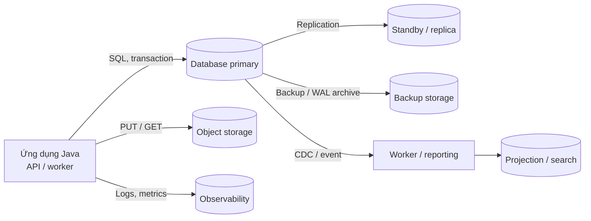

# Đánh giá chi phí lưu trữ, truy cập và vận hành

Một hệ thống có thể lưu dữ liệu trên ổ đĩa rất rẻ nhưng lại tốn kém vì truy vấn, truyền dữ liệu, sao lưu, máy chủ luôn hoạt động và công sức khắc phục sự cố. Ngược lại, phương án có đơn giá lưu trữ cao hơn đôi khi làm giảm tổng chi phí nhờ ít vận hành thủ công, hiệu năng ổn định hoặc phục hồi nhanh hơn. Vì vậy, khi lựa chọn công nghệ persistence, **không thể đánh giá chỉ bằng giá tiền trên mỗi GB**.

Bài học thuộc chương **Yêu cầu lưu trữ** của module **DATA_PERSISTENCE_FUNDAMENTALS**. Mục tiêu là biết cách định lượng **chi phí lưu trữ, truy cập và vận hành** trên toàn vòng đời dữ liệu; từ đó thiết kế ranh giới persistence cho ứng dụng Java phù hợp với mô hình dữ liệu, truy vấn, chỉ mục, giao dịch, kiểm soát đồng thời, tiến hóa schema, sao lưu, bảo mật và mục tiêu hiệu năng.

Sau bài học, người học cần có thể:

1. Xác định đầy đủ các thành phần làm phát sinh chi phí và đơn vị tính của chúng.
2. Lập dự toán tháng/năm từ một workload có số đo hoặc giả định rõ ràng.
3. So sánh các phương án lưu trữ theo **tổng chi phí sở hữu** (*total cost of ownership*, TCO), bao gồm rủi ro vận hành.
4. Liên hệ một thay đổi ở truy vấn hoặc lược đồ Java với I/O, CPU, bộ nhớ, storage và công sức vận hành.
5. Đặt chỉ số chi phí đơn vị, ngân sách, ngưỡng cảnh báo và quy trình kiểm chứng sau triển khai.

## 1. Chi phí nằm ở nhiều lớp, không chỉ ở nơi giữ dữ liệu

Xem xét một ứng dụng nhận đơn hàng, ghi PostgreSQL, lưu ảnh sản phẩm trong object storage và phát sự kiện cập nhật báo cáo.



Mỗi mũi tên, không chỉ mỗi hình trụ lưu trữ, đều có thể tạo chi phí:

| Nhóm chi phí | Đơn vị thường gặp | Ví dụ |
| --- | --- | --- |
| **Không gian lưu trữ** | GB-tháng, GiB-tháng, GB đã cấp hoặc đã dùng | Bảng, index, file, projection, backup |
| **Compute** | Giờ máy, vCPU-giờ, memory-giờ, node-tháng | Database, ứng dụng, worker, search cluster |
| **Truy cập / I/O** | Số request, số thao tác đọc/ghi, IOPS cấp trước, MB/s | Truy vấn, đọc object, import, rebuild index |
| **Truyền dữ liệu** | GB ra Internet, giữa vùng, giữa các vùng địa lý | API trả file, replication liên vùng, export |
| **Độ sẵn sàng và phục hồi** | Số replica, dung lượng backup, log lưu, bài diễn tập | Standby, point-in-time recovery, restore |
| **Quan sát và bảo mật** | GB log thu thập, GB log lưu, sự kiện audit, dịch vụ khóa | Monitoring, log search, encryption/KMS |
| **Nhân lực vận hành** | Giờ công, chi phí nhân sự/nhà cung cấp | On-call, incident, nâng cấp, tuning, restore |
| **Thay đổi và rủi ro** | Giờ migration, thời gian ngừng dịch vụ, tác động sự cố | Chạy backfill, chuyển vùng, downtime |

**Chi phí trực tiếp** là khoản đơn vị tính tiền rõ ràng trên hóa đơn. **Chi phí gián tiếp** là thời gian phát triển/vận hành, suy giảm hiệu năng, rủi ro mất dữ liệu, công khôi phục và cơ hội kinh doanh bị bỏ lỡ. Một bảng đánh giá TCO cần thể hiện cả hai, nhưng chỉ quy đổi rủi ro thành tiền khi có giả định và phương pháp tính được công bố.

## 2. Xác định mô hình tính tiền trước khi nhân số lượng

Không có một bảng giá thống nhất cho PostgreSQL, object storage hay cloud database. Nhà cung cấp có thể dùng cách tính khác nhau: lưu trữ **đã cấp**, lưu trữ **đang dùng**, IOPS/throughput được cấp, I/O thực tế, node chạy theo giờ, hoặc gói đã bao gồm vài thành phần.

| Cách tính phí | Biến số cần đo | Điều dễ nhầm |
| --- | --- | --- |
| `price_per_GiB_month` | Dung lượng tính phí trung bình trong tháng | Không lấy dung lượng cuối tháng làm đại diện chính xác khi tăng mạnh |
| `price_per_provisioned_GiB_month` | Dung lượng đã cấp dù có sử dụng hay không | Còn nhiều đĩa trống vẫn bị tính phí |
| `price_per_1000_requests` | Số PUT/GET, truy vấn hoặc I/O **được nhà cung cấp xác định là tính phí** | Không giả định một câu SQL luôn tương ứng một I/O bị tính tiền |
| `price_per_IOPS_month` | IOPS hoặc throughput được cấp trước | Chi phí vẫn có thể phát sinh khi ít sử dụng |
| `price_per_instance_hour` | Số giờ từng node chạy theo cấu hình | Standby/read replica và môi trường non-production có thể có phí riêng |
| `price_per_GB_egress` | Dữ liệu truyền qua ranh giới bị tính phí | Cần tách Internet, cùng vùng, khác vùng, CDN |
| `price_per_backup_GB_month` | Dung lượng backup vượt mức miễn phí/bao gồm, nếu có | Snapshot incremental, nén và chia sẻ block không giống số bản full |
| `price_per_log_GB` | Lượng log thu thập/lưu/truy vấn | Ghi nhiều SQL/PII vào log vừa tốn tiền vừa tăng rủi ro |

### GB và GiB, thời gian sử dụng và cách làm tròn

- **GB** bằng 1.000.000.000 byte; **GiB** bằng 1.073.741.824 byte.
- **GB-tháng** hoặc **GiB-tháng** là đơn vị *dung lượng × thời gian*, không đơn giản là số GB ở thời điểm chốt sổ.
- Một dữ liệu 100 GiB tồn tại nửa tháng có thể được tính gần 50 GiB-tháng nếu hợp đồng tính theo thời gian thực và bỏ qua các quy tắc làm tròn/tối thiểu.
- Tháng 28, 30 hay 31 ngày và giờ instance chạy thực tế ảnh hưởng kết quả; phải dùng quy định billing cụ thể.

Khi so hai nhà cung cấp, cần **chuẩn hóa đơn vị và phạm vi**. Gói “đã bao gồm backup, standby” không tương đương trực tiếp với báo giá chỉ cho ổ đĩa primary.

> Bất kỳ mức giá nào trong ví dụ dưới đây đều là **giả định để thực hành phép tính**, không phải báo giá hiện hành của một nhà cung cấp.

## 3. Tách các lớp chi phí lưu trữ

### 3.1. Dữ liệu nghiệp vụ, dữ liệu dẫn xuất và index

Giả sử nghiệp vụ lưu các bảng `orders`, `order_lines` và `payments`. Ngoài dữ liệu gốc, ứng dụng có thể có:

- B-tree cho khóa chính/ngoại và truy vấn thường gặp.
- Bảng tổng hợp hoặc materialized view.
- Lịch sử trạng thái, audit và outbox cần retention riêng.
- TOAST/LOB, metadata, phiên bản bản ghi và khoảng trống do cập nhật.
- Bản tìm kiếm trong search engine và cache ở bộ nhớ.

Dữ liệu dẫn xuất có thể xây lại, nhưng việc xây lại có **chi phí compute, I/O và thời gian**. Vì vậy, “có thể tái tạo” không đồng nghĩa “không tốn tiền để lưu”.

Các kích thước trên thường được đo khác nhau theo engine. Với PostgreSQL, `pg_total_relation_size` của một relation đã bao gồm bảng, TOAST và các chỉ mục liên quan; **không cộng `pg_indexes_size` lần nữa** vào giá trị này.

### 3.2. Một bản sao dữ liệu có thể bị tính tiền nhiều lần

Một hệ thống có thể cần:

- Primary để ghi.
- Standby để failover.
- Read replica để phân tán truy vấn.
- Backup, snapshot và WAL/binlog archive.
- Bản đọc ở search cluster hoặc data warehouse.

Cần xác nhận nhà cung cấp tính phí mỗi bản sao theo node/volume hay cung cấp storage sao chép theo mô hình khác. **Không mặc định nhân dung lượng primary với số node** nếu dịch vụ đã tính replication vào đơn giá; ngược lại, cũng không giả định standby miễn phí.

Ví dụ biểu thức cho mô hình *mỗi node giữ và tính phí riêng một bản đầy đủ*:

```text
Billed_DB_GiB_month =
    average_primary_GiB
  + average_standby_GiB
  + Σ average_read_replica_GiB

Storage_cost = Billed_DB_GiB_month × price_per_GiB_month
```

Phần backup, object storage và archived WAL vẫn phải tính riêng nếu chúng được đặt ở dịch vụ khác; nếu chính sách hoặc hóa đơn đã bao gồm thì ghi bằng 0 ở cột phụ phí để tránh tính trùng.

### 3.3. Dự phòng WAL, temporary storage và migration

Dung lượng cơ sở dữ liệu tăng ròng không diễn tả đầy đủ đỉnh sử dụng. WAL có thể giữ lâu do replication slot/backup lỗi; sort và hash có thể tràn ra đĩa; rebuild index hay backfill tạo bản sao dữ liệu tạm. Có hai trường hợp:

1. **Bị tính phí theo dung lượng cấp:** phải cấp đủ chỗ cho đỉnh tạm, kể cả khi phần lớn thời gian trống.
2. **Bị tính phí theo dung lượng sử dụng:** phải tính thêm dữ liệu thực giữ và các thao tác I/O phát sinh trong thời gian cao điểm.

Không dùng chỉ số tăng trưởng dung lượng bảng làm đại diện cho **tốc độ ghi WAL**. Cập nhật một bản ghi 1.000 lần có thể không tạo thêm 1.000 hàng nghiệp vụ, nhưng vẫn sinh nhiều I/O, log và công dọn phiên bản.

## 4. Truy cập dữ liệu tạo chi phí như thế nào?

Chi phí truy cập thường thể hiện qua **CPU, bộ nhớ, I/O, IOPS/throughput, request, truyền dữ liệu và latency**, nhưng mỗi thành phần có cách tính tiền riêng.

### 4.1. Một truy vấn có thể kéo theo nhiều công việc bên dưới

Ví dụ truy vấn không có index phù hợp:

```sql
SELECT order_id, created_at, status
FROM orders
WHERE tenant_id = :tenant_id
  AND created_at >= :from_time
ORDER BY created_at DESC
LIMIT 50;
```

Nếu có index phù hợp theo `(tenant_id, created_at DESC)`, DB có thể giảm lượng dữ liệu phải đọc và công sắp xếp. Nhưng index cũng:

- Chiếm chỗ trên đĩa.
- Tăng chi phí ghi vì mỗi INSERT/UPDATE/DELETE có thể phải duy trì index.
- Tăng chi phí backup, replication và một số migration.
- Có thể không giúp ích nếu truy vấn rất hiếm hoặc không chọn lọc.

Chọn index bằng **query plan** và số liệu thực tế, thay vì áp dụng tỷ lệ cố định “bao nhiêu index là đủ”. Với PostgreSQL, dùng `EXPLAIN (ANALYZE, BUFFERS)` trong môi trường/điều kiện kiểm soát phù hợp: `ANALYZE` thực sự thực thi truy vấn và có thể gây tải, đặc biệt với câu lệnh ghi.

### 4.2. Truy vấn dư thừa trong Java/JPA

Một trường hợp quen thuộc là **N+1 query**:

```java
List<Order> orders = orderRepository.findRecentOrders(customerId);

for (Order order : orders) {
    // Nếu order.getLines() được tải lười và chưa fetch,
    // mỗi vòng có thể kích hoạt thêm truy vấn.
    System.out.println(order.getLines().size());
}
```

Nếu có 50 đơn, ứng dụng có thể phát **1 + 50 truy vấn**, tùy cách mapping và cache. Sửa bằng projection DTO, `JOIN FETCH` hoặc batch fetching được thiết kế theo nhu cầu có thể giảm round trip và công xử lý. Tuy nhiên, tải quá nhiều quan hệ 1–N bằng một câu JOIN cũng có thể làm tăng số dòng trung gian; phải đo dung lượng truyền, độ trễ, bộ nhớ và plan trước/sau.

Điều nên đo:

| Chỉ số | Câu hỏi cần trả lời |
| --- | --- |
| Truy vấn/request | Một chức năng sinh bao nhiêu câu SQL? |
| CPU time và DB time | Có đang dùng nhiều CPU DB chỉ để trả dữ liệu lặp? |
| Logical/physical blocks read | Truy vấn đọc bao nhiêu trang trong cache và từ đĩa? |
| p95/p99 latency | Có đạt SLO khi dữ liệu và số người dùng tăng? |
| Rows scanned vs returned | Có lọc quá muộn hoặc thiếu index? |
| Bytes transferred | Có tải cả entity khi chỉ cần ba cột? |
| Connection pool wait | Có thiếu kết nối, giữ transaction quá lâu hoặc retry vô ích? |

**Giảm số truy vấn không tự động giảm hóa đơn:** nếu gói DB trả tiền theo số giờ node cố định, tối ưu có thể cải thiện tốc độ và trì hoãn nâng cấp node thay vì làm hóa đơn tháng này giảm ngay. Ghi riêng **lợi ích hiện tại** và **chi phí tránh được trong tương lai**.

### 4.3. Read, write, retry và transaction

Các hoạt động sau có thể làm tăng chi phí truy cập:

- Ghi cập nhật nhỏ liên tục thay vì batch hợp lý.
- Retry liên tiếp khi DB quá tải, tạo hiệu ứng khuếch đại.
- Giao dịch dài giữ lock/connection khiến throughput giảm.
- Poll liên tục một bảng outbox hoặc queue khi không có việc.
- Trả nhiều bản ghi rồi lọc ở Java thay vì lọc ở DB.
- Đọc toàn bộ object lớn để hiển thị vài byte metadata.
- Tải lại cùng dữ liệu dẫn xuất không đổi nhưng không có cache/TTL phù hợp.

Cần cân bằng hiệu năng và nhất quán: tăng batch size quá lớn có thể kéo dài transaction, lock hoặc WAL spike; cache có thể giảm read load nhưng phát sinh lưu trữ, invalidation và nguy cơ dữ liệu cũ. Đối với trạng thái thanh toán hay tồn kho, không dùng cache thiếu ràng buộc để quyết định giao dịch nghiệp vụ.

## 5. Truyền dữ liệu và vùng đặt dữ liệu

Phí mạng có thể phát sinh khi tải file xuống Internet, đồng bộ qua vùng, chuyển dữ liệu tới công cụ phân tích hoặc gọi dịch vụ quản lý có biểu phí riêng.

Các câu hỏi cần khảo sát:

1. Dữ liệu truyền **trong cùng vùng**, **giữa vùng**, **qua Internet**, hay qua CDN?
2. Phí được tính một chiều hay hai chiều; có ngưỡng miễn phí/giới hạn tối thiểu?
3. Read replica và backup khác vùng có tạo lưu lượng tính phí?
4. Dữ liệu nén được tính theo kích thước trước hay sau nén tại điểm đo?
5. Có phí cho PUT/GET, request thất bại, restore từ kho lạnh hoặc lấy dữ liệu sớm hơn thời hạn tối thiểu?
6. Có phát sinh phí khi xuất hoặc di chuyển toàn bộ dữ liệu sang nền tảng khác (*data egress/exit cost*)?

Ví dụ, lưu ảnh ở object storage thay vì trong bảng SQL giúp DB gọn hơn nhưng ứng dụng vẫn trả chi phí object storage, GET, egress và CDN. Đặt data warehouse ở vùng khác có thể tạo phí truyền lặp lại mỗi ngày nếu pipeline xuất dữ liệu lớn.

**Data locality** cần xét cả latency, tuân thủ nơi lưu dữ liệu và an toàn phân quyền, không chỉ cước mạng.

## 6. Vận hành là thành phần của TCO

TCO có thể được xem trên một chân trời `H` tháng:

```text
TCO(H) =
    Σ (infrastructure_cost_month
       + managed_service_cost_month
       + access_and_transfer_cost_month
       + backup_and_security_cost_month
       + operations_labor_month)
  + one_time_migration_and_setup_cost
  + expected_incident_impact_if_quantified
```

Tránh vừa ghi toàn bộ phí managed service vừa cộng thêm một khoản “nhân sự DBA đầy đủ” chỉ vì hệ thống có database. Cần ghi **những hoạt động thực sự còn do đội ngũ chịu trách nhiệm**: tuning, schema migration, capacity planning, incident triage, data recovery, bảo mật và tối ưu truy vấn.

### Managed service so với tự vận hành

| Tiêu chí | Database tự vận hành | Database được quản lý |
| --- | --- | --- |
| Compute/storage | Tự chọn máy, đĩa, cấu hình và dự phòng | Trả theo node/cấu hình hoặc mức sử dụng quy định |
| Patch và nâng cấp | Tự lên lịch, kiểm thử và triển khai | Nhà cung cấp hỗ trợ một phần; ứng dụng vẫn cần kiểm thử |
| HA, failover, backup | Đội ngũ tự xây/kiểm chứng | Thường có tính năng tích hợp, cần kiểm tra phạm vi và phí |
| Monitoring/tuning | Toàn bộ hoặc phần lớn do đội ngũ làm | Vẫn phải hiểu workload, index, query và cấu hình |
| Quyền kiểm soát | Nhiều tùy chọn kỹ thuật hơn | Có giới hạn phiên bản, extension, cấu hình và quota |
| Chi phí rủi ro | Phụ thuộc kinh nghiệm và nhân sự dự phòng | Phụ thuộc SLA, kiến trúc, vùng và trách nhiệm chia sẻ |

Không có kết luận “managed luôn rẻ hơn” hoặc “self-hosted luôn rẻ hơn”. So sánh phải dựa trên cùng RPO/RTO, SLA, tải, nhân lực và kịch bản phục hồi.

### Những khoản vận hành dễ bị bỏ quên

- Diễn tập backup/restore và kiểm tra backup hỏng.
- Xử lý replication lag, hết dung lượng, sự cố mạng, giới hạn kết nối.
- Kiểm soát secrets, mã hóa, rotation, audit và chính sách dữ liệu cá nhân.
- Tạo index, backfill, chuyển partition, upgrade phiên bản DB.
- Xử lý dữ liệu chất lượng kém, import lặp, retry và reconciliation.
- Môi trường development, staging, CI có database, log và snapshot riêng.
- Khả năng hỗ trợ khi sự cố ngoài giờ, tài liệu runbook và đào tạo.

Các khoản có thể biến động theo quý. Chi phí một lần như migration nên ghi riêng hoặc phân bổ minh bạch cho chân trời so sánh, không giấu trong “giá mỗi GB”.

## 7. Công thức thực hành: dự toán một tháng

Một mô hình thuận tiện là chia chi phí theo đơn vị tính tiền:

```text
C_month =
    C_storage + C_compute + C_IO + C_requests
  + C_network + C_backup + C_logs_security
  + C_operations + C_other

C_storage = Σ (average_billed_GiB_month × rate_GiB_month)
C_compute = Σ (instance_hours × rate_hour)
C_IO      = Σ (billed_IO_units × rate_IO_unit)
C_network = Σ (billed_GB_by_route × rate_GB_by_route)
C_backup  = billed_backup_GB_month × rate_backup_GB_month
C_ops     = staff_hours × loaded_hourly_cost
```

**Chỉ số `average_billed_GiB_month` phải cùng định nghĩa với đơn giá**. Nếu dịch vụ tính phí provisioned, dùng capacity provisioned theo thời gian; nếu tính actual used, dùng dung lượng sử dụng được tính phí theo thời gian.

Để kiểm tra không cộng trùng, mỗi dòng dự toán nên có đủ: **sản phẩm, phạm vi, đơn vị, lượng sử dụng, đơn giá, nguồn số liệu, điều khoản billing và người chịu trách nhiệm**.

## 8. Ví dụ số: hệ thống đặt hàng Java

Giả định một hệ thống có primary, standby và một read replica. Mỗi node giữ bản dữ liệu có footprint trung bình **500 GiB** trong tháng. Nhà cung cấp trong bài tập này **tính riêng storage của mỗi node**. Hệ thống còn cần backup, log, truy cập và công vận hành.

### 8.1. Đầu vào giả định

| Hạng mục | Số lượng tính phí trong tháng | Đơn giá giả định | Thành tiền |
| --- | ---: | ---: | ---: |
| DB storage: 3 node × 500 GiB | 1.500 GiB-tháng | 0,12 USD/GiB-tháng | **180,00 USD** |
| Compute: primary, standby, replica | 3 node-tháng | 120 USD/node-tháng | **360,00 USD** |
| Backup lưu riêng | 800 GiB-tháng | 0,03 USD/GiB-tháng | **24,00 USD** |
| WAL archive lưu riêng | 150 GiB-tháng | 0,03 USD/GiB-tháng | **4,50 USD** |
| I/O thuộc loại bị tính phí | 80.000.000 thao tác | 0,0002 USD/1.000 thao tác | **16,00 USD** |
| Egress Internet | 200 GiB | 0,08 USD/GiB | **16,00 USD** |
| Truyền liên vùng | 50 GiB | 0,04 USD/GiB | **2,00 USD** |
| Log/monitoring/security bổ sung | Một gói/tháng | 40,00 USD | **40,00 USD** |
| Công vận hành | 20 giờ | 35 USD/giờ | **700,00 USD** |
| Phân bổ diễn tập phục hồi | Một khoản/tháng | 60,00 USD | **60,00 USD** |
| **Tổng** | | | **1.402,50 USD/tháng** |

**Giới hạn của ví dụ:** mọi giá ở đây do bài học giả định, không phải báo giá thị trường; chưa bao gồm thuế, chiết khấu, cam kết chi tiêu, phí môi trường khác, phí triển khai một lần và tổn thất sự cố chưa lượng hóa. Các dòng nêu trên đã được định nghĩa **không bao gồm lẫn nhau** để phép cộng có ý nghĩa.

### 8.2. Kiểm tra phép tính

```text
DB storage        = 3 × 500 × 0,12             = 180,00 USD
Compute           = 3 × 120                    = 360,00 USD
Backup            = 800 × 0,03                 =  24,00 USD
WAL archive       = 150 × 0,03                 =   4,50 USD
I/O               = (80.000.000 / 1.000)×0,0002 = 16,00 USD
Internet egress   = 200 × 0,08                 =  16,00 USD
Cross-region      = 50 × 0,04                  =   2,00 USD
Monitoring        =                            40,00 USD
Ops labor         = 20 × 35                   = 700,00 USD
Restore drill     =                            60,00 USD
----------------------------------------------------------
Tổng                                           1.402,50 USD
```

Nhìn vào bảng, tăng 10% dung lượng DB chưa chắc quan trọng bằng giảm số giờ xử lý sự cố. Trong giả định này, riêng công vận hành là **700/1.402,5 ≈ 49,9%** tổng dự toán. Đây là kết quả của **bộ giả định**, không phải kết luận về mọi hệ thống production.

### 8.3. Đo hiệu quả bằng chi phí trên một đơn vị nghiệp vụ

Nếu hệ thống phục vụ **2.000.000 đơn hàng được xử lý trong tháng**:

```text
Monthly cost per processed order = 1.402,50 / 2.000.000
                                 = 0,00070125 USD/đơn

Cost per 1.000 processed orders  = 0,70125 USD
```

Cần mô tả mẫu số rõ ràng. “Số đơn được xử lý” có thể là tổng giao dịch phát sinh trong tháng, khác với tổng số đơn đang lưu tích lũy. Nếu doanh nghiệp đo chi phí theo **đơn giao thành công** thay vì đơn tiếp nhận, mẫu số có thể nhỏ hơn và chỉ số chi phí cao hơn. Không nên so hai nhóm bằng hai định nghĩa mẫu số khác nhau.

Chỉ số chi phí đơn vị hữu ích khi theo dõi qua nhiều tháng:

- `USD/1.000 đơn được xử lý` cho hiệu quả vận hành.
- `USD/triệu lần đọc có độ trễ đạt SLO` cho khối lượng truy vấn.
- `USD/TiB-tháng dữ liệu hữu ích đang lưu` cho hiệu quả sử dụng storage.
- `USD/tenant-tháng` với tiêu chí phân bổ compute/storage minh bạch.
- `USD/GB dữ liệu phục hồi thành công` hoặc thời gian restore đối với đánh giá công cụ DR.

Không một chỉ số nào đơn độc nói lên toàn bộ chất lượng hệ thống.

## 9. Phân tích nhạy cảm và tăng trưởng

Một dự toán chỉ có một điểm đo không đủ để lập ngân sách. Dùng các kịch bản thay đổi **từng biến** để tìm thành phần nhạy cảm nhất.

Giữ nguyên các giả định ở mục trước:

| Biến thay đổi riêng rẽ | Thay đổi về lượng | Chi phí tăng | Tổng mới/tháng |
| --- | --- | ---: | ---: |
| Dung lượng storage DB | 1.500 → 1.950 GiB-tháng (+30%) | +54,00 USD | 1.456,50 USD |
| I/O tính phí | 80 → 120 triệu thao tác (+50%) | +8,00 USD | 1.410,50 USD |
| Internet egress | 200 → 400 GiB (+100%) | +16,00 USD | 1.418,50 USD |
| Công vận hành | 20 → 30 giờ/tháng | +350,00 USD | 1.752,50 USD |

Bảng này là **phân tích một biến tại một thời điểm**. Trong thực tế, storage tăng thường kéo theo backup, index, I/O, thời gian restore và có thể nhu cầu nâng cấp compute. Dự báo nhiều năm phải xét sự liên hệ giữa các biến thay vì cộng từng tỷ lệ một cách cơ học.

### 9.1. Mô hình tăng trưởng chi phí

Ví dụ lượng dữ liệu được tính phí tăng ròng `g` GiB/tháng; đơn giá không đổi:

```text
Billed_storage(m) = Billed_storage(0) + g × m

Storage_cost(m) = Billed_storage(m) × rate_per_GiB_month
```

Nếu chọn thêm replica ở tháng thứ 6, **số bản sao phải là biến theo thời gian**. Nếu có tier archive rẻ hơn, lượng dữ liệu được chuyển khỏi tầng nóng sẽ giảm giá của một phần dữ liệu nhưng tạo phí archive, retrieval, chuyển dữ liệu và thời gian truy cập.

### 9.2. Chi phí cố định, biến đổi và chi phí theo bậc

- **Cố định trong một khoảng:** phí compute theo node-tháng, giấy phép hoặc hợp đồng hỗ trợ.
- **Biến đổi theo lưu lượng:** request, I/O tính theo thao tác, egress và một phần backup.
- **Theo bậc:** thêm replica, tăng loại instance, nâng storage tier, sharding, thay đổi gói dịch vụ.

Nhờ phân loại này, dự báo có thể nêu rõ **điểm chuyển bậc**. Chẳng hạn lúc p95 query latency vượt SLO, thêm node có thể làm chi phí tăng đột ngột dù số GB chỉ tăng ít. Đường ngân sách không nhất thiết tuyến tính theo dung lượng.

### 9.3. So các phương án trên cùng chân trời

Để so phương án A và B, dùng cùng:

- Số đơn đọc/ghi, đỉnh lưu lượng và độ trễ yêu cầu.
- Khối lượng dữ liệu ban đầu và tốc độ tăng.
- Retention, số bản sao, RPO/RTO, backup và yêu cầu bảo mật.
- Khả năng nhân sự vận hành, thời gian triển khai và migration.
- Thời gian so sánh (12, 24 hoặc 36 tháng), giả định chiết khấu và thuế nếu cần.

Nên lập **baseline**, **growth** và **stress**; nếu sự khác biệt chi phí nhỏ hơn độ bất định đo, không vội quyết định chỉ dựa vào bảng giá.

## 10. Chi phí so với độ trễ, tính sẵn sàng và độ bền

Ba mục tiêu thường kéo chi phí theo những hướng khác nhau:

| Quyết định | Có thể tăng chi phí | Giá trị hoặc điều kiện đạt được |
| --- | --- | --- |
| Thêm read replica | Node/storage, đồng bộ, monitoring | Mở rộng tải đọc, cách ly báo cáo khỏi primary; đọc có thể trễ |
| Thêm standby/đa vùng | Compute, lưu trữ, đường truyền | Tăng khả năng chịu lỗi nếu failover được thiết kế và diễn tập đúng |
| Tăng chỉ mục | Storage, ghi, WAL, backup | Giảm thời gian cho những truy vấn có lợi từ index |
| Cache dữ liệu | RAM/service, invalidation, vận hành | Giảm đọc DB và latency, đổi lấy nhất quán cần kiểm soát |
| Chuyển dữ liệu lạnh sang archive | Phí archive/retrieval, pipeline và truy vấn chậm | Giảm chi phí lưu nóng nếu dữ liệu ít truy cập |
| Giảm retention | Có thể giảm storage/backup, cần công dọn | Chỉ phù hợp khi vẫn đáp ứng nghiệp vụ và yêu cầu pháp lý |
| Tăng thời hạn log/backup | Dung lượng lưu thêm, thao tác tìm kiếm | Phục vụ kiểm toán/khôi phục; cần quyền truy cập và bảo mật |
| Tách blob ra object storage | GET/PUT/egress, tham chiếu và quy trình xóa | Giảm áp lực footprint của relational DB trong một số workload |

### RPO/RTO phải có trong cùng phép so sánh

- **RPO**: mức mất dữ liệu tối đa chấp nhận được khi khôi phục.
- **RTO**: thời gian tối đa chấp nhận được để hệ thống hoạt động trở lại.
- **SLO/SLI**: mục tiêu/chỉ số chất lượng như p95 truy vấn và tính sẵn sàng.

Phương án A rẻ hơn 20% nhưng không đáp ứng RTO không phải lựa chọn tương đương với phương án B. Phải đo thời gian khôi phục trên kích thước dữ liệu dự báo, không chỉ trên database mẫu vài GB.

Nếu định lượng rủi ro, có thể dùng:

```text
Expected annual incident impact =
    Σ (probability_of_scenario_per_year × estimated_loss_per_scenario)
```

Đây chỉ là **ước lượng để ra quyết định**, không thay thế cam kết độ bền hay các biện pháp sao lưu. Xác suất và tác động khó đo; cần ghi nguồn và khoảng bất định, tránh tạo cảm giác chính xác giả.

## 11. Lựa chọn lưu trữ theo đặc tính truy cập

Một hệ thống thường dùng **nhiều lớp lưu trữ**, vì đặc điểm dữ liệu khác nhau.

| Loại dữ liệu | Nhu cầu truy cập | Điểm cần tính trong TCO | Lựa chọn thường xem xét |
| --- | --- | --- | --- |
| Đơn hàng, thanh toán | Giao dịch, ràng buộc, cập nhật nhất quán | Compute DB, index, WAL, HA, backup, ops | Relational DB |
| File ảnh, tài liệu | Đọc/ghi object, lưu lâu, quy mô lớn | GiB-tháng, PUT/GET, egress, versioning, retrieval | Object storage |
| Session/cache | Đọc nhiều, TTL, có thể tái tạo | RAM, node, eviction, invalidation | Memory cache hoặc key-value store |
| Audit/event stream | Ghi liên tục, retention rõ, cần replay | Storage, phân vùng, replication, truy xuất lịch sử | Log/event platform hoặc bảng chuyên dụng |
| Báo cáo lớn | Quét/tổng hợp định kỳ, ETL | Compute per query/job, scan bytes, storage, egress | Warehouse/analytics engine |
| Full-text search | Truy vấn theo từ khóa và xếp hạng | Index lớn, số shard, replica, reindex | Search engine |

Đây là **gợi ý đánh giá**, không phải quy định bắt buộc. Một DB quan hệ có thể xử lý dữ liệu JSON hay full-text search ở quy mô phù hợp; một search engine có thể bị lạm dụng cho chức năng cần transaction mà nó không được thiết kế để đảm nhiệm.

### Trường hợp ảnh sản phẩm

Giả sử ảnh 3 MiB, 1 triệu ảnh, mỗi ảnh được đọc trung bình 10 lần/tháng. Chỉ nhìn dung lượng lưu là khoảng **2,86 TiB** trước khi tính nén/phiên bản và metadata. Nhưng số lượt đọc tháng là **10 triệu GET**, dữ liệu gửi đi nếu toàn bộ mỗi lượt đọc 3 MiB là gần **28,6 TiB**. Khi đó CDN, cache, định dạng ảnh nhỏ theo nhu cầu và egress có thể quyết định phần lớn chi phí.

Cách tính chỉ là kịch bản minh họa: không phải mọi lượt xem đều tải ảnh gốc, cache có thể tránh yêu cầu về origin và một số lượt tải bị hủy. Đo **bytes thực được truyền qua ranh giới tính phí** mới có dự toán đúng.

## 12. Theo dõi chi phí bằng dữ liệu và công cụ đo

### 12.1. Số liệu từ database

Một số phép đo PostgreSQL có ích:

```sql
-- Dung lượng các đối tượng trong database hiện tại,
-- không đại diện cho WAL, replica hoặc backup.
SELECT pg_database_size(current_database()) AS database_bytes;

-- Tổng footprint của từng bảng (gồm index tương ứng).
SELECT
    schemaname,
    relname,
    pg_total_relation_size(relid) AS total_relation_bytes
FROM pg_stat_user_tables
ORDER BY total_relation_bytes DESC
LIMIT 20;
```

Khi đo tốc độ truy cập:

- `pg_stat_statements` (nếu bật) cho biết số lần gọi, thời gian thực thi, chỉ số I/O theo truy vấn; dữ liệu thống kê có thể reset và phụ thuộc cấu hình.
- `pg_stat_database` cung cấp các bộ đếm tổng hợp như block read/cache hit; không trực tiếp là số I/O bị nhà cung cấp tính phí.
- `pg_stat_wal` (trên phiên bản hỗ trợ) cho biết lượng WAL phát sinh theo bộ đếm; không phải kích thước WAL còn nằm trên đĩa.
- Công cụ giám sát volume/cloud provider cho biết used/provisioned storage, IOPS, throughput, replication lag và chi phí billed thực.

**Mọi bộ đếm cần hiệu số theo thời gian**, cùng thời điểm thu thập và xử lý các lần reset. Một snapshot `pg_stat_statements` không đủ để kết luận mức tiêu thụ trong toàn tháng.

### 12.2. Ghép hóa đơn với telemetry

Quy trình thực tế:

1. Lấy hóa đơn chi tiết hoặc export chi phí theo dịch vụ, account, region, workload, môi trường và nhãn sở hữu.
2. Thu telemetry về kích thước, query load, số request, egress, backup, số giờ node và thời gian vận hành.
3. Ánh xạ từng dòng hóa đơn tới metric cùng phạm vi và đơn vị; kiểm tra các khoản chưa gán được.
4. Tính chi phí đơn vị trên số yêu cầu, đơn hàng, tenant hoặc lượng dữ liệu hữu ích.
5. So với mô hình dự báo; lưu nguyên nhân chênh lệch như batch đột xuất, tăng replica hay retention chưa hoạt động.
6. Đặt cảnh báo chi phí và ngân sách; thực hiện hành động cụ thể khi xu hướng vượt ngưỡng.

Không được suy từ `pg_database_size` rằng tiền hóa đơn phải tương ứng chính xác với lượng byte đó. Có thể đang tính theo **provisioned size**, replica, phí node, logs hoặc I/O trên mô hình riêng.

### 12.3. Phân bổ chi phí chung cho tenant

Trong một DB nhiều tenant, phần chi phí lưu trữ có thể phân bổ theo footprint; nhưng phần compute/IO nên cân nhắc thêm cường độ truy vấn và write load.

Ví dụ phân bổ:

```text
tenant_cost =
    tenant_direct_usage_cost
  + shared_cost × allocation_weight

Σ allocation_weight = 1 trong nhóm tenant được phân bổ
```

Cân nhắc dùng vector trọng số gồm dung lượng, số lần ghi, query time hoặc mức dùng dịch vụ; lưu rõ phương pháp để giải thích. Không tự quy toàn bộ phí DB cho tenant có nhiều byte nhất khi một tenant khác có truy vấn phức tạp tiêu thụ phần lớn CPU.

## 13. Ví dụ Java: tính dự toán từ đơn giá và lượng sử dụng

Một công cụ nội bộ có thể giữ dữ liệu về lượng dùng, đơn giá và thời điểm đo. Ví dụ Java 17 sau tính riêng các dòng cơ bản bằng `BigDecimal` để tránh sai số cộng tiền bằng `double`:

```java
import java.math.BigDecimal;
import java.math.RoundingMode;

public final class MonthlyStorageCost {
    private static final BigDecimal THOUSAND = new BigDecimal("1000");

    private MonthlyStorageCost() {}

    public record Usage(
            long dbGiBMonths,
            long backupGiBMonths,
            long walArchiveGiBMonths,
            long billedIoRequests,
            long internetEgressGiB,
            long crossRegionGiB,
            int nodeMonths,
            int operationsHours) {

        public Usage {
            if (dbGiBMonths < 0 || backupGiBMonths < 0 ||
                    walArchiveGiBMonths < 0 || billedIoRequests < 0 ||
                    internetEgressGiB < 0 || crossRegionGiB < 0 ||
                    nodeMonths < 0 || operationsHours < 0) {
                throw new IllegalArgumentException("Usage cannot be negative");
            }
        }
    }

    private static BigDecimal money(long quantity, String unitRate) {
        return BigDecimal.valueOf(quantity).multiply(new BigDecimal(unitRate));
    }

    public static BigDecimal estimate(Usage u) {
        BigDecimal storage = money(u.dbGiBMonths(), "0.12");
        BigDecimal compute = money(u.nodeMonths(), "120");
        BigDecimal backup = money(u.backupGiBMonths(), "0.03");
        BigDecimal wal = money(u.walArchiveGiBMonths(), "0.03");
        BigDecimal io = BigDecimal.valueOf(u.billedIoRequests())
                .divide(THOUSAND, 8, RoundingMode.HALF_UP)
                .multiply(new BigDecimal("0.0002"));
        BigDecimal egress = money(u.internetEgressGiB(), "0.08");
        BigDecimal crossRegion = money(u.crossRegionGiB(), "0.04");
        BigDecimal monitoring = new BigDecimal("40");
        BigDecimal operations = money(u.operationsHours(), "35");
        BigDecimal restoreDrill = new BigDecimal("60");

        return storage.add(compute).add(backup).add(wal).add(io)
                .add(egress).add(crossRegion).add(monitoring)
                .add(operations).add(restoreDrill)
                .setScale(2, RoundingMode.HALF_UP);
    }

    public static void main(String[] args) {
        Usage u = new Usage(
                1500, 800, 150, 80_000_000L,
                200, 50, 3, 20);
        System.out.println(estimate(u)); // 1402.50 (USD giả định)
    }
}
```

Lưu ý giới hạn của mẫu:

- Đơn giá giả định được **hardcode để minh họa**, không dùng làm giá thị trường; triển khai thực phải lấy từ cấu hình/biểu phí có hiệu lực và xác minh hóa đơn.
- Đầu vào GiB-tháng đã được tính theo cơ chế billing của ví dụ, không chỉ là dung lượng cuối kỳ.
- Lượng I/O trong mẫu đã được xác định là **I/O bị tính phí**, không phải số block read trong PostgreSQL.
- Với số lượng lẻ, đơn giá bậc thang, giờ chạy hoặc phần miễn phí, dùng cấu trúc kiểu `BigDecimal`/`Duration` thích hợp thay vì ép mọi lượng dùng về số nguyên.
- Nếu hợp đồng có giảm giá, minimum charge, tiered pricing, thuế hay nhiều đồng tiền, hãy mô hình hóa chúng thành các bước rõ ràng; không gộp vào một hằng số không giải thích được.

## 14. Giảm chi phí có kiểm soát

Một tối ưu chi phí chỉ được coi là thành công nếu vẫn đạt mục tiêu nghiệp vụ, độ trễ, tính đúng đắn, bảo mật và khả năng phục hồi.

| Biện pháp | Chi phí có thể giảm | Điều phải kiểm tra |
| --- | --- | --- |
| Sửa N+1 và trả DTO đúng cột | CPU/IO, số truy vấn, network | Không thay đổi dữ liệu trả về và quyền truy cập |
| Tạo index có chọn lọc | Thời gian/IO truy vấn, có thể tránh nâng node | Index làm tăng storage và write amplification |
| Bỏ index không dùng | Storage, WAL và thời gian write | Có workload hiếm nhưng quan trọng không? |
| Dùng batch vừa phải | Round trip và overhead commit | Lock time, WAL spike, retry, memory |
| Cache có TTL/invalidation | Đọc DB/độ trễ | Dữ liệu cũ, RAM cost, quy tắc consistency |
| Phân tầng dữ liệu nóng/lạnh | Chi phí storage tier | Tốc độ truy xuất, retrieval fee, retention |
| Archive/xóa đúng hạn | Dung lượng primary và backup | Tuân thủ, restore, tombstone, xóa bản sao |
| Nén dữ liệu/đổi định dạng | GB lưu và GB truyền | CPU, độ tương thích, latency và việc truy vấn |
| Rightsize compute/replica | Node-tháng hoặc tài nguyên cấp sẵn | Đỉnh tải, failover và RTO/RPO |
| Giới hạn log mức debug | Ingestion và retention log | Không làm mất dấu vết cần cho audit/incident |
| Tối ưu lịch chạy ETL/report | Compute, I/O, egress | Độ mới của projection và cửa sổ xử lý |

### Quy trình chọn một thay đổi

1. **Chọn mục tiêu:** giảm 15% phí DB trong quý hoặc giữ phí/1.000 đơn ổn định khi lưu lượng tăng.
2. **Xác định cấu phần lớn nhất:** dùng hóa đơn và telemetry, không ưu tiên tối ưu theo cảm giác.
3. **Đề xuất thay đổi có giả thuyết:** ví dụ “dùng DTO và batch fetch sẽ giảm số query/request từ 51 xuống dưới 5”.
4. **Đo baseline:** cost line item, query time, p95 latency, I/O, lock wait, error rate, rollback rate.
5. **Kiểm tra ở workload thực tế:** thử tải và tính đúng của truy vấn/giao dịch; xác nhận giữ SLO/RPO/RTO.
6. **Triển khai theo dõi:** đo sau thay đổi trên chu kỳ billing phù hợp, điều chỉnh những dự báo chưa đúng.
7. **Lưu quyết định:** phương án, đánh đổi, dữ liệu chứng minh và thời điểm cần xem lại.

Đừng đổi một dịch vụ database đang ổn định sang giải pháp rẻ hơn chỉ bằng cách so đơn giá storage nếu chưa tính công di chuyển, downtime, kiểm thử, phụ thuộc công nghệ, backup và khả năng truy xuất dữ liệu cũ.

## 15. Các sai lầm phổ biến

**1. Chỉ dùng giá GiB-tháng để quyết định.** Query, node, I/O, egress, replica, backup và nhân lực có thể chiếm phần lớn hóa đơn.

**2. Cộng cùng dung lượng hai lần.** Ví dụ lấy `pg_total_relation_size` rồi cộng lại index, hoặc nhân phí replication dù gói đã tính phí.

**3. Xem số liệu cuối tháng là dung lượng tính phí của cả tháng.** Nhiều nhà cung cấp dùng trung bình hoặc thời gian tồn tại tài nguyên, có quy định làm tròn riêng.

**4. Coi mọi request SQL đều bị tính phí một lần I/O.** DB cache, query plan và cách metering của provider khác nhau. Phải lấy đơn vị billed có thật.

**5. Dựa vào traffic trung bình để chọn cấu hình.** Peak, batch, migration và failover có thể cần tài nguyên lớn hơn nhiều.

**6. Chỉ tính hệ thống production.** Staging, preview, CI, log, snapshot và backup cũng dùng ngân sách.

**7. Xóa/di chuyển dữ liệu mà không kiểm tra retention.** Tiết kiệm có thể vi phạm yêu cầu truy vết hoặc khiến restore không đáp ứng RPO/RTO.

**8. Giảm index hoặc replica chỉ vì ít dùng trong thống kê ngắn hạn.** Một truy vấn cuối tháng hay đợt failover hiếm gặp vẫn có thể rất quan trọng.

**9. Nhầm tiết kiệm tài nguyên với tiết kiệm ngay trên hóa đơn.** Tối ưu CPU khi trả theo node cố định thường chỉ giảm chi phí khi downsize hoặc tránh scale-up; nhưng vẫn có thể cải thiện SLO.

**10. Bỏ qua chi phí thoát nền tảng.** Export lượng lớn dữ liệu, đổi giao thức/driver, chuyển schema và thời gian downtime có thể làm thay đổi kết luận TCO.

## 16. Bài tập tình huống: lựa chọn thiết kế

Một sản phẩm thương mại điện tử cần lưu lịch sử đơn hàng trong nhiều năm, trả trang lịch sử trong khoảng thời gian SLO quy định, tạo báo cáo doanh thu mỗi giờ và giữ đủ dữ liệu để đối soát thanh toán.

Có ba đề xuất:

- **A:** Lưu toàn bộ đơn, báo cáo và file trong database quan hệ, bổ sung chỉ mục cho mọi màn hình.
- **B:** Lưu đơn và trạng thái giao dịch trong DB quan hệ; ảnh/tệp ở object storage; báo cáo là projection có lịch cập nhật và cơ chế rebuild.
- **C:** Chuyển tất cả dữ liệu sang object storage rẻ hơn, không duy trì database giao dịch.

Không nên chọn chỉ dựa trên phí lưu trữ. Đánh giá cần nêu:

| Tiêu chí | A | B | C |
| --- | --- | --- | --- |
| Transaction và ràng buộc đơn hàng | DB hỗ trợ | DB hỗ trợ cho dữ liệu nghiệp vụ | Cần cơ chế khác; object storage không thay thế trực tiếp giao dịch SQL |
| Footprint và I/O của DB | Có thể cao nếu chứa nhiều blob và projection | Có thể gọn hơn, đổi lấy đồng bộ hai tầng | Giảm phụ thuộc DB nhưng tăng công xây chức năng |
| Truy cập ảnh/tệp | Qua DB | GET/CDN từ object storage | GET/CDN từ object storage |
| Báo cáo và tìm kiếm | Truy vấn trực tiếp hoặc materialized | Projection có độ trễ và rebuild | Cần engine xử lý bổ sung |
| Backup/restore | Có thể nặng do gộp nhiều dữ liệu | Cần chính sách riêng cho DB và object | Cần khôi phục cả metadata, chỉ mục và trạng thái thao tác |
| Rủi ro và nhân sự | DBA/tuning, chi phí index/blob | Đồng bộ, quyền truy cập, lifecycle | Công xây dựng và bảo đảm nhất quán có thể lớn |

Phương án **B đáng thử nghiệm** với yêu cầu trên, nhưng kết luận cuối cùng phải dựa trên kích thước file, query profile, consistency, SLA, số nhân sự và phí nhà cung cấp thực tế. Cần tạo một bản PoC có workload điển hình, đo chi phí và độ trễ trước khi chốt.

### Checklist trước khi phê duyệt thiết kế

- [ ] Phạm vi chi phí, thời gian dự báo và đơn vị tiền tệ rõ ràng.
- [ ] Phân biệt actual used, provisioned và số bản sao thực sự bị tính phí.
- [ ] Có dự báo tăng trưởng dữ liệu, truy vấn, giao dịch và thời gian lưu giữ.
- [ ] Tính riêng compute, I/O, request, egress, index, backup, log, bảo mật và công vận hành.
- [ ] Đối chiếu báo giá với hóa đơn/meters, tránh cộng trùng.
- [ ] Đánh giá theo workload đỉnh và có SLO, RPO, RTO.
- [ ] Có kịch bản tăng trưởng và điểm chuyển bậc chi phí.
- [ ] Có người sở hữu dashboard, ngân sách, ngưỡng cảnh báo và quy trình đo lại.
- [ ] Có kế hoạch rút lui, di chuyển dữ liệu và chi phí khôi phục khi thay đổi nền tảng.

### Câu hỏi tự kiểm tra

1. Vì sao một dịch vụ có đơn giá lưu trữ thấp hơn vẫn có thể có TCO cao hơn?
2. Khi nào nên dùng GB-tháng đã cấp thay vì GB cuối tháng để tính phí?
3. Một query Java/JPA tạo 51 câu SQL thay vì 1–5 câu có thể tác động tới những khoản phí và SLO nào?
4. Vì sao thêm index đồng thời có thể giảm chi phí đọc và tăng chi phí ghi?
5. Nếu chi phí DB tính theo node cố định, tối ưu query giảm 30% CPU sẽ tiết kiệm tiền ngay trong trường hợp nào?
6. Nếu thêm standby, chi phí nào ngoài dung lượng cần đưa vào mô hình?
7. Vì sao không được cộng `pg_indexes_size` vào `pg_total_relation_size` của cùng một bảng?
8. Để so backup của hai phương án, tại sao phải xét RPO/RTO và thời gian restore?
9. Khi chuyển tệp khỏi DB sang object storage, khoản phí mới nào có thể xuất hiện?
10. Cách tính chi phí/1.000 đơn có thể gây hiểu lầm nếu một nhóm chỉ đếm đơn giao thành công còn nhóm khác đếm mọi request?
11. Những thay đổi nào trong workload có thể làm chi phí tăng theo bậc dù dữ liệu tăng tuyến tính?
12. Làm sao chứng minh một tối ưu storage đã giảm hóa đơn mà không làm giảm chất lượng phục vụ?

Đánh giá chi phí persistence là bài toán **đồng thời về dữ liệu, truy cập, độ tin cậy và vận hành**. Một dự toán tốt ghi rõ đơn vị, phạm vi, giả định và công thức; một quyết định tốt dùng cùng yêu cầu về chức năng, hiệu năng, nhất quán và khả năng khôi phục để so sánh. Với cách tiếp cận đó, nhóm phát triển Java có thể chọn schema, index, mô hình lưu trữ và kiến trúc triển khai dựa trên tổng chi phí thực tế, rồi tiếp tục kiểm chứng khi lưu lượng và dữ liệu tăng.
