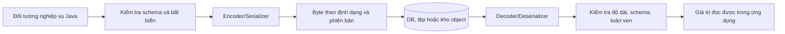

# Định dạng văn bản, nhị phân và cấu trúc bản ghi

## 1. Từ đối tượng Java đến dữ liệu có thể lưu bền vững

Một đối tượng `Order` đang nằm trong heap của JVM không tự tồn tại sau khi ứng dụng dừng. Để lưu nó, hệ thống cần biến trạng thái có ý nghĩa nghiệp vụ thành **một biểu diễn có thể ghi, đọc và diễn giải lại**. Biểu diễn đó có thể là văn bản UTF-8, một chuỗi byte nhị phân, các cột trong bảng quan hệ hay các bản ghi trong một tệp nhật ký.

Bài học thuộc chương **Biểu diễn dữ liệu** của module `DATA_PERSISTENCE_FUNDAMENTALS`. Trọng tâm là hiểu lựa chọn **định dạng văn bản, định dạng nhị phân và cấu trúc bản ghi** ảnh hưởng như thế nào đến độ chính xác của dữ liệu, thiết kế schema, truy vấn/chỉ mục, ranh giới persistence trong Java, giao dịch, lỗi khi ghi/đọc, đồng thời, bảo mật, sao lưu và hiệu năng.

Hãy bắt đầu bằng một câu hỏi thực tế:

> Khi ghi `"Đơn hàng đã thanh toán"` hôm nay, làm cách nào để ứng dụng khác hoặc phiên bản phần mềm năm sau đọc đúng **ID**, **số tiền**, **thời điểm** và **trạng thái** của cùng đơn hàng?

Nếu định dạng không quy định rõ charset, kiểu số, cách phân tách bản ghi và phiên bản schema, cùng một dãy byte có thể bị diễn giải khác nhau.

### Tình huống xuyên suốt

Giả sử đơn hàng số `42` có trạng thái `PAID`, tổng tiền `125000.50 VND`, thời điểm tạo `2026-11-21T09:30:00Z` và ghi chú `"Giao hàng: Hà Nội"`. Ứng dụng Java cần:

1. Lưu đơn hàng ở DB giao dịch để xử lý nghiệp vụ.
2. Xuất dữ liệu sang dịch vụ báo cáo dưới dạng văn bản hoặc nhị phân.
3. Ghi bản ghi sự kiện vào outbox trong cùng giao dịch với việc chuyển trạng thái.
4. Giữ khả năng đọc dữ liệu cũ sau khi schema có thêm trường.
5. Phát hiện dữ liệu bị cắt cụt, sai encoding hoặc vượt giới hạn trước khi dùng nó.

Bốn khía cạnh phải được tách bạch:

| Khái niệm | Câu hỏi nó trả lời | Ví dụ |
| --- | --- | --- |
| Mô hình dữ liệu (*data model*) | Thực thể, quan hệ và quy tắc là gì? | Đơn hàng có ID, trạng thái, số tiền |
| Schema | Trường nào, kiểu nào, bắt buộc hay tùy chọn? | `id: long`, `total: decimal`, `status: enum` |
| Định dạng/encoding | Các giá trị thành byte như thế nào? | JSON UTF-8, bản ghi nhị phân có trường độ dài |
| Phương thức lưu trữ | Byte hoặc trường được đặt ở đâu và ghi bền vững bằng cách nào? | Bảng PostgreSQL, object storage, tệp log |

**Định dạng không tự quyết định tính đúng đắn của giao dịch.** JSON không tự bảo đảm atomicity; nhị phân không tự bảo đảm độ bền; việc chọn một schema tốt không thay thế cơ chế đồng thời của DB.

## 2. Đơn vị cơ bản: byte, ký tự, trường và bản ghi

### 2.1. Byte không phải ký tự

Máy tính lưu và truyền **byte**. Văn bản cần một **bảng mã ký tự** (*character encoding*) để chuyển ký tự thành byte.

Ví dụ, chuỗi `"Hà Nội"` chứa các ký tự Unicode; khi mã hóa bằng UTF-8, một số ký tự chiếm nhiều hơn một byte. Nếu ghi bằng UTF-8 nhưng đọc bằng bảng mã khác, nội dung có thể bị lỗi hiển thị. Không dùng `String.length()` để tính chính xác số byte cần cấp phát: `String.length()` đếm đơn vị mã UTF-16 trong Java, không đếm code point Unicode hay byte UTF-8.

```java
import java.nio.charset.StandardCharsets;

String text = "Hà Nội";
byte[] bytes = text.getBytes(StandardCharsets.UTF_8);

System.out.println(text.length());  // số code unit UTF-16
System.out.println(bytes.length);   // số byte thực tế trong UTF-8
```

Với văn bản trao đổi giữa các hệ thống, UTF-8 thường là lựa chọn mặc định thuận tiện; **tên encoding phải được quy định trong hợp đồng dữ liệu**. Khi đọc dữ liệu cũ không rõ encoding, không nên đoán rồi lặng lẽ ghi đè dữ liệu gốc.

### 2.2. Trường, bản ghi, tập bản ghi

- **Trường (*field*):** một phần tử dữ liệu có ý nghĩa, ví dụ `orderId` hoặc `total`.
- **Giá trị:** nội dung của trường tại một thời điểm, ví dụ `42`.
- **Bản ghi (*record*):** nhóm trường mô tả một đơn vị logic, chẳng hạn một đơn hàng.
- **Tập bản ghi:** nhiều đơn hàng trong bảng DB, tệp CSV, luồng NDJSON hoặc chuỗi khung nhị phân.
- **Metadata:** thông tin giúp đọc và quản lý bản ghi: schema version, thời điểm, đơn vị, checksum, nguồn dữ liệu hoặc khóa phân vùng.

Một đối tượng Java, một hàng SQL và một bản ghi trong tệp **không mặc nhiên có cùng cấu trúc**. Trong Java, thuộc tính có thể là `BigDecimal`; trong DB nó có thể là `NUMERIC(18,2)`; trong JSON để tránh làm tròn khi đi qua các hệ khác, hệ thống có thể chọn chuỗi `"125000.50"`.

### 2.3. Hình dung quá trình mã hóa và giải mã



Ở chiều đọc, nếu dữ liệu không đúng định dạng hoặc không vượt qua kiểm tra hợp lệ, hãy **báo lỗi có kiểm soát**. Không nên tạo một đối tượng nghiệp vụ “có vẻ hợp lệ” từ byte sai bằng cách tự động điền giá trị mặc định cho mọi trường bị mất.

## 3. Biểu diễn văn bản: dễ nhìn, nhưng phải có quy tắc

Định dạng văn bản chứa ký tự đã được mã hóa theo charset thống nhất. Lợi thế lớn là người vận hành có thể mở bằng công cụ quen thuộc và dễ truy vết trong log, HTTP hoặc tệp xuất. Cái giá phải trả là cần phân tích cú pháp, xử lý ký tự đặc biệt và chuyển lại thành kiểu có ý nghĩa.

### 3.1. JSON — bản ghi có tên trường

Một biểu diễn JSON cho đơn hàng:

```json
{
  "schemaVersion": 1,
  "orderId": 42,
  "status": "PAID",
  "currency": "VND",
  "total": "125000.50",
  "createdAt": "2026-11-21T09:30:00Z",
  "note": "Giao hàng: Hà Nội",
  "discountCode": null
}
```

Một số quyết định được thể hiện rõ:

- `schemaVersion` cho biết hợp đồng diễn giải dữ liệu.
- `orderId` là số nguyên nhận diện đơn hàng; số lớn hơn phạm vi số nguyên an toàn của một số môi trường tiêu thụ có thể cần quy ước biểu diễn khác.
- `total` được xuất thành **chuỗi số thập phân** để tránh mất độ chính xác khi hệ thống tiêu thụ dùng số dấu phẩy động nhị phân. Hợp đồng phải yêu cầu parser chuyển chuỗi đó thành kiểu decimal chính xác.
- `currency` tách riêng khỏi `total`. Phần mềm không được tự suy luận đơn vị tiền từ môi trường máy chủ.
- `createdAt` dùng ISO 8601 với `Z` biểu thị UTC, giúp tránh sự nhập nhằng của thời gian không có múi giờ.
- `discountCode: null` khác với trường `discountCode` hoàn toàn vắng mặt nếu hợp đồng định nghĩa hai trường hợp khác nhau.

JSON cho phép object lồng nhau và mảng, phù hợp với payload API hoặc sự kiện. Tuy nhiên, tên trường và enum là một phần của hợp đồng. Đổi `status` từ `"PAID"` thành `"SETTLED"` mà không có cách đọc tương thích có thể làm consumer cũ lỗi.

### 3.2. CSV — bản ghi dạng bảng phẳng

```csv
order_id,status,currency,total,created_at,note
42,PAID,VND,125000.50,2026-11-21T09:30:00Z,"Giao hàng: Hà Nội"
43,NEW,VND,0.00,2026-11-21T10:00:00Z,"Người nhận nói: ""gọi trước"""
```

CSV hữu ích khi trao đổi dữ liệu dạng bảng và nhập/xuất qua spreadsheet. Dù vậy, nó có ít thông tin về kiểu hơn JSON; `42` có thể là số hoặc chuỗi, và `2026-11-21T...` vẫn chỉ là văn bản cho đến khi được parser chuyển kiểu.

CSV còn có những quy tắc dễ bị bỏ qua:

- Dấu phẩy trong trường phải được đặt trong dấu nháy theo dialect tương ứng.
- Dấu nháy kép bên trong trường thường được nhân đôi.
- Trường được trích dẫn có thể chứa **xuống dòng thực**, nên **một dòng tệp không nhất thiết là một bản ghi CSV**.
- Dấu phân cách, charset, newline, ký hiệu null và header phải được xác định, nhất là khi giao tiếp giữa nhiều hệ thống.
- Khi xuất CSV cho phần mềm bảng tính, dữ liệu người dùng bắt đầu bằng các ký tự được chương trình nhận làm công thức có thể tạo rủi ro *CSV formula injection*. Cần xử lý theo ứng dụng nhận và chính sách xuất dữ liệu.

Không nên ghép một bản ghi CSV bằng `String.join(",")` nếu giá trị có thể chứa dấu phân cách, dấu nháy hay xuống dòng. Sử dụng thư viện CSV với dialect được cấu hình rõ.

### 3.3. NDJSON — nhiều bản ghi JSON theo từng dòng

```jsonl
{"orderId":42,"status":"PAID","total":"125000.50"}
{"orderId":43,"status":"NEW","total":"0.00"}
```

NDJSON (*newline-delimited JSON*) quy ước mỗi dòng là một giá trị JSON độc lập; ký tự xuống dòng nằm trong một chuỗi phải được escape như `\n` thay vì tạo dòng vật lý giữa bản ghi. Nó thuận tiện cho log có cấu trúc, xử lý theo luồng và nạp theo lô vì không phải tải toàn bộ mảng JSON vào bộ nhớ.

Tuy nhiên, tệp có thể kết thúc giữa chừng khi tiến trình chết trong lúc ghi. Reader cần nhận diện dòng cuối chưa hoàn chỉnh, phân biệt bản ghi hợp lệ và bản ghi lỗi. Nếu cần phát hiện mất bản ghi ở giữa hoặc bảo đảm trình tự, nên có số thứ tự, record ID và giao thức ghi/khôi phục rõ ràng.

### 3.4. XML, YAML và văn bản tùy biến

XML có namespace, thuộc tính, cấu trúc cây và hệ sinh thái schema/validation; đôi khi phù hợp hợp đồng doanh nghiệp hoặc tích hợp lâu đời. Parser cần cấu hình an toàn trước XML không đáng tin cậy, đặc biệt cơ chế external entity. YAML dễ đọc cho cấu hình nhưng có cú pháp và quy tắc kiểu phức tạp hơn; không nên mặc nhiên xem nó là định dạng trao đổi dữ liệu sản xuất tối ưu cho mọi trường hợp.

Một định dạng tự nghĩ ra như `id|status|total` chỉ có vẻ đơn giản lúc đầu. Khi dữ liệu chứa ký tự `|`, xuống dòng, ký tự thoát hoặc có trường mới, việc đọc lại sẽ nhập nhằng nếu không định nghĩa escaping, framing và phiên bản.

## 4. Biểu diễn nhị phân: quy ước bit/byte và schema là bắt buộc

Định dạng nhị phân có thể mã hóa giá trị trực tiếp thành các byte theo quy tắc xác định, không cần chuyển mọi thứ thành văn bản có thể đọc bằng mắt. Ví dụ một số nguyên 64-bit, timestamp dạng epoch và độ dài chuỗi có thể được ghi thành những byte với vị trí rõ ràng.

**Nhị phân không đồng nghĩa với mã hóa bảo mật.** Người có quyền đọc file và biết định dạng vẫn có thể giải mã. Nếu cần bảo mật nội dung phải thiết kế mã hóa, kiểm soát khóa và phân quyền riêng. Tương tự, **nhị phân không tự bảo đảm nhỏ hơn hay nhanh hơn** văn bản trong mọi trường hợp; kích thước và tốc độ phụ thuộc schema, dữ liệu, thư viện, nén và cách đọc.

### 4.1. Kiểu số và thứ tự byte

| Vấn đề | Điều cần quy định | Lỗi dễ gặp |
| --- | --- | --- |
| Integer | Độ rộng 8/16/32/64 bit, có dấu hay không | Tràn số khi đổi giữa `long` và `int` |
| Endianness | Big-endian hay little-endian cho số nhiều byte | Đọc cùng bốn byte thành giá trị khác |
| Số thập phân chính xác | Scale và unscaled integer, hoặc decimal được quy định | Dùng `double` để biểu diễn tiền và cộng dồn sai |
| Floating point | Chuẩn IEEE 754 nếu sử dụng, cách xử lý NaN/vô cực | Hai hệ thống không đồng ý dữ liệu đặc biệt |
| Timestamp | Đơn vị giây/mili giây/micro giây, mốc epoch, UTC hay timezone | Sai 1.000 lần hoặc lệch múi giờ |
| Chuỗi | Encoding, số byte, quy ước độ dài và null | Cắt chuỗi giữa ký tự UTF-8 nhiều byte |
| Boolean/enum | Mã giá trị và trạng thái không biết | Gặp enum mới rồi diễn giải nhầm |

Ví dụ: `DataOutputStream.writeLong(...)` trong Java ghi 8 byte theo big-endian. `ByteBuffer` mặc định cũng dùng big-endian nhưng có thể đổi bằng `order(ByteOrder.LITTLE_ENDIAN)`. Writer và reader phải dùng **cùng hợp đồng**, không dựa vào thứ tự byte mặc định của phần cứng.

Với tiền tệ, một cách phổ biến là dùng đơn vị nhỏ nhất biểu diễn bằng integer **khi chính sách tiền tệ cho phép**; cách khác là ghi decimal dưới dạng `unscaledValue` và `scale` có giới hạn. Cần quy định mã tiền tệ và quy tắc làm tròn. Không nên tự giả định mọi đồng tiền đều có hai chữ số thập phân.

### 4.2. Cố định độ dài, trường có độ dài và TLV

Một bản ghi nhị phân có thể dùng:

- **Fixed layout:** mỗi trường ở một offset, độ rộng cố định. Đọc trực tiếp nhanh nhưng khó thêm trường hoặc chuỗi biến độ dài.
- **Length-prefixed:** trước chuỗi hoặc khối byte là số byte, giúp parser xác định điểm kết thúc.
- **Tagged fields/TLV:** mã trường (*tag*), độ dài (*length*), giá trị (*value*); thường hỗ trợ bỏ qua trường không biết và phát triển schema tốt hơn nếu thiết kế đúng.
- **Schema-driven encoding:** writer và reader dùng schema được quản lý riêng; có thể tiết kiệm byte vì không cần lặp tên trường trong từng bản ghi.

Chỉ ghi lần lượt `id` rồi `title` mà không lưu độ dài `title` hoặc ký tự kết thúc theo quy ước sẽ khiến reader không biết bản ghi dừng ở đâu.

### 4.3. Các định dạng nhị phân phổ biến

| Định dạng/họ định dạng | Đặc tính điển hình | Trường hợp dùng |
| --- | --- | --- |
| Protocol Buffers | Trường được đánh số, schema mô tả message, hỗ trợ bỏ qua trường không biết theo cơ chế wire type | Giao tiếp giữa dịch vụ và lưu message nhỏ |
| Apache Avro | Mã hóa theo schema; thường dùng writer schema/reader schema để đọc dữ liệu tiến hóa | Sự kiện, tệp dữ liệu, pipeline |
| Apache Parquet | Định dạng cột, nén/encoding theo cột và metadata phục vụ quét chọn cột | Phân tích theo lô trên dữ liệu lớn |
| Bản ghi nhị phân tự thiết kế | Toàn quyền kiểm soát layout, header và phiên bản | Giao thức nội bộ có yêu cầu đặc thù |

Việc dùng thư viện được duy trì và định dạng được tài liệu hóa thường an toàn hơn tự thiết kế wire format phức tạp. Nhưng ngay cả với thư viện có sẵn, vẫn phải xác định cách đổi schema, mức tương thích, giới hạn kích thước, quyền đọc và chiến lược phục hồi.

## 5. Cấu trúc một bản ghi nhị phân đáng tin cậy

Với tệp chứa nhiều bản ghi, reader phải biết **bản ghi nào đang bắt đầu**, **thuộc phiên bản nào**, **dài bao nhiêu** và **có bị hỏng trong lúc ghi/truyền không**.

Một khung (*frame*) minh họa:

```text
+--------------------+----------------------+-----------------------+
| Header             | Payload              | Bản ghi tiếp theo ... |
+--------------------+----------------------+-----------------------+

Header (14 byte):
  magic             4 byte    "DPF1"
  schemaVersion     2 byte    unsigned, big-endian
  payloadLength     4 byte    signed int, big-endian; giới hạn trước cấp phát
  payloadCrc32c     4 byte    CRC32C của payload

Payload phiên bản 1:
  id                8 byte    signed long, big-endian
  statusCode        4 byte    signed int, big-endian
  updatedAtMillis   8 byte    signed long, epoch milliseconds UTC
  titleByteLength   4 byte    signed int, big-endian
  title             N byte    UTF-8
```

Tổng độ dài với `title` có N byte là `14 + 24 + N` byte. Ví dụ này không có padding, không có dấu phân cách dòng và không lưu null; muốn hỗ trợ null phải bổ sung quy ước riêng. `magic` chỉ giúp nhận diện loại khung; nó không thay thế xác thực nguồn dữ liệu.

Các kiểm tra cần có:

1. `magic` đúng giá trị mong đợi.
2. `schemaVersion` được chương trình hỗ trợ.
3. `payloadLength` không âm và không vượt giới hạn đã quy định.
4. Có đủ chính xác số byte payload đã khai báo; tệp bị cắt phải báo lỗi.
5. CRC32C của payload khớp với giá trị trong header.
6. Kiểu trường và độ dài chuỗi hợp lệ, không tràn quá payload.
7. Chuỗi UTF-8 giải mã hợp lệ, dữ liệu thỏa ràng buộc nghiệp vụ.
8. Trong payload không còn byte dư chưa được định nghĩa.

**CRC32C kiểm tra lỗi dữ liệu không chủ ý, không phải chứng thực mật mã.** Người có thể sửa nội dung cũng có thể tính lại CRC. Với dữ liệu cần chống giả mạo, dùng cơ chế xác thực như chữ ký số hoặc MAC phù hợp, có quản lý khóa.

## 6. Ví dụ Java: ghi và đọc bản ghi nhị phân có version, length và checksum

Ví dụ dùng các lớp chuẩn của Java 17, không cần thư viện serializer ngoài. Nó tạo một frame trong bộ nhớ trước khi ghi; cách này thích hợp cho **bản ghi nhỏ với giới hạn rõ ràng**. Với payload lớn, cần thiết kế streaming/chunking để tránh giữ toàn bộ trong RAM.

```java
import java.io.ByteArrayInputStream;
import java.io.ByteArrayOutputStream;
import java.io.DataInputStream;
import java.io.DataOutputStream;
import java.io.IOException;
import java.io.InputStream;
import java.io.OutputStream;
import java.nio.ByteBuffer;
import java.nio.charset.CharacterCodingException;
import java.nio.charset.CodingErrorAction;
import java.nio.charset.StandardCharsets;
import java.util.Objects;
import java.util.zip.CRC32C;

record TicketRecord(
        long id,
        int statusCode,
        long updatedAtEpochMillis,
        String title
) {}

public final class TicketBinaryCodec {
    private static final int MAGIC = 0x44504631; // ASCII "DPF1"
    private static final int VERSION = 1;
    private static final int MAX_TITLE_BYTES = 64 * 1024;
    private static final int MAX_PAYLOAD_BYTES = 1024 * 1024;

    private TicketBinaryCodec() {}

    public static void write(TicketRecord record, OutputStream stream)
            throws IOException {
        Objects.requireNonNull(record, "record");
        Objects.requireNonNull(stream, "stream");
        Objects.requireNonNull(record.title(), "title");

        if (record.id() <= 0 || record.statusCode() < 1
                || record.statusCode() > 3) {
            throw new IllegalArgumentException("Trường nghiệp vụ không hợp lệ");
        }

        byte[] titleBytes =
                record.title().getBytes(StandardCharsets.UTF_8);
        if (titleBytes.length > MAX_TITLE_BYTES) {
            throw new IOException("Tiêu đề vượt giới hạn");
        }

        ByteArrayOutputStream buffer = new ByteArrayOutputStream();
        DataOutputStream payloadWriter = new DataOutputStream(buffer);
        payloadWriter.writeLong(record.id());
        payloadWriter.writeInt(record.statusCode());
        payloadWriter.writeLong(record.updatedAtEpochMillis());
        payloadWriter.writeInt(titleBytes.length);
        payloadWriter.write(titleBytes);
        payloadWriter.flush();

        byte[] payload = buffer.toByteArray();
        if (payload.length > MAX_PAYLOAD_BYTES) {
            throw new IOException("Payload vượt giới hạn");
        }

        CRC32C crc = new CRC32C();
        crc.update(payload, 0, payload.length);

        DataOutputStream writer = new DataOutputStream(stream);
        writer.writeInt(MAGIC);
        writer.writeShort(VERSION);
        writer.writeInt(payload.length);
        writer.writeInt((int) crc.getValue());
        writer.write(payload);
        writer.flush();
    }

    public static TicketRecord read(InputStream stream)
            throws IOException {
        Objects.requireNonNull(stream, "stream");
        DataInputStream reader = new DataInputStream(stream);

        if (reader.readInt() != MAGIC) {
            throw new IOException("Magic không hợp lệ");
        }

        int version = reader.readUnsignedShort();
        if (version != VERSION) {
            throw new IOException("Không hỗ trợ phiên bản " + version);
        }

        int payloadLength = reader.readInt();
        if (payloadLength < 0 || payloadLength > MAX_PAYLOAD_BYTES) {
            throw new IOException("Độ dài payload không hợp lệ");
        }

        int expectedChecksum = reader.readInt();
        byte[] payload = new byte[payloadLength];
        reader.readFully(payload); // EOFException nếu bị cắt cụt

        CRC32C crc = new CRC32C();
        crc.update(payload, 0, payload.length);
        if ((int) crc.getValue() != expectedChecksum) {
            throw new IOException("Checksum không khớp");
        }

        DataInputStream fields =
                new DataInputStream(new ByteArrayInputStream(payload));
        long id = fields.readLong();
        int status = fields.readInt();
        long updatedAt = fields.readLong();
        int titleLength = fields.readInt();

        if (id <= 0 || status < 1 || status > 3) {
            throw new IOException("Trường nghiệp vụ không hợp lệ");
        }
        if (titleLength < 0 || titleLength > MAX_TITLE_BYTES
                || titleLength > fields.available()) {
            throw new IOException("Độ dài tiêu đề không hợp lệ");
        }

        byte[] titleBytes = new byte[titleLength];
        fields.readFully(titleBytes);
        if (fields.available() != 0) {
            throw new IOException("Payload có byte dư");
        }

        String title;
        try {
            title = StandardCharsets.UTF_8.newDecoder()
                    .onMalformedInput(CodingErrorAction.REPORT)
                    .onUnmappableCharacter(CodingErrorAction.REPORT)
                    .decode(ByteBuffer.wrap(titleBytes))
                    .toString();
        } catch (CharacterCodingException ex) {
            throw new IOException("Tiêu đề không phải UTF-8 hợp lệ", ex);
        }

        return new TicketRecord(id, status, updatedAt, title);
    }
}
```

### Điều ví dụ minh họa

- `DataOutputStream` và `DataInputStream` sử dụng big-endian cho các kiểu số; writer/reader thống nhất quy tắc.
- `DataOutputStream.writeUTF` **không được dùng** ở đây vì nó áp dụng *modified UTF-8* với quy ước độ dài riêng của Java, khác UTF-8 chuẩn của hợp đồng này.
- Reader kiểm tra độ dài **trước khi cấp phát**. Nếu không giới hạn, một header giả khai báo gigabyte có thể gây cạn bộ nhớ.
- `readFully` đọc đủ số byte hoặc báo lỗi; không giả định một lời gọi `InputStream.read` luôn nhận đủ mọi byte.
- UTF-8 được giải mã ở chế độ báo lỗi với byte không hợp lệ; không lặng lẽ thay ký tự hỏng bằng dấu thay thế.
- Codec không tự đóng `stream` do caller truyền vào. Caller quản lý vòng đời file/connection, đóng và đồng bộ dữ liệu theo chính sách.
- Writer hiện dùng `String.getBytes(UTF_8)`, có thể thay thế các UTF-16 surrogate không hợp lệ trong đầu vào. Nếu hợp đồng yêu cầu **không tự sửa dữ liệu**, writer cũng phải dùng `CharsetEncoder` với `CodingErrorAction.REPORT`, tương tự chính sách decoder.
- Codec chủ động từ chối phiên bản khác `1`. Khi cần hỗ trợ bản cũ/bản mới, phải viết rõ logic giải mã tương ứng; không nên diễn giải tự do phần byte còn lại.

Ví dụ này chỉ minh họa **mã hóa và kiểm tra frame**. Nó chưa cung cấp giao thức khôi phục khi tệp chứa nhiều frame bị hỏng, giao dịch với DB, mã hóa bảo mật hay cam kết ghi bền vững sau mất điện.

### Sử dụng với tệp

```java
import java.io.InputStream;
import java.io.OutputStream;
import java.nio.file.Files;
import java.nio.file.Path;

Path file = Path.of("ticket-42.bin");

try (OutputStream out = Files.newOutputStream(file)) {
    TicketBinaryCodec.write(
            new TicketRecord(42, 2, 1795253400000L, "Đã tiếp nhận"),
            out);
}

try (InputStream in = Files.newInputStream(file)) {
    TicketRecord restored = TicketBinaryCodec.read(in);
    System.out.println(restored);
}
```

Timestamp trong ví dụ này là một giá trị epoch milliseconds minh họa; ứng dụng thật nên lấy từ `Instant`, ví dụ `instant.toEpochMilli()`, và thống nhất đơn vị với hợp đồng. Lưu ý lời gọi `Files.newOutputStream(file)` ở chế độ mặc định có thể tạo hoặc ghi đè file; **không** dùng cùng cách này để thay một bản lưu quan trọng trong khi dịch vụ khác đang đọc nếu chưa có quy trình thay file an toàn.

## 7. Cấu trúc bản ghi trong tệp: xác định ranh giới và khôi phục

Một tệp chứa nhiều record có thể được tổ chức theo ba cách phổ biến:

| Tổ chức | Đặc điểm | Rủi ro hoặc cách khắc phục |
| --- | --- | --- |
| Dòng văn bản | Newline phân tách, ví dụ NDJSON | Phải escape newline trong giá trị và nhận diện dòng cuối bị cắt |
| Khung độ dài | Header chứa kích thước payload, như ví dụ nhị phân | Header hỏng có thể làm mất vị trí bản ghi tiếp theo |
| Nhật ký append-only | Thêm bản ghi/sự kiện nối đuôi, không sửa trực tiếp bản cũ | Cần checkpoint, idempotency, compaction và cách xử lý phần cuối hỏng |

Với **append-only log**, sửa trạng thái có thể được biểu diễn bằng bản ghi mới:

```text
seq=100: ORDER_CREATED  orderId=42
seq=101: ORDER_PAID     orderId=42
seq=102: ORDER_REFUNDED orderId=42
```

Các bản ghi sự kiện phản ánh thay đổi; trạng thái hiện tại được tính từ chuỗi sự kiện hợp lệ. Đây không phải điều kiện bắt buộc của persistence; bảng quan hệ thường lưu **trạng thái hiện tại**, còn event log lưu **các thay đổi theo thời gian**. Việc dựa vào sự kiện để tái dựng trạng thái cần thêm thiết kế schema, thứ tự, đối soát và chính sách lưu giữ.

### 7.1. Mất điện hoặc crash giữa lúc ghi

Nếu tiến trình chết sau khi ghi header nhưng chưa ghi hết payload, reader sẽ gặp EOF hoặc checksum sai. Với log nối đuôi, có thể xác định và bỏ phần **đuôi chưa hoàn chỉnh** khi phục hồi, nhưng chỉ khi format và quy trình recovery cho phép; không được lặng lẽ bỏ bản ghi lỗi nằm giữa dữ liệu đã được xác nhận.

Một cách thay thế tệp snapshot thường dùng:

1. Ghi toàn bộ snapshot vào **tệp tạm cùng filesystem**.
2. Flush nội dung và, khi cần bảo đảm bền vững sau mất điện, yêu cầu đồng bộ xuống thiết bị lưu trữ bằng cơ chế thích hợp.
3. Kiểm tra tệp tạm đã ghi đủ và đúng định dạng/checksum.
4. Thay thế tên tệp đích bằng thao tác rename/move nguyên tử **nếu hệ thống file hỗ trợ**; nếu không, cần giao thức dự phòng.
5. Khi yêu cầu durability chặt, cân nhắc đồng bộ metadata/thư mục theo khả năng hệ điều hành và filesystem.

**Atomic rename không đồng nghĩa với durability sau mất điện.** Việc tên tệp được thay nguyên tử trong lúc hệ thống đang chạy không tự chứng minh dữ liệu và metadata đã đến thiết bị lưu trữ bền vững. Với nghiệp vụ giao dịch, dùng DB có WAL và cơ chế commit được cấu hình đúng thường thích hợp hơn tự tạo transactional file store.

### 7.2. Thứ tự, tính độc nhất và idempotency

Nếu consumer nhận lại cùng một bản ghi do retry, một checksum đúng chỉ xác nhận byte không lỗi; nó không chứng minh bản ghi chưa từng được xử lý. Cần khóa logic như `recordId` hoặc `eventId` để chống xử lý trùng.

Nếu xử lý bản ghi theo thứ tự có ý nghĩa, thêm `sequenceNumber` hoặc phiên bản của thực thể để phát hiện sự kiện bị thiếu hoặc đảo thứ tự. Không dựa hoàn toàn vào timestamp để suy ra thứ tự toàn cục giữa nhiều máy.

## 8. Row-oriented và column-oriented: cùng dữ liệu, cách đọc khác nhau

Khái niệm **cấu trúc bản ghi** còn liên quan cách DB và định dạng lưu trữ sắp xếp dữ liệu.

### Lưu theo hàng

```text
[order #42: id | status | total | created_at]
[order #43: id | status | total | created_at]
[order #44: id | status | total | created_at]
```

Lưu theo hàng thuận tiện khi ứng dụng lấy/sửa nhiều trường của một đơn hàng cụ thể. DB giao dịch thường hỗ trợ đọc/ghi theo hàng, chỉ mục, MVCC và giao dịch; cấu trúc byte trên đĩa là chi tiết của engine, **không nên suy từ thứ tự cột SQL ra layout vật lý cố định**.

### Lưu theo cột

```text
[id:         42, 43, 44, ...]
[status:     PAID, NEW, ...]
[total:      125000.50, 0.00, ...]
[created_at: ..., ..., ...]
```

Lưu theo cột có lợi khi cần quét rất nhiều bản ghi nhưng chỉ đọc một vài trường, ví dụ tổng doanh thu theo ngày. Các định dạng như Parquet có metadata và encoding theo cột, giúp phân tích và nén tốt trên nhiều bộ dữ liệu. Tuy nhiên, cập nhật thường xuyên từng đơn hàng có thể không phù hợp với một tệp phân tích dạng cột bất biến.

### Không nhầm lưu hàng/cột với text/binary

JSON UTF-8 là văn bản nhưng vẫn có thể chứa một tập hàng; Parquet là nhị phân thiên về cột. Một cơ sở dữ liệu quan hệ có thể cho người dùng truy vấn SQL giống nhau dù engine triển khai lưu theo hàng hoặc theo cột. Đây là hai **trục thiết kế độc lập**:

- Văn bản hay nhị phân trả lời: **giá trị biến thành byte thế nào?**
- Hàng hay cột trả lời: **nhiều giá trị được nhóm theo đơn vị truy cập nào?**

## 9. Khi biểu diễn dữ liệu trong DB: kiểu cột vẫn quan trọng

Không nên lấy một chuỗi JSON rồi nhét mọi dữ liệu vào một cột `TEXT` chỉ vì nó dễ tạo nhanh. Với dữ liệu cần ràng buộc, lọc, join, chỉ mục và giao dịch, các cột có kiểu rõ ràng thường giúp DB kiểm tra và tối ưu tốt hơn.

Ví dụ lược đồ cho đơn hàng:

```sql
CREATE TABLE orders (
    id         BIGINT PRIMARY KEY,
    status     VARCHAR(20) NOT NULL
        CHECK (status IN ('NEW', 'PAID', 'CANCELLED')),
    currency   CHAR(3) NOT NULL,
    total      NUMERIC(18, 2) NOT NULL CHECK (total >= 0),
    created_at TIMESTAMPTZ NOT NULL,
    updated_at TIMESTAMPTZ NOT NULL
);
```

Với Java/JDBC, hãy ánh xạ đúng ý nghĩa:

| Mô hình Java | Kiểu SQL điển hình | Khi xuất văn bản/nhị phân |
| --- | --- | --- |
| `long id` | `BIGINT` | Số nguyên có quy định phạm vi |
| `BigDecimal total` | `NUMERIC(18,2)` | Decimal string hoặc decimal binary có scale |
| `String status` / enum có mã ổn định | `VARCHAR` + `CHECK` / bảng tham chiếu | Chuỗi/mã có tài liệu về giá trị được phép |
| `Instant createdAt` | Kiểu timestamp có thông tin thời điểm tương ứng | ISO 8601 UTC hoặc epoch + đơn vị |
| `String note` | `TEXT` | UTF-8, null/độ dài/escaping được quy định |
| Dữ liệu nhị phân nhỏ | `BYTEA` hoặc `BLOB` tùy DB | Byte có định dạng và phiên bản |

Lưu ý `TIMESTAMPTZ` của PostgreSQL lưu thời điểm theo cách engine quy định và **không giữ nguyên tên múi giờ gốc**. Nếu cần giữ múi giờ người dùng lựa chọn, lưu riêng timezone ID hợp lệ, chẳng hạn `Asia/Ho_Chi_Minh`, và biết mục đích sử dụng.

### 9.1. JSON trong DB có thể hữu ích khi có chủ đích

Một cột JSON/JSONB có thể phù hợp trường bổ sung linh hoạt, sự kiện hoặc payload ít được join. Nhưng:

- Schema cần được kiểm tra ở ứng dụng và/hoặc tầng DB.
- Truy vấn nhiều trường bên trong JSON có thể cần chỉ mục chuyên biệt; không mặc định nhanh như cột chuẩn hóa.
- Đổi tên trường trong hàng triệu payload cũ cần migration hoặc reader tương thích.
- Kiểu JSON native như `JSONB` có đặc tính lưu trữ, thứ tự key và phép so sánh riêng; đừng giả định DB bảo toàn byte JSON gốc.

Nếu cần tìm đơn hàng theo `status` và `created_at` mỗi giây, đặt chúng trong các cột được kiểm soát và chỉ mục phù hợp thường dễ vận hành hơn phụ thuộc vào việc bóc tách từ một blob lớn.

### 9.2. Byte lớn: BLOB, object storage và streaming

Ảnh, PDF hay file đính kèm có thể rất lớn. Đưa tất cả vào một hàng có thể làm tăng chi phí backup, replication và đọc danh sách. Tùy yêu cầu giao dịch và bảo mật, có thể lưu nội dung dưới dạng BLOB trong DB hoặc trên object storage và giữ metadata/URI trong DB.

Khi dùng JDBC, các API như `setBinaryStream`/`getBinaryStream` hỗ trợ xử lý byte theo luồng tùy driver. Cần giới hạn kích thước upload, định dạng được phép, quyền truy cập, checksum và cách dọn dữ liệu không còn được tham chiếu. Nếu file ngoài DB, **giao dịch JDBC không tự rollback upload object**, nên phải thiết kế workflow và cơ chế đối soát.

## 10. Schema evolution: làm sao đọc dữ liệu từ năm trước?

Dữ liệu bền vững sống lâu hơn một phiên bản ứng dụng. Giả sử bản ghi đơn hàng phiên bản 1 chỉ có `id`, `status` và `total`; phiên bản 2 có thêm `paymentMethod`.

### 10.1. Những thay đổi có thể tương thích

| Thay đổi | Hành vi cần xem xét | Hướng xử lý |
| --- | --- | --- |
| Thêm trường tùy chọn | Reader cũ có thể bỏ qua nếu format/decoder hỗ trợ | Quy định giá trị mặc định, xử lý dữ liệu cũ |
| Thêm trường bắt buộc | Dữ liệu v1 không có giá trị | Migration/backfill hoặc nâng schema theo giai đoạn |
| Đổi tên trường JSON | Reader cũ không thấy tên mới | Hỗ trợ alias/chuyển đổi trong một giai đoạn |
| Đổi mã enum | Có thể phá logic của consumer cũ | Lập ánh xạ và kế hoạch chuyển đổi |
| Đổi `int` thành `long` | Reader cũ có thể tràn nếu vẫn đọc kiểu hẹp | Kiểm tra phạm vi, quy tắc tương thích của format |
| Đổi đơn vị timestamp | Có thể sai thời gian hàng nghìn lần | Gắn phiên bản và quy định đơn vị rõ |
| Đổi encoding | Byte cũ bị diễn giải sai | Gắn metadata, công cụ chuyển đổi và thử dữ liệu lịch sử |
| Thay định dạng nhị phân không có version | Reader khó biết layout | Luôn có version/schema ID từ đầu |

**Backward compatibility** thường nói về việc reader mới đọc dữ liệu do writer cũ tạo. **Forward compatibility** thường nói về việc reader cũ đọc dữ liệu do writer mới tạo. Một hệ thống cần cả hai hay không phụ thuộc cách triển khai, thời gian tồn tại của message và khả năng phát lại dữ liệu cũ.

### 10.2. Ví dụ chuyển đổi theo phiên bản JSON

```json
{
  "schemaVersion": 2,
  "orderId": 42,
  "status": "PAID",
  "currency": "VND",
  "total": "125000.50",
  "paymentMethod": "BANK_TRANSFER",
  "createdAt": "2026-11-21T09:30:00Z"
}
```

Reader v2 có thể hỗ trợ v1 bằng cách diễn giải `paymentMethod` vắng mặt thành `UNKNOWN` **nếu** nghiệp vụ cho phép. Không tự suy rằng các đơn hàng cũ đều thanh toán bằng một phương thức cụ thể. Cần phân biệt `null`, vắng mặt và giá trị không biết trong hợp đồng.

Với định dạng có tag như Protobuf, quy tắc tương thích liên quan số hiệu trường, wire type và giá trị mặc định; không được tái sử dụng tùy tiện tag đã bỏ cho nghĩa khác. Với Avro, phải kiểm tra cơ chế resolution giữa writer schema và reader schema. Với bản ghi fixed layout tự thiết kế, thường phải duy trì decoder riêng cho từng phiên bản.

### 10.3. Migration và backfill

Khi đổi định dạng, nên triển khai theo trình tự:

1. Cho reader hiểu cả phiên bản cũ và mới.
2. Đưa writer mới vào hoạt động theo phạm vi được kiểm soát.
3. Theo dõi lỗi giải mã và đối chiếu kết quả giữa các phiên bản.
4. Chuyển đổi dữ liệu cũ theo lô nếu cần; có checkpoint/idempotency.
5. Chỉ bỏ reader cũ khi đã chứng minh không còn dữ liệu cũ phải đọc, kể cả trong backup, archive và hàng đợi còn khả năng phát lại.

Đừng xóa decoder cũ chỉ vì DB nóng đã dùng schema mới. Bản sao lưu, tệp lưu trữ lạnh hoặc event cũ có thể quay lại sau nhiều năm.

## 11. Giao dịch, lỗi kết nối và giới hạn của định dạng

### 11.1. Tính hợp lệ của frame khác tính nguyên tử của giao dịch

Một frame có checksum hợp lệ chứng minh payload vượt qua một phép kiểm tra toàn vẹn cụ thể. Nó không cho biết bản ghi đã **commit** hay chưa, không bảo đảm một event không bị gửi lại và không khóa được hai transaction cùng sửa một đơn hàng.

Ngược lại, transaction DB có thể đảm bảo hai hàng được commit cùng nhau, nhưng nếu một hàng chứa payload JSON có schema sai và không được kiểm tra, ứng dụng vẫn có thể không đọc được dữ liệu sau này.

Cần phối hợp:

- Ràng buộc DB và validation khi ghi.
- Kiểu/encoding và kiểm tra giải mã khi đọc.
- Transaction khi nhiều thay đổi phải thành công cùng nhau.
- Khóa lạc quan/bi quan hoặc điều kiện cập nhật để xử lý đồng thời.
- Idempotency khi yêu cầu bị lặp sau timeout hoặc mạng lỗi.
- Audit/log và giám sát khi nhận dữ liệu sai hoặc phát hiện chênh lệch.

### 11.2. Khi commit có kết quả chưa xác định

Ví dụ ứng dụng Java lưu một đơn hàng và một hàng outbox trong cùng transaction. Nếu mạng đứt đúng lúc gửi `COMMIT`, client không thể kết luận chắc rằng DB đã rollback. Định dạng event ở outbox có thể vẫn hoàn toàn đúng; điều còn thiếu là **biết kết quả nghiệp vụ đã được commit hay chưa**.

Hãy dùng `request_id` duy nhất, tra theo yêu cầu trước khi tạo lại; với consumer, dùng `event_id` hoặc khóa nghiệp vụ để chống áp dụng lại sự kiện. Khi tệp hoặc object được ghi ngoài transaction DB, cần workflow có trạng thái, khóa ổn định, kiểm tra checksum và đối soát để xử lý trường hợp một bên thành công còn bên kia lỗi.

### 11.3. Dữ liệu một phần, dữ liệu trùng, dữ liệu cũ

| Trường hợp | Biện pháp ở lớp định dạng | Biện pháp ở lớp persistence/nghiệp vụ |
| --- | --- | --- |
| Tệp bị cắt cụt | Length prefix, `readFully`, checksum | Recovery, không đánh dấu commit trước khi ghi bền |
| Byte hỏng | Checksum và kiểm tra encoding | Khôi phục từ bản sao, cảnh báo, đối chiếu |
| Event gửi trùng | Record/event ID | Consumer idempotent, unique key/checkpoint |
| Event đến sai thứ tự | Aggregate version/sequence | Xử lý thứ tự hoặc tái tính từ nguồn |
| Hai writer cập nhật cùng hàng | Bản ghi có version để trao đổi | `UPDATE ... WHERE version = ?`, transaction/khóa |
| Đọc nhầm schema | Schema version / schema ID | Quản lý registry và reader tương thích |
| Giá trị hợp lệ về byte nhưng sai nghiệp vụ | Kiểu và validation | Ràng buộc DB, luật chuyển trạng thái, phân quyền |

## 12. Bảo mật khi lưu và giải mã dữ liệu

Việc dữ liệu là văn bản hay nhị phân không quyết định độ an toàn. Cả hai đều có thể chứa bí mật và cả hai đều có thể là đầu vào độc hại.

Các kiểm soát cần thiết:

1. **Giới hạn độ dài và độ sâu:** giới hạn kích thước payload, số bản ghi, chiều sâu JSON/XML, số phần tử mảng và dung lượng được phép cấp phát. Cẩn trọng với payload nén có tỉ lệ giải nén cực lớn.
2. **Parser có kiểm tra:** từ chối cấu trúc lỗi, trường bắt buộc thiếu, byte UTF-8 sai và số vượt phạm vi.
3. **Không tin Java native serialization từ nguồn không đáng tin cậy:** `ObjectInputStream` và serialization đối tượng tùy ý có thể gây rủi ro bảo mật và ràng buộc chặt vào cấu trúc lớp. Chỉ dùng khi có chính sách kiểm soát loại đối tượng và nguồn dữ liệu rõ; với giao tiếp dịch vụ thường ưu tiên định dạng có schema và parser được duy trì.
4. **Chống injection:** câu SQL dùng `PreparedStatement`; JSON/XML/CSV cũng cần parser/encoder đúng, không ghép chuỗi thủ công. Với XML, tắt hoặc giới hạn external entity theo thư viện sử dụng.
5. **Mã hóa và toàn vẹn có xác thực:** dùng TLS khi truyền, mã hóa khi lưu theo yêu cầu, quản lý khóa và phân quyền. CRC32C không bảo vệ chống người tấn công sửa dữ liệu.
6. **Tách dữ liệu nhạy cảm:** không đưa password, token, thông tin thanh toán hoặc dữ liệu riêng tư không cần thiết vào event, log, snapshot hay tệp export.
7. **Chính sách lưu giữ/xóa:** bản ghi có thể còn trong backup, archive và hệ thống tìm kiếm sau khi xóa khỏi DB nóng. Cần biết dữ liệu được sao chép ở đâu, giữ bao lâu và ai được giải mã.

Một file JSON dễ đọc bằng mắt cũng có thể lộ thông tin nếu quyền thư mục hoặc object bucket cấu hình sai; một file nhị phân khó đọc bằng mắt cũng không che giấu dữ liệu với người có công cụ giải mã.

## 13. Hiệu năng: đo nhu cầu truy cập thay vì chọn theo cảm giác

Lựa chọn định dạng có thể ảnh hưởng cả CPU, RAM, mạng, kích thước lưu trữ và cách truy vấn.

| Tiêu chí | Văn bản (JSON/CSV/NDJSON) | Nhị phân record-oriented | Nhị phân column-oriented |
| --- | --- | --- | --- |
| Kiểm tra thủ công | Dễ hơn, có thể mở bằng editor | Cần decoder | Thường cần công cụ chuyên dụng |
| Overhead tên trường | JSON thường lặp tên; CSV ít lặp hơn | Có thể giảm nhờ schema/tag | Metadata và mã hóa theo cột |
| Parse/serialize | Chi phí xử lý ký tự, số và escaping | Có thể giảm bước chuyển đổi kiểu | Tối ưu cho quét/phân tích theo cột |
| Truy vấn chọn vài cột trên dữ liệu lớn | Thường phải parse nhiều dữ liệu hơn | Phụ thuộc layout và chỉ mục | Thường có lợi với quét một số cột |
| Thay đổi schema | JSON linh hoạt nhưng cần hợp đồng | Tùy kiểu mã hóa và reader/writer | Cần chiến lược metadata/schema rõ |
| Dòng sự kiện nhỏ | NDJSON/JSON tiện quan sát | Protobuf/Avro có thể tiết kiệm byte | Thường không phải lựa chọn đầu tiên |
| Cập nhật từng bản ghi | Tùy storage engine, không phải riêng định dạng | Tùy thiết kế file/DB | Tệp phân tích thường phù hợp batch hơn |

Khi benchmark, giữ cùng dữ liệu và mục tiêu:

- Tổng byte trên đĩa/mạng, **có và không nén**.
- Thời gian mã hóa/giải mã và số bản ghi mỗi giây.
- Bộ nhớ đỉnh, số lần cấp phát, tác động GC trong Java.
- Độ trễ p95/p99 với kích thước record thực tế.
- Chi phí nén/giải nén, CPU và băng thông.
- Chi phí đọc chọn một trường, đọc cả bản ghi và quét theo lô.
- Chi phí backup, replication và khôi phục dài hạn.

Không chỉ so sánh kích thước một bản ghi mẫu nhỏ. JSON có thể được nén rất tốt với dữ liệu lặp tên trường; nhị phân có overhead header/tag; Parquet có lợi thế khi đủ dữ liệu để nén theo cột. Kết luận phải dựa trên thử nghiệm cùng workload.

### Chỉ mục quyết định truy vấn, không phải phần mở rộng tệp

Một bảng SQL có cột kiểu đúng và chỉ mục phù hợp có thể lọc `status` nhanh mà không cần đọc toàn bộ payload. Một tệp JSON lớn không có index phụ trợ thường phải quét và parse để tìm giá trị. Ngược lại, công cụ phân tích trên Parquet có thể bỏ qua một số khối/cột nhờ metadata và predicate pushdown.

Vì vậy hãy xét **định dạng + công cụ truy cập + chỉ mục + mô hình dữ liệu** như một thiết kế thống nhất. Đổi JSON thành Protobuf nhưng vẫn quét toàn bộ file có thể không giải quyết vấn đề truy vấn chậm.

## 14. Sao lưu, lưu trữ lạnh và khả năng giải mã trong tương lai

Dữ liệu bền vững chỉ thật sự có ích nếu còn **đọc được** khi cần phục hồi. Một bản sao lưu chứa file nhị phân nhưng thiếu tài liệu schema hoặc khóa giải mã có thể trở nên vô dụng.

Với một định dạng được lưu lâu dài, cần giữ:

- Tài liệu layout, endian, charset, phiên bản và ý nghĩa các trường.
- Schema file hoặc mã định nghĩa hợp đồng, cùng bộ dữ liệu mẫu để thử.
- Metadata về nén, mã hóa, thuật toán checksum, khóa/khả năng lấy khóa hợp lệ.
- Version của công cụ chuyển đổi hoặc reader tương thích.
- Quy trình khôi phục và kiểm tra sau khôi phục, bao gồm đối chiếu bản ghi.
- Chính sách retention và xóa khi hết thời hạn lưu.

Đối với cold archive, nên ghi manifest chứa định danh ổn định, định dạng, schema version, checksum, kích thước, thời gian lưu và nơi tìm bản lưu. Thử **đọc lại một mẫu archive** theo lịch; không chỉ kiểm tra file vẫn tồn tại.

Sao lưu một DB giao dịch và lưu tệp ngoài DB có thể diễn ra ở những thời điểm khác nhau. Muốn khôi phục toàn bộ trạng thái nhất quán, phải xác định ranh giới phục hồi cho metadata và object, cũng như cách đối soát những bản ghi đang ghi dở. RPO (mức dữ liệu có thể mất) và RTO (thời gian phục hồi) phải được đặt và đo riêng.

## 15. Chọn định dạng trong một ứng dụng Java

Một cách ra quyết định thực tế:

1. **Xác định đối tượng và bất biến:** dữ liệu đại diện điều gì, ID nào ổn định, trường nào cần giá trị chính xác?
2. **Xác định cách truy cập:** đọc một bản ghi, quét hàng triệu bản ghi, sửa từng trường, tìm theo cột hay trao đổi message?
3. **Xác định người đọc:** cùng JVM, dịch vụ đa ngôn ngữ, công cụ BI hay ứng dụng bên ngoài? Có cần đọc bằng mắt để điều tra không?
4. **Xác định tuổi thọ dữ liệu:** đọc lại sau vài giây hay vài năm? Cần schema version và migration thế nào?
5. **Chọn ranh giới giao dịch:** lưu ở bảng DB, tệp hay object; chỗ nào cần ACID và chỗ nào phải dùng workflow?
6. **Thiết kế framing và validation:** giới hạn kích thước, null, encoding, trường tùy chọn, checksum/kiểm tra tính hợp lệ.
7. **Xử lý lỗi và bảo mật:** timeout, retry, idempotency, quyền truy cập, parser an toàn, dữ liệu nhạy cảm.
8. **Đo và thử phục hồi:** latency, CPU/RAM, kích thước, độ trễ tải, khả năng đọc dữ liệu lịch sử.

### Gợi ý theo nhu cầu

| Nhu cầu | Lựa chọn khởi đầu hợp lý | Điều phải kiểm tra thêm |
| --- | --- | --- |
| Dữ liệu nghiệp vụ có quan hệ và transaction | Bảng SQL với kiểu/ràng buộc rõ | Truy vấn, index, isolation, migration |
| REST API cần khả năng quan sát | JSON UTF-8 | Decimal, timestamp, null, schema compatibility |
| Dữ liệu dạng bảng để trao đổi | CSV UTF-8 hoặc định dạng bảng phù hợp | Dialect, escaping, formula injection, kiểu |
| Log/sự kiện văn bản để xử lý theo luồng | NDJSON | Framing, thiếu/trùng/sai thứ tự, retention |
| Thông điệp giữa dịch vụ cần schema và gọn | Protobuf hoặc Avro | Schema registry, compatibility, giới hạn và idempotency |
| Quét phân tích nhiều cột chọn lọc | Parquet | Batch size, partitioning, schema và pipeline |
| Snapshot riêng có yêu cầu đặc biệt | Binary framed record hoặc định dạng chuẩn có version | Checksum, crash recovery, reader dài hạn |
| Tệp lớn ít truy vấn bên trong | Object storage + metadata DB | Quyền, tính toàn vẹn, đồng bộ metadata/file |

Không có định dạng nào tốt nhất cho mọi tầng. Một đơn hàng có thể được lưu bằng cột quan hệ, trả qua API JSON, phát ra sự kiện Avro/Protobuf và sau này được phân tích trong Parquet. Các biểu diễn ấy cần thống nhất **ý nghĩa**, **định danh**, **phiên bản** và **quy tắc nghiệp vụ**.

## 16. Bài thực hành tổng hợp

Tạo một ứng dụng Java nhỏ lưu và đọc thông tin phiếu hỗ trợ hoặc đơn hàng bằng **hai định dạng**: JSON UTF-8 và binary framed record. Dùng DB quan hệ để giữ dữ liệu nguồn có ràng buộc, sau đó xuất và nhập một tập bản ghi mẫu.

### Phần A — Thiết kế hợp đồng

Hãy xác định cho mỗi trường: tên, kiểu, bắt buộc hay tùy chọn, đơn vị, giá trị mặc định, độ dài tối đa và quy tắc validation. Tối thiểu có:

- `id`: số nguyên 64-bit dương.
- `status`: mã trạng thái với các giá trị tài liệu hóa.
- `amount` hoặc `title`: trường cần bảo toàn chính xác tiền tệ hoặc UTF-8.
- `updatedAt`: thời điểm tuyệt đối, quy định UTC và đơn vị.
- `schemaVersion`: phiên bản diễn giải dữ liệu.

Đặt câu hỏi về `null`, trường vắng mặt, Unicode, số lớn và phiên bản chưa biết trước khi viết encoder.

### Phần B — Mã hóa và giải mã

1. Tạo bản ghi có chữ tiếng Việt và ký tự Unicode đa byte.
2. Xuất JSON UTF-8, nhập lại và so sánh từng trường theo ngữ nghĩa.
3. Dùng codec nhị phân mẫu để ghi/đọc bản ghi; so sánh ID, status, timestamp và title.
4. Tạo lỗi giả: thay một byte payload, rút ngắn tệp, sửa magic, đổi version, khai báo length quá lớn. Decoder phải từ chối, không cấp phát vô hạn.
5. Với CSV, kiểm tra trường chứa dấu phẩy, dấu nháy và xuống dòng; bảo đảm một bản ghi nhập lại không bị chia sai.
6. Nếu dùng tiền, thử `0.1 + 0.2` trong `double` và `BigDecimal` với đầu vào chuỗi; giải thích vì sao không dùng float nhị phân để quyết định tổng tiền chính xác.

### Phần C — Giao dịch và khôi phục

1. Ghi đơn hàng vào DB, tạo một bản ghi outbox chứa `eventId` và payload đã quy định schema **trong cùng transaction**.
2. Mô phỏng lỗi giữa hai câu `INSERT`; xác minh rollback và không để event mồ côi.
3. Mô phỏng worker gửi lại cùng event; consumer phải chống áp dụng trùng bằng ID.
4. Lưu snapshot ra file tạm và kiểm tra checksum trước khi thay thế snapshot cũ theo cơ chế hệ thống file hỗ trợ.
5. Chuyển sang `schemaVersion = 2`, thêm trường tùy chọn; đảm bảo reader mới vẫn đọc được dữ liệu v1.
6. Lưu một bản vào kho lạnh thử nghiệm cùng schema version/checksum; diễn tập phục hồi và kiểm tra nội dung sau khôi phục.

### Phần D — Đo đạc

Tạo bộ dữ liệu thử nghiệm nhiều bản ghi với các kiểu trường và kích thước gần thực tế. So sánh JSON, binary codec và nếu phù hợp một định dạng chuẩn theo:

| Phép đo | Ghi nhận |
| --- | --- |
| Kích thước trung bình/bản ghi | Số byte và tỷ lệ nén |
| Tốc độ ghi/đọc | Bản ghi/giây trong điều kiện thử nghiệm |
| Bộ nhớ đỉnh | Khi đọc từng frame so với nạp toàn bộ tệp |
| Chi phí lỗi | Thời gian phát hiện bản ghi hỏng hoặc thiếu |
| Tương thích | Khả năng đọc bản ghi v1 từ reader v2 |
| Khả năng phục hồi | Kết quả đọc từ bản sao lưu/archive |

### Câu hỏi tự đánh giá

1. Tại sao `String.length()` không cho biết số byte UTF-8 cần lưu?
2. Cùng một chuỗi byte có thể bị hiểu sai khi thiếu thông tin nào?
3. Vì sao JSON thuận tiện nhưng cần quy tắc riêng cho tiền, thời gian và số nguyên rất lớn?
4. Tại sao tệp CSV có thể chứa một bản ghi kéo dài qua nhiều dòng?
5. Khi nào chọn length-prefix, khi nào chọn schema với tag, và cần kiểm tra những gì trước khi cấp phát buffer?
6. CRC32C giúp phát hiện loại lỗi nào? Vì sao nó không thể thay chữ ký số hoặc MAC?
7. Nhị phân luôn nhanh hơn, nhỏ hơn và an toàn hơn văn bản đúng hay sai? Cần đo gì để trả lời?
8. Tại sao row-oriented/column-oriented là một câu hỏi khác với text/binary?
9. Giao dịch DB, checksum và khóa idempotency đang bảo vệ **ba vấn đề khác nhau** như thế nào?
10. Nếu dữ liệu đã lưu mười năm nhưng không còn reader/schema, có thể gọi bản lưu đó là có khả năng khôi phục không?

Hoàn thành bài học nghĩa là bạn có thể mô tả một bản ghi bằng **cấu trúc logic và cấu trúc byte**, chọn định dạng theo nhu cầu truy cập, nhận ra giới hạn của mỗi định dạng và kiểm tra việc dữ liệu vẫn được diễn giải đúng sau lỗi, đổi schema hoặc phục hồi. Một biểu diễn đáng tin cậy cần sự nhất quán giữa **schema, encoding, framing, transaction, bảo mật và quy trình đọc lại**, chứ không chỉ một câu lệnh ghi file hay chuyển đối tượng sang JSON.
