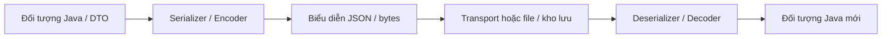

# Phân biệt tuần tự hóa đối tượng với thiết kế lược đồ lưu trữ

## 1. Hai việc khác nhau trong cùng một luồng dữ liệu

Giả sử ứng dụng Java nhận một yêu cầu tạo đơn hàng. Trong bộ nhớ, đơn hàng là một đối tượng chứa mã đơn, ngày tạo, trạng thái và danh sách dòng hàng. Khi gửi phản hồi HTTP, ứng dụng có thể **tuần tự hóa** đối tượng thành JSON. Khi lưu đơn hàng lâu dài, ứng dụng phải quyết định **cấu trúc dữ liệu lưu trữ**: bảng nào, cột nào, kiểu dữ liệu gì, quan hệ và ràng buộc ra sao, truy vấn theo khóa nào, cập nhật trong transaction nào.

Hai hoạt động có thể trông giống nhau vì đều chuyển đổi dữ liệu:

- Tuần tự hóa (*serialization*) biến một giá trị hoặc đồ thị đối tượng thành một biểu diễn có thể truyền hoặc ghi lại, chẳng hạn JSON, Protocol Buffers, CBOR hoặc một định dạng nhị phân.
- Thiết kế lược đồ lưu trữ (*storage schema design*) xác định dữ liệu được tổ chức, nhận dạng, kiểm tra, liên kết, tìm kiếm, cập nhật và duy trì bền vững trong hệ lưu trữ ra sao.

**Một JSON hợp lệ chưa phải là một lược đồ persistence đủ tốt.** Nó có thể thiếu khóa duy nhất, ràng buộc tham chiếu, cách truy vấn hiệu quả, cách cập nhật đồng thời và quy tắc tiến hóa dữ liệu. Ngược lại, một schema database được thiết kế đúng cũng không tự xác định hình dạng JSON trả cho API.

Ví dụ, Java có thể giữ dữ liệu này:

```java
record OrderLine(
    int lineNo,
    String sku,
    int quantity,
    java.math.BigDecimal unitPrice
) {}

record Order(
    java.util.UUID id,
    String status,
    String currency,
    java.time.Instant createdAt,
    java.util.List<OrderLine> lines
) {}
```

JSON để trao đổi có thể là:

```json
{
  "id": "9d5c9672-196f-4ac2-96fb-3b2c5e6281f2",
  "status": "NEW",
  "currency": "USD",
  "createdAt": "2026-04-10T09:30:00Z",
  "lines": [
    {
      "lineNo": 1,
      "sku": "BOOK-01",
      "quantity": 2,
      "unitPrice": 19.90
    },
    {
      "lineNo": 2,
      "sku": "PEN-01",
      "quantity": 3,
      "unitPrice": 2.50
    }
  ]
}
```

Với database quan hệ, thiết kế có thể dùng một bảng `orders` và một bảng `order_lines`. Mỗi bảng phục vụ cách lưu, khóa và truy vấn riêng. **Không có yêu cầu rằng số class Java, số object JSON và số bảng phải bằng nhau.**

Chủ đề này thuộc phần **Biểu diễn dữ liệu** của kiến thức về persistence: chọn mô hình lưu trữ theo quy tắc nghiệp vụ, truy vấn, chỉ mục, transaction, khả năng mở rộng và thời gian tồn tại của dữ liệu. Tuần tự hóa là một công cụ trong hệ thống đó; nó không thay thế việc thiết kế dữ liệu.

## 2. Định nghĩa và ranh giới trách nhiệm

| Khía cạnh | Tuần tự hóa đối tượng | Thiết kế lược đồ lưu trữ |
|---|---|---|
| Câu hỏi chính | Biểu diễn một giá trị thành bytes/text và đọc lại như thế nào? | Dữ liệu được lưu, liên kết, kiểm chứng và truy xuất thế nào qua thời gian? |
| Đầu vào thường gặp | Object Java, DTO, message, cấu trúc dữ liệu | Yêu cầu nghiệp vụ, invariant, kiểu truy vấn, vòng đời và khối lượng dữ liệu |
| Đầu ra | JSON, XML, CBOR, Protobuf, bytes, snapshot | Bảng/cột/kiểu, document collections, khóa, index, constraint, migration |
| Cơ chế chính | Encoder/decoder, field mapping, schema của định dạng truyền | DDL, khóa chính/ngoại, ràng buộc, index, transaction, policy |
| Phạm vi thời gian | Một lần encode/decode hoặc một phiên bản thông điệp | Nhiều phiên bản ứng dụng và thời gian tồn tại của dữ liệu đã lưu |
| Xử lý trùng lặp | Có thể encode hai object có cùng giá trị | Có thể áp dụng `PRIMARY KEY`, `UNIQUE` hoặc cách nhận dạng phù hợp |
| Xử lý đồng thời | Bản thân serializer không điều phối các writer | DB và ứng dụng chọn locking, version, isolation, atomic update |
| Truy vấn | Thường phải decode hoặc dùng công cụ đặc thù để lọc trường | Có cấu trúc truy vấn và chỉ mục theo nhu cầu |
| Độ bền | Tạo ra bytes không bảo đảm bytes đã được lưu bền vững | Phải xác định commit, log, backup, khôi phục và phạm vi lỗi |
| Bảo mật | Kiểm soát field được xuất, giới hạn kiểu/đầu vào | Quyền truy cập, mã hóa, lọc dữ liệu, lưu giữ và kiểm toán |

Cũng cần phân biệt thêm **schema của dữ liệu truyền** và **schema lưu trữ**. Một hợp đồng JSON Schema hoặc Protobuf có thể quy định tên trường, kiểu, trường bắt buộc và quy tắc tương thích giữa các message. Đó là **schema của thông điệp**, không mặc nhiên là schema quan hệ hoặc quy tắc persistence.

Ba lớp có thể cùng tồn tại:

1. **Domain model / Java object:** Biểu diễn ý nghĩa nghiệp vụ, hành vi và trạng thái đối tượng.
2. **Transport contract / serialized message:** Biểu diễn dữ liệu trao đổi qua API, file, queue hoặc event.
3. **Storage model / persisted schema:** Biểu diễn dữ liệu trong hệ lưu trữ để bảo toàn invariant, hỗ trợ truy vấn và phát triển lâu dài.

Tách ba lớp này cho phép thay đổi API mà không buộc phải thay đổi toàn bộ database, hoặc tối ưu database mà không phá hợp đồng của client.

## 3. Tuần tự hóa thực sự làm những gì?

Quá trình thông thường gồm:



Serializer cần biết cách chuyển đổi field, collection, định danh, số, ngày giờ, null và có thể cả kiểu đa hình. Deserializer thực hiện hướng ngược lại: dựng lại **một giá trị trong bộ nhớ** từ biểu diễn bên ngoài.

### 3.1. Round-trip không có nghĩa cùng một object

```java
Order original = buildOrder();
String json = mapper.writeValueAsString(original);
Order restored = mapper.readValue(json, Order.class);
```

Dù `original` và `restored` có các giá trị tương đương, chúng là **hai đối tượng khác nhau** trong JVM. Tham chiếu bộ nhớ, kết nối database, lock, thread, cache và tài nguyên đang mở thường không được hoặc không nên được tuần tự hóa.

Giá trị round-trip cũng không bảo đảm hoàn toàn bằng nhau nếu serializer bỏ qua field, làm tròn số, thay kiểu, thay timezone hoặc gặp cấu trúc không hỗ trợ. Muốn khẳng định tương đương, phải định nghĩa những thuộc tính nào quan trọng và kiểm thử trên định dạng và phiên bản thư viện thực tế.

### 3.2. Đồ thị đối tượng không nhất thiết là cây JSON

Java có thể có các quan hệ hai chiều:

```text
Order -> List<OrderLine>
OrderLine -> Order
```

Nếu serializer đi theo mọi tham chiếu, nó có thể tạo vòng lặp vô hạn hoặc thông điệp rất lớn. Những lựa chọn như chỉ xuất ID của quan hệ, cắt một chiều, dùng DTO riêng hoặc cấu hình reference handling giải quyết việc biểu diễn. Quyết định này **không tự nói lên** bảng nào được dùng trong database hoặc khóa ngoại ra sao.

Hai đối tượng Java riêng rẽ có thể cùng mang một ID nghiệp vụ. Ngược lại, nhiều đường tham chiếu có thể trỏ đến cùng một instance Java. Cần phân biệt:

- **Object identity:** Có phải cùng instance trong bộ nhớ (`a == b`)?
- **Value equality:** Có bằng nhau theo logic `equals()` hoặc định nghĩa khác không?
- **Persistent identity:** Có tham chiếu đến cùng bản ghi hoặc aggregate trong dữ liệu đã lưu không?

Một serializer thông thường không tự thực thi quy tắc khóa chính của database.

### 3.3. Những quyết định nằm trong định dạng

JSON là định dạng trao đổi dữ liệu phổ biến nhưng có hạn chế cần quản lý:

- Số JSON không bắt buộc được parser giữ như `BigDecimal`; một client dùng floating point có thể làm mất độ chính xác.
- JSON không có kiểu chuẩn riêng cho `UUID`, `Instant`, tiền tệ hoặc enum; hợp đồng phải quy ước cách biểu diễn.
- Trường **vắng mặt** và trường có giá trị `null` có thể mang ý nghĩa khác nhau khi cập nhật từng phần.
- Object JSON không được bảo đảm về thứ tự field theo ngữ nghĩa thông thường; không dùng thứ tự JSON để xác định quy tắc nghiệp vụ.
- Một số serializer có thể bỏ qua giá trị mặc định hoặc field `null`, thay đổi ý nghĩa khi đọc lại nếu không có hợp đồng rõ ràng.

Các định dạng khác như Protobuf, Avro hoặc CBOR có cơ chế kiểu dữ liệu, schema hay kích thước khác nhau. Chọn định dạng phù hợp mục đích trao đổi và tương thích, **không suy ra rằng đổi định dạng là đã giải quyết bài toán lưu trữ**.

## 4. Vì sao database cần thiết kế schema riêng?

Một lược đồ lưu trữ phải trả lời nhiều câu hỏi mà JSON không trả lời:

1. **Khóa và danh tính:** Làm sao bảo đảm hai thao tác không tạo cùng một đơn hàng?
2. **Kiểu dữ liệu:** Tiền dùng `DECIMAL/NUMERIC` hay số nguyên đơn vị nhỏ nhất? Thời điểm dùng kiểu gì?
3. **Quan hệ:** Mỗi dòng hàng thuộc về đơn nào? Xóa đơn có được xóa dòng hàng không?
4. **Ràng buộc:** Số lượng phải dương, trạng thái chỉ thuộc tập hợp hợp lệ, mã SKU không trống.
5. **Truy vấn:** Tìm đơn theo khách, theo ngày, theo trạng thái với cách đánh chỉ mục nào?
6. **Transaction:** Tạo đơn và tất cả dòng hàng có phải commit cùng nhau không?
7. **Đồng thời:** Hai người sửa cùng đơn thì làm sao tránh lost update?
8. **Tiến hóa:** Khi thay trạng thái, chia bảng hoặc thêm field, đọc dữ liệu cũ bằng cách nào?
9. **Bảo mật và lưu giữ:** Ai được đọc dữ liệu nhạy cảm, thời hạn giữ và xóa thế nào?
10. **Độ bền:** Dữ liệu được commit, backup, phục hồi theo mục tiêu nào?

Lưu nguyên cả JSON vào một cột `TEXT` có thể đáp ứng nhu cầu **lưu một payload**, nhưng không tự giải quyết toàn bộ câu hỏi trên.

### 4.1. Ví dụ lược đồ quan hệ cho đơn hàng

```sql
CREATE TABLE orders (
    id UUID PRIMARY KEY,
    customer_id UUID NOT NULL,
    status TEXT NOT NULL
        CHECK (status IN ('NEW', 'CONFIRMED', 'CANCELLED')),
    currency CHAR(3) NOT NULL,
    created_at TIMESTAMPTZ NOT NULL DEFAULT now(),
    version BIGINT NOT NULL DEFAULT 0 CHECK (version >= 0)
);

CREATE TABLE order_lines (
    order_id UUID NOT NULL REFERENCES orders(id),
    line_no INTEGER NOT NULL CHECK (line_no > 0),
    sku TEXT NOT NULL CHECK (length(btrim(sku)) > 0),
    quantity INTEGER NOT NULL CHECK (quantity > 0),
    unit_price NUMERIC(19, 2) NOT NULL CHECK (unit_price >= 0),
    PRIMARY KEY (order_id, line_no)
);

CREATE INDEX ix_orders_customer_created
    ON orders (customer_id, created_at DESC);
```

Ví dụ dùng PostgreSQL và giả định tất cả giá trong một đơn thuộc cùng `currency`; giới hạn hai chữ số thập phân chỉ phù hợp những loại tiền/quy tắc làm tròn tương ứng. Với hệ thống đa tiền tệ thật, phải thiết kế scale theo đơn vị tiền, làm tròn và đối soát có kiểm chứng.

Những quyết định đáng chú ý:

- `orders.id` là danh tính lưu trữ; `order_lines` dùng khóa ghép `(order_id, line_no)`.
- `FOREIGN KEY` buộc dòng hàng tham chiếu một đơn đã tồn tại theo quy tắc transaction.
- `CHECK` ngăn lưu số lượng âm hoặc bằng 0.
- `NUMERIC(19, 2)` cho số thập phân chính xác ở scale được chọn; dùng `float`/`double` cho phép tính tiền thường không phù hợp.
- `version` hỗ trợ optimistic locking khi người dùng chỉnh đơn đồng thời.
- Chỉ mục `(customer_id, created_at DESC)` hướng tới truy vấn danh sách đơn của một khách theo thời gian; cần kiểm tra bằng kế hoạch truy vấn và số liệu tải thực.
- Chưa đặt `ON DELETE CASCADE` vì xóa đơn phải theo quy tắc nghiệp vụ và chính sách lưu giữ, không nên suy ra từ quan hệ object.

Có thể tính tổng tiền khi truy vấn:

```sql
SELECT o.id,
       o.currency,
       SUM(l.quantity * l.unit_price) AS total_amount
FROM orders AS o
JOIN order_lines AS l ON l.order_id = o.id
WHERE o.id = :order_id
GROUP BY o.id, o.currency;
```

Tổng tiền là một giá trị **dẫn xuất**; nếu lưu cả `total_amount` trong bảng `orders` để tối ưu, phải có cơ chế giữ nó nhất quán với `order_lines` khi thêm, sửa hoặc xóa dòng hàng. Không phải cứ field có trong Java là phải có cột tương ứng.

### 4.2. Schema làm được điều serializer không làm

Cùng một JSON có thể được gửi hai lần. Serializer sẽ encode hai lần bình thường. Database có khóa `PRIMARY KEY` và quy tắc transaction có thể ngăn tạo hai hàng `orders` mang cùng `id`.

Nếu client gửi dòng hàng có `quantity = -5`, JSON vẫn có thể đúng cú pháp. Bean Validation ở Java và `CHECK(quantity > 0)` ở database thực thi các lớp quy tắc khác nhau. Validation ở API cải thiện thông báo lỗi; constraint tại nguồn ghi bảo vệ dữ liệu khỏi những đường nhập khác.

Một schema SQL cũng hỗ trợ truy vấn chọn lọc:

```sql
SELECT o.id, o.created_at
FROM orders AS o
WHERE o.customer_id = :customer_id
ORDER BY o.created_at DESC
LIMIT 20;
```

Chỉ cần khóa và một vài cột, database không phải đọc/giải mã mọi dòng hàng thành một object `Order` đầy đủ. Một hệ lưu trữ chỉ chứa các blob JSON nén có thể cần đọc nhiều dữ liệu hơn nếu không có chỉ mục hoặc khả năng truy vấn nội dung phù hợp.

## 5. Ví dụ Java: DTO và JSON là hợp đồng trao đổi

Với API, nên có DTO được thiết kế cho những dữ liệu client cần, thay vì tuần tự hóa nguyên entity JPA:

```java
import java.math.BigDecimal;
import java.time.Instant;
import java.util.List;
import java.util.UUID;

record OrderLineView(
    int lineNo,
    String sku,
    int quantity,
    BigDecimal unitPrice
) {}

record OrderView(
    UUID id,
    String status,
    String currency,
    Instant createdAt,
    List<OrderLineView> lines
) {}
```

Ví dụ với Jackson 2 và module hỗ trợ kiểu thời gian Java:

```java
import com.fasterxml.jackson.databind.json.JsonMapper;
import com.fasterxml.jackson.datatype.jsr310.JavaTimeModule;

JsonMapper mapper = JsonMapper.builder()
    .addModule(new JavaTimeModule())
    .build();

String json = mapper.writeValueAsString(orderView);
OrderView copy = mapper.readValue(json, OrderView.class);
```

Ví dụ giả định đã khai báo `orderView` là một giá trị hợp lệ và dùng phiên bản Jackson hỗ trợ Java records. Thư viện và cấu hình thực tế quyết định định dạng ngày giờ, số, null và hành vi đọc field lạ. Vì thế cần **hợp đồng JSON và test tương thích**, không phụ thuộc hoàn toàn vào cấu hình serializer mặc định.

### 5.1. Tại sao không trả trực tiếp entity JPA?

Entity thường chứa chi tiết chỉ dành cho persistence:

- Quan hệ hai chiều có thể dẫn tới vòng tham chiếu khi tuần tự hóa.
- Quan hệ `LAZY` có thể bị truy cập ngoài transaction hoặc gây nhiều truy vấn không mong muốn.
- Field nội bộ như version, khóa ngoại, trạng thái duyệt hoặc dữ liệu nhạy cảm có thể bị lộ.
- Thay schema hoặc ORM mapping có thể vô tình làm đổi API công khai.
- Khi nhận JSON vào entity trực tiếp, client có thể gán những field server phải kiểm soát (ví dụ `status`, `ownerId`, `role`).

Tách DTO đầu vào, domain model và entity persistence giúp mỗi lớp có quy tắc rõ ràng. DTO chỉ nhận trường được phép thay đổi; service kiểm tra quyền, invariant và tạo lệnh ghi thích hợp.

### 5.2. Không đồng nhất “decode được” với “hợp lệ nghiệp vụ”

```json
{
  "sku": "BOOK-01",
  "quantity": -10,
  "unitPrice": -0.01
}
```

JSON trên đúng cú pháp và có thể được deserialize thành object. Nhưng số lượng và giá âm trái quy tắc mua hàng. Sau khi decode, ứng dụng phải validate theo nghiệp vụ, kết hợp constraint tại database.

Tương tự, JSON có trường `customerId` hợp lệ về dạng UUID vẫn chưa chứng minh người gọi có quyền đọc hoặc tạo đơn cho khách đó.

## 6. Từ Java object xuống các bảng: mapping và transaction

Một object `Order` chứa danh sách dòng hàng. Trong schema trên, việc lưu một đơn mới cần:

1. Kiểm tra dữ liệu và quyền tạo đơn.
2. Chèn một hàng vào `orders`.
3. Chèn các hàng vào `order_lines` với cùng `order_id`.
4. Commit **một transaction** để không có đơn mới chỉ chứa một phần dòng hàng.

Mọi thao tác cần một ranh giới transaction khi yêu cầu nghiệp vụ là **tạo toàn bộ đơn hoặc không tạo**.

### 6.1. Mẫu JDBC ghi đơn và các dòng hàng

```java
import javax.sql.DataSource;
import java.math.BigDecimal;
import java.sql.*;
import java.util.List;
import java.util.UUID;

record NewOrderLine(int lineNo, String sku, int quantity,
                    BigDecimal unitPrice) {}

record CreateOrder(
    UUID id,
    UUID customerId,
    String currency,
    List<NewOrderLine> lines
) {}

public final class OrderWriter {
    private final DataSource dataSource;

    public OrderWriter(DataSource dataSource) {
        this.dataSource = dataSource;
    }

    public void create(CreateOrder command) throws SQLException {
        if (command == null || command.id() == null
                || command.customerId() == null
                || command.currency() == null
                || !command.currency().matches("[A-Z]{3}")
                || command.lines() == null || command.lines().isEmpty()) {
            throw new IllegalArgumentException("Invalid order");
        }

        for (NewOrderLine line : command.lines()) {
            if (line == null || line.lineNo() <= 0
                    || line.sku() == null || line.sku().isBlank()
                    || line.quantity() <= 0 || line.unitPrice() == null
                    || line.unitPrice().signum() < 0
                    || line.unitPrice().scale() > 2) {
                throw new IllegalArgumentException("Invalid order line");
            }
        }

        try (Connection c = dataSource.getConnection()) {
            c.setAutoCommit(false);
            try {
                try (PreparedStatement header = c.prepareStatement("""
                    INSERT INTO orders(id, customer_id, status, currency)
                    VALUES (?, ?, 'NEW', ?)
                    """)) {
                    header.setObject(1, command.id());
                    header.setObject(2, command.customerId());
                    header.setString(3, command.currency());
                    header.executeUpdate();
                }

                try (PreparedStatement lineInsert = c.prepareStatement("""
                    INSERT INTO order_lines(
                        order_id, line_no, sku, quantity, unit_price)
                    VALUES (?, ?, ?, ?, ?)
                    """)) {
                    for (NewOrderLine line : command.lines()) {
                        lineInsert.setObject(1, command.id());
                        lineInsert.setInt(2, line.lineNo());
                        lineInsert.setString(3, line.sku());
                        lineInsert.setInt(4, line.quantity());
                        lineInsert.setBigDecimal(5, line.unitPrice());
                        lineInsert.addBatch();
                    }
                    lineInsert.executeBatch();
                }

                c.commit();
            } catch (SQLException | RuntimeException failure) {
                try {
                    c.rollback();
                } catch (SQLException rollbackFailure) {
                    failure.addSuppressed(rollbackFailure);
                }
                throw failure;
            }
        }
    }
}
```

Mẫu này là ví dụ JDBC với PostgreSQL, Java hỗ trợ text block và record. Nó không phải một hệ thống tạo đơn đầy đủ: chưa có kiểm tra tồn kho, idempotency key từ API, quyền khách hàng, các quy tắc thanh toán, tax hoặc giới hạn kích thước danh sách. Những điều đó phải được thiết kế phù hợp hợp đồng nghiệp vụ.

Điểm cần quan sát là **mapping giữa hai lớp**, không có hàm “serialize object sang SQL” thần kỳ:

- Field `id` và `customerId` của lệnh tạo trở thành khóa ở bảng cha.
- Mỗi `NewOrderLine` trở thành một hàng ở bảng con.
- Kiểu `BigDecimal` được gán bằng `setBigDecimal()` vào `NUMERIC`; database vẫn thực thi kiểu và constraint của mình.
- Nếu một dòng hàng sai khóa ghép, kiểu dữ liệu hoặc ràng buộc, transaction rollback cả phần header và lines.
- Batch giúp giảm số lần round-trip SQL cho nhiều dòng nhưng vẫn cần transaction và xử lý lỗi đúng.

Việc `commit()` trả về thành công là mốc ứng dụng thường dùng để xác nhận lưu hoàn tất theo cấu hình của database. Nếu kết nối mất ngay trong `commit()`, kết quả **có thể không xác định**; không nên retry bằng một ID đơn mới rồi vô tình tạo trùng nghiệp vụ.

### 6.2. Đọc thành object là một phép ánh xạ ngược

Để dựng lại `OrderView`, repository có thể:

- Truy vấn một hàng `orders` theo `id`.
- Truy vấn tất cả `order_lines` với cùng `order_id`, sắp xếp theo `line_no`.
- Chuyển kiểu SQL sang `UUID`, `Instant`, `BigDecimal` và danh sách DTO.
- Trả về DTO cho serializer JSON.

Một số query có thể gộp bằng join; nhưng cần kiểm soát hiện tượng **N+1 query** khi ORM hoặc code đọc nhiều đơn và lần lượt tải lines của từng đơn.

Định dạng JSON bên ngoài có thể giữ nguyên khi query được tối ưu bằng join, projection hoặc batching. Đây chính là lợi ích của việc tách transport contract khỏi storage schema.

## 7. JPA/Hibernate là mapping, chưa phải toàn bộ thiết kế dữ liệu

JPA cho phép mô tả tương quan giữa entity Java và database:

```java
@Entity
@Table(name = "orders")
class OrderEntity {
    @Id
    private java.util.UUID id;

    @Column(name = "customer_id", nullable = false)
    private java.util.UUID customerId;

    @Version
    private long version;

    protected OrderEntity() {}
}
```

Ví dụ rút gọn để minh họa annotation; entity thực tế còn cần đầy đủ constructor, phương thức và mapping các cột khác.

Annotation như `@Table`, `@Column`, `@OneToMany` hay `@Version` giúp ORM biết cách đọc/ghi, nhưng **không thay thế quá trình thiết kế schema, migration, constraint và chỉ mục**. Ví dụ:

- Một thuộc tính `List<OrderLine>` phải được ánh xạ thành bảng con, bảng nối, cột JSON hoặc một cách lưu khác dựa trên yêu cầu.
- `@Column(nullable = false)` có thể góp phần sinh DDL hoặc metadata ORM, nhưng cơ sở dữ liệu đang chạy vẫn cần kiểm chứng đã có `NOT NULL` tương ứng.
- Trường phiên bản `@Version` hỗ trợ phát hiện cập nhật xung đột khi ORM thực hiện update đúng cách; nó không ngăn mọi race của một hệ thống có các đường ghi ngoài ORM.
- Sinh schema tự động lúc khởi động tiện cho ví dụ hoặc môi trường thử nghiệm, nhưng hệ thống production cần thay đổi có version, đánh giá tác động và kiểm chứng dữ liệu cũ.

Khi dùng ORM, trạng thái entity **managed**, đã `flush()` và đã `commit()` là những mốc khác nhau. ORM có thể sinh `INSERT` hoặc `UPDATE` khi flush, song dữ liệu chưa commit vẫn có thể rollback. Serializer đọc object managed ngay sau sửa field không chứng minh trạng thái đó đã được lưu thành công.

## 8. Khi nào lưu JSON trong database là hợp lý?

Không nên hiểu rằng “đúng schema” luôn có nghĩa mọi trường đều phải tách thành cột quan hệ. PostgreSQL `JSONB` và các document database có thể rất phù hợp với dữ liệu linh hoạt.

Ví dụ metadata của nhà vận chuyển:

```sql
CREATE TABLE shipments (
    id UUID PRIMARY KEY,
    order_id UUID NOT NULL REFERENCES orders(id),
    carrier TEXT NOT NULL,
    external_tracking_code TEXT,
    attributes JSONB NOT NULL DEFAULT '{}'::jsonb,
    created_at TIMESTAMPTZ NOT NULL DEFAULT now()
);
```

Các thuộc tính như `order_id`, `carrier` và mã tracking được tìm kiếm thường xuyên có thể là cột có kiểu và ràng buộc rõ. `attributes` chứa dữ liệu phụ ít ổn định theo từng nhà vận chuyển.

Nếu truy vấn một field JSON nhiều lần, có thể cân nhắc index phù hợp với query thực tế:

```sql
-- Ví dụ minh họa index biểu thức cho phép so sánh theo một key JSONB.
CREATE INDEX ix_shipments_external_region
    ON shipments ((attributes ->> 'region'));
```

Index này chỉ hữu ích với kiểu truy vấn có thể khai thác biểu thức đó; phải kiểm tra `EXPLAIN`, kích thước index và dữ liệu. Trước khi thêm index, cần xác định field có đủ ổn định, dữ liệu có đủ phân biệt và write amplification có chấp nhận được không.

### 8.1. Những giới hạn khi lưu cả object như một blob

```sql
CREATE TABLE order_payloads (
    id UUID PRIMARY KEY,
    payload JSONB NOT NULL
);
```

Schema này vẫn có thể hợp lệ với một số use case như snapshot hoặc tài liệu hiếm khi cần truy vấn chi tiết. Nhưng nếu toàn bộ đơn hàng chỉ có `payload`, các câu hỏi xuất hiện:

- Muốn lọc theo khách và ngày tạo, index nào cần có?
- Làm sao bảo đảm `quantity > 0` cho từng dòng hàng?
- Làm sao giữ quan hệ đến khách hàng, sản phẩm và quyền truy cập?
- Hai tiến trình cùng sửa các field khác nhau trong một document thì giải quyết xung đột thế nào?
- Khi đổi tên `unitPrice`, dữ liệu JSON cũ phải đọc và di trú ra sao?
- Cập nhật một phần document có làm tăng chi phí ghi, kích thước log hoặc cạnh tranh không?

Một hệ quản trị document có thể hỗ trợ validation, index và atomic operation mạnh theo từng document. Vấn đề không phải JSON “kém hơn SQL”, mà là **chọn mô hình lưu trữ có cơ chế bảo vệ invariant và kiểu truy vấn phù hợp**.

### 8.2. Bảng định hướng lựa chọn

| Đặc điểm dữ liệu | Mô hình thường cân nhắc | Lý do |
|---|---|---|
| Đơn hàng, số dư, hóa đơn, nhiều quan hệ và constraint | Bảng quan hệ có khóa/transaction | Phù hợp truy vấn, quan hệ và quy tắc nhất quán |
| Metadata linh hoạt, ít phụ thuộc chéo | `JSONB`/document | Dễ thêm trường, giữ các thuộc tính tùy biến |
| Event đã phát, phải đọc lại theo thứ tự nghiệp vụ | Event store hoặc log với hợp đồng event | Giữ lịch sử thay đổi, cần schema/version và retention |
| File ảnh/tài liệu lớn | Object storage + metadata trong DB | Phù hợp dung lượng và cách phân phối, cần quản lý tính nhất quán giữa hai nơi |
| Cache hoặc session ngắn hạn | Key-value store + TTL | Tập trung truy cập nhanh, không tự thay thế nguồn dữ liệu bền |

Không chọn mô hình chỉ vì object Java “trông giống document”. Phải bắt đầu từ truy vấn, tần suất cập nhật, tính đúng đắn, bảo mật, sao lưu và khả năng mở rộng.

## 9. Schema của object và schema lưu trữ thay đổi theo các nhịp khác nhau

Ứng dụng Java có thể ra phiên bản mới hằng tuần, API có client cũ, và database có dữ liệu nhiều năm tuổi. Vì vậy một field trong object có thể được thêm, đổi tên hoặc xóa mà không thể thay đổi đồng thời mọi nơi.

Ví dụ phiên bản đầu dùng:

```json
{
  "orderId": "9d5c9672-196f-4ac2-96fb-3b2c5e6281f2",
  "status": "NEW"
}
```

Phiên bản sau thêm `requestedDeliveryDate`:

```json
{
  "orderId": "9d5c9672-196f-4ac2-96fb-3b2c5e6281f2",
  "status": "NEW",
  "requestedDeliveryDate": "2026-04-20"
}
```

Thay đổi này liên quan đến **ba quyết định độc lập**:

1. **Java model:** Thêm field, đặt kiểu `LocalDate`, định nghĩa có thể vắng mặt hay không.
2. **Hợp đồng JSON:** Client cũ có chấp nhận trường mới không? Server mới đọc payload cũ thiếu field theo quy tắc nào?
3. **Storage schema:** Có cần cột mới, default, index, constraint, backfill hoặc giữ trong JSONB không?

Không thể chỉ thêm field vào record Java rồi khẳng định mọi dữ liệu đã lưu đều tương thích.

### 9.1. Expand–migrate–contract cho database

Một kế hoạch triển khai an toàn thường chia nhiều giai đoạn:

**Expand — mở rộng schema tương thích:**

```sql
ALTER TABLE orders
ADD COLUMN requested_delivery_date DATE;
```

Cột ban đầu cho phép `NULL` để bản ghi cũ và phiên bản ứng dụng cũ tiếp tục hoạt động. Nếu cần index cho truy vấn ngày giao hàng, lập kế hoạch tạo index sau khi có số liệu truy vấn; với bảng lớn, đánh giá ảnh hưởng DDL và chiến lược tạo index phù hợp PostgreSQL.

**Migrate — ứng dụng và dữ liệu cũ:**

- Triển khai code **đọc được cả khi field thiếu**.
- Với đơn mới, ghi ngày giao hàng khi nghiệp vụ yêu cầu.
- Backfill dữ liệu cũ nếu có nguồn xác định và quy tắc chuyển đổi rõ; tránh tự bịa ngày giao hàng cho các đơn không có thông tin.
- Theo dõi số bản ghi còn thiếu và các phiên bản ứng dụng đang hoạt động.
- Nếu đổi tên field, duy trì giai đoạn đọc/ghi tương thích có chủ đích; tránh cho hai phiên bản code hiểu khác nhau về nguồn dữ liệu chính.

**Contract — siết ràng buộc hoặc bỏ đường cũ:**

Khi đã xác minh tất cả bản ghi cần thiết có giá trị và không còn writer cũ, mới cân nhắc áp `NOT NULL` hoặc bỏ cột cũ. Không áp constraint chỉ vì entity Java mới có annotation `@NotNull`.

### 9.2. Version của message khác version của database

Một sự kiện trong broker được lưu lâu dài có thể dùng:

```json
{
  "eventType": "OrderCreated",
  "schemaVersion": 2,
  "eventId": "a3a57e91-44cc-4b0b-a5ec-90a5b38a9900",
  "orderId": "9d5c9672-196f-4ac2-96fb-3b2c5e6281f2",
  "createdAt": "2026-04-10T09:30:00Z",
  "currency": "USD"
}
```

`schemaVersion` trên diễn tả hợp đồng **event payload**, không nhất thiết trùng với phiên bản migration SQL hay version của ứng dụng. Consumer phải biết cách đọc những phiên bản còn tồn tại trong retention của broker, event store hoặc archive.

Các quy tắc thường cân nhắc:

- Thêm field tùy chọn dễ tương thích hơn với reader cho phép bỏ qua field mới.
- Xóa/đổi tên field hoặc đổi ý nghĩa có thể phá consumer; cần version và chiến lược chuyển đổi.
- Trường bắt buộc mới có thể khiến message cũ không deserialize được nếu không có default hợp lệ.
- Dữ liệu đã lưu không tự được chuyển đổi khi deploy phiên bản Java mới.
- Nếu schema có hợp đồng nghiêm ngặt, dùng kiểm tra tương thích tự động trên schema/message khi phát hành.

## 10. Những kiểu dữ liệu cần thiết kế có chủ đích

### 10.1. Tiền và số

`BigDecimal("19.90")` biểu diễn số thập phân chính xác trong Java; database có thể lưu bằng `NUMERIC(19,2)`. JSON chỉ có kiểu số chung, client có thể parse qua `double`, nên hệ thống cần hợp đồng rõ ràng về **độ chính xác, đơn vị, làm tròn và giới hạn**.

Một cách khác là lưu tiền theo số nguyên đơn vị nhỏ nhất, nhưng quy tắc chuyển đổi khác nhau theo tiền tệ. Chọn một cách, ghi rõ trên schema và kiểm thử ở các ranh giới Java/JSON/database; đừng trộn các cách biểu diễn mà không có chuyển đổi tường minh.

### 10.2. Thời gian

- Java `Instant`: một thời điểm tuyệt đối.
- PostgreSQL `TIMESTAMPTZ`: lưu thời điểm có ngữ nghĩa múi giờ theo cơ chế DBMS; kết quả hiển thị phụ thuộc timezone của session.
- JSON ISO 8601: hợp đồng định dạng và offset phải rõ.
- `LocalDate`: ngày lịch, không phải một thời điểm UTC.

Không dùng chuỗi không có múi giờ để biểu diễn một sự kiện phải sắp xếp chính xác toàn cầu. Những dữ liệu như “ngày sinh” hoặc “ngày giao hàng theo lịch địa phương” lại có thể phù hợp với `DATE` hơn `TIMESTAMPTZ`.

### 10.3. Null, missing và default

Trong Java, field reference có thể là `null`. Với JSON, **thiếu key** khác với `"key": null`. Với SQL, `NULL` có ngữ nghĩa ba giá trị và tương tác với `DEFAULT`, `NOT NULL`, `UNIQUE` theo quy tắc DBMS.

Ví dụ PATCH địa chỉ:

```json
{}
```

có thể nghĩa là “không thay đổi địa chỉ”, trong khi:

```json
{"addressLine2": null}
```

có thể nghĩa là “xóa địa chỉ phụ”. Nếu deserialize cả hai thành cùng một Java field `null` và lưu đè, API sẽ mất ý nghĩa. Dùng DTO cập nhật có khả năng phân biệt *absent* với *explicit null* khi nghiệp vụ cần.

### 10.4. Enum và quy tắc nghiệp vụ

Enum Java `OrderStatus.NEW` có thể serialize thành `"NEW"`. Nhưng database vẫn cần giới hạn giá trị hợp lệ và kiểm soát chuyển trạng thái, chẳng hạn `NEW → CONFIRMED` hoặc `NEW → CANCELLED`.

Nếu một ứng dụng cũ đọc trạng thái `REFUNDED` do ứng dụng mới ghi, việc deserialize vào enum cũ có thể thất bại. Thiết kế cần xem xét quy tắc mở rộng trạng thái, cơ chế hiển thị fallback hay phiên bản hợp đồng, thay vì coi thay đổi enum chỉ là sửa một class.

## 11. Tính đúng đắn và bảo mật ở từng ranh giới

Việc dữ liệu qua được serializer không chứng minh dữ liệu an toàn để lưu hoặc công bố.

### 11.1. Không deserialize đối tượng Java không tin cậy bằng cơ chế native một cách tùy tiện

Java native serialization (`Serializable`, `ObjectInputStream`) có rủi ro bảo mật khi đọc bytes từ nguồn không tin cậy: deserialization có thể kích hoạt hành vi của class/gadget ngoài ý muốn, gây từ chối dịch vụ hoặc lỗ hổng nghiêm trọng nếu phụ thuộc và cấu hình dễ bị khai thác.

Đối với API và message từ bên ngoài, thường ưu tiên định dạng và decoder có hợp đồng dữ liệu rõ, giới hạn kích thước/độ sâu, allowlist kiểu nếu có đa hình và validation sau decode. Nếu hệ thống buộc phải đọc dữ liệu native đã tồn tại, cần đánh giá nguồn dữ liệu, giới hạn lớp được phép đọc và có kế hoạch chuyển đổi định dạng.

### 11.2. Chống lộ dữ liệu và mass assignment

Nếu entity có field `passwordHash`, `internalNote` hoặc `isAdmin`, việc serializer tự xuất tất cả getter có thể làm lộ thông tin. Ngược lại, việc nhận JSON thẳng vào entity có setter cho `ownerId` hoặc `role` có thể cho phép client chỉnh thuộc tính đáng lẽ chỉ server được quyết định.

Sử dụng DTO có allowlist field được công bố, validator và kiểm tra phân quyền trước khi ghi. SQL dùng prepared statement/binding tham số; **serialize thành chuỗi rồi nối SQL** không phải cách an toàn để lưu dữ liệu.

### 11.3. Mã hóa, retention và khôi phục thuộc thiết kế persistence

JSON hay Protobuf chỉ quy định cách biểu diễn, không mặc định mã hóa dữ liệu. Cần xác định mã hóa khi truyền, khi lưu, phân quyền, quản lý khóa, backup, kiểm toán và thời hạn xóa theo tính nhạy cảm.

Dữ liệu có thể được sao chép sang cache, log, event, search index, backup và export. Chính sách xóa dữ liệu phải xác định cả các bản sao ấy. Đổi sang JSONB hoặc BSON không tự làm dữ liệu “bảo mật hơn” hoặc “xóa được ở mọi nơi”.

## 12. Hiệu năng: tối ưu cả biểu diễn lẫn truy cập

Một số giải pháp tuần tự hóa làm thông điệp nhỏ hơn và encode nhanh hơn, nhưng **không nhất thiết** giúp database truy vấn và cập nhật tốt hơn.

| Mục tiêu | Cần xem xét | Đo lường phù hợp |
|---|---|---|
| Giảm kích thước message | JSON so với binary format, field naming, compression | Kích thước bytes, CPU serialize/deserialize, băng thông |
| Giảm thời gian đọc một đơn | Chỉ mục, projection, join, số query, cache | p50/p95/p99 latency, số row/page đọc |
| Cập nhật nhiều dòng an toàn | Transaction, batch, khóa, ràng buộc | Throughput thành công, lock wait, rollback, contention |
| Lọc theo thuộc tính trong JSONB | Index biểu thức hoặc GIN phù hợp predicate | `EXPLAIN ANALYZE`, chi phí index và ghi |
| Tải danh sách nhiều đơn | Batching, projection, kiểm soát N+1 | Số SQL/request, memory, latency |
| Giữ dung lượng lâu dài | Retention, archive, partitioning, compression | Tăng trưởng bảng/index/WAL và thời gian backup |

Một document chứa toàn bộ đơn hàng có thể giảm số join khi đọc đầy đủ một đơn nhưng tăng chi phí cập nhật một phần, cạnh tranh trên một document lớn và khó lọc theo các chiều khác. Schema quan hệ có thể hỗ trợ nhiều kiểu truy vấn và constraint nhưng đòi hỏi join/mapping. Quyết định nên dựa trên **mẫu truy cập thực**, không chỉ kích thước JSON nhìn bằng mắt.

Giữ schema mở rộng quá mức với quá nhiều index cũng có giá: mỗi lần `INSERT`/`UPDATE` có thể cần cập nhật nhiều cấu trúc chỉ mục, tăng IO và thời gian commit. Thiết kế cần cân bằng đọc, ghi và vận hành.

## 13. Kiểm thử ba lớp độc lập

Một bộ kiểm thử có chất lượng cần phân biệt serializer, schema và transaction:

| Nhóm kiểm thử | Thiết lập | Kết quả cần chứng minh |
|---|---|---|
| **Serialization round-trip** | Encode/decode một `OrderView` với ngày, decimal, null và lines | Các field được giữ theo hợp đồng; không lộ field nội bộ |
| **Compatibility JSON** | Đọc payload cũ thiếu field mới; payload mới có field bổ sung | Hành vi reader được xác định, không biến ý nghĩa nghiệp vụ |
| **Validation** | Đưa `quantity = -1` hoặc SKU trống vào DTO | API từ chối với lỗi phù hợp |
| **Database constraint** | Thử insert dòng hàng âm qua SQL trực tiếp | `CHECK` ngăn trạng thái không hợp lệ, kể cả bỏ qua Java |
| **Atomicity** | Gây lỗi ở dòng hàng thứ hai khi tạo đơn | Header và dòng đầu tiên đều rollback |
| **Uniqueness** | Hai request cố insert cùng `id` | Chỉ một bản ghi có khóa đó được commit |
| **Concurrency** | Hai writer đọc cùng `version` và cùng sửa | Cơ chế khóa/version phát hiện hoặc ngăn lost update |
| **Mapping** | Đọc từ database bằng một connection/context khác sau commit | DTO phản ánh dữ liệu thực, kể cả giá trị mặc định tại DB |
| **Migration** | Chạy code mới với bản ghi tạo từ schema cũ | Dữ liệu cũ đọc được; không bị tạo giá trị giả không có căn cứ |
| **Security** | Gửi field chỉ server được phép gán; payload quá lớn/đa hình lạ | Không mass assignment, không lộ bí mật hoặc tải tài nguyên không kiểm soát |
| **Performance** | Dữ liệu đủ lớn và truy vấn thực tế | Chỉ mục/mapping đạt ngưỡng latency, throughput và tài nguyên |

Đừng chỉ viết test:

```java
String json = mapper.writeValueAsString(orderView);
assertTrue(json.contains("BOOK-01"));
```

Test này chỉ chứng minh chuỗi JSON chứa một đoạn text. Nó không chứng minh foreign key, invariant, commit, locking hoặc khả năng đọc dữ liệu đã lưu. Cần test riêng từng ranh giới và một số integration test end-to-end có lỗi cố ý.

### Kịch bản thực tế: một JSON hợp lệ nhưng không thể lưu

Client gửi:

```json
{
  "id": "9d5c9672-196f-4ac2-96fb-3b2c5e6281f2",
  "status": "NEW",
  "currency": "USD",
  "lines": [
    {"lineNo": 1, "sku": "BOOK-01", "quantity": 2, "unitPrice": 19.90},
    {"lineNo": 1, "sku": "PEN-01", "quantity": 1, "unitPrice": 2.50}
  ]
}
```

Payload đúng cú pháp JSON và có thể decode thành danh sách Java. Nhưng cả hai dòng dùng `lineNo = 1`. Trong schema mẫu, `PRIMARY KEY (order_id, line_no)` từ chối dòng thứ hai. Nếu lưu trong một transaction đúng cách, toàn đơn được rollback.

Từ ví dụ này có thể rút ra sự khác biệt giữa:

- **Hợp lệ về cú pháp:** Decoder đọc được.
- **Hợp lệ về cấu trúc:** Field có kiểu, giới hạn và dạng được chấp nhận.
- **Hợp lệ về nghiệp vụ:** Không vi phạm invariant.
- **Lưu bền vững thành công:** Transaction đã commit theo cam kết của database.

Bốn kết quả trên cần được kiểm tra bằng những cơ chế khác nhau.

## 14. Bài tập tự thực hành

### Bài tập A — Cùng một object, hai mô hình lưu

Một Java object `CustomerProfile` có `customerId`, `name`, `email`, `addresses` và `preferences`. Hãy thiết kế:

1. JSON DTO chỉ chứa những field client được phép xem.
2. Schema quan hệ với ràng buộc email/địa chỉ phù hợp nghiệp vụ.
3. Một phương án dùng `JSONB` cho preferences ít được truy vấn.
4. Chỉ mục cho truy vấn “tìm hồ sơ theo customerId” và “lọc khách theo khu vực”.
5. Quy tắc xóa dữ liệu và bản sao dẫn xuất.

Giải thích vì sao danh sách `addresses` trong Java không bắt buộc nằm trong một cột duy nhất.

### Bài tập B — Thêm field qua nhiều phiên bản

Ứng dụng cần thêm `deliveryInstructions` có thể vắng mặt. Client cũ vẫn dùng API trong một thời gian, DB có nhiều đơn cũ, sự kiện `OrderCreated` được giữ 90 ngày.

Hãy mô tả kế hoạch mở rộng schema, quy tắc reader xử lý field thiếu/null, việc ghi dữ liệu mới, migration nếu cần và điều kiện loại bỏ code tương thích cũ.

### Bài tập C — Dữ liệu đúng kiểu nhưng sai invariant

Một đơn có hai dòng hàng cùng `lineNo` và một dòng `quantity = 0`. Trong các lớp sau, hãy chỉ ra nơi có thể phát hiện và nơi phải bảo vệ: JSON Schema/DTO validation, domain validation, `PRIMARY KEY`, `CHECK`, transaction.

### Bài tập D — Chọn mô hình theo truy vấn

Một hệ thống lưu hàng triệu đơn, mỗi đơn có nhiều dòng hàng. Người dùng thường:

- Lọc đơn theo `customer_id` và `created_at`.
- Tìm các đơn có chứa một SKU nhất định.
- Lấy toàn bộ chi tiết một đơn.
- Cập nhật trạng thái thanh toán độc lập với dòng hàng.

Hãy so sánh việc lưu một blob JSON với schema `orders + order_lines`, đề xuất index có lý do và nêu cách kiểm chứng bằng workload thực.

### Bài tập E — Lỗi bảo mật ở ranh giới JSON

API nhận một JSON có `customerId` và `isAdmin` do client gửi, rồi deserialize thẳng vào entity. Hãy xác định nguy cơ, thiết kế request DTO chỉ chứa field được phép nhập, và chỉ ra quyền/constraint nào cần được áp tại service và database.

## 15. Checklist khi thiết kế biểu diễn dữ liệu cho persistence

Trước khi đưa một tính năng lưu dữ liệu vào production, trả lời:

1. **Ý nghĩa:** Dữ liệu nào là nguồn có thẩm quyền, dữ liệu nào là DTO, cache hoặc bản sao dẫn xuất?
2. **Định dạng:** Dùng JSON, Protobuf, Avro hay định dạng khác để trao đổi? Có hợp đồng rõ về số, thời gian, enum, null và phiên bản không?
3. **Lưu trữ:** Bảng/document nào được dùng, khóa chính, khóa ngoại và cách tổ chức danh sách/quan hệ là gì?
4. **Quy tắc:** Những invariant nào được bảo vệ bằng domain validation, constraint SQL hoặc transaction?
5. **Transaction:** Những thay đổi nào phải cùng commit? Khi commit timeout, có thể đối soát bằng ID/idempotency key không?
6. **Đồng thời:** Có nguy cơ lost update, write skew hoặc nhiều writer cùng sửa một aggregate không? Cơ chế version/lock/isolation nào được chọn?
7. **Truy vấn:** Các kiểu truy vấn chủ yếu là gì? Index, projection, join hay JSONB có được đo trên dữ liệu thực không?
8. **Evolution:** Có chiến lược expand–migrate–contract, đọc dữ liệu cũ và tương thích với client/event cũ không?
9. **An toàn:** Có giới hạn đầu vào, chống mass assignment, bảo vệ field nhạy cảm, mã hóa và quyền truy cập không?
10. **Vòng đời:** Retention, archive, backup, restore và xóa bản sao có được xác định theo dữ liệu lưu thực tế không?
11. **Kiểm thử:** Đã tách test serialization, schema constraint, transaction, migration, bảo mật và hiệu năng chưa?

**Nguyên tắc ghi nhớ:** Tuần tự hóa trả lời *“dữ liệu trông như thế nào khi được chuyển đi hoặc dựng lại?”*. Thiết kế lược đồ lưu trữ trả lời *“dữ liệu tồn tại, đúng đắn, truy vấn được và phát triển ra sao trong thời gian dài?”*. Một hệ persistence tốt trong Java cần cả hai, với hợp đồng ánh xạ rõ ràng và những ràng buộc được thực thi tại đúng ranh giới.
