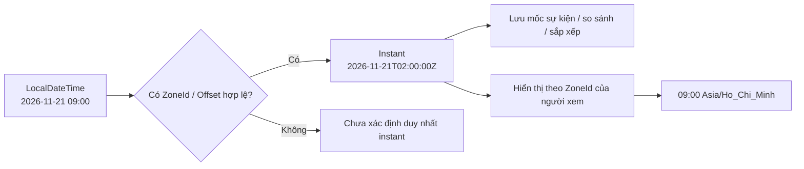
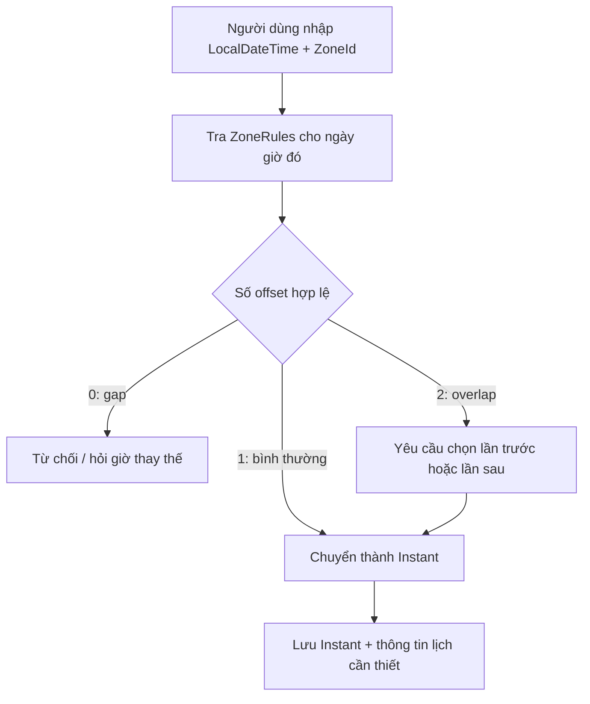
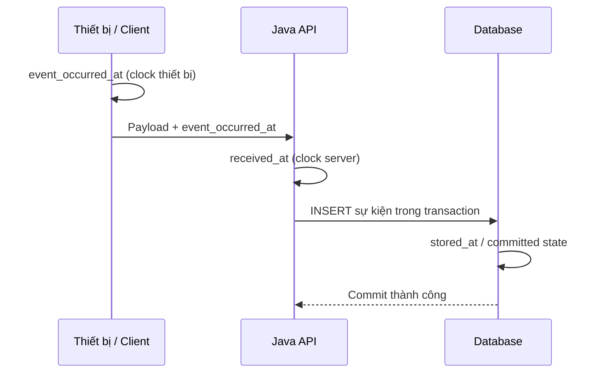

# Biểu diễn ngày giờ, múi giờ và độ chính xác thời gian

> **Chương:** Biểu diễn dữ liệu  
> **Học phần:** `DATA_PERSISTENCE_FUNDAMENTALS` — nền tảng lưu trữ bền vững trong Java, từ mô hình dữ liệu, lược đồ, truy vấn và chỉ mục đến giao dịch, cô lập, kiểm soát đồng thời, xử lý lỗi kết nối, tiến hóa schema, bảo mật, sao lưu và hiệu năng.

Trong một ứng dụng đặt lịch, câu “hẹn lúc 09:00 ngày 21/11/2026” chưa đủ để xác định một thời điểm duy nhất: **09:00 ở đâu, theo quy tắc múi giờ nào và cần chính xác đến giây, mili giây hay micro giây?** Cũng là ngày giờ nhưng “ngày sinh”, “thời điểm đơn hàng được tạo”, “09:00 mỗi thứ Hai” và “thời gian chạy một truy vấn” cần những kiểu dữ liệu khác nhau.

Nếu biểu diễn sai, ứng dụng Java có thể lưu lệch giờ, lọc thiếu dữ liệu ở ranh giới ngày, đặt trùng lịch khi chuyển giờ mùa hè (DST), làm mất phần thập phân của giây hoặc so sánh timestamp sai sau khi đọc lại từ database. Những lỗi này ảnh hưởng trực tiếp đến tính đúng đắn của transaction, lập chỉ mục, audit và khả năng phục hồi dữ liệu.

Sau bài này, người học có thể:

- Phân biệt **thời điểm tuyệt đối** (instant), **ngày/giờ theo lịch** (civil time), **độ lệch UTC** (offset) và **múi giờ có quy tắc** (time zone).
- Chọn các kiểu `java.time` và SQL phù hợp cho sự kiện, lịch hẹn, ngày sinh và tác vụ lặp.
- Giải thích `TIMESTAMP WITH TIME ZONE` và `TIMESTAMP WITHOUT TIME ZONE` trong PostgreSQL, tránh suy luận từ tên kiểu.
- Xử lý giờ không tồn tại và giờ xuất hiện hai lần tại các vùng có DST.
- Bảo toàn độ chính xác ở ranh giới Java, JDBC, database và JSON; dùng truy vấn khoảng thời gian theo múi giờ địa phương.
- Xác định nguồn đồng hồ, thời điểm sự kiện so với thời điểm ghi nhận, và các yêu cầu kiểm thử khi vận hành.

## 1. Bốn khái niệm không thể thay thế nhau

| Khái niệm | Ví dụ | Điều nó nói | Điều nó **không** nói |
| --- | --- | --- | --- |
| **Ngày lịch** (*calendar date*) | `2026-11-21` | Một ngày theo lịch | Một thời điểm trên dòng thời gian toàn cầu |
| **Giờ địa phương** (*local date-time*) | `2026-11-21 09:00` | Các thành phần năm, tháng, ngày, giờ | UTC offset hoặc vùng địa lý |
| **UTC offset** | `+07:00`, `-04:00` | Độ lệch cố định so với UTC ở một thời điểm | Quy tắc chuyển giờ trong quá khứ/tương lai |
| **Time zone theo vùng** | `Asia/Ho_Chi_Minh`, `America/New_York` | Bộ quy tắc lịch sử và tương lai để đổi local time ↔ instant | Một offset cố định áp dụng cho mọi ngày |
| **Instant** | `2026-11-21T02:00:00Z` | Một điểm xác định trên dòng thời gian | Cách người dùng muốn hiển thị theo lịch địa phương |

Ví dụ `2026-11-21T09:00:00+07:00` và `2026-11-21T02:00:00Z` chỉ **cùng một instant**. Tuy nhiên, chỉ giữ `+07:00` không cho biết người dùng thuộc `Asia/Ho_Chi_Minh` hay một vùng khác có cùng offset tại thời điểm đó. Offset đủ để xác định instant của một mốc cụ thể; **zone ID** cần thiết khi phải tôn trọng quy tắc lịch của địa phương, đặc biệt cho cuộc hẹn trong tương lai hoặc lịch lặp.



**UTC không phải một địa điểm người dùng chọn cho mọi lịch hẹn.** UTC là chuẩn rất hữu ích để lưu mốc xảy ra sự kiện; lịch dân sự lại phụ thuộc zone. Chuyển tất cả chuỗi ngày giờ thành UTC mà không còn giữ vùng người dùng đã chọn có thể làm mất nghĩa “09:00 giờ New York mỗi thứ Hai”.

## 2. Chọn kiểu `java.time` theo ý nghĩa nghiệp vụ

Ưu tiên API `java.time` của Java thay cho `java.util.Date`/`Calendar` trong thiết kế mới:

| Nhu cầu | Kiểu Java | Ví dụ | Vì sao |
| --- | --- | --- | --- |
| Ngày sinh, ngày hiệu lực không kèm giờ | `LocalDate` | `2026-11-21` | Ngày lịch độc lập với offset |
| Giờ mở cửa lặp theo địa phương | `LocalTime` | `09:00` | Chưa gắn với một ngày hoặc instant |
| Người dùng nhập giờ hẹn tại địa phương | `LocalDateTime` | `2026-11-21T09:00` | Giữ ý định lịch địa phương; cần thêm zone/offset để xác định instant |
| Mốc tạo đơn, commit, sự kiện | `Instant` | `2026-11-21T02:00:00Z` | So sánh các mốc tuyệt đối, không phụ thuộc zone hiển thị |
| Chuỗi thời gian có offset do client gửi | `OffsetDateTime` | `2026-11-21T09:00+07:00` | Xác định instant và giữ offset thể hiện trên payload |
| Lịch hiển thị theo quy tắc vùng | `ZonedDateTime` | `09:00 Asia/Ho_Chi_Minh` | Mang zone ID và quy tắc dịch sang instant |
| Khoảng thời gian đo giữa hai instant | `Duration` | `PT30M` | Đơn vị giây/nano trên dòng thời gian |
| Khoảng thời gian theo lịch | `Period` | `P1M` | Cộng một tháng theo lịch, không phải số giây cố định |
| Vùng IANA và offset | `ZoneId` / `ZoneOffset` | `America/New_York` / `-05:00` | Phân biệt quy tắc vùng và độ lệch tại một mốc |

Một cách tự kiểm tra: nếu đổi múi giờ hiển thị của người dùng mà **giá trị gốc phải giữ nguyên**, nhiều khả năng cần `Instant`. Nếu người dùng nói “ngày 15 hằng tháng” hoặc “09:00 theo giờ thành phố đã chọn”, cần lưu ý định lịch theo `LocalDate`/`LocalTime` và `ZoneId`, không chỉ một instant duy nhất.

### `Duration` khác `Period` ở chỗ nào?

Khi đồng hồ chuyển DST, cộng `Duration.ofDays(1)` là cộng **24 giờ thực**; cộng một ngày theo lịch địa phương (`plusDays(1)` trên `ZonedDateTime`) có thể tương ứng **23 hoặc 25 giờ**. Tương tự, `Period.ofMonths(1)` theo lịch không thể thay bằng số giây cố định vì mỗi tháng có độ dài khác nhau.

```java
import java.time.Duration;
import java.time.ZoneId;
import java.time.ZonedDateTime;

ZoneId ny = ZoneId.of("America/New_York");
ZonedDateTime beforeDst = ZonedDateTime.of(2026, 3, 7, 12, 0, 0, 0, ny);
ZonedDateTime nextCalendarDay = beforeDst.plusDays(1);
ZonedDateTime after24Hours = beforeDst.plus(Duration.ofHours(24));
// nextCalendarDay: 12:00 ngày 08/03 (theo giờ New York).
// after24Hours:    13:00 ngày 08/03, vì hôm đó đồng hồ nhảy tới 03:00.
```

Đừng dùng một số mili giây cố định để đại diện “ngày mai lúc 09:00 tại khu vực X” khi miền nghiệp vụ là lịch địa phương.

## 3. Ánh xạ Java và SQL: chọn cột trước khi viết JDBC

Ví dụ dưới đây sử dụng PostgreSQL; hành vi và độ chính xác của các kiểu SQL có thể khác giữa DBMS hoặc driver:

| Giá trị cần lưu | PostgreSQL | Java/JDBC hiện đại | Ghi chú |
| --- | --- | --- | --- |
| Chỉ ngày | `DATE` | `LocalDate` | Ngày lịch, không có timezone |
| Chỉ giờ | `TIME WITHOUT TIME ZONE` | `LocalTime` | Dùng cùng zone/qui tắc khi cần xác định lịch lặp |
| Ngày giờ *chưa có zone* | `TIMESTAMP WITHOUT TIME ZONE` | `LocalDateTime` | Không tự chuyển sang UTC; chỉ lưu thành phần ngày giờ |
| Mốc thời gian tuyệt đối | `TIMESTAMP WITH TIME ZONE` / `TIMESTAMPTZ` | `OffsetDateTime` qua PostgreSQL JDBC; chuyển sang `Instant` tại domain | PostgreSQL quy đổi mốc, hiển thị theo timezone của session |
| Vùng IANA người dùng chọn | `TEXT` hoặc `VARCHAR` có ràng buộc | `ZoneId` ở domain, `String` qua JDBC | `TIMESTAMPTZ` **không lưu tên vùng** |
| Offset ban đầu cần đối soát | `VARCHAR(9)` hoặc `INTEGER` số giây lệch UTC | `ZoneOffset` | Chỉ lưu thêm khi có yêu cầu audit/giữ lựa chọn ban đầu |

PostgreSQL lưu `TIMESTAMPTZ` như một mốc thời gian được chuẩn hóa; kết quả khi `SELECT` được hiển thị theo cấu hình timezone của phiên. Nó **không giữ lại** offset hoặc chuỗi zone ID mà client đã nhập. Ngược lại, `TIMESTAMP WITHOUT TIME ZONE` không mang thông tin offset; truyền một giá trị có chữ `+07:00` rồi ép thành kiểu không có zone có thể làm mất ngữ nghĩa lệch giờ. Tránh ép kiểu mơ hồ, đặc biệt khi dùng string literals và timezone mặc định của server.

Ví dụ minh họa trong phiên PostgreSQL:

```sql
SET TIME ZONE 'UTC';

SELECT
    TIMESTAMPTZ '2026-11-21 09:00:00+07:00' AS absolute_moment,
    TIMESTAMP '2026-11-21 09:00:00' AS local_wall_time;

-- absolute_moment sẽ được hiển thị là 2026-11-21 02:00:00+00;
-- local_wall_time vẫn là 2026-11-21 09:00:00.
```

**Nguyên tắc:** lưu sự kiện đã xảy ra bằng kiểu biểu diễn *instant*; lưu giờ địa phương độc lập bằng kiểu *local*, và lưu riêng `ZoneId` khi ý nghĩa nghiệp vụ cần quy tắc vùng. Không chọn `TIMESTAMP WITHOUT TIME ZONE` chỉ vì ứng dụng “luôn chạy tại Việt Nam”: cấu hình máy chủ có thể đổi, request có thể đến từ nhiều vùng và nghiệp vụ có thể mở rộng.

## 4. Múi giờ IANA, DST và những thời điểm không tồn tại

Tên IANA như `Asia/Ho_Chi_Minh` hoặc `America/New_York` gắn với bộ quy tắc timezone có lịch sử và có thể được cập nhật khi quốc gia thay đổi quy định. `UTC+7` hoặc `-05:00` chỉ là **offset**; không suy ra được quy tắc theo mùa từ offset.

Với New York năm 2026:

- **08/03/2026, 02:30 địa phương:** đồng hồ nhảy từ 01:59:59 lên 03:00, nên `02:30` **không tồn tại** (*DST gap*).
- **01/11/2026, 01:30 địa phương:** đồng hồ lùi từ 02:00 về 01:00, nên `01:30` **xuất hiện hai lần** (*DST overlap*), tương ứng `-04:00` và `-05:00`.
- **21/11/2026, 09:00 ở `Asia/Ho_Chi_Minh`:** tương đương 02:00 UTC theo quy tắc áp dụng tại ngày đó.



Java có phương thức thuận tiện như `LocalDateTime.atZone(zone)` nhưng trong DST gap/overlap, các quy tắc mặc định có thể tự điều chỉnh hoặc chọn một offset. Nếu nghiệp vụ là lịch hẹn hay lệnh giao dịch có hậu quả lớn, **không âm thầm lựa chọn thay người dùng**.

Ví dụ kiểm tra và giải quyết đầy đủ:

```java
import java.time.Instant;
import java.time.LocalDateTime;
import java.time.ZoneId;
import java.time.ZoneOffset;
import java.time.ZonedDateTime;
import java.util.List;

record ResolvedAppointment(
        LocalDateTime requestedLocal,
        ZoneId zone,
        ZoneOffset selectedOffset,
        Instant instant) {}

final class AppointmentTimeResolver {
    static ResolvedAppointment resolve(
            LocalDateTime local, String zoneName, ZoneOffset chosenOffset) {
        ZoneId zone = ZoneId.of(zoneName);
        List<ZoneOffset> candidates = zone.getRules().getValidOffsets(local);

        if (candidates.isEmpty()) {
            throw new IllegalArgumentException("Local time is in a DST gap");
        }
        if (candidates.size() > 1 && chosenOffset == null) {
            throw new IllegalArgumentException(
                    "Ambiguous local time: require an offset selection");
        }

        ZoneOffset selected = chosenOffset == null
                ? candidates.get(0)
                : chosenOffset;
        if (!candidates.contains(selected)) {
            throw new IllegalArgumentException(
                    "Offset is not valid for this zone and local time");
        }

        Instant instant = ZonedDateTime.ofLocal(local, zone, selected).toInstant();
        return new ResolvedAppointment(local, zone, selected, instant);
    }
}
```

Ở đoạn code này, `chosenOffset` chỉ xác nhận một trong các offset hợp lệ của **ngày và zone đã nhập**; offset có giá trị ngoài danh sách sẽ bị từ chối. Khi giờ địa phương nhập bị thiếu do DST, API có thể trả lỗi yêu cầu chọn giờ khác; khi bị lặp, UI có thể hỏi rõ “lần đầu” (`-04:00`) hay “lần sau” (`-05:00`).

**Lịch lặp có quy tắc riêng:** “09:00 sáng thứ Hai ở New York” nên lưu `LocalTime`, quy tắc lặp và `ZoneId`, sau đó xác định instant của từng lần chạy dựa trên timezone rules áp dụng cho ngày đó. Lưu duy nhất instant của lần chạy đầu và mỗi lần cộng đúng `7 × 24` giờ có thể khiến giờ hiển thị thay đổi sau DST. Đồng thời, khi quy tắc múi giờ quốc gia thay đổi, hệ thống cần chính sách giữ nguyên *giờ dân sự đã hứa* hay giữ nguyên *instant đã chốt* cho cuộc hẹn tương lai.

## 5. Lược đồ PostgreSQL cho lịch hẹn có thông tin vùng

Giả sử người dùng đặt một cuộc hẹn *một lần*, muốn có thể tra cứu theo mốc tuyệt đối, đồng thời xem lại đúng giờ và vùng đã yêu cầu. Một schema có thể giữ cả dữ liệu tính toán lẫn ý định lịch:

```sql
CREATE TABLE appointment (
    appointment_id UUID PRIMARY KEY,
    customer_id BIGINT NOT NULL,
    starts_at TIMESTAMPTZ(6) NOT NULL,
    requested_local TIMESTAMP(6) WITHOUT TIME ZONE NOT NULL,
    zone_id TEXT NOT NULL,
    chosen_offset TEXT NOT NULL,
    created_at TIMESTAMPTZ(6) NOT NULL DEFAULT CURRENT_TIMESTAMP,
    version INTEGER NOT NULL DEFAULT 0 CHECK (version >= 0),
    CHECK (length(zone_id) BETWEEN 1 AND 100)
);

CREATE INDEX idx_appointment_customer_start
    ON appointment (customer_id, starts_at, appointment_id);
```

`starts_at` là mốc **đã giải quyết**, dùng để so sánh, sắp xếp, tìm cuộc hẹn trong một khoảng UTC. `requested_local`, `zone_id` và `chosen_offset` lưu lại điều người dùng đã chọn, phục vụ audit và hiển thị/đối soát khi timezone rules thay đổi. Cần kiểm tra ZoneId và offset hợp lệ ở ứng dụng; ràng buộc `length` ở SQL chỉ giới hạn độ dài, không kiểm chứng múi giờ có tồn tại.

Với nghiệp vụ không cần ghi lại ý định địa phương, ví dụ `payment_committed_at`, có thể chỉ lưu `TIMESTAMPTZ` cho mốc sự kiện. Với “ngày sinh”, dùng `DATE`, vì lưu mốc 00:00 UTC rồi trình bày ở một zone khác có thể chuyển sang **ngày hôm trước**, sai ý nghĩa.

### Ghi qua JDBC mà không phụ thuộc timezone mặc định của JVM

Trong PostgreSQL JDBC, `OffsetDateTime` là kiểu Java 8 thường dùng cho `TIMESTAMPTZ`; `LocalDateTime` dùng cho `TIMESTAMP WITHOUT TIME ZONE`. `ZonedDateTime` chứa nhiều thông tin hơn và không nên kỳ vọng một cột `TIMESTAMPTZ` lưu lại nguyên `ZoneId`.

```java
import java.sql.Connection;
import java.sql.PreparedStatement;
import java.sql.SQLException;
import java.time.OffsetDateTime;
import java.time.ZoneOffset;
import java.time.temporal.ChronoUnit;
import java.util.UUID;
import javax.sql.DataSource;

final class AppointmentRepository {
    private final DataSource dataSource;

    AppointmentRepository(DataSource dataSource) {
        this.dataSource = dataSource;
    }

    void insert(UUID id, long customerId, ResolvedAppointment value)
            throws SQLException {
        String sql = """
            INSERT INTO appointment
              (appointment_id, customer_id, starts_at,
               requested_local, zone_id, chosen_offset)
            VALUES (?, ?, ?, ?, ?, ?)
            """;
        try (Connection conn = dataSource.getConnection();
             PreparedStatement ps = conn.prepareStatement(sql)) {
            ps.setObject(1, id);
            ps.setLong(2, customerId);
            ps.setObject(3, OffsetDateTime.ofInstant(
                    value.instant().truncatedTo(ChronoUnit.MICROS),
                    ZoneOffset.UTC));
            ps.setObject(4, value.requestedLocal()
                    .truncatedTo(ChronoUnit.MICROS));
            ps.setString(5, value.zone().getId());
            ps.setString(6, value.selectedOffset().getId());
            ps.executeUpdate();
        }
    }
}
```

Ví dụ dùng Java 17+ và PostgreSQL JDBC hỗ trợ kiểu thời gian của JDBC 4.2. Việc **cắt xuống micro giây** là một chính sách chủ động để dữ liệu Java và cột PostgreSQL có cùng độ phân giải; hệ thống khác có thể chọn làm tròn hoặc từ chối giá trị chi tiết quá mức nhưng phải thống nhất khi ghi và đọc. Nếu ghi nhiều bảng trong một đơn vị nghiệp vụ, transaction phải được quản lý bao quanh các câu lệnh thay vì dựa vào một `INSERT` tự commit riêng lẻ.

Đọc lại giá trị:

```java
import java.sql.ResultSet;
import java.time.Instant;
import java.time.LocalDateTime;
import java.time.OffsetDateTime;
import java.time.ZoneId;

// rs là ResultSet được trả về từ SELECT.
OffsetDateTime databaseTime = rs.getObject(
        "starts_at", OffsetDateTime.class);
Instant absoluteTime = databaseTime.toInstant();
LocalDateTime requested = rs.getObject(
        "requested_local", LocalDateTime.class);
ZoneId requestedZone = ZoneId.of(rs.getString("zone_id"));
```

Không giả định offset do JDBC trả về giống offset người dùng nhập. Với `TIMESTAMPTZ` PostgreSQL, nhiều phiên bản driver chuẩn hóa kết quả `OffsetDateTime` về UTC. Khi cần hiển thị đúng vùng đã chọn, tái dựng từ `requested_local`/`zone_id` và chính sách nghiệp vụ; khi chỉ cần hiển thị mốc đã commit theo vùng hiện tại, dùng `absoluteTime.atZone(requestedZone)`.

## 6. Độ chính xác, độ phân giải và sai lệch đồng hồ

Có ít nhất ba nghĩa khác nhau thường bị gộp vào chữ “chính xác”:

| Khái niệm | Ví dụ | Câu hỏi cần trả lời |
| --- | --- | --- |
| **Độ phân giải (resolution)** | Clock chỉ thay đổi theo bước 1 ms hoặc lớn hơn | Có thể phân biệt hai lần đọc đồng hồ gần nhau đến đâu? |
| **Độ chính xác biểu diễn (precision)** | Java `Instant` tới nanosecond; PostgreSQL timestamp thường tới microsecond | Có bao nhiêu chữ số thập phân giây được lưu và trả lại? |
| **Độ đúng với thời gian chuẩn (clock accuracy)** | Đồng hồ máy chạy lệch UTC vài giây | Timestamp nhận được lệch thời gian thực bao nhiêu? |

`Instant` của Java biểu diễn phần nano giây (`0..999_999_999`), nhưng **không bảo đảm `Instant.now()` thực sự đo được thời gian tới nano giây**; độ phân giải và độ đúng của clock phụ thuộc hệ điều hành, phần cứng và đồng bộ thời gian. PostgreSQL `TIMESTAMP`/`TIMESTAMPTZ` dùng độ phân giải micro giây cho phần giây trong cài đặt thông thường; tham số `(6)` yêu cầu tối đa 6 chữ số thập phân giây, chứ không tự tạo ra dữ liệu đo chính xác đến micro giây.

Ví dụ mất precision qua database:

```text
Java Instant:           2026-11-21T02:00:00.123456789Z
Cắt về microsecond:     2026-11-21T02:00:00.123456000Z
Chuỗi hiển thị rút gọn: 2026-11-21T02:00:00.123456Z
```

Nếu không chủ động cắt, cách driver/database làm tròn hoặc biểu diễn phần dư có thể khiến giá trị đọc lại khác giá trị trước khi ghi. Với kiểm tra `equals`, optimistic locking, deduplication hoặc test round-trip, phải quy định precision **ngay tại ranh giới persistence**. Không dùng timestamp như khóa duy nhất cho những sự kiện có thể xảy ra trong cùng micro giây; dùng ID/sequence rõ ràng.

Trong Java:

```java
import java.time.Instant;
import java.time.temporal.ChronoUnit;

Instant original = Instant.parse("2026-11-21T02:00:00.123456789Z");
Instant normalized = original.truncatedTo(ChronoUnit.MICROS);
boolean identical = original.equals(normalized); // false
```

**Thời gian hệ thống và thời gian đo độ trễ là hai bài toán khác nhau.** Dùng `Instant.now()` hoặc clock được truyền vào để ghi mốc sự kiện; dùng `System.nanoTime()` để đo khoảng thời gian bên trong cùng tiến trình vì nó được thiết kế cho phép đo trôi qua. Không diễn giải kết quả `System.nanoTime()` thành Unix timestamp và không so sánh giá trị của nó giữa những JVM khác nhau. Clock hệ thống có thể bị điều chỉnh nên `Instant.now()` không phải một bộ đếm tăng đơn điệu hoàn hảo.

## 7. Mốc sự kiện, mốc nhận và mốc commit: lưu gì để đối soát?

Khi một thiết bị gửi sự kiện hoặc ứng dụng nhận lệnh qua mạng, có thể tồn tại nhiều thời điểm:



- `event_occurred_at`: mốc do **nguồn tạo sự kiện** báo; cần biết độ tin cậy và khả năng clock nguồn bị lệch.
- `received_at`: thời điểm gateway hoặc service đầu tiên quan sát yêu cầu; phục vụ phân tích độ trễ đầu vào.
- `created_at`/`stored_at`: thời điểm ứng dụng/database tạo hàng; **không nhất thiết bằng thời điểm transaction commit**.
- Thời điểm commit chính xác cần đặc tả riêng nếu nghiệp vụ thực sự yêu cầu; giá trị `DEFAULT CURRENT_TIMESTAMP` không tự động là “wall-clock commit time”.

Trong PostgreSQL, `CURRENT_TIMESTAMP`/`now()` trả mốc **bắt đầu transaction**; `statement_timestamp()` là lúc bắt đầu statement, còn `clock_timestamp()` lấy thời gian đồng hồ tại lúc gọi (có thể thay đổi ngay trong một statement). Các hàm tương tự ở DBMS khác có hành vi riêng; không thay tên hàm mà giữ nguyên giả định.

Một schema audit có thể lưu cả:

```sql
CREATE TABLE device_event (
    id UUID PRIMARY KEY,
    device_id TEXT NOT NULL,
    event_occurred_at TIMESTAMPTZ(6) NOT NULL,
    received_at TIMESTAMPTZ(6) NOT NULL,
    stored_at TIMESTAMPTZ(6) NOT NULL DEFAULT CURRENT_TIMESTAMP,
    payload JSONB NOT NULL
);
```

Cần nhất quán khi chọn nguồn thời gian và thước đo độ trễ: nếu trừ timestamp giữa hai thiết bị có clock lệch, kết quả có thể âm dù dữ liệu đi theo đúng thứ tự. Với kiểm toán và bảo mật, log cả nguồn ghi thời gian và độ chính xác kỳ vọng, bảo vệ quyền sửa lịch sử và tránh tin tưởng hoàn toàn timestamp do client gửi.

## 8. Truy vấn theo “một ngày” địa phương phải dùng khoảng nửa mở

Yêu cầu “lấy tất cả cuộc hẹn trong ngày 01/11/2026 tại New York” không thể giải quyết an toàn bằng cách cộng **24 giờ** vào mốc đầu ngày, vì ngày chuyển DST có thể dài 23 hoặc 25 giờ.

Cách đúng: xác định **đầu ngày địa phương** và **đầu ngày kế tiếp trong cùng zone**, chuyển hai mốc đó thành instant rồi lọc bằng `>= start` và `< end`.

```java
import java.time.Instant;
import java.time.LocalDate;
import java.time.ZoneId;

ZoneId zone = ZoneId.of("America/New_York");
LocalDate localDate = LocalDate.of(2026, 11, 1);
Instant startInclusive = localDate.atStartOfDay(zone).toInstant();
Instant endExclusive = localDate.plusDays(1).atStartOfDay(zone).toInstant();
// Khoảng ngày 01/11/2026 tại New York dài 25 giờ vì DST kết thúc.
```

```sql
SELECT appointment_id, starts_at
FROM appointment
WHERE customer_id = ?
  AND starts_at >= ?
  AND starts_at < ?
ORDER BY starts_at, appointment_id;
```

Trong JDBC, bind hai tham số ranh giới dưới dạng `OffsetDateTime.ofInstant(startInclusive, ZoneOffset.UTC)` và `OffsetDateTime.ofInstant(endExclusive, ZoneOffset.UTC)` để driver truyền đúng mốc tuyệt đối. Tư duy tương tự áp dụng cho báo cáo “hôm nay tại Việt Nam”: xác định ngày theo `Asia/Ho_Chi_Minh` trước, rồi lấy khoảng UTC tương ứng. Không dựa vào timezone mặc định của pod.

Ưu điểm của truy vấn khoảng nửa mở:

1. Không bỏ sót timestamp cuối ngày có phần giây nhỏ hơn mức precision của Java hoặc DB.
2. Không đếm trùng mốc `00:00` của ngày kế tiếp khi ghép nhiều ngày.
3. Có thể dùng chỉ mục B-tree trên `starts_at` cùng điều kiện `customer_id`; thường có lợi hơn bọc cột bằng hàm `DATE(starts_at)` trong `WHERE` nếu không có expression index phù hợp.
4. Tôn trọng độ dài thực tế của một ngày ở zone cần xem, bao gồm ngày có DST.

Đọc/sắp xếp theo timestamp còn phải xem **phân trang**. Nhiều bản ghi có cùng `starts_at` do precision giới hạn; thêm một khóa ổn định như `appointment_id` vào `ORDER BY` và cursor để không mất/nhân đôi hàng.

## 9. Định dạng API, JSON và các lỗi chuyển đổi thường gặp

Nên dùng định dạng ISO 8601/RFC 3339 có offset rõ ràng khi API trao đổi **một instant**:

```json
{
  "eventId": "ccfb5d04-3346-4b34-9225-f95c853ee974",
  "occurredAt": "2026-11-21T02:00:00.123456Z"
}
```

Với cuộc hẹn cần giữ ý định địa phương và vùng:

```json
{
  "requestedLocal": "2026-11-01T01:30:00",
  "zoneId": "America/New_York",
  "chosenOffset": "-05:00"
}
```

Định dạng thứ hai phải được **validate**: offset phải hợp lệ cho đúng local time và zone. Khi chuyển thành instant, `01:30-05:00` ngày 01/11/2026 ở New York là lần xuất hiện thứ hai của 01:30. Với payload `OffsetDateTime` thuần túy, offset đã cho phép tạo một instant duy nhất nhưng chưa cho biết quy tắc vùng cho các lịch hẹn tương lai.

Các lỗi thường gặp:

| Sai lầm | Hậu quả | Cách sửa |
| --- | --- | --- |
| `LocalDateTime.now()` rồi lưu như UTC | Lệch giờ khi JVM không chạy ở UTC | Lấy mốc bằng `Instant.now()`, lưu kiểu biểu diễn instant |
| Parse `2026-11-21 09:00` mà không biết zone | Không xác định được instant duy nhất | Yêu cầu offset hoặc zone theo hợp đồng API |
| Chỉ lưu `+07:00` cho lịch lặp | Mất quy tắc thay đổi offset theo mùa/luật | Lưu IANA `ZoneId` và quy tắc lịch lặp |
| Dùng `LocalDate` như một mốc UTC 00:00 | Ngày hiển thị có thể đổi khi chuyển zone | Giữ kiểu `DATE` cho ngày lịch |
| Dùng `Timestamp.toString()` làm định dạng trao đổi | Phụ thuộc cách biểu diễn và timezone | Dùng serializer ISO rõ kiểu/offset |
| So sánh nanosecond trước/ sau round-trip DB | Sai `equals` khi DB chỉ giữ microsecond | Chuẩn hóa precision ở ranh giới persistence |
| Xác định cuối ngày bằng 23:59:59.999 | Bỏ sót các mức precision nhỏ hơn hoặc sai DST | Dùng khoảng `[start, nextStart)` |
| Dùng timestamp làm ID/sequence duy nhất | Nhiều giao dịch có thể trùng thời điểm | Dùng khóa định danh và thứ tự rõ ràng |
| Tin clock client tuyệt đối | Audit và sắp xếp có thể sai khi clock lệch | Lưu nguồn mốc, thời điểm nhận và chính sách đối soát |

**Unix epoch** thường có biểu diễn giây hoặc mili giây kể từ epoch. Tránh đặt tên trường chỉ là `timestamp` rồi gửi số `173...` thiếu đơn vị; xác định `epochSeconds` hay `epochMillis` theo contract và kiểm tra dải giá trị. Số giây bị đọc thành mili giây (hoặc ngược lại) tạo lỗi sai lệch rất lớn nhưng đôi khi vẫn parse thành một mốc hợp lệ.

## 10. Giao dịch, đồng thời và độ chính xác thời gian

Một timestamp không thay thế transaction ID, version hay khóa nghiệp vụ. Ví dụ hai yêu cầu chỉnh sửa lịch hẹn cùng đọc `updated_at`; nếu database chỉ giữ microsecond, các thay đổi rất gần nhau có thể có timestamp trùng hoặc `CURRENT_TIMESTAMP` cố định trong cùng transaction. Dùng optimistic locking với `version`:

```sql
UPDATE appointment
SET starts_at = ?,
    requested_local = ?,
    zone_id = ?,
    chosen_offset = ?,
    version = version + 1
WHERE appointment_id = ?
  AND version = ?;
```

Chỉ chấp nhận cập nhật khi `executeUpdate()` trả 1 hàng; nếu 0 hàng, cần phân biệt bản ghi không tồn tại và version đã thay đổi. Quy tắc này xử lý xung đột cập nhật nhưng không tự giải quyết tranh chấp đặt lịch của hai cuộc hẹn khác ID; ràng buộc không trùng lịch hoặc transaction isolation phù hợp vẫn cần thiết.

**Thời điểm ghi thành công khác thời điểm client nhận phản hồi.** Nếu DB commit rồi đường truyền bị ngắt, thời gian nhận response có thể không được ghi; khi retry cần idempotency key và tra trạng thái thay vì suy từ `created_at` hoặc `updated_at`. Thời gian không phải bằng chứng duy nhất cho tính nguyên tử hay kết quả commit.

Để tiến hóa schema từ cột `TIMESTAMP WITHOUT TIME ZONE` cũ sang `TIMESTAMPTZ`, phải xác định **mỗi giá trị cũ đã được hiểu theo zone nào**, kể cả thay đổi DST và hệ thống nguồn. Một phép `ALTER` mù có thể diễn giải dữ liệu theo timezone session và dịch mốc sai. Có thể tạo cột mới, backfill theo quy tắc đã xác nhận, triển khai code đọc/ghi tương thích và đối soát trước khi bỏ cột cũ.

## 11. Kiểm thử và vận hành dữ liệu thời gian

Với tính năng lịch hẹn, thử ít nhất các trường hợp:

1. **Ngày bình thường:** `2026-11-21 09:00 Asia/Ho_Chi_Minh` tương ứng `2026-11-21T02:00:00Z`.
2. **DST gap:** `2026-03-08 02:30 America/New_York` bị từ chối hoặc yêu cầu chọn lại theo chính sách.
3. **DST overlap:** `2026-11-01 01:30 America/New_York` cần lựa chọn `-04:00` hay `-05:00`; hai instant khác nhau.
4. **Chuyển ngày:** một mốc ngay trước/sau 00:00 trong một zone không bị phân vào hai ngày hoặc bỏ sót.
5. **Precision:** timestamp có 9 chữ số thập phân giây được chuẩn hóa khi lưu vào PostgreSQL microsecond và đọc lại khớp giá trị đã chuẩn hóa.
6. **Nhiều môi trường:** JVM, DB session và container có timezone mặc định khác nhau nhưng kết quả lưu/đọc instant vẫn nhất quán.
7. **Thay đổi quy tắc vùng:** mô phỏng quy tắc timezone được cập nhật, kiểm tra chính sách giữ giờ địa phương hoặc giữ instant với lịch hẹn tương lai.
8. **Đồng thời và retry:** hai bản ghi cùng timestamp vẫn có ID riêng; cập nhật có version; timeout commit không làm tạo lịch hẹn trùng.

Trong unit test, truyền `Clock` vào service thay vì gọi `Instant.now()` không kiểm soát:

```java
import java.time.Clock;
import java.time.Instant;
import java.time.ZoneOffset;

Clock fixed = Clock.fixed(
        Instant.parse("2026-11-21T02:00:00Z"), ZoneOffset.UTC);
Instant predictableNow = Instant.now(fixed);
```

Đối với vận hành, đồng bộ clock máy chủ bằng cơ chế đáng tin cậy, theo dõi skew và cập nhật timezone database của JDK/OS/DBMS theo quy trình. Sau nâng cấp timezone rules, kiểm tra cuộc hẹn trong tương lai theo chính sách nghiệp vụ. Tính **đúng thời gian** không thể bảo đảm chỉ bằng việc chọn `TIMESTAMPTZ` nếu đồng hồ nguồn sai hoặc quy tắc chuyển đổi không rõ.

## 12. Bài tập áp dụng

**Bài A — chọn kiểu:** Một bảng `invoice` có `invoice_date` (ngày hóa đơn), `created_at` (mốc tạo), `customer_birthday` (ngày sinh) và `reminder_time` (09:00 theo vùng của khách). Chọn kiểu Java/SQL cho từng trường và giải thích trường nào cần zone ID.

**Bài B — xử lý DST:** Người dùng đặt hai cuộc hẹn vào `01:30` ngày 01/11/2026 tại `America/New_York`, một lần chọn `-04:00` và một lần chọn `-05:00`. Chuyển mỗi cuộc hẹn thành instant, tính độ chênh thực tế và giải thích tại sao cả hai cùng hiển thị 01:30.

**Bài C — truy vấn theo ngày:** Viết Java tạo `startInclusive`/`endExclusive` cho ngày 08/03/2026 tại New York. Vì sao không nên dùng `start + 86_400s`? Đề xuất chỉ mục cho truy vấn theo `customer_id` và khoảng `starts_at`.

**Bài D — round-trip:** Một thiết bị gửi `2026-11-21T02:00:00.123456789Z`, database giữ microsecond. Hãy định nghĩa chính sách cắt hoặc làm tròn, kiểm tra dữ liệu sau đọc lại và xác định liệu timestamp có thể thay thế ID sự kiện hay không.

**Bài E — migration:** Cơ sở dữ liệu cũ chứa `meeting_time TIMESTAMP WITHOUT TIME ZONE` và ghi theo giờ địa phương của nhiều quốc gia, nhưng không có `zone_id`. Liệt kê thông tin cần phục hồi từ nguồn khác, trường hợp không thể xác định chính xác, và quy trình chuyển dữ liệu an toàn.

## 13. Checklist thiết kế biểu diễn thời gian

- [ ] Phân loại mỗi trường thành ngày lịch, giờ địa phương, instant, lịch lặp hay khoảng thời gian.
- [ ] Dùng kiểu `java.time` phù hợp và xác định rõ kiểu SQL tương ứng; không phụ thuộc timezone mặc định.
- [ ] Với instant, dùng biểu diễn có offset rõ ràng tại API và `TIMESTAMPTZ` hoặc kiểu tương đương trong DB.
- [ ] Với lịch địa phương, lưu `ZoneId` IANA cùng quy tắc/giờ địa phương khi cần.
- [ ] Có chính sách rõ ràng cho giờ không tồn tại hoặc xuất hiện hai lần khi DST.
- [ ] Thống nhất độ chính xác phần giây qua Java, driver, DB, JSON và phép kiểm tra round-trip.
- [ ] Dùng khoảng `[start, nextStart)` theo zone khi lọc ngày, kể cả ngày 23/25 giờ.
- [ ] Có ID/version để kiểm soát đồng thời; không dùng timestamp làm khóa duy nhất.
- [ ] Phân biệt thời điểm phát sinh, tiếp nhận, ghi bản ghi và commit; đánh giá clock skew.
- [ ] Kiểm tra migration và cập nhật timezone rules với dữ liệu lịch hẹn tương lai.

**Nguyên tắc cần nhớ:** chọn biểu diễn thời gian theo **ý nghĩa nghiệp vụ**, xác định rõ zone/offset tại nơi đổi sang instant, và công khai precision ở ranh giới persistence. Nhờ đó dữ liệu Java được ghi, truy vấn và đối soát chính xác qua nhiều múi giờ, trong khi giao dịch, chỉ mục, bảo mật, sao lưu và quy trình nâng cấp vẫn giữ được ngữ nghĩa thời gian ban đầu.
