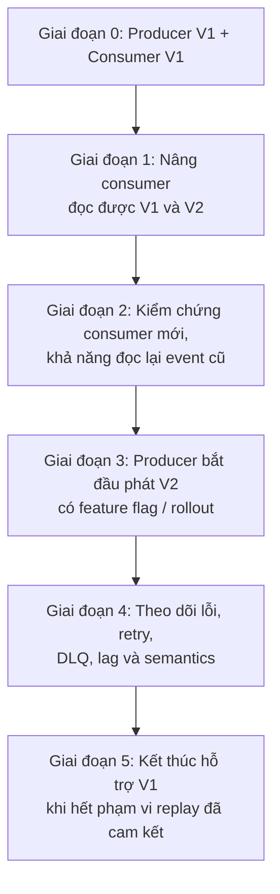

# Tương thích định dạng khi ứng dụng thay đổi phiên bản

## 1. Vì sao thay đổi phiên bản ứng dụng có thể làm dữ liệu không đọc được?

Một ứng dụng Java thường thay đổi theo từng bản phát hành, trong khi dữ liệu đã lưu có thể tồn tại nhiều năm và các thành phần hệ thống không nhất thiết được cập nhật cùng lúc. Một service có thể đã chạy phiên bản mới, nhưng queue vẫn còn thông điệp cũ; một replica, worker hoặc client di động vẫn dùng phiên bản trước; bản backup có thể chứa dữ liệu được ghi bởi ứng dụng cách đây nhiều tháng.

Ví dụ, phiên bản đầu của hệ thống tạo đơn hàng phát sự kiện JSON:

```json
{
  "eventType": "OrderCreated",
  "schemaVersion": 1,
  "orderId": "2c3d1c61-00c1-43c8-8c31-a248efc66518",
  "occurredAt": "2026-04-10T09:30:00Z",
  "currency": "USD",
  "totalMinor": 1990
}
```

Một phiên bản mới cần biết đơn hàng đến từ kênh nào, nên thêm `sourceChannel`:

```json
{
  "eventType": "OrderCreated",
  "schemaVersion": 2,
  "orderId": "2c3d1c61-00c1-43c8-8c31-a248efc66518",
  "occurredAt": "2026-04-10T09:30:00Z",
  "currency": "USD",
  "totalMinor": 1990,
  "sourceChannel": "WEB"
}
```

Thay đổi trên nhìn đơn giản: thêm một trường. Nhưng nó đặt ra các câu hỏi phải trả lời **trước khi triển khai**:

- Worker mới có đọc lại được thông điệp `schemaVersion = 1` đang nằm trong queue không?
- Worker cũ có đọc được thông điệp `schemaVersion = 2` nếu chưa được nâng cấp không?
- Nếu `sourceChannel` vắng mặt, có được hiểu là `WEB` không, hay phải là “không xác định”?
- Dữ liệu lưu trong database, event store, cache, file và backup phải được xử lý thế nào?
- Hệ thống có thể rollback ứng dụng về phiên bản cũ sau khi phiên bản mới đã ghi dữ liệu hay không?
- Khi nào được xóa field cũ hoặc ngừng hỗ trợ phiên bản cũ?

Đây là bài toán **tương thích định dạng khi ứng dụng thay đổi phiên bản** (*data format compatibility across application versions*). Nó thuộc nhóm **Biểu diễn dữ liệu**, nhưng ảnh hưởng trực tiếp đến persistence: kiểu dữ liệu, schema, truy vấn, transaction, bảo mật, thời hạn lưu, backup và tính sẵn sàng.

**Nguyên tắc đầu tiên:** Việc code mới biên dịch thành công không chứng minh nó đọc được dữ liệu cũ; việc JSON deserialize thành công cũng chưa chắc có nghĩa dữ liệu vẫn giữ nguyên ý nghĩa nghiệp vụ.

## 2. Ba phiên bản khác nhau không nên gộp làm một

Trong cùng một hệ thống có thể tồn tại ba loại phiên bản:

| Loại phiên bản | Phạm vi | Ví dụ | Cách quản lý |
|---|---|---|---|
| **Phiên bản ứng dụng** | Mã Java, API/service đang chạy | `order-service 3.8.0` | Build/deploy/release |
| **Phiên bản hợp đồng dữ liệu** | Cấu trúc và ngữ nghĩa của thông điệp, event, file hoặc API | `OrderCreated schemaVersion = 2` | Schema registry, hợp đồng message, tài liệu và test tương thích |
| **Phiên bản schema lưu trữ** | Bảng, cột, index, constraint, migration của DB | `V024__add_source_channel.sql` | Migration có version và lịch deploy riêng |

Chúng có thể tiến hóa độc lập. Một bản phát hành Java chỉ sửa thuật toán mà không đổi message hay database. Ngược lại, một migration thêm chỉ mục có thể không đổi định dạng API. Một producer có thể phát nhiều phiên bản message trong giai đoạn chuyển tiếp.

Không nên lấy số phiên bản ứng dụng làm `schemaVersion` cho mọi message. Nếu mỗi lần deploy lại tăng version thông điệp dù không thay đổi hợp đồng, consumer phải xử lý nhiều phiên bản không cần thiết.

Với event đã lưu lâu dài, `schemaVersion` xác định cách diễn giải **payload**. Nếu message gồm nhiều loại event, version thường phải được hiểu cùng với `eventType`; `schemaVersion = 2` của `OrderCreated` không nhất thiết có nghĩa giống version 2 của `OrderCancelled`.

## 3. Backward, forward và full compatibility

Hai từ “cũ” và “mới” phải gắn với **reader** (bên đọc) và **writer** (bên ghi). Nếu chỉ nói “tương thích ngược” mà không nêu ai đọc dữ liệu của ai, đội ngũ có thể hiểu khác nhau.

| Thuật ngữ | Khả năng cần có | Ví dụ |
|---|---|---|
| **Backward compatibility** | **Reader mới đọc được dữ liệu do writer cũ tạo** | Consumer V2 đọc được sự kiện OrderCreated V1 |
| **Forward compatibility** | **Reader cũ đọc được dữ liệu do writer mới tạo** | Consumer V1 đọc được OrderCreated V2 |
| **Full compatibility** | Hai chiều trên đều đúng trong phạm vi phiên bản được cam kết | Consumer V1/V2 đều chấp nhận payload V1/V2 |
| **Breaking change** | Ít nhất một tổ hợp reader/writer cần hỗ trợ không còn hoạt động đúng | Đổi nghĩa `totalMinor` sang đơn vị tiền chính mà không chuyển đổi |

Đây là cách dùng thông dụng trong quản lý schema dữ liệu; tên chính sách tương thích cụ thể của từng công cụ cần được đọc theo định nghĩa của công cụ đó.

Ma trận minh họa cho `OrderCreated`:

| Reader | Writer V1 | Writer V2 |
|---|---|---|
| **Consumer V1** | Phải hoạt động theo hợp đồng V1 | Chỉ hoạt động nếu V1 chấp nhận field mới và quy tắc version mới |
| **Consumer V2** | Chỉ hoạt động nếu V2 hiểu và xử lý trường thiếu | Phải hoạt động theo hợp đồng V2 |

Một thay đổi **thêm field tùy chọn** có thể tương thích về cấu trúc, nhưng vẫn phá ứng dụng:

- Consumer V1 dùng parser “cấm trường lạ” nên từ chối `sourceChannel`.
- Consumer V1 chỉ chấp nhận `schemaVersion == 1`.
- Consumer V2 giả định trường mới luôn có và gọi `sourceChannel.toUpperCase()` khi đọc sự kiện V1.
- Hai phiên bản cùng decode được nhưng hiểu `totalMinor` theo đơn vị khác.

Vì vậy cần kiểm tra cả **khả năng parse** và **ý nghĩa của dữ liệu sau parse**.

### 3.1. Ma trận khác nhau theo thời điểm triển khai

Trong một đợt triển khai cuốn chiếu (*rolling deployment*), có thể có giai đoạn producer mới cùng tồn tại với consumer cũ. Khi đó cần forward compatibility hoặc kế hoạch trì hoãn việc phát định dạng mới.

Sau khi mọi consumer đã được nâng cấp, producer mới có thể bắt đầu ghi V2. Tuy nhiên, consumer mới vẫn cần backward compatibility khi đọc queue, event store và dữ liệu đã lưu từ các writer cũ.

### 3.2. Đừng lẫn khả năng đọc với khả năng xử lý nghiệp vụ

Giả sử consumer cũ biết trạng thái `NEW` và `CANCELLED`. Payload mới thêm trạng thái `REFUNDED`. Parser có thể đọc chuỗi `"REFUNDED"`, nhưng business logic cũ không biết thực hiện thao tác gì. Trả mặc định `NEW` sẽ gây hỏng ý nghĩa nghiệp vụ.

Đối với enum hoặc kiểu dữ liệu có hành vi quan trọng, cần xác định chính sách cho giá trị chưa biết: từ chối có kiểm soát, chuyển vào luồng đối soát, hoặc sử dụng trạng thái `UNKNOWN` nếu hợp đồng cho phép. **Không tự gán giá trị mặc định khiến dữ liệu sai nghĩa.**

## 4. Những thay đổi định dạng thường gặp

| Thay đổi | Mức độ rủi ro | Điều kiện để có thể tương thích |
|---|---|---|
| Thêm trường tùy chọn | Thường thấp | Reader cũ chịu được trường lạ; reader mới có quy tắc thiếu trường |
| Thêm trường bắt buộc | Cao với dữ liệu cũ | Có giá trị mặc định **hợp lệ về nghiệp vụ** hoặc chuyển đổi dữ liệu cũ |
| Đổi tên trường | Cao | Hỗ trợ tên cũ và mới trong giai đoạn chuyển tiếp; thống nhất tên ghi |
| Xóa trường | Có thể phá reader cũ | Xác minh không còn reader nào cần trường đó, kể cả replay dữ liệu cũ |
| Đổi kiểu `int → string` | Cao | Có converter rõ, xử lý giá trị biên, không làm mất thông tin |
| `long → int` | Cao | Có thể tràn số; phải kiểm tra miền giá trị thật |
| Đổi `double` sang decimal | Trung bình đến cao | Quy định chính xác scale, làm tròn và chuỗi/số khi truyền |
| Đổi định dạng thời gian | Cao | Thống nhất timezone, offset, độ chính xác và cách parse dữ liệu cũ |
| Thêm enum value | Cao nếu reader có switch/validation chặt | Reader cũ có xử lý unknown an toàn |
| Đổi ý nghĩa field nhưng giữ tên | Rất cao | Cần phiên bản/field mới và chuyển đổi có căn cứ |
| Đổi thứ tự field trong JSON object | Thường thấp | Reader không dựa vào thứ tự key |
| Đổi số field của Protobuf | Rất cao | Không tái sử dụng số field; quản lý reserved field |
| Tái cấu trúc hai bảng thành một | Cao với persistence | Expand–migrate–contract; bảo đảm old/new writer cùng hoạt động |

Không có quy tắc “chỉ cần giữ nguyên tên field là tương thích”. Đơn vị, quy ước null, tính bắt buộc, phạm vi số, semantics và quy tắc sắp xếp đều là một phần của hợp đồng.

## 5. Ví dụ Java: đọc hai phiên bản JSON và quy về cùng mô hình nghiệp vụ

Để đảm bảo consumer mới xử lý dữ liệu đã lưu trong queue, ta có thể đọc payload V1 và V2 rồi chuyển về **một mô hình nội bộ**. Mã ví dụ sau dùng Jackson 2, Java records và `Instant`.

### 5.1. Dữ liệu đầu vào

V1 không có `sourceChannel`; V2 có thể mang trường đó. Trong ví dụ này, trường mới **là tùy chọn về mặt nghiệp vụ**. Khi V1 không có giá trị, mô hình nội bộ giữ `null` để diễn tả “không biết kênh”, **không tự suy ra `WEB`**.

```java
import com.fasterxml.jackson.core.JsonProcessingException;
import com.fasterxml.jackson.databind.JsonNode;
import com.fasterxml.jackson.databind.json.JsonMapper;
import java.time.Instant;
import java.util.UUID;

record OrderCreated(
    UUID orderId,
    Instant occurredAt,
    String currency,
    long totalMinor,
    String sourceChannel
) {}

final class OrderCreatedReader {
    static OrderCreated read(JsonMapper mapper, String json)
            throws JsonProcessingException {
        JsonNode root = mapper.readTree(json);
        if (root == null || !root.isObject()) {
            throw new IllegalArgumentException("Event must be an object");
        }

        String eventType = requiredText(root, "eventType");
        if (!"OrderCreated".equals(eventType)) {
            throw new IllegalArgumentException("Unsupported eventType");
        }

        int version = requiredInt(root, "schemaVersion");
        if (version != 1 && version != 2) {
            throw new IllegalArgumentException("Unsupported schemaVersion");
        }

        UUID orderId = UUID.fromString(requiredText(root, "orderId"));
        Instant time = Instant.parse(requiredText(root, "occurredAt"));
        String currency = requiredText(root, "currency");
        if (!currency.matches("[A-Z]{3}")) {
            throw new IllegalArgumentException("Invalid currency");
        }

        JsonNode amount = root.get("totalMinor");
        if (amount == null || !amount.isIntegralNumber()
                || !amount.canConvertToLong() || amount.longValue() < 0) {
            throw new IllegalArgumentException("Invalid totalMinor");
        }

        String sourceChannel = version == 2
            ? optionalText(root, "sourceChannel")
            : null;

        return new OrderCreated(
            orderId, time, currency, amount.longValue(), sourceChannel);
    }

    private static String requiredText(JsonNode root, String field) {
        JsonNode node = root.get(field);
        if (node == null || !node.isTextual()
                || node.textValue().isBlank()) {
            throw new IllegalArgumentException("Invalid " + field);
        }
        return node.textValue();
    }

    private static int requiredInt(JsonNode root, String field) {
        JsonNode node = root.get(field);
        if (node == null || !node.isInt()) {
            throw new IllegalArgumentException("Invalid " + field);
        }
        return node.intValue();
    }

    private static String optionalText(JsonNode root, String field) {
        JsonNode node = root.get(field);
        if (node == null || node.isNull()) {
            return null;
        }
        if (!node.isTextual() || node.textValue().isBlank()) {
            throw new IllegalArgumentException("Invalid " + field);
        }
        return node.textValue();
    }
}
```

Mã này **chủ động chấp nhận V1 và V2**, có validation cấu trúc, kiểm tra đơn vị tiền bằng `totalMinor` (số nguyên ở đơn vị nhỏ nhất theo hợp đồng) và chuẩn hóa kiểu ngày giờ qua `Instant`. Đây là một ví dụ *upcasting*: chuyển payload cũ sang mô hình hiện hành có ý nghĩa rõ.

Các giới hạn cần nhận thức:

- Kiểm tra ba chữ cái của `currency` chỉ xác nhận định dạng, không chứng minh mã tiền có được phép dùng hoặc `totalMinor` có scale đúng cho tiền đó. Cần logic domain bổ sung.
- Reader bỏ qua trường JSON không được dùng đến trong ví dụ, nhưng chỉ nên làm vậy với trường **được phép mở rộng**; không bỏ qua dữ liệu quan trọng về quyền, tiền hoặc điều kiện nghiệp vụ.
- V1 vẫn có thể thiếu `schemaVersion` trong một hệ thống thực tế. Nếu có dữ liệu legacy như vậy, phải định nghĩa quy tắc nhận diện có căn cứ và kiểm thử; không âm thầm coi mọi message thiếu version là V1.
- Parser từ chối version khác 1 và 2. Một consumer cũ dùng reader này **không tự có forward compatibility** với writer V3. Phải kiểm tra ma trận và kế hoạch triển khai trước khi bật V3.
- Một sự kiện có thể bị đọc lại sau nhiều tháng; code xử lý V1 không nên bị xóa cho đến khi dữ liệu V1 không còn trong toàn bộ phạm vi replay/khôi phục cần hỗ trợ.

### 5.2. Kiểm thử thông điệp cũ và mới

```java
JsonMapper mapper = JsonMapper.builder().build();

OrderCreated old = OrderCreatedReader.read(mapper, v1Json);
OrderCreated now = OrderCreatedReader.read(mapper, v2Json);

assert old.orderId().equals(now.orderId());
assert old.totalMinor() == 1990L;
assert old.sourceChannel() == null;          // V1 không khai báo kênh
assert "WEB".equals(now.sourceChannel());   // V2 có kênh
```

Đây là đoạn kiểm thử minh họa, với `v1Json` và `v2Json` là hai payload mẫu ở trên. Trong kiểm thử thực, nên dùng assertion của JUnit thay cho `assert` thuần để không phụ thuộc cờ JVM `-ea`.

Thành công của một reader mới trên cả V1 và V2 mới chứng minh **backward compatibility cho các trường hợp đã kiểm thử**. Muốn chứng minh forward compatibility, cần thực sự chạy **consumer V1** với dữ liệu do writer V2 phát và xác nhận nó xử lý đúng.

### 5.3. Một hướng khác: DTO theo từng phiên bản

Khi các phiên bản khác nhau nhiều, có thể tạo `OrderCreatedV1`, `OrderCreatedV2`, mỗi lớp đi kèm decoder/schema riêng, rồi ánh xạ sang `OrderCreated` nội bộ. Cách này tránh nhồi nhiều điều kiện phiên bản vào một class và giúp quản lý những thay đổi không còn tương thích về cấu trúc.

Một nguyên tắc hữu ích là **không để logic nghiệp vụ phân nhánh khắp nơi theo `schemaVersion`**. Hãy chuẩn hóa ở ranh giới tiếp nhận, sau đó để nghiệp vụ làm việc với mô hình đã được kiểm tra.

## 6. JSON, Avro, Protobuf và các quy tắc tương thích

### 6.1. JSON: linh hoạt nhưng thiếu hợp đồng nếu không định nghĩa

JSON cho phép thêm field dễ dàng. Tuy nhiên, tương thích phụ thuộc cách đọc và validator:

- Reader cũ có từ chối trường lạ không?
- Field mới có bắt buộc không? Đâu là giá trị mặc định hợp lệ?
- Reader có phân biệt missing và explicit `null` không?
- Một giá trị ngày giờ/tiền/UUID được diễn tả thành dạng nào?
- Khi không hiểu enum hoặc event type, consumer đưa vào luồng lỗi hay xử lý mặc định?
- Có giới hạn kích thước, độ sâu và kiểu dữ liệu nhận vào không?

Một hợp đồng JSON Schema hoặc schema dùng trong API có thể làm rõ cấu trúc. Nhưng **JSON Schema không tự đảm bảo tính tương thích qua các bản phát hành**: vẫn cần kiểm tra và test với nhiều phiên bản.

Các annotation Jackson như `@JsonAlias` có thể giúp nhận cả tên field cũ và mới. `@JsonIgnoreProperties(ignoreUnknown = true)` có thể cho phép reader bỏ qua field mới không quan trọng. Không áp dụng “bỏ qua tất cả” một cách mù quáng cho thông tin bảo mật, số tiền hoặc hành động mà consumer không hiểu.

### 6.2. Protobuf: tên field có thể đổi, số field phải ổn định

Ví dụ giản lược:

```proto
syntax = "proto3";

message OrderCreated {
  string order_id = 1;
  int64 total_minor = 2;
  string currency = 3;
  optional string source_channel = 4;
}
```

Khi thêm trường, cấp **số field mới** thay vì tái sử dụng số của một trường đã bị xóa. Với trường đã bỏ khỏi schema, đặt `reserved` cho field number và tên tương ứng khi cần để ngăn tái sử dụng ngoài ý muốn.

```proto
message OrderCreated {
  string order_id = 1;
  int64 total_minor = 2;
  string currency = 3;
  reserved 4;
  reserved "source_channel";
}
```

Đoạn sau chỉ minh họa việc loại bỏ field 4 trong một phiên bản khác; nó không phải schema tương thích hai chiều tự động. Trong Protobuf, nhiều thay đổi kiểu có quy tắc wire compatibility riêng; **wire đọc được không đồng nghĩa giữ nguyên ý nghĩa hoặc giá trị**. Proto3 cũng có các quy tắc presence/default khác nhau giữa trường scalar thông thường, `optional` và wrapper, nên phải kiểm tra theo phiên bản syntax/runtime sử dụng.

### 6.3. Avro và schema resolution

Avro thường dùng schema của writer và reader để giải mã dữ liệu; việc đổi tên, thêm field với default, union type và logical type có quy tắc resolution cụ thể. Một hệ dùng schema registry có thể kiểm tra tương thích khi đăng ký phiên bản mới.

Tuy vậy:

- Đặt một chế độ compatibility của registry không thay thế việc kiểm thử logic xử lý.
- Registry cần kiểm tra **phạm vi version**: chỉ phiên bản trước hay tất cả các phiên bản cũ còn phải hỗ trợ.
- Dữ liệu đã tồn tại trong event store hoặc archive có thể cần reader/schema cũ lâu hơn dự kiến.
- Một thay đổi tên hoặc nghĩa field có thể vượt ngoài khả năng schema resolution tự động.

### 6.4. Bảng quyết định định dạng

| Môi trường | Hướng thường cân nhắc | Điều phải quản lý |
|---|---|---|
| REST/HTTP API công khai | JSON + hợp đồng API/JSON Schema | Client cũ, field tùy chọn, status/error, phiên bản API |
| Event stream giữa service | JSON/Avro/Protobuf có event type và schema version | Consumer độc lập, replay, unknown fields, schema registry |
| Snapshot hoặc cache serialization | Định dạng ổn định, có version/TTL | Eviction, read cũ, key format, tương thích sau rollback |
| Dữ liệu lưu lâu dài trong DB | Schema DDL hoặc JSONB có quy tắc validation | Migration, index, transaction, backup, restore |
| File trao đổi theo lô | JSONL/CSV/Parquet hoặc format được chọn | Header, encoding, null, delimiter, schema và quy tắc nhập lại |

Không có định dạng “miễn nhiễm” với việc đổi phiên bản. Chọn định dạng giúp quản lý thay đổi theo hệ sinh thái, nhưng vẫn phải định nghĩa hợp đồng và kiểm thử.

## 7. Phiên bản mới và dữ liệu lưu bền vững trong database

Message format và storage schema phát triển theo các nhịp khác nhau. Với database quan hệ, migration phải hỗ trợ **ứng dụng cũ và mới cùng truy cập** trong giai đoạn deploy.

Giả sử bảng `orders` ban đầu là:

```sql
CREATE TABLE orders (
    id UUID PRIMARY KEY,
    status TEXT NOT NULL,
    total_minor BIGINT NOT NULL,
    currency CHAR(3) NOT NULL,
    created_at TIMESTAMPTZ NOT NULL DEFAULT now()
);
```

Bản mới muốn lưu `source_channel`. Nếu thêm ngay một cột `NOT NULL` không có giá trị cho hàng cũ hoặc yêu cầu writer cũ luôn ghi trường này, deployment có thể lỗi.

### 7.1. Expand–migrate–contract

**Expand — mở rộng theo hướng còn tương thích:**

```sql
ALTER TABLE orders
ADD COLUMN source_channel TEXT;
```

Cột có thể `NULL` để các hàng cũ và writer cũ tiếp tục hoạt động. Code mới phải xử lý trường hợp chưa có thông tin. Nếu cần giới hạn giá trị, đặt kế hoạch constraint và kiểm thử phù hợp.

**Migrate — chạy đồng thời và chuyển dữ liệu khi có căn cứ:**

- Deploy code mới **đọc được `NULL`**.
- Bắt đầu ghi `source_channel` cho đơn mới khi request cung cấp kênh.
- Nếu có nguồn dữ liệu lịch sử đáng tin cậy, backfill theo lô có kiểm soát.
- Nếu không biết kênh của đơn cũ, **không tự backfill tất cả thành `WEB`**.
- Theo dõi tỷ lệ các writer cũ còn hoạt động và sự thay đổi trong dữ liệu.
- Đảm bảo ứng dụng cũ vẫn ghi được trong suốt khoảng rollout và rollback đã cam kết.

**Contract — siết ràng buộc khi đã đủ điều kiện:**

Chỉ khi dữ liệu hiện có đáp ứng chính sách, không còn writer cũ và xử lý nghiệp vụ đã thay đổi, mới cân nhắc bắt buộc trường mới hoặc bỏ cơ chế tương thích. Nếu lịch sử không thể biết kênh, có thể cần **tiếp tục cho phép `NULL`** thay vì áp `NOT NULL` bằng mọi giá.

### 7.2. Đổi tên cột cần giai đoạn chuyển tiếp

Đổi `buyer_name` thành `customer_name`:

1. Thêm cột mới, vẫn giữ cột cũ.
2. Định nghĩa nguồn dữ liệu có thẩm quyền trong giai đoạn chuyển tiếp.
3. Cho reader mới đọc được dữ liệu cũ và mới theo chính sách rõ ràng.
4. Đồng bộ giá trị trong giai đoạn có nhiều writer, có thể cần cơ chế DB hoặc service để tránh mất cập nhật.
5. Backfill và kiểm chứng.
6. Xác nhận không còn ứng dụng cũ, job, báo cáo hoặc tích hợp dùng cột cũ.
7. Mới gỡ cột cũ.

**Dual write không mặc nhiên an toàn.** Nếu writer cũ chỉ sửa `buyer_name`, còn writer mới chỉ sửa `customer_name`, hai cột có thể khác nhau. Cần quy tắc đồng bộ, version hoặc một nguồn chính rõ ràng, cùng test cập nhật đồng thời.

### 7.3. Đổi schema có thể đụng đến index, transaction và dữ liệu lâu dài

Ví dụ chuyển từ một cột JSONB chứa mọi dòng hàng sang bảng `order_lines`. Cần xét:

- Mapping đọc/ghi cũ và mới.
- Giao dịch tạo/sửa đơn có còn atomic không?
- Constraint và khóa ngoại mới có chặn dữ liệu lịch sử không hợp lệ không?
- Backfill lượng lớn có gây tắc nghẽn/lock, tăng WAL và chậm replica không?
- Query/Index có đáp ứng tải thực không?
- Backup, archive và khôi phục ở mốc schema cũ có còn đọc được không?

Migration DDL thành công mới chỉ là một bước kỹ thuật. **Tương thích lưu trữ** phải bao gồm toàn bộ hành vi đọc, ghi, khôi phục, bảo mật và concurrency.

## 8. Thiết kế tương thích trong quá trình triển khai cuốn chiếu

Một kế hoạch an toàn cho event V1 → V2 với field `sourceChannel` có thể như sau:



Trong quá trình này:

- **Đọc trước, ghi sau:** Nâng consumer để hiểu V2 **trước khi** producer thực sự phát V2.
- **Giữ khả năng đọc cũ:** Consumer mới phải đọc V1 vì queue/replay có thể còn dữ liệu cũ.
- **Kích hoạt ghi có kiểm soát:** Sau khi đủ điều kiện, producer mới mới chuyển sang V2. Feature flag có thể giúp tạm dừng phát V2 nếu còn consumer cũ.
- **Quan sát thực tế:** Không chỉ đếm error HTTP; cần tỷ lệ deserialize fail, DLQ, unknown event, lag, duplicate, retry và invariant nghiệp vụ.
- **Kế hoạch rollback:** Nếu producer đã phát V2, rollback consumer về V1 chỉ an toàn khi V1 hiểu V2. Nếu không, phải giữ reader V2 hoặc dừng/bù dữ liệu bằng quy trình được thiết kế.

### 8.1. Có phải lúc nào cũng nâng consumer trước?

Không. Với một thay đổi được thiết kế **forward compatible với mọi consumer còn hỗ trợ**, producer mới có thể được phát hành trước. Nhưng thứ tự này phải được chứng minh bằng ma trận tương thích, không suy từ việc “chỉ thêm một trường”.

Với hệ thống gồm nhiều client ngoài quyền kiểm soát, có thể cần hỗ trợ song song hợp đồng API V1/V2, content negotiation hoặc endpoint version trong một thời gian xác định. Thời điểm ngừng phiên bản phải có thông báo và dữ liệu chứng minh mức sử dụng; chỉ deploy backend mới không khiến app di động cũ biến mất.

### 8.2. Biểu diễn trạng thái thay vì cố ép mọi bước nguyên tử

Một ứng dụng có thể triển khai nhiều service theo thứ tự và tồn tại vài phút ở trạng thái phiên bản hỗn hợp. Không cố biến cả hoạt động triển khai và mọi hệ thống thành một transaction.

Thay vào đó:

- Dùng hợp đồng tương thích cho thao tác đồng thời.
- Dùng transaction cục bộ để giữ tính đúng đắn của một thay đổi nghiệp vụ.
- Dùng outbox khi cập nhật DB và phát sự kiện phải cùng được ghi nhận.
- Dùng idempotency, retry và đối soát khi tiêu thụ message hoặc tích hợp dịch vụ.
- Định nghĩa tính sẵn sàng chấp nhận được trong khi rollout và khi cần rollback.

## 9. Sự kiện, snapshot, cache và backup có thể “giữ chân” phiên bản cũ

Không chỉ database hiện tại mới có dữ liệu cần đọc.

### 9.1. Event và outbox

Một outbox chứa payload V1 có thể được publisher V2 phát đi sau vài giờ. Một consumer V2 có thể nhận lại event V1 sau khi bị lỗi và retry. Với event sourcing, hệ thống có thể cần replay toàn bộ event từ nhiều năm trước để dựng lại aggregate.

Nếu bỏ decoder V1 ngay sau khi bật writer V2, việc khôi phục hoặc dựng read model từ đầu có thể thất bại. Có hai hướng thường gặp:

- Giữ các decoder/upcaster cho những phiên bản còn thuộc phạm vi hỗ trợ.
- Chuyển đổi dữ liệu cũ có kế hoạch, kiểm tra toàn vẹn và lưu dấu vết phiên bản nguồn.

Không được xóa support cũ chỉ vì “topic đang gửi V2”; cần xét queue tồn đọng, dead-letter queue, archive, event store và backup.

### 9.2. Snapshot và blob serialization

Hệ thống có thể lưu snapshot của đối tượng dưới dạng JSON hoặc binary. Khi class Java đổi package, field, enum hoặc cơ chế deserialize, snapshot cũ có thể không đọc được.

Nên lưu **format/version ổn định** và mô tả cấu trúc snapshot, hạn chế phụ thuộc trực tiếp vào tên class Java. Việc dùng Java native serialization (`ObjectInputStream`) cho dữ liệu lưu lâu dài thường làm tăng phụ thuộc vào class, `serialVersionUID` và đồ thị object, đồng thời có rủi ro bảo mật khi deserialize từ nguồn không tin cậy.

Một snapshot nên có:

- Định danh aggregate và điểm snapshot được tạo.
- Phiên bản định dạng.
- Cơ chế kiểm tra tính toàn vẹn như checksum phù hợp.
- Các trường cần tái tạo trạng thái; không serialize connection, lock, thread hoặc resource runtime.
- Đường đọc và chuyển đổi các phiên bản cũ còn hỗ trợ.

### 9.3. Cache và key format

Cache có thể chứa bytes do bản ứng dụng trước tạo ra. Nếu ứng dụng mới đổi cấu trúc dữ liệu, việc đọc cache cũ có thể lỗi.

Những lựa chọn có thể kết hợp:

- Đặt version trong key, ví dụ `order-view:v2:{id}`, với giới hạn TTL để tránh giữ bản cũ vô thời hạn.
- Chấp nhận đọc cả hai định dạng trong một cửa sổ chuyển tiếp.
- Xóa cache an toàn nếu nguồn dữ liệu có thẩm quyền có thể tái tạo giá trị.
- Kiểm soát cache stampede khi chuyển version/đồng loạt invalidate.

**Cache có thể bị xóa và tái tạo** trong nhiều hệ thống; event store và dữ liệu nghiệp vụ lâu dài thường không thể xử lý như vậy.

### 9.4. Backup và khôi phục

Một bản backup cũ có thể chứa **schema DB cũ và payload cũ**. Khôi phục backup vào một phiên bản ứng dụng chỉ hỗ trợ schema mới có thể lỗi hoặc đọc sai.

Quy trình restore nên xác định:

1. Khôi phục vào môi trường cô lập.
2. Xác nhận phiên bản schema và định dạng dữ liệu tại mốc backup.
3. Chạy đúng chuỗi migration/upcasting cần thiết, theo hướng tương thích và có khả năng đối soát.
4. Áp dụng lại các sự kiện xóa/retention sau mốc backup nếu chính sách yêu cầu, để tránh dữ liệu đã xóa xuất hiện trở lại.
5. Kiểm tra tính toàn vẹn, phân quyền, dữ liệu nghiệp vụ và mục tiêu RPO/RTO.
6. Chỉ sau đó mở phục vụ.

Có backup thành công chưa chứng minh có thể **khôi phục dữ liệu vào hệ thống hiện tại**. Phải diễn tập restore qua một số mốc phiên bản thực tế.

## 10. Những thay đổi đặc biệt dễ phá ý nghĩa dữ liệu

### 10.1. Đơn vị tiền và độ chính xác

Nếu `totalMinor = 1990` có nghĩa là 19,90 USD, đổi tên thành `total` nhưng chuyển ý nghĩa sang “19.90 USD” mà vẫn giữ kiểu `long` là nguy hiểm. Reader cũ có thể âm thầm hiểu sai hệ số 100.

Khi cần đổi đơn vị:

- Dùng field hoặc version mới có ý nghĩa rõ.
- Quy định chuyển đổi theo tiền tệ và số chữ số thập phân phù hợp.
- Không dùng `double` để tính tiền mà thiếu quy tắc làm tròn rõ ràng.
- Kiểm thử số 0, âm nếu hợp đồng cho phép, giới hạn rất lớn, tràn số và làm tròn.

Sự tương thích **ngữ nghĩa** thường khó hơn tương thích cú pháp.

### 10.2. Thời điểm và múi giờ

JSON dạng `"2026-04-10T09:30:00Z"` xác định một instant. Nếu một phiên bản mới đổi thành `"2026-04-10 09:30:00"` không có offset, các reader có thể gán timezone khác nhau và hiểu lệch thời điểm.

Quy định rõ `Instant`/UTC, offset, độ chính xác mili/vi giây và parser. Trong database quan hệ, lựa chọn `TIMESTAMPTZ` hay `DATE` cũng cần phù hợp bản chất dữ liệu. Không tự chuyển một ngày lịch như “ngày giao hàng” thành một instant khi chưa biết timezone nghiệp vụ.

### 10.3. Missing, null, default và PATCH

Trong JSON, những payload này có thể khác nghĩa:

```json
{}
```

```json
{"sourceChannel": null}
```

```json
{"sourceChannel": "WEB"}
```

Với request cập nhật từng phần, **vắng mặt** có thể nghĩa “giữ nguyên”, còn `null` nghĩa “xóa giá trị”. Nếu deserialize cả hai thành cùng một field Java `null` rồi ghi đè database, phiên bản mới có thể làm hỏng hành vi client cũ.

Mặt khác, khi đọc event V1 mà field chưa từng tồn tại, `null` có thể biểu diễn “không có thông tin lịch sử”. Phải xác định ý nghĩa theo **loại message và nghiệp vụ**, không áp chung một quy tắc null cho mọi nơi.

### 10.4. Enum và giá trị chưa biết

Giả sử producer mới phát `status = "ON_HOLD"`. Một consumer cũ dùng Java enum chỉ có `NEW`, `CONFIRMED` và `CANCELLED` có thể deserialize lỗi. Nếu bật cơ chế “unknown enum → NEW”, hệ thống có thể xử lý sai đơn đang bị giữ.

Với trạng thái quyết định quyền, thanh toán hoặc tồn kho, xử lý unknown thường nên **fail closed** hoặc đưa vào luồng đối soát; nếu hợp đồng có trạng thái fallback an toàn, phải chỉ rõ hành vi nào được phép.

### 10.5. Đổi tên trường và duplicate fields

Trong một giai đoạn chuyển tên, payload có thể mang cả `buyerId` và `customerId`. Nếu hai trường có giá trị khác nhau, reader phải xác định quy tắc xử lý rõ ràng, thường là từ chối hoặc dùng nguồn chính theo phiên bản hợp đồng đã được kiểm chứng. Chọn ngẫu nhiên “trường nào có trước” làm kết quả phụ thuộc thứ tự JSON.

### 10.6. Quyền truy cập và dữ liệu nhạy cảm

Một field mới trong JSON có thể vô tình chứa email, token, thông tin nội bộ hoặc dữ liệu thuộc người dùng khác. Reader bỏ qua field không có nghĩa publisher được phép phát dữ liệu đó.

Khi thay đổi định dạng:

- Kiểm tra allowlist field được xuất.
- Kiểm tra quyền truy cập theo tài nguyên và tenant.
- Không deserialize trực tiếp request từ client vào entity có field nội bộ có thể gán được.
- Giới hạn kích thước/depth của payload và kiểu dữ liệu được phép.
- Không ghi raw payload chứa thông tin nhạy cảm vào log/DLQ vô thời hạn.
- Bảo vệ cả dữ liệu cũ trong backup, archive và đường replay.

Một thay đổi tương thích về schema vẫn có thể là **breaking change về bảo mật** nếu nó mở rộng dữ liệu được lộ ra ngoài.

## 11. Kiểm thử hợp đồng giữa các phiên bản

Để kiểm chứng thực sự, cần giữ lại mẫu dữ liệu của những writer còn hỗ trợ, chạy reader theo ma trận và xác minh cả kết quả nghiệp vụ.

### 11.1. Bộ mẫu dữ liệu chuẩn (*golden fixtures*)

Có thể chuẩn bị trong bài test các payload:

- `OrderCreated V1` chuẩn.
- `OrderCreated V2` chuẩn.
- V1 thiếu một field bắt buộc.
- V2 có `sourceChannel = null` và một giá trị hợp lệ.
- V2 có kiểu sai (`totalMinor` là chuỗi, số thập phân hoặc ngoài miền `long`).
- Dữ liệu cũ có field không còn dùng, nếu hợp đồng cho phép.
- Phiên bản chưa hỗ trợ và giá trị enum mới.
- Dữ liệu có Unicode, ký tự escape, timestamp biên hoặc payload lớn.

Bộ fixture phải phản ánh **dữ liệu đã từng được ghi**, không chỉ những object mà code mới tự serialize. Đặc biệt, một test serialize rồi deserialize bằng cùng phiên bản có thể PASS dù ứng dụng đã mất khả năng đọc dữ liệu cũ.

### 11.2. Ma trận consumer × producer

| Trường hợp test | Mục tiêu | Kết quả mong muốn |
|---|---|---|
| Reader V1 × Writer V1 | Hợp đồng cũ hoạt động | PASS |
| Reader V2 × Writer V1 | Backward compatibility | PASS nếu còn cam kết hỗ trợ V1 |
| Reader V1 × Writer V2 | Forward compatibility | PASS nếu cần rollback/rolling overlap, hoặc producer V2 phải bị chặn cho tới khi reader cũ rời hệ thống |
| Reader V2 × Writer V2 | Hợp đồng mới hoạt động | PASS |
| Reader V2 × Dữ liệu lỗi | Validation và an toàn | Từ chối có kiểm soát, không biến thành giá trị sai |
| Reader hiện tại × Snapshot/backup cũ | Khả năng khôi phục | PASS sau các bước migration/upcast được phê duyệt |

Nếu nhóm dùng schema registry, kiểm tra tương thích tự động là một lớp hữu ích; vẫn cần **consumer-driven contract tests** và integration tests với dữ liệu đã lưu thật.

### 11.3. Kiểm thử triển khai và rollback

Một kiểm thử gần với môi trường production có thể:

1. Khởi động service V1 và ghi dữ liệu V1.
2. Nâng một phần consumer lên V2 trong khi producer vẫn là V1.
3. Xác minh V2 đọc lại được cả dữ liệu cũ và mới.
4. Bật producer V2 trong phạm vi nhỏ.
5. Xác nhận consumer còn lại chấp nhận được định dạng hoặc không nhận V2 theo kế hoạch.
6. Thử hạ producer về V1 và kiểm tra dữ liệu V2 đã ghi có thể được xử lý theo chiến lược rollback.
7. Khôi phục snapshot hoặc backup trước migration vào môi trường kiểm thử và chạy tiến trình nâng cấp.

Khi test rollback, cần nhớ **rollback code không tương đương rollback schema**. Một lệnh `DROP COLUMN` có thể xóa dữ liệu mà code cũ không thể phục hồi. Migration mang tính phá hủy phải đến sau cửa sổ rollback và sau khi xác nhận các reader/writer cũ đã hết phụ thuộc.

## 12. Quan trắc lỗi tương thích trong production

Chỉ nhìn log “deserialize failed” là chưa đủ. Nên theo dõi theo **event type, schema version và consumer** mà không làm lộ nội dung nhạy cảm:

| Chỉ số | Câu hỏi cần trả lời |
|---|---|
| `events_by_schema_version` | Producer thực tế đang phát V1 hay V2? Có worker cũ bất ngờ còn ghi V1 không? |
| `decode_failures_total` | Lỗi parser tăng sau rollout? Loại field nào không tương thích? |
| `unsupported_schema_version_total` | Consumer có nhận version chưa hỗ trợ không? |
| `dead_letter_queue_depth` | Event lỗi có bị dồn lại, chờ xử lý hoặc làm mất tiến độ không? |
| `consumer_lag_seconds` | Reader mới có làm chậm pipeline không? |
| `migration_backlog_rows` | Còn bao nhiêu dữ liệu cũ chưa được chuyển đổi theo kế hoạch? |
| `old_writer_active_count` | Có chắc mọi writer cũ đã ngừng trước khi xóa field cũ không? |
| `restore_verification_failures` | Backup/schema cũ còn đọc được theo quy trình khôi phục không? |

Lỗi tương thích có thể xuất hiện nhiều ngày sau deploy: một batch job ít chạy, một consumer trong vùng dự phòng, một thông điệp từ DLQ được replay hoặc một bản backup được restore. Vì thế cảnh báo, retention của metric và thời gian duy trì decoder cũ phải theo **phạm vi dữ liệu thật**.

### 12.1. Xử lý message không đọc được

Một consumer không nên lặp vô hạn việc parse một event chắc chắn không tương thích:

- Phân loại lỗi tạm thời (ví dụ lỗi kết nối registry) và lỗi vĩnh viễn (field bắt buộc không hợp lệ).
- Với lỗi có thể phục hồi, retry có giới hạn và backoff.
- Với lỗi không thể xử lý, chuyển vào luồng cách ly/DLQ theo chính sách, cảnh báo và giữ đủ metadata để điều tra.
- Không coi “bỏ qua event lỗi” là thành công nếu event ảnh hưởng đến tiền, tồn kho hoặc quyền.
- Khi sửa decoder, hỗ trợ phát lại idempotent và đối soát trạng thái với nguồn dữ liệu có thẩm quyền.

## 13. Những ngộ nhận cần tránh

**“Thêm trường vào JSON luôn tương thích ngược.”** Reader mới chỉ đọc được dữ liệu cũ nếu xử lý field vắng mặt; reader cũ chỉ đọc được message mới nếu nó cho phép trường lạ và không từ chối version mới.

**“Chỉ đổi tên Java field, database sẽ tự hiểu.”** Field của object, hợp đồng JSON và tên cột SQL là các bề mặt khác nhau. Phải quản lý mapping và migration.

**“Có schema registry là không thể sai nghiệp vụ.”** Registry kiểm tra cấu trúc theo chính sách; nó không biết một số tiền bị đổi đơn vị hoặc một enum mới khiến code cũ thực hiện hành động sai.

**“Deploy xong producer mới là có thể bỏ decoder cũ.”** Queue, DLQ, event store, snapshot và backup có thể chứa dữ liệu do writer cũ tạo.

**“Chỉ cần chạy migration là ứng dụng cũ vẫn hoạt động.”** Migration có thể bỏ cột, siết constraint, thay kiểu hoặc thay ngữ nghĩa mà old writer/reader không chịu được.

**“Rollback ứng dụng sẽ rollback cả dữ liệu đã ghi.”** Code cũ có thể không hiểu dữ liệu do code mới đã lưu. Cần kế hoạch rollback data/schema riêng.

**“Một giá trị mặc định bất kỳ có thể sửa dữ liệu legacy.”** Default không có căn cứ có thể biến thiếu thông tin thành thông tin sai. Giá trị chưa biết phải được mô hình hóa rõ.

**“Đọc JSON được nghĩa là cập nhật dữ liệu an toàn.”** Deserialization không thay thế validation nghiệp vụ, phân quyền, constraint, transaction, isolation hoặc idempotency.

## 14. Tình huống thực hành

### Bài tập A — Thêm trường bắt buộc

Phiên bản V1 của `CustomerRegistered` chỉ có `customerId` và `registeredAt`. V2 cần `marketingConsent` để quyết định có được gửi marketing email.

Hãy trả lời:

1. Có an toàn khi tự đặt `marketingConsent = true` cho dữ liệu V1 không? Vì sao?
2. Reader V2 nên làm gì khi dữ liệu V1 không có quyết định đồng ý?
3. Khi nào được nâng `marketingConsent` thành trường bắt buộc cho các sự kiện V2?
4. Làm sao giữ workflow cũ hoạt động mà không gửi marketing email sai quyền?

*Gợi ý:* Thiếu thông tin đồng ý không đồng nghĩa đã đồng ý. Phải áp dụng quy tắc bảo mật/quyền riêng tư thích hợp và mô hình hóa trạng thái chưa có thông tin.

### Bài tập B — Rolling deployment

Có ba consumer: A, B, C. A và B đã đọc được V2; C vẫn chỉ đọc V1. Producer dự định bắt đầu phát V2 ngay.

Hãy lập ma trận các tổ hợp thực tế, quyết định có nên bật V2 ngay không, đề xuất thứ tự deploy và nêu metric cần giám sát. Xét cả trường hợp consumer C chỉ chạy mỗi đêm.

### Bài tập C — Đổi cột database

Một bảng có cột `customer_phone`, phiên bản mới muốn dùng `contact_phone`. Có hai phiên bản Java cùng hoạt động trong 30 phút.

Thiết kế kế hoạch expand–migrate–contract sao cho old/new writer không làm mất cập nhật. Giải thích vì sao chỉ dual-read hoặc chỉ dual-write không phải lúc nào cũng đủ.

### Bài tập D — Replay sự kiện cũ

Event store lưu `OrderCreated V1` trong 5 năm, nhưng consumer hiện tại chỉ hiểu V3. Một sự cố buộc phải dựng read model từ đầu.

Hãy nêu các lựa chọn: giữ upcaster V1→V2→V3, chuyển dữ liệu có kiểm chứng hoặc dùng snapshot đáng tin cậy và replay tiếp; chỉ rõ rủi ro semantic, version và khả năng đối soát.

### Bài tập E — Đổi kiểu và đơn vị

Một producer V1 lưu `amount = 1990` theo đơn vị xu. Producer V2 muốn gửi `amount = 19.90` theo đơn vị tiền chính, nhưng giữ nguyên tên field.

Hãy giải thích thay đổi này gây lỗi gì với consumer cũ và đề xuất định dạng version mới, kiểu số và quy tắc chuyển đổi an toàn.

### Bài tập F — Backup và rollback

Sau khi migration thêm cột mới và producer đã phát V2, đội triển khai cần rollback service về V1. Đồng thời có backup từ thời kỳ chỉ có dữ liệu V1.

Hãy phân biệt:

- Rollback ứng dụng.
- Khôi phục hoặc chuyển đổi schema database.
- Chuyển đổi dữ liệu đã được writer V2 ghi.
- Khả năng replay event và phục hồi snapshot sau khi rollback.

## 15. Checklist trước mỗi thay đổi định dạng

1. **Phạm vi dữ liệu:** Đang đổi Java model, API DTO, event, cache, file, SQL schema hay nhiều nơi cùng lúc?
2. **Bên ghi/đọc:** Những phiên bản producer và consumer nào còn hoạt động, kể cả worker ít chạy và client ngoài quyền kiểm soát?
3. **Ma trận tương thích:** Reader mới có đọc writer cũ? Reader cũ có đọc writer mới trong thời gian cần hỗ trợ?
4. **Ý nghĩa:** Field mới, kiểu, đơn vị, enum, null và default có giữ đúng ý nghĩa nghiệp vụ không?
5. **Phiên bản hợp đồng:** Event type, schema version và source of truth được ghi ở đâu? Có logic upcast hợp lệ không?
6. **Dữ liệu bền:** Queue, DLQ, event store, snapshot, cache, archive và backup còn chứa những phiên bản nào?
7. **Migration:** Schema có đi qua expand–migrate–contract, hỗ trợ old/new writer, backfill và kiểm chứng không?
8. **Đồng thời:** Dual write hoặc chuyển đổi có tạo race, cập nhật mất hoặc trạng thái không nguyên tử không?
9. **An toàn:** Payload có trường nhạy cảm mới, enum nguy hiểm, schema injection hoặc mass assignment không?
10. **Kiểm thử:** Có golden fixtures từ writer thật, contract tests V1×V2, dữ liệu sai và kiểm thử rollback/restore không?
11. **Quan trắc:** Có metric theo event/version, lỗi decode, lag, DLQ, migration backlog và old writer còn hoạt động không?
12. **Gỡ hỗ trợ:** Đã xác định mốc hết hạn reader cũ dựa trên retention/replay thực tế và hợp đồng hỗ trợ chưa?

**Nguyên tắc cốt lõi:** Tương thích định dạng là cam kết rằng dữ liệu do một phiên bản tạo ra vẫn được các phiên bản cần hỗ trợ **đọc và hiểu đúng**. Với ứng dụng Java có persistence, cam kết này trải từ JSON/Protobuf, schema database, transaction, event đến backup và khôi phục. Thiết kế hợp đồng theo từng phiên bản, nâng reader trước khi thay writer khi cần, chuyển dữ liệu có kiểm chứng và chỉ loại bỏ đường cũ khi đã hiểu rõ dữ liệu cũ còn tồn tại ở đâu.
