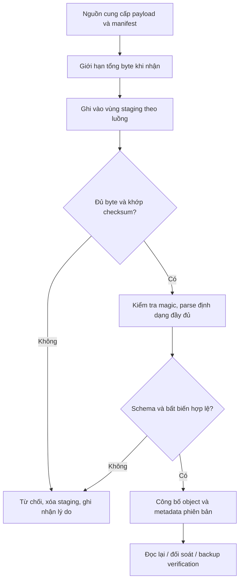

# Kiểm tra dữ liệu hỏng bằng độ dài, định dạng và checksum

Một dịch vụ Java nhận tệp đơn hàng có tên `orders.csv`, lưu vào kho đối tượng rồi đánh dấu “đã nhập”. Một ngày sau, dữ liệu đối soát bị thiếu 250 dòng. Hệ thống vẫn tải được tệp, dấu phẩy và xuống dòng vẫn có vẻ hợp lệ. Có thể tệp đã bị cắt ngắn trong lúc chuyển, bộ mã hóa ký tự bị thay đổi, một đoạn dữ liệu bị sửa nhưng giữ nguyên kích thước, hoặc tệp hoàn toàn nguyên vẹn nhưng chứa giá trị nghiệp vụ sai.

**Không có một phép kiểm tra duy nhất nào phát hiện được tất cả những tình huống này.** Độ dài, định dạng và checksum giải quyết những lớp vấn đề khác nhau. Muốn kết luận dữ liệu có thể đưa vào persistence một cách đáng tin cậy, ứng dụng phải kết hợp chúng với kiểm tra ngữ nghĩa, nguồn gốc và quy trình khôi phục.

Bài học thuộc chương **Biểu diễn dữ liệu** của module **DATA_PERSISTENCE_FUNDAMENTALS**. Trong phạm vi nền tảng lưu trữ dữ liệu bền vững cho Java — từ mô hình dữ liệu, schema, truy vấn, chỉ mục tới giao dịch, cô lập, kiểm soát đồng thời, lỗi kết nối, tiến hóa schema, bảo mật, sao lưu và hiệu năng — bài này tập trung vào **phát hiện dữ liệu hỏng ở các ranh giới nhận, chuyển đổi, lưu trữ, đọc lại và khôi phục**.

Sau bài này, bạn có thể:

- Phân biệt **độ dài byte**, **số ký tự**, **định dạng**, **giá trị nghiệp vụ** và **checksum/hash**.
- Chọn đúng cơ chế kiểm tra cho lỗi cắt ngắn, lỗi mã hóa, sai schema, thay đổi nội dung và dữ liệu cố ý bị làm giả.
- Thiết kế một đường nhận tệp theo luồng (streaming), giới hạn tài nguyên, kiểm tra SHA-256 và chỉ công bố dữ liệu sau khi xác minh.
- Lưu metadata đủ để xác minh lại dữ liệu, phát hiện lỗi âm thầm và diễn tập khôi phục.
- Viết bộ ca thử cho dữ liệu bị hỏng mà vẫn có độ dài hoặc cấu trúc bề ngoài hợp lệ.

## 1. Đầu tiên phải định nghĩa “dữ liệu hỏng”

Dữ liệu hỏng (*corruption*) là dữ liệu khác với trạng thái hoặc biểu diễn mà hệ thống có trách nhiệm lưu giữ. Nhưng có nhiều mức “khác”:

| Tình huống | Ví dụ | Dấu hiệu có thể phát hiện |
| --- | --- | --- |
| **Cắt ngắn (truncation)** | Tệp 10 MiB chỉ còn 8 MiB | Độ dài so với manifest hoặc cấu trúc kết thúc tệp |
| **Thừa byte** | Gói truyền có thêm dữ liệu ngoài payload mong đợi | Độ dài, cấu trúc, hash |
| **Thay đổi một hay nhiều byte** | Một bit trong tệp bị đổi; kích thước không đổi | Checksum/hash khi có giá trị kỳ vọng độc lập |
| **Mã hóa sai** | UTF-8 hợp lệ bị đọc như bảng mã khác, hoặc byte UTF-8 không hợp lệ | Kiểm tra giải mã nghiêm ngặt, quy tắc charset |
| **Sai định dạng** | Tệp giả PNG chỉ có phần header, phần còn lại không giải mã được | Parser đầy đủ, quy tắc cấu trúc của định dạng |
| **Sai schema** | JSON hợp lệ nhưng thiếu `orderId` hoặc `amount` là chuỗi sai quy tắc | Schema validator và kiểm tra phiên bản |
| **Sai ngữ nghĩa** | Đơn hàng có tổng tiền khác tổng các dòng | Bất biến nghiệp vụ, đối soát |
| **Bản cũ thay cho bản mới** | Một bản backup/replica chứa dữ liệu hợp lệ nhưng quá cũ | Version, sequence, timestamp đáng tin cậy, checkpoint |
| **Bị thay thế có chủ ý** | Kẻ tấn công sửa cả tệp lẫn checksum đặt cạnh nó | HMAC/chữ ký số và kiểm soát nguồn tin cậy |

Một tệp có thể **đủ số byte, đúng cú pháp, đúng checksum do chính nó tự công bố nhưng vẫn sai nghiệp vụ**. Nếu ứng dụng không biết loại lỗi cần phát hiện, việc thêm “checksum” có thể tạo cảm giác an toàn không có căn cứ.

### Ba trục kiểm tra

1. **Độ dài:** dữ liệu có đúng số byte, số bản ghi hay giới hạn kích thước mà hợp đồng yêu cầu?
2. **Định dạng:** bytes có thể được giải mã và diễn giải theo loại nội dung, phiên bản schema cùng giới hạn cho phép?
3. **Checksum/hash:** chuỗi bytes có khớp một giá trị kiểm tra được tính từ nguồn hoặc mốc đã tin cậy?

Bên trên ba trục này còn có **xác thực nguồn gốc** và **kiểm tra nghiệp vụ**. Cần xác định rõ ranh giới trách nhiệm của từng lớp.

## 2. Độ dài: phải ghi rõ đang đếm đơn vị nào

Trong Java, một chuỗi có nhiều cách đo kích thước:

- `String.length()` đếm **đơn vị mã UTF-16** (*code units*), không phải số ký tự mà người dùng nhìn thấy.
- `codePointCount(...)` đếm **Unicode code points**, vẫn không luôn tương đương số grapheme/ký tự hiển thị.
- `text.getBytes(StandardCharsets.UTF_8).length` đếm **số byte sau khi mã hóa UTF-8**.
- `Files.size(path)` trả về **kích thước tệp theo byte** của tệp hiện tại, không mặc định chứng minh nội dung là đúng.

Ví dụ:

```java
import java.nio.charset.StandardCharsets;

public class LengthExample {
    public static void main(String[] args) {
        String plain = "A";
        String accented = "\u00E1";           // á: một code point
        String emoji = "\uD83D\uDE0A";         // 😊: một code point, hai UTF-16 units

        System.out.println(plain.length());   // 1
        System.out.println(accented.length()); // 1
        System.out.println(accented.getBytes(StandardCharsets.UTF_8).length); // 2

        System.out.println(emoji.length()); // 2
        System.out.println(emoji.codePointCount(0, emoji.length())); // 1
        System.out.println(emoji.getBytes(StandardCharsets.UTF_8).length); // 4
    }
}
```

Hai chuỗi hiển thị gần như giống nhau cũng có thể có biểu diễn Unicode khác nhau:

- `"\u00E9"`: ký tự `é` dạng dựng sẵn; **2 byte** trong UTF-8.
- `"e\u0301"`: chữ `e` và dấu sắc kết hợp; **3 byte** trong UTF-8.

Cả hai có thể trông giống nhau trong giao diện nhưng tạo checksum khác nhau. Nếu bài toán yêu cầu so khớp **byte gốc**, tuyệt đối không tự chuẩn hóa Unicode hoặc thay đổi xuống dòng trước khi tính hash. Nếu bài toán cần kiểm tra **giá trị văn bản đã chuẩn hóa**, hợp đồng phải nêu rõ thuật toán chuẩn hóa, phiên bản quy tắc và thời điểm áp dụng.

### Độ dài khai báo không phải nguồn chân lý duy nhất

HTTP `Content-Length`, trường `size` trong manifest hoặc metadata của object storage đều có thể hữu ích, nhưng:

- Header có thể bị thiếu, sai, hoặc đại diện kích thước **trên đường truyền** thay vì kích thước sau khi giải nén/chuyển đổi.
- Một bên gửi không đáng tin cậy có thể khai báo kích thước tùy ý.
- Kích thước tệp hoặc object đúng **không chứng minh từng byte đều đúng**.
- Độ dài sau giải nén có thể lớn hơn nhiều lần độ dài dữ liệu nén.

Khi nhận dữ liệu, hãy đo **số byte thực nhận** ngay tại ranh giới đã định, từ chối vượt giới hạn sớm và so với kỳ vọng nếu có. Khi parse, còn cần giới hạn **độ dài của trường**, **số bản ghi**, **độ sâu lồng nhau**, **số phần tử** và **kích thước sau giải nén**.

Ví dụ, 5 MiB JSON có thể có hàng triệu phần tử nhỏ hoặc độ sâu lồng nhau rất lớn; giới hạn tổng byte chỉ kiểm soát một phần chi phí xử lý.

### Khi nào độ dài là bằng chứng mạnh?

Nếu manifest đáng tin cậy nói object phải có đúng 1.024.000 byte, bản tải về chỉ có 1.000.000 byte thì đã đủ kết luận **không đúng bản mong đợi**. Nhưng nếu bản tải về cũng có 1.024.000 byte, vẫn cần hash/format để phát hiện thay đổi giữ nguyên kích thước. Độ dài là lớp kiểm tra **rẻ và hữu ích**, không phải bằng chứng toàn vẹn trọn vẹn.

## 3. Định dạng: đúng phần mở đầu chưa chắc đúng toàn bộ

Định dạng mô tả quy tắc diễn giải một chuỗi byte thành dữ liệu có cấu trúc. Kiểm tra định dạng thường gồm nhiều tầng:

| Tầng | Ví dụ | Giới hạn |
| --- | --- | --- |
| **Tên tệp/MIME được khai báo** | `photo.png`, `Content-Type: image/png` | Dễ bị khai báo sai; không chứng minh bytes là PNG |
| **Magic bytes / signature** | PNG bắt đầu bằng 8 byte đặc trưng | Chỉ xác nhận dấu hiệu nhận diện; phần còn lại có thể hỏng |
| **Cú pháp cấu trúc** | JSON parse thành công; PNG có chunk theo quy tắc | Không chứng minh schema hoặc nội dung đúng nghiệp vụ |
| **Schema và phiên bản** | JSON có `orderId`, `items` đúng kiểu; CSV đúng số cột | Không chứng minh tổng tiền, quan hệ hay quyền truy cập hợp lệ |
| **Bất biến nghiệp vụ** | Số tiền không âm; tổng dòng bằng tổng đơn | Không chứng minh đây là dữ liệu do đúng người gửi hoặc là phiên bản mới nhất |

### Ví dụ với PNG

PNG có một **signature 8 byte** ở đầu tệp. Nhưng tệp chỉ chứa signature đó **không phải ảnh PNG hợp lệ**. Một bộ kiểm tra nghiêm túc phải dùng parser/decoder có khả năng xác minh cấu trúc chunk, kích thước, CRC nội bộ và dữ liệu ảnh theo định dạng; đồng thời giới hạn số pixel, bộ nhớ và thời gian xử lý. CRC của từng chunk PNG là một cơ chế kiểm tra lỗi định dạng, không phải xác thực người gửi.

Tệp tải lên tự xưng là JPEG, PNG hoặc ZIP phải được kiểm tra bằng **nội dung thực tế** và **các quy tắc định dạng cụ thể**, ngoài tên và MIME. Định dạng được parse thành công cũng không có nghĩa nội dung an toàn để đưa vào quy trình nghiệp vụ khác.

### Ví dụ với JSON

Đây là JSON hợp lệ về cú pháp:

```json
{
  "orderId": "O-42",
  "amount": "-1000",
  "items": []
}
```

Parser JSON sẽ chấp nhận chuỗi này. Nhưng schema có thể yêu cầu `amount` là số thập phân không âm, và nghiệp vụ có thể yêu cầu đơn phải có ít nhất một dòng hàng. Chỉ kiểm tra mở/đóng ngoặc hoặc “parse không lỗi” sẽ bỏ sót.

Với JSON, xác định:

1. Bộ mã (thường UTF-8), chính sách xử lý byte không hợp lệ và giới hạn kích thước.
2. Parser chuẩn có kiểm soát **độ sâu**, **số phần tử** và **kiểu dữ liệu**; không coi regex là JSON parser.
3. Schema version, trường bắt buộc/tùy chọn, cách xử lý field lạ, giá trị `null` và số nguyên lớn.
4. Bất biến giữa các field, quyền truy cập và tham chiếu tới những đối tượng đang tồn tại.
5. Quy tắc serialization/canonicalization nếu cần ký hoặc so sánh hash của **biểu diễn logic** thay vì raw bytes.

### Ví dụ với CSV và dữ liệu văn bản

Đếm ký tự dấu phẩy trên mỗi dòng là cách kiểm tra sai: giá trị CSV có thể chứa dấu phẩy hoặc xuống dòng bên trong field được đặt trong dấu nháy. Cần dùng CSV parser đúng dialect, ghi rõ dấu phân tách, quote/escape, newline, charset, thứ tự header, số cột, định dạng ngày/giờ và số thập phân theo locale.

Với văn bản UTF-8, có thể dùng decoder được cấu hình **báo lỗi** khi gặp chuỗi byte sai. Một decoder thay ký tự lỗi bằng `�` có thể làm mất dấu vết hỏng trước khi kiểm tra checksum của *văn bản đã chuyển đổi*.

### Định dạng nén và tài nguyên

Một tệp ZIP nhỏ có thể giải nén ra lượng dữ liệu rất lớn; tên entry có thể chứa đường dẫn không hợp lệ để ghi ra ngoài thư mục đích. Vì vậy parser phải giới hạn **tổng byte giải nén, số entry, độ sâu lồng nhau** và kiểm tra đường dẫn. Kiểm tra hash đúng của tệp nén chỉ chứng minh bytes khớp, không chứng minh rằng tệp an toàn để xử lý.

## 4. Checksum, hash, MAC và chữ ký số khác nhau thế nào?

**Checksum** là giá trị được tính từ nội dung để giúp kiểm tra thay đổi. Tên “checksum” đôi khi được dùng rộng cho CRC hoặc hash; khi ghi hợp đồng kỹ thuật, cần nêu **thuật toán cụ thể**.

| Cơ chế | Mục tiêu chủ yếu | Đặc tính và giới hạn |
| --- | --- | --- |
| **CRC32/CRC32C** | Phát hiện lỗi truyền/lưu trữ ngẫu nhiên nhanh | Kích thước nhỏ, tính nhanh; có va chạm và **không** chống kẻ tấn công sửa dữ liệu có chủ đích |
| **SHA-256** | Dấu vân tay mạnh của chuỗi byte, đối chiếu nội dung giữa các nơi | Xác suất va chạm cực thấp với dữ liệu thông thường; **không tự xác thực người gửi** nếu attacker sửa được cả hash |
| **HMAC-SHA-256** | Kiểm tra tính toàn vẹn và nguồn gốc dưới một bí mật chung | Chỉ có ý nghĩa nếu khóa bí mật an toàn và phía xác minh tin cậy; cần quản lý/luân chuyển khóa |
| **Chữ ký số** | Xác thực nội dung theo khóa riêng và kiểm tra bằng khóa công khai | Cần quản lý khóa, danh tính, thuật toán, phạm vi chữ ký và chính sách tin cậy |
| **Checksum nội bộ của database/filesystem** | Phát hiện hỏng trang dữ liệu/block theo cơ chế engine | Không thay thế checksum ứng dụng, đối soát logic, backup và khôi phục |

Về mặt phát hiện lỗi không chủ ý, SHA-256 thường phù hợp để kiểm tra tệp lớn hoặc gói dữ liệu trao đổi. CRC32C có ích khi hệ thống đã có giao thức hoặc storage sử dụng nó để phát hiện hỏng khối nhanh. Không đánh đồng việc CRC không trùng với bằng chứng có ai đó cố ý sửa dữ liệu.

### Cần một “giá trị kỳ vọng” đáng tin cậy

Giả sử tệp đã hỏng và hệ thống **tính SHA-256 trên tệp hỏng**, rồi lưu kết quả cạnh tệp đó. Lần sau hash vẫn khớp. Điều này chỉ xác nhận **tệp không thay đổi kể từ khi giá trị hash mới được ghi**, không chứng minh tệp đúng với nguồn ban đầu.

Để phát hiện hỏng trong đường đi, cần so kết quả với giá trị được tính từ **bản nguồn đã xác minh** hoặc manifest có thể tin cậy, được truyền/lưu theo quy trình quản lý nguồn độc lập thích hợp.

Trường hợp kẻ tấn công có thể sửa **cả payload và hash**: SHA-256 không ngăn họ tự tính một hash mới. Hãy dùng HMAC, chữ ký số hoặc một kênh/phân quyền bảo vệ manifest tương ứng với mô hình đe dọa.

### Checksum có phạm vi rõ ràng

Các hệ thống có thể tính hash trên:

- **Byte gốc trước nén** hay **byte đã nén**.
- **Plaintext trước mã hóa** hay **ciphertext sau mã hóa**.
- **Một chunk** hay **toàn bộ object**.
- **Một thông điệp JSON với đúng thứ tự byte** hay **dữ liệu logic được canonicalize**.

Những giá trị này thường **khác nhau dù thông tin hiển thị tương tự**. Manifest nên ghi rõ thuật toán, phạm vi bytes, encoding, compression, phiên bản và quy tắc ghép chunk. Không so SHA-256 của plaintext với SHA-256 ciphertext để rồi kết luận dữ liệu hỏng.

Đặc biệt, **ETag của object storage không phải lúc nào cũng là MD5**, nhất là với multipart upload, mã hóa hoặc những cách tạo object đặc thù. Nếu cần kiểm chứng SHA-256 đầu cuối, sử dụng metadata checksum có ngữ nghĩa đã được nhà cung cấp xác nhận hoặc tự lưu giá trị SHA-256 rõ ràng.

## 5. Thiết kế kiểm tra đầu cuối tại các ranh giới dữ liệu

Một luồng nhận và lưu dữ liệu có thể gồm:



**Trình tự có ý nghĩa:**

1. **Xác định hợp đồng đầu vào:** ID, schema version, định dạng, số byte kỳ vọng, thuật toán hash, nguồn của manifest và chính sách kích thước.
2. **Nhận theo stream:** kiểm soát kích thước *trong khi đọc*; không đợi đến lúc chất đầy RAM hoặc ổ đĩa mới phát hiện vượt giới hạn.
3. **Ghi staging:** chưa cho nghiệp vụ khác đọc tệp chưa qua xác minh.
4. **Đối chiếu bytes đã lưu ở staging:** độ dài và checksum phải khớp đúng phạm vi đã thỏa thuận.
5. **Xác minh định dạng:** kiểm tra signature rồi parse cấu trúc đầy đủ dưới giới hạn tài nguyên; với JSON/CSV tiếp tục kiểm tra schema và nghiệp vụ.
6. **Công bố dữ liệu và metadata:** dùng chiến lược publication phù hợp với kho lưu trữ; chống đua tranh phiên bản, tránh người đọc thấy bản ghi “đã sẵn sàng” khi object còn dở.
7. **Đọc lại và kiểm toán định kỳ:** xác minh theo hash kỳ vọng đã lưu, checksum của backup, đối soát và cảnh báo sai lệch.

Nếu metadata nằm trong SQL database còn payload ở object storage, hai hệ thống **không tự động có transaction ACID chung**. Một thiết kế thường là trạng thái `UPLOADING → VERIFIED → AVAILABLE`, kết hợp staging, retry và dọn các object bị bỏ lại. Không đánh dấu `AVAILABLE` trước khi object đã kiểm tra và truy cập được theo hợp đồng.

## 6. Ví dụ Java: nhận tệp có giới hạn, so SHA-256 và kiểm tra dấu PNG

Ví dụ dưới đây dùng Java 17 và thư viện chuẩn để thể hiện **khâu nhận bytes**, kiểm tra độ dài, checksum và signature; phần xác minh cấu trúc PNG đầy đủ phải thực hiện thêm bằng decoder phù hợp trước khi công bố trong ứng dụng thật.

Giả định:

- `storageDir` là thư mục **tin cậy, đã tồn tại**, ứng dụng kiểm soát quyền ghi và không để người dùng tùy ý thay đổi đường dẫn.
- `expectedBytes` và `expectedSha256` đến từ manifest đã được xác thực hoặc một quy trình có định nghĩa nguồn kỳ vọng.
- Mỗi bản ghi dùng tên tệp do hệ thống sinh ra, không lấy trực tiếp filename do người dùng gửi.
- Ví dụ từ chối khi filesystem không hỗ trợ `ATOMIC_MOVE`; không tự suy ra đổi tên nguyên tử đồng nghĩa đã `fsync` bền vững trước mất điện.

```java
import java.io.IOException;
import java.io.InputStream;
import java.io.OutputStream;
import java.nio.file.Files;
import java.nio.file.Path;
import java.nio.file.StandardCopyOption;
import java.security.MessageDigest;
import java.security.NoSuchAlgorithmException;
import java.util.Arrays;
import java.util.UUID;

public final class VerifiedPngReceiver {
    private static final byte[] PNG_SIGNATURE = {
        (byte) 0x89, 0x50, 0x4E, 0x47,
        0x0D, 0x0A, 0x1A, 0x0A
    };

    private VerifiedPngReceiver() {}

    public static Path receive(
            InputStream source,
            Path storageDir,
            long expectedBytes,
            byte[] expectedSha256,
            long maxBytes
    ) throws IOException, NoSuchAlgorithmException {
        if (maxBytes < PNG_SIGNATURE.length
                || expectedBytes < PNG_SIGNATURE.length
                || expectedBytes > maxBytes
                || expectedSha256 == null
                || expectedSha256.length != 32) {
            throw new IllegalArgumentException("Invalid upload manifest");
        }

        Path staged = Files.createTempFile(storageDir, "incoming-", ".part");

        try {
            // Nhận theo luồng và kiểm soát giới hạn trước mỗi lần ghi.
            long received = 0;
            try (OutputStream sink = Files.newOutputStream(staged)) {
                byte[] buffer = new byte[8192];
                int count;
                while ((count = source.read(buffer)) != -1) {
                    if (count == 0) {
                        continue;
                    }
                    if (count > maxBytes - received) {
                        throw new IOException("Upload exceeds the byte limit");
                    }
                    sink.write(buffer, 0, count);
                    received += count;
                }
            }

            if (received != expectedBytes
                    || Files.size(staged) != expectedBytes) {
                throw new IOException("Unexpected byte length");
            }

            // Hash lại các byte trong tệp staging, tránh phụ thuộc vào
            // hash đã tính trên luồng đầu vào trước khi ghi.
            MessageDigest digest = MessageDigest.getInstance("SHA-256");
            byte[] prefix = new byte[PNG_SIGNATURE.length];
            int prefixCount = 0;

            try (InputStream stored = Files.newInputStream(staged)) {
                byte[] buffer = new byte[8192];
                int count;
                while ((count = stored.read(buffer)) != -1) {
                    if (count == 0) {
                        continue;
                    }
                    for (int i = 0;
                         i < count && prefixCount < prefix.length; i++) {
                        prefix[prefixCount++] = buffer[i];
                    }
                    digest.update(buffer, 0, count);
                }
            }

            if (!Arrays.equals(prefix, PNG_SIGNATURE)) {
                throw new IOException("Not a PNG signature");
            }
            if (!MessageDigest.isEqual(digest.digest(), expectedSha256)) {
                throw new IOException("SHA-256 mismatch");
            }

            // Bắt buộc thêm bước parse PNG đầy đủ, giới hạn tài nguyên,
            // kiểm tra schema/metadata nghiệp vụ trước khi publish thực tế.
            Path target = storageDir.resolve(UUID.randomUUID() + ".png");
            return Files.move(staged, target, StandardCopyOption.ATOMIC_MOVE);
        } finally {
            Files.deleteIfExists(staged);
        }
    }
}
```

**Giới hạn quan trọng của mã minh họa:**

- `source` là stream do tầng gọi sở hữu, ví dụ servlet xử lý việc đóng kết nối. Không dùng ví dụ này để cho phép upload không xác thực hoặc đường dẫn do client chỉ định.
- Kết quả SHA-256 chỉ kiểm chứng nội dung so với `expectedSha256`. Nếu phía gửi không đáng tin cung cấp cả tệp lẫn hash, việc khớp hash **không xác thực nguồn gốc hay độ đúng nghiệp vụ**.
- Kiểm tra signature PNG chỉ nhận diện phần đầu; cần một decoder kiểm tra nội dung và giới hạn pixel/chi phí trước khi coi là ảnh hợp lệ.
- `ATOMIC_MOVE` chỉ liên quan tính nguyên tử của thao tác chuyển tên theo filesystem. Bảo đảm sau mất điện còn liên quan flush/fsync, metadata thư mục, volume và cơ chế lưu trữ.
- Đối với storage directory có quyền ghi chung với tiến trình không tin cậy, có thêm rủi ro thay thế tệp giữa lúc kiểm tra và công bố (TOCTOU). Thiết kế production phải kiểm soát quyền và đường đi tới đối tượng đã kiểm chứng.
- Nếu cần upload **rất lớn**, dùng một protocol đa phần với checksum cho từng phần và cho toàn bộ object; cần xác minh thứ tự, độ dài tổng và cách ghép, không chỉ cộng hay nối các checksum con.

Mã trên chủ yếu minh họa **đường nhận dữ liệu có ràng buộc**. Logic nghiệp vụ phải có trạng thái đối tượng chưa công bố, parser nội dung hoàn chỉnh, xử lý retry và transaction metadata phù hợp.

## 7. Checksum theo chunk, file lớn và đồng bộ nhiều lần

Với object lớn, gửi một lần có thể thất bại giữa chừng. Truyền theo chunk hỗ trợ retry từng phần, nhưng cần kiểm tra:

| Trường trong manifest | Vai trò |
| --- | --- |
| `objectId`, `version` | Xác định chính xác object và phiên bản cần lắp |
| `totalBytes` | Kiểm tra độ dài toàn bộ sau khi ghép |
| `chunkIndex`, `chunkOffset` | Kiểm tra thứ tự và vị trí byte của từng phần |
| `chunkLength` | Chống cắt ngắn/thừa byte ở một chunk |
| `chunkChecksum` | Phát hiện nội dung chunk bị thay đổi |
| `wholeObjectSha256` | Kiểm tra bytes sau khi ghép **toàn bộ object** |
| `algorithm` và `hashScope` | Nêu thuật toán và đối tượng được hash |
| `schemaVersion` | Giải thích cách parse dữ liệu sau khi ghép |

Cần tránh ba ngộ nhận:

1. **Các chunk đều đúng không chứng minh object đúng thứ tự.** Phải kiểm tra offset, index, số chunk và đủ toàn bộ khoảng byte, không trùng/thiếu phần.
2. **Nối các chuỗi checksum chunk không bằng SHA-256 của object.** Để kiểm tra SHA-256 toàn bộ, phải hash đúng toàn bộ byte sau khi ghép (trừ khi giao thức công bố một thuật toán Merkle/compound checksum riêng với quy tắc xác minh rõ ràng).
3. **Upload thành công không có nghĩa đã bền vững sau thảm họa.** Cần kiểm tra quy tắc commit/object visibility, replication, backup và khả năng restore của kho lưu trữ cụ thể.

Nếu cache/CDN, replica hoặc object storage có nhiều phiên bản, ghi lại `objectVersion`/`ETag` theo ngữ nghĩa của nhà cung cấp và đối chiếu **đúng phiên bản**. Hai bản có cùng nội dung nhưng metadata khác nhau không nhất thiết là lỗi; một bản cũ có hash hợp lệ lại vẫn có thể là **stale data** so với yêu cầu đọc hiện tại.

## 8. Lưu metadata kiểm tra trong database như thế nào?

Có thể lưu payload ở object storage và manifest trong database quan hệ. Ví dụ PostgreSQL:

```sql
CREATE TABLE stored_object_manifest (
    object_id UUID PRIMARY KEY,
    storage_key TEXT NOT NULL UNIQUE,
    format_name TEXT NOT NULL,
    format_version INTEGER NOT NULL CHECK (format_version > 0),
    size_bytes BIGINT NOT NULL
        CHECK (size_bytes >= 0 AND size_bytes <= 104857600),
    sha256_hex CHAR(64) NOT NULL
        CHECK (sha256_hex ~ '^[0-9a-f]{64}$'),
    state TEXT NOT NULL
        CHECK (state IN ('STAGING', 'VERIFIED', 'AVAILABLE', 'CORRUPT')),
    verified_at TIMESTAMPTZ
);
```

Bảng này chỉ giới hạn **cấu trúc metadata**:

- `CHECK (sha256_hex ~ ...)` xác nhận hash được viết thành 64 ký tự hex thường hợp lệ, **không tự tính SHA-256 trên payload**.
- `size_bytes` là kích thước được **ghi nhận**, không tự chứng minh object thật có bấy nhiêu byte.
- `state` cần được thay đổi theo quy trình có kiểm tra, tránh đánh dấu `AVAILABLE` trước khi object có thể đọc đúng phiên bản.
- Nếu object storage và database không chia sẻ transaction, phải có cơ chế xử lý trường hợp object đã lưu nhưng transaction metadata thất bại, hoặc metadata tồn tại nhưng object bị thiếu.

Nếu lưu payload trực tiếp trong cột `BYTEA`, DB có thể kiểm tra độ dài bằng `octet_length(payload)` và có thể lưu hash do ứng dụng tính. Tuy nhiên, hash do ứng dụng tính trong cùng lần ghi chỉ phát hiện thay đổi **sau khi tạo mốc hash**; không xác nhận bản ghi ban đầu đã đúng nghĩa vụ nghiệp vụ. Cơ chế checksum trang của DB, nếu có và được bật, cũng bảo vệ tầng lưu trữ riêng, không thay thế kiểm tra toàn vẹn cấp ứng dụng.

### Chọn nơi giữ giá trị kỳ vọng

- Đối với **truyền một tệp**, dùng manifest từ nguồn đã xác thực hoặc được bảo vệ riêng; kiểm tra ngay sau khi nhận.
- Đối với **lưu lâu dài**, giữ hash và version gắn với bản dữ liệu đã xác minh; kiểm tra lại khi đọc và qua các chu kỳ scrub/backup.
- Đối với **threat model có người sửa dữ liệu**, bảo vệ manifest bằng quyền độc lập hoặc xác thực bằng HMAC/chữ ký số; hash đặt cạnh object dưới cùng quyền sửa có giới hạn giá trị.
- Đối với **backup**, lưu dấu kiểm tra và kết quả restore, nhưng vẫn cần kiểm tra tính mở được, dữ liệu nghiệp vụ và quan hệ giữa các kho.

Hash có thể dùng như một khóa nhận diện **nội dung byte** trong hệ thống content-addressed storage, nhưng phải tách khỏi danh tính đối tượng nghiệp vụ: hai ảnh giống từng byte có cùng hash nhưng vẫn có thể thuộc hai bản ghi, hai chủ sở hữu hoặc hai phiên bản khác nhau.

## 9. Kiểm tra trong suốt vòng đời dữ liệu

Việc kiểm tra chỉ ở API upload là chưa đủ. Dữ liệu có thể đi qua nhiều bước:

```text
Upload (raw bytes)
    → parse/validate
    → normalize / transform
    → persist
    → replicate / cache
    → export CSV/JSON
    → backup
    → restore
    → replay / import
```

Mỗi bước có thể **biến đổi có chủ đích** hoặc làm hỏng dữ liệu. Do đó cần xác định **đối tượng nào đang được so sánh**.

### Dữ liệu đã biến đổi thì hash phải được tính lại theo hợp đồng

Ví dụ, ứng dụng nhận JSON:

```json
{"amount":"19.90","currency":"USD"}
```

Một serializer khác có thể xuất:

```json
{
  "currency": "USD",
  "amount": "19.90"
}
```

Hai biểu diễn có thể tương đương về một số trường nghiệp vụ nhưng **SHA-256 của raw bytes khác nhau**. Nếu muốn đối chiếu payload thô, dùng hash của bản gốc. Nếu muốn đối chiếu **nội dung logic**, phải có bộ quy tắc canonicalization được định nghĩa trước: encoding, Unicode normalization, thứ tự khóa, cách biểu diễn số, xử lý `null`, ký tự xuống dòng và phiên bản schema. Không tự giả định “parse rồi serialize lại” giữ nguyên hash.

Khi nén/mã hóa cũng vậy: lưu lại `sha256Plaintext` và/hoặc `sha256Ciphertext` cùng mô tả thuật toán và phạm vi. Chỉ giải mã và xác minh ở những nơi có quyền; không ghi plaintext hoặc khóa bí mật vào log.

### Xác minh sau backup và restore

- **Backup job thành công** chỉ nói công cụ đã hoàn tất thao tác theo kết quả của nó. Không chứng minh có đủ mọi object, cấu trúc và mốc dữ liệu cần phục hồi.
- Kiểm tra checksum từng backup/object giúp tìm lỗi truyền hoặc lưu, nhưng vẫn cần **restore thử** và kiểm tra parser/schema/bất biến nghiệp vụ.
- Khi phát hiện hash không khớp, không tự “sửa” bằng cách ghi hash mới từ dữ liệu nghi hỏng. Cần xác định nguồn có thẩm quyền, phục hồi từ bản tốt và ghi nguyên nhân.
- Dùng version và checkpoint để phân biệt **bản hợp lệ nhưng cũ** với **bản bị sửa sai**.

Ví dụ một object được khôi phục đúng 100% byte của phiên bản `v4` nhưng hệ thống cần `v6`: checksum v4 khớp không đồng nghĩa đã đáp ứng mục tiêu RPO hay hợp đồng read-after-write.

### Quan sát và điều tra

Log và metric nên ghi:

- `objectId`, `version`, `schemaVersion` và nguồn nhận.
- Kích thước kỳ vọng/thực nhận, thuật toán và phạm vi hash.
- Loại lỗi: `LENGTH_MISMATCH`, `INVALID_ENCODING`, `FORMAT_INVALID`, `SCHEMA_INVALID`, `DIGEST_MISMATCH`, `STALE_VERSION`.
- Mốc kiểm tra, thời gian xử lý, số lần retry, số object trong staging/quarantine, tuổi object chưa hoàn tất.
- Kết quả khôi phục/đối soát và nguồn bản sao dùng để sửa.

Không ghi toàn bộ payload, mã xác thực, khóa bí mật, dữ liệu cá nhân hoặc thông tin thanh toán vào log chỉ để gỡ lỗi checksum. Hash của nội dung cũng có thể tiết lộ thông tin về dữ liệu có không gian đoán nhỏ; cần cân nhắc khi công khai.

## 10. Bảng lựa chọn kiểm tra theo tình huống

| Dữ liệu | Kiểm tra độ dài | Kiểm tra định dạng | Kiểm tra checksum/hash | Kiểm tra bổ sung |
| --- | --- | --- | --- | --- |
| Ảnh PNG tải lên | Giới hạn byte và tổng pixel sau giải mã | Signature + decoder/chunk validation | SHA-256 so với manifest khi có nguồn kỳ vọng | Quyền tải lên, xử lý metadata, chống tải tài nguyên quá mức |
| JSON đơn hàng | Giới hạn byte, độ sâu và số mục | UTF-8 nghiêm ngặt, JSON parser, schema version | Hash nếu cần phát hiện thay đổi trên đường truyền/lưu trữ | Tổng tiền, khóa định danh, uniqueness, quyền |
| CSV nhập kho | Kích thước tệp, số dòng/giá trị giới hạn | CSV parser theo dialect, charset, số cột | SHA-256 cho tệp nguồn | Kiểm tra tổng số, mã SKU, đối soát trước commit |
| Object lớn upload đa phần | Tổng byte và từng phần | Loại nội dung/parser phù hợp | Checksum từng chunk **và** toàn object | Thứ tự, offset, version, retry idempotent |
| Database backup | Kích thước bản backup và log chain | Đúng loại backup/phiên bản engine | Checksum backup theo hợp đồng công cụ | Restore thử, constraint, dữ liệu nghiệp vụ, RPO/RTO |
| Tệp cấu hình quan trọng | Giới hạn byte và số mục | Parser, schema, version | Hash hoặc chữ ký theo mô hình tin cậy | Bảo vệ quyền, kiểm tra giá trị và rollback |
| Bản sao dữ liệu trên replica | Số lượng/chunk và watermark | Schema/serialization | Hash/CRC cho phát hiện thay đổi không mong đợi | Kiểm tra version, độ trễ replication và đối soát |

Không phải tình huống nào cũng cần cả SHA-256 và CRC32C nếu chúng kiểm tra cùng một phạm vi không mang lại ích lợi bổ sung đáng kể. Chọn thuật toán dựa vào mục tiêu, chuẩn đang dùng, chi phí tính toán, khả năng đối chiếu độc lập và mô hình lỗi.

## 11. Kiểm thử lỗi theo ma trận thay vì chỉ dùng dữ liệu hợp lệ

Với một pipeline nhận object, có thể lập bộ kiểm thử sau:

| Ca kiểm thử | Thao tác gây lỗi có kiểm soát | Kết quả mong đợi |
| --- | --- | --- |
| **Payload hợp lệ** | Gửi đúng tệp, độ dài, hash, schema | `AVAILABLE` chỉ sau khi kiểm tra đủ |
| **Thiếu byte** | Cắt phần cuối tệp | Từ chối do length/hash/format; không công bố |
| **Thừa byte** | Thêm vài byte cuối | Từ chối theo length hoặc format |
| **Đổi byte, giữ nguyên size** | Lật một byte và giữ độ dài | SHA-256 mismatch; length có thể vẫn khớp |
| **Đổi cả tệp và hash trong yêu cầu không tin cậy** | Gửi payload khác với digest mới tính | Không coi hash khớp là xác thực; cần kiểm tra nguồn gốc và nghiệp vụ |
| **Sai signature** | Đổi 8 byte đầu PNG | Format/signature invalid |
| **Đúng signature nhưng tệp hỏng** | Chỉ giữ header PNG hoặc làm hỏng chunk | Parser đầy đủ phải từ chối dù signature đúng |
| **Sai UTF-8** | Đưa byte UTF-8 không hợp lệ | Decoder strict trả lỗi, không âm thầm thay ký tự |
| **JSON đúng cú pháp, sai schema** | Đổi `amount` từ số thập phân hợp lệ sang object | Schema validation thất bại |
| **Cạn tài nguyên** | Dữ liệu nén nhỏ nhưng giải nén rất lớn | Dừng theo giới hạn output/pixel/độ sâu |
| **Chunk đảo thứ tự** | Gửi các chunk đủ số byte nhưng sai offset | Từ chối thứ tự/offset hoặc SHA-256 toàn object không khớp |
| **Retry upload** | Gửi lại cùng object version sau timeout | Không tạo hai bản ghi công bố hoặc ghi đè phiên bản mới |
| **Bản sao cũ** | Tải một object có hash hợp lệ nhưng version cũ | Nhận biết stale version, không đánh đồng với corruption |
| **Restore từ bản tốt** | Đổi byte ở bản chính, phục hồi từ backup đã xác minh | Hash/version và dữ liệu nghiệp vụ khớp sau restore |

**Tiêu chí đạt** không nên chỉ là “mã kiểm tra đã chạy và không ném exception”. Cần xác minh dữ liệu bị lỗi **không được chuyển vào trạng thái sử dụng**, lỗi có mã chẩn đoán phù hợp, tệp staging được xử lý, có thể retry hoặc phục hồi, và bản hợp lệ vẫn đọc lại đúng byte.

### Ví dụ một hợp đồng kiểm tra

```yaml
dataset: product-import
representation:
  format: csv
  charset: UTF-8
  schema_version: 3
  delimiter: ","
limits:
  max_encoded_bytes: 104857600
  max_records: 500000
integrity:
  algorithm: SHA-256
  scope: "raw uploaded bytes before decoding"
  expected_digest_source: "authenticated manifest"
  require_exact_byte_length: true
validation:
  - strict_utf8_decode
  - csv_parse_with_quoted_fields
  - schema_v3
  - business_invariants
publication:
  initial_state: STAGING
  accepted_state: AVAILABLE
  on_failure: QUARANTINED
recovery:
  - immutable_source_version
  - reconciliation_by_record_id
```

Những thông số chỉ là ví dụ. Giá trị thật phải phù hợp với nguồn dữ liệu, mô hình truy cập và giới hạn tài nguyên. Nếu dữ liệu qua bước chuẩn hóa, cần bổ sung hash/phương thức xác minh cho **biểu diễn sau chuyển đổi** ở một trường riêng, không ghi đè dấu vân tay của raw bytes.

## 12. Bài tập suy luận và thực hành

**Bài tập 1 — byte hay ký tự?** Một API giới hạn tên hiển thị 100 ký tự và đồng thời giới hạn tối đa 256 byte UTF-8 khi lưu. Tại sao `String.length() <= 100` chưa đủ để quyết định độ dài byte? Tại sao chỉ giới hạn byte cũng chưa mô tả đầy đủ độ dài hiển thị?

*Gợi ý:* `String.length()` đếm UTF-16 code units; Unicode code point và grapheme có thể khác. Tính số byte trên chuỗi **đã chọn quy tắc chuẩn hóa/mã hóa** và xác định rõ độ dài hiển thị muốn giới hạn.

**Bài tập 2 — đổi một byte.** Manifest đáng tin cậy có `size=1048576` và SHA-256 của object. Một bit trong payload bị lật, không có byte nào thêm/bớt. Kiểm tra độ dài có phát hiện không? SHA-256 có ý nghĩa gì ở đây?

*Gợi ý:* Size vẫn khớp, nhưng SHA-256 của bytes đã thay đổi gần như chắc chắn khác với digest kỳ vọng; phải so với digest của bản nguồn đã tin cậy.

**Bài tập 3 — đúng signature chưa đủ.** Tệp upload có 8 byte signature PNG chính xác, nhưng thiếu phần lớn các chunk nội dung. Chỉ xác minh signature rồi đánh dấu ảnh hợp lệ có đúng không?

*Gợi ý:* Không. Signature nhận diện loại; phải dùng parser/decoder kiểm tra cấu trúc và giới hạn tài nguyên. Checksum độc lập từ nguồn cũng có thể phát hiện cắt ngắn nếu manifest đáng tin cậy.

**Bài tập 4 — JSON cùng ý nghĩa khác bytes.** Hai JSON có các cặp khóa–giá trị giống nhau nhưng thứ tự khóa và khoảng trắng khác. Có nên kỳ vọng SHA-256 raw bytes bằng nhau không? Nếu muốn so nội dung logic, cần thay đổi hợp đồng thế nào?

*Gợi ý:* Hash raw bytes khác. Cần chọn phép chuẩn hóa/canonicalization rõ ràng và tính hash trên biểu diễn chuẩn đã thống nhất, hoặc so dữ liệu đã parse theo schema.

**Bài tập 5 — hash không phải chữ ký.** Một người gửi có thể sửa cả tệp và giá trị `sha256` trong request. Việc ứng dụng tính lại và thấy hash khớp chứng minh điều gì? Làm thế nào để xác thực nguồn?

*Gợi ý:* Chứng minh khớp với giá trị **do cùng người gửi khai báo**, chưa chứng minh người gửi được phép hay tệp không bị giả mạo. Sử dụng manifest đã xác thực, HMAC/chữ ký số hoặc cơ chế tin cậy khác theo mô hình đe dọa.

**Bài tập 6 — backup và dữ liệu cũ.** Restore hoàn chỉnh bản backup v5, checksum hợp lệ, nhưng API đã xác nhận dữ liệu v6 trước thảm họa. Đủ căn cứ khẳng định đã đáp ứng yêu cầu khôi phục chưa?

*Gợi ý:* Chưa. Phải kiểm tra mốc phiên bản, RPO, tính toàn vẹn nghiệp vụ và các hệ thống liên quan; hash đúng cho v5 không thay thế được v6.

**Thực hành có kiểm soát:** Tạo một tệp PNG hoặc CSV hợp lệ trong môi trường thử nghiệm; ghi lại raw byte length và SHA-256 từ bản nguồn. Thử các thay đổi: cắt cuối tệp, thêm byte, đảo một byte, đổi charset, giữ header nhưng làm hỏng phần nội dung, gửi lại cùng version. Lập bảng chứa **kích thước trước/sau, kết quả parse, hash trước/sau, bước phát hiện, hành động từ chối hoặc phục hồi**. Sau đó lưu một bản tốt vào kho có backup và xác minh lại SHA-256 sau restore.

## Ghi nhớ

**Độ dài phát hiện thiếu/thừa byte; định dạng giải thích bytes có hợp lệ theo cấu trúc hay không; checksum/hash đối chiếu xem bytes có còn giống mốc kỳ vọng.** Không phép nào trong ba phép tự chứng minh đầy đủ tính đúng nghiệp vụ hoặc danh tính người gửi. Để lưu trữ dữ liệu đáng tin cậy trong ứng dụng Java, hãy kiểm tra tại các ranh giới nhận–ghi–đọc–khôi phục, xử lý theo luồng dưới giới hạn tài nguyên, lưu rõ thuật toán và phạm vi hash, bảo vệ nguồn checksum kỳ vọng, cùng kiểm tra schema, version, transaction và đối soát thực tế.
